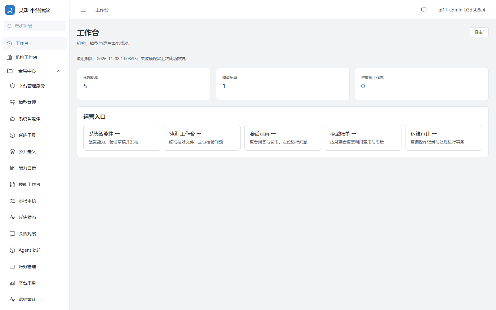
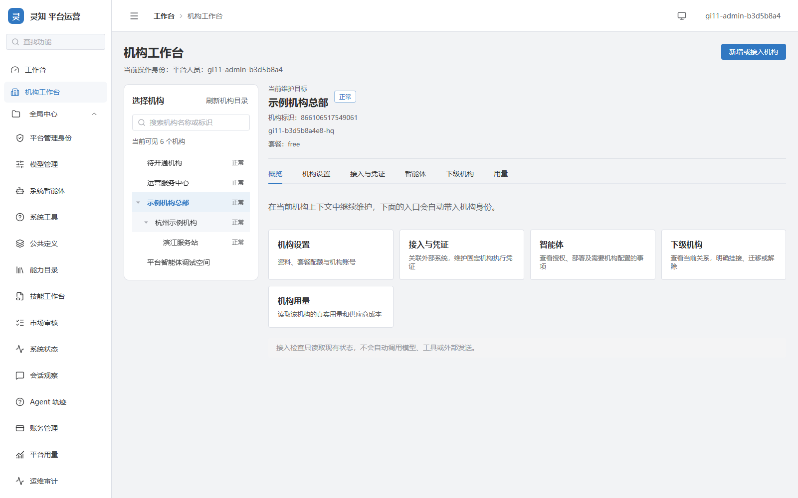
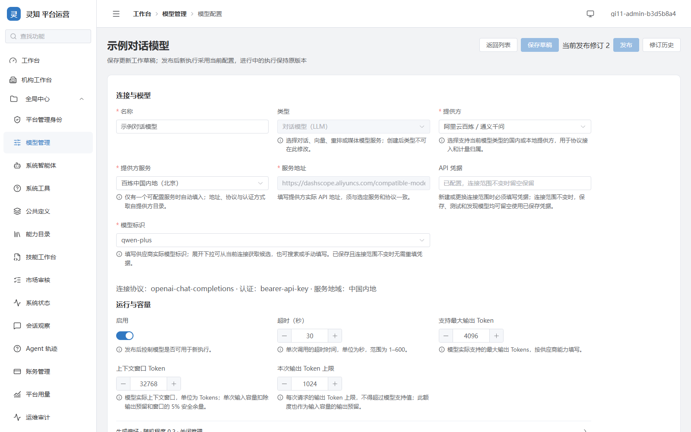
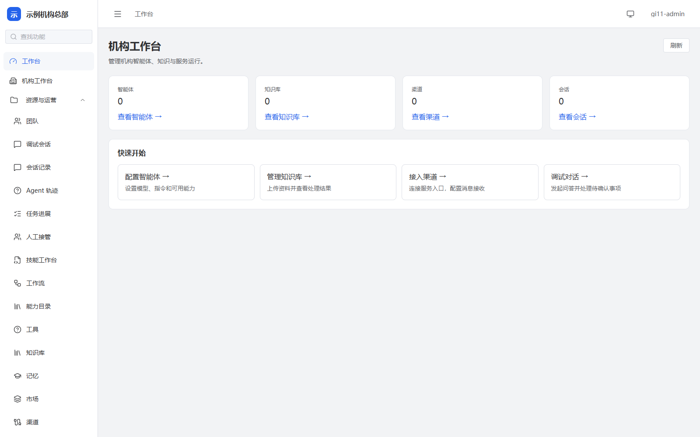
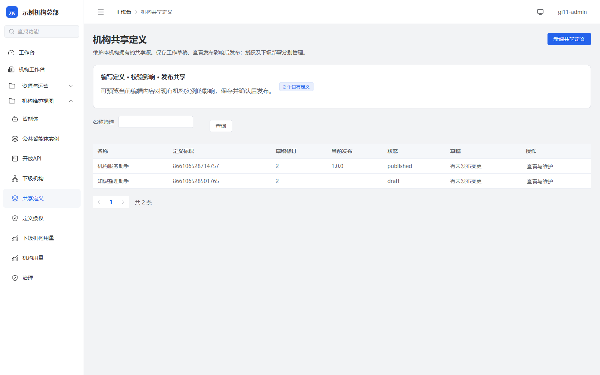
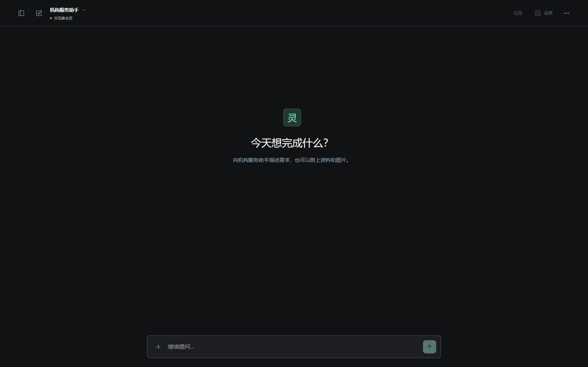

# 灵知

中文名：**灵知**。英文名：**NoeWise**。

面向机构的通用智能 Agent 与 Workflow 平台，帮助用户理解目标、使用知识与工具、执行任务并交付结果。

灵知将 Agent Runtime、机构管理、模型与能力配置、知识与记忆、会话和执行观测组合为一个项目。机构可以建设专业助手与确定性工作流，最终用户通过独立会话端、机构渠道或自有应用使用服务。产品定位与边界见[产品概述](docs/01-产品与需求/02-产品概述.md)。

## 能力与当前边界

- **Agent 与 Workflow**：Agent 负责理解、判断和结果整合；Workflow 推进确定步骤，Runtime 管理执行、等待、取消与恢复。
- **知识与记忆**：将受授权的知识来源和不同范围的记忆用于持续会话与任务。
- **工具与成果**：以 Skill 指导工作方法，以 Tool 执行操作，支持代码执行与文档等产物交付；沙箱与外部服务需要单独配置。
- **专业分工**：通过明确授权的专业 Agent 委派拆分任务，子 Agent 的职责和生命周期由 Runtime 管理。
- **机构治理**：平台与机构后台分别管理资源、权限、配置发布、会话观测、用量和计费。
- **本地桌面原型**：Electron 客户端管理本地 Java Host，使用用户配置的模型与本机工具。

项目处于预发布阶段，当前技术主线为 MVP-0 Agent Runtime。架构文档包含现行契约和后续目标，不能据此判断全部功能已经交付；能力限制见[未实现功能清单](docs/02-架构与设计/11-未实现功能清单.md)，分期目标见[路线图](docs/01-产品与需求/04-实施路线图.md)。部署清单、健康检查或局部测试不等于生产验收，正式使用前需要在目标环境验证权限、迁移、模型、沙箱及恢复链路。

## 界面预览

以下为当前版本在隔离演示环境中的真实界面：正式前后端连接临时数据库，机构、账号和配置均为虚构演示数据。截图不包含真实客户资料或凭据，也不代表付费模型与生产环境已经验收。

| 平台工作台 | 机构管理 |
| :---: | :---: |
|  |  |

| 模型管理 | 机构工作台 |
| :---: | :---: |
|  |  |

| 机构共享智能体定义 | 独立会话端 |
| :---: | :---: |
|  |  |

## 项目结构

| 路径 | 内容 |
| :--- | :--- |
| `backend-java/agent-runtime-*` | Java 21 Agent Runtime SDK、适配器及可选 Starter |
| `backend-java/skillforge-*` | Spring Boot 3 平台领域、机构与平台宿主、网关和迁移 |
| `frontend-admin/`、`frontend-platform/` | Vue 3 / TypeScript 机构后台与平台后台 |
| `frontend-chat/`、`frontend-shared/` | 独立会话端与后台共享能力 |
| `frontend-website/` | 项目网站前端 |
| `desktop-client/` | Electron 桌面原型 |
| `official-skills/` | 官方 Skill 产品资产及必要许可声明 |
| `harness-design/` | Runtime 需求、架构、对象模型和执行契约 |
| `docs/` | 产品、宿主设计、接口、规范和操作指南 |
| `deploy/`、`tools/` | 部署清单、构建与验证工具 |

代码中的 `skillforge` 包名、模块名和配置标识是当前工程接口的一部分。独立 SDK 的边界见[Harness 架构](harness-design/02-微内核插件架构实现思路.md#14-agent-runtime-sdk-交付边界)。

## 快速开始

先安装 Git、Java 21 JDK、Node.js `^22.18.0` 或 `^24.0.0` 与 Corepack。前端工作区固定使用 pnpm `10.33.4`，后端使用仓库内 Gradle Wrapper。平台开发还需要 Python、Docker Compose，以及 PostgreSQL / pgvector、Redis、Nacos 和 Elasticsearch；完整前置条件见[开发与部署指南](docs/04-指南与运维/01-开发与部署指南.md)。

```powershell
git clone https://github.com/iskssssss/noe-wise.git
Set-Location noe-wise
corepack pnpm install --frozen-lockfile
```

### 运行桌面原型

桌面原型可独立运行，不需要启动平台数据库、Redis 或 Docker。在 Windows PowerShell 中，从仓库根目录构建本地宿主并启动客户端：

```powershell
Push-Location backend-java
.\gradlew.bat :agent-runtime-desktop-host:installDist
if ($LASTEXITCODE -ne 0) { throw '本地宿主构建失败' }
Pop-Location
corepack pnpm --dir desktop-client dev
```

在“模型设置”中选择 DeepSeek 或自定义 OpenAI Chat Completions 兼容服务，确认或填写 API 地址和模型名，输入 API Key，再选择工作目录开始会话。任务上下文会发送到所配置的供应商，模型调用可能产生费用；文件修改会写入所选目录，命令执行需要用户确认。其它平台使用对应 Gradle Wrapper；使用方式、打包及限制见[桌面客户端说明](desktop-client/README.md)。

### 运行机构与平台服务

1. 从 `.env.example` 创建本地 `.env`，配置数据库角色、服务地址、独立的身份密钥、你自行设置的初始平台管理员密码（`PLATFORM_ADMIN_PASSWORD`）和共享媒体目录。初始密码没有公开默认值，缺失时停止启动；不要提交真实凭据。
2. 按[本地启动指南](docs/04-指南与运维/01-开发与部署指南.md#53-本地启动)准备依赖、数据库与对象权限，并确认当前迁移链适用于目标数据库。
3. 构建机构服务、平台服务和网关，然后使用 Windows 服务入口启动所需后端及三个前端；非 Windows 环境按指南与 Compose 清单准备部署。
4. 通过平台后台配置模型与能力，通过机构后台配置 Agent，再访问独立会话端。模型凭据不随仓库提供，代码执行沙箱需要额外部署。

Windows 服务入口只管理本仓库自行启动的组件；准备完毕后可查看状态：

```powershell
pwsh -NoProfile -File tools/dev/services.ps1 status
```

默认端口为机构后台 `3000`、平台后台 `3100`、会话端 `3200`，后端机构服务 `8000`、平台服务 `8100`、网关 `8080`。启动、停止、日志位置和就绪检查均以本地启动指南为准。

## 文档导航

| 目的 | 入口 |
| :--- | :--- |
| 阅读全部文档 | [文档目录](docs/README.md) |
| 理解产品与用户场景 | [产品概述](docs/01-产品与需求/02-产品概述.md)、[PRD](docs/01-产品与需求/01-PRD.md) |
| 理解 Runtime 与执行契约 | [Harness 总览](harness-design/README.md) |
| 理解平台、数据与 API | [技术架构](docs/02-架构与设计/01-技术架构.md)、[接口与事件契约](docs/02-架构与设计/04-接口与事件契约.md) |
| 开发与部署 | [开发与部署指南](docs/04-指南与运维/01-开发与部署指南.md) |
| 使用沙箱与产物 | [代码执行与产物运行指南](docs/04-指南与运维/09-代码执行与产物运行指南.md) |
| 选择验证方式 | [测试与验收策略](docs/04-指南与运维/03-测试与验收策略.md) |

## 参与贡献与许可

欢迎通过本仓库的 [Issue](https://github.com/iskssssss/noe-wise/issues) 报告问题或讨论需求，通过 [Pull Request](https://github.com/iskssssss/noe-wise/pulls) 提交改动。开始前请阅读[贡献指南](CONTRIBUTING.md)；安全问题按[安全报告说明](SECURITY.md)处理。

本项目原创内容采用 [Apache License 2.0](LICENSE)。随仓库提供的第三方内容保留各自许可证和版权声明，见 [NOTICE](NOTICE) 及相应文件中的声明。
