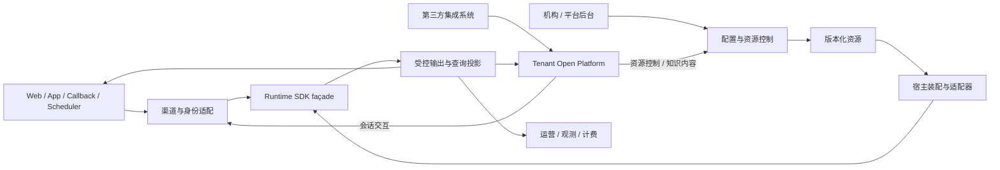

# 技术架构

> 本文描述 灵知 宿主平台如何集成 Agent Runtime。
> Agent Runtime 的全局架构、模块边界和插件模型以
> [Harness 02](../../harness-design/02-微内核插件架构实现思路.md) 为唯一事实源。

## 1. 架构范围

宿主平台负责身份、多租户、平台机构治理与系统接入、渠道、Agent/Workflow 配置、知识资产、连接器、市场、计费、管理后台和部署。Runtime 内部职责与 SDK 发布边界直接引用 [Harness 02](../../harness-design/02-微内核插件架构实现思路.md#14-agent-runtime-sdk-交付边界)。

`agent-runtime-*` 是可独立使用的 Agent SDK，可由服务端、桌面端或其他宿主组合为 Agent 产品；`skillforge-*` 是基于该 SDK 的高级平台。平台通过 SDK 契约、适配器与装配入口接入，SDK 不依赖平台业务模块、业务表或平台默认配置。

平台与机构的组织、多角色/权限、权威安全会话、菜单字典、商业功能、可靠通知、公共文件/管理任务及审计运维统一归 [SaaS 基础底座](19-SaaS基础底座设计.md)。成员当前动作、对象归属与部门范围、机构功能/资源配额以及 Runtime 冻结配置分别检查；JWT 中的旧角色声明不形成授权事实。管理员与普通成员 MFA 均默认关闭，可自愿启用，显式安全策略及撤权由当前数据库事实约束。

## 2. 全局集成视图

下图表达集成边界与目标路径，不单独证明每种渠道或外部系统已完成接入。当前模块及其依赖以[生成模块图](../08-数据与工具/generated/module-graph.md)为准，具体入口与目标范围按各专项文档和源码核对。

本图只表示宿主接入。Runtime 内部调用关系见 [Harness 02 §1.2](../../harness-design/02-微内核插件架构实现思路.md#12-mvp-0-全局架构)，SDK 的公开命令、结果与宿主 SPI 见 [Harness 03 §7.5](../../harness-design/03-核心对象模型与状态机.md#75-agent-runtime-sdk-façade)。

## 3. 宿主边界

### 3.1 平台模块与依赖方向

平台按业务能力组织源码、Mapper、资源和测试，领域模块拥有自己的业务数据与生命周期。当前模块清单及直接生产依赖由 [Gradle 模块图](../08-数据与工具/generated/module-graph.md)生成；测试夹具依赖不表示生产依赖。

| 模块 | 平台职责 |
| :-- | :-- |
| `skillforge-common` | 通用值、错误与工具，不包含平台领域服务 |
| `skillforge-core-shared` | 数据访问、租户上下文等技术基础设施；其平台项目依赖只到 `skillforge-common` |
| `skillforge-core-foundation` | 身份、组织、权限、平台配置、公共文件、通知、管理任务、审计及平台身份/回调适配 |
| `skillforge-core-model` | 平台模型目录、凭据、版本与模型管理服务，消费 SDK 模型适配器 |
| `skillforge-core-billing` | 平台计费、配额、用量管理与结算 |
| `skillforge-core-capability` | 能力目录、Skill/Tool 发布、挂载、连接器与平台 MCP 绑定 |
| `skillforge-core-agent` | 平台 Agent 定义、发布、冻结装配与 Session 能力绑定 |
| `skillforge-core-chat` | 平台会话入口、消息、会话查询与受控输出集成 |
| `skillforge-core-workflow` | 平台 Workflow 定义、节点与其持久化适配 |
| `skillforge-core-knowledge` | 平台知识管理、入库、检索与其持久化适配 |
| `skillforge-core-channel` | 渠道配置、身份映射与协议接入 |
| `skillforge-prompts` | 平台宿主提示词资源及组合 |
| `skillforge-institution-service` / `skillforge-platform-service` | 机构与平台 HTTP 入口、宿主组合根及服务生命周期 |
| `skillforge-migration` | 当前平台完整 Flyway 历史与平台数据库部署资源 |

依赖由服务入口指向所属领域，再指向 SDK 契约/适配器及技术基础设施；底层技术模块不能反向承接领域业务。平台身份、回调、模型目录、MCP 绑定、知识/Workflow 管理和 Session 能力绑定由各自领域提供，不能放入 Runtime JDBC 适配器或通用 Starter。Starter 只装配 SDK 组件并要求宿主显式提供身份、配置来源和必要端口；平台默认实现由平台组合根提供。

### 3.2 平台与 SDK 集成

平台宿主自有固定正文归 [skillforge-prompts](../../backend-java/skillforge-prompts/NAVIGATION.md)，覆盖平台聊天边界与行为、计划与 Goal 续行、协作、成果交付、平台系统动作协议和系统用途默认正文；独立桌面宿主正文归其自身 classpath 资源，共享 Runtime 语义与运行机制正文归 Runtime。具体归属及 `SessionPrompt.Type` 分类边界见 [Harness 提示词模块](../../harness-design/03-上下文视图与执行优化.md#11-具名提示词模块)。工具及字段说明、标签、短回执由实际工具或协议代码维护，不建立全局字符串仓库。宿主组合 API 依赖 Runtime 的 `SessionPrompt` 契约；调用方提供已冻结数据库配置正文及发布版本，系统协议、用途、业务角色与协作政策分层进入模型准备链路。Runtime 不依赖宿主源码、生成目录、构建任务或提示词 JAR。动态事实、Schema、权限、状态和供应商编码保留原归属；提示词不拥有配置发布或执行写权。

| 宿主能力 | Runtime 接入方式 | 禁止做法 |
| :--- | :--- | :--- |
| 渠道 | 适配为 InboundEnvelope，从 Outbox 投递结果 | Controller 直接调用 Workflow |
| 平台机构治理与系统接入 | 平台管理身份按当前动作/对象范围开通机构、维护公共定义并直接部署；外部命名空间只负责映射，机构执行固定 Tenant/integration | 引入默认 Application、把管理凭证当作任意机构执行权，或从正文建立租户身份 |
| Tenant Open Platform | ServicePrincipal 经控制/内容 API 维护版本化资源，经 Session/Event API 代理终端用户完整交互 | 把资源维护伪装成会话输入，或暴露 Workflow run/resume/checkpoint |
| 身份 | 在 Inbound 前解析 tenant/user/agent/session 绑定 | 用渠道身份代替统一用户身份 |
| Agent 配置 | 解析 Agent 模板版本、Persona、Scope、Preset、能力挂载与运行预算 | 把模板配置字段写进 Kernel，或让机构覆盖模板固定配置 |
| 模型与运营配置 | 平台维护模型不可变版本和版本化运营配置，机构只选择平台模型引用；宿主在 NewRun 受理时解析并冻结模型、运营配置及预算版本；后续模型/工具动作从该 Run 或 Execution 的冻结配置生成调用快照，重试和恢复沿用原快照，当前停用与撤权另行复验 | 让 SDK 查询租户业务表、把连接凭据返回机构端，或让已发出的调用在重试或恢复时改读当前版本 |
| Workflow 管理 | 发布时固定定义版本并校验能力声明 | 运行时扫描节点猜能力 |
| 知识 | Source/Operator 注册到 Knowledge Runtime；EvidenceBundle 先写日志再由 ContextPipeline 注入 | 固定前置 RAG、Graph 旁路拼 Prompt或知识层直接回复 |
| 工具/连接器 | ToolVersion 是能力契约，ToolDeployment 才绑定 Connector/Provider | Agent、Workflow 或 Controller 直接调用 Connector，或模型获得凭证与内部元数据 |
| 代码执行与产物 | 通用 PLATFORM Tool 对接独立 Sandbox，宿主负责文件存储、鉴权下载和隔离预览；目标见[专项设计](12-代码执行沙箱与产物交付.md) | 将执行绑定为 Skill 专属能力、机构进程内执行用户代码、把产物二进制注入模型上下文 |
| 个人远程浏览器 | 机构 PLATFORM handlers 对接独立 Browser service，通过官方扩展与远程 WSS 操作用户个人设备；已批准目标见[BrowserSkill 接入](18-BrowserSkill远程浏览器接入.md) | 走代码沙箱或 MCP 绕行、增加浏览器专属 Core Action、由模型指定租户或个人归属 |
| Builder/Marketplace | 生产、校验、发布或分发版本化资源 | 提供 Tool invoke、Workflow run/resume 或绕过发布门禁 |
| Handoff/运营 | 消费受控任务、Session/Execution 投影和 Outbox | 读取 checkpoint、节点变量或原始第三方载荷 |
| 计费/配额 | ExternalInvocationGuard 包裹模型、知识来源、工具、连接器和外部 Workflow；Usage Ledger 保存只追加的原子事件，配置变更不清零累计用量 | Controller 后置统计或能力实现直连底层客户端 |
| SSE / OpenAPI | 消费 Session Outbox 与受控投影 | 读取 Workflow 内部 checkpoint |
| 运维 | 按 TraceRootRef 查询 TraceProjection；会话链使用 rootInputId，控制操作链使用 rootOperationId，分别观察技术 trace、账本、队列、费用缺口和投影 | 用采样遥测或 TraceProjection 替代权威事实 |

机构工具默认操作收敛为“选择连接器 → 勾选工具 → 确认接入并授权调用 → Agent 选择可用工具”。接入服务在外部目录读取后，以一次事务登记并发布工具、建立默认服务绑定并合并连接器工具名单；标识和提供方由已选连接器生成。Agent 默认使用当前发布工具，只有多个服务实例时才补选实例；连接设置、工具版本、环境和服务绑定放在高级管理。底层仍保留 ToolVersion、ToolDeployment、发布权限、租户隔离及执行冻结契约。

确认接入会明确授权已挂载这些工具的 Agent 自动调用，所选服务可能读写外部数据。新接入工具按非幂等写处理，不自动重试；远端只读提示不改变该策略。已有工具沿用其发布策略，需要确认或不可被模型调用的工具不进入默认可用目录，也不被接入操作自动重新授权。接入请求结果未知时仅查询原连接器和工具选择的当前事实，缺失或不可用不构成自动重发依据。

机构工具页先采纳正式 `AVAILABLE` 回执中的工具、精确版本和服务来源，再刷新可用目录；同定义的其他服务实例保留。后续目录读取失败保留已确认的接入事实，提示刷新而非重复接入；读取成功后以权威目录完整替换。UNKNOWN 只读核对确认成功后采用同一展示规则，不能将 `MISSING/UNAVAILABLE` 当作可用工具。

知识发布默认由“准备知识发布 → 选择就绪文档范围 → 确认准备 → 独立确认发布”完成。准备入口组合知识创建、更新与知识库管理授权，在同一事务内创建或复用工作草稿并将显式 `source_version` 集合和治理策略固定为 ready；失败整体回滚，不创建 Capability 或切换当前发布指针。发布继续使用原专用权限和确认，已受理任务沿用冻结知识来源。界面按真实就绪文档选择范围，单次最多 2000 项；大知识库按页选择，不要求用户手工填写版本清单。

目标 SDK 发布单元与宿主适配职责见 [Harness 02 §1.4](../../harness-design/02-微内核插件架构实现思路.md#14-agent-runtime-sdk-交付边界)；不从旧模块名推定公共 API 归属。

平台模型目录保存 Provider 连接、认证、加密凭据、能力和计价的不可变 revision；机构默认选择和 Agent 覆盖只保存平台模型引用。平台模型更新、运营配置更新和回滚只改变当前指针并追加不可变 revision。Agent 的五项运行预算覆盖在 NewRun 时与平台 task_budget 场景根额度及代码角色比例统一装配并冻结，后续动作和恢复保持同一预算。所有新格式 Run 保存不可变准备 Profile 的精确引用与预算登记；后续动作和恢复不按当前代码策略或部署配置重新派生。已经发出的调用及其重试、结果处理和恢复读取原调用快照，不在中途换版本。配置变更不删除 UsageEvent 或重置累计用量。权威数据关系见[数据模型设计](03-数据模型设计.md#35-模型运营配置与调用准备)，管理边界见[API 与事件契约](04-接口与事件契约.md#51-平台模型运营配置与运营查询)。

配置按下列五层归属；每个有效入口必须有实际消费者、明确生效时点与覆盖关系。可以从唯一来源推导的值不另设可编辑默认值，未被执行器消费的配置不对外保留。技术参数由部署维护，不能仅因单位相同就并入业务预算。

| 配置层 | 所有者与消费者 | 生效及覆盖边界 |
| :-- | :-- | :-- |
| 模型与资源能力 | 资源管理员维护模型、工具和执行环境的版本；Provider 与能力适配器消费能力、Schema、权限、副作用、确认和容量声明 | 发布新资源版本；任务选择不能扩大资源能力或权限 |
| 部署参数 | 运维维护执行宿主、租约、连接、解析和存储资源；Starter 与所属基础设施消费 | 按所属组件启动或发布时生效，不作为 Agent 业务额度覆盖；有效租约与 fencing 保持实际写权边界 |
| 运营策略 | 平台维护版本化场景预算、调用策略和生命周期策略；所属宿主与业务服务消费 | 修改当前指针影响后继受理，保持配置修订与冲突检查；机构任务预算唯一来源为 task_budget |
| Agent 与任务覆盖 | 获授权配置者维护具体用途的可选覆盖；受理入口解析继承后的有效值 | 只在批准的覆盖范围内生效，不能突破任务根预算、能力或权限 |
| 执行冻结事实 | 系统在受理与调用准备时生成 Profile、预算登记、来源版本及实际请求；执行和恢复消费 | 不可编辑；原执行沿用精确引用，不因当前默认值、运营变更或部署更新重新派生 |

机构聊天从 `task_budget` 的场景根额度与代码角色策略派生有限预算，再应用 Agent 明确覆盖，并在受理时冻结；Root、Run、Stage 是同一来源的内部职责，预算算法归[共享任务预算](../../harness-design/03-上下文视图与执行优化.md#24-共享任务预算与持久结算)。系统 Agent 调试由其自有用途配置与冻结发布生成有限预算及准备 Profile；独立桌面普通任务冻结 ObserveOnly 累计策略，DesktopPolicy 只拥有桌面准入容量与单次模型、输入输出和租约策略，不继承平台累计额度。只计量保留用量、UNKNOWN、取消与原执行恢复，未支持该模式的入口明确拒绝。各宿主只消费自身入口已确定的唯一来源，不在执行中重新读取当前配置。具体推荐值、当前消费者与未实现项见[平台与桌面配置对齐](21-平台与桌面配置对齐.md)。

期限与重试按实际操作归属，不建立一个替代所有边界的全局 timeout：

| 边界 | 责任与组合方式 |
| :-- | :-- |
| 连接建立 | 所属 HTTP 客户端控制连接等待；连接期限不代表完整响应期限 |
| 单次调用及响应正文 | 宿主提供可信 InvocationControl，模型和 MCP 适配器按冻结目标 timeout 与调用剩余期限取较早边界；HTTP 工具另取原操作策略和 context 期限的较早边界，取消时关闭本次交换 |
| 任务活跃时间 | 原任务预算累计真实活动，在根、Run、阶段及收尾准入和结算边界检查；这不表示在途请求会于剩余活跃时间耗尽时立即中断，持久等待不能通过新建调用重置预算 |
| 等待与恢复窗口 | 人工交互、回调和恢复各自保存原操作身份与有效期；Worker 再领取只恢复原事实，不能授予重新发送未知副作用的权限 |
| 重试与纠正 | 每次外调由唯一责任方登记真实 Attempt 与预算；输出纠正是新的模型决策，MCP 握手是协议操作，Worker 补扫是调度恢复，均不能当作同一外部请求的网络重试 |

模型适配器的失败与未知结果保留原分类；Retry-After 提示、剩余预算或 Worker 唤醒本身不触发重试。只有所属安全重试契约明确允许时才能产生下一真实 Attempt，已发送但结果未知的调用先查原结果或对账。具体权限、期限和恢复语义归[Runtime 共用调用契约](../../harness-design/03-核心对象模型与状态机.md#761-共用身份引用与失败契约)，本表不改变现有调用时限或增加重试层。

宿主 Controller 负责 HTTP 解析、认证上下文和响应信封，渠道凭据与配置生命周期、模型探测、知识管理等业务规则归各自应用服务。模块依赖遵循实际业务能力：Agent 配置不依赖渠道；渠道目录通过租户约束的读模型读取绑定摘要；聊天入口明确选择已授权的 Agent 或团队，Session Outbox 负责持久化后发布。

宿主模块内部按业务能力组织，HTTP 类型归所属入口，跨模块命令与结果归权威业务能力，持久化对象留在所属存储边界。共享 DTO 按真实传输契约归包，仅平台使用的模型归平台模块。目录、Service/组件职责与分边界容器的目标遵循[Java 代码组织规范](../../.agents/skills/nw-engineering/references/java-organization-standards.md)，存量差异见[实施索引](11-未实现功能清单.md#23-宿主代码组织与类型容器)；通用组织规则不改变 Runtime SDK 交付边界。

知识服务在管理、入库和检索链路中传递强类型结果；检索命中保留知识库、文档、分块、来源版本及分值。JSON/Map 只停留在动态业务内容或外部协议适配边界，不作为内部固定结果的中转格式。

知识库更换 Embedding 模型由 Knowledge 领域的持久重建任务负责。创建时冻结全部未删除文档的当前编辑版本，应用服务与数据库约束共同阻止内容变更和其他发布；旧活动版本继续检索。每个来源版本及知识库 revision 固定模型 ID、模型 revision 与维度，历史查询使用对应模型，即使维度相同也不能混用向量。重建外调位于事务外，批次回执、租约和 fencing 控制短事务写入；过期在途请求保留 UNKNOWN，不静默重算。完整索引准备完成后保持写冻结等待人工发布，发布原子推进文档指针、默认模型、Catalog 与活动 revision。失败或取消不切换活动版本；Elasticsearch 仅是可修复投影，PostgreSQL 完整版本为发布依据。

机构管理员可通过知识库文档列表中高质量索引、已就绪来源的“修复检索投影”调用 `POST /api/v1/knowledge/bases/projections/repair`，请求固定 `kb_id` 与 `source_version`。服务从认证租户的完整 READY 来源读取 PG 分块与向量，按原分块身份重放 ES；不重新调用 Embedding，不改文档、模型或活动版本指针。该操作复用已有向量；“重新索引”会生成新来源并可能产生模型费用。只有全部 bulk 项确认写入才返回成功；未完成返回 503，可对同一来源显式重试。ES 失败不回滚已完成的 PG 发布，也不自动重算模型。

文档重新索引使用 `request_id` 绑定原操作，并在模型调用前持久登记处理中回执。相同请求重复进入时返回原状态，不再次调用 Embedding；新来源版本、当前来源 CAS 与成功回执在同一短事务提交，成功回执携带新 `source_version` 和分块数。响应丢失后通过原请求只读查询结果，`PROCESSING`、204 或读取失败都不能证明操作失败；页面保留原请求并停止该文档的重复重索引，不自动重放。确定性业务拒绝写入 `REJECTED` 终态；5xx、408 和连接中断保持结果未确认。

## 4. Agent 与 Workflow 边界

契约语义见 [Harness 03](../../harness-design/03-核心对象模型与状态机.md#3-契约体系四契约)；宿主通过 SDK façade 接入，不直接依赖内部协作类型。

平台发布完整的 Agent 模板，模板包含系统提示词、公开角色说明、名称、头像、固定默认 LLM、运行预算、基础能力和可选能力槽。非系统 Agent 与业务模板正文只存在数据库，由平台模板管理或机构 Agent 管理创建、修改和发布；源码资源、数据库迁移及启动初始化不提供业务角色默认正文，平台提供的行业模板也走相同管理流程。模板定义的类型归属 [AgentTemplateDefinition](../../backend-java/skillforge-core-agent/src/main/java/com/skillforge/core/agent/model/AgentTemplateDefinition.java)；模板草稿可以不完整，发布前必须通过服务端可运行性校验。发布要求模型已选择，基础能力引用已发布的公共版本且其技能依赖完整；`config_schema`、`required_permissions` 和 `planning_rules` 不属于模板契约。

机构安装模板时只补齐可选的机构资源槽和委派角色槽。`SKILL` 与内置 `PLATFORM TOOL` 是模板可声明的公共基础能力，`TOOL`、`WORKFLOW`、`KNOWLEDGE_SOURCE` 可声明机构 `resource_slots`；委派目标通过 `delegation_slots` 绑定机构内已有 Agent。机构资源必须属于当前租户且处于已发布、有效状态，凭据只保留在资源自身，不复制进模板或 Agent。

已发布模板的修改生成同一 key 的新 minor 草稿。独立安装的 Agent 配置、能力挂载和运行预算保持独立，不随模板变更；平台公共定义的机构部署使用 FOLLOW_PUBLISHED，下一轮新 Run 解析该 key 的当前发布定义与机构本地槽位。必需绑定、模型、能力或授权未就绪时拒绝新 Run，不静默使用旧版本。实际受理后冻结定义版本、机构绑定与运行预算，恢复和已受理的委派不改读当前发布。模板安装和公共部署沿用 Runtime 的 Agent、Session 和 Execution，不创建第二套执行引擎；聊天、团队与委派通过相同的发布解析边界生成 FrozenMember。

### 4.1 平台直管与机构执行关系

已确认目标为“一个部署由一个运营方管理，平台直接管理多个独立 Tenant”。机构部署中，运营人员登录平台端，总部与下级机构管理员登录机构端；无需 Application、应用端或服务商实体。总部/下级通过独立 Tenant 的单父无环机构树关联，不自动继承业务访问权。Tenant 仍是会话、资源、执行、记忆、配额和费用的隔离边界，Channel 是机构内的入口和展示配置。

平台人员及受限管理机器身份只在其管理动作和目标范围内开通机构、管理定义或部署；机构执行使用固定 Tenant/integration 的 ServicePrincipal。两者不能互换，也不能凭正文 tenant_id 冒充机构成员。外部机构以部署内“命名空间＋外部机构标识”唯一映射，Tenant、默认策略及映射原子创建；已有机构需平台明确绑定，凭证独立签发。门店等 BusinessScope 由 Tenant/integration 和真实业务授权约束。

平台公共定义由平台维护，机构共享定义由创建机构维护；平台可直接授权目标 Tenant，总部可显式授权直属下级，在目标 Tenant 部署独立稳定实例并绑定本地资源和参数。授权与定义维护、目标部署、业务读取分别检查，平台/上级来源默认不能转授，显式转授须校验完整许可链。FOLLOW_PUBLISHED 新 Run 读取当前发布，受理后冻结版本/绑定，缺槽位拒绝新 Run；当前下架/撤权继续生效。普通独立 Agent 保留自己的发布机制。机构迁移/撤销不搬移历史、记忆和费用，独立平台直授保持自身授权依据；层级与管理边界见[SaaS 基础底座](19-SaaS基础底座设计.md#24-机构层级与跨机构管理目标)。平台自用助手在独立业务 Tenant 执行，平台账号本身不承接业务 Run。

EndUser、私聊及实例映射固定在 Tenant/integration；同一外部 Agent 跨机构独立实例。共享群目标为一个 GroupBinding 对应一个共享 Session，多成员/Agent 通过明确授权服务集合及每次触发路由，换 Agent 不重建群历史；私聊继续稳定 EndUser。GROUP/GROUP_MEMBER 的完整 Runtime 归属、编解码和冻结细节由提案 GI-00 写入所属 Harness，不能据本段推定已实现。

可信 Tenant/integration、操作者、EndUser、业务范围、群及实际 Agent 来源在入口认证后持久化，Run、委派、控制操作和计量沿用同一事实；不再包含 Application。历史、事件、资源和交付物统一检查 Tenant/integration/scope，群操作再检查当前资格。定义维护权不包含机构患者、群记忆或业务写权限。

钱包负责客户价格、余额准入和扣款；平台负责原子用量、供应商成本、配额与预算。增量导出复用可靠待发布机制，改为当前部署的平台发布流及按机构/integration 受限读取，提交后分配单调游标；过滤游标和授权变化的处理见[用量设计](14-用量与账单设计.md)。供应商成本、销售结算及钱包金额分别表达。

实现核对以当前源码、迁移及生成接口为准；旧迁移文件或字段不建立 Application 兼容义务。机构层级、共享定义授权与旧应用移除须按当前 API 和权限边界核验。本文不授权数据库操作或服务切换。

## 5. Session 与多执行

Session、Execution、Pending 与邮箱的对象和状态定义见 [Harness 03](../../harness-design/03-核心对象模型与状态机.md#5-核心运行时对象) 和 [Harness 03](../../harness-design/03-核心对象模型与状态机.md#6-状态机)。宿主前端消费受控投影，对外传输见[API 与事件契约](04-接口与事件契约.md)。

## 6. 有状态 Agent

上下文和策略语义见 [Harness 03](../../harness-design/03-核心对象模型与状态机.md#56-stateful-agent-context)，宿主可实现的存储、身份、模型、渠道等适配器职责见 [Harness 03](../../harness-design/03-核心对象模型与状态机.md#76-sdk-ports-与适配器责任)。产品的 Persona、关系 schema 和配置仍由宿主维护。

## 7. 插件与能力装配

插件生命周期、依赖和注册见 [Harness 02](../../harness-design/02-微内核插件架构实现思路.md#3-插件体系)；宿主按 [Harness 02](../../harness-design/02-微内核插件架构实现思路.md#14-agent-runtime-sdk-交付边界)进行手动装配或 Starter 接入。能力与挂载契约直接引用 [Harness 03](../../harness-design/03-核心对象模型与状态机.md#54-类型化-capability-契约与挂载快照)。

## 8. 数据与一致性

Runtime 逻辑存储见 [Harness 06](../../harness-design/06-MVP-0技术底座实施方案.md#5-数据与事实源方案)，权威关系见 [Harness 03](../../harness-design/03-核心对象模型与状态机.md#10-事实源关系)。宿主数据域与外部资源映射见[数据模型设计](03-数据模型设计.md)。

物理表按所有权分为 SDK 的 `agent_runtime_` 与平台的 `nw_` 命名空间；Flyway 元数据保留所属迁移器名称，规则与映射入口见[数据库规范](../../.agents/skills/nw-database/references/database-modeling-standards.md#21-sdk-与平台存储命名空间)。平台会话元数据与 SDK Session 共用租户内会话身份，但各自只拥有所属业务事实，不能用平台投影替代 Runtime 执行账本。目标初始化和迁移链的重写不构成既有库升级方案；新建或另行授权重建的环境边界见[部署指南](../04-指南与运维/01-开发与部署指南.md#31-sdk-数据库初始化)。

模板安装是机构侧单事务：创建 Agent、写入内置工具的租户部署、保存能力挂载与委派绑定、启用 Agent、递增安装计数并写入幂等回执必须一起成功或一起失败。相同 `request_id` 重试返回原 Agent；请求参数不同返回冲突；实例删除后原请求不能重建实例。安装事务不复制资源凭据，也不自动创建配套 Agent。

## 9. 安全与可观测性

全局计费状态扫描在同一受管事务内逐个进入候选机构的专用 SQL 窗口，仅允许套餐读取、该机构当月请求计数和 `active` / `warning` 状态 CAS。平台手动扫描的机构变更与受理回执原子提交；窗口退出恢复原租户绑定与缓存，普通机构事务仍不能切换租户。

平台级安全与 SLO 见[非功能需求](../01-产品与需求/03-非功能需求.md)；Runtime 端到端轨迹、用量和投影边界见 [Harness 03](../../harness-design/03-核心对象模型与状态机.md#510-端到端轨迹与用量契约)。宿主监控、计费与审计通过各自授权接口读取对应事实。

## 10. 实施边界

实施顺序、SDK 交付和验收条件见 [Harness 06](../../harness-design/06-MVP-0技术底座实施方案.md)，目标架构见 [相关设计](../../harness-design/README.md)。本文不维护旧类删除进度或以当前物理模块代替目标架构。

## 11. 独立桌面宿主原型

桌面宿主采用 Electron/Vue 界面与独立 Java 21 进程，本地装配同一 `ExecutionCoordinator` 和 `AgentExecutionProgram`；模型调用复用正式 Provider。任务由本机运行，客户端直接连接用户配置的云端模型服务，不依赖机构后端、PostgreSQL、Redis 或 Docker。启动和交付入口见[桌面客户端](../../desktop-client/README.md)。

桌面主进程拥有系统目录选择、模型凭据与 Host 生命周期，通过私有 stdio JSONL 传递受限用例和事件；页面不持有任意文件系统或命令执行入口。单机身份由 Host 建立并与会话绑定，模型配置在受理时冻结，API Key 通过系统加密存储或进程内存持有，不进入执行数据库和工具环境。

桌面可信工具目录显式采用参数化调用身份，并将每个工具的 `callIdentityPolicy` 写入受理配置；恢复从冻结字段重建，不从当前代码默认值补造。不同参数可形成新动作，但仍逐次接受授权、命令确认和预算检查；相同调用复用原结果，未决和 UNKNOWN 不允许改参绕过。完整语义遵循 [Harness 工具身份契约](../../harness-design/03-核心对象模型与状态机.md)。不支持的旧配置只保留可读事实，不能恢复或进入新任务历史；具体格式由 [DesktopConfiguration](../../backend-java/agent-runtime-desktop-host/src/main/java/com/skillforge/runtime/desktop/DesktopConfiguration.java)定义。

桌面行为正文使用 `agent-runtime-desktop-host` 自有的 UTF-8 classpath 资源，不依赖平台 `skillforge-prompts`，也不把长篇自然语言规则内联在 Java 装配代码中。组合时只加入已实际装配的能力说明与策略值；共享动作声明、Schema 和执行语义继续由 Runtime 提供，正文不能另定义授权或状态机。

每个新 Run 在受理时冻结固定资源的来源与内容摘要、实际采用的运行策略，以及完成资源和策略组合后的模型正文与其 UTF-8 SHA-256。正文变化只影响随后受理的新 Run；在受支持协议内，原 Run 的继续执行与恢复读取原冻结正文及策略，不按当前资源或当前默认值重建。摘要与来源描述用于核对，不替代保存实际正文，也不在设计文档中手抄当前哈希值。

新 Run 使用本次冻结的系统正文，历史只承接业务消息及保持原配对的工具调用与结果，剔除前序 Run 的 SYSTEM 消息，避免旧宿主指令叠加。该处理只改变新 Run 的模型视图，不删除原日志、修改已保存结果或重写旧 Run 的冻结请求；历史业务事实不能升级为当前指令。桌面源码与真实请求测试证明实现状态，本节设计不自证资源抽取或恢复验收完成。

桌面与平台共用 Runtime 的 NativeConversation：需要操作时调用真实工具，正常回答直接输出正文；只有完整停止且无工具调用的候选通过引用、动作及宿主门禁后才提交 Respond 和完成事件。升级不保留旧终结函数协议，旧格式 Run 只保留历史事实并明确拒绝恢复；新建会话使用新协议，不清空数据库、不迁移或重解释旧调用。切换及引用闭包按[数据保留规范](../04-指南与运维/11-数据清理与保留规范.md#连续上下文与模型能力格式切换)处理。

SQLite 适配器保留 Runtime 的幂等、revision、lease/fencing、调用登记、预算、等待、取消与结果未知语义。文件工具限制到选定目录并检查读取版本；命令使用本机权限并逐次确认，工作目录不构成操作系统沙箱。多会话可并行，单会话顶层任务排队，恢复不自动重放未确认结果的外部调用。桌面原型不改变平台宿主的多租户、计费和隔离规则，也不据此宣称平台阶段或双平台真机验收完成。

## 平台系统智能体

平台系统智能体由平台管理员统一维护，配置域独立于机构 Agent 和可安装的智能体模板。草稿保存不改变线上行为，发布生成不可变版本并原子切换生效指针。机构不能覆盖系统智能体的 Prompt、模型或能力配置。内部任务通过固定用途选择已发布智能体，运行受理时冻结配置、平台模型修订及能力部署版本；重试使用同一快照。

系统智能体的技能激活方式由服务端从所选技能当前发布版本派生，客户端不能单独覆盖。保存草稿和发布使用本次解析的配置；发布在同一次修订更新中同步草稿与发布快照。新执行按技能当时的当前发布版本冻结描述、正文和激活方式，已受理运行继续使用原挂载快照，后续技能发布不改写原运行。

首版支持固定输出模型任务与通用 Agent 运行。记忆提取属于固定输出任务，只产出经校验的候选，仍由机构宿主的 MemoryRuntime 写入；通用运行使用现有 Runtime 的 Session、模型、工具和执行账本。Agent 模板首版提供公共 Skills 与内置 PLATFORM 工具基础能力，并可通过机构资源槽选择已发布的 Workflow、Tool 或 Knowledge Source；模板本身不携带机构凭据，也不自动创建配套 Agent。

平台调试使用独立内部执行空间，成本归该空间；机构后台记忆任务的输入、结果与计量仍属于原机构。调试不写用户记忆，工具调试只允许 TEST 部署。宿主登记的执行 owner 不要求复制平台配置到机构 agents；服务主体必须匹配该 owner 的 integration，身份、Session 与工具授权继续由 Runtime 校验。
