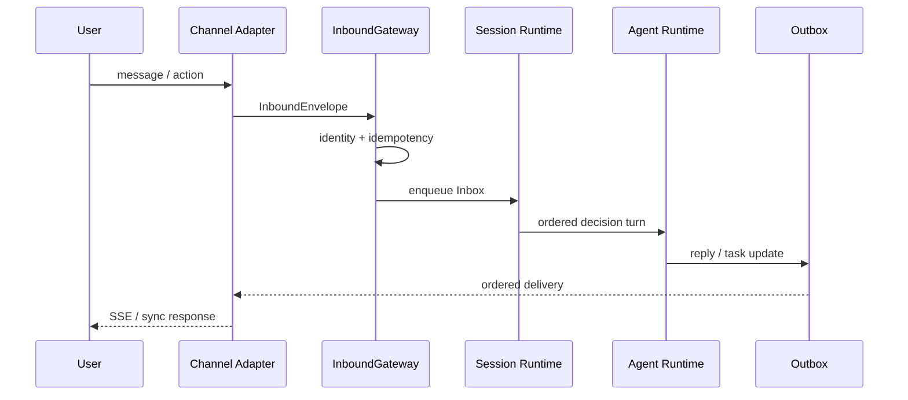

# 核心流程设计

> 本文只描述跨宿主模块的端到端流程。Agent Runtime 内部对象、状态和并发语义以
> [Harness 02](../../harness-design/02-微内核插件架构实现思路.md) 与
> [Harness 03](../../harness-design/03-核心对象模型与状态机.md) 为准。

本文的时序图和处理要求是跨模块目标契约，不代表每种渠道、回调或定时触发均已完成接入与验证。当前代码可从 [InboundEnvelope](../../backend-java/agent-runtime-api/src/main/java/com/skillforge/runtime/api/InboundEnvelope.java)、[SessionLogPort](../../backend-java/agent-runtime-api/src/main/java/com/skillforge/runtime/api/port/SessionLogPort.java)、[ExecutionCoordinator](../../backend-java/agent-runtime-session/src/main/java/com/skillforge/runtime/session/ExecutionCoordinator.java) 和 [AgentExecutionLoop](../../backend-java/agent-runtime-core/src/main/java/com/skillforge/runtime/core/AgentExecutionLoop.java) 追踪具体边界；端到端能力以宿主装配和实际验证为准。

## 1. 用户消息

处理要求：

1. 渠道适配器只负责认证、协议转换和投递。
2. InboundGateway 校验 tenant、user、agent 与 session 归属，并登记输入幂等。
3. Session Inbox 保证同 Session 决策轮单 flight；不同 Session 可以并行。
4. Agent 决策前执行 ContextPipeline 与 PolicyChain。
5. 输出先写 SessionLog 与 Outbox，再由渠道投递。
6. 用户请求不得携带 Workflow 作为会话目标。

## 2. Agent 调用 Workflow

运行调用链和 Agent/Workflow 协作见 [Harness 02](../../harness-design/02-微内核插件架构实现思路.md#51-正常执行)，参数与输出契约见 [Harness 03](../../harness-design/03-核心对象模型与状态机.md#3-契约体系四契约)。宿主只提交会话输入并消费执行投影。

## 3. Workflow 挂起与继续对话

前端展示 Pending 投影，用户可继续普通对话或处理其他任务；点选通过新的会话输入提交。Pending 匹配、澄清、恢复竞争与事件语义见 [Harness 02](../../harness-design/02-微内核插件架构实现思路.md#510-多执行与挂起路由单-session-多-workflow) 和 [Harness 03](../../harness-design/03-核心对象模型与状态机.md#53-pendingentry-与-wakeintent)。

## 4. 外部回调与定时触发

Callback 和 Scheduler 不直接恢复 Workflow：

1. 适配器验证签名、授权、租户归属和幂等键。
2. 适配器构造 callback 或 scheduled 类型的 InboundEnvelope。
3. Envelope 进入对应 Session Inbox。
4. Recovery 解析目标 Pending 并调用 WorkflowPortal。
5. 结果按普通输出路径进入 SessionLog 和 Outbox。

回调与用户操作竞争时只有一个 CAS 成功，另一个返回当前状态并记录审计。

## 5. 后台 Execution 完成

后台完成回注见 [Harness 03](../../harness-design/03-核心对象模型与状态机.md#57-multi-execution-registry-与-session-mailbox)。宿主渠道从 Outbox 投递任务更新，前端按执行标识更新对应视图；通知的展示与连接生命周期见[API 与事件契约](04-接口与事件契约.md#6-sse-事件)。

## 6. 查询与取消

查询从 ExecutionRegistry 或 Execution Ledger 的受控投影读取活动摘要，不读取节点快照。

取消请求先进入授权与 Recovery 边界，再调用 WorkflowPortal 执行状态 CAS。已终态返回幂等结果；运行中是否可协作取消由能力声明决定。

## 7. 陪伴型 Agent 上下文

宿主管理 Persona、关系 schema、记忆授权与策略配置。上下文阶段、快照和模型调用前的持久化要求直接引用 [Harness 03](../../harness-design/03-核心对象模型与状态机.md#56-stateful-agent-context)，避免本文的简化列表成为另一套装配顺序。

## 8. 重启与重建

恢复、版本快照与账本重建见 [Harness 02](../../harness-design/02-微内核插件架构实现思路.md#511-执行账本重建与高级续跑边界) 和 [Harness 03](../../harness-design/03-核心对象模型与状态机.md#10-事实源关系)；宿主重启与故障处置操作见[运行手册](../04-指南与运维/02-运行手册.md)。

## 9. 产品配置流程

机构配置流程仍由宿主平台负责：

1. 创建或安装 Agent 与 Workflow。
2. 配置能力声明、Scope、Preset、Persona 和 Policy。
3. 绑定知识、工具、连接器与渠道。
4. 在沙箱验证成功、失败、挂起、恢复、重复输入和租户隔离。
5. 发布不可变版本；Persona、能力挂载与 Execution 的版本生效时点分别遵循 [Harness 03](../../harness-design/03-核心对象模型与状态机.md#5-核心运行时对象)，不把所有配置更新都限定为新建 Session。

Workflow 包格式见 [工作流规范](../03-规范与术语/01-工作流规范.md)，对外传输见
[API 与事件契约](04-接口与事件契约.md)。

## 10. 不再作为目标流程的旧路径

以下路径只可出现在历史文档或 rejected Note 中：

- 用户显式选择 Workflow 并绕过 Agent；
- ReAct/Workflow 门卫双轨路由；
- 无 LLM 时保留旧 Planner 作为运行时兼容分支；
- Controller、Callback 或 Scheduler 直接调用 Workflow 恢复；
- Agent 拼装 Pending、checkpoint 或节点状态；
- 从历史消息或裸 Map 倒序猜测 Workflow 输出。
