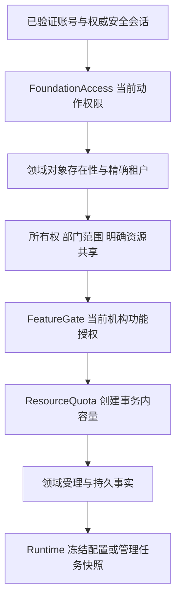

# SaaS 基础底座设计

本文定义平台与机构管理端的基础能力、当前授权分层及运维边界。基础底座属于宿主系统，承接账号、组织、资源治理与管理操作，不改变 [Agent Runtime 的架构边界](../../harness-design/02-微内核插件架构实现思路.md)或创建另一套 Session、Run、Workflow 执行引擎。实现机制以 [foundation 生产代码](../../backend-java/skillforge-core-foundation/src/main/java/com/skillforge/core/foundation)、双宿主装配与 V274–V279、V281 迁移为依据；正文定义有效设计及保留契约，不表示相应环境已经完成迁移或 Java、HTTP 验收。目标部署应单独核验完整迁移、权限和真实基础设施组合。

## 1. 六个能力域与所有权

| 能力域 | 已落入生产代码的职责 | 权威边界 |
|---|---|---|
| access | 部门、岗位、成员组织资料、多角色、动作权限、部门范围、资源归属与共享 | 账号密码及启停仍由对应账号表持有；正式组织和授权关系由本域持有 |
| security | 权威设备会话、访问及刷新凭据、可选 TOTP、恢复码、密码恢复、邀请激活、撤销和显式安全策略 | JWT 只引用已登记会话；当前安全状态从数据库验证，邮件投递由 messaging 持有 |
| catalog | 受控菜单、字典及引用、机构品牌、个人偏好、功能目录、套餐功能关系、机构覆盖和资源配额 | 菜单不产生权限，UI 偏好不修改模型、运营配置或 Run 冻结事实 |
| messaging | 公告、站内通知、不可变通知模板、SMTP 配置版本、Outbox、投递尝试和人工核验 | 站内读取归当前收件人；SMTP 接受、确定拒绝和未知分别保留，不推导终端收件 |
| assets / jobs | 公共文件、业务引用、注册处理器驱动的 CSV 导入导出、持久管理任务、行回执和结果文件 | 公共文件不接管 Session 附件、Artifact 或成果权威；管理任务不接管 Runtime 调度 |
| operations | 平台及机构安全审计、检索导出、审计保留策略与调查保护、清理回执、真实依赖及 JVM 采样、备份恢复工具 | 审计仅追加；当前保留执行器仅拥有审计删除写权，其他数据生命周期仍归所属领域 |

共享实现位于 `skillforge-core-foundation`，HTTP 入口由平台和机构宿主暴露。领域通过各自生产 Configuration 装配服务、MyBatis Mapper XML 和权限 contributor。平台显式导入共享配置；机构扫描与显式装配共同构成实际入口。前端共享页面位于 [frontend-shared/src/foundation](../../frontend-shared/src/foundation)，由宿主传入现有认证客户端、固定 API 根和当前权限，不自行读取令牌。

## 2. 身份、动作、对象与商业授权分层

平台账号和机构成员是独立账号体系。可信主体仅包含账号 ID、账号体系和机构归属；平台主体不能通过请求中的 `tenant_id` 获得机构成员身份。机构 ID、操作者和安全会话均由已验证入口形成，不能由表单或业务 context 补建。外部渠道、机构 ServicePrincipal 和受限平台管理机器身份使用各自独立认证契约，不能替代后台登录或绕过对象授权。平台人员及机器主体不能因公共定义维护权取得机构业务读取/执行权限。

平台直管选型复用上述双账号体系：部署运营人员登录平台端，总部与门诊管理员登录机构端，机构树不自动形成跨机构业务访问权，不建设应用端。目标移除 Application 治理身份，机构执行仍固定 Tenant/integration，自动化管理机器主体需明确动作/目标范围且不能充当执行万能凭证。机器身份及旧应用移除的目标范围见[技术架构](01-技术架构.md)，实际行为需核对当前源码与对应候选的验证。

这些条件按实际入口组合使用。本人偏好不需要资源容量，平台目录不继承机构套餐；涉及机构资源的创建必须同时满足其当前动作、对象及商业授权要求。动作权限、资源权限、功能与配额不是相互替代的布尔开关。

### 2.1 当前动作权限与组织范围

[FoundationAccess](../../backend-java/skillforge-core-foundation/src/main/java/com/skillforge/core/foundation/access/FoundationAccess.java)从当前有效账号、启用角色、成员角色关系和已注册权限目录计算 `roles`、`permissions` 与 `authorization_version`。JWT 中的角色声明及旧账号单 `role` 字段不作为授权事实。管理员拥有本账号体系中实际注册的动作；未注册动作不通过默认放行。

角色的数据范围联合本人、所属部门、部门子树、明确部门集合或全机构范围。部门和岗位是组织归属，岗位名称不自动产生动作权限。角色、成员组织归属和授权变化推进版本，新的请求和后台派发重新读取当前状态。内置管理员不能被删除、停用或降级；更改成员状态或角色不得移除最后一个启用管理员。

控制器的 `RequirePermission` 与权限拦截器约束 HTTP 入口；应用服务再次检查动作、可信主体和目标对象。列表先按当前可见对象范围筛选再分页及计数，不能只隐藏前端按钮，或先读取全机构结果再在浏览器过滤。

### 2.2 资源与会话授权

资源归属保存真实领域对象的主键、所有者和部门；明确共享保存同机构受让成员、角色或部门及具体动作。共享只能扩大对象访问范围，不能补足主体缺失的动作权限。对象是否存在仍由 Agent、Workflow、Knowledge、Channel、Connector 等所属领域确认，删除和授权引用清理在相同业务边界完成。

Session 历史和正文使用会话自身的所有权与部门范围，Agent 被共享不授予其历史会话访问权。[SessionService](../../backend-java/skillforge-core-chat/src/main/java/com/skillforge/core/chat/session/SessionService.java)公开读取使用当前读权，公开写入使用当前写权。内部系统恢复入口仅承接已经持久的执行事实或另行授权的外部对象，不能把 HTTP 参数直接送入系统读取入口。

接管工单读取按当前可读 Session 范围过滤，详情只要求会话读权；受理、领取、解决及新人工回复要求工单动作和会话写权。处理其他坐席已领取的工单另需 `foundation.handoff.manage`。后台人工回复先核对已经提交的原始 SessionLog 回执，再从持久受理记录绑定原坐席并检查当前动作及会话权限；撤权阻止新的副作用，但不把已发生事实改写成未提交。平台模型调用私有正文另需 `foundation.sessions.diagnostic_read`，普通会话观测读取不隐含该权限。

领取和解决请求携带稳定 `command_id` 与 `expected_revision`；成功回执和工单状态在同一数据库事务提交，回执绑定原成员、工单、动作、修订及请求内容摘要。同键同内容返回原结果，同键不同内容冲突。`GET /api/v1/handoff/tickets/action-receipt` 按当前成员和可读工单只读查询；未查到不能认定失败。首次请求返回 `HANDOFF_ACTION_NOT_ACCEPTED` 表示该命令的状态变更未提交，客户端保留输入并刷新工单。客户端保存原命令身份，连接中断后先查询原回执，不以新命令自动重发；用户确认后可使用原命令和修订继续，解决说明只保留摘要，刷新后需重新输入一致内容。

### 2.3 租户功能和资源配额

[FeatureGate](../../backend-java/skillforge-core-foundation/src/main/java/com/skillforge/core/foundation/catalog/entitlements/FeatureGate.java)检查当前功能目录、套餐关系、机构显式覆盖及启停状态。没有功能关系即没有授权，移除机构覆盖后恢复当前套餐继承。该检查不授予成员动作权限，也不写入 Runtime 的运行参数。

[ResourceQuota](../../backend-java/skillforge-core-foundation/src/main/java/com/skillforge/core/foundation/catalog/entitlements/ResourceQuota.java)加入资源创建事务，锁定机构配额事实并统计真实领域资源，用同一事务持有锁直到提交或回滚。Agent、Workflow、知识库、成员、渠道、公共文件字节、后台管理任务和直属子机构分别计量；有效限制为 `0` 表示没有新增容量，有效限制为 `null` 表示不限。容量不足在写入前拒绝，不能用独立易漂移计数器或事务外的“先查再创建”承诺并发正确性。

GI-15 直属容量使用原 Foundation 的 `SUB_INSTITUTION` 资源及 `limits.sub_institutions`，沿套餐 `nw_billing_plans.quota_max_sub_institutions` 与机构 `nw_tenants.override_quota_max_sub_institutions` 解析。机构覆盖为 NULL 时继承套餐，套餐也为 NULL 时不限；0 是明确禁止新增，不是不限。使用量按当前 `nw_tenants.parent_tenant_id` 的直属子机构实际行数统计，包括停用子机构、不累计后代；迁出或解除后释放该父机构容量，迁入计入新父机构当前用量。直属开通在树写入事务内锁定当前总部配额并检查新增 1 个容量，超限返回 409 `resource_quota_exceeded`；同参原回执重读不再申请容量。平台挂接/迁移是独立关系管理操作，不宣称该操作执行了直属开通容量门禁；其结果会影响下一次开通的实际计数。既有资源不因额度降低而被删除，超限时拒绝新增；不新增累计计数器、父子共享配额或默认套餐数量。字段约束见[数据模型 §12.1](03-数据模型设计.md#121-管理关系定义与部署)。

上述资源容量与月度调用/Token 配额、Usage Ledger 和 Run 任务预算分别表达。销售套餐或功能更新不清空已经发生的用量，也不修改已受理 Run 的预算及准备引用；现行用量与账单语义仍归 [用量与账单设计](14-用量与账单设计.md)。

群暂停/接管是单独管理动作，控制命令、端点换代/退役确认、ACK 及本地意图对账/解除分别检查当前主体、动作、对象范围与凭证状态；成员身份、聊天权限和记忆内容不能充当控制授权。跨服务版本、参与方回执及失败语义归[接口与事件 §2.6](04-接口与事件契约.md#26-暂停与接管跨服务生效目标)，不以 JWT 内历史角色恢复已撤销权限。远端明确拒绝不授权原操作者解除本地阻止；获准管理者接续时保留两方审计，只解除指定意图，不能借换代、对账或恢复清除其他接管。

### 2.4 机构层级与跨机构管理（目标）

总部和下级都是独立 Tenant，层级采用单父无环机构树；机构内部门/门店仍使用部门或 BusinessScope。GI-15 以关系服务、V302 的树修订/关系历史和最终数据库约束管理当前机构关系；接口与安全目录见[接口 §2.7.5](04-接口与事件契约.md#275-机构关系与直属开通gi-15)。平台、总部、下级分别使用平台端、机构端、机构端；总部菜单按当前权限显示，不新增总部或应用后台。GI-16 已提供机构共享授权和总部代部署的正式入口；后端交付不证明完整 UI 已验收，管理界面仍由 GI-11 负责。

平台按管理动作/目标范围创建、挂接、迁移、解除机构关系和配置总部管理权限；迁移同时检查 child、当前原父和目标父的明确范围，以 child 的关系 revision 表达预期源状态，在树写锁内复核当前路径和 CAS。总部可在显式 `tenant.sub_institutions.provision` 及容量内创建直属机构；已有机构挂接/迁移由平台确认，外部编号或正文 parentTenantId 不能认领其他机构。机构关系、管理授权和业务数据权限分别判断；总部不会自动成为下级成员，固定 Tenant/integration 的凭证不能切换到子机构运行。

总部目录要求 `tenant.sub_institutions.read` 当前动作、精确目标的 active `nw_institution_management_grants` 及其 relation_ref 与当前父/child/revision 一致；直属开通显式创建这一安全目录授权，单有父关系不产生目录资格。普通机构管理员角色不自动具有 read/provision；机构人员由当前 FoundationAccess 判断，固定机构机器由当前 ServicePrincipal 状态、凭据版本、精确同名 scope、Tenant/integration 判断，`resources.write` 不代替机构管理 scope。平台管理机器使用独立身份域和目标范围，不能进入机构总部路径，机构机器也不能进入平台关系管理路径。返回目录只有稳定机构 ID、父 ID、名称、状态和关系/树修订，没有下级成员、密钥、患者、Session、Memory 或费用正文。

机构树允许多个独立根，单个机构最多一个直接父机构，不设置隐含的产品固定深度限制。迁移检查子机构、原父机构和目标父机构的明确权限；机构关系及管理策略不自动授予业务访问权，业务权限不沿父子关系自动继承。

机构端跨机构管理请求保留真实 actor Tenant 和目标 Tenant，服务端检查管理动作、明确目标、当前关系版本及相应商业约束；平台身份也保留真实账号体系。列表在分页/计数前收窄，树中不可见节点不能通过详情或统计泄漏。平台维护权、上级关系、Agent 授权均不授予患者、Session、GROUP/GROUP_MEMBER、密钥或工具执行权；下级成员管理、业务数据访问不纳入首版总部能力。

机构自有共享定义由所属机构的获准成员创建/编辑/发布/下架，向直属下级授予使用权；下级只消费获准发布并维护本地声明值。授权不部署实例、不发执行凭证，总部代部署须另有目标部署管理权。平台/上级来源默认不能转授；源所有者明确允许后，每次只到直属下级，目标范围、动作、有效期和剩余层数只能收窄，必须保留并验证完整父授权链。首版不自动授权全部后代或未来子机构。

关系迁移/解除、祖先授权撤销/到期或源机构停用，立即收窄其依赖的管理范围和部署有效性；缓存/异步投影不能延长权限。独立的平台直授和下级自有 Agent 按自身依据判断，不能一并失效；迁移不搬移数据、不改费用归属。重新挂回不复活原 grant；仍有子机构时拒绝删除，先显式迁移/解除，历史按既有保留契约处理。并发/事务与幂等要求见[接口契约](04-接口与事件契约.md#25-机构层级与-agent-授权目标)。

总部用量汇总须独立授权且限定目标集合，明细和导出另行授权，不隐含代付或配额继承，见[用量与账单](14-用量与账单设计.md#多机构可靠用量交付)。GI-15 已闭合机构关系、明确安全目录与直属开通，GI-16 已交付机构共享定义、完整授权链、独立目标管理及显式换授；总部用量汇总仍由 GI-09 落地，原同机构资源共享契约保持有效。

重新授予同源使用权不自动修复已有部署。实例授权切换需目标机构部署管理权及当前有效的新授权，不能由源定义维护权单独完成；平台直授与总部转授并存也由显式绑定确定依据。稳定实例及旧 Run 的授权边界按[接口契约 §2.5](04-接口与事件契约.md#25-机构层级与-agent-授权目标)执行，不自动换链恢复旧任务。

### 2.5 多机构接入授权判定（目标）

GI-00 固定管理与执行的授权组合：平台人员检查当前安全会话、账号、角色/动作、目标及 authorization_version；平台机器检查独立管理凭证版本、精确 scope、明确 Tenant/定义/namespace 目标；机构 ServicePrincipal 检查固定 Tenant/integration、当前凭证版本/scope 和对象闭包。动作键和开放路径归[接口 §2.7](04-接口与事件契约.md#271-身份路径和动作)，未注册或缺失动作失败关闭，不以管理员名称、树祖先关系或签名有效替代授权。

机构管理动作保留 actor Tenant 与 target Tenant，目标必须由明确管理 grant 和当前关系共同允许；总部仅获准创建直属下级、共享定义/授权、另行授予的下级部署或汇总。成员管理、Session/群历史/Memory、密钥读取、业务工具执行、明细/事件导出均不随上述权限授予。平台直授与关系授权并存时只沿部署已选择的完整 grant 链判断；当前授权版本变化使相关缓存/游标失效，不能切到另一条链兜底。

| 受理或派发边界 | 必须允许的条件 | 拒绝及保留事实 |
|---|---|---|
| 机构挂接/迁移/解除 | 平台精确关系动作＋子/父目标范围＋关系 CAS＋事务内无环 | 总部认领已有 Tenant、并发制造环、多父及失效 revision 拒绝，旧关系/审计保留。 |
| 定义维护/发布/授权 | 可信所有者＋对应独立动作＋对象范围＋精确修订；转授另验源许可与直属关系 | 下级编辑上级草稿、借发布泄露私有挂载、转授扩大或普通发布自动共享拒绝。 |
| 部署/同源换授权 | 目标部署管理权＋当前完整链＋本地资源/容量＋CAS | 源维护权不等于目标部署权；跨源、自动换链及旧请求覆盖新修订拒绝，实例/旧 Run 不变。 |
| 群读写、恢复及检索 | 固定执行域＋当前群/成员/服务 Agent＋业务范围；治理另验本人/管理者与来源 | 群成员身份不授予患者资料或他人确认；退出后旧 SSE 不继续披露，过去群事实保留。 |
| 暂停/接管/恢复/端点换代/本地对账 | 对应独立控制、发送端管理或对账动作＋群/Run 对象范围＋当前凭证＋CAS | 曾发起暂停或远端拒绝不授予解除权；获准接替者保留原操作者和接替审计，只解除指定阻止。 |
| 群后台提取/异步恢复 | 明确 SystemPrincipal 当前授权＋原来源证明＋同群闭包＋预算 | 不凭历史 EndUser 资格恢复外部权限，不冒充退出成员或最近 @ Agent；禁止使用/遗忘继续生效。 |
| 用量读取 | 平台明确目标或固定机构执行域，总部汇总另有目标动作；每页当前复验 | 汇总权不授明细/事件；角色撤销即使 JWT 未过期仍拒绝，旧 cursor 不能保留已撤销范围。 |

上表按所属批次落地：GI-14 的平台管理/固定机构身份、GI-15 的关系/安全目录及 GI-16 的机构源/完整授权链/目标部署均有对应入口和精确动作；群和总部汇总仍按相应群/用量批次实施。真实入口和受限身份验证证据归所属阶段，不以正文列出目标宣称其他能力已完成。

## 3. 可选 MFA 与真实安全会话

平台管理员、机构管理员和普通成员默认均不开启 MFA，未开启的账号正常登录不要求验证码。用户可自愿绑定验证器，绑定在证明正确后生效；恢复码只保存摘要并在使用时原子消费，TOTP 计数器和行锁阻止同一验证码重放。全员 MFA 策略默认关闭，只有拥有策略动作权限的主体显式发布后才改变当前要求，不从“管理员”角色推导默认强制绑定。

[FoundationSecurityService](../../backend-java/skillforge-core-foundation/src/main/java/com/skillforge/core/foundation/security/FoundationSecurityService.java)持有设备会话。JWT 引用 `security_session_id`，业务入口验证当前会话期限、撤销状态、账号启停、密码指纹及 MFA 状态；JWT 签名有效不等于设备仍有效。密码修改、恢复、管理员撤销和成员停用影响原设备，新请求不能依赖旧令牌中的授权版本继续访问。

登录会话分为 `full`、`challenge` 和 `enrollment`。自愿启用 MFA 的账号密码验证后进入 challenge；显式全员策略下尚未绑定的账号进入 enrollment。受限会话只允许完成必要认证流程，不能访问普通管理能力。访问令牌与刷新凭据引用同一权威设备会话；刷新通过 CAS 轮换，竞争失败或原凭据已消费不再签发。

已经启用 MFA 的账号执行高风险写入时要求最近五分钟的证明；默认未启用的账号不增加该步骤。安全设置支持本人设备查询/撤销、恢复码再生成、同范围成员设备撤销、验证器遗失恢复和策略管理，各动作仍需当前授权。一次性密码恢复及邀请凭据按用途和账号体系绑定、只存摘要并原子消费；密码恢复不能清除或绕过既有 MFA。

恢复和邀请通过 messaging 交付到已登记邮箱。未配置邮件通道、尚未投递或 SMTP 结果未知时，接口受理不能证明凭据已送达；API 不返回可复用邮件凭据。认证拒绝审计使用独立事务保留，避免登录或 MFA 失败回滚时丢失事实。

普通撤销或到期设备会话采用同作用域默认 90 日调查保留期，从权威 `revoked_at` 或未撤销会话的 `expires_at` 起算。保留期届满只是候选条件，认证仍有效或处于调查保护的会话继续保留。策略由具备安全策略权限的管理员显式发布；请求 `days` 必须出现，`1–36500` 表示保留天数，显式 `null` 表示管理员关闭回收，遗漏字段不能变成关闭。策略变化及调查保护登记、解除沿既有安全审计与强化认证边界执行。

后台通过 [SecuritySessionCleanupScheduler](../../backend-java/skillforge-core-foundation/src/main/java/com/skillforge/core/foundation/security/SecuritySessionCleanupScheduler.java)公平有界领取存在候选的作用域，每作用域独立绑定 RLS 并与策略、保护和刷新竞争同一数据库锁；扫描水位不改变业务到期时间。目录函数由受控 superuser/BYPASSRLS 迁移所有者持有，仅给既有调度应用角色显式 EXECUTE，不提升普通业务角色的跨租户能力，也不返回会话或凭据正文。真实删除后认证入口因权威会话缺失继续拒绝，不把回收解释为撤销历史安全审计。

## 4. 菜单、字典与展示配置

菜单节点只保存 [ControlledRoutes](../../backend-java/skillforge-core-foundation/src/main/java/com/skillforge/core/foundation/catalog/navigation/ControlledRoutes.java)登记的路由键。路由路径、编译组件和读取权限由代码目录确定；数据库不能注入任意路径或组件。菜单写入有 CAS 版本，读取按当前权限裁剪；节点可见不代表目标 API 已授权。机构默认菜单从受控模板初始化，已经初始化的空菜单不重新复活为默认树。

字典和值独立维护启停、排序及版本，可信消费者在业务事务内登记实际引用；仍被引用的值不能删除。机构品牌和个人偏好只表达展示名称、颜色、联系方式、主题、语言、分页与导航偏好，身份由当前主体决定，更新使用版本约束。它们不存模型凭据、运营策略或 Runtime 运行冻结配置。

## 5. 消息受理、Outbox 与未知结果

公告、站内通知、模板、邮箱版本、Outbox 和投递尝试分别保存权威事实。站内通知只对当前收件人提供列表、未读数和已读更新。公告撤回隐藏站内正文并取消尚未派发的邮件，不撤销已经被 SMTP 接受的外部邮件。

模板和 SMTP 配置采用不可变版本，个性化通知受理时冻结模板、邮箱版本、收件人及具体内容；公告收件通知则冻结精确公告引用。当前邮箱停用仍阻止后续旧版本派发。邮件正文和凭据加密保存，查询和错误只返回安全投影。平台与机构的模板、邮箱和投递记录按各自作用域隔离。

相同公告的原始 UTF-8 正文由该作用域内的精确公告身份持有一份 AES-GCM 密文，并保存格式、编码和原字节 SHA-256 摘要。每个收件通知保留授权成员、渠道、已读状态及 `announcement_id` 复合关联，不复制正文或邮件密文；站内授权读取和 SMTP 派发解析同一份原正文，并验证格式及摘要。共享不跨作用域，也不因摘要相同合并不同所有者。个性化通知和安全一次性凭据仍持有各自受控加密材料，不能从当前模板重建历史内容。

[NotificationMailTransport](../../backend-java/skillforge-core-foundation/src/main/java/com/skillforge/core/foundation/messaging/integration/NotificationMailTransport.java)在外部发送命令前提交受租约约束的 dispatching 状态。`accepted` 只表示 SMTP 服务接受，`rejected` 表示确定没有派发，`unknown` 表示派发后无法确定结果；dispatching 失去租约后进入 unknown，不能自动重放邮件。重试只面向明确可重试的拒绝；未知结果需人工核验并追加证据，不能以新幂等键重发自证恢复。

普通终态消息材料采用同作用域默认 30 日保留期。请求 `days` 必须出现，`1–36500` 为天数，显式 `null` 才表示有权管理员关闭回收。通知只有在邮件无投递或投递已 `accepted/cancelled`、站内渠道未启用或消息已读或公告已撤回、且创建/已读/撤回/投递终态中最晚确认时刻已超过保留期时才成为候选；调查保护、未读且未撤回、`unknown` 及仍可继续或重试的投递继续保留。存量撤回记录缺少精确撤回时刻时，从受控迁移所有者确认的时刻保守起算，不能猜测更早的历史时间。

消息回收由 [NotificationHistoryCleanupScheduler](../../backend-java/skillforge-core-foundation/src/main/java/com/skillforge/core/foundation/messaging/application/NotificationHistoryCleanupScheduler.java)和消息域事务服务拥有，采用有候选才推进的公平水位、逐作用域 RLS、策略及领域锁与有界批次。先释放符合终态条件的尝试材料，再退休无剩余尝试且无调查引用的通知；全部收件引用退役后才能释放公告唯一正文。通知、公告及投递身份、指纹、收件人/已读关系、权威状态和尝试计数墓碑继续保留，重复原请求返回原身份，不重新派发。退休后解除模板/邮箱版本引用，只有非当前、过保留期且无剩余引用的版本可删除。目录函数同样要求受控 superuser/BYPASSRLS 迁移所有者及显式调用授权，不能用年龄替代领域所有者或引用保护。

## 6. 公共文件与后台管理任务

公共文件包含元数据、真实 MIME、大小、摘要、持久存储键和业务引用。上传、下载、删除和结果文件访问均检查当前主体与作用域；有活动引用的文件不能删除。可信引用所有者负责验证业务对象及访问权，不允许客户端通过随意声明 `owner_kind/owner_id` 抢占引用。无引用文件的清理按领域保留期执行，不触碰 Session 附件、工作区快照或 Artifact。

[FoundationJobService](../../backend-java/skillforge-core-foundation/src/main/java/com/skillforge/core/foundation/jobs/FoundationJobService.java)只执行代码登记的 [CsvTransferHandler](../../backend-java/skillforge-core-foundation/src/main/java/com/skillforge/core/foundation/jobs/CsvTransferHandler.java)。受理保存幂等键、请求摘要、真实操作者、处理器、操作和文件引用，当前动作与功能授权在派发时再次检查。CSV 不执行表达式；导出转义表格公式前缀，不把原始秘密载荷写进结果。

任务租约约束执行写权，行级领域写入与对应恢复身份及错误同事务提交；回执写入失败必须回滚该行效果，不能报告成功。成功和已记录错误的恢复身份使用每 256 行一块 32 字节位图，10000 行最多 40 块；只有错误行另存逻辑行号、字段及可纠正说明，不复制成功行正文或保留空错误明细。重建工作者从原任务和持久位图逐行跳过已提交效果，不能依赖内存进度重放。

每行先锁定任务，以数据库实际时钟核对 owner 和租约；仅进入续租窗口时延长租约，不按每行重复更新租约或查询投影。进度每 64 行或 1 秒，以及取消、失败和终态边界从持久回执汇总，仅计数变化才写入。逐行错误、取消请求和终态仍按持久记录展示；取消不是对已经提交行的跨域回滚。失败及生命周期收尾从已持久任务身份恢复 RLS 作用域并还原调用线程，不能借助已经失效的 JWT。

终态结果文件按所属任务授权下载。七日材料保留到期后，先由数据库 CAS 确认任务所有者退役，再在同一事务释放输入/结果文件引用、错误明细、位图及选项材料；释放失败回滚全部材料。继续保留任务 ID、幂等键、请求摘要及计数墓碑，重复原受理请求不新增任务。该任务系统负责管理导入导出，Run、Pending、Mailbox 和 Workflow 的执行状态继续由 Runtime 持有。

## 7. 审计、保留与监控

[AuditService](../../backend-java/skillforge-core-foundation/src/main/java/com/skillforge/core/foundation/application/AuditService.java)是审计追加入口。事实保存真实操作者、动作、资源、分类、`success/failure/denied`、时间及追踪引用；payload 递归过滤凭据、令牌、验证码和正文类字段，并限制深度和条目预算。无租户的平台事件及无法归因的认证拒绝允许 `tenant_id=NULL`；普通机构只读取本机构事实，未归因认证拒绝可追加但不可读取。

审计检索支持动作、操作者、分类、结果、资源、追踪和时间条件，读取与导出分别授权。同步及后台 `security_audit` CSV 导出使用当前作用域，上限 10000 条并过滤秘密载荷，不把“大范围导出被受理”显示为无限量导出能力。

双后台安全审计目录通过 `audit/summaries` 只读取九个展示字段，不加载 payload；完整审计仍由 `audit` 查询返回。两入口使用相同的作用域、过滤、排序、分页和授权快照，并共享同主体、授权版本及过滤条件的读取审计批次。目录投影不改变审计事实、调查保护、导出或保留策略。

审计保留默认 180 天且清理关闭，显式策略只允许 30–3650 天并使用 CAS 版本。预览冻结最多 1000 个具体 ID、截止时间和策略版本，有效期 15 分钟；候选优先选择未受活动保护的事实，避免最早一批永久保护记录阻塞后续到期记录。执行只删除这次冻结候选，重新检查当前权限、策略、期限和调查引用，并与保护登记锁定同一审计事实。

清理在独立事务中执行，技术失败回滚全部删除后再独立登记失败回执；终态不可改写，重复执行读取原回执。数据库禁止修改审计事实，删除必须携带清理事务标记、满足至少 30 天的硬下限且无活动调查保护。解除或过期的保护保留历史墓碑，不以永久外键阻止正常到期清理。Runtime 历史、知识、邮件、Session 和文件清理仍按各自所有者与 [数据清理规范](../04-指南与运维/11-数据清理与保留规范.md)执行。

[FoundationOperationsStatus](../../backend-java/skillforge-core-foundation/src/main/java/com/skillforge/core/foundation/operations/FoundationOperationsStatus.java)真实采样数据库 `SELECT 1`、Redis PING、JVM 和可用 Hikari 信息。依赖失败报告 down，未装配或不可采集报告 unavailable；存在 MeterRegistry 只证明注册器存在，不证明 Prometheus 已成功抓取。监控使用 [prometheus.yml](../../deploy/prometheus.yml)和 [alerts.yml](../../deploy/alerts.yml)中的实际 Micrometer 指标，覆盖抓取失败、5xx 比例、连接池占用、HTTP p95 和堆使用。

## 8. API 与持久化入口

所有 ID 通过 HTTP 按字符串传输，固定 URL 不使用路径变量，写入目标位于请求体，查询目标位于查询参数，响应沿用宿主统一信封。常规接口返回 401/403 表达当前身份或权限拒绝，409 表达版本/配额/幂等冲突；异步受理和外部未知状态由所属结果明确表达，不能只凭 HTTP 200 展示业务完成。

| 能力 | 平台 API 根 | 机构 API 根 | 代表性行为 |
|---|---|---|---|
| access | `/api/v1/admin/foundation/access` | `/api/v1/tenant/foundation/access` | 部门、岗位、成员、角色、成员多角色和资源授权 |
| security | `/api/v1/admin/foundation/security` | `/api/v1/tenant/foundation/security` | 状态、设备、恢复码、成员撤销/恢复、显式策略、会话保留/调查保护和邀请 |
| catalog | `/api/v1/admin/foundation/catalog` | `/api/v1/tenant/foundation/catalog` | 菜单、字典、展示偏好、功能及配额治理 |
| messaging | `/api/v1/admin/foundation/messaging` | `/api/v1/tenant/foundation/messaging` | 收件箱、未读、公告、模板、邮箱、投递重试/核验、终态保留和调查保护 |
| files | `/api/v1/admin/foundation/files` | `/api/v1/tenant/foundation/files` | 列表、上传、按 file_id 下载和删除 |
| jobs | `/api/v1/admin/foundation/jobs` | `/api/v1/tenant/foundation/jobs` | 受理、列表/详情、进度、行错误、取消及结果 |
| operations | `/api/v1/admin/foundation/operations` | `/api/v1/tenant/foundation/operations` | audit、audit/export、retention、preview/execute/runs/holds、status |

登录、刷新、`me`、MFA 绑定/校验和密码恢复仍归各宿主 auth 命名空间。`me` 返回当前角色数组、权限数组、授权版本、安全会话 ID 与认证状态；精确请求字段和生成 OpenAPI 以实际 Controller/HTTP 类型为准，本文不复制完整接口签名。

| 迁移 | 持久化范围 | 重要约束 |
|---|---|---|
| [V274](../../backend-java/skillforge-migration/src/main/resources/db/migration/V274__foundation_access.sql) | access scopes、部门/岗位、成员组织资料、正式角色、角色权限、成员角色、部门范围、资源归属和共享 | scope 隔离、版本、管理员保留及资源真实性 |
| [V275](../../backend-java/skillforge-migration/src/main/resources/db/migration/V275__foundation_security.sql) | MFA、恢复码、设备会话、显式策略、恢复/邀请摘要 | 原子消费、当前会话撤销、MFA 默认关闭 |
| [V276](../../backend-java/skillforge-migration/src/main/resources/db/migration/V276__foundation_catalog.sql) | 菜单、字典引用、机构品牌、个人偏好、关系化功能授权及资源配额 | CAS、受控路由、引用保护、套餐与机构覆盖 |
| [V277](../../backend-java/skillforge-migration/src/main/resources/db/migration/V277__foundation_messaging.sql) | 公告、模板、邮箱版本、通知、Outbox、尝试事实与派发 scope | 作用域隔离、秘密加密、不可变版本、租约与 unknown |
| [V278](../../backend-java/skillforge-migration/src/main/resources/db/migration/V278__foundation_assets_jobs.sql) | 公共文件与引用、管理任务、行回执 | 引用删除保护、租约、幂等及终态墓碑 |
| [V279](../../backend-java/skillforge-migration/src/main/resources/db/migration/V279__foundation_operations.sql) | 审计分类/结果、平台空租户事实、保留策略、冻结清理回执和调查保护 | RLS、追加审计、30 天底线、持久终态不可改写 |
| [V281](../../backend-java/skillforge-migration/src/main/resources/db/migration/V281__foundation_compact_jobs_security_messaging_storage.sql) | CSV 位图恢复身份、安全会话保留与调查保护、公告唯一加密正文、消息终态材料策略 | 行效果同事务、90/30/7 日分属领域、privileged 目录 owner、完整作用域与引用保护、幂等墓碑 |

这些迁移只建立宿主基础数据模型，不要求迁移现有业务库的授权随代码交付自动成立。环境应用迁移、数据替换或清理仍按 [开发流程](../../.agents/skills/nw-workflow/references/development-workflow.md)和所属迁移规则单独执行。

## 9. 配置、备份与验收边界

机构 JWT 与平台 JWT 使用独立签名密钥；跨宿主的业务密文继续使用既有 CryptoService 密钥契约，部署值按 [开发与部署指南](../04-指南与运维/01-开发与部署指南.md)安全注入。该基础底座没有实现每租户 KMS/DEK、跨区驻留策略或离线私有化发行闭环。

公共文件配置为 `skillforge.foundation.files.root/max-bytes/orphan-hours`，默认独立根 `./data/foundation-files`、单文件 20 MiB、无引用保留至少 24 小时。根目录必须为宿主持久存储，不能复用活动 Session 工作区。SMTP 连接与密码通过本域配置入口登记，外部邮件服务、真实认证邮箱和投递核验是部署条件；Prometheus 抓取与告警接收同样需要实际监控网络及接收器配置，HTTP histogram 必须由宿主启用。

[备份恢复工具](../../tools/operations/README.md)提供显式来源逻辑/物理备份、冻结文件与摘要清单、全新隔离库恢复、离线物理 PITR 准备和连续 WAL 追加。应用配置只登记元数据，不复制正文；物理备份覆盖 PostgreSQL 集群并需要妥善保护。恢复目标必须全新、明确命名且独立于源库、业务数据和备份目录，脚本不自动启动应用或切换业务流量。

验证应分别覆盖完整 Flyway 链、真实账号/权限/资源组合、撤权及跨租户、并发配额、MFA 与设备撤销、管理任务及消息恢复、前端交互、监控抓取和备份恢复。迁移成功只证明结构可建立，readiness 只证明可达；隔离 SMTP、SQL、promtool 或 PITR 演练不能替代真实部署的邮件交付、备份凭据、归档连续性、RPO/RTO、恢复业务验收或生产抓取。

## 10. 安全标准与基础设施依据

设备会话、恢复流程与 MFA 生命周期依据 [OWASP ASVS V7 Session Management](https://github.com/OWASP/ASVS/blob/master/5.0/en/0x16-V7-Session-Management.md)和 [MFA Cheat Sheet](https://cheatsheetseries.owasp.org/cheatsheets/Multifactor_Authentication_Cheat_Sheet.html)核对。数据库备份、WAL 连续归档及时间点恢复按 [PostgreSQL 16 Backup and Restore](https://www.postgresql.org/docs/16/backup.html)执行；部署仍须验证本项目的授权、秘密保护与恢复条件。
