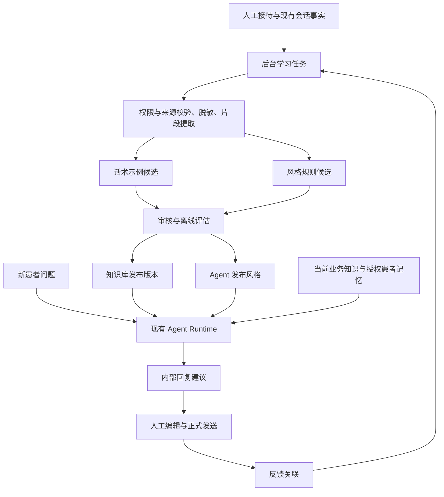

# 会话话术与风格学习设计

> 本文是[产品需求](../01-产品与需求/05-会话话术与风格学习需求.md)的宿主技术方案，尚未形成实现与场景验收结论。实验配置与评估方法归[效果评估](../06-评估与方案/02-会话学习效果评估.md)；功能实现和场景效果需独立验收。

## 1. 架构边界与已有入口

采用后台增量学习、审核发布、在线消费的结构。学习属于机构服务与 Agent 配置领域；运行继续使用现有 Agent Runtime、知识调用和模型治理，不在 Kernel 加入特定行业状态，不建立另一套 Agent 执行器。

会话、执行、知识、记忆与授权的公共语义沿用[Harness 对象契约](../../harness-design/03-核心对象模型与状态机.md)和[SaaS 基础底座](19-SaaS基础底座设计.md)。本文定义新增宿主能力；若实施发现需要修改 Runtime 公共行为，先同步所属 Harness 契约，不能只靠宿主提示词建立新权限或执行路径。

| 已有入口 | 可复用基础 | 仍需补充 |
|---|---|---|
| [SessionHumanAssistance](../../backend-java/agent-runtime-session/src/main/java/com/skillforge/runtime/session/SessionHumanAssistance.java)及[HandoffReplyService](../../backend-java/skillforge-institution-service/src/main/java/com/skillforge/institution/service/HandoffReplyService.java) | 带真实坐席身份的人工事实、可靠提交和回执 | 纯人工接待准入、建议私有可见性与学习资格；完整 Handoff 工作台范围仍归其原方案 |
| [SystemAgentExecution](../../backend-java/skillforge-core-agent/src/main/java/com/skillforge/core/agent/systemagent/SystemAgentExecution.java) | 受控系统模型任务与配置引用 | 话术提取、风格归纳的输入输出契约及任务装配 |
| [KnowledgeWriteProposalService](../../backend-java/skillforge-core-knowledge/src/main/java/com/skillforge/core/knowledge/application/KnowledgeWriteProposalService.java) | 提案审核、并发控制与投影入口 | 人工对话来源验证、候选类型和正式话术文档投影 |
| [KnowledgeService](../../backend-java/skillforge-core-knowledge/src/main/java/com/skillforge/core/knowledge/KnowledgeService.java) | 有效来源版本、关键词与向量检索、重排 | 对话片段完整性、业务场景和人员来源过滤、示例选择 |
| [AgentRuntimeExecutionSources](../../backend-java/skillforge-institution-service/src/main/java/com/skillforge/institution/runtime/AgentRuntimeExecutionSources.java) | 实际模型请求中的系统提示词和冻结输入 | 已发布风格、示例用途及来源的受控装配 |
| [记忆管理](07-记忆管理.md) | 患者个人事实的归属、访问和治理 | 本功能不将机构风格写成患者 MemoryFact，不以自动提取开关替代话术学习 |

该表记录 2026-10-23 的源码核查入口，不证明这些基础已组合完成本专题，也不把注释、字段存在或已有局部测试当作口腔场景验收。

## 2. 数据流与模块职责

机构业务服务负责学习范围、来源准入、批次、审核和反馈；Agent 领域负责风格草稿与发布引用；知识领域拥有正式示例及其索引；Runtime 消费已授权、已冻结的材料。Python 任务可承担脱敏、优化和实验，通过受控输入输出边界工作，不直接写业务表或生产发布指针。

学习设置、后台任务和在线服务分别配置权限、配额与取消入口。首期可以在现有机构服务中按业务包实现，不为此预建独立微服务、消息中间件或新的向量数据库。

## 3. 对象与唯一事实源

以下是目标领域对象及关键约束，不是已存在的表名、完整 DDL 或公开 API。实际字段、外键、类型、修订和索引在对应实施批次按[数据库规范](../../.agents/skills/nw-database/references/database-modeling-standards.md)落地；固定配置使用明确字段或关系，不能整体塞入无约束 JSON。

| 对象 | 所属与保存内容 | 唯一性和生命周期 |
|---|---|---|
| 学习设置 | 目标 Agent、允许来源人员和会话范围、目的与场景、任务预算、启用状态 | 归当前机构；设置修订冻结到批次，变更不重解释已完成结果 |
| 学习批次与处理项 | 来源范围与版本、增量进度、提取器和模型版本、任务引用、结果引用、失败或未知原因 | 处理项以租户、目标 Agent、来源版本集合摘要和处理配置版本去重；运行调用复用已有系统任务账本 |
| 话术候选 | 适用场景、必要前文、回复、沟通步骤、使用限制、脱敏版本与支持来源 | 复用知识提案治理，批准后通过唯一投影形成正式知识文档 |
| 正式话术示例 | 经确认的完整片段、场景元数据、发布和停用信息 | 正文归知识文档版本；检索分段不能拆断问题和回答语义，索引是可重建投影 |
| 风格规则 | 称呼、语气、句式、长度、提问习惯、限制、支持样本与适用场景 | 首期归 Agent 草稿和不可变发布；后续存在独立复用需求时再抽独立资源 |
| 来源关系 | 来源会话、事件或消息 ID、版本、真实作者、衍生对象及衍生版本 | 在同租户内建立可反查关系；源访问权与衍生内容使用权分别校验 |
| 回复反馈 | 建议生成引用、最终人工消息引用、编辑者、反馈原因、当时上下文与版本引用 | 保持一条建议到多次编辑或最终发送的准确关联，不再次复制完整聊天正文 |

原始消息按当前会话权威链读取，`nw_chat_messages` 等显示或归档表不是新增直写入口。学习批次保存稳定来源引用和必要冻结材料，不把全量聊天表复制成第二套会话库。向既有聊天表直接插入记录不保证触发学习任务。

候选、审核、知识发布、索引准备和 Agent 采用分别复用所属对象的状态；不以一个 `learned=true` 覆盖整条链路。风格与配套话术库版本通过 Agent 发布引用组成可使用配置，只有依赖就绪后才推进对外生效版本。

## 4. 后台学习与发布

### 4.1 接入与增量来源

纯人工模式的患者和坐席消息走受鉴权会话接入，保持真实身份和产品顺序；是否请求建议由明确服务模式或人工动作决定。内部建议不进入患者可见 Outbox，人工发送使用现有可靠公开消息路径，并保留 AI 辅助来源关系。

任务可以由负责人选定会话发起，也可在结束接待后或按批次发现新增合格记录。使用稳定游标或来源版本处理增量；已发布历史的改写、删除和作者修正作为来源变更处理。不能以再次全表扫描和盲目重提取替代去重。

### 4.2 片段提取与脱敏

以一次问题处理片段为单位，保留回答发生前必要的连续上下文，合并服务人员连续发送的多条回复，标记场景和接待阶段。患者之后的反应、预约结果或投诉可以作为评价材料，不能泄漏进重建该次回答的生成输入。

脱敏发生在材料进入跨患者示例、外部模型、评估数据集或遥测之前，按机构批准的数据用途选择必要内容。手机号、姓名、就诊编号等识别信息替换为片段内一致的占位符；删除无关病情细节，保留必要场景条件。脱敏原始映射如需保存，应留在受控来源域，不能随示例导出。

来源可信度、回答完整性、后续纠正、时效和人工确认共同决定候选资格。成交或预约只作辅助信号；AI 原样输出和未知作者内容不自动当作人工示范。发现提示注入或指令性聊天内容时仍按数据解析，不执行或晋升为系统指令。

### 4.3 提取与风格归纳

话术提取输出场景、患者意图、必要上下文、沟通步骤、回复示例、使用限制和支持来源。输出需要类型化校验、原文支持关系和内容预算；结构有效不等于语义正确，语义质量由审核与评估确认。

风格按人员和场景从多个独立会话归纳，记录支持样本、反例和适用条件。多人员先分别分析，再由机构选择纳入公共风格的规则；不能让消息数量最多的人自动主导机构风格。偶发词句、临时活动和个别患者偏好不晋升为一般规则。

提取器只生成候选。话术使用知识提案入口审核；风格更新 Agent 草稿。审批者检查来源和内容；并发审核按所属修订与 CAS 规则处理。批准不自动授权生产模型训练、跨机构共享或对患者发送。

### 4.4 发布与配置采用

知识版本完成内容校验和索引准备后，Agent 发布绑定精确知识版本与风格规则。模型、提取器、检索策略、发布内容及实际注入的示例均保留可追溯版本。新执行在既有配置受理边界采用发布内容，重试和恢复不重新检索或替换已冻结请求。

停用和撤销按 §6 的当前访问规则优先阻止新的披露，不修改已经发生的调用事实。普通回退只能选择仍有效、仍有授权的历史配置；不能通过版本回退重新启用已撤销来源。

## 5. 在线生成与反馈

### 5.1 检索与上下文装配

1. 从可信会话身份解析机构、患者、目标 Agent 和发布绑定，不让模型提供租户或患者归属。
2. 依据当前问题与回答之前的近期上下文确定检索内容；机构、授权与发布版本是强制过滤，场景和接待阶段参与匹配，人员来源限制按学习设置执行。
3. 复用现有知识检索组合关键词和向量候选，必要时重排；场景示例与事实知识分别标记用途。过滤应进入召回边界，不能先跨租户召回再只在界面隐藏。
4. 按上下文预算选取少量互补示例并冻结引用。业务事实以当前有效知识和工具结果为准，患者记忆只在其授权范围读取。
5. 系统规则与已发布风格按现有提示词装配；历史话术作为明确标注的参考数据提供，不能通过原始聊天内容生成新的高优先级指令。
6. 生成内部建议并记录来源、模型和配置。检索无合适结果时，按产品要求回答、追问或转人工，不用弱相关示例凑满数量。

检索数量、重排和模型选取属于[实验参数](../06-评估与方案/02-会话学习效果评估.md#3-检索与模型实验)，不是本设计规定的生产默认。当前知识接口若缺少必要过滤或材料用途字段，应在所属知识契约中补齐后接入，不能让提示词代替服务器授权。

### 5.2 建议、发送与反馈

建议生成是内部结果，正式人工发送才产生患者可见事实。工作台展示生成时的上下文版本；期间患者补充、会话模式变化或人工编辑后，不把旧建议视为新输入下仍然有效。发送时重新检查当前动作权限、会话状态和幂等键。

反馈保留原建议、最终消息及其输入范围关联，标记采纳、修改、放弃和原因。获得新信息后的修改须关联新上下文；不能直接构造成同一输入下的偏好训练对。反馈进入下一批筛选，不能即时改写线上提示词或自动发布。

### 5.3 执行与资源控制

学习与在线回复使用独立配额和队列容量，任务取消、重启恢复、模型用量和外部结果未知沿现有执行契约处理。外部等待不持有业务事务；超时先查原调用和回执，不把 UNKNOWN 当成未调用重试。

异步观测故障不影响业务发送与发布事实；未确认用量不按零计费。后台按新增材料处理，批次记录耗时、输入输出量、模型费用、失败及未知数量；在线记录检索和重排耗时、注入量与模型耗时，验收归 CL-11。

## 6. 权限、来源撤销与保留

机构、来源人员和患者身份来自可信业务绑定。读取会话、创建学习任务、审核、发布、导出和发送是不同权限；源信息可读不意味着可以用于模型训练或跨患者复用。调用模型、脱敏、评估和遥测的处理位置均遵循机构允许的数据用途及驻留要求。

来源撤销先更新受控可用性状态，在召回、材料装配及新调用披露边界检查，随后反查候选、知识版本、风格规则、评估数据、索引和缓存。受影响内容暂停后续使用；多来源规则根据保留证据重新评估并生成新版本，不原地修改历史发布。

已经外发的请求不能因本地删除而宣称撤回。既成调用回执和必要审计按[数据清理与保留规范](../04-指南与运维/11-数据清理与保留规范.md)处理，内容删除和历史事实保存分别执行；外部数据集、遥测或未来训练产物需要对应删除或重建证据。仅删聊天表、索引或训练样本不能证明模型已遗忘。

第一版不引入模型权重训练，降低派生材料撤销的处理范围。未来微调的训练数据来源、模型使用许可和撤销影响单独验收，不能沿用示例删除结果宣称权重遗忘。

## 7. 实施约束

业务验收编号以[产品需求 §5](../01-产品与需求/05-会话话术与风格学习需求.md#5-产品验收要求)为准，选型和评估方法只在[评估文档](../06-评估与方案/02-会话学习效果评估.md)维护，实际实现与验证以当前源码和对应测试为准。实际服务模式协议、对象字段、来源验证器、API 与页面规格在所属批次形成，不在设计阶段宣告已有接口。
