<!-- Generated by tools/docs/gen_module_graph.py — do not edit by hand. Run: make docs-regenerate -->

# 后端模块依赖图（生成式）

> 本文件由 `tools/docs/gen_module_graph.py` 生成，禁止手改。
> 模块清单来自 `backend-java/settings.gradle.kts`，依赖来自各模块
> `build.gradle.kts` 的 `api`、`implementation` 与 `runtimeOnly`
> `project(...)` 声明；测试依赖不进入本图。运行边界见
> [`01-技术架构.md`](../../02-架构与设计/01-技术架构.md)。

```mermaid
flowchart TD
    %% 模块依赖：A --> B 表示 A 依赖 B（方向为运行时依赖）
    agent-runtime-api["agent-runtime-api<br/><small>SDK 公开契约</small>"]
    agent-runtime-codec-spi["agent-runtime-codec-spi<br/><small>SDK 结果编解码契约</small>"]
    agent-runtime-session-spi["agent-runtime-session-spi<br/><small>SDK 协调与存储契约</small>"]
    agent-runtime-json["agent-runtime-json<br/><small></small>"]
    agent-runtime-core["agent-runtime-core<br/><small>SDK 纯计算内核</small>"]
    agent-runtime-session["agent-runtime-session<br/><small>SDK 会话与执行协调</small>"]
    agent-runtime-memory["agent-runtime-memory<br/><small>SDK 记忆治理</small>"]
    agent-runtime-adapter-testkit["agent-runtime-adapter-testkit<br/><small>SDK 测试夹具与内存参考实现</small>"]
    agent-runtime-adapter-jdbc["agent-runtime-adapter-jdbc<br/><small>Runtime PostgreSQL 存储与 schema</small>"]
    agent-runtime-adapter-sqlite["agent-runtime-adapter-sqlite<br/><small>Runtime SQLite 存储</small>"]
    agent-runtime-desktop-host["agent-runtime-desktop-host<br/><small>桌面 SDK 宿主</small>"]
    agent-runtime-adapter-model["agent-runtime-adapter-model<br/><small>模型供应商适配</small>"]
    agent-runtime-adapter-mcp["agent-runtime-adapter-mcp<br/><small>MCP 协议适配</small>"]
    agent-runtime-spring-boot-starter["agent-runtime-spring-boot-starter<br/><small>SDK Spring 装配</small>"]
    agent-runtime-bom["agent-runtime-bom<br/><small>SDK 版本集合</small>"]
    skillforge-common["skillforge-common<br/><small>公共上下文与工具</small>"]
    skillforge-prompts["skillforge-prompts<br/><small>宿主提示词正文与组合</small>"]
    skillforge-core-shared["skillforge-core-shared<br/><small>技术基础设施</small>"]
    skillforge-core-agent["skillforge-core-agent<br/><small>平台 Agent 定义与装配</small>"]
    skillforge-core-chat["skillforge-core-chat<br/><small>平台会话与消息</small>"]
    skillforge-core-workflow["skillforge-core-workflow<br/><small>工作流领域</small>"]
    skillforge-core-knowledge["skillforge-core-knowledge<br/><small>知识领域</small>"]
    skillforge-core-channel["skillforge-core-channel<br/><small>渠道领域</small>"]
    skillforge-migration["skillforge-migration<br/><small>Flyway 迁移</small>"]
    skillforge-institution-service["skillforge-institution-service<br/><small>机构服务（8000）</small>"]
    skillforge-platform-service["skillforge-platform-service<br/><small>平台服务（8100）</small>"]
    skillforge-gateway["skillforge-gateway<br/><small>网关（8080）</small>"]
    skillforge-sandbox-service["skillforge-sandbox-service<br/><small>独立代码沙箱服务</small>"]
    skillforge-system-agent-runtime["skillforge-system-agent-runtime<br/><small>平台系统用途 Agent 装配</small>"]
    skillforge-execution-contract["skillforge-execution-contract<br/><small>宿主执行服务契约</small>"]
    skillforge-browser-service["skillforge-browser-service<br/><small>独立浏览器服务</small>"]
    skillforge-core-foundation["skillforge-core-foundation<br/><small>身份、组织与平台基础底座</small>"]
    skillforge-core-model["skillforge-core-model<br/><small>平台模型目录与管理</small>"]
    skillforge-core-billing["skillforge-core-billing<br/><small>平台计费、配额与结算</small>"]
    skillforge-core-capability["skillforge-core-capability<br/><small>能力目录与发布</small>"]
    agent-runtime-codec-spi --> agent-runtime-api
    agent-runtime-session-spi --> agent-runtime-api
    agent-runtime-core --> agent-runtime-api
    agent-runtime-core --> agent-runtime-codec-spi
    agent-runtime-core --> agent-runtime-json
    agent-runtime-session --> agent-runtime-api
    agent-runtime-session --> agent-runtime-codec-spi
    agent-runtime-session --> agent-runtime-core
    agent-runtime-session --> agent-runtime-json
    agent-runtime-session --> agent-runtime-session-spi
    agent-runtime-memory --> agent-runtime-api
    agent-runtime-memory --> agent-runtime-json
    agent-runtime-adapter-jdbc --> agent-runtime-api
    agent-runtime-adapter-jdbc --> agent-runtime-codec-spi
    agent-runtime-adapter-jdbc --> agent-runtime-json
    agent-runtime-adapter-jdbc --> agent-runtime-session-spi
    agent-runtime-adapter-sqlite --> agent-runtime-session-spi
    agent-runtime-desktop-host --> agent-runtime-adapter-model
    agent-runtime-desktop-host --> agent-runtime-adapter-sqlite
    agent-runtime-desktop-host --> agent-runtime-api
    agent-runtime-desktop-host --> agent-runtime-codec-spi
    agent-runtime-desktop-host --> agent-runtime-core
    agent-runtime-desktop-host --> agent-runtime-session
    agent-runtime-desktop-host --> agent-runtime-session-spi
    agent-runtime-adapter-model --> agent-runtime-api
    agent-runtime-adapter-model --> agent-runtime-session-spi
    agent-runtime-adapter-mcp --> agent-runtime-api
    agent-runtime-spring-boot-starter --> agent-runtime-adapter-jdbc
    agent-runtime-spring-boot-starter --> agent-runtime-adapter-model
    agent-runtime-spring-boot-starter --> agent-runtime-api
    agent-runtime-spring-boot-starter --> agent-runtime-core
    agent-runtime-spring-boot-starter --> agent-runtime-memory
    agent-runtime-spring-boot-starter --> agent-runtime-session
    agent-runtime-bom --> agent-runtime-adapter-jdbc
    agent-runtime-bom --> agent-runtime-adapter-mcp
    agent-runtime-bom --> agent-runtime-adapter-model
    agent-runtime-bom --> agent-runtime-adapter-sqlite
    agent-runtime-bom --> agent-runtime-adapter-testkit
    agent-runtime-bom --> agent-runtime-api
    agent-runtime-bom --> agent-runtime-codec-spi
    agent-runtime-bom --> agent-runtime-core
    agent-runtime-bom --> agent-runtime-json
    agent-runtime-bom --> agent-runtime-memory
    agent-runtime-bom --> agent-runtime-session
    agent-runtime-bom --> agent-runtime-session-spi
    agent-runtime-bom --> agent-runtime-spring-boot-starter
    skillforge-prompts --> agent-runtime-session-spi
    skillforge-core-shared --> skillforge-common
    skillforge-core-agent --> agent-runtime-adapter-jdbc
    skillforge-core-agent --> agent-runtime-api
    skillforge-core-agent --> agent-runtime-session-spi
    skillforge-core-agent --> skillforge-common
    skillforge-core-agent --> skillforge-core-billing
    skillforge-core-agent --> skillforge-core-capability
    skillforge-core-agent --> skillforge-core-foundation
    skillforge-core-agent --> skillforge-core-knowledge
    skillforge-core-agent --> skillforge-core-model
    skillforge-core-agent --> skillforge-core-shared
    skillforge-core-agent --> skillforge-core-workflow
    skillforge-core-chat --> agent-runtime-api
    skillforge-core-chat --> agent-runtime-memory
    skillforge-core-chat --> agent-runtime-session
    skillforge-core-chat --> agent-runtime-session-spi
    skillforge-core-chat --> skillforge-common
    skillforge-core-chat --> skillforge-core-agent
    skillforge-core-chat --> skillforge-core-billing
    skillforge-core-chat --> skillforge-core-capability
    skillforge-core-chat --> skillforge-core-foundation
    skillforge-core-chat --> skillforge-core-knowledge
    skillforge-core-chat --> skillforge-core-model
    skillforge-core-chat --> skillforge-core-shared
    skillforge-core-chat --> skillforge-execution-contract
    skillforge-core-chat --> skillforge-prompts
    skillforge-core-workflow --> agent-runtime-adapter-jdbc
    skillforge-core-workflow --> agent-runtime-api
    skillforge-core-workflow --> agent-runtime-session
    skillforge-core-workflow --> agent-runtime-session-spi
    skillforge-core-workflow --> skillforge-common
    skillforge-core-workflow --> skillforge-core-capability
    skillforge-core-workflow --> skillforge-core-foundation
    skillforge-core-workflow --> skillforge-core-shared
    skillforge-core-workflow --> skillforge-execution-contract
    skillforge-core-knowledge --> agent-runtime-adapter-jdbc
    skillforge-core-knowledge --> agent-runtime-adapter-model
    skillforge-core-knowledge --> agent-runtime-api
    skillforge-core-knowledge --> agent-runtime-codec-spi
    skillforge-core-knowledge --> agent-runtime-spring-boot-starter
    skillforge-core-knowledge --> skillforge-common
    skillforge-core-knowledge --> skillforge-core-billing
    skillforge-core-knowledge --> skillforge-core-capability
    skillforge-core-knowledge --> skillforge-core-foundation
    skillforge-core-knowledge --> skillforge-core-model
    skillforge-core-knowledge --> skillforge-core-shared
    skillforge-core-channel --> skillforge-core-agent
    skillforge-core-channel --> skillforge-core-capability
    skillforge-core-channel --> skillforge-core-foundation
    skillforge-core-channel --> skillforge-core-shared
    skillforge-institution-service --> agent-runtime-adapter-jdbc
    skillforge-institution-service --> agent-runtime-adapter-mcp
    skillforge-institution-service --> agent-runtime-adapter-model
    skillforge-institution-service --> agent-runtime-api
    skillforge-institution-service --> agent-runtime-codec-spi
    skillforge-institution-service --> agent-runtime-core
    skillforge-institution-service --> agent-runtime-memory
    skillforge-institution-service --> agent-runtime-session
    skillforge-institution-service --> agent-runtime-session-spi
    skillforge-institution-service --> agent-runtime-spring-boot-starter
    skillforge-institution-service --> skillforge-common
    skillforge-institution-service --> skillforge-core-agent
    skillforge-institution-service --> skillforge-core-billing
    skillforge-institution-service --> skillforge-core-capability
    skillforge-institution-service --> skillforge-core-channel
    skillforge-institution-service --> skillforge-core-chat
    skillforge-institution-service --> skillforge-core-foundation
    skillforge-institution-service --> skillforge-core-knowledge
    skillforge-institution-service --> skillforge-core-model
    skillforge-institution-service --> skillforge-core-shared
    skillforge-institution-service --> skillforge-core-workflow
    skillforge-institution-service --> skillforge-execution-contract
    skillforge-institution-service --> skillforge-migration
    skillforge-institution-service --> skillforge-prompts
    skillforge-platform-service --> agent-runtime-adapter-jdbc
    skillforge-platform-service --> agent-runtime-adapter-model
    skillforge-platform-service --> agent-runtime-api
    skillforge-platform-service --> agent-runtime-codec-spi
    skillforge-platform-service --> agent-runtime-session
    skillforge-platform-service --> agent-runtime-session-spi
    skillforge-platform-service --> skillforge-common
    skillforge-platform-service --> skillforge-core-agent
    skillforge-platform-service --> skillforge-core-billing
    skillforge-platform-service --> skillforge-core-capability
    skillforge-platform-service --> skillforge-core-channel
    skillforge-platform-service --> skillforge-core-chat
    skillforge-platform-service --> skillforge-core-foundation
    skillforge-platform-service --> skillforge-core-knowledge
    skillforge-platform-service --> skillforge-core-model
    skillforge-platform-service --> skillforge-core-shared
    skillforge-platform-service --> skillforge-core-workflow
    skillforge-platform-service --> skillforge-migration
    skillforge-platform-service --> skillforge-system-agent-runtime
    skillforge-sandbox-service --> skillforge-execution-contract
    skillforge-system-agent-runtime --> agent-runtime-adapter-jdbc
    skillforge-system-agent-runtime --> agent-runtime-adapter-model
    skillforge-system-agent-runtime --> agent-runtime-api
    skillforge-system-agent-runtime --> agent-runtime-codec-spi
    skillforge-system-agent-runtime --> agent-runtime-core
    skillforge-system-agent-runtime --> agent-runtime-memory
    skillforge-system-agent-runtime --> agent-runtime-session
    skillforge-system-agent-runtime --> agent-runtime-session-spi
    skillforge-system-agent-runtime --> agent-runtime-spring-boot-starter
    skillforge-system-agent-runtime --> skillforge-common
    skillforge-system-agent-runtime --> skillforge-core-agent
    skillforge-system-agent-runtime --> skillforge-core-billing
    skillforge-system-agent-runtime --> skillforge-core-capability
    skillforge-system-agent-runtime --> skillforge-core-foundation
    skillforge-system-agent-runtime --> skillforge-core-model
    skillforge-system-agent-runtime --> skillforge-core-shared
    skillforge-system-agent-runtime --> skillforge-prompts
    skillforge-browser-service --> skillforge-execution-contract
    skillforge-core-foundation --> agent-runtime-adapter-jdbc
    skillforge-core-foundation --> agent-runtime-api
    skillforge-core-foundation --> agent-runtime-spring-boot-starter
    skillforge-core-foundation --> skillforge-common
    skillforge-core-foundation --> skillforge-core-shared
    skillforge-core-model --> agent-runtime-adapter-model
    skillforge-core-model --> agent-runtime-api
    skillforge-core-model --> skillforge-common
    skillforge-core-model --> skillforge-core-billing
    skillforge-core-model --> skillforge-core-foundation
    skillforge-core-model --> skillforge-core-shared
    skillforge-core-billing --> agent-runtime-api
    skillforge-core-billing --> skillforge-common
    skillforge-core-billing --> skillforge-core-foundation
    skillforge-core-billing --> skillforge-core-shared
    skillforge-core-capability --> agent-runtime-adapter-jdbc
    skillforge-core-capability --> agent-runtime-adapter-mcp
    skillforge-core-capability --> agent-runtime-api
    skillforge-core-capability --> agent-runtime-core
    skillforge-core-capability --> agent-runtime-session
    skillforge-core-capability --> agent-runtime-spring-boot-starter
    skillforge-core-capability --> skillforge-common
    skillforge-core-capability --> skillforge-core-billing
    skillforge-core-capability --> skillforge-core-foundation
    skillforge-core-capability --> skillforge-core-shared
    skillforge-core-capability --> skillforge-execution-contract
```



## 模块清单与依赖

| 模块 | 职责 | 直接依赖 |
| :--- | :--- | :--- |
| `agent-runtime-api` | SDK 公开契约 | — |
| `agent-runtime-codec-spi` | SDK 结果编解码契约 | `agent-runtime-api` |
| `agent-runtime-session-spi` | SDK 协调与存储契约 | `agent-runtime-api` |
| `agent-runtime-json` | — | — |
| `agent-runtime-core` | SDK 纯计算内核 | `agent-runtime-api`、`agent-runtime-codec-spi`、`agent-runtime-json` |
| `agent-runtime-session` | SDK 会话与执行协调 | `agent-runtime-api`、`agent-runtime-codec-spi`、`agent-runtime-core`、`agent-runtime-json`、`agent-runtime-session-spi` |
| `agent-runtime-memory` | SDK 记忆治理 | `agent-runtime-api`、`agent-runtime-json` |
| `agent-runtime-adapter-testkit` | SDK 测试夹具与内存参考实现 | — |
| `agent-runtime-adapter-jdbc` | Runtime PostgreSQL 存储与 schema | `agent-runtime-api`、`agent-runtime-codec-spi`、`agent-runtime-json`、`agent-runtime-session-spi` |
| `agent-runtime-adapter-sqlite` | Runtime SQLite 存储 | `agent-runtime-session-spi` |
| `agent-runtime-desktop-host` | 桌面 SDK 宿主 | `agent-runtime-adapter-model`、`agent-runtime-adapter-sqlite`、`agent-runtime-api`、`agent-runtime-codec-spi`、`agent-runtime-core`、`agent-runtime-session`、`agent-runtime-session-spi` |
| `agent-runtime-adapter-model` | 模型供应商适配 | `agent-runtime-api`、`agent-runtime-session-spi` |
| `agent-runtime-adapter-mcp` | MCP 协议适配 | `agent-runtime-api` |
| `agent-runtime-spring-boot-starter` | SDK Spring 装配 | `agent-runtime-adapter-jdbc`、`agent-runtime-adapter-model`、`agent-runtime-api`、`agent-runtime-core`、`agent-runtime-memory`、`agent-runtime-session` |
| `agent-runtime-bom` | SDK 版本集合 | `agent-runtime-adapter-jdbc`、`agent-runtime-adapter-mcp`、`agent-runtime-adapter-model`、`agent-runtime-adapter-sqlite`、`agent-runtime-adapter-testkit`、`agent-runtime-api`、`agent-runtime-codec-spi`、`agent-runtime-core`、`agent-runtime-json`、`agent-runtime-memory`、`agent-runtime-session`、`agent-runtime-session-spi`、`agent-runtime-spring-boot-starter` |
| `skillforge-common` | 公共上下文与工具 | — |
| `skillforge-prompts` | 宿主提示词正文与组合 | `agent-runtime-session-spi` |
| `skillforge-core-shared` | 技术基础设施 | `skillforge-common` |
| `skillforge-core-agent` | 平台 Agent 定义与装配 | `agent-runtime-adapter-jdbc`、`agent-runtime-api`、`agent-runtime-session-spi`、`skillforge-common`、`skillforge-core-billing`、`skillforge-core-capability`、`skillforge-core-foundation`、`skillforge-core-knowledge`、`skillforge-core-model`、`skillforge-core-shared`、`skillforge-core-workflow` |
| `skillforge-core-chat` | 平台会话与消息 | `agent-runtime-api`、`agent-runtime-memory`、`agent-runtime-session`、`agent-runtime-session-spi`、`skillforge-common`、`skillforge-core-agent`、`skillforge-core-billing`、`skillforge-core-capability`、`skillforge-core-foundation`、`skillforge-core-knowledge`、`skillforge-core-model`、`skillforge-core-shared`、`skillforge-execution-contract`、`skillforge-prompts` |
| `skillforge-core-workflow` | 工作流领域 | `agent-runtime-adapter-jdbc`、`agent-runtime-api`、`agent-runtime-session`、`agent-runtime-session-spi`、`skillforge-common`、`skillforge-core-capability`、`skillforge-core-foundation`、`skillforge-core-shared`、`skillforge-execution-contract` |
| `skillforge-core-knowledge` | 知识领域 | `agent-runtime-adapter-jdbc`、`agent-runtime-adapter-model`、`agent-runtime-api`、`agent-runtime-codec-spi`、`agent-runtime-spring-boot-starter`、`skillforge-common`、`skillforge-core-billing`、`skillforge-core-capability`、`skillforge-core-foundation`、`skillforge-core-model`、`skillforge-core-shared` |
| `skillforge-core-channel` | 渠道领域 | `skillforge-core-agent`、`skillforge-core-capability`、`skillforge-core-foundation`、`skillforge-core-shared` |
| `skillforge-migration` | Flyway 迁移 | — |
| `skillforge-institution-service` | 机构服务（8000） | `agent-runtime-adapter-jdbc`、`agent-runtime-adapter-mcp`、`agent-runtime-adapter-model`、`agent-runtime-api`、`agent-runtime-codec-spi`、`agent-runtime-core`、`agent-runtime-memory`、`agent-runtime-session`、`agent-runtime-session-spi`、`agent-runtime-spring-boot-starter`、`skillforge-common`、`skillforge-core-agent`、`skillforge-core-billing`、`skillforge-core-capability`、`skillforge-core-channel`、`skillforge-core-chat`、`skillforge-core-foundation`、`skillforge-core-knowledge`、`skillforge-core-model`、`skillforge-core-shared`、`skillforge-core-workflow`、`skillforge-execution-contract`、`skillforge-migration`、`skillforge-prompts` |
| `skillforge-platform-service` | 平台服务（8100） | `agent-runtime-adapter-jdbc`、`agent-runtime-adapter-model`、`agent-runtime-api`、`agent-runtime-codec-spi`、`agent-runtime-session`、`agent-runtime-session-spi`、`skillforge-common`、`skillforge-core-agent`、`skillforge-core-billing`、`skillforge-core-capability`、`skillforge-core-channel`、`skillforge-core-chat`、`skillforge-core-foundation`、`skillforge-core-knowledge`、`skillforge-core-model`、`skillforge-core-shared`、`skillforge-core-workflow`、`skillforge-migration`、`skillforge-system-agent-runtime` |
| `skillforge-gateway` | 网关（8080） | — |
| `skillforge-sandbox-service` | 独立代码沙箱服务 | `skillforge-execution-contract` |
| `skillforge-system-agent-runtime` | 平台系统用途 Agent 装配 | `agent-runtime-adapter-jdbc`、`agent-runtime-adapter-model`、`agent-runtime-api`、`agent-runtime-codec-spi`、`agent-runtime-core`、`agent-runtime-memory`、`agent-runtime-session`、`agent-runtime-session-spi`、`agent-runtime-spring-boot-starter`、`skillforge-common`、`skillforge-core-agent`、`skillforge-core-billing`、`skillforge-core-capability`、`skillforge-core-foundation`、`skillforge-core-model`、`skillforge-core-shared`、`skillforge-prompts` |
| `skillforge-execution-contract` | 宿主执行服务契约 | — |
| `skillforge-browser-service` | 独立浏览器服务 | `skillforge-execution-contract` |
| `skillforge-core-foundation` | 身份、组织与平台基础底座 | `agent-runtime-adapter-jdbc`、`agent-runtime-api`、`agent-runtime-spring-boot-starter`、`skillforge-common`、`skillforge-core-shared` |
| `skillforge-core-model` | 平台模型目录与管理 | `agent-runtime-adapter-model`、`agent-runtime-api`、`skillforge-common`、`skillforge-core-billing`、`skillforge-core-foundation`、`skillforge-core-shared` |
| `skillforge-core-billing` | 平台计费、配额与结算 | `agent-runtime-api`、`skillforge-common`、`skillforge-core-foundation`、`skillforge-core-shared` |
| `skillforge-core-capability` | 能力目录与发布 | `agent-runtime-adapter-jdbc`、`agent-runtime-adapter-mcp`、`agent-runtime-api`、`agent-runtime-core`、`agent-runtime-session`、`agent-runtime-spring-boot-starter`、`skillforge-common`、`skillforge-core-billing`、`skillforge-core-foundation`、`skillforge-core-shared`、`skillforge-execution-contract` |

## 生成方式

```bash
make docs-regenerate   # 或 python tools/docs/gen_module_graph.py
```
