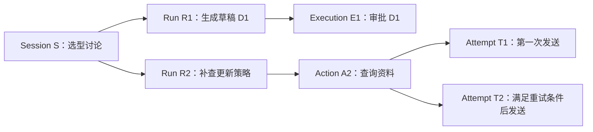

# Session、Run、Execution：别让一个状态字段解释所有事情

前置阅读：[01 课](01-从聊天接口到有状态Agent平台.md)

选型报告草稿已经生成。用户在同一个聊天窗口里又说：“补查更新策略，另外把现有草稿交给我审批。”研究还要继续，审批也开始等待。如果整个窗口只有一个 running 或 done 字段，它该显示什么？

问题不在状态名少了，而在不同事情共用了一个生命周期。我们需要给长期对话、一次任务推进和确定性流程分别命名。本系列采用一套教学模型；其他系统可能使用不同名称，理解职责比记住词汇更有用。

## 五个对象，各自回答一个问题

| 对象 | 本系列含义 | 在研究助手中的例子 |
| :-- | :-- | :-- |
| Session | 长期会话，承载连续交流及其归属 | 围绕检索选型持续讨论 |
| Run | 一次 Agent 任务推进，可以经过多轮模型与工具交互，也可以挂起 | 补查方案 B 更新策略并修订草稿 |
| Execution | 一次 Workflow 执行 | 对指定草稿开展审批并发布 |
| Action | 运行过程中提出并登记的一个动作 | 查询资料、启动 Workflow、请求澄清 |
| Attempt | 对某次调用的实际尝试 | 一次模型请求或工具请求的发送 |

一条用户消息未必恰好对应一个 Run。它可能创建新任务，也可能补充一个等待中的任务。Run 也不是一次模型 HTTP 请求：为了回答问题，它可以多次选工具、看结果，再决定下一步。

Execution 专门表示 Workflow 执行。不要把一次 HTTP 调用、一个线程或者一次工具尝试也叫 Execution。否则后来讨论恢复时，“执行成功”到底指流程完成还是网络返回，会重新变得含糊。

## 把同一窗口里的两件事展开

设 Session S 中已有报告草稿 D1。Run R1 负责比较资料，启动审批 Workflow E1 后等待结果；用户又请求补查，系统可以创建 Run R2，也可以按产品规则要求用户先结束 R1。两种选择都合理，关键是明确支持哪一种。

本教程逐步走向允许多个任务并存的模型。此时 E1 审批的是 D1，R2 生成 D2 并不会自动把 E1 的目标换成 D2。批准旧稿不能顺带批准新稿。



图中两个 Attempt 属于同一个已确定的动作。如果用户把查询范围从“更新周期”改成“权限隔离”，动作语义已经改变，应形成新 Action，而不是把原动作的参数悄悄覆盖。稳定身份只有在语义稳定时才有意义。

## 状态沿关系传播，不靠名字推断

Workflow 等待审批时，Run 可以记录自己在等待 E1；Session 仍允许显示历史和接受合法的新输入。E1 完成后，Run 消费它的已提交结果，再决定是否向用户交付。它不应因为一个 HTTP 请求返回 200，就推断整个审批流程已经结束。

同样，Run 结束不意味着 Session 关闭。用户可能明天继续提问。Session 删除也不等于所有外部操作得到撤销：如果已发出发布请求，需要单独处理其真实结果和保留政策。

可以用一张简化记录说明关联关系。以下字段是教学示意：

```json
{
  "session_id": "S",
  "run_id": "R1",
  "run_status": "waiting",
  "wait_target": {
    "kind": "workflow",
    "execution_id": "E1",
    "draft_version": "D1"
  }
}
```

这段记录不把完整 Workflow 状态复制到 Run 里。Run 保存等待关系，Workflow 自己保存流程状态；界面需要展示时，读取关联对象。这样避免同一事实在两个地方分别被更新，随后互相矛盾。

## 一次失败，不要扩大成整个任务失败

查询资料的某个 Attempt 超时，可能只需要安全重试。Action 最终失败后，Run 也可能使用已有资料交付部分结果。相反，一次工具成功并不证明 Run 已完成，工具拿到的资料还可能不适用。

状态分层让失败能够停在合适的位置，但也增加了关联管理成本。小工具不必为每条日志建立一张表；只要发生恢复、并发或外部副作用，能稳定回答“这是谁的哪一步”就值得明确建模。

接下来的提示词课程会让模型看到经过裁剪的运行状态。模型可以知道自己正在等待什么，但不能通过输出一段文字，把 waiting 改成 completed。

## 用状态表检查自己的理解

练习：Session S 中，R1 正在等待 E1 审批 D1，R2 查询新资料的第一次 Attempt 超时。写出各对象此刻的状态，并判断能否发布 R2 刚生成的 D2。

预期结果：Session 继续存在；R1 等待；E1 未批准；R2 尚不能仅凭一次超时被认定整体失败；该 Attempt 失败或超时，其 Action 是否重试取决于调用语义。D2 没有对应批准记录，不能借用 E1 发布。若你的答案需要让整个 Session 同时既“完成”又“失败”，说明状态仍然放错了层级。

上一课：[01 课](01-从聊天接口到有状态Agent平台.md) · 下一课：[03 课](03-提示词设计总览分层组装与验证.md) · [学习路线](README.md)
