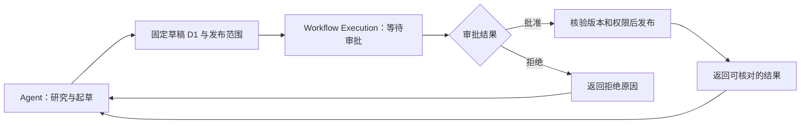

# Agent 与 Workflow：把探索和固定流程接起来

前置阅读：[02 课](02-Session-Run与Execution为什么需要分开.md)、[04 课](04-Agent-Loop的动作观察与模型输出失败处理.md)

研究助手整理出草稿 D1，下一步要由用户审批，再生成正式交付记录。若让模型自己记住“审批以后才发布”，流程可能在上下文压缩后丢失；若把所有资料研究都画成固定节点，检索和澄清又会显得僵硬。

Agent 擅长根据新信息决定下一步，Workflow 擅长把已知步骤和前提保存下来。两者协作的关键，是在交接处固定目标、参数和结果，而不是互相替代。

## 把确定的事交给流程

研究阶段可能需要补充查询，也可能直接回答。发布阶段则有明确顺序：接受指定草稿、等待批准、检查批准是否仍然有效、执行发布并记录结果。



图里的 Execution 属于 Workflow。Agent 的 Run 可以挂起等待它，也可以在产品允许的范围内推进另一项独立任务。审批流程有自己的身份，不能因为聊天窗口刷新就重新创建。

这个示例只讨论流程协作。持久等待、重复回调和旧批准失效将在第 22 课展开。

## 入口参数决定流程到底在处理什么

启动流程时，不要只传一句“发布刚才的报告”。“刚才”依赖聊天位置，而后续修订会改变它的含义。流程入口需要明确的草稿版本、目标范围及所需审批类型。

以下是入口参数的教学示例：

```json
{
  "draft_id": "report-draft",
  "draft_version": "D1",
  "publication_scope": "internal-team",
  "approval_required": true
}
```

approval_required 不是让模型决定是否审批的开关。示例用它展示流程策略，真实应用应从可信策略中确定这一要求，拒绝模型随意改为 false。对下游有实质影响的默认值，也不应靠模型猜测。

流程返回结果应区分“已受理”“等待中”“已拒绝”“已发布”和“发布结果待核对”。HTTP 受理成功只能证明请求进入系统，不能证明报告已经对读者可见。

## 交接时给模型一段短说明

在 Run 准备启动或续接 Workflow 时，追加以下提示词片段。输入来自草稿存储、当前流程定义及已提交的 Execution 状态，而非从聊天文本重新猜测。

```text
[新增：流程交接]
启动流程前提供明确的 draft_id、draft_version 和 publication_scope。
缺少必填值时询问或读取可信记录，不补造版本。
已有对应 Execution 时消费其状态，不重复启动。
waiting_approval：说明正在等待谁确认哪个版本，不代替用户批准。
rejected：报告拒绝及可见原因，按用户要求修订。
published：引用已确认的成果标识和访问范围。
unknown：说明结果待核对，不声称发布成功，也不自行重发写入。
```

这段提示词帮助模型准确讲述流程事实。运行时仍需执行参数校验、权限检查和状态迁移。用户在参考材料中看到的“同意发布”，不等于审批端收到了一条有效授权。

预期行为是：流程返回 waiting_approval 后，助手告诉用户“D1 正在等待审批，尚未发布”。失败对照是模型把“流程启动成功”改写成“报告已发布”，或者为了尽快完成任务自行发送批准动作。

## 交接之后，结果也要能回得来

Workflow 完成后，Run 需要能够关联它对应的结果。不要依赖一条偶然到达的内存回调；持久记录的 Execution ID 和等待关系，才让重启后的程序知道该消费哪一条完成通知。

流程失败也需要保留原因。审批拒绝属于业务结果，不必当作基础设施异常无限重试；发布连接超时可能导致外部结果未知，不能简单回到“再次发布”节点。流程图能表达顺序，却不能自动解决外部系统的一致性问题。

固定 Workflow 的成本是修改流程需要明确版本和迁移策略。任务主要是临时探索时，直接由 Agent Loop 组织只读动作更轻；操作前提稳定、需要等待或有外部效果时，Workflow 的价值更明显。

## 在纸上模拟一次修订

练习：D1 进入审批后，用户要求删去一段并生成 D2。此时 D1 收到批准。画出 Agent 和 Workflow 各自接下来可以做的事。

预期结果：批准只对应 D1；D2 需要自己的有效审批。助手可以说明已有批准与当前修订版不匹配，不能声称 D2 已发布。若选择取消 D1 的待办，系统记录取消结果；若 D1 已进入发布，还要核对真实效果。模型负责解释和提出后续动作，流程与执行层负责批准生效和发布事实。

上一课：[04 课](04-Agent-Loop的动作观察与模型输出失败处理.md) · 下一课：[06 课](06-多模型供应商适配与配置发布.md) · [学习路线](README.md)
