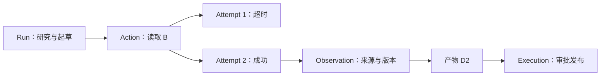

# 执行轨迹与审计：解释报告怎么形成，也解释哪里没完成

前置阅读：[19 课](19-持久化状态机与事实源设计.md)、[20 课](20-幂等外部副作用与未知结果.md)、[27 课](27-从临时文件到正式成果产物生命周期.md)、[29 课](29-REST-SSE-Webhook与断线恢复.md)、[30 课](30-Agent聊天执行过程与历史重建.md)

用户看到“方案 B 的更新机制仍需确认”，想知道助手查了什么；管理员看到发布结果未知，想知道请求到底有没有发出。聊天历史能解释一部分，但很难仅凭对话气泡回答一次调用的所有细节。

执行轨迹把任务、动作、尝试、观察和成果连起来。审计则关心谁在什么授权与内容版本下作出了什么决定。两者可以共享关联标识，但面向的问题和可见范围不同。

## 从因果关系组织轨迹

一条合理的轨迹可能是：Run 接受比较任务，Action 查询 B，Attempt 发出读取，Observation 返回空结果，Run 请求补材料，后续生成 D2，Workflow 等待审批，发布 Action 返回待核对。

稳定标识比一长串自然语言日志更有用。每个事件保留对象关联、任务版本、时间和结果类别，读者才能把重试识别为同一动作的多个尝试，而不是多个独立业务意图。

图表达因果，不要求 UI 逐项显示所有底层细节。面向研究者可以折叠为“资料读取已重试并成功”，面向排障者再展开每次 Attempt。

## 事件流是线索，领域事实解释结果

遥测系统的 span 很适合看耗时与跨服务调用，但采样、丢包和异步传递可能让它不完整。发布是否成功应读取业务结果记录，不能仅凭某个 span 显示绿色。

反过来，领域状态 completed 也不说明性能良好。一次 Run 可能成功，但经历长时间限流。将业务事实与遥测关联，才能既回答“结果是什么”，又解释“为什么耗时这么久”。

异步委派不一定属于同一条同步调用栈。父 Run 和子 Run 可以用明确的因果链接关联，避免伪造一条从始至终持续占用线程的调用链。跨 Run Goal 也应保留自己的关系，而不是随意复用一个 trace ID 代替所有业务身份。

## 审计需要保留决定依据，不需要暴露全部内容

对一次报告发布，审计通常需要审批主体、对象版本、访问范围、决定时间、有效策略版本和实际发布结果。若批准 D1、发布 D2，关联检查就能发现问题。

不必为了审计保存所有敏感正文或模型内部思考。可核对的来源引用、简短决策依据、输入摘要和内容摘要往往更合适。需要原文留存时，应明确用途、访问权限和保留期限；内容摘要也不能替代所有事实验证，它只能帮助确认字节是否一致。

审计记录本身也需要权限和完整性保护。普通租户不应读取其他团队的轨迹；管理员查看敏感证据也应有明确范围。导出、搜索索引和调试界面都是披露边界，不能只保护主页面。

## 对未知结果保留不确定性

发布请求发送后响应丢失，轨迹应显示发送事实、可用请求标识和待核对状态。缺少响应不是“对方失败”，日志里也不应为了便于统计统一写成 failed。

后续查询确认已发布时，追加核对结果并关联原 Action。不要覆盖原始记录，让它看起来从未发生过未知状态。这样既能解释恢复行为，也能检查系统有没有在核对之前盲目重发。

审计系统是否采用追加记录、版本化表或专用事件存储，是实现选择。关键是保护重要决定的历史，并提供可以读取当前事实的索引，避免每次页面查询都重放全部事件。

## 从轨迹反推一份报告的可信边界

练习：轨迹中有“读取 B 超时”“使用 source-a@v1 生成 D1”“审批 D1 通过”“发布 D2 成功”。指出哪一项需要调查，以及报告中不能声称什么。

预期结果：D2 与获批 D1 不一致，需要核对是否存在缺失的 D2 审批或执行错误；B 的读取失败不能作为 B 不具备某能力的证据。调查应围绕版本、动作和授权事实，不要求公开模型隐藏推理。报告若仍存在证据缺口，应在用户视图中保留，而不是只藏在管理员日志里。

上一课：[31 课](31-Vue多前端共享层与组件边界.md) · 下一课：[33 课](33-Agent-Runtime的微内核与插件边界.md) · [学习路线](README.md)
