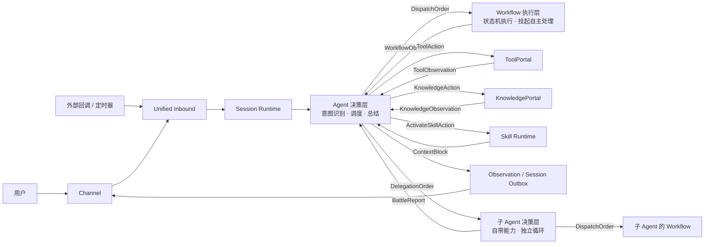
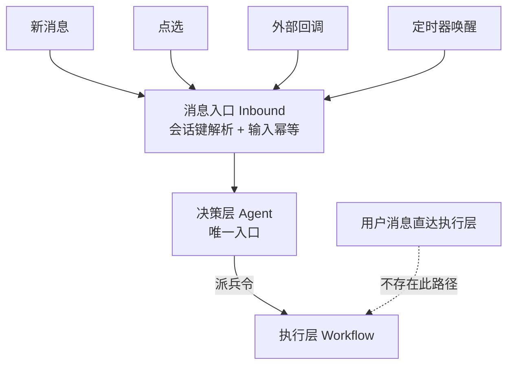

# Agent Runtime：MVP-0 技术底座需求

> 本文定义 MVP-0 技术底座的需求与验收标准。
> FR 编号在本文和 [04-P1/P2 需求扩展](04-后续阶段需求扩展-P1-P3.md) 中全局唯一。
> 类型、状态机和事实源边界见 [03-核心对象模型与状态机](03-核心对象模型与状态机.md)。

---

## 1. 背景与问题陈述

### 1.1 背景

Agent（智能体）与 Workflow（工作流）是两类互补的执行单元：

- **Agent** 擅长开放性问题：理解模糊意图、分解目标、临机应变、用自然语言产出结果。
- **Workflow** 擅长确定性问题：按预定步骤推进、状态可追踪、挂起可恢复、结果可审计。

两者单独使用都有短板：Agent 单独跑容易失控且不可复现；Workflow 单独跑无法应对
未预定义的输入。业界常见的做法是让 Agent 与 Workflow 混合编排，但在多数实现中，
两者的边界是模糊的——Agent 代码深入 Workflow 内部状态，Workflow 又被迫做决策，
导致：

1. **职责混杂**：编排层（Agent 侧）承担了执行层（Workflow 侧）的战术职责
   （拦截节点类型、组装恢复快照、注入上下文），执行层的入口被调用方层层包裹。
2. **契约隐式**：执行层的结果通过"消息文本 + 裸键 Map"回传，消费方靠
   倒序捞字符串理解结果，拿不到结构化战果（提取的实体、关键状态变量）。
3. **恢复分散**：同一"执行挂起"事实，在多个类中各自组装恢复上下文，
   恢复通道（用户输入 / 点选 / 外部回调 / 定时器）行为不一。
4. **演进困难**：编排层成为上帝类（单文件数千行），无法独立测试与演进。
5. **入口旁路**：用户消息存在直达执行层（Workflow 直连）的旁路路径，
   会话归属与决策上下文被绕过，Agent 无法统一决策。

### 1.2 问题陈述

我们需要一套**职责边界清晰、协作契约显式、可独立演进**的 Agent 与 Workflow
协作模型。本目录的当前设计是实现的唯一基线；现有代码与设计冲突时直接替换或删除，不保留旧行为、旧入口或双轨兼容层。

---

## 2. 目标与非目标

### 2.1 目标

| # | 目标 | 度量方式 |
| :-- | :-- | :-- |
| G1 | 职责清晰：编排层与执行层各管一段 | 编排层不再出现节点类型判断、快照组装逻辑 |
| G2 | 契约显式：双向数据流只使用四类契约——执行指令 / 执行报告 / 执行事件 / 委派指令 | 新增第三方消费方无需读执行层源码 |
| G3 | 可演进：执行层可替换、编排层可扩展 | 同一执行引擎可被两个以上编排策略驱动 |
| G4 | 设计即基线：实现只服从当前契约，不保留冲突的旧路径 | 架构一致性测试通过；旧旁路、旧类型和兼容适配器不存在 |
| G5 | 有状态 Agent：人格、关系、记忆与策略可通过稳定扩展点进入上下文 | 陪伴型 Agent 无需修改 Kernel 即可落地 |
| G6 | 多执行会话：持续对话与复杂 Workflow 可在同一 Session 中并存 | Workflow 挂起或后台运行时 Session 仍可处理新输入 |
| G7 | 能力分类稳定：只有 Skill、Tool、Workflow、Knowledge Source 可挂载 | 其他产品对象不能扩展 CapabilityType 或形成调用旁路 |

### 2.2 非目标（MVP-0 明确不做）

- 不扩展状态机的业务语义范围（节点、边、条件求值）；现有引擎只在符合新契约时复用，否则可直接替换。
- 不做全链路分布式事件驱动重写；MVP-0 保留前台同步调用，并为后台 Execution 提供持久队列、事件回注和恢复能力。
- 不做执行失败后的自动修复（LLM 应急修复留待后续阶段）。
- 不做多智能体对等协作（Agent 之间平级协商 / 竞价 / 群组不在本次范围。
  主从式委派见 FR-15，P2）。
- 不在 Kernel 中固化陪伴业务字段（熟悉度、情感值、称呼策略等）；MVP-0 只提供上下文、关系状态和策略扩展原语。
- 不做动态插件安装、热更新和跨进程插件隔离；MVP-0 使用显式注册或 Spring 容器装配。
- 不要求所有 Workflow 异步化；前台同步执行与后台持久执行同时存在。

---

## 3. 角色与概念模型

| 角色 | 定义 |
| :-- | :-- |
| **决策层（Agent）** | 接收用户意图，分解目标，选择执行单元并下达指令；根据执行结果决定下一轮动作。 |
| **执行层（Workflow）** | 按指令执行确定性步骤；节点、状态和挂起由执行层内部处理。 |
| **执行事件（ExecutionEvent）** | 执行层向决策层与外部消费方发布的进度和结果事件。 |
| **执行指令（DispatchOrder）** | 决策层到执行层的唯一输入契约：目标、参数和只读上下文引用。 |
| **执行报告（BattleReport）** | 执行层到决策层的唯一输出契约：状态、结果和结构化数据。 |
| **能力引用** | `type + capabilityId + versionId` 组成的不可变引用；类型专属字段由对应 Descriptor 定义。 |

### 3.1 能力构成：Agent 挂载什么

Agent 只挂载以下四类能力，构成当前 input 可路由的能力集合：

| 能力 | 定义 | 谁使用 |
| :-- | :-- | :-- |
| **Workflow** | 确定性流程执行单元：按预定步骤推进，可挂起和恢复。 | Agent 通过执行指令调用。 |
| **工具 Tool** | 以名称、说明、输入契约和可选输出契约暴露的可调用执行能力；复杂度不改变其 Tool 身份，Connector 只是部署实现。 | 决策层通过已挂载的 ToolDeployment 调用，结果进入观察。 |
| **Knowledge Source** | Agent 获准通过 Knowledge Runtime 查询的版本化知识来源。 | Agent 决定目标、模式、预算与停止；Runtime 规划来源与 Operator 并返回证据。 |
| **Skill** | 以 `SKILL.md` 为入口、可包含指令、脚本、参考资料和资产的可复用程序性知识包；自身不授予执行权、状态或副作用。 | 通过渐进式披露常驻或按需装载，指导当前决策与受权 Tool 使用。 |

**设计含义**：`CapabilityType` 有且只有 `SKILL / TOOL / WORKFLOW / KNOWLEDGE_SOURCE`。Workflow 走派兵令；Tool、Knowledge Source 和 Skill 在 Agent 路径由决策层受控消费。Workflow 只有定义中显式声明的 ToolCallNode/KnowledgeQueryNode 才能使用对应能力槽。P2 Agent 委派使用独立 DelegationOrder 与授权关系，不是第五种 CapabilityType，也不进入 CapabilityMount。
Workflow 不可直连用户消息——用户消息只能发给决策层，Workflow 只能经
派兵令被驱动（§3.2 原则 6）。

Persona、Memory、RelationshipState、ContextPipeline 和 PolicyChain 属于认知上下文；Session/Inbox/Outbox/Multi-Execution/HITL/Recovery 属于会话执行；Channel、Connector、Open Platform、身份、Trace、Usage 和 Audit 属于集成治理；Builder、Marketplace、Handoff、Billing、Compliance 和运营后台属于产品运营。它们均不能伪装成可挂载能力。

**能力=三角色（Capability Seam）**：每一项能力都是"服务定义（接口）+
服务提供方（实现，可多个可替换）+ 消费方（决策层/工具）"三件套，
单一角色不构成能力——新增能力必须三角色齐备（详见
[02-实现思路 §3.2 Capability Seam](02-微内核插件架构实现思路.md)）。

**Scope 分层挂载**：能力按 `agent → preset → global` 分层解析为版本化 `CapabilityRef`。
不同 Agent 的挂载互不可见，运行时不得以同名全局搜索替代显式挂载。
**Preset 组合**：Agent 的能力集合以组合声明（preset）为单位整体装载，
一个 Agent 一份声明（Workflow/Knowledge Source/Tool/Skill 清单），每个 input 按声明冻结实际能力组合。

### 3.2 核心原则

1. **决策层不介入节点执行**：决策层不下达节点级指令，不读取执行层内部状态，
   不组装恢复快照。
2. **执行层不承担决策**：执行层不感知决策层的存在，不决定"选哪个目标、
   要不要总结"。
3. **事件只表达事实**：事件只负责"发生了什么"，不承载决策逻辑。
4. **契约即接口**：派兵令 / 战报 / 号角是唯一的数据通道，禁止隐式传参。
5. **挂载即能力**：Agent 的能力由四类挂载集合决定（Skill / Tool / Workflow /
   Knowledge Source），能力清单是 Agent 配置的一等公民；Agent 委派使用独立授权，
   不进入 CapabilityMount。
6. **Agent 是会话唯一入口**：会话（session）的创建、续接、恢复均以决策层（Agent）
   为唯一入口；执行层（Workflow）不可直连用户消息，只能经派兵令被驱动。
   外部唤醒（回调/定时器）同样先进决策层，由 Agent 决定如何应对。
7. **委派受控**：Agent 可委派其它 Agent 执行子任务，但委派目标必须在本会话
   scope 内可见、有环检测与深度上限、子 Agent 不持有会话（继承父会话只读引用）、
   子执行消耗计入父循环预算（FR-15，P2）。

**角色协作关系总览**：

---

## 4. 功能需求

> 需求编号 FR-xxx，每项含验收标准（可测试）。

### FR-1 派兵令（决策层 → 执行层）

**描述**：决策层向执行层下达执行指令，契约字段如下。

| 字段 | 必填 | 说明 |
| :-- | :-- | :-- |
| `execution_unit_id` | 是 | 目标执行单元（如工作流实例）标识 |
| `definition_version` | 是 | 能力解析后固定的 Workflow 定义版本；运行中不可漂移 |
| `mode` | 是 | `foreground` / `background`；不得通过节点扫描推断 |
| `input` | 是 | 目标化输入：决策层提炼后的任务描述（可默认透传用户原话） |
| `params` | 否 | 结构化参数：从用户话术提取的业务参数，注入执行上下文 |
| `evidence_refs` | 否 | 已冻结知识证据引用；只包含 bundle、item、version 与来源事件标识，不复制证据正文 |
| `meta.tenant_id` | 是 | 租户标识 |
| `meta.session_id` | 是 | 会话标识 |
| `meta.agent_id` | 是 | 发起执行的 Agent 标识，用于 Scope、策略和审计 |
| `meta.end_user_id` | 是 | 入口显式传入并校验的 Session 用户标识；执行层只读透传，不从 Session、默认用户或渠道引用推导 |
| `meta.execution_id` | 是 | 本次执行标识（幂等与账本关联） |
| `meta.trace.input_id` | 是 | 触发本次调度的当前 Inbound 标识，用于输入幂等和动作关联 |
| `meta.trace.root_input_id` | 是 | 原始用户问题或业务触发的根 Inbound；恢复、回调和后台回注沿用 |
| `meta.trace.trace_id` / `span_id` | 是 | 当前技术执行尝试的 W3C Trace Context 标识；异步边界创建新 trace 并保留因果链接 |
| `meta.trace.event_id` / `caused_by_event_id` | 是/否 | 当前持久事件及直接原因事件；根事件的 caused_by 为空 |
> 字段命名说明：本表为概念层使用 snake_case（贴近事件/配置契约）。
> 对象模型的 Java record 草案使用 camelCase（如 `executionUnitId`），
> 二者为同一契约的两种视角，落地时以宿主项目序列化约定为准
> （record 草案唯一家在 [03-核心对象模型与状态机](03-核心对象模型与状态机.md)，命名对照见其附录 A）。

**验收标准**：

- FR-1.1 决策层不传节点级指令（不出现 `node_id`、节点类型等字段）。
- FR-1.2 决策层不传恢复快照（`pendingState` / `checkpoint`），恢复上下文由
  执行层按 `meta.execution_id` 自查。
- FR-1.3 `params` 注入执行上下文 `ctx_*` 变量，覆盖能力默认参数；Session 历史、Persona、关系状态和记忆不得作为隐式参数注入 Workflow。
- FR-1.4 `definition_version` 与 `mode` 在 dispatch 持久化时固定；缺失时拒绝执行，不由 Workflow 运行中猜测。
- FR-1.5 tenant、session、agent、user、execution 与 TraceContext 贯穿日志、账本和事件；任一归属不一致时拒绝 dispatch。技术 trace 不作为跨挂起业务链主键。
- FR-1.6 DispatchOrder 不携带完整 history、userProfile、RelationshipState 或 Memory；Workflow 所需业务数据必须通过白名单 `params` 显式传入。
- FR-1.7 `evidence_refs` 只能引用本 Session 已提交的不可变 EvidenceBundle；Workflow 通过声明的 KnowledgeQueryNode 解析引用，禁止借此读取完整 SessionLog 或在恢复时重新检索。
- FR-1.8 DispatchOrder 不携带 `allowHitl`。挂起是已发布 Workflow 版本的执行语义；调用方不能为同一版本选择“允许挂起”或“禁止挂起”两条路径。

### FR-2 战报（执行层 → 决策层）

**描述**：执行层执行完毕返回结构化结果。

| 字段 | 必填 | 说明 |
| :-- | :-- | :-- |
| `status` | 是 | `completed` / `waiting_hitl` / `failed` / `loop_terminated`；`loop_terminated` 表示回边循环保护终止，不得映射为正常完成 |
| `output` | 否 | 面向用户/决策层的最终文本（无卡文本） |
| `cards` | 否 | 结构化卡片列表（透传，不重渲染） |
| `data` | 否 | 结构化战果：按能力声明导出的关键变量/提取结果 |
| `pending` | 否 | 挂起交互投影（仅 `waiting_hitl`）：pendingId、executionId、nodeId、nodeType、交互类型、actionKeys 和 expiresAt；不包含 checkpoint、节点变量或内部 runId |

**验收标准**：

- FR-2.1 战报只含结果，不含过程；节点级进度经号角事件另行送达。
- FR-2.2 `data` 为空时，消费方（如 LLM 总结）使用 `output` 文本；不读取旧 Map 或历史消息推断结果。
- FR-2.3 `pending` 是 Execution Ledger 的受控交互投影；消费方不自行拼接，也不能从中读取或恢复 checkpoint、节点变量和原始第三方载荷。

### FR-3 号角事件（执行层 → 事件总线）

**描述**：执行层在关键节点发布事件，决策层与外部消费方订阅。

| 事件 | 触发 | 消费方 |
| :-- | :-- | :-- |
| `execution.queued` | DispatchOrder 已持久化，等待执行插件受理 | ExecutionRegistry；前端任务清单 |
| `execution.started` | 受令开始执行 | 前端任务清单；决策层（可选） |
| `execution.step` | 节点级进度 | 前端任务清单 |
| `execution.hitl` | 挂起等待 | 决策层（决策等待/取消）；前端；定时器 |
| `execution.resumed` | 从挂起恢复 | 决策层（更新认知）；前端 |
| `execution.completed` | 执行完成 | 决策层（总结/下一轮）；前端 |
| `execution.failed` | 执行失败 | 决策层（重试/转人工）；前端 |
| `execution.loop_terminated` | 回边循环保护终止 | 决策层（降级/转人工）；前端 |
| `execution.cancelled` | 取消 CAS 成功 | ExecutionRegistry；决策层；前端 |

**验收标准**：

- FR-3.1 事件载荷统一包含 `event_id`、`tenant_id`、`session_id`、`execution_id`、`execution_revision`、`status`、`trace`、`occurred_at` 和版本化 payload；`trace` 使用统一 TraceContext，`execution_revision` 是该 Execution 的单调递增账本版本，每个持久执行事件（含 `execution.step`）独占一个 revision，字段命名跨事件一致。
- FR-3.2 账本状态/进度记录与待发布事件必须在同一原子边界提交；提交成功后才广播进程内事件，SSE、Webhook 等远程投递从 Outbox 异步完成。订阅或投递失败不得回滚、改写或重复执行已提交的业务结果。
- FR-3.3 事件总线可同时送达至少三类通道：SSE（实时）、外部回调、定时器。
- FR-3.4 **事件分三域**：会话事件（持久、可重建）/ 能力事件（策略接入点）/
  运行时事件（活动观察）——新事件先判域再设计，选错域视为设计缺陷。
- FR-3.5 **模型可见 ⟺ 已记录**：任何进入模型请求的内容（prompt 片段、工具
  schema、检索结果、战报 data）必须能从会话日志重建；新增模型可见输入 =
  新增一条会话事件（验收：日志回放可完全重建一次模型请求）。
- FR-3.6 **判别标签事件**：事件类型用封闭联合而非自由字符串；消费方 switch
  穷尽所有类型，新增类型须显式处理（default 兜底）。
- FR-3.7 Execution Ledger 状态迁移与 queued、started、hitl、resumed、completed、failed、loop_terminated、cancelled 事件一一对应；投影方按 `event_id` 幂等、按 `execution_revision` 判序，重复或旧版本事件不得覆盖新状态，同一 revision 的不同 eventId 视为契约冲突并告警。

### FR-4 挂起与恢复

**描述**：执行层内部挂起（等用户 / 等外部 / 超时）与恢复统一收敛；MVP-0 的多执行并存、确定性恢复路由与重启重建见 FR-18，P1 的语义唤醒产品增强见 FR-12，P2 的任意节点中断续跑见 FR-13。

**恢复通道**：

| 通道 | 触发 | 语义 |
| :-- | :-- | :-- |
| 用户输入 | 新消息 | LLM 语义判定是否在回应对应挂起，是则恢复，否则走新对话 |
| 点选 | 交互卡确认 | 按 `action` 恢复 |
| 外部回调 | 业务系统事件 | 按回调动作恢复 |
| 定时超时 | 挂起超时 | 按 `timeout` 动作恢复（走超时分支） |

**验收标准**：

- FR-4.1 四类通道走同一恢复入口（位于决策层 Recovery）；外部唤醒先进 Unified Inbound，再由 Recovery 构造 ResumeExecutionCommand 调用 WorkflowPortal；挂起上下文只由执行层按 executionId 自查。
- FR-4.2 恢复后状态连续：已收集信息（如手机号）不丢失。
- FR-4.3 超时恢复语义与正常恢复可区分（`timeout` 动作走条件边）。
- FR-4.4 恢复可重入：同一挂起被重复恢复（如回调与用户输入竞争）时，
  第二次恢复被幂等拒绝，不产生重复执行。
- FR-4.5 恢复动作进入会话日志（`execution.resumed` 事件），回放可见完整
  挂起-恢复链路（何时挂起、谁触发、以何动作恢复）。

### FR-5 类型化能力契约（部队编制）

**描述**：能力使用共同身份头和类型化领域对象，替代运行时节点扫描与包含所有类型字段的通用 Descriptor。共同身份只包含 `CapabilityRef`、名称、说明、租户、来源、信任级别、状态和版本哈希；Skill、Tool、Workflow 与 Knowledge Source 的专属字段不能混放。

| 类型 | 专属契约 |
| :-- | :-- | :-- |
| SkillDefinition / SkillCatalog / SkillResolver / SkillActivation | 标准 Skill 包及不可变版本、目录发现、精确版本解析、渐进加载与激活结果；宿主激活策略、依赖、冲突、预算和信任信息与可移植包内容分层 |
| ToolDefinition / ToolRegistry / ToolResolver / ToolInvocation / ToolResult | 名称、说明、输入/输出 schema、版本化目录和精确解析；调用侧另保存副作用等级、幂等语义、确认策略、超时、敏感字段和 Provider 要求 |
| WorkflowDescriptor | 输入/输出 schema、`supports_hitl`、`export_fields`、超时、并发安全和定义版本 |
| KnowledgeSourceDescriptor | 来源类型、允许算子、权限、时效、引用和版本策略 |

**验收标准**：

- FR-5.1 Workflow 定义含挂起节点但未声明 `supports_hitl=true` → 发布校验拒绝；该字段不能出现在 Skill 或 Tool 定义。
- FR-5.2 未声明 `export_fields` 时，战报 `data` 为空（不默认导出全部状态）。
- FR-5.3 能力未提供符合自身类型 schema 的完整 Descriptor 时禁止发布或调用，不根据旧默认行为补齐。
- FR-5.4 **调用面检查不可绕过**：消费方暴露/调用前必须检查对应调用面。
  user-only 能力对模型面不可见（模型面工具列表不出现）；模型面不检查即调用 → 拒绝。
- FR-5.5 **schema 白名单**：模型只看到已挂载能力的受控名称、说明、参数 schema 或 Skill 目录元数据，以及运行时生成的不透明 handle；版本、部署、输出定义、超时、并发和凭证元数据不进入模型请求。
- FR-5.6 **规范输出**：能力声明输出 schema，执行返回经校验的 JSON 值。
  展示投影（render）是纯函数，直播与回放渲染一致。
- FR-5.7 每个 input 受理时冻结实际 `CapabilityMount` 集合；同一 Loop 内配置不漂移，下一个 input 才可解析新发布或新挂载版本。Workflow Execution 额外冻结定义版本、ToolDeployment 和 KnowledgeQueryNode 配置，恢复时不得重新解析当前版本。

### FR-6 决策层编排

**描述**：决策层内部按职责拆分，对外只暴露当前设计定义的 Unified Inbound 入口。

| 子组件 | 职责 |
| :-- | :-- |
| Director（决策协调） | 入口分发、执行调度、事件处理、总结与下一轮决策 |
| Planner（计划） | 目标分解：意图识别、计划生成与校验 |
| Executor（执行调度） | 按步骤类型分派（执行单元 → 派兵令；LLM → 直接调用） |
| Recovery（恢复） | 四类恢复通道统一入口 |

**验收标准**：

- FR-6.1 对外公开入口按 `InboundEnvelope` 与查询/控制命令契约重新定义；旧签名与直连 Workflow 入口直接删除。
- FR-6.2 每个子组件可独立单元测试，不依赖其他子组件的内部实现。
- FR-6.3 决策层按 Agent 的 scope 链解析能力（agent → preset → global），
  派兵/调工具/检索均经能力路由，不硬编码能力来源。
- FR-6.4 决策层的决策过程（意图、派兵令、战报、总结）全部落入会话日志，
  可回放（NFR-7）。
- FR-6.5 决策层是会话唯一入口：会话创建/续接/恢复均以 Agent 为唯一目标。
  用户消息只进决策层，不存在直达执行层（Workflow）的会话路径。

### FR-7 Agent 能力挂载

**描述**：Agent 可挂载 **Skill、Tool、Workflow、Knowledge Source** 四类能力。Workflow
经派兵令消费，其余三类在 Agent 路径受控消费；挂载集合构成 Agent 的能力清单，
随 Agent 生命周期管理。
挂载按 Scope 分层注册、以 Preset 组合声明为单位（见 §3.1）。

| 能力 | 消费方式 | 说明 |
| :-- | :-- | :-- |
| Knowledge Source | 自适应证据获取 | 由 Knowledge Runtime 解析；`NONE` 不检索，`GROUNDING` 单轮取证，`RESEARCH` 作为 Action 进入循环 |
| 工具 Tool | 指令式调用 | 通过已挂载 ToolDeployment 请求可调用能力，ToolResult 作为 Observation 进入决策循环 |
| Skill | 常驻或按需装载 | 标准目录包按 metadata、完整 `SKILL.md`、按需资源渐进加载；`ALWAYS` 随 input 激活，`ON_DEMAND` 经 ActivateSkillAction 在当前 Loop 生效 |
| Workflow | 派兵令 | 通过 WorkflowPortal 建立可挂起、恢复和审计的独立 Execution |

**验收标准**：

- FR-7.1 Agent 配置含版本化能力挂载清单（Workflow / Tool / Knowledge Source / Skill），可增删、可查询；绑定时对四类资源统一校验租户、可见性、发布状态和版本，挂载变更不重建 Agent；任何其他资源类型进入挂载请求均拒绝。
- FR-7.2 Knowledge 使用 `NONE`、`GROUNDING`、`RESEARCH` 三种模式；Agent Runtime 决定模式、研究目标、总预算和停止，Knowledge Runtime 不回复用户、不派发 Workflow，也不拥有会话决策权。
- FR-7.3 工具：Agent 只能用当前 input 冻结挂载表生成的 `toolHandle` 调用 ToolDeployment；不存在按任意名称查询租户工具、未命中 Mock 成功或 Provider 重名静默覆盖。输入、策略、确认、幂等、外部调用、输出和计量依次经统一守卫；ToolResult 与战报平级，不经派兵令。
- FR-7.4 Skills：Skill 是以 `SKILL.md` 为必需入口的标准目录，可包含 `scripts/`、`references/`、`assets/` 等资源；发布版本不可变，发现只暴露 metadata，激活后加载完整指令，执行中按需读取资源。包内脚本只能经已挂载且已授权的 Shell、Code Execution 或专用 Tool 执行；`allowed-tools`、正文和脚本都不能授予凭证、Provider、网络或其他权限。`ALWAYS/ON_DEMAND` 是宿主激活策略，激活只影响当前 input/Loop，不创建 Workflow Execution 或 checkpoint。
- FR-7.5 能力清单是派兵令路由的一部分：目标指向 Workflow 时走派兵令。
  Agent 路径指向 Tool / Knowledge Source / Skill 时由决策层受控消费。Workflow 内预定义的 KnowledgeQueryNode 是类型化能力消费者，不把知识请求伪装成派兵令，也不获得会话决策权。
- FR-7.6 **能力 = 三角色**：每项挂载能力必须同时具备服务定义/提供方/消费方。
  只提供实现类而无消费方的不算已挂载能力（验收：挂载清单只接受三角色齐备的能力）。
- FR-7.7 **Scope 隔离**：Agent A 挂载的能力对 Agent B 不可见；按
  `agent → preset → global` 解析显式 CapabilityRef，同名不参与路由，多版本冲突必须由挂载配置明确选择或稳定拒绝。
- FR-7.8 **Preset 组合**：Agent 的能力组合以 preset 声明为单位整体装载。
  运行时改组合只影响后续 input；同一 input/Loop 保持冻结挂载，历史调用按快照回放。
- FR-7.9 **调用面（Invocation Policy）**：能力按模型面/用户面分别声明可调用性
  （四象限）；消费方在暴露前必须检查对应调用面，user-only 能力对模型不可见。
- FR-7.10 `NONE` 不得调用任何知识来源；`GROUNDING` 只执行受预算约束的单查询计划，失败或空结果按可选上下文降级；`RESEARCH` 以 KnowledgeAction 进入 Agent Loop，证据不足时由 Agent 决定继续、换源、澄清或停止。
- FR-7.11 Agent 只向 Knowledge Runtime 提交显式 KnowledgeRequest；Runtime 在允许来源、算子、权限、时效和预算内生成 KnowledgePlan，MVP-0 允许单查询计划，复杂拆分、并行检索、链接追踪和 Runtime 内迭代留 P1 FR-19。
- FR-7.12 Knowledge Runtime 返回不可变 EvidenceBundle；候选、选中、注入和明确引用分别记录。证据必须先作为 SessionLog Observation 提交，再经 PolicyChain 与 ContextPipeline 进入 AgentContextSnapshot。
- FR-7.13 Vector、Keyword、Wiki/Link 和结构化检索是 Knowledge Operator，不直接生成最终用户回复；图谱与 GraphRAG 不属于产品实现范围。
- FR-7.14 Workflow 不拥有 Knowledge Runtime；只有定义中显式声明的类型化 KnowledgeQueryNode 可经同一守卫管道查询或解析 EvidenceRef，未声明节点的 Workflow 不可访问知识能力。
- FR-7.15 Knowledge Runtime 只能产生 Memory 或机构知识的 KnowledgeWriteProposal；提案不得直接激活 MemoryFact 或修改 KnowledgeBase。
- FR-7.16 Skill 的 `requiredCapabilities` 只用于资格校验，不能自动挂载能力或扩大授权；依赖缺失、冲突组冲突或完整指令块超预算时产生稳定拒绝 Observation，不静默截断。
- FR-7.17 ToolDefinition/ToolVersion 定义不可变业务契约，ToolDeployment 绑定 Platform Handler、ConnectorInstance、MCP 或其他 Provider，AgentToolMount 才授予调用权。Mock 只能作为测试环境显式 Deployment。
- FR-7.18 Tool 的破坏性或非幂等写入按 ToolVersion 的宿主确认策略形成 Agent Runtime Pending；MCP `input_required` 使用独立的 Tool 输入等待契约继续同一逻辑 Action。需要业务步骤编排、持久状态机、补偿或多人协作的过程仍建模为 Workflow，不能只靠 Tool 描述或 Skill 指令保证。

### FR-8 会话与消息入口（会话唯一入口）

**描述**：会话（session）是用户与 **Agent** 之间对话上下文的容器，以 Agent 为
唯一归属目标；执行层（Workflow）不持有会话、不可直连用户消息。所有进入系统的
输入——新消息、续接、点选、外部回调、定时器唤醒——统一经消息入口进决策层。

**会话模型**：

| 概念 | 定义 |
| :-- | :-- |
| 会话（Session） | 用户 ↔ 单个 Agent 的对话上下文；创建时绑定 Agent，存续期间不变更归属 |
| 会话键 | `tenant_id + agent_id + session_id` 唯一标识，贯穿执行契约与会话日志 |
| 组合代（Generation） | 每个 input 受理时冻结的 Agent 能力装配版本；原快照用于回放，后续 input 可读取新组合（NFR-8） |
| 消息入口（Inbound） | 统一接收所有输入并路由到决策层的唯一端口 |

**生命周期**：创建（指定 Agent）→ join（scope 父链）→
对话 / 续接（每个 input 冻结组合代，消息全进决策层）→ 关闭（释放 scope 注册）。

**会话唯一入口示意**（所有输入统一收口，执行层不可直连）：

**验收标准**：

- FR-8.1 会话创建必须指定 Agent；不存在无 Agent 归属的会话。
- FR-8.2 会话续接不改变归属 Agent（跨 Agent 会话转移在 MVP-0 范围外，见 §6.2）。
- FR-8.3 所有输入（新消息 / 点选 / 外部回调 / 定时器唤醒）经同一消息入口进决策层。
  不存在绕过决策层直达执行层的通道。
- FR-8.4 执行层（Workflow）只接收 `session_id` 作为关联和追踪引用，不读取或修改 Session 聚合，也不持有对话、人格、关系或记忆状态。
- FR-8.5 恢复唤醒定位：外部回调 / 定时器按 `session_id + execution_id` 定位挂起，
  唤醒后仍先进决策层判定（FR-4.1），不直通执行层。
- FR-8.6 消息入口把每一条输入记录为会话事件（FR-3.5：模型可见 ⟺ 已记录），
  回放可见完整输入流。
- FR-8.7 **输入幂等**：入口以 `tenant_id + agent_id + session_id + input_id` 为幂等键，并保存规范化输入指纹、处理状态和结果引用。相同键与相同指纹的重复投递返回原 `processing` / `completed` / `failed` 结果，不重复入队或决策；相同键携带不同指纹必须以 `idempotency_conflict` 拒绝并审计。输入幂等与 FR-4.4 的恢复 CAS 分层，外部副作用仍遵循 FR-18.12。
- FR-8.8 **并发会话隔离**：同一 Agent 可服务多个并发会话；挂起、记忆、input 级能力快照、输入输出邮箱和活动执行视图互不串扰；同一会话的决策轮按序处理（单 flight），已启动且声明并发安全的 Execution 可独立并行。
- FR-8.9 **冷启动与续接同入口**：新会话（无历史）与续接（有历史）走同一消息入口；实时处理按当前 input 的冻结组合代组装，回放直接读取当时的 ContextSnapshot 和 CapabilityMount，不重新解析当前配置。
- FR-8.10 **身份绑定**：会话绑定入口显式传入的正数 `end_user_id`；入口先校验 tenant、agent、session、end_user_id 与 channel，再生成携带这些只读字段及 TraceContext 的 InboundEnvelope。缺失、非法或与已冻结身份不一致时拒绝；执行层不得从 Session、租户默认用户、externalUserRef 或 `user_id` 别名兜底获取。

### FR-11 决策循环（Agent Loop）

**描述**：决策层（Agent）收到用户输入后的循环执行模型——单轮由
**观察 → 思考 → 行动** 组成，循环直到收敛或达到预算上限。

| 环节 | 内容 | 输出 |
| :-- | :-- | :-- |
| 观察 | 收集号角事件 / 战报 / 工具结果 / 知识证据 / 记忆检索命中 | 上下文增量 |
| 思考 | LLM 决策：直接回答 / 调工具 / 派 Workflow / 委派 Agent / 研究 / 问用户 / 停止 | 决策 |
| 行动 | 执行决策（回答 / 派兵令 / 委派令 / 工具调用 / KnowledgeAction / 提问） | 新观察源 |

**验收标准**：

- FR-11.1 **终止条件明确**：自然收敛（直接回答且无新动作）、最大轮数、
  token 预算、用户打断、HITL 挂起——任一触发即停止本轮。
- FR-11.2 **循环预算可配置**：轮数 / token / 工具调用上限，超限降级
  （用已有上下文直接回答 + 标注，或转人工），不无限循环。
- FR-11.3 **挂起结束当前轮次**：HITL 挂起时持久化当前执行的循环状态（已执行动作、剩余预算）并结束本轮；Session 不被冻结，后续输入可开始新轮次；恢复时对应 Execution 从暂停点续跑。
- FR-11.4 **每轮入日志**：观察输入、思考决策、行动与结果全部为会话事件，
  回放可重建每一轮（FR-3.5 模型可见 ⟺ 已记录）。
- FR-11.5 **两种决策模式**：响应式（ReAct：边想边做）与计划驱动
  （先分解计划为 Todo 清单再逐步执行，FR-16，P2 见
  [04-后续阶段需求扩展-P1-P3](04-后续阶段需求扩展-P1-P3.md)）；同一 Agent 可切换，
  模式选择入日志。
- FR-11.6 **回放不重执行**：日志回放只按已记录的 Observation、模型响应、Action 和结果重建原轮次，不重新调用模型、工具、Workflow 或外部系统；处理中断后的继续执行只从最后一个已提交边界开始，并复用稳定动作标识查询既有结果。
- FR-11.7 **动作去重**：同一轮不重复调用同一工具 / 重复派同一派兵令
  （防 LLM 抖动），重复请求直接返回已执行结果。

### FR-17 有状态 Agent 上下文与策略运行时

**描述**：MVP-0 提供构建陪伴型、顾问型和长期服务型 Agent 所需的通用状态与策略原语，但不在 Kernel 固化具体陪伴业务字段。

| 原语 | 底座职责 | 产品扩展示例 |
| :-- | :-- | :-- |
| `PersonaProfile` | 稳定 Agent 身份下版本化保存表达约束和行为边界；每个新主 Run 固定当前发布版本，已有会话下一轮采用更新 | 陪伴语气、专业角色、品牌人格 |
| `RelationshipState` | 按 `tenant + user + agent` 隔离的可扩展关系状态容器；支持 schema 版本 | 称呼偏好、互动阶段、长期关注主题 |
| `ContextPipeline` | 按确定顺序装配工作上下文、近期对话、任务投影、会话/长期事实和知识结果；执行总预算裁剪 | 陪伴上下文、行业上下文、客户画像 |
| `PolicyChain` | 在输入、模型调用、能力调用和输出阶段执行不可绕过的策略 | 安全策略、合规策略、主动触达策略 |
| `MemoryPort` | 提供 Session 与 user+agent 两种作用域的结构化 MemoryFact 读写接口；实现可替换。用户级 `USER` 由 [FR-9](04-后续阶段需求扩展-P1-P3.md#fr-9-记忆产品增强p1) 新增 | 事实记忆、偏好记忆、情节记忆 |
| `TriggerPort` | 将定时器和业务事件标准化为 Inbound 输入 | 主动关怀、回访、提醒 |

**验收标准**：

- FR-17.1 Session 创建时固定 `persona_version`；每个 input 受理时固定能力组合代，同一 Loop 使用该组合，回放读取当时已冻结的 ContextSnapshot 与 CapabilityMount。
- FR-17.2 `RelationshipState` 以 `tenant_id + end_user_id + agent_id` 为隔离键；跨会话可读取，跨 Agent 或跨租户默认不可见。
- FR-17.3 `RelationshipState` 为 schema 驱动的扩展容器；Kernel 不识别熟悉度、情感值等业务键。
- FR-17.4 `ContextPipeline` 的阶段顺序稳定且可测试；工作上下文、近期会话视图、任务投影、会话事实、近期情节、长期事实和知识结果由独立 Provider 注册接入，不修改主组装流程或互相充当权威存储。
- FR-17.5 每次模型调用使用不可变 `AgentContextSnapshot`；进入模型请求的人格、关系、上下文块、来源引用和预算结果均先记录到 SessionLog，回放使用该快照而非按当前状态重新检索。
- FR-17.6 `PolicyChain` 的拒绝、降级、脱敏和放行结果进入 SessionLog；能力插件和 Skills 不得绕过策略链。
- FR-17.7 MVP-0 阶段的基础范围为 `SESSION` 与 `USER_AGENT`，支持来源事件引用、作用域隔离、读取预算和显式删除；工作记忆由 LoopState/AgentContextSnapshot 承载，近期会话和中期情节是可重建检索视图，高级冲突消解与衰减留在 FR-9。该阶段范围不是当前 API 的完整 scope 清单：当前持久归属还包含 `USER`、`GROUP` 与 `GROUP_MEMBER`；归属、来源与访问权限分别见 [FR-9](04-后续阶段需求扩展-P1-P3.md#fr-9-记忆产品增强p1) 和[群记忆契约](02-微内核插件架构实现思路.md#581-群记忆归属与冻结目标契约)。
- FR-17.8 入口必须提供可校验的 `end_user_id`；渠道 externalRef 仅作审计/关联，不能在运行时映射、创建或覆盖终端用户身份，也不自动猜测身份。
- FR-17.9 定时器和业务事件经统一 Inbound 进入 Agent；触发器不得直接构造模型回复或绕过输入幂等。
- FR-17.10 主动输出必须经过可插拔的授权、频控、安静时段和渠道可达性策略；具体产品规则由 P1 配置。
- FR-17.11 用户数据支持查看、纠正和删除；纠正与删除产生审计事件，删除后的数据不得继续进入模型上下文。
- FR-17.12 任一上下文提供方失败时按声明的失败策略处理：可选上下文降级为空，强制策略失败则拒绝继续执行。
- FR-17.13 近期对话由 SessionLog 尾部按事件序号读取，先取最近窗口再恢复时间正序；缓存只作派生加速，缓存丢失或乱序时必须回源，不得改变读取结果。
- FR-17.14 Workflow 只接收显式业务参数、只读身份元数据和必要引用；会话历史、MemoryPort、RelationshipState、checkpoint 与节点变量不得跨 Agent/Workflow 边界透传。
- FR-17.15 Workflow 输出只有经能力声明 `export_fields` 白名单进入 BattleReport.data、再落为带 executionId 和字段路径的 SessionLog Observation 后，才可成为记忆提取来源。
- FR-17.16 ExecutionRegistry、PendingEntry、会话摘要和检索索引均为可重建投影；活动执行、原始对话和结构化记忆的权威分别是 Execution Ledger、SessionLog 与 MemoryFact。

### FR-18 多执行会话与后台任务运行时

**描述**：一个 Session 可以持续处理对话，并同时管理多个前台、后台或挂起的 Workflow Execution；单个 Execution 的暂停不得冻结整个 Session。

| 概念 | 定义 |
| :-- | :-- |
| `ExecutionRegistry` | Session 下活动 Execution 的认知视图；权威状态仍在执行账本 |
| 前台执行 | 当前决策轮等待其执行报告后再生成回复 |
| 后台执行 | 当前决策轮先返回受理结果，Execution 独立推进并在完成后产生通知输入 |
| 挂起执行 | 等待用户、外部系统或超时动作的 Execution；仅对应执行暂停 |
| 输入邮箱 | Session 的有序 Inbound 队列；保证同一 Session 的决策轮单 flight |
| 输出邮箱 | 对话回复、后台完成通知和主动消息的有序投递队列 |

**验收标准**：

- FR-18.1 Session 可同时关联多个 `running`、`waiting_hitl` 或后台 Execution；每个 Execution 拥有独立状态、预算、checkpoint 和幂等键。
- FR-18.2 Workflow 返回 `waiting_hitl` 时仅结束当前决策轮并登记 PendingEntry；Session 保持 `active`，后续输入可启动新的决策轮。
- FR-18.3 Session 输入按序处理；不同 Execution 只有在能力声明 `concurrency_safe=true` 且资源预算允许时才可并行。
- FR-18.4 点选、回调和定时器按 `session_id + execution_id + action_key` 确定性路由，不经过 LLM 意图匹配。
- FR-18.5 自由文本先由 Agent 判断普通对话、恢复已有执行、启动新执行或查询任务；一条自由文本最多自动恢复一个唯一高置信 Execution，未命中保留全部挂起，低置信、多候选或同时指向多个任务时必须澄清，禁止默认恢复最新任务。
- FR-18.6 前台或后台模式由能力声明、调用策略或执行指令显式确定，不通过节点扫描推断。
- FR-18.7 后台 Execution 完成后生成标准 Inbound 事件；Agent 决定通知、汇总、继续执行或忽略，执行层不得直接生成最终对话回复。
- FR-18.8 输出邮箱保证同一 Session 的消息有确定顺序；后台完成通知或回调结果在当前回复完成后取得新的 `session_sequence`，不得插入正在生成的回复中间或直接写渠道连接。
- FR-18.9 用户可查询活动执行列表和单个执行摘要；取消操作必须经过 Agent Recovery 和执行层 CAS。
- FR-18.10 Execution 节点事件先投影为受控任务摘要再进入 Agent 上下文，避免把全部节点日志注入模型；任务摘要不是 MemoryFact，投影丢失时从执行账本重建。
- FR-18.11 服务重启后，ExecutionRegistry 可从执行账本中重建；内存缓存和会话记忆均不是活动执行的权威来源。
- FR-18.12 同一逻辑副作用使用稳定 `action_id`（或等价键）贯穿内部账本和外部系统。基础设施可在未确认结果时重试同一逻辑动作，但不得生成新的业务动作标识；只有外部幂等或执行前协调能证明结果唯一时才自动重试。外部结果未知且无法查询或幂等时，Execution 进入 `failed` 并记录 `outcome_unknown`，不得宣称 exactly-once 或盲目重放。
- FR-18.13 运行中的 Workflow 固定定义版本；发布新版本只影响新 Execution。
- FR-18.14 后台任务、挂起任务和普通对话共享租户、身份、审计和配额边界，但不共享可变执行状态。
- FR-18.15 重启后 `queued` 任务可用原 executionId 重新领取，`waiting_hitl` 任务恢复等待；宕机时处于 `running` / `resuming` 的任务必须按能力声明和副作用记录协调为继续等待、安全重试或 `failed`，无法证明安全时不得自动重放。MVP-0 不承诺任意非挂起节点从指令中点继续。
- FR-18.16 ExecutionRegistry、SessionLog 和通知投影均按 `execution_revision` 单调推进；乱序、重复事件可被安全忽略，发现同 revision 冲突时停止该 Execution 的自动投影并告警，不通过到达时间猜测新旧。

---

## 5. 非功能需求

| 编号 | 类别 | 需求 |
| :-- | :-- | :-- |
| NFR-1 | 设计一致性 | 代码、数据 schema、测试与当前文档契约一致；冲突的旧实现直接废弃，不设兼容层 |
| NFR-2 | 性能 | EventBus 广播、SessionLog 提交、Inbox 排队、Outbox 投递和 ContextPipeline 组装分别建立基线与 SLO；技术底座不得把持久 IO 隐藏在 EventBus 广播指标中 |
| NFR-3 | 安全 | 战报 `data` 按白名单导出，不整体回传执行状态；敏感字段默认不外泄 |
| NFR-4 | 可观测 | `traceId/spanId` 采用 W3C Trace Context 表达单次技术执行；`inputId/rootInputId/eventId/causedByEventId` 表达可跨挂起、回调和重启的持久业务因果链 |
| NFR-5 | 可演进 | 执行层实现可替换（同一契约可挂不同引擎）；决策策略可插拔 |
| NFR-6 | 交付可分解 | 每个里程碑独立通过文档验收门禁；不以保留旧路径、双写或运行时切换作为拆分手段 |
| NFR-7 | 可回放 | 一次完整对话（含模型请求、工具调用、战报）可从会话日志无损重建；回放不调用模型或外部能力，且与实时渲染一致（展示投影纯函数） |
| NFR-8 | 组合一致性 | 每个 input 冻结能力组合代并贯穿该 Loop；组合切换只影响后续 input，历史模型调用按原 ContextSnapshot 和 CapabilityMount 回放 |
| NFR-9 | 租户与身份隔离 | Session、关系状态、记忆、ExecutionRegistry、SessionLog 和插件视图均绑定租户与用户身份；任何跨租户读取默认拒绝 |
| NFR-10 | 持久一致性 | SessionLog、执行账本和输入幂等账本分别承担明确事实域；持久执行事件携带账本 revision，禁止以内存缓存、到达时间或派生投影替代权威记录 |
| NFR-11 | 契约确定性 | 持久事件和契约对象具备显式版本与单一 schema；同一部署单元只运行当前设计版本，不同时维护新旧语义 |
| NFR-12 | 背压与资源治理 | Session 输入邮箱、输出邮箱、后台 Execution、模型调用和工具调用均受可配置预算约束；超限时拒绝、排队或降级，不无限堆积 |
| NFR-13 | 策略不可绕过 | 输入、模型、能力调用和输出均经过相应 PolicyChain；插件不能通过直接依赖底层客户端绕过授权、安全、审计和计费 |
| NFR-14 | 整洁替换 | 新契约接管某个边界时，同一变更删除该边界的旧入口、旧读写路径和临时适配器；架构检查阻止旧路径回流 |
| NFR-15 | 文档驱动 | 适用的设计决策、实施范围与有效验证可追溯；Note 触发、复用和生命周期按 [Note 治理规范](../.agents/skills/nw-docs/references/notes-governance.md) |
| NFR-16 | 轨迹与费用完整性 | SessionLog、Execution/Action Ledger、Usage Ledger 和 AuditLog 分别保存 MVP-0 权威事实；P1 控制操作另由 ControlOperation Log 保存。TraceProjection 只组合引用。所有可能收费的外部调用必须经统一守卫，缺失用量、未定价和未知结果显式暴露，不按零处理 |

---

## 6. MVP-0 范围边界

> MVP-0 是可运行的技术底座，不是空接口集合；退出时必须能同时承载持续对话、有状态上下文和复杂 Workflow。

### 6.1 范围内（MVP-0 技术底座）

- 派兵令 / 战报 / 号角三类核心执行契约落地；委派令在 MVP-0 固定目标类型与校验边界，P2 才启用跨 Agent 路由。
- 执行入口收敛（多参数重载 → 派兵令对象）。
- 会话唯一入口：用户消息只进决策层，Workflow 不可直连（FR-6.5）。
- 会话模型与消息入口（FR-8 子集）：会话归属 Agent、输入统一收口、输入幂等。
- 恢复通道统一入口（四类通道收口）、Execution 级恢复幂等 CAS 与多挂起确定性路由。
- 决策循环模型与循环预算（FR-11）。
- 类型化能力契约、版本化 CapabilityMount 与发布前校验；Workflow 专属的 `supports_hitl`、`export_fields` 和并发字段不污染 Skill/Tool。
- 决策层按 4 子组件拆分，对外只保留新 Unified Inbound 与查询/控制契约。
- 基础事件日志（会话事件先落盘后广播，模型可见 ⟺ 已记录，FR-3.5）。
- 统一 TraceContext、外部调用守卫和 Usage Ledger 基线：当前 input 与根 input、技术 trace、持久事件因果和执行/动作标识可关联；模型、知识来源、工具、连接器和外部 Workflow 调用不能绕过计量。
- 基础 ToolDefinition/ToolVersion/ToolDeployment、已挂载 handle 解析、强制调用守卫和独立 ToolResult（FR-7.3）。
- Agent Skills 标准目录、不可变版本、渐进式披露、`ALWAYS/ON_DEMAND` 激活、依赖/冲突/预算校验、受权脚本执行边界和 ContextSnapshot 记录（FR-7.4）。
- Knowledge Runtime 基础契约（FR-7）：三级模式、单查询计划、KnowledgeAction/Observation、EvidenceBundle/EvidenceRef、守卫调用与可回放证据。
- 有状态 Agent 上下文与策略运行时（FR-17）：Persona 版本、关系状态容器、ContextPipeline、PolicyChain、MemoryPort 和 TriggerPort。
- 多执行会话运行时（FR-18）：ExecutionRegistry、输入/输出邮箱、前后台执行、多挂起和重启重建。
- Workflow 版本固定、节点副作用幂等键传递、活动执行查询与取消。
- 租户/身份隔离、资源预算、契约版本、架构一致性门禁和文档驱动交付。

### 6.2 分期推进（P1-P3，各期验收独立，不进 MVP-0）

> P1 / P2 阶段的需求全文见
> [04-后续阶段需求扩展-P1-P3](04-后续阶段需求扩展-P1-P3.md)（FR 编号全局唯一，
> 不因拆分改变）。

| 期 | 能力 | 说明 |
| :-- | :-- | :-- |
| P1 | Scope/Preset 产品化 | 基于 MVP-0 注册与组合代能力，提供运营配置、版本发布和灰度管理 |
| P1 | 陪伴关系产品化 | 在 FR-17 原语上实现具体 Persona、关系 schema、陪伴记忆类型和主动触达规则 |
| P1 | 记忆增强 | FR-9：结构化事实、来源追踪、双时态、提取、检索、冲突和衰减协议 |
| P1 | Knowledge Runtime 产品化 | FR-19：多源并行研究、链接追踪、充分性/冲突评估和写回提案处理 |
| P1 | 会话生命周期治理 | FR-10（详见 04 §2） |
| P1 | 多任务交互增强 | 在 FR-18 确定性多执行基础上实现语义唤醒、任务运营视图和更复杂的歧义处理（FR-12） |
| P1 | 第三方业务回环产品化 | 在 TriggerPort 和统一 Inbound 上实现业务回调注册、主动事件决策和用户通知策略（FR-14） |
| P1 | 回放与运营工具 | 基于 MVP-0 SessionLog 提供可视化回放、问题定位和数据治理工具 |
| P1 | 端到端轨迹与费用归因 | FR-20：按 rootInputId 组合会话、执行、外部调用、用量、费用和输出投递轨迹，提供对账、调整与缺口展示 |
| P1 | Tenant Open Platform | FR-21：以四个 API 平面开放资源维护、知识内容、会话运行和全量事件交互，并保持 Unified Inbound/Outbox 与治理边界 |
| P2 | Agent 委派 | 委派令路由：可见性 / 环检测 / 预算传递 / 挂起传播（FR-15，主从式，详见 04 §3） |
| P2 | Todo 任务清单 | 计划驱动模式下的可勾选进度视图（FR-16，详见 04 §3） |
| P2 | 高级中断续跑 | MVP-0 支持挂起和活动清单重建；P2 补非挂起节点 checkpoint 续跑和分布式租约（FR-13） |
| P2 | 高级记忆 | 冲突消解 / 用进废退 / 来源强制审核 / 元认知工具（FR-9 其余，详见 04 §2） |
| P3 | 插件生态 / 动态加载 | 运行时安装执行单元（插件市场 / 生态需求） |
| P3 | 沙箱 / 多智能体对等协作 | Sandbox 强化；平级协商（独立需求评审） |

### 6.3 范围外（后续阶段）

| 项 | 说明 | 触发条件 |
| :-- | :-- | :-- |
| 全链路异步事件驱动 | 前台执行也取消同步返回并统一改为分布式事件编排 | 后台执行规模或跨服务解耦需求达到独立改造门槛 |
| 失败自动修复 | 执行失败 → LLM 应急修复 | 治理模型（白名单/权限/审计）先行 |
| 插件热加载 | 运行时动态安装执行单元 | 插件市场/生态需求（P3） |
| 跨 Agent 会话转移 | 会话中途更换归属 Agent | 多智能体编排 / 运营需求 |
| 会话合并 / 拆分 | 多会话合并或拆分 | 独立需求评审 |
| 经验学习 | 从成功案例训练 agent 经验（轨迹/经验记忆） | 案例治理与评估先行 |

---

## 7. 验收总览（MVP-0）

> 本表只列 MVP-0 技术底座验收项（FR-1 至 FR-8、FR-11、FR-17、FR-18）。
> P1 / P2 验收项见 [04-后续阶段需求扩展-P1-P3 §6](04-后续阶段需求扩展-P1-P3.md)。

| 验收项 | 对应需求 | 方式 |
| :-- | :-- | :-- |
| 决策层零节点判断、零快照组装 | FR-1.1 / FR-1.2 | 代码评审 + 单测 |
| 战报 `data` 按白名单导出、空则回退 | FR-2.2 / FR-5.2 | 单测 |
| 四类恢复通道同一入口且状态连续 | FR-4.1 / FR-4.2 | 集成测试 |
| 恢复幂等：重复恢复被拒绝 | FR-4.4 | 集成测试（竞争场景） |
| 账本提交后发布事件，订阅失败不改写已提交结果，远程投递走 Outbox | FR-3.2 | 契约测试 + 故障注入 |
| 执行事件重复、乱序或同 revision 冲突时投影结果确定 | FR-3.7 / FR-18.16 | 投影契约测试 + 乱序故障注入 |
| 模型可见 ⟺ 已记录（日志可重建模型请求） | FR-3.5 / NFR-7 | 回放测试 |
| 技术 trace 与持久业务因果分离，异步回调新建 trace 但可沿 rootInputId 回到原问题 | NFR-4 / NFR-16 | 契约测试 + 挂起回调 E2E |
| 所有可能收费的外部调用经统一守卫并产生可关联 UsageEvent；缺失 usage 显示 estimated/unknown 而非零 | NFR-13 / NFR-16 | 架构规则 + 计量契约测试 |
| 能力三角色齐备才可挂载 | FR-7.6 | 单测（挂载清单校验） |
| Scope 隔离：A 能力对 B 不可见 | FR-7.7 | 集成测试（双 Agent 场景） |
| 组合切换只影响后续 input，同一 Loop 与回放使用冻结挂载 | FR-5.7 / FR-7.8 / NFR-8 | 集成测试 + 回放 |
| 调用面检查不可绕过 | FR-5.4 | 集成测试（模型面调 user-only 能力被拒） |
| 代码与当前设计一致，不存在冲突旧路径 | NFR-1 / NFR-14 | 架构规则 + 依赖测试 + E2E |
| 会话唯一入口：用户消息只能经决策层进入 | FR-6.5 | 集成测试（直连 Workflow 被拒） |
| 会话必绑 Agent，无归属会话不存在 | FR-8.1 | 集成测试 |
| 消息入口唯一：直达执行层被拒 | FR-8.3 | 集成测试 + 契约测试 |
| 执行层不持有会话（无会话读写权） | FR-8.4 | 代码评审 + 契约测试 |
| 输入幂等：重复投递不重复处理 | FR-8.7 | 集成测试（网络重试场景） |
| 相同 inputId 的不同载荷被拒绝，处理中与已完成重放返回原状态/结果 | FR-8.7 | 集成测试（指纹冲突 + 并发重放） |
| 并发会话互不串扰、同会话按序 | FR-8.8 | 集成测试（双会话并行） |
| 身份不一致拒绝访问 | FR-8.10 | 集成测试（会话串用被拒） |
| 循环终止条件与预算降级 | FR-11.1 / FR-11.2 | 集成测试（超预算场景） |
| 挂起恢复后从暂停点续跑 | FR-11.3 | 集成测试 + 回放 |
| 每轮决策可回放、同轮动作去重 | FR-11.4 / FR-11.7 | 回放测试 |
| 回放不重新调用模型或外部能力，中断后只从已提交边界继续 | FR-11.6 | 调用计数断言 + kill -9 演练 |
| Persona 在会话内固定；能力组合按 input 固定并由快照回放 | FR-17.1 / NFR-8 | 集成测试 + 回放 |
| 关系状态按 tenant + user + agent 隔离，跨会话可续接 | FR-17.2 / NFR-9 | 多租户集成测试 |
| 陪伴业务 schema 可通过扩展注册，不修改 Kernel | FR-17.3 / FR-17.4 | 契约测试 + 示例插件 |
| 人格、关系、记忆和策略结果可重建模型输入 | FR-17.5 / FR-17.6 | 回放测试 |
| PolicyChain 对模型、工具和输出均不可绕过 | FR-17.6 / NFR-13 | 负向集成测试 |
| 工作记忆按 loop 隔离，短期窗口取最新事件且缓存可回源 | FR-17.7 / FR-17.13 | 双 Session 测试 + 缓存故障注入 |
| Workflow 不读取会话/记忆，只有白名单 Observation 可进入提取链 | FR-17.14 / FR-17.15 | 架构规则 + 负向契约测试 |
| 任务、摘要和索引投影可从各自权威源重建 | FR-17.16 | 重建演练 |
| Workflow 挂起后 Session 仍可继续普通对话 | FR-18.2 | E2E（挂起期间继续聊天） |
| 单 Session 多 Execution 并存且状态互不串扰 | FR-18.1 / FR-18.14 | 并发集成测试 |
| 点选、回调、定时器准确恢复指定 Execution | FR-18.4 | 多挂起集成测试 |
| 自由文本最多恢复一个唯一高置信候选，未命中保留、歧义澄清 | FR-18.5 | 意图矩阵测试 |
| 前台/后台模式可显式选择，回调与后台通知在当前回复后有序输出 | FR-18.6 / FR-18.8 | E2E + sessionSequence 断言 |
| 重启后从执行账本重建活动执行视图 | FR-18.11 / NFR-10 | 重启演练 |
| 后台执行结果未知时只安全重试同一动作，无法证明安全则失败并标记 outcome_unknown | FR-18.12 / FR-18.15 | 故障注入 + 外部幂等桩 |
| Workflow 运行实例固定定义版本 | FR-18.13 / NFR-11 | 版本切换集成测试 |
| 按 Note 治理规范应维护的实施记录与其范围、有效验证和主文档一致 | NFR-15 | 对应记录与证据核对；验证范围按评审与验证规范 |

---

## 8. 术语表（MVP-0）

> P1 / P2 阶段特有术语（记忆 / 挂起清单 / 检查点 / 回环 / 委派 / Todo 等）
> 唯一家在 [04-后续阶段需求扩展-P1-P3 §7](04-后续阶段需求扩展-P1-P3.md)。

| 术语 | 定义 |
| :-- | :-- |
| 决策层（Agent） | 接收意图、分解目标、调度能力和汇总结果的执行编排者 |
| 执行层（Workflow） | 按指令执行确定性步骤序列的执行单元 |
| 执行指令（DispatchOrder） | 决策层到执行层的输入契约 |
| 执行报告（BattleReport） | 执行层到决策层的输出契约 |
| 执行事件（ExecutionEvent） | 执行层向总线发布的进度和结果事件 |
| CapabilityRef | `type + capabilityId + versionId` 组成的不可变能力引用 |
| CapabilityMount | Agent 在一个 input 内实际可用的版本化能力及类型化挂载配置 |
| Capability Seam | 能力的完整三角色：服务定义 + 服务提供方 + 消费方 |
| Scope | 能力分层注册与隔离的作用域（agent → preset → global） |
| Preset | Agent 四类能力组合声明（Workflow/Knowledge Source/Tool/Skill 清单） |
| Invocation Policy | 能力调用面声明：模型面 / 用户面分别可调（四象限） |
| 会话（Session） | 以 Agent 为唯一归属的对话上下文；执行层不持有会话，只响应派兵令 |
| 消息入口（Inbound） | 统一接收所有输入（新消息/点选/回调/定时器）并路由到决策层的唯一端口 |
| 组合代（Generation） | 每个 input 受理时冻结的能力组合版本；回放读取当时快照，不解析当前组合 |
| 会话日志 | 持久事件流，模型可见 ⟺ 已记录的事实源，可回放 |
| 决策循环（Agent Loop） | 单轮 观察→思考→行动 的循环执行模型，终止于收敛 / 预算 / 挂起 |
| 循环预算 | 轮数 / token / 工具调用上限，超限降级不无限循环 |
| HITL | Human-in-the-loop，人工介入点（挂起等待用户） |
| 有状态 Agent Runtime | 提供 Persona、关系状态、上下文管线、策略链、记忆和触发端口的通用运行时 |
| ContextPipeline | 以稳定顺序和预算组装模型上下文的扩展管线 |
| PolicyChain | 在输入、模型、能力调用和输出阶段执行的不可绕过策略链 |
| ExecutionRegistry | Session 下活动 Execution 的可重建视图；执行账本仍是状态权威 |
| 输入邮箱 | Session 的有序输入队列，保证同一 Session 决策轮单 flight |
| 输出邮箱 | Session 的有序输出队列，协调普通回复、后台完成通知和主动消息 |
| TraceContext | 当前技术执行与持久业务因果的关联对象，包含 inputId、rootInputId、traceId/spanId、eventId 和 causedByEventId |
| Usage Ledger | 保存原子用量、价格快照、费用、未决项和追加调整的权威账本；不保存 Prompt 或模型私有思维链 |
| TraceProjection | MVP-0 按 rootInputId 组合会话链；P1 经 TraceRootRef 扩展到 rootOperationId 控制操作链。它是可重建查询视图，不是新的事实源 |

---

*文档结束*
