# 微内核插件架构实现思路（Everything Business-Specific is a Plugin）

> 本文定义 Agent Runtime 的微内核和插件架构。
> 需求和验收标准见 [01-MVP-0 需求分析](01-Agent-Workflow协作引擎-MVP需求分析.md) 与 [04-P1/P2 需求扩展](04-后续阶段需求扩展-P1-P3.md)。
> 类型和状态机见 [03-核心对象模型与状态机](03-核心对象模型与状态机.md)。

---

## 1. 核心哲学

> **内核只负责契约处理、路由和事件发布；业务能力通过插件接入。**

微内核架构（Microkernel / Plugin Architecture）把系统分为两部分：

1. **内核（Core / Kernel）**：最小必要功能，不含业务逻辑。
2. **插件（Plugin）**：围绕内核的可插拔能力，经统一 SPI 接入。

本设计的插件化范围**远超传统微内核**——不仅执行单元（Workflow）是插件，
连决策层（Agent）、事件通道（SSE/回调/定时器）、四类 Agent 挂载能力和记忆实现
都通过扩展点接入；只有 Skill、Tool、Workflow、Knowledge Source 使用 CapabilityRef/Mount：

```
Everything is a plugin：
  决策主体（Agent/Recovery）           —— 决策插件
  执行单元（Workflow/LLM）            —— 执行插件
  Agent 挂载能力（Skill/Tool/Workflow/Knowledge Source） —— 能力插件
  事件通道（SSE/回调/定时器）          —— 通道插件
  横切能力（计费/审计/记忆/沙箱）      —— 横切插件
```

> Agent 的能力集合只由四类挂载组成：Workflow 经执行指令调用；Knowledge Source、
> Tool 与 Skill 在决策层受控消费。Channel、Memory、Connector 和产品运营插件不进入 CapabilityMount。

### 1.1 核心原则

1. **稳定核心，业务可扩展**：内核只保留契约、注册、路由、事件和强制治理点；人格、关系 schema、记忆实现、决策策略和 Workflow 均通过扩展点接入。
2. **能力 = 三角色**：一个能力是完整的 **Capability Seam**（服务定义 /
   服务提供方 / 消费方），单一角色不构成能力（§3.2）。
3. **注册即效果**：插件注册产生可回滚的效果（返回 disposer），卸载即清理。
   没有"注册了就不管"的全局副作用（§3.5）。
4. **Agent 是会话唯一入口**：用户消息、点选、回调、定时器和后台完成事件统一进入 Inbound，再由 Agent 处理；Workflow 不可直连用户消息。
5. **Session 与 Execution 解耦**：Session 承载持续交互并保持 active；每个 Execution 独立运行、挂起、恢复或取消，单个 Execution 的 `waiting_hitl` 不冻结 Session。
6. **治理不可绕过**：身份校验、输入幂等、PolicyChain、配额、审计和输出投递位于强制路径；插件不得通过直连底层客户端绕过。
7. **受控委派**：已配置的委派只允许选择冻结范围内且当前仍获授权的目标；首期子 Agent 是叶子，不继续委派，也不由模型指定子预算。子任务使用独立内部 Session，目标配置和实际用量分别按既有授权、运行预算与计量契约治理；具体行为见 [委派首期基线](08-Agent委派与多智能体运行时.md#20-agent-原生委派与结构化计划首期基线)。

### 1.2 MVP-0 全局架构

MVP-0 同时提供 Stateful Agent Runtime 与 Multi-Execution Session Runtime：前者让人格、关系、记忆和策略可组合，后者让持续对话与复杂 Workflow 在同一 Session 内并存。

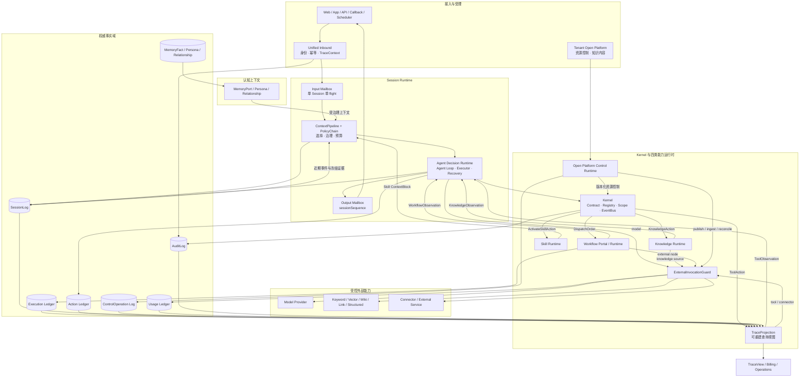

| 运行时 | 核心职责 | 不承担 |
| :-- | :-- | :-- |
| Unified Inbound | 统一接收、身份映射、输入幂等、Session 定位和确定性恢复路由 | 不生成回复，不执行 Workflow |
| Session Runtime | 输入单 flight、上下文装配、策略执行、活动执行投影、日志与有序输出 | 不保存 Workflow 内部可变状态 |
| Agent Decision Runtime | 理解输入、选择能力、发起或恢复 Execution、汇总结果 | 不读取节点快照，不直接修改执行账本 |
| Kernel | 契约校验、能力解析、受控 dispatch、事件广播和强制治理钩子 | 不固化陪伴业务字段，不编排节点 |
| Capability Runtime | 只注册、挂载和解析 Skill、Tool、Workflow、Knowledge Source 四类版本化能力 | 不管理 Memory/Persona/Channel/Connector/Builder 等非挂载对象，不绕过 Scope、Invocation Policy 或 PolicyChain |
| Persistence | 分域保存 Session、关系状态、幂等记录、Execution 和交互日志 | 不以内存投影替代事实源 |

**六层归属**：Agent Runtime 是决策控制层；四类 Capability 是可挂载业务层；Persona/Memory/Relationship/ContextPipeline/PolicyChain 是认知上下文层；Session/Mailbox/Multi-Execution/HITL/Recovery 是会话执行层；Channel/Connector/Open Platform/Identity/Trace/Usage/Audit 是集成治理层；Builder/Marketplace/Handoff/Billing/Compliance/运营后台是产品运营层。后五层不能通过注册自定义 CapabilityType 改变 Kernel 路由。

**MVP-0 运行时不变量**：

1. Session 在任一 Execution 运行或挂起时仍可保持 `active` 并处理新输入。
2. Execution Ledger 是执行状态、checkpoint 和挂起状态的唯一权威；ExecutionRegistry 只是可重建投影。
3. SessionLog 是交互与认知事实源；任何模型可见输入必须先记录并可回放。
4. RelationshipState 是带 schema 版本的扩展容器；Kernel 不解释熟悉度、情绪或关系阶段等业务键。
5. 点选、回调和定时器按 `session_id + execution_id + action_key` 确定性路由；自由文本存在多个候选时先澄清。
6. 用户侧所有路径必须进入 Agent；`Kernel.dispatch` 仅允许 Agent Runtime 与受控内部恢复流程调用。
7. 输出统一写入输出邮箱；普通回复、后台完成通知和主动消息按 Session 顺序投递。
8. SessionLog、ControlOperation Log、Execution/Action Ledger、Usage Ledger 与 AuditLog 各自保存权威事实；TraceProjection 只组合引用，OpenTelemetry 导出不参与回放或计费。
9. 唯一会话主干是 `Channel/Open Platform → Unified Inbound → Session Runtime → Agent Runtime → Capability → Observation → Session Outbox`；控制/内容 API 只进入 Control Runtime。
10. `CapabilityType` 是四值封闭联合；Agent 委派、Memory、Channel、Connector 和产品运营对象均不进入 CapabilityMount。

### 1.3 宿主模块边界

平台宿主负责产品入口、渠道、资源控制面与 Workflow 引擎；SDK 负责通用执行与存储端口。公开模块边界见 §1.4，模块依赖以 `backend-java/settings.gradle.kts` 和构建约束为准。

| 职责 | 所属模块 | 边界 |
| :-- | :-- | :-- |
| 统一输入、Session 执行协调与输入输出邮箱 | `agent-runtime-session` | 通过 Session SPI 读取和提交权威事实，调用受管适配器 |
| Agent 纯计算、Action/Observation、ContextPipeline、PolicyChain | `agent-runtime-core` | 不执行外部 I/O，不依赖宿主领域 |
| 公开契约与宿主端口 | `agent-runtime-api`、`agent-runtime-session-spi` | 公共类型与存储/协调端口分离，领域行为不依赖持久化实现 |
| 模型、MCP、存储与记忆适配 | `agent-runtime-adapter-*`、`agent-runtime-memory` | 实现受管端口，不接管执行循环 |
| 产品会话、Agent 控制面与 Workflow 引擎 | `skillforge-core-chat`、`skillforge-core-agent`、`skillforge-core-workflow` | 复用 SDK，外部输入不绕过统一执行链 |
| HTTP/SSE、回调与调度接线 | 宿主服务与渠道模块 | 适配协议和可信身份，不能引入第二条决策主链 |

### 1.4 Agent Runtime SDK 交付边界

Agent Runtime 以无界面的模块化 SDK 交付，灵知 是第一个宿主而不是 Runtime 契约本身。SDK 固定 Agent Loop、Session 执行语义、强制治理和各事实域端口；模型供应商、MCP、数据库、队列、身份系统、渠道和产品控制面通过适配器或宿主接入。SDK 不把现有 Service 类集合重新打包，也不把 Spring 容器或 灵知 数据表当作公开 API。

`agent-runtime-*` 构成独立 SDK，可由任意端宿主包装为 Agent；`skillforge-*` 构成基于 SDK 的高级平台。所有 SDK 生产依赖保持在 SDK 和必要第三方库范围内，不依赖 `skillforge-*` 平台模块。平台领域划分与组合根归[宿主技术架构](../docs/02-架构与设计/01-技术架构.md#31-平台模块与依赖方向)。

模型适配边界由 SDK 维护供应商与接入服务目录、ServiceProfile、协议/认证允许组合、Dialect、协议级能力状态和可选模型发现方案。每家供应商的 `*ModelProvider` 必须完整实现统一的模型服务接口，负责本供应商的模型发现、非流式与流式调用、工具回合、结构化输出及相应错误和用量转换；未支持的能力明确拒绝。Provider 的职责不能止于返回端点、headers、body、请求策略或其他调用参数，再由上层发起供应商请求。

当前 `ModelProvider` 已定义发现、生成和流式接口，默认实现对未实现操作明确拒绝；`ModelProviderRuntime.runtime(...)` 装配实际调用能力，`standard()` 则使用标准目录，不能仅凭供应商条目存在就认定对应接口或模型能力可用。实际支持范围以已选 Provider、协议和配置为准。

ModelPort 适配层在冻结绑定和调用许可确定后选择对应 Provider，调用其统一方法并消费类型化结果或事件；宿主后台模型任务与显式模型发现也使用同一 Provider 入口。SDK 与宿主上层不自行编码或发送供应商请求，不依据品牌或协议另走通用客户端。各 Provider 内部可以组合共享协议适配器、ConversationCodec、认证与 HTTP 传输能力；完整接口实现不要求逐供应商复制协议代码，共享协议组件也不得按供应商品牌分支。目录 metadata 和配置解析结果可以供界面、校验与私有冻结绑定使用，但不构成交给上层执行 HTTP 的调用计划。Provider 执行仍受本次 Registered Attempt、预算、取消、撤权及未知结果规则约束，不接管 Core 决策或绕过账本治理。

供应商无关的 Canonical Conversation IR 以 Instruction、Message、ToolCall、ToolResult、Reasoning 与不透明 ProtocolState 等同级 Item 表达上下文，Provider 内部使用的协议级 `ConversationCodec` 决定这些 Item 在线上 `messages`、`input`、content blocks 或 parts 中的编码和响应还原；需要签名或私有续接状态的 Item 在对应供应商 Quirk 未能原样回传前必须拒绝。宿主维护租户/Agent 选择、凭据存储、服务启用与自定义端点访问策略。SDK 不维护通用供应商模型目录；宿主只在用户显式请求时调用所选 Provider 的模型发现接口，或接受用户填写的非空模型名。协议特有能力可以按官方契约声明精确模型允许集合，但它不成为发现候选或通用模型能力推断。发现结果只是当前账号可见候选，不授权模型能力、不触发推理，也不成为 Runtime Core/API 的供应商 DTO。模型级协议网关必须由模型发现结果或冻结模型元数据明确选择协议及 Conversation Codec，不能把供应商固定为单一兼容协议。

上下文因果顺序与冻结视图由 Runtime 统一拥有；Provider 只编码冻结输入及已声明缓存能力，不能为缓存命中独立检索、改写或保留已失效 Skill。供应商 Prompt Cache 的范围派生、协议限制与验收见[上下文专题 §13.1](03-上下文视图与执行优化.md#131-供应商-prompt-cache-与前缀稳定性)。原生 Messages 或 Responses 只有在独立编解码、私有续接与用量语义实现后才能启用，不从相似兼容端点推断支持。

通用图片能力按[多模态专题](03-多模态内容与媒体引用.md)采用有序 Text/Image 与可信持久 MediaRef，用户上传和工具回图共用媒体路径。当前具体模型视觉能力与协议工具图片能力分别核验；不隐式换模型或图转文回退。图片是独立平台基础能力，BrowserSkill 只作为消费者；宿主负责字节存储与访问，Provider 内部 Codec 负责实际协议表达。此处为目标边界，不证明多模态已经实现。

首版直接交付完整生产组合：宿主装配 PostgreSQL、真实模型 Provider、MCP Tool Provider、持久化 Session/Run/Action、Outbox 事件投递与崩溃恢复。外部调用通过端口执行，调用前提交执行意图并按 Action 契约核验调用许可；恢复依据持久事实判断已知结果、未决结果与可执行操作，不凭执行意图直接重发外部调用。首版范围内的其他能力仍按 M7 交付，生产组合不缩减其验收范围。

模块按契约、运行逻辑、基础设施适配与测试支持四类职责组织。Core 负责单步领域计算，Session 负责会话状态推进、持久化协调与恢复；运行逻辑依赖契约，基础设施适配器实现契约，由宿主装配入口连接具体实现。公共契约不反向依赖实现模块，适配器不形成以 JDBC 实现为中心的依赖层级，测试支持不进入生产运行依赖链。模块边界用于隔离领域逻辑和基础设施，首版即使用上述真实实现。

关系数据库适配器以 MyBatis Core Mapper 执行 SQL，宿主提供 `DataSource` 和驱动，不依赖 Spring 容器或宿主的 MyBatis-Plus 装配。同一原子操作的辅助 Mapper 参与适配器持有的同一会话与事务；连接取消、类型映射和观测属于内部基础设施，不能形成业务 SQL 的第二条执行路径。宿主框架选择与 SQL 归属统一遵循[工程规范](../.agents/skills/nw-engineering/references/engineering-standards.md#数据库与迁移)。

PostgreSQL 的 Runtime schema 资源随 `agent-runtime-adapter-jdbc` 发布，由 [RuntimeJdbcSchema](../backend-java/agent-runtime-adapter-jdbc/src/main/java/com/skillforge/runtime/adapter/jdbc/schema/RuntimeJdbcSchema.java)提供显式安装、校验与接管入口；适配器构造和 Starter 装配不自动执行 DDL。宿主创建数据库、提供连接池、驱动和应用角色，在独立初始化阶段使用具有必要 DDL/扩展权限的连接安装 schema，正常执行使用非超级用户、`NOBYPASSRLS` 角色。Runtime 迁移仅管理自身资源及 `agent_runtime_schema_history`，不扫描或执行 `skillforge-migration`。

空库安装和已纳管 Runtime 的升级使用 `install`；`validate` 只读比较当前结构与 SDK 清单，不修复差异。非空且未纳管的数据库必须在维护窗口停止其他 DDL/迁移，再显式 `adopt`：锁定 Runtime 所有表、严格校验清单中的结构，任何差异均拒绝且不记录成功接管，不以静默 baseline 跳过检查。平台数据库中的宿主函数或 trigger 若与 SDK 清单不同，同样拒绝接管，不能仅凭表名齐全判定可用。接管需要至少两条连接；具体操作前置见[SDK 数据库初始化指南](../docs/04-指南与运维/01-开发与部署指南.md#31-sdk-数据库初始化)。平台当前仍保留完整 Flyway 历史以保护已有平台部署；SDK 独立 schema 不代表可删除、重写、重跑平台旧迁移或对现有业务数据库自动接管。

执行与持久化采用 [§1.5](#15-执行与持久化重构) 的步骤边界。旧的逐层来源重验、实例票据、checkpoint 解码缓存与阶段交接优化不再作为目标约束；它们不能成为新路径必须保留的兼容层。

下图与表格描述目标职责划分，不是当前 Gradle 构件清单。当前源码没有独立的 `agent-runtime-delegation` 模块：已配置的委派决策和等待处理分别位于 Core 与 Session，执行能力由宿主装配；模块清单以 [settings.gradle.kts](../backend-java/settings.gradle.kts) 为准。会话派生的 `forkSession` 仍是 P2 目标，当前公开 Runtime API 没有该入口。

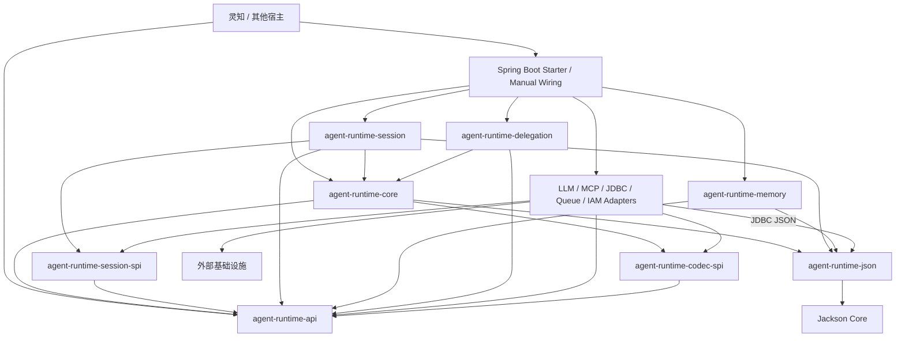

| 逻辑发布单元 | 拥有的稳定边界 | 禁止包含 |
| :-- | :-- | :-- |
| `agent-runtime-api` | façade 命令、结果、事件、ID、状态枚举和宿主侧 SPI | Spring、MyBatis、Controller、Mapper、数据库实体、供应商 DTO |
| `agent-runtime-codec-spi` | Portal outcome 无损编解码、resolution/failure/canonicalObservation 语义及类型化 Knowledge 文档编解码契约；领域 codec 归 Core，基础 JSON 语法与确定性编码归 JSON 模块，消费者只使用 API／SPI 强类型结果 | Action 调用来源图、permit、持久化、JSON 格式副本、Session ACK 证明、façade 公共契约 |
| `agent-runtime-session-spi` | 执行协调层与存储适配器之间的步骤提交、结果保存和必要恢复契约 | façade 公共契约、Core 状态机、SQL/MyBatis、Access/Sources 默认实现 |
| `agent-runtime-json` | 有界 JSON 语法读取、普通写出与确定性编码；共享 `CodecLimits` | Runtime API、执行状态、领域身份、I/O 或宿主依赖 |
| `agent-runtime-core` | 统一 Agent Loop 的 `decide`/`batch`、Action/Observation、Budget、ContextPipeline、PolicyChain、能力选择，以及已保存结果的纯计算采纳规则 | DagWork 协调快照、Session/Execution 私有 checkpoint、ResumeAccess、journal 专用状态、渠道协议、数据库查询 |
| `agent-runtime-session` | Unified Inbound、Session、唯一执行协调入口、步骤提交、挂起与恢复、事件投递 | Workflow 节点状态、IAM 用户目录、渠道发送实现 |
| `agent-runtime-memory` | 长短期记忆读取、受控写回、作用域和记忆治理端口 | 向量库或图数据库专属类型、绕过 SessionLog 的写入 |
| `agent-runtime-delegation` | Target Projection、spawn/await/cancel、Delegation Ledger 协调和父 Loop Observation | 把子 Agent 当 Tool、复制父 Agent 定义或拥有用户 Session |
| `agent-runtime-adapter-*` | LLM、MCP、JDBC、SQLite 等 SDK 端口实现；JDBC 只拥有 Runtime 存储与 schema | 平台业务表、模型目录与 MCP 绑定等宿主配置，改写 Core 状态机或绕过 PolicyChain/账本/Outbox |
| `agent-runtime-adapter-testkit` | 测试夹具和内存适配参考实现，通过测试依赖使用 | 进入 SDK 或平台的生产运行依赖链，以内存实现替代生产持久化 |
| `agent-runtime-spring-boot-starter` | SDK 组件装配、配置校验和生命周期启动 | 平台默认身份/模型/能力装配、第二套运行语义、自动补齐缺失身份或权限、自动安装数据库 |
| `agent-runtime-bom` | SDK 模块与适配器的兼容版本集合 | 运行时代码和业务默认值 |

SDK 能力归属固定如下：

| 能力 | Runtime 归属 | 接入方式 |
| :-- | :-- | :-- |
| 计划与任务协作 | Session + Prompt | 原生 Plan Action 通过 Session 的统一 DagWork 协调主步骤和成员步骤；会话规划模式负责精确版本审批，计划与步骤的展示来自持久事实投影 |
| 工具调用 | Core + Capability Adapter | Core 固定 action/预算/幂等/Observation；Provider Adapter 执行调用 |
| 上下文与会话管理 | Core + Session | ContextPipeline 只消费已授权、已持久化事实；Session 拥有邮箱、日志和顺序 |
| 权限 | Core Policy SPI + Host Adapter | SDK 强制执行 PolicyChain；宿主或 IAM Adapter 提供身份与授权事实 |
| 长短期记忆 | Memory | MemoryPort 隔离作用域，写回必须保留来源和治理状态 |
| 持久会话 | Session + Store Adapter | Session 语义属于 SDK；存储介质由 JDBC、外部 Event Store 等适配器实现 |
| 会话恢复与派生 | Session | 恢复使用挂起 identity/revision；派生从已提交 sequence 建立 lineage，不复制活动执行（FR-23，P2） |
| 外部会话存储 | Store Adapter | 实现 Session、Mailbox、Log 和幂等端口，不向 Core 泄漏存储模型 |
| MCP | Tool Provider Adapter | MCP Tool 投影为冻结 Tool handle；MCP 不成为第五种 CapabilityType |
| 子 Agent | Delegation | 使用独立 Agent 定义、能力快照和预算；结果经 AgentObservation 回注（FR-15，P2；M7 只冻结 Port 与 AgentObservation 契约） |
| 后台任务 | Session + Queue/Scheduler Adapter | 接受、lease、outbox 和 recovery 是持久语义，不以进程内 Future 代表完成 |
| 中断 | Core + Session | Cancel/Interrupt 命令写入持久控制事实，并按 action/execution CAS 收敛 |
| 审批回调 | Session + Channel Adapter | 形成 `AGENT_HITL` 或 `WORKFLOW_HITL` 挂起，由 callback Inbound 确定性恢复 |

SDK 首个发布形态是嵌入式 Java 模块与可选 Spring Boot Starter。Runtime Server/Sidecar 只能作为同一 SDK façade 的宿主部署形态，对外 HTTP/gRPC 客户端不得复制 Loop、Session 或恢复语义。

JSON 的普通读取允许标准空白与任意键序；规范材料读取要求原文等于确定性编码。数字使用任意精度整数/小数，规范编码保留去尾零、零折叠、普通十进制及展开长度约束；重复键、尾随内容和非法 Unicode 拒绝。资源预算的根深度为一，对象键和值均计入节点。Memory 继续在领域边界拒绝其不支持的数字，不因基础库统一扩大配额。

Core 的纯计算组件依赖 JDK、`agent-runtime-api`、API-only 的 `agent-runtime-codec-spi` 与纯计算的 `agent-runtime-json`，不解析宿主配置、执行外部 I/O 或主动读取时钟。JSON 模块使用 Jackson Core 承担语法读取与转义，公共边界只暴露 JDK 值；Core/Memory 的领域结构、字段存在性和身份摘要仍由各自 codec 负责。预算判定消费已冻结限制、显式累计耗时及带完整性标识的已报告用量；Context/Policy 的选择与强制治理算法归 Core，Session 通过已授权、已持久化的事实供给与提交端口承接它们，不另建策略链。未接入宿主的参考内核不构成第二条生产路由，也不赋予任何 Provider 调用权。

Core 为 Session、Delegation 及 Starter/Manual Wiring 提供类型化纯计算入口，不获取调用许可、读取账本或执行 Provider。协调层消费计算结果，在明确的业务步骤边界持久化并调用适配器；原始模型结果的读取和安全反馈转换归该路径，公开回执只暴露必要结果及引用。跨 package 可调用不构成外部执行授权，不为内部值交接再建立实例绑定票据协议。

执行重构的显式宿主装配根可以消费已批准的 Core 纯值、实际请求 codec 和结果 codec；其配置、材料来源及能力适配限定在构建 Gate 的精确源码白名单内。该例外不开放普通业务、Controller 或渠道使用 Core 推进逻辑，也不允许装配根调用旧 Model/Tool Cycle；唯一执行推进仍由 Session 负责。

目录冻结装配仅使用 `CodecLimits` 与 `SkillActivation` 保存真实 Skill 值；Agent 和 Workflow 节点共享的 Provider 调用装配仅使用 `CodecLimits`、`FrozenModelRequest` 与 `CoreRuntime` 的实际请求和结果 codec。Workflow 节点请求组装只使用 `CodecLimits` 与 `FrozenModelRequest`，由真实 Engine checkpoint、原不可变安装与模型 Profile 生成唯一实际请求；节点 Program 位于 Session，宿主不承担其执行循环。本地 Plan 采纳装配只使用 `CodecLimits` 配置 Session 协议解析限额，真实 DAG 写入及 Run 推进由同一 `SqlSession` 原子提交。上述窄依赖按源码文件逐项核验，不开放宿主业务调用 Core 效果循环。

公共组件与 package-private 实现位于 Core 自有 package；Java public 不构成运行权限或仅对 Session 可见的访问控制。构建 Gate 精确发现并冻结 Core 的 public/nested/sealed surface，递归检查签名闭包只含 JDK、API、Codec SPI、JSON 与批准的 Core 类型；另以不同 package、显式声明正式构件及其传递依赖的真实消费编译与组合测试验证可装配性。`CodecLimits` 归 JSON 构件，Core 公开签名通过编译依赖导出它；API 构件仍保持纯 JDK。宿主业务、Controller、渠道和 Provider adapter 不得借组件入口绕过 Unified Inbound/Session；该约束由依赖/导入 Gate 验证，不依赖反射、split package、字符串命令总线或隐式 JPMS 访问承诺。

公共 API 与宿主侧 SPI 的所有调用只接受完整身份、稳定请求身份和 trace envelope；状态变更另须携带输入或操作幂等身份，读取与订阅使用独立 `requestId` 做授权、审计、限流和调用关联，不得为只读调用伪造 `inputId`。这些调用返回稳定 handle 或类型化 outcome。`Map<String, Object>`、`*DO`、Mapper、Spring `ApplicationContext`、数据库连接以及供应商请求/响应不得出现在公开签名中。Core 内部协作契约不构成 SDK façade；迁移期间仍由其所属模块封装，不能被宿主、事件出口或公开 SPI 调用。生产适配器必须提供持久 SessionLog、幂等账本、domain ledger、durable outbox、lease/fencing 与重启恢复；in-memory 适配器只用于测试和本地开发，不能声明生产级持久语义。


### 1.5 执行与持久化重构

直接重写现有 Java 执行主链，采用在内存中连续推进、在真实业务边界持久化、中断后才加载恢复的 Agent 循环：受理输入 → 加载必要状态 → 计算下一动作 → 提交派发 → 外部调用 → 保存结果并推进 → 下一动作或结束。不引入额外编排框架，不在现有 Session graph 外包装另一层协调器。此节是已确定的重构目标，尚未代表生产实现。

| 责任 | 实现边界 |
| :-- | :-- |
| Core | 类型化状态、上下文组织、动作解析、路由和预算算术；不查库、不持有事务、不调用 Provider |
| Session | 拥有唯一执行协调入口，负责状态推进、业务提交、实际派发和中断后恢复；活跃执行持有当前 Run 状态和已加载材料，提交成功直接消费返回的新版本及状态 |
| 宿主与适配器 | 可信身份、当前权限、模型和工具、媒体、存储及产品展示；Provider、工具 Handler、媒体服务和协议 Codec 保留实际能力，调用授权改接新 Action/Attempt |

源码职责入口为 [AgentExecutionLoop](../backend-java/agent-runtime-core/src/main/java/com/skillforge/runtime/core/AgentExecutionLoop.java) 的纯计算、[ExecutionCoordinator](../backend-java/agent-runtime-session/src/main/java/com/skillforge/runtime/session/ExecutionCoordinator.java) 的连续推进、[AgentExecutionProgram](../backend-java/agent-runtime-session/src/main/java/com/skillforge/runtime/session/AgentExecutionProgram.java) 的实际请求和结果处理，以及 [ExecutionStore](../backend-java/agent-runtime-session-spi/src/main/java/com/skillforge/runtime/session/spi/ExecutionStore.java) / [JdbcExecutionStore](../backend-java/agent-runtime-adapter-jdbc/src/main/java/com/skillforge/runtime/adapter/jdbc/execution/JdbcExecutionStore.java) 的事务边界。机构装配归 [AgentRuntimeExecutionConfiguration](../backend-java/skillforge-institution-service/src/main/java/com/skillforge/institution/runtime/AgentRuntimeExecutionConfiguration.java)，不再装配旧 Model/Tool Cycle、SessionFlight 或阶段 journal。源码接线不证明完整功能、真实恢复或容量验收通过，状态以实施记录为准。

一次模型调用或工具调用是业务步骤，参数组装、来源读取和内部辅助方法不是独立恢复步骤。不建设通用事件溯源、任意步骤回滚、全历史分叉、跨版本执行恢复、自动补偿或分布式调度框架。

仅在首次领取、进程恢复、接管或版本冲突时重新加载运行状态，不在每次组件调用前恢复 checkpoint。内存状态减少重复读取，数据库提交仍决定状态是否生效；正常采纳不再重建 `sourceRun → checkpoint → events → capability → binding` 来源图。

正常执行只在输入受理、派发、结果保存、人工等待及恢复、取消与结束边界提交。普通模型或工具步骤以派发前、结果后两个业务提交边界为目标，不承诺两条 SQL，也不机械拆开可合并的提交。简单结果保存、预算结算、状态推进和公开事件追加同事务完成；图片准备等确有较长计算或外部处理时，先保存原始结果，再处理和采纳，不默认增加异步阶段。外部调用、人工等待和大正文处理不持有数据库事务。

入口解析可信身份和资源访问，派发边界检查当前权限、挂载、取消、租约及预算，等待后重新检查。内部函数复用本次已确认上下文；审计直接记录已有判定和事实引用，不额外查询身份、重建会话或逐层记录成功证明。当前权限不跨派发缓存；已发生的迟到结果可落账，不因此获得新派发权。

同一 Run 的状态提交通过 revision/fence 串行化，不同 Run 并行。并行 Action 独立执行并保存结果，由唯一推进入口采纳。事务、锁顺序、预算账本权威与最小状态契约归 [03 §10.1](03-核心对象模型与状态机.md#101-执行与持久化的最小权威模型)。授权、预算和派发资格的最终条件落在提交边界，不靠提交前反复查询代替；授权采用该边界的当前判定，不引入全局 IAM 锁。

取消与失租监测使用已有控制调度和本地单向停止信号，getter 不查数据库。沿用活动检查不超过 5 秒及两个间隔未确认即关闭本地窗口的上限；该窗口不能保证撤回已经送达的外部动作。续期只在需要时进行，不与普通状态读取绑定。

恢复只需区分未派发、结果已保存、派发结果未知以及等待输入。已有结果直接采用；未知非幂等操作停止自动重放，不为自动续跑再加推测性查询或补偿协议。精确状态归属见 [03 §10.1](03-核心对象模型与状态机.md#101-执行与持久化的最小权威模型)。

新输入、结果或等待响应提交后直接唤醒对应 Run，活跃循环有下一步就连续执行。沿用当前有界执行器，保留 50 个活动执行槽位，不以改用虚拟线程作为本次性能方案。未获得槽位的工作留在持久记录，槽位释放后立即补位，不提前领取大量租约，不增加无界内存任务队列。启动补扫一次；正常运行以默认 5 秒、每批最多 100 条的有界补扫兜底，通过到期条件和索引定位工作，定时等待按最近到期时间唤醒。不建立第二份通用工作队列，不通过全租户 100ms 轮询取得验收成绩。

页面和 SSE 直接消费已保存的公开事件及游标，不加载完整 Run、不触发恢复；工具完成展示必须对应已保存结果，现有流式增量体验保留。状态提交后直接通知事件投递器，可靠投递以持久记录为依据。派生统计处理已提交事件，不进入每个执行步骤的同步关键路径；本次不增加审计平台、消息中间件或指标数据库。

模型过程开始与派发登记同事务保存，过程终态与实际结果同事务保存；没有新公开内容的分片计数不单独提交。开始事实不表示首 token 或生成成功，真实模型流、私有续接和公开正文增量的边界见 [03 §10.1](03-核心对象模型与状态机.md#101-执行与持久化的最小权威模型)。

对外沿用受理、查询、事件订阅、取消和工具输入恢复的产品语义。内部按加载状态、登记派发、保存结果并推进、等待及恢复、取消与结束、领取到期工作收敛；具体 record、实体和封闭类型直接表达固定结构，JSON 编解码集中在存储及协议边界，数据库连接和事务对象不进入公共 SDK。随消费者迁移删除旧 Model/Tool Cycle、各能力独立阶段 journal、重复 consume proof、来源重建、操作快照及其专用触发器、codec、缓存和交接票据；最终只存在一套当前执行路径，不双写、不保留旧快照兼容分支。

---

## 2. 内核设计（微内核）

### 2.1 内核职责（只做这些）

> Kernel 只包含契约、能力路由、注册表、Scope 和 EventBus。SessionTable、输入幂等账本、SessionLog、邮箱与 ExecutionRegistry 属于 Session Runtime，边界见 [03-核心对象模型与状态机 §7](03-核心对象模型与状态机.md)。

| 职责 | 说明 |
| :-- | :-- |
| **契约编解码** | 派兵令（Dispatch Order）/ 委派令（Delegation Order）解析与校验；战报（Battle Report）组装与校验 |
| **派兵路由** | 按派兵令中的 `execution_unit_id` 找到已注册的执行插件并分发；Agent 委派由 Agent Runtime 内的 Delegation Runtime 按 `target_agent_handle` 解析、授权和调度，不经过插件路由；内核不接收用户消息，用户消息的唯一入口是决策插件（§1.1 原则 4） |
| **号角总线** | 收执行插件发布的事件，转发给订阅的通道插件与决策插件 |
| **插件注册表** | 插件注册 / 发现 / 生命周期（启动、停止、健康） |
| **调用元数据传递** | `tenantId` / `sessionId` / `executionId` 与 TraceContext 贯穿，不读取或写入业务状态 |
| **强制治理钩子** | 在 dispatch 与能力解析处执行 Invocation Policy、审计和配额钩子；不允许插件绕过 |

### 2.2 内核不做什么

- 不做意图识别、不做目标分解（决策插件的事）。
- 不执行节点、不管理状态机（执行插件的事）。
- 不决定事件如何渲染、如何送达（通道插件的事）。
- 不拥有计费、审计和记忆数据；Kernel 只提供不可绕过的调用钩子，具体策略与存储由插件或独立 Runtime 组件实现。

### 2.3 内核骨架示意

```java
// 示意：内核只暴露五个门面（对象模型见 03 §7.2）
// 事件类型为判别标签（closed union），非自由字符串（§4.3）
public interface Kernel {
    DispatchOrder decode(Object raw);                     // 收令
    BattleReport dispatch(DispatchOrder order);           // 派兵（同步主路径）
    BattleReport delegate(DelegationOrder order);         // 委派（可见性/环/深度校验后路由）
    void publish(ExecutionEvent event);                   // 吹号（载荷已封装在事件内）
    <T extends Plugin> T plugin(Class<T> type);           // 插件访问（依赖声明约束，§3.7）
}
```

### 2.4 为什么用微内核

| 痛点 | 微内核解法 |
| :-- | :-- |
| 编排层上帝类，数千行难测试 | 决策逻辑拆成决策插件，内核只做路由 |
| 执行入口被层层包裹、参数爆炸 | 派兵令契约收敛参数，执行插件只认契约 |
| 挂起恢复语义分散 | 恢复是执行插件自己的账本，内核不碰 |
| 事件消费方耦合 | 号角总线解耦发布/订阅 |
| 新增能力动主链路 | 新增插件 + 注册，内核零改动 |
| Agent 能力难组合/难隔离 | Scope 分层挂载：能力按 agent→preset→global 分层注册，最近层优先 |

---

## 3. 插件体系

**总体架构**（内核只收令 / 传令 / 吹号，其余全为插件）：

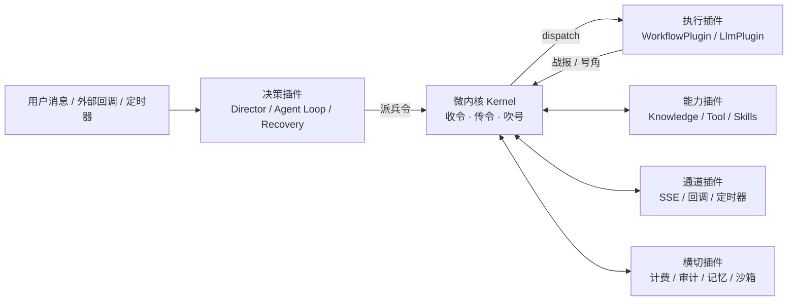

### 3.1 插件分类

#### 3.1.1 决策插件（将军阵营）

| 插件 | 职责 | SPI 要点 |
| :-- | :-- | :-- |
| `DirectorPlugin` | 入口分发、派兵令/委派令组装、听号角、总结/下一轮。
  可作委派目标（响应委派令） | `onRequest(Request) → Decision`；`onDelegate(DelegationOrder) → BattleReport` |
| `RecoveryPlugin` | 四类恢复通道统一入口 | `resume(ExecutionId, HitlResponse) → BattleReport` |

#### 3.1.2 执行插件（特种兵阵营）

| 插件 | 职责 | SPI 要点 |
| :-- | :-- | :-- |
| `WorkflowPlugin` | 状态机执行（内部节点/边/挂起自主处理）；不可直连用户消息，只响应派兵令 | `run(DispatchOrder) → BattleReport` |
| `LlmPlugin` | LLM 调用（生成/流式/结构化输出） | `generate(Prompt, Options) → LlmResult` |

#### 3.1.3 Agent 路径能力插件（Tool、Skill、Knowledge Source）

Workflow 作为第四类挂载由 WorkflowPortal 解析到执行插件；本节只列 Agent 决策路径直接消费的三个 Runtime，不改变 CapabilityType 的四值闭包。

| 插件 | 能力 | SPI 要点 |
| :-- | :-- | :-- |
| `KnowledgePortal` | 受治理证据能力：路由、规划、检索、融合与充分性结果 | `execute(KnowledgeRequest) → EvidenceBundle` |
| `KnowledgeSourceProvider` | 封装 KnowledgeBase、Wiki、结构化或远程来源 | `retrieve(KnowledgeStep) → List<EvidenceItem>` |
| `KnowledgeOperator` | Keyword、Vector、Link、Structured 等执行算子 | `supports(type)` + `execute(step, source)` |
| `ToolPortal` | 工具守卫门面：解析挂载、校验、策略、调用、计量和结果规范化 | `invoke(ToolInvocation) → ToolResult` |
| `ToolProvider` | ToolDeployment 的具体执行提供方；Connector 只在此层绑定 | `invoke(ExternalInvocation) → ProviderResult` |
| `ToolCatalog` | 只从当前 input 的冻结 `CapabilityMountSnapshot` 发现可见 ToolDefinition，并保留 exact target | `list/search/resolve(snapshot, ...) → ToolCatalogEntry` |
| `SkillCatalog` / `SkillResolver` | 发现已发布 Skill metadata，按精确版本加载 `SKILL.md` 与所需资源；不自行执行包内脚本 | `discover(scope) → metadata`；`resolve(CapabilityRef, resourceRef) → content` |
| `SkillActivationConsumer` | 处理常驻注入与按需 ActivateSkillAction，形成 SkillActivation | `activate(Action, CapabilityMountSnapshot) → SkillActivationObservation` |

**挂载模型**：Agent 配置只保存版本化 `CapabilityMount`；每项引用不可变 `CapabilityRef`，并携带类型化挂载配置。运行时在 input 受理时统一完成租户、发布状态、版本和 Deployment 校验，冻结 `CapabilityMountSnapshot`，再交决策层消费。

```java
// 示意：能力清单是 Agent 配置的一等公民
public record AgentSpec(
        String agentId,
        long revision,
        List<CapabilityMount> mounts,
        List<String> delegableAgentIds) {} // P2 独立授权，不进入 CapabilityMount

public record CapabilityRef(
        CapabilityType type,
        String capabilityId,
        String versionId) {}
```

#### 3.1.4 通道插件（号角阵营）

| 插件 | 职责 | SPI 要点 |
| :-- | :-- | :-- |
| `SseChannelPlugin` | 消费 Session Outbox 并实时推送到前端 | `deliver(OutboxEntry)` |
| `CallbackChannelPlugin` | 入站回调（外部系统事件唤醒）：恢复型（命中挂起）+
  主动型（业务推送），完成验签和归属映射后只产生 InboundEnvelope（§5.12） | `adapt(Registration, Payload) → InboundEnvelope` |
| `SchedulerChannelPlugin` | 定时器（挂起超时扫描等），只产生定时 InboundEnvelope | `emitTimeout(ExecutionRef) → InboundEnvelope` |

#### 3.1.5 横切插件

| 插件 | 职责 |
| :-- | :-- |
| `MeteringPlugin` | 外部调用守卫、原子用量与费用事件；调用方不能绕过 |
| `AuditPlugin` | 审计日志 |
| `MemoryPlugin` | 记忆存取 |
| `SandboxPlugin` | 安全沙箱（域名白名单/SSRF 防护等） |

### 3.2 Capability Seam：能力 = 三角色

一个**能力**不是"一个插件"，而是三个角色的完整组合，缺一不可：

| 角色 | 职责 | 示例（知识库能力） |
| :-- | :-- | :-- |
| **服务定义** Service Definition | 声明接口契约（入参/出参/能力声明），不依赖实现 | `KnowledgePortal` 接口 |
| **服务提供方** Service Provider | 实现规划、来源和算子接口；来源可本地或远程 | `PgVectorSourceProvider` / `LinkOperator` |
| **消费方** Consumer | 使用服务的一方，通常是决策层或显式 Workflow 节点 | `DirectorPlugin` / `KnowledgeQueryNode` |

```java
// 示意：能力三角色分离——定义、提供方、消费方各自独立演进
public interface KnowledgePortal {                     // 服务定义
    EvidenceBundle execute(KnowledgeRequest request);
}

public interface KnowledgeSourceProvider {             // 来源提供方
    List<EvidenceItem> retrieve(KnowledgeStep step);
}

public class KnowledgeResearchConsumer {               // Agent 消费方
    private final KnowledgePortal knowledge;           // 经注册表注入，不依赖具体来源/算子
}
```

**规则**：

- 新增能力 = 设计全部三角色；只加一个角色（如只有实现类、无消费方）不算能力。
- 提供方可替换且替换不影响消费方（换提供方 = 整个能力迁移，无分叉实现）。
- 能力声明（`supports(...)`）挂在**服务定义**上，消费方按声明路由（§5.4）。
- **单个插件可合并多角色**：如 `WorkflowPlugin` 同时充当服务定义（能力声明）
  与提供方（`run` 实现），消费方仍是独立的 `DirectorPlugin`/工具——
  "三角色齐备"指三方职责各自存在并解耦，不要求三个独立类。

### 3.3 Scope 分层挂载：Agent 能力如何组合与隔离

每个 Agent 拥有自己的**作用域层**（Scope），
能力按调用上下文的归属分层注册，读取时按 `agent → preset → global` 链合并。
路由只接受已解析的 CapabilityRef 或 input 内不透明 handle，不以显示名称搜索全局能力。

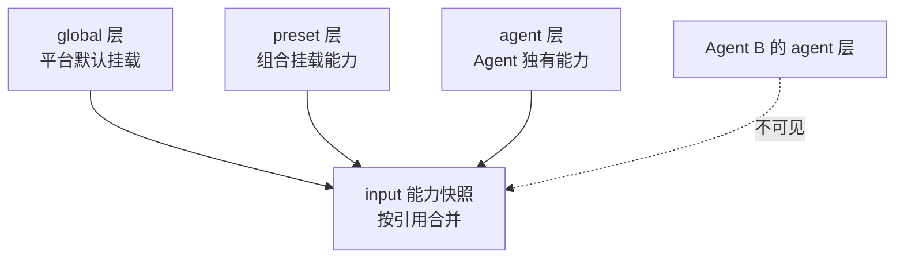

同一 logical capabilityId 出现多个版本时必须由挂载配置显式选择；显示名称重复不参与路由，也不能静默遮蔽。

**三条机制**：

1. **注册视图向下继承**：子 scope（agent）的注册视图能看见祖先层
   （preset/global）的已授权挂载；解析结果在 input 受理时冻结，不会因为祖先层后续变更泄露到当前 Loop。
2. **事件准入向上扩展**：scope 事件只被同 key 或**祖先 key** 的监听器接收，
   反向不行——preset 层监听器能收到其下所有 agent 的事件，但 agent 层的
   监听器收不到兄弟 agent 的。事件过滤（scope 谓词）在派发端完成，
   携带 scope 载体（carrier）编译期强制。
3. **可见性与所有权绑定**：注册的上下文同时决定"谁能看见"与"随谁销毁"——
   一个注册不会在 A scope 可见、却随 B scope 销毁（防止悬挂引用）。

**状态隔离**：会话/Agent 维度状态（挂起、记忆）以 scope 键隔离。
同组合共享实现（standing mount 仅一份），但状态按 Session/Agent 分开，
会话之间互不串。**注意**：Scope 是能力路由与隔离机制，**不是安全沙箱**——
恶意代码逃逸不在 Scope 职责内（由 Sandbox 插件负责，§7）。

**能力注册三步**（以 Agent A 挂一个知识库为例）：

```java
// 1. 为 Agent A 建 scope（挂 preset 父链，A 可见 preset/global 能力）
Scope agentScope = kernel.createScope(agentKey, /* parent= */ presetKey);
// 2. 往 A 的层注册能力（三角色：定义/提供方/消费方，§3.2）
AutoCloseable reg = agentScope.register("knowledge.doc-schedule",
        new PgVectorProvider(...));
// 3. 注册返回 disposer：A 销毁/组合切换时 reg.close() 全部回滚（§3.5）
```

### 3.4 Preset 组合：Agent 的"军备库"声明

Agent 的能力组合以 **preset**（组合声明）为单位——一份声明只列出该 Agent 挂载的
Workflow / Tool / Knowledge Source / Skill；Agent 委派授权使用独立字段，不进入
CapabilityMount。加载时把声明挂到 preset 层（standing mount，进程内仅一份），
每个 input 按 Agent 的 scope 键解析并冻结能力视图。

```yaml
# 示意：agent preset 组合声明（agent.cordis.yml 风格）
agent:
  id: receptionist
  name: 前台接待
  capability_mounts:
    - workflow.request-review@1.0.0
    - knowledge-source.doctor-schedule@2.1.0
    - tool.his-query@1.3.0
    - skill.polite-reception@1.0.0
  delegable_agent_ids:             # P2 独立授权，不是 CapabilityType
    - triage
```

**生命周期（mount → join → 切换）**：

1. **standing mount（进程内一次）**：preset 首次被用时挂载其能力子树到
   preset scope 层；进程内仅此一份，所有 join 该 preset 的 Agent 共享实现
   （状态按 Session/Agent 隔离，§3.3）。
2. **会话 join**：会话创建时建立 Agent 到 preset/global 的可见父链，不把某一代能力永久固定到 Session。
3. **input freeze**：每个 input 受理时解析并验证父链，冻结组合代和 CapabilityMountSnapshot；切换只影响后续 input，回放读取当时快照而不解析当前注册表。

**规则**：

- 组合是**只读声明**，运行时改组合只影响后续 input。
- 当前 input 的每次模型调用记录实际工具 schema、Skill 指令块和能力版本；回放直接读取冻结 ContextBlock。
- global 层能力也必须显式进入 Agent 的解析结果，不能作为未命中名称的运行时回退。

### 3.5 注册即效果

所有注册操作返回**可回滚的 disposer**，插件卸载/组合切换时自动清理：

```java
// 示意：注册返回 disposer，调用方可回滚
AutoCloseable reg = kernel.scope(agentKey).register("knowledge-source.doctor-schedule",
        new PgVectorProvider(...));
// ... 组合切换/Agent 销毁时：reg.close() 自动解注册并清理相关监听
```

**规则**：

- 注册是"效果"而非"配置"：进入注册表、发布事件、挂监听器都必须可逆。
- 无"注册了就不管"的全局副作用；插件卸载时其全部注册一并回滚。

### 3.6 插件注册与发现

```java
// 示意：启动期注册（到 global 层）
kernel.register("workflow.request-review", new WorkflowPlugin(...));
kernel.register("channel.sse", new SseChannelPlugin(...));
// 某 Agent 独有能力（到该 Agent 的 scope 层）
kernel.scope(agentKey).register("knowledge.doctor-schedule", new PgVectorProvider(...));

// 派兵路由（内核唯一分发点）
BattleReport report = kernel.dispatch(order); // 按 execution_unit_id 查注册表（含 scope 链合并）
```

**发现策略**（按宿主项目规模选型）：

| 策略 | 说明 | 适用 |
| :-- | :-- | :-- |
| 显式注册 | 启动期代码注册（简单直接） | MVP-0 |
| 容器自动装配 | 按接口扫描容器（如 Spring） | 已用容器的项目 |
| 配置文件/Preset 注册 | yaml 声明插件清单与组合 | 需要运营配置 |
| 动态加载 | 运行时 jar/class 加载 | 插件市场（后续） |

模型侧 Tool Discovery 不读取“全部已安装 Tool”。当前授权目录较小时，Session 使用同一
`ToolCatalog` 对冻结 mount-set 做确定性全量投影；目录扩大后可改为按需 search，但查询与
结果仍绑定同一 `CapabilityMountSnapshot`、ToolVersion、Deployment 和 revision。每项至少
投影 opaque exact handle、serverIdentity/qualifiedName、name/title/description、inputSchema，
以及必要的 output/effect/idempotency/timeout 提示。同名 Tool 依靠 Server 身份消歧；这些
名称字段只帮助发现，不能成为调用授权或 exact handle 解析失败后的回退键。

### 3.7 插件依赖声明（防 Service Locator 退化）

`kernel.plugin(Class<T>)` 若不设限，会退化为万能 Service Locator（插件 A → 内核
→ 插件 B 的隐式耦合，违反 §8「SPI 只经内核注册表访问，代码评审禁止插件间
直接引用」）。**约束：插件注册时声明依赖，`plugin()` 仅在声明清单内解析**
（对象模型见 [03-核心对象模型与状态机](03-核心对象模型与状态机.md) §7.3）：

```java
// 示意：插件注册时声明依赖；plugin() 仅在声明清单内解析
public interface Plugin {
    default Set<Class<? extends Plugin>> dependsOn() { return Set.of(); }
}
```

规则：插件调用 `kernel.plugin(T)` 时，T 必须在其注册时声明的 `dependsOn()`
清单内（或由宿主容器注入），否则解析失败并审计。未声明依赖清单的插件
（默认空集）无法经 Kernel 获取任何其他插件。

---

## 4. 四类跨插件协作契约

> 契约字段级定义见 [01 需求分析 §4](01-Agent-Workflow协作引擎-MVP需求分析.md)（概念层字段表）。
> 对象模型与 record 草案见 [03-核心对象模型与状态机 §3](03-核心对象模型与状态机.md)（唯一 record 家）。
> 本节只写内核处理语义，不再重复定义。
> WorkflowPortal 的 resume、cancel、query 使用独立类型化控制命令，不伪装成 DispatchOrder；定义见 [03 §5.8](03-核心对象模型与状态机.md)。

### 4.1 派兵令 Dispatch Order（决策 → 执行）

**内核处理**（record 草案见 [03 §3.2](03-核心对象模型与状态机.md)）：
校验必填 → 按 `executionUnitId` 路由 → 透传（不解释业务字段）。

### 4.2 战报 Battle Report（执行 → 决策）

**内核处理**（record 草案见 [03 §3.3](03-核心对象模型与状态机.md)）：
透传（不解释）→ 同步返回主路径；Workflow Runtime 在真实账本迁移点发布与报告状态对应的执行事件。

### 4.3 号角事件（执行 → 总线 → 订阅方）

**内核处理**（record 草案见 [03 §3.5](03-核心对象模型与状态机.md)）：
事件类型为判别标签（`ExecutionQueued` 等九类，`execution.queued/started/step/
hitl/resumed/completed/failed/loop_terminated/cancelled`）→ 转发给所有订阅插件（通道插件送达前端/外部，
决策插件更新认知）。

**事件规则**：

- **模型可见 ⟺ 已记录**：任何进入模型请求的内容（prompt 片段、工具 schema、
  检索结果、战报 data）必须能从会话日志重建；新增一种模型可见输入 =
  新增一种会话事件。这是号角事件与执行日志一致性的硬约束，也保证回放、审计、
  重试都基于同一事实源（FR-3.5）。
- **事件载荷可验证**：事件类型用**判别标签**（closed union）而非自由字符串，
  消费方 switch 时穷尽所有类型，新增类型必须显式处理（default 分支兜底）。
  载荷统一包含 `event_id`/`tenant_id`/`session_id`/`execution_id`/`execution_revision`/`status`/`trace`/`occurred_at`/`event_version`，其中 `trace` 使用统一 TraceContext，不为单个事件新造关联键；投影按账本 revision 判序，不使用到达时间推断状态新旧。
- **提交与发布分离**：执行账本状态/进度记录和待发布事件在同一事务提交，每个持久事件独占一个 executionRevision；提交后 EventBus 广播，SSE/Webhook 等远程投递从 Outbox 重试。订阅失败不反向改写已提交的执行状态，进程在“提交后、广播前”崩溃也可从待发布记录补发。
- **事件三域**：会话事件（持久、可重建）/ 能力事件（策略接入点）/
  运行时事件（活动观察）——分类与示例见 [03 §8.1](03-核心对象模型与状态机.md)。
- **委派链可追溯**：子执行（委派产生，§5.13）发布同一套 `execution.*` 事件，
  载荷附加 `delegate_of` 指向父执行 id——回放 / 审计可沿事件链重建整条委派链
  （FR-15.7），且不新增事件类型（子执行就是一次普通执行）。

### 4.4 事件载体分离：SessionLog（Store）与 EventBus（Bus）

「模型可见 ⟺ 已记录」要求模型可见内容可落盘重建，EventBus 又需要保持轻量旁路，因此二者须分开承载（边界见 [03 §8.3](03-核心对象模型与状态机.md)）：

| 载体 | 性质 | 承载事件 |
| :-- | :-- | :-- |
| **SessionLog（持久）** | append-only；先落盘后广播；模型可见内容在请求组装前完成写入 | 会话事件域 |
| **EventBus（运行时）** | 进程内同步旁路广播，不持久；与 SessionLog 提交分别观测 | 会话事件广播 + 能力事件 + 运行时事件 |

- 路由规则：会话事件 → SessionLog + EventBus；能力事件 / 运行时事件 → 仅 EventBus。
- 指标拆分：EventBus 广播、SessionLog 提交和 Outbox 投递分别建立基线与 SLO，阈值由 Gate 0 的宿主性能基线确定。

### 4.5 端到端轨迹与计量边界

`InvocationContext` 是外部调用、用量和轨迹的封闭上下文联合。Session 路径使用 `TraceContext`，携带当前 `inputId`、原始 `rootInputId`、W3C `traceId/spanId` 与持久 `eventId/causedByEventId`；Agent 发布、知识摄取、批量同步和期望状态对账使用 `ControlOperationContext`，携带 operationId/rootOperationId 而不伪造 inputId。技术 trace 只描述一次执行尝试，不能代替跨挂起、重启或异步作业的持久因果。

执行拥有者在现有 ExecutionStore／SessionLog 的业务提交边界追加类型化、版本化的安全观测事实，显式保留操作、父操作、原模型 Step、Action、attempt、入口与 Trace 关联，不建立另一套执行状态或调用账本。Step 由真实模型决策身份确定，重试不增加 ReAct 轮次；`causedByEventId` 不是调用父节点。观测补写、查询与投影重建不能重新取得模型或工具调用权，租约、幂等、恢复及未知结果边界仍由原执行契约拥有。

TraceProjection 将实际发生的操作表达为 ENTRY、AGENT、STEP、LLM、TOOL、RETRIEVAL、MEMORY、GUARDRAIL、COMPACTION 和 WORKFLOW。固定检索／记忆属于 Agent；工具触发的检索／记忆及派发子 Agent 属于准确的父工具；护栏记录真实检查对象与阶段；压缩只有真实发生时才出现，摘要模型归属该压缩。Workflow 按真实节点、分支、并行和子流程组织。缺少父子或 Step 身份时保留未关联事实，不按时间、名称或相邻 Action 拼树。跨请求恢复保留原 Run 的持久因果并标明新的入口与技术 Trace。

观测区分调用登记、实际执行和结果提交，耗时只采用所属执行边界的实测值；排队、等待、持久事件跨度与供应商耗时分别表达。父子节点共享的 attempt 引用不重复累计用量。业务轨迹以根输入组织当前授权的操作、公开消息与结果，面向后台的查询、快照、检索和内容边界见[会话观测与轨迹设计](../docs/02-架构与设计/17-平台会话观测设计.md)；该投影不是新的权威状态，也不声明 ATIF 交换兼容。

| 权威域 | 保存内容 | 不保存 |
| :-- | :-- | :-- |
| SessionLog | Inbound、ContextSnapshot、PolicyDecision、Agent Action/Observation、可见输出 | Workflow checkpoint、计费聚合 |
| ControlOperation Log | Agent/Workflow 发布、知识摄取、批量同步、期望状态对账及逐项结果 | Session 对话、Workflow checkpoint |
| Execution/Action Ledger | Workflow 状态、节点执行、恢复、逻辑 actionId 和副作用结果 | 会话历史、模型私有思维链 |
| Usage Ledger | 调用尝试、用量来源、价格快照、原币/结算币费用、未决与追加调整 | Prompt、工具原始敏感载荷 |
| AuditLog | 权限、安全和管理操作 | Agent 认知事实、Workflow 状态 |
| TraceProjection | 上述事实的引用、排序、脱敏摘要和聚合 | 新的可写权威状态 |

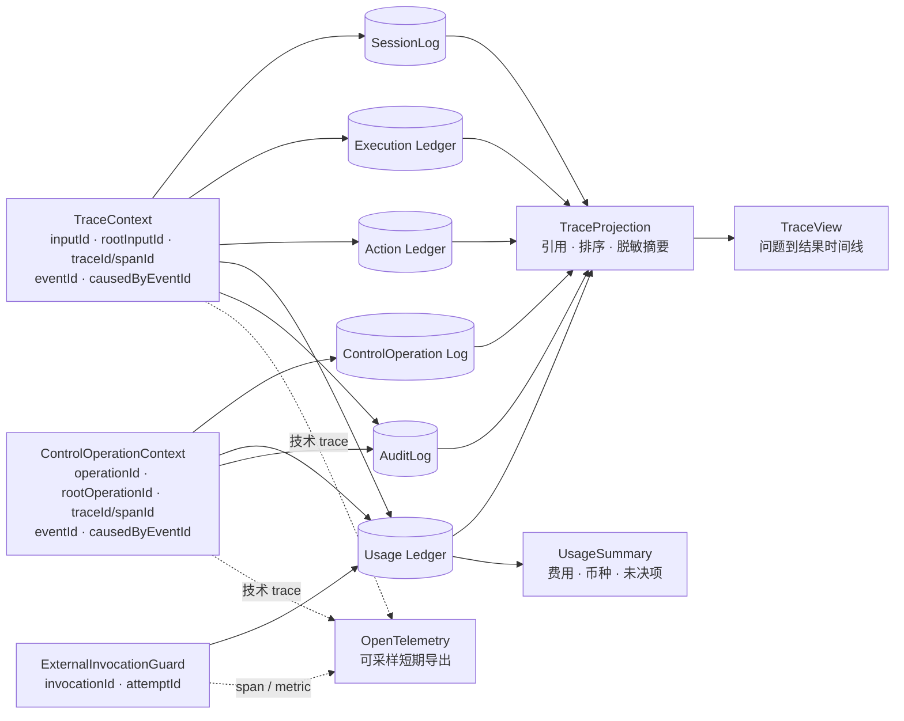

所有可能收费的模型、Knowledge Source、Tool、Connector 和外部 Workflow 调用必须进入同一 `ExternalInvocationGuard`：调用前写入稳定 `invocationId + attemptId` 的开始事实，执行 Scope/Policy/配额检查；调用后追加成功、失败或 `UNRESOLVED` 结果并写 UsageEvent。相同 attempt 的基础设施重放按稳定事件键去重；供应商可能分别收费的重试分配新 attemptId，但共享逻辑 invocationId。

UsageEvent 冻结供应商返回或估算的 token/数量、计量来源、单价来源和版本。缓存输入与 reasoning token 分别作为 input/output 的子集，聚合时不重复累加；供应商未返回 usage 时记录 `ESTIMATED` 或 `UNKNOWN`，无价格时记录 `UNPRICED`，不得用零掩盖缺口。金额使用高精度十进制，单次调用不按整数分提前舍入；币种转换冻结汇率来源与版本，不直接汇总未转换的不同币种。

OpenTelemetry 适配器把一次有时长的调用导出为 span，把状态变化导出为 event，并映射 GenAI input/output/cached/reasoning token。导出允许采样和短期保留，故障或丢失不影响持久轨迹、回放和费用账本；trace headers 不携带租户、用户或其他敏感数据。

---

## 5. 关键流程（插件视角）

### 5.1 正常执行

**问题到结果运行时序图：**

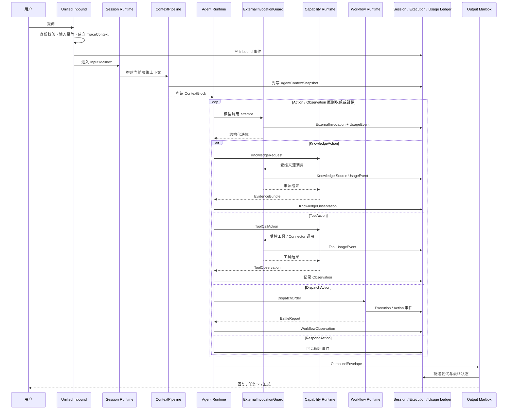

> 入口约束：用户消息唯一入口是决策插件；WorkflowPlugin 只响应派兵令，
> 不存在"用户 → Workflow"的直连路径。外部回调/定时器同样先唤醒决策插件
> （Recovery），由将军决定如何应对。

### 5.2 Agent 挂载能力消费（随身能力）

**能力调用与权威边界图：**

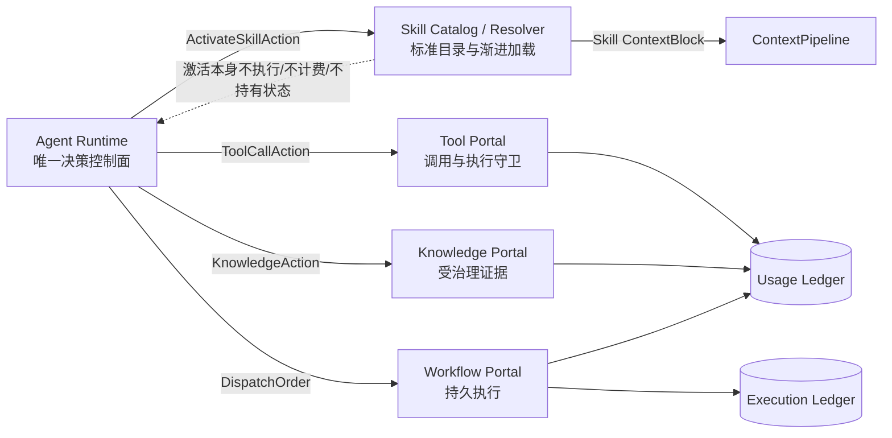

图中 Skill 激活形成 ContextBlock，并可指导 Agent 读取资源或调用已授权 Tool；包内脚本必须通过 Tool/Runtime 执行。Tool 和 Knowledge 的外部调用进入 Usage Ledger；Workflow 的运行状态只进入 Execution Ledger。Agent Runtime 持有选择权，但不接管这些能力域的权威状态。

**单个 input 内能力调用图：**

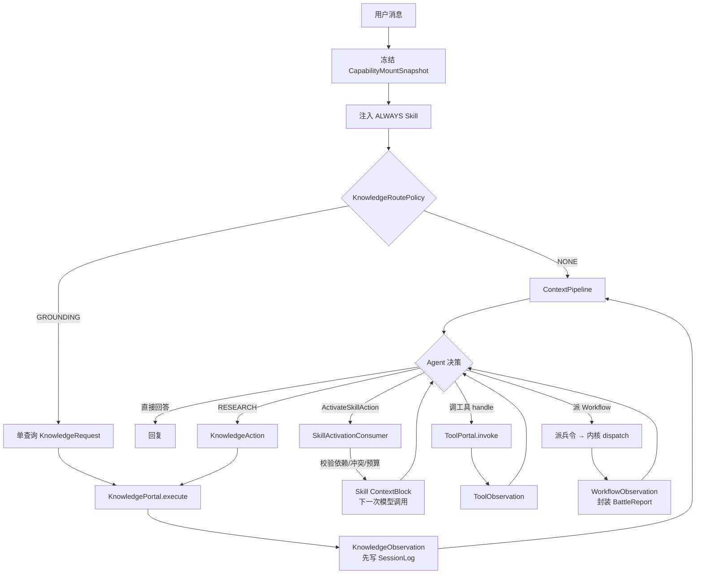

**三级模式**：`NONE` 不创建计划或调用来源；`GROUNDING` 由 Agent Runtime 的轻量路由策略产生单查询、受预算计划，空结果按可选上下文降级；`RESEARCH` 是显式 KnowledgeAction，结果以 KnowledgeObservation 返回循环。Agent 可根据 EvidenceBundle.sufficiency 决定继续、换源、澄清或停止，Knowledge Runtime 不替 Agent 回复或结束会话。

**两级规划**：Agent 固定研究目标、允许来源/算子、总预算和停止权；Knowledge Runtime 把 KnowledgeRequest 转为 KnowledgePlan，在约束内拆查询、选择 Source Provider 与 Operator、融合证据并报告充分性。MVP-0 的 planner 只需生成单查询计划；P1 FR-19 才要求多查询并行、链接追踪和 Runtime 内迭代。图谱与 GraphRAG 不属于产品实现范围。

**证据生命周期**：所有 Operator 返回 EvidenceItem，保留 sourceId、sourceVersion、来源引用、算子路径、相关性与信任信息。Runtime 形成不可变 EvidenceBundle；Agent Runtime 先写 SessionLog KnowledgeObservation，再由 PolicyChain 和 ContextPipeline 选择注入项。candidate、selected、injected、referenced 分别记录；回放读取冻结 ContextBlock/EvidenceRef，不重新检索。

**Workflow 边界**：Knowledge 仍是 Agent Runtime 治理的能力，不经派兵令调用。Workflow 若需要知识，只能在定义中显式声明类型化 KnowledgeQueryNode；该节点经同一 Scope、InvocationPolicy、PolicyChain、预算和审计管道调用 KnowledgePortal，或解析 DispatchOrder.evidenceRefs。节点只获得引用 item，不能读取完整 SessionLog、MemoryPort、RelationshipState 或任意共享知识服务；未声明节点时访问即拒绝。

**权威边界**：KnowledgeBase、Wiki 与结构化源保持各自内容权威；EvidenceBundle 是已执行查询的不可变认知产物，不是新的机构知识事实。Knowledge Runtime 不直接读取 MemoryPort，只接收 Agent 明确放入 KnowledgeRequest 的意图与查询约束；写回只能产生 KnowledgeWriteProposal，分别交 Memory 或机构知识治理流程审批。

**Skill 激活**：Skill 包以 `SKILL.md` 为入口，可包含 `scripts/`、`references/` 与 `assets/`。`ALWAYS` 在 input freeze 后加载完整指令并形成不可变 ContextBlock；`ON_DEMAND` 先只暴露受控 metadata，Agent 发出 ActivateSkillAction 后由 Runtime 校验挂载、依赖、冲突组与完整 token 预算，再按需读取资源。成功激活的 Skill 只进入当前 Loop，不获得 Tool/Workflow/Knowledge 权限，不创建执行账本，也不产生独立费用；脚本只有经已挂载且已授权的 Tool/Runtime 才执行。

**Tool 解析**：ToolDefinition/ToolVersion 保存 name/title/description、输入/输出 schema 等不可变调用契约；ToolExecutionPolicy 保存 effect、确认、幂等、超时、敏感字段、调用身份政策与 Provider 要求；ToolDeployment 绑定 Platform Handler、ConnectorInstance、MCP 或其他 Provider，AgentToolMount 授权具体 Deployment。`ToolCatalog` 仅从当前 input 的冻结 mount-set 形成模型可见目录，并把发现 metadata 与同一 exact target 一起交给 Session 冻结。模型只能提交目录中的 opaque `tool_handle` 和标准 JSON object `arguments`；名称未知、名称代替 handle、未挂载、版本停用、Deployment 不可用或 schema 不匹配均在 Provider 前稳定拒绝，不搜索租户全局同名工具，不自动调用 Mock。

以下能力调用和守卫管道是目标约束，不代表所有 Provider 和宿主组合均已通过端到端验证。当前 Session 已有冻结 schema 校验及工具结果校验代码；具体派发、取消与外部执行能力仍取决于宿主装配和对应 Provider。

**能力调用契约**：

| 契约项 | 说明 |
| :-- | :-- |
| 入参快照 | 模型产生的标准结构化 Tool `arguments` 在 decoder 后进入 request、Action 与 invocation，按冻结 inputSchema 校验并在派发前**无损快照**；恢复只读原快照，不从当前配置重建 |
| 规范输出 | 能力声明输出 schema（canonical output）；Session 对工具结构化结果按冻结输出 schema 校验，展示层从结果投影（render），不与执行耦合 |
| 超时预算 | Tool 与 Workflow 可声明合作式超时；Skill 只声明整体注入预算，不拥有执行超时 |
| 并发安全 | Tool 与 Workflow 分别声明并发语义；Skill 无执行并发状态 |
| 取消传播 | 执行必须观察/转发 `exec.signal`，取消后只在自己的工作静默后结束 |
| 展示与执行分离 | 能力可声明 pending/completed 两种展示投影（纯函数，仅依赖入参），
  直播与回放共用——同一次调用在实时与回放中渲染一致 |

**Tool 守卫管道**：`handle/tenant/mount → input schema → PolicyChain/confirmation → idempotency/retry/budget → ExternalInvocationGuard → output schema/redaction → ToolObservation/UsageEvent/TraceEntry`。开始事实未持久化时不得调用 Provider；结果未知时记录 unresolved，不盲目重放。

#### 通用代码执行装配

`code_execute` 作为 PLATFORM Tool 接入上述统一管道，不新增 CapabilityType 或 AgentAction。普通对话可直接提交 inline 代码；Skill 可提供脚本引用，但不是执行前提，也不拥有独立执行权。文档生成、静态网站生成和计算共用此 Tool，领域模板可以由可选 Skill 提供，不另设重复执行器。

宿主 Platform Handler 接收 Provider 传入的可信执行上下文，通过已有冻结快照能力解析受权 Skill 资源，再调用独立 Sandbox 服务；Runtime Core 不识别工具名称、不依赖 Docker 或产物存储。Sandbox 服务负责隔离执行与取消，宿主产物服务负责持久化和访问控制，聊天消费受控产物投影。契约见 [03 通用代码执行 Tool](03-核心对象模型与状态机.md#通用代码执行-tool)，执行环境、依赖、网络、下载和预览见[宿主设计](../docs/02-架构与设计/12-代码执行沙箱与产物交付.md)。

#### 会话工作区装配

会话持久工作区由宿主与现有 Sandbox 服务装配，`workspace_files`、`workspace_exec`、`workspace_checkpoint` 沿用 PLATFORM Tool 管道，不新增 Runtime Core 文件系统、Docker 或云存储职责。机构宿主拥有 Session 归属、权限和持久清理意图；Sandbox 拥有项目文件、操作修订、快照和执行静止事实；又拍云备份仅由可信后台任务执行。

每个实际 Session（包括独立委派子 Session）拥有各自项目目录。任务临时目录与项目持久卷分属不同生命周期；`code_execute`/`run_code` 通过显式授权的 `use_workspace` 选用同一项目目录。备份不是正式成果，成果发布继续由已有产物服务负责。调用、未知结果及跨成员边界见 [03 会话工作区 Tool](03-核心对象模型与状态机.md#会话工作区-tool)，存储、完整 Bash、异步快照和首期范围见[宿主工作区设计](../docs/02-架构与设计/12-代码执行沙箱与产物交付.md#43-会话持久工作区)。

### 5.3 挂起与恢复

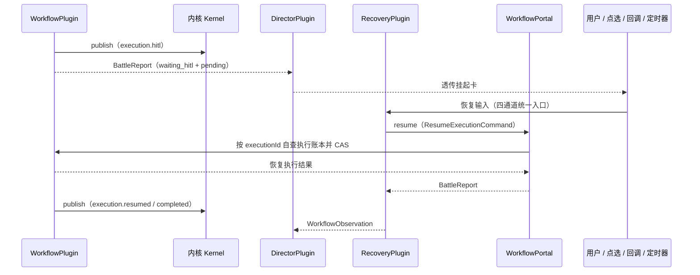

**关键点**：恢复上下文（pending/checkpoint/变量）是执行插件的私有账本，
决策插件与内核都不碰（解决"恢复语义分散"痛点）。

**恢复幂等**：同一挂起被重复恢复（回调与用户输入竞争、定时器与点选竞争）时，
第二次恢复被**幂等拒绝**——执行插件按 executionId 的当前状态 CAS 判定
（仅 waiting_hitl 可恢复，恢复中/已完成/已取消一律拒绝），不产生重复执行。
恢复动作本身进会话日志（`execution.resumed`），审计与回放可见完整
挂起-恢复链路。

**多挂起与意图唤醒**：单会话可并存多个挂起——恢复先路由后执行：
确定性通道（点选/回调/定时器）按 `sessionId + executionId + actionKey` 直连，用户自由文本按
唤醒意图特征匹配（§5.10）；宕机后从持久化账本重建挂起清单并续跑（§5.11）。

### 5.4 能力声明与 Invocation Policy

能力声明挂在**服务定义**上（§3.2），除"是否支持某能力"外，还须声明
**调用面**（Invocation Policy）：能力对模型面 /
用户面分别是否可调用，四个组合独立声明
（record 草案见 [03 §5.4](03-核心对象模型与状态机.md)）：

- 双面可调（如知识库检索）：`{ model: true, user: true }`。
- 仅模型可调（如内部管理工具）：`{ model: true, user: false }`。
- 仅用户可调（如人工审批工具）：`{ model: false, user: true }`。
- 双面禁用（占位/停用）：`{ model: false, user: false }`。

**能力声明示例**（挂起支持 + 调用面，消费方按声明路由）：

```java
public class WorkflowPlugin implements ExecutionPlugin {
    @Override public boolean supports(String capability) {
        return switch (capability) {
            case "supports_hitl" -> definition.supportsHitl();
            case "export_fields" -> !definition.exportFields().isEmpty();
            default -> false;
        };
    }
    @Override public InvocationPolicy invocation() { return definition.invocation(); }
}
```

**发布前校验**：

- 声明 `supports_hitl=true` 才允许挂起打断；未声明 `export_fields` 则战报
  `data` 恒为空。
- 消费方在暴露/调用前必须检查对应调用面（模型面工具检查
  `modelInvocable`，用户面命令检查 `userInvocable`），不可绕过分派。
- 注册到 scope 层时按调用面校验可见性（user-only 能力对模型面不可见）。
- **schema 白名单**：能力声明中模型可见的只有（名称/描述/参数）。
  输出定义、超时、并发标记等元数据永不进模型请求（防止内部细节泄露给模型）。

### 5.5 会话入口与生命周期

本节的插件入口、统一路由图及生命周期表是目标职责模型。当前存在 `InboundEnvelope` 类型，但源码没有 `DirectorPlugin`、`RecoveryPlugin` 同名类型；不能仅凭下图认定所有通道及生命周期操作已接入。

**会话对象**：会话绑定其对话目标，不依附任何执行插件；当前宿主支持 Agent 或 Team 目标，群会话通过专属入口绑定群身份
（record 草案见 [03 §5.1](03-核心对象模型与状态机.md)；状态机见 [03 §6.1](03-核心对象模型与状态机.md)）：

**消息入口（Inbound）**：所有输入统一经一个端口进入，按会话定位决策插件：

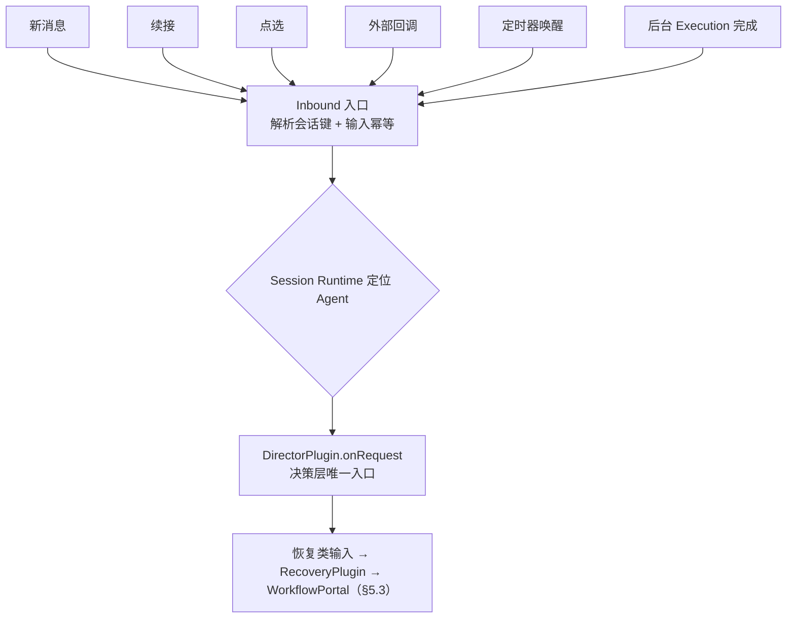

**强制机制**：内核与注册表不提供"输入 → 执行插件"的路由——派兵路由只认
派兵令（`dispatch(DispatchOrder)`），执行插件 SPI 只有 `run(DispatchOrder)`。
不存在用户消息直达 WorkflowPlugin 的路径（§1.1 原则 4）。执行插件若要取会话
数据，只能经派兵令 `meta` 的只读引用获得，不持有 Session 聚合、关系状态或记忆端口。

**生命周期**：

| 阶段 | 动作 | 说明 |
| :-- | :-- | :-- |
| 创建 | 指定 Agent → 建 Session → join scope 父链 | 记录身份、Persona 版本和 agent scope 键，不固定能力组合代 |
| input freeze | 每个 input 按 `agent → preset → global` 链解析挂载 | 校验租户、状态、版本、依赖和冲突后冻结 CapabilityMountSnapshot |
| 续接 | 按 sessionId 恢复上下文并受理新 input | 新 input 读取当前挂载；历史回放读取当时 ContextSnapshot，不重查 Registry |
| 关闭 | 关闭 Session → 释放 agent 层注册（disposer，§3.5） | 组合切换仅影响后续 input；历史按快照回放（§3.4） |

**会话与执行的关系**：执行插件只认 `executionId`，会话信息以只读引用随派兵令
`meta` 传递；执行层不读写会话，也不读取 Agent 配置、历史、画像、关系或记忆。agentId 只用于归属校验与审计，执行插件无会话聚合句柄。外部唤醒按 `session_id + execution_id + action_key` 定位挂起后，仍经 Unified Inbound 和 Recovery 进入执行层（FR-18.4）。

### 5.6 会话运行：冷启动 / 续接 / 幂等 / 并发

**冷启动与续接（同一入口，不同上下文组装）**：

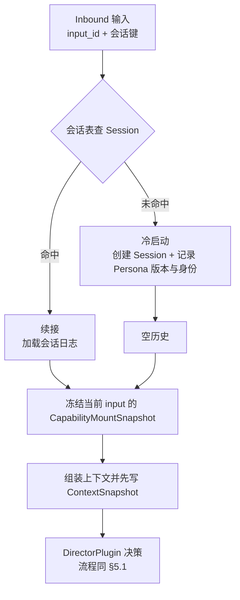

**输入幂等**：每条输入携带 `input_id`；InputIdempotencyLedger 以完整会话键 `tenant_id + agent_id + session_id + input_id` 持久去重，并保存规范化输入指纹、处理状态和结果引用。相同键与相同指纹返回既有处理中或终态结果；相同键但指纹不同以 `idempotency_conflict` 拒绝并审计。输入幂等与 executionId 恢复 CAS 分层，分别避免重复决策与重复恢复；外部副作用仍须端到端传递稳定 actionId。

**并发隔离**：

| 维度 | 规则 |
| :-- | :-- |
| 多会话并行 | 不同会话可并行决策/执行；会话状态按 scope 键隔离（§3.3），各 input 的能力快照互不串扰 |
| 同会话决策串行 | 同一会话内 Inbound 按序处理（每会话单 flight），避免交错生成 Agent 决策；已启动且声明并发安全的 Execution 可独立并行 |
| 共享实现 | 同 preset 的 standing mount 实现共享一份，但状态按 Session 隔离（§3.4） |

**身份绑定**：Session 记录 `userId + channel`；入口校验每次输入的会话键与身份
一致，不一致拒绝访问（防会话串用，FR-8.10）；身份作为 meta 随派兵令透传，
执行层只读使用、不自行校验身份（身份策略归守卫管道，§5.2）。

### 5.7 会话状态、记忆与生命周期

上下文视图与执行优化的详细契约归 [03 专题](03-上下文视图与执行优化.md)，本节只定义装配职责，不把目标设计视为已实现。

| 模块边界 | 优化职责 |
| :-- | :-- |
| Runtime API / Core | 多原生调用、只读批次与子操作状态，受控原文读取和 Skill 释放，溢出补救分类及纯状态约束 |
| Session / SPI | 证据到模型视图再到冻结请求；摘要覆盖及其未覆盖尾部、调用组、轮次边界、活动 Run 缓存和 reasoning 批次日志；默认记忆源不自动三层检索，显式 SPI 注入的冻结组可回放 |
| Institution 宿主与系统用途服务 | 显式 `task_id` 的只读选择、安全原文存储、按需任务/记忆工具、`correct` 使用的 task-context 系统用途、独立 context-summary 模型配置和可信 parallelSafe 配置；业务事实不下沉 Core |
| 模型适配器 | 多调用编解码、明确溢出识别及 Provider 必需 reasoning 协议 |
| 诊断接口与现有前端 | 消费后端统一压力、组成、阶段耗时和关联用量，不自行分词或新建观测平台 |

精确 ABI 以源码和生成基线为准。复用现有 ContextBlock、日志、准备 journal 与系统用途发布链，不预建独立缓存服务或通用提示词替换框架。

**记忆与上下文分层**（只经决策层消费，执行层不碰）：

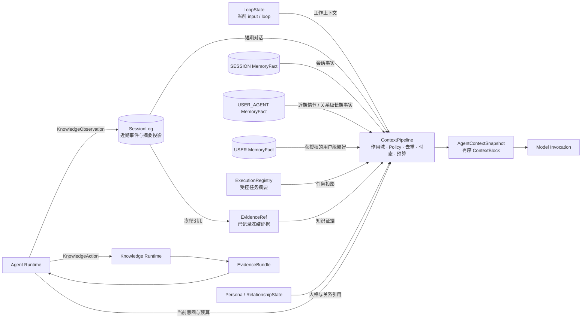

| 产品概念 | 实现载体 | 作用域 | 权威语义 |
| :-- | :-- | :-- | :-- |
| 工作记忆 | `LoopState` + 不可变 `AgentContextSnapshot` | 当前 input / loop | LoopState 保存决策轮运行事实；快照先入 SessionLog 再调用模型 |
| 短期记忆 | `RecentConversationProvider` 生成的 SessionLog 尾部视图 | 当前 Session 摘要覆盖与未覆盖尾部 | 派生视图；缓存丢失后从持久来源重建 |
| 会话记忆 | `MemoryFact(scope=SESSION)` + `SessionSummaryProjection` | tenant + session | MemoryFact 归属 `SessionRef`，不额外绑定用户或 Agent；摘要是可重建投影 |
| 中期记忆 | `RECENT_EPISODIC` 查询配置 | 同一 user + agent 的近期跨会话情节 | 复用 USER_AGENT episodic 事实；不新增存储、scope 或任务/项目级作用域 |
| 关系级长期记忆 | `MemoryFact(scope=USER_AGENT)` | tenant + user + agent | 该助手的专属偏好与需隔离的长期业务事实；跨 Agent 默认不可见 |
| 用户级长期偏好 | `MemoryFact(scope=USER)` | tenant + user | 类型策略允许、适用范围明确的人级偏好；归属不含 agent。跨助手可见不等于任何助手默认可读可写 |
| 群公共记忆 | `MemoryFact(scope=GROUP)` | tenant + group binding | 按群生命周期归属，访问仍受群权限与治理策略约束 |
| 群成员记忆 | `MemoryFact(scope=GROUP_MEMBER)` | tenant + group binding + subject user | 被描述成员与当前访问者分离，不能因指定对象而获得读取或写入权限 |
| Workflow 状态 | Execution Ledger / checkpoint | 单个 executionId | 独立执行事实域，不属于记忆 |

> 活动执行与挂起清单由 ExecutionRegistry/WakeIndex 投影，不以内存或记忆作为权威；投影和索引必须可从 Execution Ledger 与 SessionLog 重建。

**规则**：

- 记忆只经决策层消费：DirectorPlugin 在决策/总结前经 ContextPipeline 读取 MemoryPlugin；WorkflowPlugin 不持有 MemoryPort、会话历史或关系状态，只接收显式业务参数、只读身份元数据和必要引用。
- Workflow 的 checkpoint、挂起变量和内部节点结果永不复制为工作或会话记忆；战报只按能力声明 `export_fields` 导出 `data`，导出结果先落 SessionLog Observation 后才可进入统一提取链。
- **记忆写入即事件**：记忆变更（提取的事实、更新的画像）作为会话事件落日志，
  回放一致（§4.3 模型可见 ⟺ 已记录）。
- **记忆与模型可见一致**：每次模型调用前冻结 AgentContextSnapshot；进 prompt 的上下文块、来源与预算结果必须能从会话日志重建，回放不得按当前索引重新检索。
- MemoryFact 的持久 scope 为 `SESSION`、`USER_AGENT`、`USER`、`GROUP` 和 `GROUP_MEMBER`；工作记忆与中期视图不伪装成持久记忆 scope。长期本身不是共享边界：`USER` 表示租户内用户级归属，不表示所有 Agent 默认可读可写；群作用域的归属与授权见 §5.8.1。
- 记忆归属、访问权限和事实来源必须分开。归属按 scope 判定；当前访问者按 VerifiedIdentity 与 `MemoryAccessPolicy` 分别授权读/写；来源始终保留原始 tenant/user/agent/session 与 `sourceEventIds`。允许读取共享事实，不授予读取原始会话全文的权限。
- `USER_AGENT` 归属必须包含 Agent；`USER` 不绑定 Agent，`SESSION` 仅绑定 `SessionRef`，其来源事件仍保留真实的用户和 Agent。不得将缺少 Agent 的 `USER_AGENT` 解释为 `USER`；不绑定 Agent 本身不授予共享权限，读取仍须符合相应 scope 的访问策略。
- KnowledgeBase、RelationshipState、Persona、SessionLog、MemoryFact 和 Execution Ledger 保持独立，ContextPipeline 只组合可见内容，不合并权威存储。

**近期会话视图**：按 SessionLog 的已持久摘要覆盖范围与未覆盖历史构建时间正序视图；分页仅控制 I/O，不能按最近条数直接丢弃未摘要信息。历史完整组及近期目标见[专题 §7–§8](03-上下文视图与执行优化.md#7-历史摘要与近期完整区域)，活动 Run 增量缓存的隔离、失效与容量见[专题 §13](03-上下文视图与执行优化.md#13-活动-run-增量缓存)，不新增 Redis 或缓存表。

**会话摘要投影**：超出近期窗口的日志可生成 SessionSummaryProjection；投影记录覆盖的起止 sequence、来源事件、版本和预算信息，不能删除或替代原始 SessionLog。实时读取可使用当前投影，历史回放只使用当时已写日志的 ContextBlock。

**跨会话任务上下文**：普通 Skill 的未完成工作由 ConversationTask 保存和续接，归属同一 tenant/endUser/agent；多个 Skill 共用任务信息，同一 Skill 可处理不同任务。任务变更以 SessionLog 为源，目录与当前状态为可重建投影；任务上下文单独冻结，不依赖短期窗口或 Memory 词法命中。契约见 [03 §5.6.1](03-核心对象模型与状态机.md#561-conversationtask-与跨会话续接)。

**读写协议**（类型注册表 / 提取 / 路由 / 检索 / 更新 / 过期）见 §5.8。

**生命周期与回收**（会话生命周期与执行生命周期解耦）：

| 阶段 | 触发 | 动作 |
| :-- | :-- | :-- |
| 空闲回收 | 会话空闲超时（阈值可配置） | 释放 agent 层 scope 注册（disposer，§3.5）+ 会话运行时缓存
  （LoopState / 挂起清单投影）；输入幂等账本独立保留、不随回收清除（独立 TTL，
  见 [03-核心对象模型与状态机](03-核心对象模型与状态机.md) §9.2）。
  挂起恢复点留在执行层账本（§5.3），恢复通道可重新拉起 |
| 关闭 | 显式结束 | 同上 + 标记 Session closed，拒绝新输入 |
| 删除 | 用户请求 / 合规 | 会话日志按保留策略清理；删除动作记录为审计事件。
  该会话回放受限 |

普通首提与 `NewRun` 只有 Session 为 active 时才可进入 Inbox；created、closed 或不存在的 Session 在身份已验证后形成稳定 `REJECTED` receipt，不创建 Inbox、Run 或 publication。closed 的唯一例外是已验证 `SystemPrincipal`、原 causation 账本证明和同 owner `ExistingRun` 同时闭合的 `CALLBACK/RECOVERY`，它只用于收敛既有执行，不能创建新 Run。准入事务先识别同 input 已提交的原 receipt，再在同一 owner/Session 行锁下判断该矩阵并提交 input ledger；因此 active 下已提交而返回丢失的输入在随后关闭后仍重放原结果，close 与首次准入只存在一个数据库线性化顺序。

**关键设计**：回收/删除只清理会话侧（scope 注册、幂等集合、会话日志），
不销毁执行层账本（挂起点、execution 历史）——执行是独立生命周期，
会话删除不追溯销毁已完成的执行（除非合规明确要求）。

### 5.8 记忆协议：类型 / 提取 / 路由 / 检索 / 更新 / 过期

本节同时描述现有记忆契约和分阶段目标；具体实现范围以源码及各段标注为准。下文的 `ExecutionRegistry`、`WakeIndex` 是执行和唤醒投影的设计名称，当前源码没有同名实现，不能据此认定投影重建或语义唤醒已交付。

**记忆条目（Memory Fact）**——结构化事实，来源可追溯：

```java
public record MemoryFact(
        MemoryFactRef ref,
        MemoryOwner owner,        // scope 由封闭归属分支派生
        MemoryTypeRef type,
        RetentionClassRef retentionClass,
        String schemaVersion,
        String subject,
        String predicate,
        TypedPayload object,
        List<EventId> sourceEventIds,
        SessionRef sourceSessionRef,
        Optional<ExecutionRef> sourceExecutionRef,
        Optional<String> exportPath,
        String extractorVersion,
        long revision,
        Instant createdAt,
        Instant validFrom,
        Optional<Instant> validTo,
        Optional<Instant> expiresAt,
        double confidence,
        double importance,
        boolean reviewRequired,
        Optional<MemoryFactRef> derivedFrom,
        Optional<MemoryFactRef> supersededBy,
        double decayScore,
        FactStatus status) {}

public record MemoryFactRef(TenantId tenantId, String factId) {}
public record MemoryTypeRef(String value) {}
public record RetentionClassRef(String value) {}
public enum MemoryScope { SESSION, USER_AGENT, USER, GROUP, GROUP_MEMBER }
public enum MemoryQueryProfile { DEFAULT, RECENT_EPISODIC }
public enum FactStatus {
    ACTIVE, DECAYED, PENDING_CONFIRM, REJECTED, ARCHIVED, FORGOTTEN
}

public record MemoryQuery(
        String queryId,
        MemoryOwner owner,        // 查询边界；访问者由 PortCallContext 提供
        Optional<EndUserId> subjectEndUserId,
        String intent,
        Optional<MemoryTaskConstraint> taskConstraint,
        Set<MemoryScope> scopes,
        Set<MemoryTypeRef> types,
        MemoryQueryProfile profile,
        Instant asOf,
        MemoryRetrievalPolicy retrievalPolicy,
        int maxItems,
        int tokenBudget,
        int characterBudget,
        boolean requireProvenance) {}

public record MemoryRetrievalTrace(
        String queryId,
        List<String> candidateIds,
        List<String> selectedIds,
        List<String> injectedIds,
        List<String> referencedIds) {}
```

这些值对象同时是 Agent Runtime SDK MemoryPort 的唯一公开领域类型，不在 §7.6 建立第二套 MemoryFact/MemoryQuery。归属分支与来源引用必须同租户。SESSION 仅归属 SessionRef，且等于 sourceSessionRef；不额外绑定用户或 Agent。USER_AGENT 归属真实用户与 Agent；USER 仅归属真实用户，sourceSessionRef 仍保留原始来源，读取不要求来源 Agent 等于当前读取 Agent。GROUP/GROUP_MEMBER 按下节的群生命周期与描述对象归属。所有分支均校验原始来源事件。revision 为正数；confidence、importance、decayScore 必须是有限的 0..1；maxItems、tokenBudget、characterBudget 为正数；validTo/expiresAt 若存在不得早于 validFrom。`USER` 同样适用双时态与失效，人级不等于永久有效。Create 只允许 ACTIVE，或由类型注册表强制进入 PENDING_CONFIRM；其余状态只能按 03 §6.4 的 CAS 迁移得到。检索策略以 `MemoryRetrievalPolicy` 完整不可变快照冻结；原词命中 `relevanceThreshold` 不再是查询字段。向量最低余弦相似度取有限 [-1,1]，与词法 rank 和 RRF 分数分别表达。可选 `MemoryTaskConstraint.taskId` 只在已授权集合内收窄任务关系，不授予访问权，正文不携带任务信封。

#### 5.8.1 群记忆归属与冻结目标契约

在原三种 scope 外增加 `GROUP`、`GROUP_MEMBER`。MemoryFact、MemoryFactDraft、MemoryQuery 及 MemoryPort 共用封闭 `MemoryOwner`，由分支表达必要字段，不能向个人字段填空值或群 ID。

| MemoryOwner 分支 / scope | 唯一归属与访问条件 |
|---|---|
| Session / SESSION | Tenant＋SessionRef；允许个人或群 Session，只在当前会话内读取，来源 Session 必须相同。 |
| UserAgent / USER_AGENT | Tenant＋真实 EndUser＋Agent；延续个人访问和来源校验，群不自动读取。 |
| User / USER | Tenant＋真实 EndUser；不以来源 Agent 限制本人跨 Agent 访问，群不自动读取。 |
| Group / GROUP | Tenant＋GroupBindingRef；无 owner EndUser/Agent，当前群成员和获准服务 Agent 共享读取。 |
| GroupMember / GROUP_MEMBER | Tenant＋GroupBindingRef＋subjectEndUserId；描述对象可以已退出，读取者仍必须当前获准，不能把描述对象当请求者。 |

`MemoryQuery` 的访问者来自 PortCallContext 的 VerifiedIdentity/RunIdentity，查询范围另用 MemoryOwner 及可选 subjectEndUserId 收窄；scope 与 owner 分支必须相符。群查询必须等于当前群闭包，任意指定其他群/个人 scope 在检索前拒绝，不能搜索后交给模型过滤。模型继续使用 search_memory；工具参数不能覆盖可信 Tenant、群、访问者或治理权限。

每项事实和候选保留 sourceSessionRef、sourceEventIds、来源作者、来源顺序、描述对象、提取器/策略版本及原写入责任身份；GROUP_MEMBER 不要求作者永远等于描述对象，但自动激活本人低风险偏好必须有本人明确表达，第三方/敏感/歧义候选进入 PENDING_CONFIRM。非触发提取使用明确 SystemPrincipal、任务预算及真实执行 Agent/模型引用，不伪造聊天请求者或归到最近被 @ 的 Agent。

一个来源在同一 extractorVersion＋policyVersion 下只有一个逻辑任务，候选以稳定 candidateKey 幂等；事实创建、候选进度与来源引用可靠提交，部分完成后重试复用原事实。纠正按来源的权威顺序和 fact revision CAS 形成取代，较早任务不能覆盖较晚纠正。遗忘另存 owner＋来源覆盖边界＋事实语义键的抑制记录，读取/写入均检查；旧来源重投、升级或换 fact ID 不回填。只有有权主体明确的新来源表达或恢复操作才能按 CAS 形成新事实，语义相似度不能解锁。

默认检索当前发言者本群事实和相关群事实，涉及其他成员时按明确对象收窄，不一次注入全群画像。每次模型 preparation 或按需 search_memory 以稳定 preparation/action 身份保存实际选中的 `(factId,revision)`、来源、权限/治理版本与引用；该选择在提交准备后冻结，重放和进程恢复只读原选择，不重新搜索。默认记忆组在该 Run 首次准备时冻结；按需查询按稳定 action/query 身份冻结结果，同一 Run 已选 fact 的 revision 统一钉住，后续 Loop 不因普通新偏好重新选择其新版本。新 Run 才读取最新默认组；恢复不重新检索或扩充原选择。当前撤权、退出、遗忘和禁止使用须在实际材料使用前复验；失效则阻止对应准备继续并返回明确结果，必要重建经显式受控流程，不静默重放业务写或改写已交付正文。故障无法完成当前校验时失败关闭。

事实状态沿用 Harness 03 §6.4，召回只注入 ACTIVE 且有效事实；PENDING_CONFIRM 不自动注入。本人确认、纠正激活或恢复自身明确提供的成员事实；对于第三方描述自己的候选，本人也可拒绝或遗忘，不能因来源非本人而失去否决出口。群管理者治理公共事实，均验证精确来源、当前角色及 revision；群管理不默认授予代他人确认身份。长期遗忘不删除公开消息/摘要，摘要需保留来源且不得绕过纠正、抑制和禁止使用。

**类型注册表与提取策略**：记忆类型经 schema 注册表管理（`MemoryTypeRegistry`），
每类型声明 schema、允许 scope、保留类别、自动候选条件、默认重要度、强制审核和冲突/衰减策略；提取策略含全局类型白名单与会话级覆盖，提取只产生白名单内类型（FR-9.11）。`flow_state` 不属于 MemoryType；挂起清单与语义索引由 ExecutionRegistry/WakeIndex 维护（§5.10）。

Starter 默认启用记忆；不使用记忆的独立宿主可显式设置 `agent-runtime.memory.enabled=false`，不自动装配 `JdbcMemoryPort` 与 `MemoryRuntime`，也无需提供其记忆治理依赖。以下治理要求适用于启用记忆的装配，关闭能力不提供默认允许策略或空实现。

SDK-2D 的最小 `MemoryTypeRegistry` 是由装配层显式注入、无默认实现的只读注册表。每个 registration 至少冻结 type、非空允许 scope、一个或多个 `(schemaVersion, TypedPayload.schemaId)`、retentionClass、是否允许 `RECENT_EPISODIC`、是否强制审核以及对应 schema 的纯 payload validator；未知 type/schema/version、validator 异常或非显式 Allow 一律拒绝。Runtime 同时逐项核对 query 与 adapter 返回事实：普通 query 的显式 types 必须命中注册表，返回事实必须命中请求 scope/type 与注册 schema；`RECENT_EPISODIC` 必须只请求 USER_AGENT、显式列出且全部注册为 episodic 的类型。强制审核 registration 的 Create/Supersede 草稿必须同时为 `PENDING_CONFIRM + reviewRequired=true`；registration 的 retention、scope 或 payload schema 不一致时在调用 MemoryPort 前停止。该最小契约不包含 P1 的自动候选、晋升、冲突/衰减矩阵或持久提取队列。

SDK-2D 还要求装配层显式提供无默认允许实现的 `MemoryAccessPolicy` 与 `MemorySourcePolicy`。前者在每次 query/create/supersede/transition 前按当前 VerifiedIdentity、scope、type 与操作返回带审计引用的显式 Allow；读 USER 与写 USER 必须是两条独立授权，能读不能默认能覆盖。后者在写入前检查完整 draft 与已从 SessionLog 逐一读回的来源事件。Runtime 自身仍强制来源事件非空、eventId 与来源 Session 精确匹配；SESSION/USER_AGENT 写入还要求来源事件 owner 等于当前写入者；USER 写入要求来源事件属于当前写入者当时的 Session，但 USER 读取按归属 tenant/endUser 加读权限过滤，不以来源 Agent 等于当前 Agent 作为准入。exportPath 存在时 sourceExecutionRef 必须存在并至少命中一个相同 executionRef 的已提交事件，普通 execution 来源不因没有 exportPath 被拒绝。是否为可提取 Observation、exportPath 是否在声明白名单及高敏来源规则由 SourcePolicy 决定；callback 原文、checkpoint、未导出 data 或任何非显式 Allow 均不得到达 MemoryPort。策略异常不转换成允许，也不存在生产 in-memory fallback。
ContextPipeline 装配当前助手获授权的 `USER` 偏好与自己的 `USER_AGENT` 事实；不得把全部人级信息默认注入每个请求。对同一偏好、适用条件重叠、有效且可信度满足要求的可选表现，默认采用顺序为：当前明确请求 > 当前 SESSION 约定 > USER_AGENT 专属偏好 > USER 通用偏好 > 助手默认表现。该顺序只处理用户可选偏好，不能覆盖系统约束、工具权限或安全要求；推断偏好不得仅凭更细 scope 压过用户明确保存的设置。助手级覆盖用户级只影响本次采用值，普通查询不得改写或失效用户级事实。首版把偏好名称和适用对象写进事实即可，不引入独立上下文规则引擎。子智能体不继承父智能体的 `USER_AGENT` 记忆；委派权限明确允许时可读取必要的 `USER` 偏好，但不因委派自动获得 `USER` 写权限。

**状态机与来源强制（6 态）**（状态机图见 [03 §6.4](03-核心对象模型与状态机.md)）：

- 来源强制：高敏类型（医疗等）无论蒸馏还是工具写入一律落 `pending_confirm` +
  `review_required`——LLM 推断禁止直接写高敏记忆，**落审核而非拒绝**（数据不丢、
  可审计，FR-9.16）；强制类别可配置。
- 审核动作（通过 / 拒绝 / 恢复 / 归档）全量入审计；审核超时标记 EXPIRED
  （不改变状态，已标记不重复审计）。
- 双时态过滤：注入与召回只取 `active` 且在查询 `asOf` 时有效的事实；经治理提交的修订、衰减、审核拒绝和遗忘按状态机关闭原有效区间，疑似矛盾候选本身不改变旧事实。

**提交-提取-路由（写入）**：记忆提取发生在**会话提交时**，两阶段执行、与主链路解耦：

普通入站消息的自动提取默认关闭。机构 Agent 草稿通过现有 `config` 配置 `{"memory":{"automatic_extraction":true}}` 后发布，只有来源事件精确所属租户、Agent 版本处于 `published` 且值为 JSON 布尔 `true` 时才登记 `inbound-hydrate`；缺省、`false` 和字符串 `"true"` 不启用。创建、更新和发布入口校验该字段类型，版本发布仍遵守 Agent 定义不可变约束。Worker 在调用提取模型前重新检查当前开关与发布状态；关闭或停用的存量任务记为 `SKIPPED`，不调用模型。明确的 `memoryCandidate` 保留独立准入，继续执行来源、scope、审核和幂等治理，不由自动提取开关授予额外权限。

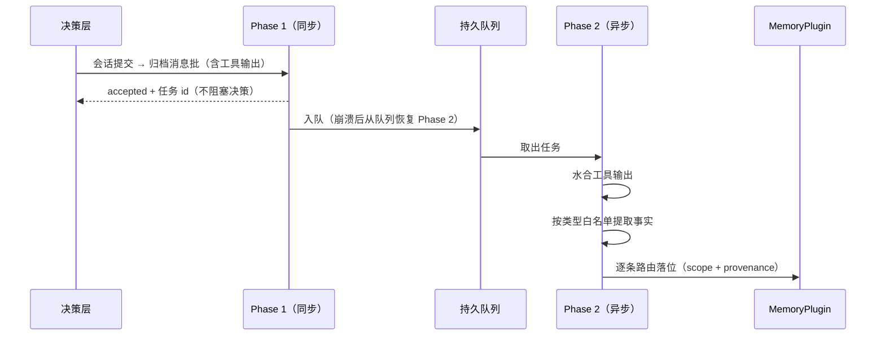

- Phase 1 与 SessionLog 批次提交在同一原子边界登记持久提取任务；Phase 2 可轮询或事件追踪，进程崩溃后由持久队列重新领取，不使用进程内无界队列。
- 提取任务稳定键至少包含 `sourceEventId + extractorVersion + policyVersion + memoryType + canonicalFactKey`；重复领取返回既有候选或结果，不重复创建事实。
- 写入者只消费已提交 SessionLog 事件；工具结果和 BattleReport.data 仅按能力声明 `export_fields` 形成带 executionId 与 exportPath 的 Observation，不默认全量。
- **元认知工具**：内置记忆工具（保存 / 召回 / 更新 / 遗忘），Agent 经工具循环
  主动管理记忆；候选、选中、注入和引用分别写使用事件；工具写入与蒸馏共用同一链路
  （去重 / 冲突 / 来源强制），仅来源与审计操作人不同（FR-9.18）。
- **路由规则**：当前个人提取链逐条处理 SESSION、USER_AGENT 或 USER；群提取接续上述 GROUP/GROUP_MEMBER 的真实群/作者/描述对象契约，不把群 ID 填入个人字段。SESSION 的 sessionId、USER_AGENT 的 tenant/user/agent、USER 的 tenant/user 必须从来源事件得到，禁止提取器编造目标空间。写入 USER 须同时满足：类型注册表允许该 type 进入 USER、用户表达的适用范围支持用户级、满足保存条件、且当前访问者具有 USER 写权限。`explicit_save`/`repeated_confirmed` 只证明可否写成稳定记忆，不单独决定 scope，也不构成跨助手共享授权。重复确认不得扩大原始表达的适用范围；“只告诉你、不要让其他助手知道”不得进入 USER。
- 自动提取中的 `scope=USER` 是模型提议；缺少独立可信共享依据时保留 USER 提议并置 `reviewRequired=true`、`PENDING_CONFIRM`，不得自动激活或复用 ACTIVE USER。提取身份只能创建此类待确认候选，不能取代或迁移 USER 状态。获授权的治理操作者须核对来源及内容，随事实 id、expectedRevision 显式确认 `confirmed_scope=USER` 后，通过既有审核/CAS/审计链激活；普通批准、恢复或纠正不能代替范围确认。拒绝候选无需确认共享范围。
- 普通情节默认保留 SESSION 或写为 USER_AGENT/episodic；USER_AGENT 仍可承载需隔离的长期业务事实，不只存助手口吻偏好。只有类型注册表允许且满足明确陈述、重复确认、显式保存等晋升信号的候选才可写稳定长期事实；其中人级且适用范围明确者可进 USER，其余长期仍进 USER_AGENT。高敏候选始终进入待确认，USER 不绕过审核。
- Session 结束不把完整摘要自动转为长期记忆；晋升产生新事实并用 derivedFrom/supersededBy 保留来源链。
- 每次写入携带 sourceEventIds；任何入 prompt 的记忆可回溯到产生它的会话事件（FR-9.6）。

个人提取采用来源绑定的 v2 契约：模型输入包含当前 `sources` 的原文和发生时间，以及只读 `existingFacts` 别名；输出逐项声明类型、主体、谓词、业务值、保存信号、范围、`stable/task/interval/unknown` 时间性质、条件、逐字证据、关系和不确定项。旧事实不是新证据，`relation` 仅能引用本次提供的别名；宿主固定真实身份和精确事实版本。`task` 落为短期 USER_AGENT episode，`interval` 使用明确业务有效区间，未来计划日期保留在业务值中，不能充当事件发生时间。未知时间和仅观察到的偏好保留待审，不按子串丢弃或晋升。

事实正文统一为 v2 的 `value/conditions/temporal`；固定结构使用实体，业务类型继续拥有开放 `value`，身份、范围、状态、版本、来源仍在既有类型化字段。模型调用前冻结原来源时刻和已有事实的精确不可变 revision 引用与顺序，恢复不读取 latest，也不重复保存完整事实 JSON；原系统 Agent Run 保存实际模型输入。模型调用不占事实事务；逐候选以类型化列及有序明细保存固定命令与首次治理材料，重启从已落状态续接。ACK_PENDING 恢复原 Runtime 命令，UNKNOWN 不重新派发模型或另造命令；槽位串行检查与写入防止两个不同偏好同时绕过审核。

修订提案先保留 PENDING_CONFIRM，固定原 target 的 ref/revision，payload 提示不能独自授权。批准通过 `AcceptRevision` 对旧事实和既有提案执行双 CAS，同一事务归档旧事实并激活原提案，不新造第三份事实。任一版本变化返回并发冲突，不自动改绑 latest；未来尚未生效或已过期提案明确拒绝，保留原事实和提案。跨助手 USER 治理先授权当前事实，再通过 `SessionLogPort.findUserSource` 按原 tenant/session/user/event 核验旧来源的真实 owner/target；新草稿仍核验当前来源，不以新助手身份重建旧来源。个人治理请求在独立事务冻结幂等键、完整请求摘要及受理时间；重复提交继续原身份和原 `memory.written` 时间，未知或日志待补返回可恢复状态。当前实现只解释个人 inbound 的自然语言和显式 v2 候选；Observation 的自然语言导出尚未接入，正式结构化 WriteProposal 继续使用现有投影链，群提取与共享召回归 GI-06/GI-07。

**读取（检索）**——两阶段 + 分层加载 + 轨迹：

ContextPipeline 分别调用工作上下文、RecentConversation、任务投影、Session Memory、Recent Episodic、Long-term Memory 与已记录 Evidence Provider，再统一执行作用域校验、PolicyChain、事实去重和预算裁剪。Provider 之间不直接读写彼此存储；Evidence Provider 只解析当前 Session 已提交的 EvidenceRef，不执行新检索。

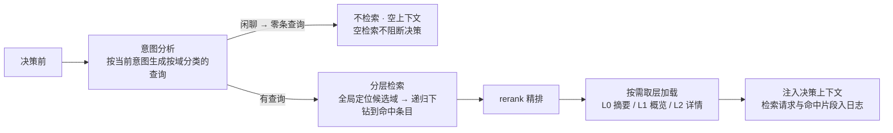

- **分层加载**：每条内容维护三层——L0 摘要（快速判相关）/ L1 概览（规划）/
  L2 详情（仅需要时读全文）；检索先取 L0 判相关，任务需要再加深（FR-9.13，
  控制 token 消耗）。
- `RECENT_EPISODIC` 只查询 USER_AGENT 作用域的 episodic 类型，并叠加时间窗与快速衰减；它是查询配置，不新增 MemoryScope 或事实副本。
- JDBC 检索使用所属类型提供的有效正文投影、成熟 Lucene CJK 分析器与 PostgreSQL 全文 rank；按配置可加入精确 embedding 空间的向量召回，以标准 RRF 融合排名。`RECENT_EPISODIC` 保留 USER_AGENT 情节类型与 `asOf` 前 30 天闭区间 `[asOf-30d, asOf]` 的用途过滤。场景词表、手写切分、结构词过滤、任务词惩罚与正文任务信封退出生产查询。
- `DEFAULT`、`RECENT_EPISODIC` 表达查询用途；检索算法另以不可变策略版本引用表达。新词法/向量/融合策略须显式选择并冻结分析器、词典、模型配置/维度、召回数、融合参数、准入条件、相关性门槛与降级政策。不得静默改变原 `relevanceThreshold` 的量纲或把 RRF 分数当作事实为真的概率；PostgreSQL `ts_rank` 不称为 BM25。
- 融合后的事实按稳定次序选择预算前缀；字符成本取 Unicode code point 数，保守 token 成本取 UTF-8 byte 数，模型注入前再用冻结 tokenizer 精确计量。每次保留精确事实 revision、各召回路径原得分/名次、融合分、覆盖数、实际预算选择和注入内容，不以预算选择宣称事实相等。
- 检索轨迹区分 candidate（索引召回）、selected（权限/状态/相关性过滤后）、injected（实际进入快照）和 referenced（模型或 Action 明确引用）；不能用一次读取计数声称模型真正使用了事实。
- 检索请求、候选定位、选中结果与实际注入片段作为会话事件落日志；历史回放直接读取已冻结 ContextBlock，不重新执行检索。
- `MemoryRetrievalDiagnostics` 独立记录引擎预预算候选、精确 revision、词法/向量原量纲得分与排名、RRF 分、覆盖及降级原因。既有四阶段 trace 的 candidate 仍表示经权威复核且可供采用的返回集合，不能把它冒充全部引擎召回。`retrieval.performed` 使用 v3 schema，written 保持自己的 v2 schema。新准备和实际使用复核当前授权、状态与时效，拒绝已遗忘或当前不可用的冻结事实，不能重搜替换原结果。
- 正常无命中返回明确空结果，不阻断决策。索引/embedding 故障不能伪装正常空结果；仅在冻结策略允许时使用词法降级并记录原因、覆盖率与实际策略，否则明确失败。未发起检索与检索后无命中分别记录。

**版本化检索与候选解释的职责**：

| 边界 | 拥有的责任 |
| :-- | :-- |
| `agent-runtime-api` / `MemoryPort` | 可信查询约束、事实精确引用、检索策略引用及结果/轨迹契约；继续作为现有消费边界 |
| `agent-runtime-memory` | 访问与来源治理、精确事实复核、预算选择、冻结与回放 |
| JDBC 适配器 | 权威事实、归属/状态/时态过滤、精确 revision、CAS 与事务；不拥有自然语言理解 |
| 检索实现 | 按注册类型生成有效正文、成熟分析器、词法/向量召回、融合和可选重排 |
| Institution 宿主 | 发布策略/模型配置、派生索引任务、候选治理与可信用量归属 |

目标查询依次执行可信范围过滤、词法与向量召回、候选融合、权威事实及当前权限复核、排序/精确重复选择、预算选择和冻结。候选检索本身必须受权限/归属约束，不能先搜全租户再让模型过滤。优先复用 PostgreSQL/pgvector 和成熟分析组件；首版融合采用显式参数的 RRF，额外模型重排由效果与成本评估决定。

类型注册表提供纯检索文本投影，只取有效内容字段；schema、内部字段名不拼入正文再靠停用词清除。领域同义词仅影响限定范围内的召回，不参与事实身份。任务归属使用宿主核验的类型化可选约束，不编码进 `intent` 正文；缺省不从正文推断任务，正文只表达搜索内容。显式 taskConstraint 对 DEFAULT 与 RECENT_EPISODIC 均在召回前生效；已关联其他任务的事实排除，无任务关联事实按既定政策保留。

首次查询 embedding 在外调前以 queryId、真实 owner、正文、完整策略指纹登记持久操作；成功向量复用原结果，处理中/未知保留原调用，不因日志提交前崩溃换键重发。事实向量投影自身承载待索引状态、原来源、模型空间和租约；超时未核实的已派发任务进入 UNKNOWN，晚到提交须核对原 fence 与内容摘要。后台索引保留原 Run 与成本身份，派发前通过正式 findCurrent 和 MemoryAccessPolicy 复验当前事实、正文投影及访问资格；冻结身份快照不代替当前授权，拒绝或判权失败均不外调。HTTP/模型调用在数据库事务外执行。模型配置、凭据解析、实际计量与预算复用共享客户端及现有账本；后台有原 Runtime 预算时沿用原根，无原预算的派生索引按既有辅助调用契约使用显式维护预算，不将其宣称为父 Run 消耗。

自然语言提取沿用 `memory-extraction → MemoryExtractionCandidates → Worker` 和持久任务，不另建执行器。候选表达主体/关系/值、类型与适用条件、稳定/任务限定/区间/未知的时间性质、原来源片段、与旧事实的建议关系及不确定项。真实身份、归属与权限由宿主填充；模型只引用本次分配的来源标识。注册表严格校验字段、枚举、长度、未知字段与组合；片段校验证明来源存在，不证明解释正确。临时要求留当前任务上下文或有限时效 episode，稳定偏好按既有范围/共享/敏感审核治理，不用子串命中直接丢弃。正常无事实、结构错误、执行失败与结果未知必须分开，提取器/prompt/schema/配置版本及失败原因随原持久任务保留。

**更新（精确重复、相似、疑似矛盾与修订）**：

- 精确重复以相同 owner、类型、schema、规范内容及适用条件为依据。规范化可以排序 JSON 对象键，但保留大小写、否定表达、数组顺序和事实值；不得用同义词改写身份。复用事实时保存独立有效来源支持，同一事件重试不形成多次确认，也不取模型自报 confidence 的最大值提升真值置信度。
- 语义相似只用于排序、分组或提示可能重复，保留事实身份。多条召回路径只按精确 factId/revision 合并同一候选，不以相似正文折叠不同事实身份。
- 疑似矛盾须核对同主体、同关系、适用条件与重叠时间，再形成治理候选；同键异值或否定词差异不能自证矛盾，也不能自动关闭旧事实。知识证据的正则差异同样不得冒充已确认冲突。
- 明确修订须有当前可信来源、目标精确 revision 与写权限，经现有 CAS 创建后继并关闭旧有效区间，保留来源、历史与审计（FR-9.7）。并发 revision 冲突与语义矛盾采用不同结果语义。
- 当前可信输入的明确纠正在本轮上下文中可见；异步候选随后按治理结果提交。模型关系提议本身不能授权取代、遗忘或跨范围共享。

**双时态与用进废退（自动遗忘）**：

- 双时态：`validFrom` / `validTo`；临时状态用短时效，稳定偏好仍受类型策略、修订和失效约束，`USER` 不等于永久有效（FR-9.8）；失效事实不进检索。
- **用进废退**：候选、选中、注入和明确引用分别写使用事件并生成统计投影；衰减任务按类型策略组合重要度、置信度、时效和使用记录，低于策略阈值转 `decayed`（不注入）。
  冻结类别按类型策略豁免衰减；`decayed` 被再次明确陈述时可按策略复活（FR-9.8）。
- 归档 / 清理可配置（标记 archived 或按保留策略删除）。

**注入预算与精确复用**：

- **注入预算**：注入按条数上限 + 字符预算截断（超限截断并附注"仅展示最相关
  部分"）；硬性事实置于上下文最末尾（角色指令 → 工作上下文/近期对话/任务 → 知识 → 关系/画像 → 事实，
  利用近因偏差压制幻觉，FR-9.19）。
- 精确复用沿用结构身份、来源支持记录与事务幂等；相似召回不改写事实。并发竞态返回原已提交结果或明确 CAS 拒绝，不借重试自动提升置信度或复活已遗忘事实。
- 检索不可用的降级属于冻结检索策略，与写入复用分离；失败和正常空结果分别处理（FR-9.17）。

**上下文使用记录（used ledger）**：

- 决策层对上下文与能力记录候选、选中、注入、明确引用、调用结果和成败；只有 `injected` 表示进入模型请求，只有模型或后续 Action 给出引用时才记 `referenced`。
- 使用记录作为会话事件落日志，回放可见一次决策装配了什么、实际发送了什么和后续引用了什么；统计计数从事件投影生成，不在每次读取时改写 MemoryFact。

**事实源与索引分离**：

- SessionLog 是交互事实源，MemoryFact 是受治理记忆事实源，Execution Ledger 是执行事实源；检索索引、SessionSummaryProjection、ExecutionRegistry 与 WakeIndex 都是派生投影，可从各自源重建。
- 检索文档绑定 tenant、fact、内容 revision 与分析器版本；向量另绑定模型配置 revision、维度和文本摘要，不混查不同模型/维度。词法投影与事实变更可靠衔接，向量可由事务登记任务异步生成，模型调用不占事实写锁或长事务。遗忘/撤权立即作用于权威可见性，不等待索引删除；旧查询恢复使用原冻结结果，新策略仅影响新查询。
- 清理 / 删除顺序：先删索引后删源（失败可重试，源保留可重建）；索引损坏可
  整体重建，源数据不可失（与 FR-10.3 一致）。

### 5.9 决策循环（Agent Loop）

**循环模型**：决策层收到用户输入后，单轮由 **观察 → 思考 → 行动** 组成
（统一循环与 Action/Observation 抽象见 [03 §4](03-核心对象模型与状态机.md)。
`LoopState` record 见 [03 §5.2](03-核心对象模型与状态机.md)）：

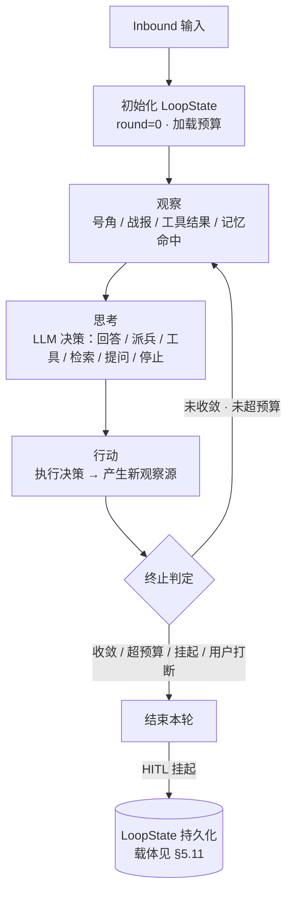

**终止条件**（任一触发即停止本轮）：

| 条件 | 判定 | 降级 |
| :-- | :-- | :-- |
| 自然收敛 | 思考输出"直接回答"且无新动作 | 正常结束 |
| 业务模型调用上限 | 下一次业务模型调用前，已消费调用次数达到上限 | 记录 `BUSINESS_MODEL_CALL_BUDGET_EXCEEDED`，不再派发该调用 |
| 输入 / 输出 / 总 token 预算 | 模型调用后已报告的累计用量达到或超过对应上限 | 记录对应预算终止原因，不执行该轮生成的动作 |
| 工具 / Knowledge 调用上限 | 动作执行前对应调用数达到上限 | 记录对应预算终止原因，不执行外部调用 |
| wall-time 预算 | 模型或动作调用前观察到 elapsed 达到上限 | 记录 `WALL_TIME_BUDGET_EXCEEDED`；回放不重新计算时钟 |
| 用户打断 | 新输入到达 | 当前轮按策略结束或取消，新输入进入 Inbox 排队 |
| HITL 挂起 | 派兵令返回 waiting_hitl | 结束当前轮并保存关联状态；Session 继续接收输入 |
| 委派挂起 | 委派令发出后子执行未返回 | 循环暂停等待子战报（`LoopSuspendReason.DELEGATED`，
  持久化；子执行完成 / 失败后经事件续跑，§5.13） |

**循环与可选 Plan**：生产与 Core 统一使用同一 Agent Loop；Core 消费已经加载的真实请求、结果和预算值，只负责解码与纯动作路由。Session 通过同一 Program/Coordinator 提交和派发，不把阶段 journal 或 `actionReceipt` 票据作为 Core 入口。批次先完成整批结构、资格和预算检查，再按冻结顺序路由，不生成聚合 Action 或伪造回执。

Plan 是独立于 Loop 的可选会话协作模式，默认 `inactive`。只有显式用户选择或批准 `exit_plan_mode` 才写入 `plan/selection`。宿主选择依据同一 Session 日志中 `run.started` 与终态事件的顺序判断空闲并立即生效，不在追加前读取独立的活动 Run 快照；重放原命令不追加新的生效事件。活动 Run 内的选择和工具批准在下一次被接受的 model preparation 中通过 CAS 附加 `plan/mode` 事件生效；挂起不结束活动区间，终态也不自动应用待选模式。一次模型步骤的重试冻结原 selection 引用、Plan 提示词和工具目录，之后的新选择保持 pending；更早的 mode 事件不得覆盖较晚 selection 的生效事实。

平台宿主的 Plan 正文来自 `skillforge-prompts` 的 `chat/plan-policy`，并作为 `SessionPrompt` 的 `PLAN_POLICY` 模块；普通渲染排除该模块，Plan active 的准备阶段加入，使用冻结的 source version。该组合分类不规定其他独立宿主的资源位置，固定正文归属见[上下文专题 §11](03-上下文视图与执行优化.md#11-具名提示词模块)。Plan 选择不改变权限、审批、沙箱或工具目录的稳定边界。

实际请求、上下文和结果格式由 [AgentExecutionCodec](../backend-java/agent-runtime-session/src/main/java/com/skillforge/runtime/session/AgentExecutionCodec.java) 拥有，运行进度只持有材料引用。已冻结请求不按当前目录重新解释；旧 `SessionCheckpoint` 与准备票据格式不恢复进新执行器。Plan、等待与引用采用属于原业务提交，不能为兼容旧格式保留第二条执行路径。

**循环与恢复**：HITL 挂起时保存 LoopState 与 relatedExecutionId 并结束当前轮，Session 不被冻结。恢复输入到达后创建新的 Recovery 决策轮，使用原 LoopState、SessionLog 与 Execution Ledger 关联上下文，让目标 Execution 从挂起点继续（FR-11.3 / FR-18.2）。

**每轮入日志**：观察输入、思考决策、行动与结果均为会话事件
（FR-3.5 模型可见 ⟺ 已记录），回放可重建每一轮（FR-11.4）。

**终止语义**：正常完成、挂起与终止分别由 `RunOutcome` 的类型表达；预算、重复循环和上下文治理等终止原因由 `LoopTerminationReason` 表达，运行时事件类型为 `RuntimeEvent.Terminated`。正常回答和 HITL 挂起不是终止原因。`LoopBudget.ObserveOnly` 模式下 `BudgetGuard` 不因累计预算拒绝调用；强制模式按已报告用量判定，缺报用量不等于已证明硬上限。

**动作复用与收敛**：`AgentDecisionRouter` 对当前操作或匹配重复键的历史动作，已解决时复用原条目，未解决时沿原操作收敛；工具目标相同但执行参数不一致会拒绝。新鲜读取和未决请求有各自的判定，不应概括为同名工具一律返回旧结果。

### 5.10 多执行与挂起路由（单 Session 多 Workflow）

本节描述目标路由契约，不代表下述自由文本意图匹配、候选集澄清及投影重建已经实现。当前源码没有 `ExecutionRegistry` 或 `WakeIndex` 同名类型；具体恢复能力以现有代码和验证结果为准。

**问题**：一个会话内可能有多个执行同时挂起——Workflow A 等用户确认申请，
Workflow B 等外部支付回调，用户在对话中又开了新话题。恢复不再天然唯一，
必须先回答“这条输入回应哪个挂起”（MVP-0 FR-18；P1 FR-12 增强唤醒配置与任务交互）。

**挂起清单（Pending Registry）**——决策层维护的会话级**认知投影**，
权威在执行层持久化账本（record 草案见 [03 §5.3](03-核心对象模型与状态机.md)。
状态机见 [03 §6.3](03-核心对象模型与状态机.md)）：

**唤醒路由（按通道分类）**：

| 通道 | 路由 | 说明 |
| :-- | :-- | :-- |
| 点选 / 回调 / 定时器 | 确定性定位 | 按 `sessionId + executionId + actionKey` 进入 Recovery，不经 LLM（FR-18.4） |
| 用户自由文本 | 候选判断 | 挂起清单 + WakeIntent 摘要进入决策上下文，输出结构化 WakeDecision；每条输入最多恢复一个 Execution（FR-18.5） |

**意图匹配流程**：

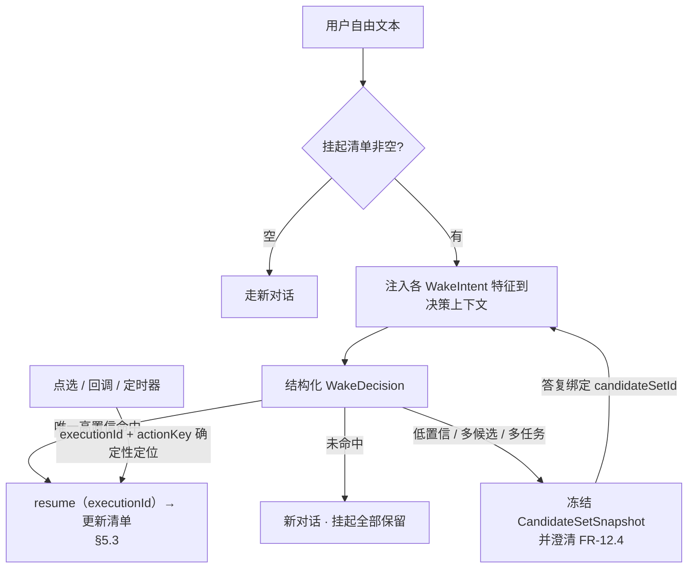

**规则**：

- **确定性优先**：点选 / 回调 / 定时器永远按标识进入 Recovery，不消耗 LLM、不参与意图匹配，也不绕过 Agent 与 Session Inbox。
- **单目标恢复**：自由文本每轮最多自动恢复一个 Execution；只有唯一候选同时满足版本化置信阈值与候选差值策略时才恢复。
- **禁止默认恢复**：未命中就是未命中，禁止"默认恢复最新挂起"（防误唤醒，FR-12.2）。
- **歧义即澄清**：低置信、多候选或用户同时指向多个任务时不猜；澄清生成稳定 candidateSetId，后续新增后台任务不得改变原候选序号和指代。
- **清单是投影**：挂起条目只存在于决策层认知，恢复上下文（checkpoint / 变量）
  仍只在执行层账本（§5.3）；清单可从账本重建（§5.11，FR-12.6）。
- **投影可回放**：挂起条目来自 Execution Ledger，变化写入 SessionLog；P1 可建立 WakeIndex 语义索引，但索引丢失不得影响确定性恢复。

### 5.11 执行账本重建与高级续跑边界

本节的载体、重启时序和场景表描述目标边界，不作为当前实现或重启验收结果。特别是图中的 `ExecutionRegistry` 为设计投影名称，当前源码没有同名类型。

MVP-0 的恢复目标是重建 Session 活动执行投影、继续 HITL 恢复并对后台运行记录执行安全协调；P2 FR-13 再扩展任意节点 checkpoint、跨实例租约和决策轮中断续跑。两阶段都遵循“权威持久化 + 投影可重建”。

**持久化载体**：

| 载体 | 内容 | 归属 |
| :-- | :-- | :-- |
| 执行账本（持久化） | execution / definitionVersion / mode / checkpoint / 挂起权威记录 | Workflow Runtime |
| 会话表（持久化） | tenant / session / agent / scopeKey / Persona 版本 / 身份 | Session Runtime |
| 上下文快照（持久化） | input / loop / CapabilityMountSnapshot / 实际 ContextBlock 与 handle 映射 | SessionLog |
| 输入幂等账本（持久化） | tenant / session / inputId / 规范化输入指纹 / 处理状态 / 结果引用 / TTL | Session Runtime |
| 循环状态（持久化） | LoopState：输入、关联 Execution、轮次、动作、预算和暂停原因 | Agent Decision Runtime |

**重启恢复时序**：

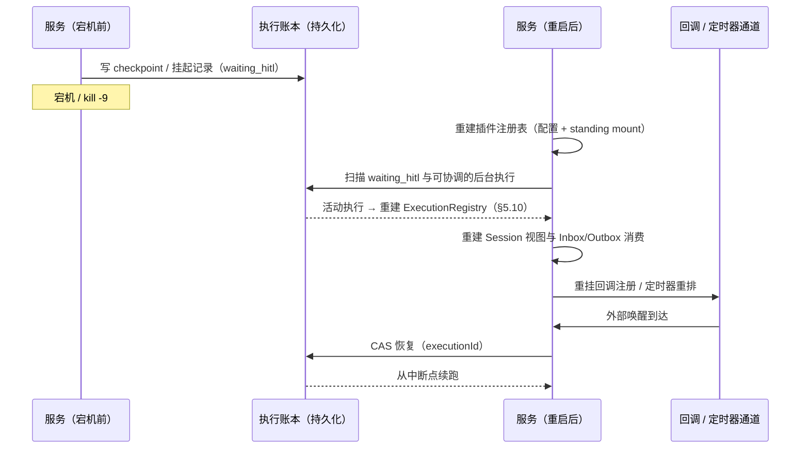

**中断续跑语义**：

| 场景 | 续跑方式 |
| :-- | :-- |
| HITL 挂起中崩溃 | MVP-0 从执行账本重建 PendingEntry，恢复输入到达后继续挂起节点 |
| 后台执行中崩溃 | `queued` 可用原 executionId 重新领取；`running` / `resuming` 按执行能力声明和副作用记录协调为安全重试、继续等待或 failed；无法证明安全时记录 `outcome_unknown`，不自动重放 |
| 任意非挂起节点中断 | P2 使用 checkpoint、执行租约与 fencing token 接管 |
| 决策循环中断 | P2 从已提交 LoopState 继续；未持久化的中间模型调用不推断为成功 |
| 重复恢复 / 重复输入 | 恢复幂等（§5.3 CAS）+ 输入幂等（§5.6 持久化集合），跨重启依然成立 |

**边界**：一个逻辑动作使用同一 actionId 贯穿账本、重试和外部调用。基础设施可以重试同一逻辑动作，但不能为重试生成新业务动作；自动重试必须有外部幂等、可查询结果或执行前协调作为安全依据。外部 API 已成功但响应丢失且无法确认结果时记录 `outcome_unknown` 并停止自动重放，系统不得宣称 exactly-once（对象模型见 [03 §9.3](03-核心对象模型与状态机.md)）。

Execution Ledger 是执行状态权威，PendingEntry 是其投影；SessionLog 是交互与认知事实源，LoopState 可由提交记录恢复。会话回收与重启恢复都不得以内存缓存替代这些事实源。

### 5.12 第三方回环在会话中的形式

**双触点**：回环在会话中不是用户消息，而是一条**业务事件**：

- **入口触点**：第三方 → `CallbackChannelPlugin.invoke(Registration, Payload)`
  → Inbound → 落 `inbound.callback` 会话事件（输入事件，与用户消息同级）。
- **出口触点**：恢复后执行层发布 `execution.resumed` / `execution.completed` 号角。

**归属三件套**：派兵时由决策层向 `CallbackChannelPlugin` 注册回调
（`executionId + sessionId + actionKey`）；回调到达按注册归属会话——
无法归属（无注册 / 会话已删除）→ 拒绝并审计，不创建无归属会话（FR-14.2）。

**时序（恢复型回环）**：

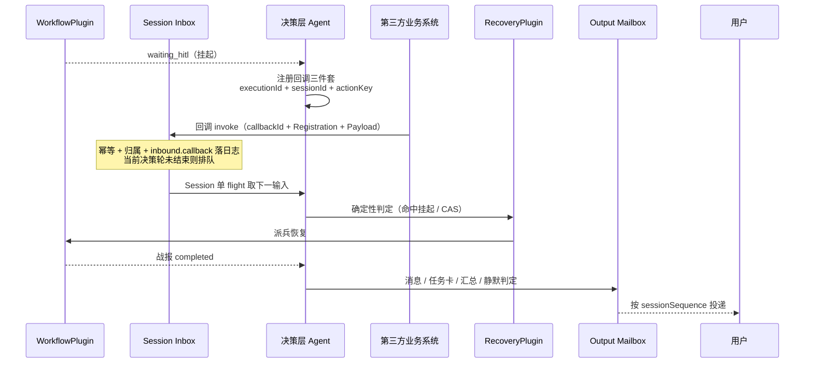

**会话时间线示例**：

```plaintext
[用户]             请提交这份申请
[Agent]            好的，已提交申请，等审核人确认…
[execution.hitl]   （workflow 挂起，等审核人确认回调）
[inbound.callback] （外部系统回调：confirmed, payload={request_id, result}）
[execution.resumed]→[execution.completed]
[Agent→用户]       您的申请已确认 ✓
```

**主动型回环**（无挂起对应，业务主动推送）：回调进入会话后由决策层判定——
通知用户 / 启动新流程 / 忽略；判定与结果入日志（FR-14.5），不默认创建会话。

**边界规则**：

- **回调不绕过将军**：始终先进决策层判定（确定性通道，不经 LLM，FR-12.3），
  再派兵恢复。
- **回调先入邮箱**：渠道完成 callbackId 幂等与归属校验后写 Session Inbox；当前回复正在生成时只排队，不得打断回复、直接调用 Workflow 或直接写 SSE。
- **payload 先落日志**：决策层引用回调内容前，`inbound.callback` 已入会话日志
  （模型可见 ⟺ 已记录）。
- **输出统一排序**：恢复后的战报由 Agent 决定生成消息、任务卡、汇总或静默更新；可见结果写 Output Mailbox 并在当前回复之后分配 sessionSequence，离线时保留待投递状态。
- **记忆来源受控**：回调 payload 和 Workflow 内部状态不直接进入记忆；只有白名单 BattleReport.data 落为 SessionLog Observation 后才可被提取。
- **会话已回收 / 关闭**：挂起仍在执行层账本，回调仍可拉起（§5.11）。
- **会话已删除**：回调拒绝 + 审计（回放受限，FR-10.3）。
- **竞争不重复**：回调恢复与用户输入同会话单 flight 串行（§5.6），
  恢复幂等 CAS 保证不重复执行（FR-14.4）。

### 5.13 Agent 委派与多级执行（将军派将军）

决策层可把子任务委派给另一个已发布、已授权的专业 Agent。委派令只到带独立 Agent Loop 的决策主体，派兵令只到 Workflow 执行层，两个目标类型不交叉。

子 Agent 使用自己的 Prompt、Model、Policy 与四类 CapabilityMountSnapshot。Parent 只传 Task、ContextRef、EvidenceRef 与 Budget，不复制 Parent Agent Definition。子 Agent 不继承父 Agent 的 `USER_AGENT` 记忆；其关系级长期记忆按自身 `target_agent_id` 存取。委派权限明确允许时可读取必要的 `USER` 偏好，但不因委派自动获得修改用户级偏好的权限。

Delegation Runtime 是薄 Harness：负责目标投影、授权、快照、账本、预算、等待、取消、Mailbox 回注与恢复；子任务推理由同一个单 Agent Loop engine 完成。

子 Agent 不持有 Session、不直接消费用户 Inbox 或写用户 Outbox。Multi-Agent 层复用现有
Session/Agent/Capability/Workflow Runtime：Target Projection 是 Agent Definition 与 Delegation Policy
的 input 级只读投影，Target Snapshot 由 Delegation Ledger 持有，子结果再经
`RECOVERY(source=agent_delegation)` Inbound 投影为 AgentObservation 恢复父 Loop。
`execution.completed/failed/cancelled` 保持为执行事实事件，不扩张 InboundKind。

完整目标选择、Delegation Target Snapshot、spawn/await/cancel、状态机、持久化和故障恢复见
[Agent 委派与多智能体运行时](08-Agent委派与多智能体运行时.md)；字段契约见
[核心对象模型 §3.4](03-核心对象模型与状态机.md#34-委派令-delegationorder01-fr-15-字段表--02-513-概念草案)，
需求与验收编号见[P1/P2 需求 FR-15](04-后续阶段需求扩展-P1-P3.md#fr-15-agent-委派p2)。
当前项目直接替换旧委派契约和非生产 ledger 数据，不建设兼容层；`message/followup` 仅属后续演进。

### 5.14 通用任务计划与规划模式审批

通用任务计划是独立的原生 `plan` 动作，沿用 `sf_agent_action` 协议，由 `PlanCommand/PlanPort` 连接可信宿主和已有 `DagPlan/DagWork`。操作为 `plan.submit/get/start_step/finish_step/wait`；不要求启用成员委派。普通任务按需计划，Skill 可用发布版本元数据 `metadata.skillforge-plan: required` 强制在执行前提交结构化计划。计划协议、审批、两类执行者、结果与恢复契约见 [Harness 08 §2.2](08-Agent委派与多智能体运行时.md#22-通用任务计划)。

规划模式仍是会话选择。普通模式的结构化计划在持久受理后可推进；规划模式或显式审批要求绑定精确计划版本，修订后重新批准，后续修订不能移除已有审批要求。批准表示进入获批计划的执行阶段，不新增工具、数据或成员权限。结构化计划通过 `/chat/work/controls` 的既有受控审批入口处理；文字评审可继续使用 `exit_plan_mode`，但不能代替结构化版本审批，也不与同一结构化计划重复审批。

PRIMARY 步骤复用原 Run，一次只保有一个活动主步骤；MEMBER 步骤由原委派机制创建唯一子 Run。统一计划取代模型维护的 Todo 整表和委派计划提交入口，不维护第二份任务清单或计划存储。用户轮次下的任务卡、历史入口和步骤详情从同一工作快照读取；主 Agent 的最终整合答复继续留在原聊天。持久事件 `work.updated` 先于相应执行准入可见，前端按工作及计划修订重新读取授权快照；浏览器离线不阻止普通模式执行。

---

## 6. 与宿主项目对接（设计替换路径）

> 本设计是宿主项目的唯一目标基线。里程碑可分步交付，但同一边界不保留新旧两套语义；冲突的旧代码、旧 schema 和旧入口在对应里程碑内直接替换。

| 阶段 | 宿主项目动作 | 说明 |
| :-- | :-- | :-- |
| S1 契约内核 | 引入执行指令、执行报告、执行事件和委派指令类型；调用方与提供方同步改用新契约 | 强类型契约成为唯一通道，删除裸 Map 和逐参透传 |
| S2 入口收口 | 新消息、点选、回调、定时器和后台完成事件统一为 InboundEnvelope；建立输入/输出邮箱 | Unified Inbound 接管后同步删除旧入口和旁路 |
| S3 Stateful Agent | 接入类型化 Capability Runtime、Agent Skills 标准目录与渐进激活、ToolDeployment 守卫、Persona、RelationshipState、ContextPipeline、PolicyChain、MemoryPort/TriggerPort、Knowledge Runtime 和 SessionLog | ContextPipeline 是唯一模型上下文组装路径，Skill 与知识先记录后注入，包内脚本和 Tool 都只能经冻结挂载与授权调用 |
| S4 Multi-Execution | 建立 ExecutionRegistry、前后台模式、多挂起、查询/取消和完成回注 | 运行态从执行账本投影，不复制 Workflow 内部状态 |
| S5 Workflow Portal | 收敛 run/resume/query/cancel；事件在真实状态迁移点发布；定义版本和幂等键贯穿 | WorkflowPortal 接管后禁止其他模块直接调用引擎 |
| S6 决策收口 | 统一 Agent Loop 与 Director/Executor/Recovery，删除用户直连 Workflow，运行双样例 E2E | 架构一致性测试禁止旧入口和跨层依赖回流 |

阶段能力与退出条件见 [06-MVP-0 技术底座实施方案](06-MVP-0技术底座实施方案.md)；Note 的触发与生命周期按 [Note 治理规范](../.agents/skills/nw-docs/references/notes-governance.md)，代码接管和整洁替换按 [工程规范](../.agents/skills/nw-engineering/references/engineering-standards.md#项目阶段与优先级)，验证范围与证据复用按[评审与验证规范](../.agents/skills/nw-verification/references/candidate-driven-delivery.md)。本节只定义架构接入顺序，不另设任务流程。

---

## 7. 横切关注点（插件化之后）

| 关注点 | 插件化处理 |
| :-- | :-- |
| 计量计费 | `MeteringPlugin` 是所有可能收费外部调用的强制守卫，按 attempt 写不可变 UsageEvent；ExecutionEvent 只提供关联事实，不能在完成后猜测调用次数或 token |
| 审计 | `AuditPlugin` 在派兵令/战报经过内核时旁路记录；与执行日志同源（模型可见 ⟺ 已记录） |
| 记忆 | `MemoryPlugin` 由决策插件注入（LLM 总结前取历史/画像）；记忆分层、
  写入即事件、scope 键隔离（§5.7） |
| 安全沙箱 | `SandboxPlugin` 包裹执行插件（域名白名单/SSRF/超时硬限） |
| 可观测 | TraceContext 贯穿调用；TraceProjection 组合持久事实，OpenTelemetry 仅作可采样导出 |
| 组合审计 | Preset 组合变更记录为会话事件（谁在何时换了能力组合），供回放与审计 |
| 回放一致性 | 会话日志为唯一事实源：模型请求、工具调用、战报均从日志重建。
  展示投影纯函数保证实时与回放渲染一致（NFR-7） |
| 能力调用面 | 守卫管道在 `pre-execute` 检查 Invocation Policy（模型面/用户面）与配额，
  违反即拒绝并记录——调用面检查不可被能力实现绕过（FR-5.4） |

---

## 8. 风险与对策

| 风险 | 对策 |
| :-- | :-- |
| 过度抽象：为"插件化"而插件化，徒增间接层 | 明确"每类插件必须有第二实现才抽象"（Rule of Two）；MVP-0 只插件化执行层与决策层 |
| 内核变成大杂烩（职责膨胀） | 内核职责清单（§2.1）作为评审门槛，新增职责须架构组通过 |
| 事件风暴：号角事件泛滥难追踪 | 事件类型白名单（9 类）+ 统一载荷 schema + TraceContext 贯穿 |
| 插件间隐式耦合（绕过内核互调） | SPI 只经内核注册表访问；代码评审禁止插件间直接引用 |
| 旧实现悄然回流并形成双重语义 | 依赖规则禁止旧入口、旧 Map 契约和跨层调用；同一变更删除冲突代码 |
| 性能损耗（多一层间接） | 内核为进程内直调（同线程旁路），无序列化/网络开销；基准测试兜底 |
| Scope 误用为安全边界（它是路由/隔离，不是沙箱） | 文档明示（§3.3）+ 安全职责归 `SandboxPlugin`（§7）；评审检查恶意代码逃逸防护 |
| 组合切换导致当前 Loop 漂移或历史无法回放 | 每个 input 冻结 CapabilityMountSnapshot；切换只影响后续 input，历史直接读取冻结 ContextBlock/handle 映射 |
| 事件域选错（该持久的进了运行时域） | FR-3.4 先判域再设计 + 评审门；`模型可见 ⟺ 已记录` 作为运行时不变量校验（§4.3） |
| 调用面检查被能力实现绕过 | 检查在守卫管道（内核侧）而非能力实现内（FR-5.4 / §7），能力无法自行放行 |
| 多挂起误唤醒（用户文本命中错误 workflow） | 唤醒特征显式声明 + 确定性通道不走 LLM + 未命中/歧义不默认恢复（§5.10）。
  验收含双挂起意图矩阵（FR-12.2 / FR-12.4） |
| 宕机窗口丢失挂起（内存态依赖） | 执行账本持久化为唯一权威，会话侧全部投影可重建（§5.11）。
  重启扫描 + kill -9 演练验收（FR-13） |
| 第三方回调乱序 / 重发 / 归属失败 | 回调 id 幂等（跨重启）+ 归属三件套 + 无归属拒绝审计。
  确定性通道不经 LLM（§5.12 / FR-14） |
| 委派环 / 深度失控（A→B→A、无限下钻） | 深度上限 + 链上重复检测（§5.13 / FR-15.2），拒绝并提示降级路径 |
| 子执行"外包"绕过父预算 | 子消耗累加进父循环预算，超限按子循环降级规则返回（§5.13 / FR-15.4） |
| 委派信任边界（子 Agent 越权访问父能力/记忆） | 子 Agent 不继承父 `USER_AGENT`；`USER` 读/写分权；只读上下文引用 + 可被委派声明。
  委派目标不可见即拒绝（§5.13 / FR-15.1 / FR-15.9） |
| 计划摘要被误当作外部执行成功或新增权限 | 计划批准不授予能力；PRIMARY 结果核验所属步骤的真实引用，MEMBER 状态来自真实子 Run，任务卡仅展示授权投影（§5.14） |
| 用量缺失被当作零、价格变化改写历史或小额调用过早舍入 | UsageSource/AmountStatus 显式状态 + 价格/汇率快照 + 高精度金额；缺口进入未决对账，不参与“已确认费用” |
| 手工 ThreadLocal 或 Provider 直连造成漏记 | ExternalInvocationGuard 成为唯一外部调用端口；依赖规则禁止能力实现直接获取底层客户端 |

---

## 9. 演进路线

> 里程碑与需求基线范围（01 §6 MVP-0 / P1-P3 分期）的映射如下
> （分期定义见 [01 §6](01-Agent-Workflow协作引擎-MVP需求分析.md) 与
> [03 附录 A](03-核心对象模型与状态机.md)）：

| 里程碑 | 对应分期 | 内容 | 退出标准 |
| :-- | :-- | :-- | :-- |
| M1 契约与内核 | MVP-0 | 执行指令、执行报告、执行事件与委派指令类型；Kernel/ContractRegistry 骨架；类型化调用链 | 契约 schema 和穷尽测试通过；裸 Map 结果、逐参透传与冲突旧类型已删除 |
| M2 Unified Inbound | MVP-0 | Session 身份绑定、输入幂等、Session 路由、输入/输出邮箱和单 flight 决策轮 | 新消息、点选、回调、定时器均走同一入口；同会话顺序稳定，跨会话隔离 |
| M3 Stateful Agent Runtime | MVP-0 | 类型化 Capability Runtime 与 Scope/Preset；Skill 常驻/按需激活；ToolVersion/Deployment 守卫；Persona、关系、ContextPipeline、PolicyChain、基础 Memory/Trigger、Knowledge 三级模式与 SessionLog | 未挂载 Tool/Skill 无法调用；模型输入、Skill 块、工具 handle 和证据引用可由日志重建；策略链负向测试通过 |
| M4 Multi-Execution Session Runtime | MVP-0 | ExecutionRegistry、前台/后台模式、多 Execution 与多挂起、输出排序、查询/取消、从账本重建 | Workflow 挂起期间仍可对话；双 Execution 独立推进；重启后活动视图一致 |
| M5 Workflow Portal 与恢复 | MVP-0 | Workflow 入口收敛、恢复 CAS、确定性路由、版本固定、副作用幂等键、执行事件投影 | 点选/回调/定时器准确恢复目标 Execution；重复恢复和重复副作用受控 |
| M6 决策层接线与收口 | MVP-0 | 统一 Agent Loop 与 Director/Executor/Recovery；移除用户直连 Workflow；陪伴样例与复杂 Workflow 样例；架构一致性门禁 | 两类样例通过 E2E；旧路径禁止规则通过；MVP-0 验收矩阵全绿 |
| P1 产品化 | P1 | Persona/关系/主动触达、增强记忆、Knowledge Runtime 多源研究与写回提案、任务运营、回调、生命周期和回放 | 产品规则建立在 MVP-0 扩展点上，不新增旁路执行入口或知识旁路 |
| P2 高级执行 | P2 | Agent 委派、任意节点 checkpoint 续跑、分布式租约和高级记忆治理 | 委派链、任意节点恢复和跨实例互斥通过专项演练 |
| P3 动态生态 | P3 | 动态插件安装、热更新、跨进程沙箱与对等多智能体协作 | 另行立项并定义安全、版本演进和运营边界 |

---

## 10. 结论

微内核与业务扩展插件共同构成可执行的 Agent Runtime 技术底座：

- **内核稳定且最小**（契约、路由、事件和强制治理点），业务策略通过插件接入。
- **契约显式**（派兵令 / 委派令 / 战报 / 号角四类），插件间零隐式耦合。
- **实现服从设计**（冲突旧代码直接替换，跨边界只使用当前契约）。
- **对象模型统一**（Action / Observation / 状态机 / 事件载体分离见
  [03-核心对象模型与状态机](03-核心对象模型与状态机.md)）。
- **演进路径清晰**：S1–S6 定义架构接入顺序，M1–M7 定义技术底座与 SDK 的交付目标；阶段验收和适用的实施记录分别引用 06 与 07。

当前类型与状态迁移按 [03-核心对象模型与状态机](03-核心对象模型与状态机.md) 实施；工程切片与验收按 [06-MVP-0 技术底座实施方案](06-MVP-0技术底座实施方案.md) 选择对应范围。

---

*文档结束*


## 平台系统智能体宿主接入

平台系统智能体的配置、发布和用途绑定属于宿主，Runtime 不拥有平台业务配置。通用系统执行仍经受信 NewRun、Session 与现有 Worker 推进，不另建执行循环。平台宿主提供冻结的 SessionCapabilities 与工具目录；每次执行使用受理时的 Skills 内容、工具版本和部署 revision。

内部执行 owner 可由受信宿主登记到 `agent_runtime_host_owners`，避免要求独立平台 Agent 复制为机构 Agent。登记包含完整租户、Agent、Session、执行主体和 integration，登记后不可改写；ServicePrincipal 必须匹配 integration，SystemPrincipal 仍需要对应租户的现行授权。认证与每次授权继续校验 owner 全值及 Session scope，不因平台身份跳过既有策略。此入口不向机构外部 API 暴露。

固定输出的记忆提取任务复用模型适配层并保留候选校验、原有 Memory 写入治理；平台调试不触发 Memory 写入。
