# Agent Runtime 核心对象模型与状态机

> 本文定义 Agent Runtime 的对象类型、状态机和事实源边界，不新增功能需求。
> 需求与验收标准见 [01-MVP-0 技术底座需求](01-Agent-Workflow协作引擎-MVP需求分析.md)，全局架构与扩展机制见 [02-微内核插件架构](02-微内核插件架构实现思路.md)。
> record、状态机与对象关系以本文及所属专题为来源。当前执行与持久化契约统一归 [§10.1](#101-执行与持久化的最小权威模型)；下述标明历史范围的旧准备票据、permit、checkpoint 和阶段 journal 协议不再是当前要求。历史验证不构成新实现的兼容或已验收证明。

---

## 1. 定位与目标

本文将 Session、Agent 决策轮和 Workflow Execution 建模为三个独立生命周期，并明确 Stateful Agent Context、Multi-Execution Registry、Mailbox 与三类事实源之间的关系。

核心约束是：Session 可以持续处理输入；决策轮按 Session 串行；Execution 可独立并行、挂起和恢复；任何投影都不能替代 SessionLog 或 Execution Ledger。

---

## 2. 对象总览

### 2.1 对象目录

本目录包含设计目标；例如 ExecutionRegistryEntry 是投影模型名称，不是当前已装配类型。实际执行入口见 [ExecutionCoordinator](../backend-java/agent-runtime-session/src/main/java/com/skillforge/runtime/session/ExecutionCoordinator.java) 与 [ExecutionStore](../backend-java/agent-runtime-session-spi/src/main/java/com/skillforge/runtime/session/spi/ExecutionStore.java)。

| 对象 | 性质 | 归属 | 依据 |
| :-- | :-- | :-- | :-- |
| Session | 会话表持久记录，目标可为 Agent、Team 或群；各存储端口支持范围以源码为准 | Session Runtime | 02 §1.2 / 01 FR-8 |
| Execution | 执行账本持久记录；执行域唯一权威 | 执行插件私有 | 02 §5.11 |
| LoopState | 单个决策轮的持久状态，不代表 Session 状态 | 决策插件 | 01 FR-11 / FR-18 |
| PersonaRef / RelationshipStateRef | 每个主 Run 固定的人格版本与会话关系状态引用 | Session Runtime | 01 FR-17 |
| AgentContextSnapshot / ContextBlock / SessionSummaryProjection | 一次模型调用实际使用的可回放上下文及会话摘要投影 | ContextPipeline | 01 FR-17 |
| PolicyDecision | 策略链在各强制阶段产生的判定记录 | PolicyChain | 01 FR-17 |
| ExecutionRegistryEntry | Session 下活动 Execution 的可重建投影 | Session Runtime | 01 FR-18 |
| InboundEnvelope / OutboundEnvelope | 输入与输出邮箱中的有序消息 | Session Runtime | 01 FR-8 / FR-18 |
| ResumeExecutionCommand / CancelExecutionCommand / QueryExecution | Workflow 生命周期控制命令 | WorkflowPortal | 01 FR-4 / FR-18 |
| PendingEntry / WakeIntent / WakeDecision / CandidateSetSnapshot | 挂起执行的认知投影、语义判定与稳定澄清候选 | Session Runtime | 01 FR-18 / 04 FR-12 |
| DispatchOrder | 命令契约：决策 → 执行 | 内核编解码/路由 | 01 FR-1 |
| DelegationOrder | 命令契约：决策 → 决策 | 内核编解码/路由 | 01 FR-15 |
| BattleReport | 结果契约：执行 → 决策 | 内核透传 | 01 FR-2 |
| ExecutionEvent | 事件契约：执行 → 总线 | 内核吹号 | 01 FR-3 |
| Action / Observation | 决策循环的统一闭环抽象 | 决策插件 | 01 FR-11（§4） |
| KnowledgeRequest / KnowledgePlan / EvidenceBundle / EvidenceRef | 知识规划、执行结果与冻结引用 | Knowledge Runtime | 01 FR-7（§5.9） |
| KnowledgeWriteProposal | 指向 Memory 或机构知识治理流程的候选写回，不直接改变事实源 | Knowledge Runtime | 01 FR-7 / 04 FR-19 |
| InvocationContext / ExternalInvocation | 会话或控制操作的持久因果与单次外部调用尝试关联契约 | Runtime 横切治理 | 01 NFR-4 / NFR-16、04 FR-21（§5.10） |
| UsageEvent / MoneyAmount | 原子用量、价格快照、费用与追加调整 | Metering Runtime | 01 NFR-16 / 04 FR-20 |
| TraceQuery / TraceView / TraceEntry | 按 TraceRootRef 组合会话或控制操作事实引用的只读投影 | TraceProjection | 04 FR-20 / FR-21 |
| ServicePrincipal / IntegrationResourceMapping | 三方服务身份、scope 与租户内外部资源映射 | Open Platform Runtime | 04 FR-21（§5.11） |
| ResourceRevisionRef / DeploymentRef | 资源草稿、不可变发布版本与部署引用 | Open Platform Runtime | 04 FR-21（§5.11） |
| ControlOperation / ControlOperationItem | 非会话长耗时操作及逐项结果 | Open Platform Runtime | 04 FR-21（§5.11） |
| KnowledgeIngestionJob / KnowledgeBindingRef | 知识摄取状态与 Agent 的知识版本选择 | Knowledge/Open Platform Runtime | 04 FR-21（§5.11） |
| EventSubscription / DeliveryAttempt | 出站事件订阅与至少一次投递尝试 | Open Platform Runtime | 04 FR-21（§5.11） |
| CapabilityRef / CapabilityMetadata | 能力的不可变类型、身份、版本和共同元数据 | Capability Registry | 01 FR-5 |
| SkillDefinition / SkillCatalog / SkillResolver / SkillActivation | Skill 标准目录版本、发现、精确解析、渐进加载与激活事实 | Skill Runtime / ContextPipeline | 01 FR-5 / FR-7 |
| CapabilityMount / CapabilityMountSnapshot | Agent 挂载配置与单个 input 冻结的能力视图 | Capability Runtime | 01 FR-5 / FR-7 |
| ToolDefinition / ToolRegistry / ToolResolver / ToolDeployment / ToolInvocation / ToolResult | Tool 不可变契约、目录、精确解析、Provider 部署与调用结果 | Tool Runtime | 01 FR-7 |
| WorkflowDescriptor / KnowledgeSourceDescriptor | Workflow 与 Knowledge Source 的类型专属契约 | 对应服务定义 | 01 FR-5 / FR-7 |
| Scope | 能力路由与隔离机制（非安全沙箱） | Registry | 02 §3.3 |
| MemoryFact | 结构化事实；从会话日志派生，经 ContextPipeline 读取 | MemoryPort / Context Runtime | 02 §5.8 |
| TodoItem | 计划可勾选视图；认知产物，权威=会话日志 | 决策层 | 01 FR-16 |
| Checkpoint | 执行进度持久化标记 | 执行账本 | 01 FR-13 |
| InputIdempotencyLedger | 输入幂等记录，保存请求指纹、处理状态和结果引用，持久化且独立于 Session 缓存 | Session Runtime | FR-8.7 + §9 |

对象按六层归属：Agent 决策对象属于决策控制层；CapabilityRef/Definition/Mount 只覆盖 Skill、Tool、Workflow、Knowledge Source；Persona/Memory/Relationship/ContextSnapshot/PolicyDecision 属于认知上下文层；Session/Mailbox/ExecutionRegistry/Pending/Recovery 属于会话执行层；开放平台、Connector 引用、Trace/Usage/Audit 属于集成治理层；Builder、Marketplace、Handoff、Billing 和 Compliance 只消费这些对象的受控资源或投影，不新增运行时权威对象。

### 2.2 运行时对象关系

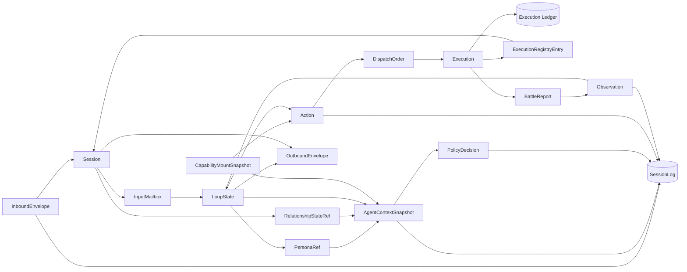

`Session → ExecutionRegistryEntry` 是一对多关系。`ExecutionRegistryEntry` 只保存 Agent 决策所需摘要，完整执行状态、checkpoint 和挂起变量只存在于 Execution Ledger。

`AgentContextSnapshot` 是一次模型调用的不可变输入快照；它引用已落 SessionLog 的上下文块和策略结果，因此线上调用与回放使用同一内容。

---

### 2.3 稳定资源身份与发布快照

Agent、模板、团队、Skill、Tool、Workflow、Knowledge Source、模型及其他发布配置以稳定业务 ID 和所属作用域内唯一 key 标识。修订 ID 只定位历史快照，不能替代资源身份；主列表每个资源只占一行，草稿与发布历史从详情进入。编辑复用同一工作草稿，发布追加不可变快照并原子更新当前发布指针；恢复历史内容先形成草稿，再明确发布。用于并发控制的 revision、事件序号与 schema_version 不承担发布版本语义。

渠道、团队、会话、委派与能力装配引用稳定资源身份。接受新的用户输入并创建主 Run，或启动新的独立 Execution 时，解析当前发布配置及本次执行所需的依赖版本并保存快照。提示词、人设、模型、运行预算、能力挂载、部署、工作流安装和委派范围在该执行中保持一致；同一轮的后续模型调用、工具结果续接、子委派、人工确认、恢复、重连和重试不能读取新发布内容补造原快照。已有会话保持身份与历史，下一轮采用新的已发布配置；系统配置按该轮重新组装，不作为普通历史消息叠加旧提示词。

发布快照不冻结授权。资源停用、权限撤回和紧急工具禁用在实际执行边界继续校验，旧快照不能绕过实时治理。模板安装属于复制：记录安装时采用的模板发布版本，生成独立资源；模板后续发布不覆盖已安装资源。成果、知识来源、记忆与关系事实在各自稳定身份下保留不可变历史，仍遵循所属事实域的状态与保留规则。

## 3. 契约体系：四契约

### 3.1 契约分类

运行时使用四类跨边界契约。阶段规划中 MVP-0 固定委派指令的类型与校验边界，P2 启用跨 Agent 路由；当前已配置委派时的执行与限制见 [Agent 委派与多智能体运行时](08-Agent委派与多智能体运行时.md)。

| 契约 | 方向 | 类型 | 通道语义 |
| :-- | :-- | :-- | :-- |
| 派兵令 DispatchOrder | 决策层 → 执行层 | 命令 | 派兵令只到执行层（Workflow） |
| 委派令 DelegationOrder | 决策层 → 决策层 | 命令 | 委派令只到决策层（Agent）；与派兵令目标类型不交叉（FR-15） |
| 战报 BattleReport | 执行层 → 决策层 | 结果 | 执行层唯一输出契约；委派子结果复用其结构（FR-15.6） |
| 号角 ExecutionEvent | 执行层 → 总线 → 各方 | 事件 | 进度/结果旁路送达；判别标签封闭联合（FR-3.6） |

> 四类契约的需求边界见 [01-MVP-0 需求分析](01-Agent-Workflow协作引擎-MVP需求分析.md)。

### 3.2 派兵令 DispatchOrder（01 FR-1 字段表 + 02 §4.1 概念草案）

```java
public record DispatchOrder(
        String executionUnitId,              // 目标执行插件键（必填）
        String definitionVersion,            // dispatch 前固定的定义版本（必填）
        ExecutionMode mode,                  // foreground / background（必填）
        String input,                        // 目标化输入（必填，可默认透传用户原话）
        Map<String, Object> params,          // 结构化参数 → 注入 ctx_*（可空）
        List<EvidenceRef> evidenceRefs,      // 已冻结证据引用（可空，不复制正文）
        Meta meta) {
    public record Meta(
            String tenantId,                 // 租户标识（必填）
            String sessionId,                // 会话标识（必填）
            String agentId,                  // 发起 Agent（必填）
            String userId,                   // 统一用户身份（必填）
            String executionId,              // 本次执行标识（必填，幂等与账本关联）
            TraceContext trace) {}            // 当前 input、根 input、技术 trace 与事件因果（必填）
}
```

**边界**：决策层不传节点级指令、恢复快照、完整历史、Persona、关系状态或记忆。Workflow 所需业务值通过白名单 `params` 显式传入；知识证据只传引用当前 Session 已提交 EvidenceBundle 的 `evidenceRefs`；`definitionVersion` 与 `mode` 在 dispatch 持久化时固定。

### 3.3 战报 BattleReport（01 FR-2 字段表 + 02 §4.2 概念草案）

```java
public record BattleReport(
        Status status,                       // completed / waiting_hitl / failed / loop_terminated
        String output,                       // 面向用户/决策层的最终文本（可空）
        List<Map<String, Object>> cards,     // 结构化卡片列表（透传，不重渲染）
        Map<String, Object> data,            // 白名单导出的结构化战果（FR-5.2）
        Pending pending) {                   // 挂起上下文（仅 waiting_hitl）
    public record Pending(
            String pendingId,
            String executionId,
            InteractionType interactionType,
            List<String> actionKeys,
            Instant expiresAt) {}            // 仅交互投影，不含 checkpoint 或节点变量
}
```

**边界（FR-2.1）**：战报只含结果不含过程；节点级进度经号角事件另行送达。
`data` 为空时消费方回退文本路径（FR-2.2）。`pending` 只投影恢复路由和展示所需字段；checkpoint、内部变量和原始载荷只保存在 Execution Ledger（FR-2.3）。跨 Portal 或 JSON 边界时，`pending` 中的时间值必须编码为稳定字符串等 JSON 标量；消费方不得把该交互投影当作引擎 checkpoint，也不得据此覆盖 Agent Runtime 的挂起事实。

### 3.4 委派令 DelegationOrder（01 FR-15 字段表 + 02 §5.13 概念草案）

```java
public record DelegationOrder(
        String delegationId,                 // 委派 ID（幂等键，重发不重复执行）
        String targetAgentHandle,            // 父 input Target Projection 中的目标句柄
        Long endUserId,                      // Runtime 从入口身份复制，Parent 模型不可填写
        DelegatedTask task,                  // 目标、约束与期望输出；子 Agent 自行分解
        List<ContextRef> contextRefs,         // 已提交事实的只读引用
        List<EvidenceRef> evidenceRefs,       // 已冻结知识证据引用
        DelegationBudget budget,             // 不超过父剩余预算和授权上限
        ParentContext parentContext,         // 父 Session/AgentRun 与委派路径
        TraceContext trace) {                // input、根 input 与技术 trace
}

public record DelegatedTask(
        String objective,
        List<String> constraints,
        String expectedOutput) {}

public record ContextRef(
        String refId,
        String sourceEventId,
        String scope) {}

public record DelegationBudget(
        int maxRounds,
        long maxTokens,
        int maxToolCalls,
        int maxKnowledgeCalls,
        Duration maxWallTime) {}

public record ParentContext(
        String sessionId,
        String parentAgentId,
        String parentAgentRunId,
        DelegationPath delegationPath) {}

public record DelegationPath(
        List<DelegationHop> hops) {}

public record DelegationHop(
        String delegationId,
        String parentAgentId,
        String parentAgentRunId,
        String targetAgentId,
        String childAgentRunId) {}
```

上方 DelegationOrder 是历史概念草案。当前模型委派命令只提交目标、task 和 background；执行身份、配置和预算由 Runtime 与宿主按实际契约决定，见 [委派运行时](08-Agent委派与多智能体运行时.md)。
Parent 不得复制自己的 Prompt、Model、Memory、CapabilityMountSnapshot、Policy 或 Workflow checkpoint。

`DelegationOrder.parentContext.delegationPath` 只包含到当前 Parent 为止的已提交委派边；Runtime 在稳定绑定
本次 `childAgentRunId` 后追加新 hop。环检测收集每个 hop 的 `parentAgentId/targetAgentId`，并同时校验
当前 `parentAgentId`；执行追溯只使用 `parentAgentRunId/childAgentRunId`。两种身份不得共用含义模糊的
execution chain。

Delegation Runtime 在校验通过后把 Target Snapshot 写入 Delegation Ledger，并复用 Capability Runtime
为目标 Agent 的 child input 冻结自己的 CapabilityMountSnapshot。当前项目直接替换旧
`DelegationOrder.input/delegateTo/parentExecutionChain` 和旧 ledger schema，不提供兼容构造、双读或
历史数据回填。字段、状态、持久化与恢复规则见[Agent 委派与多智能体运行时](08-Agent委派与多智能体运行时.md)。

### 3.5 执行事件 ExecutionEvent（01 FR-3 事件表 + 02 §4.3 概念草案）

```java
// 判别标签事件：封闭联合，消费方 switch 穷尽（FR-3.6）
public sealed interface ExecutionEvent
        permits ExecutionQueued, ExecutionStarted, ExecutionStep, ExecutionHitl,
                ExecutionResumed, ExecutionCompleted, ExecutionFailed,
                ExecutionLoopTerminated, ExecutionCancelRequested, ExecutionCancelled {
    String eventName();
    EventData data();
}

public record EventData(
        String eventId,
        String tenantId,
        String sessionId,
        String executionId,
        long executionRevision,
        String status,
        TraceContext trace,
        Instant occurredAt,
        int eventVersion,
        Map<String, Object> payload) {}
```

| 事件 | 触发 | 消费方（01 FR-3） |
| :-- | :-- | :-- |
| `execution.queued` | DispatchOrder 已持久化，等待执行插件受理 | ExecutionRegistry；前端任务清单 |
| `execution.started` | 受令开始执行 | 前端任务清单；决策层（可选） |
| `execution.step` | 节点级进度 | 前端任务清单 |
| `execution.hitl` | 挂起等待 | 决策层（决策等待/取消）；前端；定时器 |
| `execution.resumed` | 从挂起恢复 | 决策层（更新认知）；前端 |
| `execution.completed` | 执行完成 | 决策层（总结/下一轮）；前端 |
| `execution.failed` | 执行失败 | 决策层（重试/转人工）；前端 |
| `execution.loop_terminated` | 回边循环保护终止 | 决策层（降级/转人工）；前端 |
| `execution.cancel_requested` | 无 worker lease 的控制面 CAS 已持久保存取消意图，Execution 状态不变 | ExecutionRegistry；执行 worker；前端 |
| `execution.cancelled` | worker 或排队控制路径把既存取消意图收敛为取消终态 | ExecutionRegistry；决策层；前端 |

载荷统一包含 `event_id` / `tenant_id` / `session_id` / `execution_id` / `execution_revision` / `status` / `trace` / `occurred_at` / `event_version`（FR-3.1）。`trace` 使用统一 TraceContext；`executionRevision` 取自事件对应状态/进度记录提交后的账本 revision，每个持久事件（含 `execution.step`）独占一个 revision；投影方用它判定重复、乱序和冲突。委派子执行发布同一套事件，载荷附加 `delegate_of` 指向父执行 id
（02 §4.3，不新增事件类型）。

### 3.6 契约关系类图

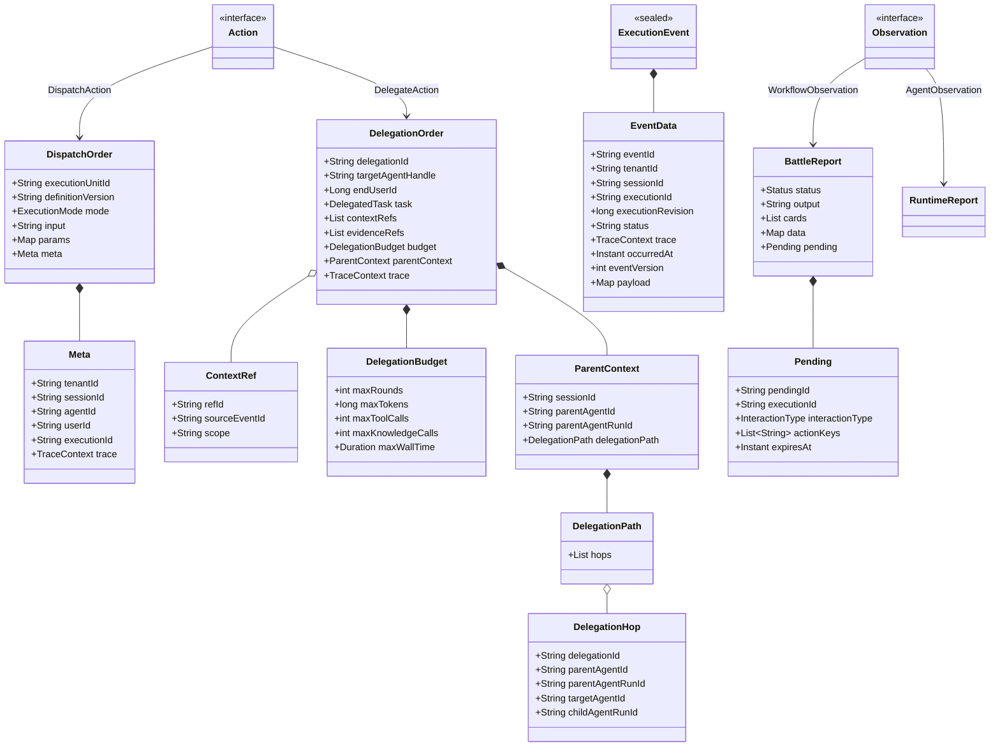

---

## 4. Action 与 Observation（Agent Loop 统一闭环）

### 4.1 统一闭环抽象

决策循环只消费 `Observation`、只产出 `Action`，避免 Workflow、Tool、Memory 和 Callback 各自形成不兼容的循环。

- **ToolResult 是随身能力的独立结构化结果**（02 §3.1.3
  `ToolPortal.invoke(ToolInvocation) → ToolResult`），与 BattleReport 平级，
  **不经派兵令、不透传进战报**（01 FR-7.3）。两者统一为
  Observation 变体进入 Agent Loop。
- **BattleReport 是「执行层输出契约」**，主来源是执行插件（Workflow）。
  委派子结果复用战报结构（FR-15.6）——它不因委派变成另一种类型。
- **Observation 是 Agent Loop 的统一输入**：所有结果（战报 / 工具结果 /
  检索命中 / 回调 / 用户输入 / 子战报）统一为 Observation 变体（§4.3）。

### 4.2 Action（基础行动与受控扩展）

以下基础行动示意对应 FR-11/FR-16；原文读取、Skill 释放及只读批次扩展以[上下文与执行专题](03-上下文视图与执行优化.md)为准，示意不构成固定七变体限制，精确 ABI 归源码。

Workflow派发来源区分`MODEL`与`AUTHORIZED_INPUT`：前者保留原生模型响应、冻结目录与原native调用来源；后者仅由可信宿主从已持久授权生成，绑定唯一Workflow，不能由客户端自报或伪造MODEL调用/结果取得执行权。两种来源均经正式预算、授权及WorkflowPortal边界，授权输入不绕过派发守卫或制造模型计量事实。

`AUTHORIZED_INPUT`驱动的唯一Workflow结果终结后结束对应运行，不进入自由Agent循环；挂起仍通过正式chat/原Pending恢复，UNKNOWN保留原调用和回执。此段定义来源与运行边界，不另声明ABI；隔离测试产品范围见[FR-22.8](04-后续阶段需求扩展-P1-P3.md#fr-22-前端能力体系与-workflow-builder-产品化p1p2)。

```java
// 运行时 sealed 契约：模型输出先解码为 AgentAction，再进入能力/重复/预算校验。
public sealed interface AgentAction
        permits RespondAction, DispatchAction, DelegateAction,
                ToolCallAction, ActivateSkillAction, KnowledgeQueryAction, AskUserAction {}

public record RespondAction(String output, List<String> evidenceItemIds) implements AgentAction {}
public record DispatchAction(String handle) implements AgentAction {}
public record DelegateAction(
        String targetAgentHandle,
        DelegatedTask task,
        List<ContextRef> contextRefs,
        List<EvidenceRef> evidenceRefs,
        DelegationBudget budget) implements AgentAction {}
public record ToolCallAction(
        String toolHandle,
        TypedPayload arguments) implements AgentAction {} // arguments.schemaId = application/json，正文必须为 object
public record ActivateSkillAction(String skillHandle) implements AgentAction {}
public record KnowledgeQueryAction(String knowledgeHandle, String query) implements AgentAction {}
public record AskUserAction(String question) implements AgentAction {}
```

桌面、机构聊天及采用原生 Agent 协议的系统 Agent 统一使用 `NativeConversation`。Provider 适配器只记录原生 assistant 响应事实，Session 从完整响应解释工具动作或内部 Respond；正文是普通文本，即使内容恰为 JSON、代码或旧动作字段，也不按动作 JSON 解码。`ModelToolKind.TOOL_CALL` 绑定普通业务工具，`AGENT_ACTION` 绑定 `ask_user`、`run_workflow`、`knowledge_query`、`use_skill`、`read_skill_resource`、计划及委派等原生函数。其中 `read_skill_resource` 是已激活冻结包的纯读取，可按[只读多工具批次](03-上下文视图与执行优化.md#16-只读多工具批次)与普通只读工具同轮处理；其余控制函数继续执行原单调用限制。原生函数只接收其专属参数，不接收路由字段 `type/operation`；Session 按原冻结目录补齐内部类型，再交由唯一的 `AgentDecisionDecoder` 校验规范动作。模型侧不声明或调用 `final_answer`；内部 Respond、最终消息与 Run 完成事件继续保留。结构化系统任务和受限 Workflow 继续使用各自显式响应格式。

模型请求在准备时一并冻结工具选择策略：普通 Agent 有可用工具时使用 `AUTO`，没有工具或当前阶段禁止工具时使用 `NONE`，是否启用推理不改变这一选择。`REQUIRED` 仅用于明确要求调用工具的独立场景。发送和恢复消费已冻结策略；适配器按目标协议省略空工具声明或生成合法请求，不在发送时更改冻结策略。模型正常停止只产生回答候选，不能替代 Runtime 的完成条件。

`NativeConversation` 的完整供应商结果保存有序 `AssistantTurn` 内容块：正文块保留原文，工具调用块保留 callId、wireName 和原始 argumentsJson；结束原因、模型及 usage 沿原调用身份保存，响应完整性由原终态结果与传输事实表达，不从规范动作或 commentary 重建。正文与工具调用可以共存；存在调用时正文只是该 assistant 消息的一部分，不能提前提交 Respond。只有完整、正常停止且没有工具调用的非空正文，才进入最终回答检查。达到输出上限时保留截断事实，不执行该响应内任何工具调用；空响应、仅私有推理、非法参数或矛盾结构按明确原因拒绝，失败与 UNKNOWN 不包装成正常结束。

正式正文仍在完整校验后提交；宿主可按 §10.1 提供经累计安全过滤、非权威的 message.preview，不能公开工具参数或私有 reasoning。控制调用与其他调用混批整批拒绝，普通业务只读批次继续按原准入处理。原生函数名必须逐一匹配本次冻结请求的 tools/wireName；任意一个无匹配时，以封闭原因 `TOOL_NOT_AVAILABLE` 拒绝整批，不路由已匹配的子调用。拒绝只记录稳定原因与 `NOT_DISPATCHED`，不回显未知函数名、参数或供应商正文；静态纠正提示要求只从本次可用工具中选择，并随观察进入下一模型请求，不重新开放先前阶段的工具、不扩大预算或执行窗口。完整原生事实沿终态 outcome、模型投影和 winner 精确匹配保存。

原生业务函数名使用有界 ASCII 语义前缀与稳定模型身份摘要，总长不超过供应商的 64 字符限制；不同服务的同名工具由摘要区分，目录顺序或增删不重命名其他工具。函数描述以 `logical_name`、`qualified_name` 及可用 `title` 保留同一冻结 ToolCatalog 条目的发现信息，使模型能够对应业务指令和工具间的名称引用；这些字段不是可调用别名，模型必须使用本次函数定义中的准确名称。身份字段按独立字符串转义，不把名称中的换行解释成新的发现信息。描述与 schema 一起参与计量和请求冻结，恢复不从新目录替换旧描述。原生模式无需为此重复注入整份可读工具目录。

不接受 `FINAL:` / `TOOL:` / `REFERENCES:` / `PARAMS:` 前缀、开放顶层参数 Map、名称调用或 `qualifiedName` 执行回退。原生函数名只匹配冻结 `wireName`，不是业务工具名称解析。规范动作字段如下：

| `type` | 必填字段 | 运行时语义 |
| --- | --- | --- |
| `respond` | `output`，可选 `evidence_item_ids` | Native 由完整正常停止且无工具调用的 assistant 正文产生，引用集合按下述正文标记规则解析；先检查当前 Run 已注入证据、未解决动作和宿主交付条件，再持久化引用和最终正文 |
| `tool_call` | `tool_handle`、`arguments` | `tool_handle` 只接受当前 input 已冻结的 opaque exact handle；`arguments` 必须是符合该冻结版本 `inputSchema` 的 JSON object，并作为调用快照的一部分持久化 |
| `knowledge_query` | `knowledge_handle`、`query` | 仅允许已冻结的 Knowledge 句柄；query 为非空白、最多 512 个 Unicode 字符的检索文本，不携带来源、算子或预算控制 |
| `dispatch` | `handle` | 仅允许已冻结的 Workflow 句柄，输入始终为用户原文 |
| `delegate` | `operation` 与对应专属参数 | 原生工具按 [委派契约](08-Agent委派与多智能体运行时.md#21-原生委派操作) 归一化；普通 delegate 默认启动并持久等待，后台模式先返回受理；身份与幂等键始终由 Runtime 产生 |
| `activate_skill` | `skill_handle` | 仅允许已冻结的 Skill 句柄 |
| `ask_user` | `question` | 受控投影为 HITL，不建立旁路交互通道 |

Knowledge 请求的 query 必须与已提交决策逐字一致，纳入调用指纹与 journal；恢复不得改用当前用户全文或重新生成检索词。来源版本、允许算子、权限与预算继续来自冻结目标。KEYWORD 使用有界连续字面短语，忽略大小写，不把用户指令或检索文本当作可执行结构；用户提供原词或原句时直接采用，缩短只取连续片段，不能删除连接词后拼接或重排。同一句柄与同一 query 才能复用既有证据，改词检索消耗新的知识调用预算。正在查询时补充的原文属于该查询的线索，知识库名称与简介不证明正文的语言和产品覆盖范围。

Headless decision 的注册 schema 为 `skillforge.runtime.agent-decision.v1`；原始模型 JSON 可含标准空白、任意成员顺序和合法字符串转义，持久 TypedPayload 则必须是规范编码。两种入口按调用阶段显式区分，不在 snapshot 解码失败后回退 wire。Runtime 自身的 revision、预算与 duration 等控制整数仍使用规范十进制字符串，不接受数字别名或溢出；`tool_call.arguments` 作为标准 JSON object 可包含 boolean、null、string、array、object 和任意精度 JSON number，解析后以确定性形式冻结。对象重复键（含转义后重名）、未知动作字段、非对象根、尾随第二文档和注释一律拒绝。解析长度、节点数与深度使用显式 CodecLimits；错误只返回稳定原因，不包含输入正文或底层解析异常。

| 嵌套 decision 内容 | 精确字段与值约束 |
| :-- | :-- |
| `task` | `objective`、`constraints`、`expected_output`；文本非空白，constraints 是无重复文本数组 |
| `budget` | `max_rounds`、`max_tokens`、`max_tool_calls`、`max_knowledge_calls`、`max_wall_time`；资源上限为正整数，wall-time 为 `seconds`/`nanos` 精确整数字符串对象，seconds 非负、nanos 在 0–999999999，合成 Duration 为正 |
| `context_refs` 元素 | `session_ref`、`ref_id`、`source_event_id`、`scope`；session_ref 精确含 `tenant_id`、`session_id` |
| `evidence_refs` 元素 | `session_ref`、`bundle_id`、`item_ids`、`version`、`source_event_id`；version 为正 long，item_ids 是无重复非空白文本数组 |

受控动作的业务文本字段（包括 output、question、各 handle、引用身份与 scope）及文本列表元素必须非空白；空字符串、纯空白、null 或错误类型在解码阶段拒绝，合法文本不 trim 或正规化。可选的 `evidence_item_ids/context_refs/evidence_refs` 只在缺失时取空列表，显式 null 或元素重复均拒绝，保留原始顺序；规范快照总是写出这些列表。decoder 只产生无副作用的类型化 Action，不查询目标、补身份、授予 Policy 或提供存在证明；委派的跨 Session、可见引用及预算校验仍在当前父 Runtime 准入边界完成。模型结果尚未完成 §5.6.1 的继续状态提交时，不向 Loop 交付解码动作；纯 codec 测试不代表该提交已成立。

解码或 schema 校验失败只形成可审计 `DecisionDecodeFailureObservation`，封闭原因包括 `INVALID_DECISION`、`UNSUPPORTED_SCHEMA`、`CONTROL_ACTION_REQUIRES_SINGLE_CALL`、`TOOL_NOT_AVAILABLE`、`TOOL_ARGUMENTS_INVALID_JSON`、`TOOL_ARGUMENTS_NOT_OBJECT`、`CONTROL_ARGUMENTS_FIELDS_INVALID`、`CONTROL_COMMENTARY_INVALID` 与 `CONTROL_ARGUMENTS_INVALID`，原生响应另区分空正文、仅推理、不完整或矛盾结果及引用拒绝原因。参数拒绝表示本次动作 `NOT_DISPATCHED`，只反馈与冻结函数 schema 对应的安全分类；不携带原参数、未知字段名、工具标识或自由异常正文，不修补 JSON 或放宽校验。`TOOL_NOT_AVAILABLE` 表示调用未派发，不等于 Tool 执行失败、未知外部效果或旧工具可恢复；其 `NOT_DISPATCHED` 是决策反馈，不新增 Action attempt 或伪造 Ledger 的同名事实。恢复须读取原模型准备中完整冻结请求和原原生结果，按当时工具集合验证并恢复同一拒绝与静态纠正，不从当前目录重建工具或重发原工具调用。尚未公开正文时只按 LoopBudget 约束的有界纠正策略继续；已公开正文按 [§5.6.1](#561-headless-模型准备与提交协议)失败收敛，不得退回文本前缀解析或重发公开正文。要求 JSON 的响应格式仍拒绝不符合其 schema 的正文，`NativeConversation` 的正常文本回答不属于格式失败。
不得记成模型 `OUTCOME_UNKNOWN` 结束 Run。流在已有部分正文时被截断、超时、取消或
5xx 仍是结果未知，禁止当校验失败重发。挂起 checkpoint 必须为 v3：
`schema_version=3` 且 `actions_taken` 为类型化 action snapshot；旧版本直接产生
`checkpoint_incompatible`，不做双格式恢复。

原生对话准备把近期用户/助手正文投影为对应角色消息，当前输入中的追踪身份仍保存在原事件而不重复注入正文。工具历史只从冻结 checkpoint 的已提交动作、原模型准备及对应确定结果重建，调用 ID 唯一且结果紧随对应调用；推理内容来自该次已消费模型结果。顶层工具定义与消息中的调用参数、结果关联和推理内容共同纳入输入预算。恢复重新核对来源与计量输入，不能读取当前工具配置来改写已冻结历史。

单工具同参数复用仅在本轮采用标记已提交后投影为本轮调用与结果对，明确说明未再次执行，并引用原已确认的安全结果；不新增 Action、Observation 或外部调用。连续上下文已消费原结果时仍须追加本轮复用反馈，恢复不重复追加。成功和确定失败结果的重复消费都进入现有无进展治理，保留轮询豁免、用户纠正重置与未知结果保护，不能把成功复用改写为执行失败。

Action 为 FR-11.7 动作去重（`LoopState.actionsTaken`）与 TodoItem 动作引用
（02 §5.14 `ActionRef`：dispatchId / delegationId / toolCallId / query）提供
统一类型；`ActionRef` 由对应 Action 派生，不再独立建模。

### 4.3 Observation（八变体）

| 观察源 | 语义与来源 |
| :-- | :-- |
| User | 已受理用户输入（FR-8.6） |
| Workflow | 已提交执行结果的安全导出，不传内部 BattleReport（FR-2） |
| Tool | 原调用成功输出或确定失败的安全反馈，按 §5.6.2 提交（FR-7.3） |
| SkillActivation | 当前 Loop 的激活状态、原因与 ContextBlock 引用 |
| Knowledge | 已提交 EvidenceBundle 或其内容寻址引用，不传松散 Chunk（§5.9、FR-7.12） |
| Event | ExecutionEvent 的观察投影（FR-11） |
| Callback | 经回调三件套验证的注册载荷，不使用自由 Map（FR-14.2） |
| Agent | [AgentObservation](../backend-java/agent-runtime-api/src/main/java/com/skillforge/runtime/api/port/AgentObservation.java) 的确定拒绝或委派终态（FR-15） |

本表定义观察来源，不声明另一套 Java ABI；Core 结果回执只在真实提交后产生，具体领域结果不自动成为 Loop 输入。

AgentObservation 的 `REJECTED` 发生在 Delegation Ledger claim 前，`delegationRef/childRunRef/report` 必须为空且 `ledgerRevision=0`，`reasonCode/resultRef` 分别来自 `DelegationActionResult.Rejected.failure` 的稳定原因与审计事实。三个终态必须携带同租户 `delegationRef/childRunRef`、正 `ledgerRevision` 与 `resultRef`：`COMPLETED` 必须携带由内部 BattleReport 投影的 `RuntimeReport` 且不得携带 reasonCode，`FAILED` 必须携带 reasonCode 且 report 可选，`CANCELLED` 不携带 report 或 reasonCode；三者逐字段投影 `DelegationOutcome`，不复制完整 ledger 事实。子执行 waiting 不是 AgentObservation：它只是 Delegation Ledger 状态和父 Session 的
PendingEntry/WakeIndex 投影，父 Loop 自 spawn 起保持 `DELEGATED` 挂起，不因 waiting 被唤醒或消耗预算
（[08 §13.1](08-Agent委派与多智能体运行时.md#131-子执行-hitl)）。父 Loop 只消费已持久化且
`ledgerRevision` 高于自身 `lastObservedRevision` 的 AgentObservation，不从缺失战报反推状态。

### 4.4 统一循环

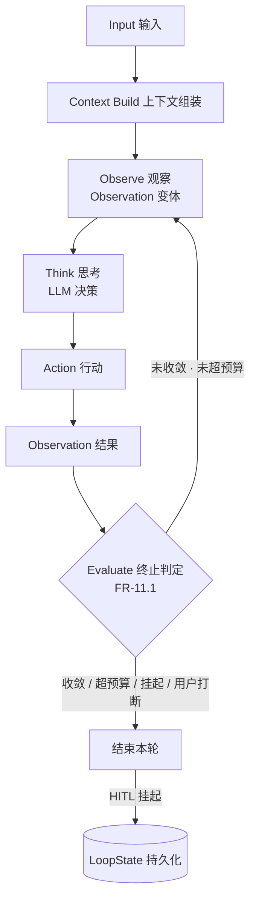

`Action` 的基础变体与「决策」对应，受控扩展见[上下文与执行专题](03-上下文视图与执行优化.md)；`Observation` 的八变体与「观察源」一一
对应。`ExecutionEvent` 负责「发生了什么」（旁路事实），`Observation` 负责
「Agent 当前看到了什么」（循环输入）——两者职责不重叠。

Headless 动作路由对 reactive 与 planned 使用同一封闭动作体系与准入顺序：先检查当前结果的 wall-time/token 预算，再应用受限 Workflow 范围、冻结可见句柄/引用约束，最后检查重复动作与新调用次数。路由只返回待提交的选择、拒绝、原结果引用或原动作待收敛引用，不授予 Provider permit，也不宣称 Session 状态已提交。解码失败只生成固定审计原因的反馈候选；下一次模型决策仍先检查并累计新的迭代预算，不在 decoder 或路由内部重试。

Session 提交 `agent.decision-decode-failure` 观察时保留稳定 `reason`；若该决策对应的已消费冻结模型结果以 `length` 结束，附加 `finishReason: "length"` 标记输出截断，供下一轮缩短输出或调整执行方法。该标记必须由冻结模型结果重建校验，不携带原始输出或异常文本，也不改变决策失败分类、预算与重试准入。

| 路由对象 | 身份、重复与预算语义 |
| :-- | :-- |
| Tool / Workflow / Knowledge | 原 Loop 的完整 RunIdentity、loopId、CapabilitySnapshotRef、动作种类与 handle 限定能力及历史范围；检查整个已登记历史。同一 scope/handle 默认不允许改变冻结请求，Tool 仅按下述参数化资格或已核证的未派发schema拒绝例外区分不同参数的新请求。相同完整调用已完成或确定失败时默认引用原已提交 Observation，不新建 Action 或增加能力计数；Tool 已确认失败的参数化只读调用适用下述窄例外。pending/unknown 只交给原账本收敛，不创建新调用 |
| Respond | evidence item id 必须唯一命中当前模型上下文可见 EvidenceRef；有歧义或不可见时拒绝。引用持久化与输出发布仍由后续交接负责 |
| ActivateSkill / AskUser | Skill 必须命中当前冻结可见句柄，激活由当前 Loop 上下文协调；AskUser 只形成受控挂起候选。二者不增加 Tool/Knowledge 次数 |
| Delegate | 同 Run/Loop/CapabilitySnapshot 以完整规范 Delegate 快照的 decisionFingerprint 为重复键。已拒绝或终结则回用原已提交 Observation；accepted/pending/unknown 保留原委派 operation、幂等键及已有 delegation/pending 引用，只收敛原请求，不再创建 ledger/child 或计数。仅新请求进入实现准入并消耗共享 tool-call 次数，不由 Planner 创建子执行 |
| 受限 Workflow | 只允许 Respond / AskUser；拒绝其他动作，不查询挂载/目标、不进入重复调用或外部执行路径，不构造缺失的 CapabilitySnapshotRef |

Tool 的调用身份由可信注册/发布策略声明为 `HANDLE` 或 `ARGUMENTS`，随精确 FrozenToolTarget/ToolBinding 冻结到原 Prepared、请求 journal 和恢复材料。Core 只消费该政策以及 `confirmation=NEVER`、`modelInvocable=true` 门槛，不从工具名称、说明、Provider 类型或效果反推资格。普通发布可按可信副作用声明选择默认政策；平台复合代码、工作区和浏览器命令在所属目录显式注册 `ARGUMENTS`，远端 annotations 或 MCP 同名工具不能继承平台声明。`ARGUMENTS` 按完整目标、绑定和规范 arguments 区分动作；相同完整调用按下述历史结果规则处理，未决/UNKNOWN 时不改参或创建新调用。`HANDLE` 保持句柄级行为，仅允许下述已核证的未派发 schema 拒绝窄例外。参数化身份与幂等性、执行授权、并行资格分别维护，`parallelSafe=false` 的目标仍保持串行。Session 从本轮精确冻结目录核证并采用路由事实，历史调用保留原政策和全部已有前缀，不能由当前目录覆盖。模型名称、参数和全局开关不能授予资格，Core 不读取目录或存储。

对于同时具备冻结 `READ_ONLY` 效果、`ARGUMENTS` 身份政策、`confirmation=NEVER` 和 `modelInvocable=true` 的 Tool，原调用已确认 `FAILED` 时，旧失败反馈不替代模型随后显式提出的同目标、同参数新调用。Core 继续检查该精确目标的历史，已有成功结果仍复用，`UNKNOWN` 或 `INPUT_REQUIRED` 仍阻止新调用；获准的新决定创建独立 Action/Attempt，计入原预算并通过当前权限及原冻结绑定检查。这是模型新决策的准入，不是自动 retry 或旧 Attempt 重放；原 `RetryMode.NONE` 及失败事实不变。其他效果或不具备上述资格的同参数失败仍复用原反馈，写工具、未决与未知结果保护不变。

在上述参数化范围内，原调用已 resolved（Completed、Failed、Rejected 或 Cancelled）时，不同规范 arguments 可以形成独立的新请求；每个请求仍有独立 operation/childOrdinal、journal、Action/attempt/permit，计入调用预算并通过原目标绑定及实时权限检查。同一冻结执行身份禁止改参；适用只读批次时，批内相同完整调用整批拒绝，所有槽位通过预检后才能登记 fresh，平台代码不进入该批次。跨轮复用精确匹配完整 scope、原 target/binding、规范 arguments 与唯一原 journal，沿用原 Action 和已提交结果；存在匹配历史但来源缺失或冲突时拒绝，不能回退 fresh。考虑同目标不同参数的新请求前，先排除该 scope 内精确目标的 PENDING、ACCEPTED、SUSPENDED 或 OUTCOME_UNKNOWN；这些条目只允许原完整请求沿原账本收敛，不因改参获得新执行权。参数化资格只区分不同完整请求，不授权重发原动作；幂等写仍须通过宿主的计划冻结、请求指纹、base revision 和实时授权守卫。参数化例外也不构成未知调用的自动重试许可。

需要读取外部当前状态的纯观察可以具有受信宿主核证的当前读取资格。Session 在原调用采用时从 Prepared、精确 target/binding、原 schema 与规范参数核证资格，将其作为既有 checkpoint 的固定领域事实；后续将当前调用与已采用历史的准确资格交给 Core；Core 只消费纯路由值，不解析宿主命令或访问目录。此类调用在不同模型 operation 下形成独立的新观察，即使参数相同也不复用已结束的旧页面结果；同一 operation 的恢复仍复用或收敛原 Action。同一精确目标存在未决或未知请求时，相同原请求只收敛，改参不能绕过；资格不改变副作用声明、并行性、预算或授权，写操作继续保持原重复保护。宿主未提供资格的工具保持普通精确请求复用，不从模型声明、工具展示名称或参数形状自动授予资格。

未派发schema拒绝不授予目标普遍参数化资格。Session 必须在原结果采用边界，从原 Prepared 的精确目标/绑定、原请求 journal、Tool terminal 及已 ACK 的原结果观察建立证明，并与结果一同原子采用：原调用为 `FAILED`、`reasonCode=tool_input_schema_rejected`、`output=null`，且原冻结 schema 对原 arguments 确有违反，调用尚未进入 Provider 执行；仅有原因码或纠正文本不足以取得资格。对原本不具参数化资格的 Tool，Core 仅在同 scope、精确目标/绑定的全部既往调用均满足该证明时，允许不同规范 arguments 作为 fresh 请求进入原准入；同参数仍复用原 Action 与结果。任一历史调用已有实际成功、实际执行失败或结果未知，即恢复原保守写工具规则，pending 等未收敛调用仍只沿原账本处理。新请求仍消耗原调用预算、通过原权限及绑定守卫，不改写原失败或复用旧 permit；该例外不将 `finalize_task_outputs` 或所有失败工具泛化为可改参重试。

连续执行与恢复共用唯一的 checkpoint 路由事实格式。恢复从持久 checkpoint 取得完整已采用状态，后续沿相同规则推进；构造合法的散装 DTO 不获得状态写权。当前权威 before、严格前缀保留与本次新增事实来源校验共同约束提交，取消、deadline、fence、实际操作授权和预算仍在所属真实边界核验。该责任调整正在实施，当前验证状态见非模型时延实施记录。

`LoopState.actionsTaken` 为 `AgentActionSnapshot(operation,contextScope, capabilitySnapshot?, action, requestJournalRef?, outcome)`。`AGENT_INPUT` 必须有 `CapabilitySnapshotRef`；`RESTRICTED_WORKFLOW` 只允许 Respond/AskUser 且为空。四类外部/委派动作必须有 `requestJournalRef`，本地动作必须为空。

outcome 只允许 `PENDING`、`ACCEPTED(pendingRef?)`、`SUSPENDED(suspendRef,resultRef)`、`COMPLETED(resultRef,resultEventId)`、`FAILED(resultRef,resultEventId?)`、`REJECTED(resultRef,resultEventId)`、`CANCELLED(resultRef,resultEventId)` 与 `OUTCOME_UNKNOWN(factRef)`；Knowledge 失败的 resultEventId 可空，快照不复制能力私有状态。`Workflow.Terminated`不是业务成功，动作快照固定为带原安全结果事件的`FAILED`；terminationReason仅留在Workflow私有投影，不改写为`COMPLETED`。

快照须同 Run/Loop/可选快照且非未来 iteration；单调用每 iteration 一个动作，Tool 批次按独立 childOrdinal 保存实际来源。各类重复键按上述范围全 Loop 唯一，可信只读、幂等写与平台代码 Tool 例外包含精确目标与规范参数；checkpoint 中历史身份、顺序、重复键或绑定矛盾必须拒绝；已采用的工具路由前缀不在每轮回读全部 journal/SessionLog 祖先。实际复用所选原结果仍精确核对对应终态、用量和安全事件；来源缺失或冲突不降级为 fresh。

纯路由不查询目标或存储、不修改 usage。已装配委派的选择输入是从原父上下文读取、绑定完整当前 operation 的只读目标句柄及完整可见 ContextRef/EvidenceRef 列表，未装配输入显式为空实现分支；该选择投影不是第五类 capability mount，也不拥有 Target Definition、Policy 或持久 checkpoint。ContextRef 须完整命中，EvidenceRef 可收窄可见 itemIds，但 session/bundle/version/sourceEventId 不可改变。来源真实性由 Session 交接校验，结构匹配不代表执行授权；后续 DelegationActionPort 仍执行完整目标/引用/路径/预算/并发准入。公共预算优先于解码反馈；受限 Workflow 的其他动作拒绝不读取历史，其余 Agent 路径在可见性检查后验证全部历史，再处理重复与新调用预算。当前结果的业务模型调用计数必须对应原模型结果的采纳事实，不在纯路由中重复计次。

未装配 Delegation 的确定拒绝不表示目标或引用已获授权：共同 wall/token 与受限 Workflow 检查仍先执行；随后仅检查可复用历史，新请求不查询目标或读取 Context/Evidence 正文，不执行 Delegation 专属路径/并发检查，不消费 tool-call 次数。已装配时才执行目标/引用可见性及完整 Delegation 准入。缺省拒绝的事件和指纹按 §8.2 注册，不能用正文摘要代替 operation 身份。

缺省拒绝由 Session journal 在发送前保存自身 requestJournalRef、原 context、完整规范 Delegate 决策、occurredAt、安全 resultRef 和原决策提交 sequence；来源校验须确认该决策已完成 Session 消费提交、属于原 operation，且缺省拒绝分支已经准入，不能由散装 DTO 自证。Core 只读原 journal 并实际 append SessionLog；每次读取、append 前后核对同一当前可信 Run/identity、取消和 deadline，Appended/Replayed 的完整 envelope/payload 必须匹配且 sequence 大于原决策事件。失败不产生可消费 AgentObservation，也不重新生成时间、引用或 operation。精确提交后构造 `DelegationActionResult.Rejected(PortFailure)`，reasonCode/resultRef 与已提交 payload 逐字段同源，retryMode=NONE；其 AgentObservation.REJECTED 投影的 ledgerRevision 为 0，delegationRef/childRunRef/report 为空。缺省组件不持有 DelegationLedgerPort、DelegationActionPort 或 child Run 创建入口；journal 与 Run 所有权的真实持久性仍由 Session/adapter Gate 验证。

缺省拒绝的历史读取接收当前 Agent Context 与路由 Reuse，只接纳同完整 Run/Loop/能力快照、非未来 iteration 的 Delegate/REJECTED 条目。读取原 journal 后，requestJournalRef、operation、capability snapshot 与完整规范动作必须逐项匹配历史；原来源校验和固定拒绝事件重建仍使用原身份，不替换成当前模型 operation。随后按原 owner/eventId 实际 `SessionLog.findByEvent`，完整核对与首次提交相同的 envelope/payload、occurredAt 和 sequence 下界；缺失、错配或技术异常均不回退 append 或 fresh 执行。访问窗口始终校验当前 operation，历史 operation 只定位不可变来源，不要求它重新成为活跃迭代。查询所得回执仍须由 Session 完成历史消费提交，不能使当前模型继续状态或 Todo 自动完成。

---

## 5. 核心运行时对象

### 5.1 Session

```java
public record Session(
        String sessionId,
        String tenantId,
        String agentId,            // 唯一归属，存续期不变
        String userId,             // 入口 end_user_id（Java 历史组件名）
        String channel,            // 当前接入渠道
        String scopeKey,           // agent 层 scope 键
        String personaVersion,     // 启动时人格版本
        SessionStatus status) {}   // created / active / closed

public enum SessionStatus { created, active, closed }
```

Session 的权威身份为 `SessionRef(tenantId, sessionId)`，归属和服务目标按下节封闭类型确定。上面的直连 Agent 示例只表达个人分支，不要求群绑定固定 Agent 或 EndUser。人格与能力组合在每个新主 Run 受理时冻结，能力采用 CapabilityMountSnapshot，发布版本不写成 Session 的永久选择。后续用户输入可采用当前发布配置，同一执行及恢复继续原快照。个人关系状态按 `tenant_id + end_user_id + agent_id` 跨 Session 读取，不复制进 Session。活动执行、输入幂等集合和邮箱内容均由独立账本或队列管理。

人工协助是 Session 级 `human.assistance` 事实，由已授权宿主通过类型化协作命令追加。命令冻结工单、坐席身份和正文，使用稳定命令 ID 与请求指纹保证一次受理；同键异体拒绝。事实没有 Run 归属，不创建 Run 或主动调用模型，也不复用 `user.steer`。聊天历史和 Outbox 从同一 SessionLog 事实投影，公开消息标记人工坐席。普通 Agent 和 Team 主助手的后续未冻结 preparation 可以读取人工事实，已冻结 preparation 保持原内容；Team 成员不得自动继承产品会话人工消息。人工正文仅是业务上下文，不授予工具能力、不覆盖授权，也不是完成证明。

#### 5.1.1 群归属与执行身份目标契约

GroupBindingRef、SessionSubject、SessionOwner 与 GROUP target 表达群归属，群产品 Session 通过专属绑定入口创建。正式 Run 身份分别保存 requester、消息来源、origin 和实际 Agent，群准入、typed ExecutionStore、Workflow 与委派沿用唯一 Runtime 执行链；个人入口仍要求 User，不从群归属补造 owner EndUser 或默认 Agent。下表列出归属与执行契约；精确 Java 签名由源码与 `public-api.javap` 持有，后文个人示例仅适用于 User 分支。

| 类型 | 目标数据与不变量 |
|---|---|
| `GroupBindingRef` | TenantId 与不透明 groupBindingId；不包含外部群 ID、成员或 Agent，不能跨 Tenant 使用。 |
| `SessionSubject` | 封闭的 `User(EndUserId)` 或 `Group(GroupBindingRef)`；个人分支必须有真实用户，群分支没有 owner EndUser。 |
| `SessionTarget` | `AGENT/TEAM/GROUP` 三种；GROUP 的 id 为同一 GroupBindingRef 的内部 ID，表示可选服务目录，不是 Team 或虚构主 Agent。AGENT/TEAM 只用于 User subject。 |
| `SessionOwner` | SessionRef、SessionSubject、SessionTarget；三者 Tenant 一致，Group subject 与 GROUP target 必须指向同一绑定，存续期不变。 |
| `RunRequester` | 封闭的真实 `EndUser(EndUserId)` 或 `System(PrincipalRef.SystemPrincipal)`；成员触发采用前者，可靠后台任务采用后者。请求者不是 Session owner，也不替代当前认证 actor。 |
| `RunIdentity` | 保留 owner、实际 agentId、causationInputId、RunRef、trace、causationIdentityRef，增加 requester、可选 sourceMessageRef 和可信 originRef；个人直连仍校验目标 Agent 一致，群 Run 从当前服务名单显式选定实际 Agent。 |
| `InboundEnvelope` | 原必填 endUserId 改为 subject 与 requester，携带 SessionTarget 和实际 Agent；群触发引用已提交 sourceMessageRef。ExistingRun 必须匹配原 owner、Run 和冻结请求者，操作者另验当前权限，不得以当前发言者改写原请求者。 |
| `AccessEnvelope / VerifiedIdentity` | 读取对象使用同一 subject/target；认证 actor 保留真实 ServicePrincipal、EndUser 或 SystemPrincipal。ServicePrincipal 代办的成员引用须经其固定 Tenant/integration 的当前映射和成员资格验证，不能只凭 ID 声称本人。 |
| `RunOrigin` | 由宿主可信入口保存 tenant、入口种类、可选 integration、actor、业务范围、群、根来源及部署/定义/授权修订引用；外部入口必须有 integration，原生/系统入口明确无 integration。Core 不解释机构树、钱包或医疗字段。 |

同一活跃 GroupBinding 只对应一个共享 Session；群关闭后该身份不复活，外部 ID 复用必须显式建立新生命周期。换成员、换回复 Agent、换凭证或进程重启不改变原归属。群没有独立 Runtime：subject/requester 扩展现有受理输入、RunIdentity 和公开业务事件，执行通过当前 ExecutionCoordinator/ExecutionStore 连续推进；遵循 [§10.1](#101-执行与持久化的最小权威模型)，不重新接回旧 Inbox/RunStore/准备消费 journal 链。

群消息是先提交的公开来源，包含稳定 sourceMessageRef、服务端 sourceSequence、真实作者类型/身份、内容和外部来源指纹。记录与回复触发分开：仅记录不构造 NewRun，不伪造 InputReceipt；触发引用该来源并形成唯一持久排队项。外部 Agent 输出回流引用原 delivery/message，不能变成 EndUser 作者。提取登记与来源提交同事务，或由同事务可靠待办接续。

同群前台槽按权威 triggerSequence 串行领取；waiting_hitl 的 Run 仍占槽。普通消息不能隐式恢复、确认或取消旧 Run；定向 ExistingRun 控制不进入普通等待队列。出队前复验当前成员、群服务 Agent、源授权、本地资源和预算；失效项保存明确拒绝/过时处置结果，再释放槽，不静默丢弃。成员增量按对象 revision CAS，旧事件只复用原回执或拒绝，不能覆盖较新退出/撤权。

NewRun 在同一准入边界冻结实际 Agent 发布、部署 revision、本地绑定、精确授权依据及整链引用、模型/Provider/运营配置和根预算。Chat、Team、群与委派共用解析器；后续子任务及恢复继承原 Run 依据，不能借新部署授权切换。每次未派发动作、检索材料使用和结果披露仍校验当前撤权；缺新槽位拒绝新 Run，不回退旧发布。原生回答采纳、胜出结果、完成状态及公开投影门槛保持唯一语义。

公开群历史和当前成员可读的群事实不按入群时间截断；退出后包括既有 SSE 在内的下一次披露重新授权。允许读取过去退出成员的群事实不等于允许其继续操作。宿主群控制和最终派发守卫见[接口与事件 §2.6](../docs/02-架构与设计/04-接口与事件契约.md#26-暂停与接管跨服务生效目标)，机构关系与当前权限由宿主 IdentityPolicyPort 落实。

### 5.2 LoopState

循环状态的精确字段与构造约束由 [ExecutionStore](../backend-java/agent-runtime-session-spi/src/main/java/com/skillforge/runtime/session/spi/ExecutionStore.java) 的 Run、Progress、Action、Attempt 与 [AgentExecutionCodec](../backend-java/agent-runtime-session/src/main/java/com/skillforge/runtime/session/AgentExecutionCodec.java) 拥有；预算边界见 [Core 预算](../backend-java/agent-runtime-core/src/main/java/com/skillforge/runtime/core/LoopBudget.java)。挂起与终止枚举分别见 [LoopSuspendReason](../backend-java/agent-runtime-api/src/main/java/com/skillforge/runtime/api/LoopSuspendReason.java) 和 [LoopTerminationReason](../backend-java/agent-runtime-api/src/main/java/com/skillforge/runtime/api/LoopTerminationReason.java)。

当前运行状态只保存阶段、计数和不可变材料引用，连续执行消费提交返回的新状态。等待由精确 WaitRef 及原请求/响应关联表达；已派发无结果、UNKNOWN、已保存结果与等待输入分别处理，不能用旧 checkpoint 内容猜测来源。下面关于 `AgenticLoopContinuation`、Inbox flight、完整 Session checkpoint 和 response journal 的布局保留为旧协议背景；它们的具体票据和提交顺序已由 [§10.1](#101-执行与持久化的最小权威模型) 取代，归属、精确整数、缺报未知、结果不重放和终态不可重开语义继续适用。

LoopBudget 在 input 受理时从同一预算登记形成，配置变更仅作用于后续受理。累计策略显式区分 Enforced 与 ObserveOnly：前者按冻结额度治理，后者保留计量而不设置累计调用、token 或活跃总时长上限，不用 0、null 或极大值模拟。Enforced 中 `maxBusinessModelCalls` 只限制业务模型调用，辅助模型由同一根账本的独立维度计量，不能把辅助额度加入本地业务调用上限；零额度表示禁止新业务模型派发。LoopUsage 的 `businessModelCalls` 在模型结果采纳时推进一次，失败解码也消耗次数，恢复按原结果与上下文增量重建，不因读取或纯路由再计次。输入、输出 token 只累计已报告值，缺失保持未知而不补零。BudgetGuard 在新模型请求及能力调用前遵守原冻结模式；有限业务调用额度用尽不阻止采纳已经付费产生的回答和既有结果。两种模式均保留权限、取消、租约、单次调用期限、解析及传输物理限制，不把模型次数改称工具次数或 Workflow 步数。

Core 的 LoopUsage 分别保存输入、输出 token 的已报告下界与完整性：尚未调用模型时为完整的零；任一调用缺少某分量后，该分量永久标记不完整，后续报告只能增加已知下界，不能重新变成完整总量。总 token 下界为两个已报告分量之和，只有两者均完整时才是确切总量；计数及加法溢出拒绝，不截断或饱和。精确 Java 字段由 Core 源码拥有；这些纯计算值不隐式定义新的 checkpoint codec。

| 预算检查 | 达到上限时的行为 | 不完整用量 |
| :-- | :-- | :-- |
| wall-time、输入、输出、总 token | 按此优先级拒绝下一步；达到上限即不再放行 | 已报告下界达到 token 上限仍拒绝，未达到不宣称完整 token 预算已被证明 |
| 下一次模型决策 | 迭代次数达到上限时拒绝 | 迭代与 wall-time 限制仍强制执行 |
| Tool、Workflow、Delegate | 共享 tool-call 次数达到上限时拒绝 | 不因 token 缺报重置次数 |
| Knowledge | knowledge-call 次数达到上限时拒绝 | 不因 token 缺报重置次数 |
| 继续处理当前模型结果 | 不再消耗一次决策或能力次数，仍检查 wall-time 与 token | 缺失分量保持未知；不能由输出文本估算补齐 |

以上表格适用于 `LoopBudget.Enforced`；`ObserveOnly` 不按这些阈值拒绝。预算检查本身不预留账本 attempt、不签发调用许可，也不将用量持久化；通过预算只代表一个必要条件，当前 Policy、Store 派发事务与 ExternalInvocationGuard 仍是外调前置。用量只对当前调用的最终报告累计一次，流式 delta 与最终总量不能双计；恢复累计与已记录调用去重由后续 Loop/Session 协调负责。

挂起原因必须在产生挂起结果时显式冻结，恢复入口不得根据 checkpoint 是否含 `loop_state`、是否存在 Workflow handle 或当前运行时任务类型反推原因：

| `LoopSuspendReason` | `suspendRef` | 私有 checkpoint 权威 | 恢复入口 |
| :-- | :-- | :-- | :-- |
| `AGENT_HITL` | 父 Session 的 PendingEntry identity | AgentRun / LoopState | Session Inbox 定位原 Loop 并注入 UserObservation |
| `WORKFLOW_HITL` | Workflow Execution identity | Workflow Execution Ledger | WorkflowPortal 恢复原 Workflow，BattleReport 再进入原 Loop |
| `WORKFLOW_EXTERNAL` | Workflow Execution identity 与原节点调用 | Workflow Execution Ledger、Action Ledger | 后台等待无卡；Tool elicitation 仅公开用户表单，完成或原输入 journal 经 WorkflowPortal 恢复 |
| `TOOL_INPUT` | `ToolInputWaitIdentity.pendingId` | Action Ledger 的 `ToolInputWait` + Session checkpoint 引用 + Session response journal | Session Inbox 接受并冻结类型化响应，按 wait revision 领取 `RESUME_INPUT` 新 attempt 后继续原 Tool invocation |
| `DELEGATED` | Delegation identity | Delegation Ledger + 父 AgentRun / LoopState | 终态 `RECOVERY(source=agent_delegation)` 形成 AgentObservation 后恢复父 Loop；子 waiting 不恢复 |

`WorkflowResult.Suspended` 与 Agent action snapshot 必须携带明确的 `WORKFLOW_HITL` 或 `WORKFLOW_EXTERNAL` 原因，Codec、语义指纹和恢复来源都保留此区分。外部等待不得作为 Accepted 让父 Run 提前终结。Tool 补充输入先核验原 Execution 的等待 revision、原 Action/invocation 与 wait identity，再由已接受的 ACTION Inbox 冻结响应 journal；Workflow resume 只携带其引用，继续同一次节点调用。回复引用不注入业务状态或模型输入。

以下至本节末的 Inbox、checkpoint、continuation journal 及具体重启时序保留为历史设计，不描述当前 ExecutionStore 主路径；当前事实与材料见 §10.1。

脚本的后台观察持有独立 Execution lease，仅查询已提交 taskId 并持久记录结果，不授予新的提交权。只有持久结果与原等待仍匹配时才能冻结系统恢复信封；该信封以 `WORKFLOW_RECOVERY` 延迟来源进入 Inbound，再沿 Session Recovery 与 WorkflowPortal 消费原等待。信封包含原 Run checkpoint revision、Execution revision 和 suspend/action key，重复投递保留原 InputId、事件、时间和正文。系统恢复信号不接受浏览器提交，也不注入节点业务变量。进程启动同时恢复在途 Workflow 所属租户的 worker 授权。

Agent Loop 可以持久化继续决策所需的自身 LoopState，但不得复制 Workflow 的节点 checkpoint、Tool Provider 私有状态或 Delegation Ledger 的子生命周期。`WORKFLOW_HITL` 的 Agent checkpoint 只保存 Workflow Execution 引用和 Loop continuation；`TOOL_INPUT` 只保存原 operation/action/invocation、wait identity/revision、InputRequired fact 与请求/响应 journal 引用，input requests 和 opaque request state 的权威正文仍归 Action Ledger，用户响应正文只归 Session response journal；`DELEGATED` 只保存 delegation identity 与已观察 revision。

`AgenticLoopContinuation` 只承载下一轮模型调用所需的 Agent 私有继续执行状态。宿主待续输入不含新恢复Observation，已激活Skill绑定同一冻结能力快照。`actionsTaken` 保存可校验的 `AgentActionSnapshot`，不得编码为 JSON 字符串或自由 Map；Workflow、Tool 与 Delegation 的私有状态仍只能通过 `suspendRef` 引用其权威账本。持久化适配器可以把类型化对象编码为 JSONB，但 Engine 与 Service 之间只传递 `LoopState`，恢复时由持久化边界按单一 schemaVersion 解码，不接受 Map/record 双轨输入。

LoopState、LoopBudget、LoopUsage、AgenticLoopContinuation 与入口身份中的整数必须按精确整数解码；小数、NaN、Infinity、超出目标整数范围或以截断、饱和方式改变数值的输入一律拒绝。当前 v3 只定义 reactive Loop 的挂起 continuation；在 planned 挂起契约另行定义前，`mode=planned` 与 `outcome=SUSPENDED` 的组合无效。Todo `BLOCKED` 不等于 Loop `SUSPENDED`，也不携带 continuation。

AgentRun 是 Loop 的持久执行载体，只能在入口身份、ReAct eligibility、LoopBudget 冻结与 Capability admission 全部通过后，于同一持久边界创建为 `queued` 并同时写入可领取 Inbox 与 queued state outbox event；任一前置失败都不得留下 AgentRun 行。该规则对用户 input 与委派 child input 同样成立。先创建 `running` 行再做 admission、绕过 durable Inbox 直接启动 Loop，以及以非类型化私有对象表达循环态，均不属于 Runtime 合法入口。

worker 领取已提交 Inbox 并以 lease/fence 将 AgentRun 从 `queued` CAS 为 `running` 后，从上下文构造开始，到统一 Agent Loop、协作状态写入、恢复后的工具或 Workflow 调用和 Runtime 编排结束为止，技术故障必须以稳定 reason code 收敛为 failed，并清除仅供继续执行使用的 pending checkpoint；异常不得留下无法恢复且仍被视为活动执行的 running 行。恢复后再次挂起必须使用带 expected-state 的单条持久化 CAS 同时保存新 LoopState checkpoint 并迁移到 waiting_hitl；并发取消或其他终态先成功时，旧恢复器不得把终态改回 waiting。

LoopState 属于一次输入触发的决策轮，是工作记忆的可恢复运行载体，不属于 Session 全局状态或 MemoryFact。HITL 只暂停与目标 Execution 相关的当前决策轮；Session 仍可消费后续 Inbound 并创建新的 LoopState。恢复时由 `relatedExecutionId` 关联原执行，并依据日志和执行账本恢复所需上下文；已记录结果的模型、工具或 Workflow 动作不得因恢复而重放。wall-time 超限是当时持久化的终止事实，回放只读取 `terminationReason`，不重新计算时钟。

`WORKFLOW_HITL` 恢复取得 fencing lease 后，Workflow Execution Ledger 必须在一个事务内完成 `waiting_hitl → resuming → running` 及两条对应事件；只有 `waiting_hitl` 是合法恢复来源，running、resuming 或终态拒绝重复恢复。任一步失败时状态、事件与 revision 全部回滚，重试仍从原可恢复状态取得执行权，不得遗留无恢复入口的 `resuming`。Workflow 恢复完成时，Workflow Execution Ledger 必须在返回 Agent Runtime 前保存可读取的结果型终态 BattleReport 投影，并在私有 checkpoint 中同时冻结 mounted Workflow 的 handle、instance identity 与 instance revision。AgentRun 在再次调用模型前先核对 execution、handle、instance 与 revision，把该投影规范化为 `workflow_result` Observation 并持久化到原 pending checkpoint；只有该交接事实保存成功，AgentRun 才能从 resuming CAS 回 running。进程在 Workflow 已形成结果型终态、Agent Loop 尚未领取 Observation 的窗口崩溃后，恢复只允许经 WorkflowPortal 读取原 execution 的终态投影并重建同一 Observation，不得再次执行 Workflow resume。取消、超时、缺少结果投影、identity 不一致、结果状态不属于 completed/failed/loop_terminated，或持久化投影含 null、非法字段名等不符合类型契约的值时不得伪造 BattleReport；以 `outcome_unknown` 或稳定契约错误失败关闭。技术异常的类型与消息只进入私有执行事件，不得写入可返回 Agent/模型的终态 BattleReport；公开失败投影只包含稳定文案和 reason code。Observation 已被 running Agent Loop 领取后的模型/能力调用崩溃不得无所有权重放；其跨进程继续执行依赖 P2 的通用 lease/fencing 与动作幂等，在该能力接管前只能保留安全冲突或失败收敛语义。

旧 SDK Session 的 `skillforge.runtime.session-checkpoint.v8` 与宿主 v3 均已退出当前执行路径，原 `SessionCheckpoint` / `SessionCheckpointCodec` 不再装配。当前上下文、请求与结果各由不可变材料保存，Run 只引用继续决策所需材料；读取严格核对 schema、完整归属和内容，缺失时拒绝，不用当前配置补造，也不双读或隐式迁移旧格式。字段编码的唯一来源为 [AgentExecutionCodec](../backend-java/agent-runtime-session/src/main/java/com/skillforge/runtime/session/AgentExecutionCodec.java)，持久边界为 [ExecutionStore](../backend-java/agent-runtime-session-spi/src/main/java/com/skillforge/runtime/session/spi/ExecutionStore.java)。

Tool 批次的已路由 Decision 使用 `batchSources` 按当前请求槽位保存实际 `ToolChildIdentity(parent, ordinal)`，未路由时为空。fresh 使用本轮 operation 和原槽位子号，历史项引用原 Action，允许本轮 fresh 子号有空洞；映射必须完整、唯一、参数一致，不能用占位 Action 补齐。Session 整批复核当前冻结请求预算、目录准入和历史原请求、invocation、确定 Observation 来源后同 CAS 采用映射，只为 fresh 登记 Action 和计数。恢复沿该映射逐项收敛，pending/UNKNOWN 不取得新调用身份或重放许可；全槽确定后按本轮请求顺序提供真实结果反馈，原生 tool-result 用本轮槽位 call ID 配对原 Observation，原事件、用量与账本身份保持不变。

checkpoint 同时保留完整 Loop 状态、模型安全结果消费历史和单 pending、已解码决策、能力安全结果与原 journal 引用、命令采用记录；不得复制 Action attempt、Provider bearer、Workflow 节点 checkpoint 或 Delegation 私有生命周期。继续状态发送前冻结原完整命令及事件，其 journal 只表示请求已冻结；消费键、用量、pending 与决策/Todo 的采用由同一完整 checkpoint 的 Run CAS 决定。Applied/Replayed 的旧提交是历史事实，继续执行前仍须重新核对当前身份、Run status/revision/checkpoint、lease 和取消事实，不能因旧回执复活已推进或已终结的 Loop。

旧 Session checkpoint 协议使用 JDBC 的 `agent_runtime_session_checkpoints` 保存 checkpoint 正文及 Run 身份；以下保留旧协议的引用和恢复规则，不描述当前执行材料的存储布局。当前执行路径使用 `agent_runtime_execution_materials` 保存不可变材料，见 [ExecutionStore 映射](../backend-java/agent-runtime-adapter-jdbc/src/main/resources/mapper/AgentRuntimeExecutionStoreMapper.xml)。旧协议中 Run 记录、提交日志与操作结果保存其精确引用。引用和新正文在提交日志冻结事务内先持久化，不能依赖未来 publication；首次输入准入同样在原事务冻结初始正文。读取须从同租户存储恢复原正文并核对 schema、内容与完整身份，引用本身不授予执行权。准备表的 payload 独立保存，Prepared 来源记录只引用原 checkpoint、不可变 Profile、原输入账本事实与已提交 SessionLog 事件，避免按 payload 读取递归加载历史来源。Agent 输入元数据 v2 只保存原 inputId，读取按完整 owner 与 causationInputId 定位不可变 input ledger 事实，并核对 ACCEPTED 回执、原 Run 引用和 AcceptedNewRun 命令的完整 Run 身份；缺失或归属不符拒绝，不从当前输入或配置补造。所有引用沿所属 Session 的恢复责任保留；不按 ACK 或终态单独删除。

JDBC 可在原 checkpoint 所有权内把大型不可变字符串保存一次，使用私有 `checkpoint-storage.v2` 封套的独立 RFC 6901 `textReferences` 路径清单精确还原；业务对象中出现 `$type` 或相似字段不构成存储引用。正文引用绑定原 tenant、Run、schema、完整身份和规范内容摘要，读取须完整消费路径清单、恢复原值并重算原 checkpoint 摘要；缺失、篡改、越界或重复路径拒绝。该表示不改变公共 checkpoint schema、采用集合、CAS 或恢复授权，也不为未运行的旧私有格式增加兼容读取。正文和全部关系共享原冻结事务，仍被任一 checkpoint 引用时不得回收。

SDK continuation 的 `accountingAt` 使用保留纳秒的规范 Instant，记录可信时钟在原命令冻结时的计量基点；状态切换也以该冻结采样时刻分段，不以 adapter 的 `updatedAt` 重算。RUNNING/RESUMING 在下次预算检查或冻结时累计基点后的时间，QUEUED/SUSPENDED 排除等待；同一原命令重放保留 elapsed/accountingAt，后续命令补计活动时间间隙且不重复计量，时钟倒退拒绝。租约续期只刷新权威到期时间；tenant/claim/worker/fencing token 和完整 RunIdentity 必须保持，不能因续期改变已冻结原命令。

### 5.3 PendingEntry 与 WakeIntent

```java
// Session Runtime 的认知投影；权威状态在 Execution Ledger
public record PendingEntry(
        String executionId,          // 权威键：恢复永远以它为准（FR-4.4）
        String workflowId,
        String displayName,          // 用户可区分的任务名称
        String waitSummary,          // 当前等待事项，不暴露内部节点变量
        List<WakeAction> actions,
        WakeIntent wake,
        Instant expiresAt,
        String status,               // waiting_hitl / resuming / cancelled / timed_out
        long executionRevision) {}

public record WakeAction(
        String actionKey,
        String label,
        JsonSchema inputSchema) {}

public record WakeIntent(
        String summary,
        List<String> keywords,
        List<String> entityKeys,
        List<String> utteranceExamples,
        String nodeType,
        String policyVersion) {}

public record CandidateSetSnapshot(
        String candidateSetId,
        String sessionId,
        String sourceInputId,
        List<String> executionIds,
        long sessionSequence,
        Instant createdAt) {}

public record WakeDecision(
        WakeDecisionType type,
        String candidateSetId,
        String executionId,
        String actionKey,
        Map<String, Object> response,
        double confidence,
        String reasonCode,
        String policyVersion) {}

public enum WakeDecisionType { RESUME, NORMAL_CHAT, QUERY_TASK, START_NEW, CLARIFY }
```

挂起条目是 ExecutionRegistryEntry 的细化投影，只维护恢复路由和 Agent 展示所需摘要。确定性通道按 `session_id + execution_id + action_key` 路由；自由文本输出封闭 WakeDecision，一次最多恢复一个唯一高置信 Execution。低置信、多候选或同时指向多个任务时生成 CandidateSetSnapshot 并澄清，后续回复按 candidateSetId 绑定原集合，不受新后台事件影响。PendingEntry 与 WakeIndex 可从 Execution Ledger 和 SessionLog 重建，不依赖 MemoryFact 存活。

### 5.4 类型化 Capability 契约与挂载快照

```java
public enum CapabilityType { SKILL, TOOL, WORKFLOW, KNOWLEDGE_SOURCE }
public enum CapabilityStatus { DRAFT, PUBLISHED, DEPRECATED, ARCHIVED }
public enum CapabilityTrust { PLATFORM, TENANT }

public record CapabilityRef(
        CapabilityType type,
        String capabilityId,
        String versionId) {}

public record CapabilityMetadata(
        CapabilityRef ref,
        String tenantId,
        String name,
        String description,
        CapabilityTrust trust,
        CapabilityStatus status,
        String contentHash,
        InvocationPolicy invocation) {}

public enum SkillActivationMode { ALWAYS, ON_DEMAND }
public record SkillDefinition(
        CapabilityMetadata metadata,
        String packageManifestRef,
        String skillMdRef,
        Set<String> resourceRefs,
        SkillActivationMode activationMode,
        String conflictGroup,
        List<CapabilityRef> requiredCapabilities,
        long estimatedTokens) {}

public interface SkillCatalog {
    List<CapabilityMetadata> discover(Scope scope);
}
public interface SkillResolver {
    ResolvedSkill resolve(CapabilityRef version);
    SkillResource read(CapabilityRef version, String resourceRef);
}
public record SkillActivation(
        CapabilityRef version,
        Set<String> loadedResourceRefs,
        long chargedTokens) {}

public enum ToolEffect { READ_ONLY, IDEMPOTENT_WRITE, NON_IDEMPOTENT_WRITE, DESTRUCTIVE }
public enum ConfirmationPolicy { NEVER, POLICY, ALWAYS }
public record ToolDefinition(
        CapabilityMetadata metadata,
        String name,
        Optional<String> title,
        String description,
        JsonSchema inputSchema,
        Optional<JsonSchema> outputSchema,
        List<String> icons,
        Optional<TypedPayload> annotations) {}

public record ToolExecutionPolicy(
        ToolEffect effect,
        boolean idempotent,
        ConfirmationPolicy confirmation,
        long timeoutMs,
        Set<String> sensitiveFields,
        Set<String> providerRequirements) {}
// sensitive_fields/provider_requirements 缺省或显式 null 均表示空集；非空值必须是数组，元素必须是规范、非空白字符串，不允许数值或布尔自动转成文本。

public interface ToolRegistry {
    ToolDefinition load(CapabilityRef version);
}
public interface ToolResolver {
    ResolvedTool resolve(String toolHandle, CapabilityMountSnapshot snapshot);
}
public interface ToolCatalog {
    List<ToolCatalogEntry> list(CapabilityMountSnapshot snapshot);
    List<ToolCatalogEntry> search(CapabilityMountSnapshot snapshot, String query, int limit);
    Optional<ToolCatalogEntry> resolve(CapabilityMountSnapshot snapshot, String exactHandle);
}

public record WorkflowDescriptor(
        CapabilityMetadata metadata,
        JsonSchema inputSchema,
        JsonSchema outputSchema,
        boolean supportsHitl,
        Set<String> exportFields,
        long timeoutMs,
        boolean concurrencySafe) {}

public record KnowledgeSourceDescriptor(
        CapabilityMetadata metadata,
        String sourceId,
        Set<String> sourceVersions,
        Set<KnowledgeOperatorType> allowedOperators,
        FreshnessPolicy freshness,
        CitationPolicy citation) {}

public record InvocationPolicy(
        boolean modelInvocable,   // 模型（决策层）可调用
        boolean userInvocable) {} // 用户（人工指令）可调用

public sealed interface MountConfig
        permits SkillMountConfig, ToolMountConfig,
                WorkflowMountConfig, KnowledgeMountConfig {}

public record SkillMountConfig(
        SkillActivationMode activationMode,
        long tokenBudget) implements MountConfig {}
public record ToolMountConfig(
        String toolDeploymentId,
        long toolDeploymentRevision) implements MountConfig {}
public record WorkflowMountConfig(
        String workflowInstanceId,
        long workflowInstanceRevision,
        long installationRevision) implements MountConfig {}
public record KnowledgeMountConfig(
        KnowledgeBindingMode mode,
        String pinnedRevisionId) implements MountConfig {}

public record CapabilityMount(
        String mountId,
        Long tenantId,
        Long agentId,
        CapabilityRef capability,
        MountConfig config,
        int priority,
        long revision,
        boolean active) {}

public record CapabilityMountSnapshot(
        String snapshotId,
        String inputId,
        Long tenantId,
        Long agentId,
        long generation,
        List<CapabilityMount> mounts,
        Instant frozenAt) {}

public enum ToolProviderType { PLATFORM, CONNECTOR, MCP, TEST_MOCK }
public record ToolDeployment(
        String deploymentId,
        String tenantId,
        CapabilityRef toolVersion,
        ToolProviderType providerType,
        String providerRef,
        long revision,
        boolean active) {}

public enum ToolResultStatus { SUCCEEDED, INPUT_REQUIRED, FAILED, OUTCOME_UNKNOWN }
public record ToolInvocation(
        String actionId,
        String invocationId,
        String attemptId,
        String toolHandle,
        JsonValue arguments,
        String idempotencyKey,
        TraceContext trace) {}
public record ToolResult(
        ToolResultStatus status,
        List<ToolContent> content,
        JsonValue structuredContent,
        List<ToolInputRequest> inputRequests,
        String requestState,
        String errorCode,
        String providerRequestId,
        List<String> usageRefs) {}

public enum SkillActivationStatus {
    ACTIVATED, NOT_MOUNTED, DEPENDENCY_MISSING,
    CONFLICT, BUDGET_EXCEEDED, VERSION_INACTIVE
}
```

ToolResult 的模型可见 content 与通用消息统一采用有序 Text/Image；图片必须先注册为可信持久 MediaRef，再按来源事件和项序号保存出现位置。MediaRef、工具回图及供应商无关回放的目标语义见[多模态专题](03-多模态内容与媒体引用.md)，不以字节串、路径或说明文字代替图片；精确类型由实施后的源码拥有。

上述 Java 仅表达目标领域形状，不冒充当前公开 ABI；精确当前 ABI 由源码与生成 baseline 拥有。Skill 包以 `SKILL.md` 为必需入口，`packageManifestRef` 固定不可变目录和逐文件摘要；`SkillCatalog` 只提供发现 metadata，`SkillResolver` 在激活后加载完整指令并按需读取 `scripts/`、`references/`、`assets/`。包内脚本必须通过已挂载且已授权的 Tool/Runtime 执行，`allowed-tools` 或正文不能扩大权限。

Skill 正文拥有专业方法、质量标准与包内脚本的使用约定，Agent 根据本次输入、已核实资源和已授权工具自主选择执行路径。平台工具 schema、统一运行说明和宿主代码分别拥有调用协议、跨工具使用说明和硬约束，不要求每份 Skill 重复成果查询或发布步骤。主 Agent 直接理解可信请求、Goal 和适用批准计划并按需使用 Skill；任意 Skill 自由正文、默认格式和输出能力声明不生成宿主交付授权。宿主按[成果交付契约](../docs/02-架构与设计/12-代码执行沙箱与产物交付.md#8-多形态成果与官方-skill-package)核验所选真实文件、权限、版本、冻结与发布，不预分类任务、不接受首轮自然语言义务契约。Workflow 任务沿同一真实请求或计划执行，不把其输出正文视为独立授权，不增加模型规划调用或独立状态机。

平台发布 `versionKey` 与包内 `metadata.version` 分离，标准包以原始内容和逐文件摘要冻结，不要求为匹配平台编号改写上游文件。未解释的产品扩展保留并明确提示，导入与加载不自动执行其中 hooks、内联命令或采纳权限声明；不以导入成功宣称运行环境或全部扩展已经支持。格式、发布治理、资源读取和实际执行分别经过各自既有校验边界，不新增一套兼容执行状态。

`ToolDefinition` 的 name/title/description、schema 与展示信息来自版本化调用契约，effect、确认、幂等、超时和敏感字段属于宿主执行策略；远程 annotations 只作为不可信提示。`ToolCatalog` 是发现的唯一目录事实源，只在当前 input 的 `CapabilityMountSnapshot` 内 list/search/resolve，并把 opaque exact handle、serverIdentity/qualifiedName 和同一 ToolVersion/Deployment target 一起返回。当前授权目录较小时，Session 将该目录确定性全量投影给模型；目录变大后可改用同一 Catalog 的按需搜索，但搜索结果仍不能越出冻结 mount-set。`ToolRegistry` 管理不可变定义，`ToolResolver` 只能解析快照内的精确版本与 Deployment。名称、title、qualifiedName 和 serverIdentity 仅用于发现与同名消歧，实际调用只接受 exact handle；模型给出的 `arguments` 与该 handle 一起进入冻结 Action/request/invocation，执行前再次按冻结 `inputSchema` 校验。`ToolResult.INPUT_REQUIRED` 表示同一逻辑 Action 等待补充输入，不等于成功、失败或结果未知。

`CapabilityType` 是封闭四值联合。Agent 委派由 DelegationOrder 表达；Connector 是 ToolDeployment 的 Provider 引用；Memory、Persona、RelationshipState、Channel、Builder、Marketplace、Handoff、Billing、Trace、Usage 与 Audit 均不得创建 CapabilityRef 或 CapabilityMount。

CapabilityMount 的 `priority` 与类型化 `MountConfig` 分离；SkillMountConfig 只含激活模式和 token 预算；ToolMountConfig 只引用 ToolDeployment；WorkflowMountConfig 只引用已安装实例；KnowledgeMountConfig 只含来源版本策略。类型与配置不匹配时绑定失败，不能以自由 Map 补齐。

`agent_capability_mount_sets` 是每个 `(tenant_id, agent_id)` 唯一的装配代记录，只保存正数 `generation`；`agent_capability_mounts` 保存 mount 的 Snowflake `id`、能力 definition/version、优先级、ACTIVE/DISABLED 状态、正数 `revision`、时间戳和四类配置的类型化 nullable 列。Skill 使用 `activation_mode`/`token_budget` 并引用独立保存的标准 Skill 包版本，Tool 使用 `tool_deployment_id`/`tool_deployment_revision`，Workflow 使用 `workflow_instance_id`/`workflow_instance_revision`，Knowledge Source 使用 `knowledge_binding_mode`/`knowledge_pinned_revision_id`，表中不保存 JSON/Map config。

数据库约束保证 mount 的 Agent 与租户一致、definition/version/type/租户可见性一致、definition 与 version 均为 PUBLISHED、同一 Agent 对同一 capability definition 只有一个 mount，以及四类配置列互斥且完整。Tool 的持久外键是 Deployment Snowflake ID；读回 `ToolMountConfig.toolDeploymentId` 时必须受租户限定地查回 `tool_deployments.deployment_key`，不能把 Snowflake ID 当作稳定 deploymentKey。当前管理服务将解析出的 Workflow 定义版本 ID 填入 `workflowInstanceRevision`，并将实例的安装修订单独填入 `installationRevision`；两个字段不可混同，也不由调用方自行编造。

首次 ensure/read 或没有装配代记录的首次成功 create 建立 `generation = 1`。已存在装配记录的每次成功 create/update/delete 在同一事务中恰好递增一代；mount-set 行锁串行化这些 mutation，失败的 mount 写入或 revision CAS 不推进 generation。Update/Delete 必须携带 expected mount revision，成功 Update 将 mount revision 加一；generation 不由 `max(mount.revision)` 推导。

机构 Agent 管理面通过 `/api/v1/agents/capability-mounts` 维护挂载（GET 查询参数 `agentId`，POST 请求体 `{agent_id,payload}`）。当前[管理服务](../backend-java/skillforge-institution-service/src/main/java/com/skillforge/institution/service/CapabilityMountManagementService.java)根据能力类型和定义解析当前发布版本，再构造四类互斥的类型化配置；请求中的版本字段不决定所选版本。GET 返回 mount-set generation 和带 revision 的 mount 列表；POST 创建 mount；PUT `/update` 使用请求体 `{agent_id,mount_id,payload}`，DELETE `/delete` 使用请求体 `{agent_id,mount_id}` 定位挂载，并强制 `If-Match` 等于当前 mount revision。缺失或非法 `If-Match` 返回 400，过期 revision 与同 definition 重复挂载返回 409；错误与跨租户访问的具体结果以服务端校验为准。

管理服务根据当前发布版本构造实际配置：Skill 激活模式来自发布描述，Tool 使用当前部署修订并核对同一工具定义，Workflow 读取当前定义和实例安装修订，Knowledge 管理入口构造 `FOLLOW_ACTIVE`。输入冻结时按实际资源解析和引用校验，不以请求携带的旧版本或修订冒充当前快照。底层类型仍可表达 `PINNED_REVISION`，这不表示管理入口允许用户指定该模式；具体校验与解析边界见上述管理服务和 [引用解析器](../backend-java/skillforge-institution-service/src/main/java/com/skillforge/institution/service/CapabilityMountReferenceResolvers.java)。

Stack 04.2 删除 Agent 详情中的旧 binding 投影及其 POST/DELETE 管理入口，但不双写、不迁移旧 binding，也不在本阶段删除旧表或 Runtime 读取；旧持久模型和运行时路径只能在 input 快照切换完成的 Stack 04.3 一次性删除。

`CapabilityMountSnapshot` 在 input 受理时冻结并贯穿当前 Loop。模型看到的 Tool/Skill handle 只能由该快照生成；下一个 input 可读取新 generation，回放读取原快照。未声明 `exportFields` 的 Workflow 战报 data 恒为空；调用面检查在守卫侧不可绕过。

冻结事实使用 `inputId + ":capability-mount-snapshot"` 作为稳定 `snapshotId` 和 SessionLog `messageId`，完整保存 generation、实际 CapabilityRef、mount revision、类型化 config 与 `frozenAt`。首次受理先读取 mount-set 并经持久 Registry 一次性校验全部 ACTIVE mount，再以幂等写入落 SessionLog；任一引用失败时既不写部分快照，也不进入 Planner、模型或动作执行。`FOLLOW_ACTIVE` 必须在此边界沿原 Knowledge definition 解析当前 active published revision，把解析后的实际 CapabilityVersion 与 pinned revision 写入快照；后续运行与恢复不能再次读取当前 active revision。

Stack 04.3 分为两个串行 Gate：04.3A 只交付持久 Registry Bean、FOLLOW_ACTIVE 的解析式 Registry 契约、CapabilityMountSnapshot 编解码与 SessionLog store/freeze service，不改 Agent Runtime 消费者，也不删除旧 binding；04.3B 只在 04.3A 验收后把 Agent/Planner/Skill/Tool/Workflow/Knowledge 切到该冻结快照，并一次性删除旧 binding Java 与 schema。两个 Gate 之间不得建立双写、旧 binding 到 mount 的兼容翻译或运行时回退。

04.3B 是一个不可拆发布、内部串行验收的三段 Stack。04.3B1 先建立 snapshot-aware runtime projection，以快照中的 `type:mountId` 为唯一 key，按精确 `CapabilityRef` 解析不可变 descriptor 并提供类型安全的 prompt/Skill/Tool/Workflow/Knowledge 视图，但不接 admission 或保留旧句柄转换。04.3B2 再让 `AgentContext` 只携带 Agent、planning rules 与该 projection，并切换 input admission、ReAct/Planner、Skill/Tool/Workflow/Knowledge 与恢复路径：模型清单只投影冻结 handle；单 Agent Planner 的执行主体只能由已受理 `AgentContext.agent().id` 注入，模型不得接收、选择或返回 `agent_id`；Planner 的 Workflow step 只保存模型选择的 `workflow:<mountId>`，执行时才从同一快照解析冻结的 instance/version；新执行在创建 AgentRun 后、任何 Planner/模型/动作前 freeze；计划 revision 复用同一 snapshot；挂起时把 `capability_snapshot_id` 和 `capability_input_id` 写入 plan snapshot 或 pending envelope，恢复只从 SessionLog 读取该原始快照，缺失、错租户、错 Session、错 Agent 或损坏一律 fail closed，不读取当前 mount-set、浮动 active 版本或生成替代快照。按快照中精确 `CapabilityRef` 读取不可变发布制品是允许的，但结果必须与冻结 identity 完全一致且不能参与重新选版。

04.3B 的四类执行句柄都必须精确命中冻结 mount。Tool 从 `ToolMountConfig` 取得冻结 Deployment identity/revision，经 ToolPortal/ExternalInvocationGuard 执行；Workflow 从 `WorkflowMountConfig` 取得 instance 与冻结 definition version，经 WorkflowPortal 执行；Knowledge 从冻结 descriptor 取得真实 `sourceId` 与完整 `sourceVersions` manifest，经 KnowledgeActionExecutor 进入 policy、KnowledgePortal、选择和 KnowledgeObservation SessionLog 提交边界，只有提交成功后的预算裁剪 snippets 与 injected EvidenceRef 可以反馈模型；`KnowledgeMountConfig.pinnedRevisionId` 不能冒充文档 `source_version`。Skill 的 ALWAYS 在 input 开始加载 `SKILL.md` 并注入 ContextBlock，ON_DEMAND 只影响当前 Loop；恢复还原当前 Loop 的已激活版本、已加载资源摘要和剩余预算。任何路径都不得继续接受 `tool:<definitionId>`、`workflow:<instanceId>`、通用 `knowledge:grounding`/`knowledge:research`、名称搜索、当前 active revision、默认 Mock 或旧 binding fallback。

04.3B2 建立唯一 admission/restore 编排：new input 只能在 snapshot freeze 后构建投影，restore 只能使用持久 `capability_input_id + capability_snapshot_id` 从 SessionLog 构建投影；restore API 不暴露 freeze fallback，并在进入 Runtime 前校验 tenant、session、agent、input 与 snapshot identity。

Agent 定义加载、input admission、plan/pending snapshot identity、Workflow handle 解析和四类能力执行统一消费类型化投影与对应 Runtime Portal；ReAct prompt 只来自冻结投影，不读取活动 binding 或按名称、实例 ID 分派。

ToolDefinition/ToolVersion 是资源容器与不可变调用契约，ToolRegistry 发布目录，ToolResolver 从冻结挂载精确解析版本和 Deployment。ToolDeployment 把版本绑定到 Platform Handler、ConnectorInstance、MCP 或其他 Provider，但不暴露凭证。ToolInvocation 至少携带 actionId、invocationId、attemptId、toolHandle、冻结参数、幂等键和 TraceContext；需要补充输入、已知成功、已知失败和结果未知必须使用互斥结果状态。

机构宿主当前只装配 MCP 与 PLATFORM Provider，控制面在 DEVELOPMENT、TEST、PRODUCTION 环境均只允许创建这两类 ToolDeployment。provider_ref 只表示稳定 Provider 身份，不含凭证：PLATFORM 必须是当前可解析的 Platform Handler 名，并命中 PlatformToolCatalog.names()；MCP 必须是当前租户 connector_instances.instance_id，且实例 status=active、executor_type=mcp。机构控制面在写入前校验租户归属、实例状态和执行器类型；实例不存在、跨租户、停用或执行器不匹配均拒绝。CONNECTOR 与 TEST_MOCK 保留为 SDK 的宿主扩展类型，不构成机构可用 Provider 的承诺；机构没有对应生产执行器，控制面与 Runtime 准入均拒绝这两类。其他宿主显式装配 TEST_MOCK 时，仍受 SDK 的 PRODUCTION 禁止 TEST_MOCK 约束。

#### 通用代码执行 Tool

`code_execute` 是普通对话与 Skill 共用的 PLATFORM Tool，沿用 Tool 挂载、冻结参数、PolicyChain、ExternalInvocationGuard、审计与用量契约。管理员显式挂载即授予该 Tool 的执行能力，采用 `confirmation=NEVER`，不增加逐调用确认；Skill 正文与 `allowed-tools` 不能授予该权限。

同一 Loop 内连续脚本的动作区分、同参数结果复用和未决调用保护遵循[统一循环的参数化路由](#44-统一循环)；该规则不改变平台代码的串行与副作用治理边界。

输入以 `mode` 区分 `inline` 与 `skill`，两者互斥。inline 包含语言与代码，不要求存在任何 Skill；skill 包含不透明 Skill handle 和 `scripts/` 内相对路径，必须命中当前 input 冻结的挂载、已激活集合和精确 SkillVersion，校验语言与文件摘要，不能按当前 default/latest 取内容。依赖采用结构化包名与精确版本，运行环境及安装约束由[宿主设计](../docs/02-架构与设计/12-代码执行沙箱与产物交付.md)定义；模式互斥必须有实际校验，不以不受支持的 JSON Schema 关键字替代。

执行请求的 tenant、主体、Session、Run、input、invocation、attempt、deadline 和取消信号来自可信 Provider 上下文，不能由模型参数指定或覆盖；Handler 不接收可跨调用复用的裸 Action permit。取消信号是本地非阻塞停止观测，持久取消与撤权由宿主控制监测更新；监测新鲜度和真实操作重验遵循 [Harness 02](02-微内核插件架构实现思路.md)。停止信号不代表外部副作用已撤销，结果未知仍按原 invocation/attempt 保留。Skill 内容在解析时冻结并验证，恢复不能漂移到其他版本。独立 Sandbox 的任务标识须绑定该次调用，重复提交只能返回既有任务/事实，不得发起新的代码执行。

代码可以产生公网副作用，因此此 Tool 非幂等、禁止自动重执行。已知正常/非零退出、依赖安装失败和已确认终止都应保留阶段、退出信息与有界日志；不能将非零退出压成丢失细节的通用错误。传输丢失且无法查明执行终态时记录 unresolved，不把结果未知变成可安全重试。确认容器停止只证明后续执行已终止，不证明此前网络副作用已撤销。

安装与执行预算、产物传输超时和 Runtime 总 deadline 分层管理，具体宿主阶段见[任务阶段与中断](../docs/02-架构与设计/12-代码执行沙箱与产物交付.md#4-任务阶段与中断)。独立传输预算不允许越过总 deadline 或失效 lease 写回。执行结果已知但产物收集/持久化失败时，保留已知执行事实并报告交付失败，不自动重跑。

ToolObservation 只包含阶段、已知执行结果、有界 stdout/stderr 与截断标志、结构化错误及已发布产物引用。产物引用包含不透明 ID、类型、展示名、大小、摘要和到期信息等受控元数据，不包含文件正文、Base64、宿主路径、服务凭证或预览票据。产物文件正文不进入 Runtime 日志或 checkpoint；图片只有按[多模态专题](03-多模态内容与媒体引用.md)完成可信媒体注册后，才可作为独立 Image 内容进入模型请求，其他产物继续只提供引用；宿主按 tenant/Session/Run/invocation 归属提供实时与历史查询，每次下载与预览重新校验访问权。未完成持久化的文件不得作为可下载产物发布。

#### 会话工作区 Tool

`workspace_files`、`workspace_exec`、`workspace_checkpoint` 是显式挂载的 PLATFORM Tool，沿用冻结能力、可信 Provider 调用身份、PolicyChain、账本、审计、用量和输出保护。工作区身份由宿主从可信 tenant、Session、endUser 解析，模型不能指定宿主路径、挂载或另一个 Session。独立委派子 Session 不因父会话授权或产品展示关系获得同一可写项目目录；跨成员交接仍走精确委派成果授权和显式文件导入。

`workspace_exec` 可选引用当前 Run 已激活的精确 Skill 包，复用现有已核实资源、执行清单和归档校验进行只读挂载，不新增资源复制器、执行器或状态机。挂载不授予工具能力，不自动安装依赖；调用结束后不保留其容器目录。只有实际执行已确认且退出结果已知时才投影本次真实资源目录，不能在激活阶段伪造物理路径，也不能为恢复改读当前默认包。路径与镜像支持边界见[宿主工作区设计](../docs/02-架构与设计/12-代码执行沙箱与产物交付.md#43-会话持久工作区)。

`code_execute`/`run_code` 的 `use_workspace` 默认关闭，开启时复验工作区能力授权并使用相同串行边界。请求摘要绑定工作区身份，首次实际执行修订记入任务事实；重复提交只能读取原任务，不因当前修订变化触发新执行。具有可信程序子调用来源的三个工作区工具和选用项目目录的代码执行明确拒绝，避免外层占用工作区时重入死锁。

文件修改使用基准摘要或修订防止覆盖；命令失败、超时、取消及结果未知可能留下部分修改，保留事实并禁止自动重跑。工作区占用恢复须先确认原执行静止，租约或调用超时本身不证明旧进程停止。快照恢复是匹配当前修订的显式新操作，不回放旧命令，也不改写已发布成果。工作区的修订与云端备份是宿主/Sandbox 资源事实，不替代 Session、Run 或 Action 终态；文件和云端正文不内嵌 Runtime checkpoint。

具体文件、Shell、检查点能力以及存储与清理政策归[宿主会话工作区设计](../docs/02-架构与设计/12-代码执行沙箱与产物交付.md#43-会话持久工作区)。Runtime Core 仅消费普通 Tool 契约，不持有云凭据或另一份工作区状态机。

### 5.5 Scope（02 §3.3）

- **分层链**：`agent → preset → global`，按 CapabilityRef 与显式版本策略合并；显示名称不参与路由，global 不作为未挂载调用的回退。
- **三条机制**（02 §3.3 原文）：
  1. 注册视图向下继承：子 scope 可见祖先层能力；读取是只读快照。
  2. 事件准入向上扩展：scope 事件只被同 key 或祖先 key 的监听器接收。
     事件过滤在派发端完成。
  3. 可见性与所有权绑定：注册不会在 A scope 可见却随 B scope 销毁。
- **三层职责区分**：`Scope` = 能不能看见（路由/隔离）。
  `InvocationPolicy` = 能不能调用；`SandboxPlugin` = 能不能执行（02 §3.3
  明示 Scope 不是安全沙箱）。
- **注册即效果**：注册返回 `AutoCloseable` disposer，卸载/组合切换自动回滚
  （02 §3.5）。

### 5.6 Stateful Agent Context

模型视图、历史压缩、原文引用、提示词模块及执行吞吐的目标契约见[上下文视图与执行优化专题](03-上下文视图与执行优化.md)。该专题是本章的契约细分，替换固定历史窗口丢弃和逐模型步任务维护策略；实现范围以当前源码和对应测试为准。

| 对象 | 身份、内容与不变量 |
| :-- | :-- |
| PersonaRef | tenant、agent 与冻结人格 version |
| RelationshipStateRef | tenant、user、agent、schema id/version 与正 revision；不内嵌业务画像 |
| ContextBlock | 稳定 blockId、type/providerId、来源事件、scope、trustLevel、注册 TypedPayload、有序位置、优先级与显式成本 |
| AgentContextSnapshot | 完整运行身份、snapshotId、人格/关系引用、有序 blocks 与实际 messages、已选择预算及冻结时间；不可变 |
| SessionSummaryProjection | 完整 owner、正 coveredFrom/ToSequence、来源事件、摘要 version、注册 TypedPayload、token 成本及创建时间；只作派生投影 |
| PolicyDecision | 稳定 policyId、stage、outcome、reasonCode 与 auditEventId；stage 为 input/context/model/capability/output/trigger，outcome 为 allow/deny/redact/degrade |

`RelationshipStateRef` 只定位通用状态容器，具体字段由 `schemaId + schemaVersion` 定义；Kernel 和 ContextPipeline 不识别陪伴业务键。每个 ContextBlock 都有来源事件、scope、信任级别、顺序和预算成本；ContextPipeline 先记录完整不可变 AgentContextSnapshot，再调用模型。SessionSummaryProjection 是带覆盖区间的派生投影，不能删除或替代 SessionLog；历史回放读取原 ContextBlock，不重新摘要或检索。

PolicyDecision 必须先写入 SessionLog，再执行对应的放行、拒绝、脱敏或降级动作。强制阶段不能由插件关闭；插件只能注册策略实现或提供额外上下文。

P1 的 ReAct 首个强制路径以每次模型调用为粒度执行 `context → model` 两阶段：运行时先从当前 Loop 的已提交 `KnowledgeObservation` 收集 EvidenceRef，PolicyChain 拒绝空身份、未持久化引用、超出已选择字符预算或非当前 Loop 的引用；随后把 PolicyDecision 和不可变 AgentContextSnapshot 按稳定 actionId 写入 SessionLog，二者任一落盘失败即不得调用模型。Snapshot 至少冻结实际 system prompt、模型输入、历史 messageId、可见 capability handle、EvidenceRef、字符预算、loop iteration 与 trace；不复制 SessionLog 浏览结果，也不重新检索。

原生回答的引用从 [§5.6.1 正文标记](#561-headless-模型准备与提交协议)解析并绑定当前 Run 实际注入的 EvidenceRef，再形成内部 Respond 的 evidenceItemIds；结构化输出继续使用其显式契约字段，不按文本前缀猜引用。引用选择与来源随回答采纳持久保存，空引用也按真实状态记录，绝不把 injected item 自动记为 referenced；原不可变 KnowledgeObservation 不被改写。

#### 5.6.1 Headless 模型准备与提交协议

当前模型步骤由 [AgentExecutionProgram](../backend-java/agent-runtime-session/src/main/java/com/skillforge/runtime/session/AgentExecutionProgram.java) 构造完整实际请求，经同一 Store 登记 Attempt 后调用 Provider，并以实际结果推进。Core 只验证和转换值；[PayloadValidator](../backend-java/agent-runtime-core/src/main/java/com/skillforge/runtime/core/PayloadValidator.java) 负责所属 schema 的业务验证。下述旧 ModelPreparation 包、两阶段策略事件、prepare/consume journal、winner/ACK 交接和 Core pending 票据属于历史设计，不要求实现恢复它们。模型输出、最终回答、引用、安全投影与预算的业务约束继续适用；事务与恢复统一按 [§10.1](#101-执行与持久化的最小权威模型)。

Core 使用内部强类型值、API 的 RunIdentity、CapabilitySnapshotRef、EvidenceRef、ModelMessage 与模型配置类型，结构化业务内容只使用注册的 TypedPayload，不传递 Map、宿主实体或 Jackson 节点。ContextPipeline 只组合 Session 提供的已授权、已提交事实；源事件须按完整 owner、input/run 与来源规则核对，EvidenceRef 除同 Session 外还必须属于当前 Loop 的已提交 KnowledgeObservation，不能以公开 record 可构造为存在或授权证明。Relationship、Persona 与 Memory 的事实来源仍由各自领域负责。

普通模型准备的稳定键由完整 RunIdentity、loopId、正 iteration 构成，三者由 Session 冻结，不随 worker、重试或恢复生成新值。明确上下文溢出后的唯一补救准备按[专题 §10](03-上下文视图与执行优化.md#10-provider-溢出补救)增加持久补救身份并关联原失败链，不复用原键承载不同内容，也不改变未知外调禁止自动重试的约束。以 §8.2 的规范编码对该键计算摘要 K；actionId 为 `model-action:` + K，invocationId 为 `model-invocation:` + K，idempotencyKey 为 `model-action:` + K。三个 Session eventId 分别为 `model-context-policy:`、`model-context-snapshot:`、`model-model-policy:` 加 K。它们只定位同一逻辑准备，不包含可变化内容；内容漂移必须产生幂等冲突，不能生成新事件绕过冲突。attemptId、lease/fence、取消信号、当前调用 deadline 与 worker span 不属于稳定键；原 Run trace 和 causationIdentityRef 属于冻结身份。

ContextPipeline 先完成作用域、来源、去重、时态、显式字符/token 预算与可见能力选择，再冻结有序 ContextBlock 和实际 ModelMessage。消息 id 唯一且保持原顺序；system prompt、原输入、历史 messageId、被选证据与能力 handle 都必须能从快照逐项复建。字符成本以 Unicode code point 计数；token 成本由显式 tokenizer 事实提供，不以字符数冒充精确 token。单个 source/block/id 重复、缺少成本、非法来源或超预算均拒绝；源事实冲突不使用后写覆盖。Policy 的 redact/degrade 只能形成新的候选内容并重新评估，最终冻结后不得原地修改。强制 context/model 阶段必须分别得到最终 ALLOW，链中任一 DENY 不可被后续 ALLOW 覆盖。

准备计量使用独立登记的 tokenizer profile，绑定完整 FrozenModelTarget、编码名称、库版本及资源限额，不从模型名称猜测编码。JTokkit 适配器钉扎 `jtokkit:1.1.0`，以 `encodeOrdinary` 实际计算文字正文 token；图片视觉成本及实际变体、数量和 wire bytes 按[多模态专题 §7](03-多模态内容与媒体引用.md#7-请求计量与容量)单独计量，Base64 不作为普通文字 token 代替视觉计量；角色、每消息 framing 与整请求 reply priming 是分别配置的协议开销，不冒充供应商真实 usage。测量冻结完整 profile、原消息及逐条正文计数，总成本精确相加；ContextBlock 分配每条消息成本时须另外归属唯一 reply priming，不能重复计算或遗漏。

准备输入来源先核创建 Run 的原首次受理事实，再把原 envelope 投影为对应 `inbound.message/action/callback/recovery/command/scheduled` 事件。eventId、trace、payload、receivedAt 和原完整 envelope 指纹保持不变，target 固定原 owner/input/run；重复发布只重放原日志。恢复来源读取不补写缺失事件，任意字段不符的回执不能成为 ContextBlock 的来源证明。

Agent 输入准备 profile 绑定发布模型、tokenizer、输入种类、系统配置及历史数量/字符/token 上限。每个新准备操作把宿主 Clock 的时间样本和明确 UTC 来源冻结在原 instructions payload，恢复使用同一事实；动态尾部消息与实际输入预算按[上下文专题 §12](03-上下文视图与执行优化.md#12-动态上下文当前快照)执行，不新增时间表或事件。原系统配置以 `agent.preparation-instructions` 事件固定，能力清单只列 handle/type/id/version 与 Skill discovery metadata，不能把全部 `SKILL.md` 或资源目录当清单注入。Skill 使用原发布 SkillDefinition 与一致的挂载模式，ALWAYS 按挂载 priority 降序、handle 稳定顺序加载完整 `SKILL.md`；ON_DEMAND 只消费本轮已提交决策并检查 model_invocable，引用资源再按需读取。精确依赖版本、冲突组通过后，仅当 `estimatedTokens` 或待读资源估算超过该 Skill 挂载 `tokenBudget` 时拒绝；不设 Loop 级 Skill 注入额度，也不在 continuation 中扣减剩余 Skill 预算。`estimatedTokens` 在发布时按 `SKILL.md` 字符估算冻结（与资源读取同一公式 `(length+3)/4`），用于对照挂载上限，不是目录表单手填，也不充当消息计量或 Provider usage。`skill.activation` 原结果先发布，版本、已加载文件摘要、句柄及局部动作结果再一起 CAS；恢复从已采用事件重算，不能凭句柄自证正文或改读当前 default/latest。只有已激活指令与明确读取的资源进入独立 Skill ContextBlock，最终消息由实际 tokenizer 重新计量。模型消息保留原输入和已激活 Skill 正文；工具业务输出的模型视图按专题缩减，原始安全证据保持完整；工具观察仅投影调用轮次、句柄、时间、状态与安全输出或失败原因，解开 TypedPayload 的 JSON 封装，不将账本身份、策略引用和调用快照引用当作模型上下文。原 SessionLog 事件与 ContextBlock 来源引用保持完整，准备恢复仍按冻结来源确定性校验。原输入和指令不截断；历史按[专题 §7–§9](03-上下文视图与执行优化.md#7-历史摘要与近期完整区域)由持久摘要覆盖加未覆盖尾部组成，以完整调用组缩减，禁止摘要前直接按条数剔除。工具结果使用[两级缩减与受权原文引用](03-上下文视图与执行优化.md#6-两级工具输出缩减)，固定输入与活动正文等必要内容仍超硬限则拒绝。角色/framing 随各消息计入所属块，唯一 reply priming 归指令块。同一次 Run 的同一 Loop 内，三层记忆（SESSION DEFAULT、USER_AGENT/`episode`、USER 与当前助手 USER_AGENT/`preference`）只在第一次模型准备查询 MemoryPort，并写入对应 CANDIDATE/SELECTED/INJECTED；后续 iteration 的准备只重放第一次已提交的 INJECTED 事件，不重新检索。近期对话窗、本轮 Observation 与已激活 Skill 仍按当次准备重建。新的用户消息创建新 Run 后重新检索。空事实层不渲染消息，但仍保留对应 INJECTED 事件。

Skill 目录逐项投影 `active_in_current_run`，取自本次准备已经核验的 Skill 激活状态。历史 Run 的激活记录不能使当前 Run 的目录项变为已激活；该字段仅表达当前事实，不自动激活、不授予脚本执行权限。激活预算预览和准备恢复使用各自已经核验的同一状态来源。

激活成功或已激活结果中的 `resourceIndex` 提供冻结包内准确相对路径、类型、编码、大小及用途；可识别脚本附带语言提示。`resourceAccess` 明确资源属于冻结 Skill 包，通过现有 `read_skill_resource` 按需读取；二者不提供虚构的物理 `resourceBase`，也不证明脚本依赖或执行权限已就绪。成功读取只返回所选资源及既有来源，不重复整包目录；当前确已激活但资源读取被拒时才附目录帮助修正。包内容读取继续按激活、精确版本、摘要和资源预算校验；可执行容器路径只有在实际工具受理资源挂载后才成立。

准备 journal 私有身份域为 `skillforge.runtime.session.preparation-origin.v1`，以完整 Run/loop/iteration 为键，冻结原 checkpoint、首次输入、选定真实事件、能力快照、独立 profile、完整计量及 Core 准备字节。首次写入持有原 Run 行锁，核 lease/revision/取消和原发布 binding；重放保持原行，不要求历史 Run lease 仍当前。首次 Session 采用前重建准备与策略，使用原不可变 tokenizer profile 复核计量及模型视图来源、覆盖和缩减条件，随后只允许准备、iteration 与 adopted operation 的精确 checkpoint 变更。后续消费者以当前权威 checkpoint 已采用的准备及唯一 invocation 绑定为基础，按完整键读取冻结准备并精确比对正文，不再次展开历史来源或运行 tokenizer；冻结行存在本身不证明已被采用。当前写权、取消、期限和 fence 始终在实际提交边界核验。 已采用准备的执行材料通过 `SessionPreparations.readFrozen` 读取，返回具体 `Frozen` 类型，仅包含完整 Key、原 preparation 正文、冻结 capabilities 与 tools；调用方对照当前 checkpoint 中已采用的精确操作、正文及能力引用，不为取目录重新恢复 sourceRun、输入、事件、Profile、tokenizer 或模型 binding 来源。首次 PREPARE 采用、已冻结但未采用的恢复，以及实际依赖原预算或来源的 retry/overflow 路径继续读取完整 `Prepared`。该投影使用原持久行，不增加持久格式、缓存或授权凭证；所选历史结果及真实派发的当前权限仍按各自边界核验。

模型准备包包含完整冻结上下文、ModelResolutionPort 本地解析的 FrozenModelTarget、RequestedModelStrategy、协商后的 ResponseContract、GenerationOptions、ReasoningPolicy、两阶段最终策略决策、完整 invocationSnapshot（包括 generate/stream callKind）及各事件的固定 occurredAt；不含 endpoint、secret、Provider DTO、permit 或 live control。评估及 redact/degrade 的纯候选试算不等于执行放行，不向模型、调用方或外部 Provider 释放候选；Session 在启动提交协议前持久保存同一准备包与稳定键，再按下表提交并应用决策，用于崩溃后逐字节恢复。这是 Agent 自身继续决策状态，不是 Provider checkpoint，也不是 ContextSnapshot 已允许进入模型的证明。context DENY 的包不包含 model 决策。历史恢复不重新检索、组装消息、选择 target、重新评估原决策或使用当前配置修补准备包；缺失/损坏包以 `model_preparation_unavailable` 失败关闭。准备包的持久化与 Run lease/CAS 由 Session/adapter 的 Gate 验证，不由纯 Core 测试声称完成。

ModelPort 将供应商明确返回的推理文本表示为独立 `ReasoningDelta`，不并入 `ContentDelta`、工具参数或受控动作。流式终态与非流式 Completed 保留聚合后的可选 reasoningContent；Core 在原模型 outcome 中与有序 AssistantTurn 分开保存，Session 仅在 ReasoningPolicy 允许且通过 Unicode、大小与来源校验后将其用于原生续接。执行模型结果事件只表达原 Action 的结果及采纳因果，不以事件载荷或正文相似度代替原 outcome。reasoningContent 与推理分片属于内部模型续接事实，校验不构成用户可见性授权；Chat 实时、历史及公开 Trace 不返回这些正文，也不从正文生成摘要。模型调用过程可从已提交 Action 状态展示，不依赖推理正文是否存在。

Native Agent 的最终回答来自一个完整、正常停止且没有工具调用的 assistant 响应。Session 读取原 `AssistantTurn`，解析正文引用并产生内部 Respond；不能从正文猜动作或虚构终结函数及工具回执。普通聊天与执行过能力的任务共用这一入口，没有独立回答准备动作、准备事件或第二个禁工具生成回合。正文与工具调用共存时保存完整 assistant 消息并处理调用，不能把该正文先行认定为 final；未声明工具、非法参数及控制混批按原决策拒绝规则处理。最终候选必须绑定原冻结请求和真实胜出结果，不能用当前目录重建。

Respond 采用前，本地检查当前所有相关动作已解决、无待采用结果或待用户工具输入，并验证每个引用来自该 Run 原已提交且实际注入的知识结果。审批、计划义务、必要子任务依赖、当前授权及宿主交付门禁仍单独执行；明确允许独立后台执行的任务依其契约处理，不因存在任何子任务一概拒绝结束。检查与引用提交属于已有决策消费及 CAS 边界，不通过增加模型请求取得可信度。失败、取消和 UNKNOWN 不被正文或模型自述覆盖。

正文引用仅使用 `[[cite:k16hex]]`，其中 `k16hex` 表示 `k` 后接 16 位小写十六进制短标识。知识结果提供短标识及当前 Run 实际注入证据的可信映射，标识在同一 Run 的重复查询和恢复中稳定，跨 Run 隔离。Session 只从 CommonMark Text 节点的原始 source span 识别标记，排除代码、引用块、链接、图片、转义文本及整篇合法 JSON，不扫描私有推理或工具参数；按首次有效正文出现顺序去重，同一标记复用同一编号。标识必须唯一映射到当前已注入证据；跨 Run、伪造、歧义及未注入引用以 `knowledge_citation_invalid` 拒绝，缺失必需引用以 `knowledge_citation_required` 拒绝，不自动补齐检索结果。原 AssistantTurn 保留原文；只有已核验标记投影为指向本地引用入口的 Markdown 链接，最终正文与可信 citationId/来源元数据共同提交，前端不再从正文猜来源。检索命中不等于回答已引用。严格 JSON Schema 等输出继续遵守其显式结构化契约，不以正文标记改写 JSON 或重新引入终结工具。

关闭预算的 [ClosingSpec](../backend-java/agent-runtime-api/src/main/java/com/skillforge/runtime/api/port/ExecutionBudgetPort.java) 继续按实际模型调用计量。收尾允许提交完整正常正文，不为独立回答准备阶段预留一次调用。预算 CLOSING 只收窄可用动作与工具，不证明结果已经完成；剩余预算不足或宿主交付条件不满足时按真实状态结束。收尾不允许工具时冻结空目录及 `NONE`，仍由同一回答采纳入口检查原事实。

收尾保护按本轮真实收尾工具目录、指令、唯一预算消息和完整已准备材料计量；材料可容纳时不因阶段转换而回收已取得的结果。只有收尾请求自身超限才确定性回收，原始历史、原生调用与结果配对、旧冻结请求保持原事实。宿主可以声明必要资源停止及成果冻结的精确工具目标，并在业务执行前预留对应工具、模型轮次、累计回执输入与处理时间；Runtime 不按工具名称推断资源领域，也不把进入 CLOSING 或 Run 终态视为清理成功。

宿主的收尾准入同时声明业务阶段的完整未来需求与收尾阶段从当前受理点起的剩余需求，账本在同一根锁内选择实际阶段并核验根及 Run。BUSINESS 保留既有保护与完整需求的逐维较大值；CLOSING 以明确的剩余需求替换先前保护。模型次数与 Token 逐次预留，时间使用共享模型窗口与真实本地处理窗口，持久累计消耗并在业务 deadline 中保留保护，计算与不足事实归[共享任务预算](03-上下文视图与执行优化.md#24-共享任务预算与持久结算)。已派发调用的消耗和 UNKNOWN 预留继续计入原账，不再次包含在未来需求中，也不因需求缩减而退款。累计新增回执输入即使只供最后一次模型读取仍须计量；保护无法容纳时原子拒绝，不改变原账本与保护。

`NativeConversation` 不将 ContentDelta 或工具参数分片直接作为最终正文公开；宿主可按 §10.1 展示经累计安全过滤的非权威 message.preview。完整正文通过原输出检查和可信引用绑定后，随原 Run 终结结果提交；Outbox、历史和重连从同一已提交来源投影。被拒绝的回答候选、截断和失败尝试保留内部事实，不投影为已交付回答。过程事件仍来自实际 Action/Observation 和合法 commentary，不因候选正文缓冲而丢失执行进展。后续正文增量展示必须另行区分生成中、已提交和中断状态，不混入私有推理或参数。

最终回答只采用原模型 attempt 的真实 winner，与原 model-result、已解码 Respond、引用和 RunOutcome 精确关联。当前已提交的 `execution.completed` 才证明相应执行完成；取消、失败或结果未知保持各自事实。原生助手附带文字不成为另一条公开最终正文；不得将不同 attempt 的文字拼接或按相似文本推断采用关系。

最终消息仅在真实 Run 完成后发布为 `phase=final/state=completed`；执行过程沿原 process 事件更新，不建立 pending/final 的候选正文状态机。Run 失败、取消或未知时展示对应状态和已有合法过程，不发布尚未采用的正文。

| 顺序 | Core 的前置与提交结果 | 允许的下一步 |
| :-- | :-- | :-- |
| 1 context policy | 对冻结候选评估；先 append `agent.context-policy` 并校验 Appended/Replayed 的完整匹配事件 | DENY 只保留策略事实并停止；最终 ALLOW 才可提交快照 |
| 2 context snapshot | append `agent.context-snapshot`，包括实际消息及完整冻结模型请求，不包含 permit | 仅匹配的已提交快照可进入 model policy；候选对象或 ResultRef 不等于提交证明 |
| 3 model policy | 对同一快照、冻结 target/协商结果评估，append `agent.model-policy`，绑定 context 与 invocation 内容摘要 | DENY 停止；最终 ALLOW 后才可进入 Action claim |
| 4 invocation | 再检查预算、当前身份/Run 所有权与取消信号；用冻结调用提交 ClaimAction | 仅按 §7.6.4 的 Execute/FinalizeKnown/FinalizeUnknown/Replay 分支推进，不把 claim 当作执行成功 |
| 5 provider | Execute 的 startAttempt 返回真实 Started permit；构造逐字段匹配冻结请求的 ModelCall | Provider adapter 仅在 consumePermit=Consumed 后调用客户端；其他结果不得外调 |
| 6 result | Provider 在返回 ModelResult 或发布流终态前保存 attempt result；存在 resolved winner 时优先采用，否则消费 Ledger 返回的当前合法 terminal/uncertainty fact | Completed 按下述模型结果交接提交后再解码/决策、usage 只累计一次；Failed 失败收敛，OutcomeUnknown 保留未知，不等待不存在的 winner 或隐式再调用模型 |

SessionLogPort 的每次 append 是独立提交；不假设它与下一次 append 或 ActionLedger 共享事务。Core 对 Appended/Replayed 都核对 owner、input、run、action、其余可选引用、eventId/type/version、trace、payload 和 occurredAt 与原请求一致，并要求正 sequence；同一准备的三个 sequence 严格递增，允许其他 Session 事件插入。Conflict、技术异常、错内容/归属或逆序响应均停止，不触发后续 append、claim/start 或 Provider。eventFingerprint 由规范事件草稿计算，日志 adapter 负责幂等唯一性；Core 不从任意 ResultRef、UUID 或 payload 字符串推断提交成功。

| 崩溃/重放窗口 | 恢复行为 | 禁止行为 |
| :-- | :-- | :-- |
| 准备包尚未持久化 | 不开始策略/快照提交或 claim | 用内存候选冒充持久恢复点 |
| 策略或快照 append 响应丢失 | 用同准备包、eventId、fingerprint 和 occurredAt 重放；核对原 committed event | 换 eventId、重新评估并覆盖原允许/拒绝、绕过缺失步骤 |
| context ALLOW 已提交而 snapshot/model policy 未完成 | 只补齐尚未确认步骤；若原结果为 DENY 则停止 | 根据孤立 ALLOW 调用模型 |
| 所有准备事实已提交，claim/start 响应丢失且原操作仍有效 | 用原完整请求精确重放，消费 Ledger 的权威分支；start 只重放原 authorization 下的 startOperationId | 用原 operation identity 携带新的 worker、时间、lease 或授权 |
| 原 claim 输出失效或 worker 接管 | 保持 action/invocation 不变；按 §7.6.4 以新 eventId fresh claim，使用其返回的新 authorization/lease 创建对应 start operation | 重放 stale_claim_operation 恢复旧写权，沿用旧 startOperationId 或为逻辑请求创建新 action |
| permit 已消费，返回结果未知 | 读取/收敛原 attempt 与 resolved winner；Model 固定 NO_AUTOMATIC_RETRY | 以失租、超时或空结果为由重放模型副作用 |
| result 已提交，Observation/usage 交接未完成 | 按 action/invocation 与实际采用的 factRef 去重；有 winner 时采用 winner，否则采用上述 current fact，重复通知不增加 usage | 用新的模型调用重建结果，流式 delta 与 Completed 最终 usage 双计，因未知/失败结果无 winner 而无限等待 |

claim/start 等带 lease 的完整 operation 请求由 Session 的独立协调状态在发送前持久保存；operation identity 绑定其不可变请求，不能由模型准备键 K 代替，也不进入内容寻址的模型 invocation payload。响应丢失只重放原请求；新 worker、失效 lease 或新 authorization 使用对应新 operation，不序列化/复制 bearer。恢复必须先通过当前入口身份、Run lease/fence 与取消检查；历史 ALLOW 不替代当前访问授权。迟到结果仍按 ActionLedger resolved-index 线性化，不由 Core 内存状态覆盖终态；只有仍可恢复的原 Loop 才可交接后继续，不复活已终结 Run。Run 已有取消请求时，正常模型执行窗口继续拒绝；原 Run SYSTEM responsibility 可在精确取消事实下专门收敛已消费的模型 attempt：known winner 先持久投影安全 `agent.model-result`，再以 FINALIZE_KNOWN 终结 Action；未返回终态的原 STARTED 或最新 UNRESOLVED 由账本保存或复用不确定事实，再以 FINALIZE_UNKNOWN 将模型 Action 终结为 OUTCOME_UNKNOWN。两条路径都不得调用 Provider、startAttempt/consumePermit 或累计正常模型 usage/decision；未知结果不伪装为成功或失败。取消 CAS 或终结响应丢失只重放原冻结命令与完整 after checkpoint ACK；全部已发出调用完成持久结算且活动 Workflow 收敛后才允许 Run 提交 CANCELLED。取消关闭本轮调度，不证明外部效果已撤销；受限 Workflow 节点必须显式绑定原 Execution 与受限上下文，不能伪造 Agent input 的 CapabilitySnapshotRef。

模型结果交接是 Think 阶段的持久中间事实，不是 §4.3 的第九种领域 Observation，也不复用委派 AgentObservation。Completed 只对 fresh resolved index 的精确 winner 做安全投影；Session 在发送前冻结投影策略事实、显式裁剪预算、注册输出和 occurredAt。投影须通过 schema、脱敏和预算校验，不直接复制私有 PortalOutcomeSnapshot；不能安全表达时停止，不以空投影或原正文兜底。`agent.model-result` 提交后完整核对回执，才可把同一 payload 作为 CompleteAction.canonicalObservation；终态 Applied/Replayed 的 Action tuple、factRef、reason、revision 与该投影必须匹配。随后 Session 以 `(actionRef,invocationId,adoptedFactRef)` 为幂等键，先在内存候选中完成安全结果的确定性解码及原准备绑定，再于同一继续状态事务中登记已消费事实、累计 Completed 最终 usage 和对应类型化 Decision，不单独提交待解码中间状态；只有该事务确认后才路由下一动作。解码返回的 Failure 也随结果一起持久化；技术异常保留原 Action 终态，恢复只重新采用原结果，不新建模型调用。流式 delta 不参与累计，Failed/OutcomeUnknown 不生成 model-result，也不增加 Completed usage。

消费入口先做无 I/O 的候选转换，非 Completed 或身份、迭代不匹配等拒绝直接返回；成功候选仍核验当前 Loaded 版本。原准备、winner、Action 终态、投影和规范事件的持久来源证明统一由提交入口执行一次，不在纯转换前重复恢复同一来源图。该收口不授予候选写权，不跳过实际提交授权，也不将 UNKNOWN 转为成功或重试。

取消已持久化时，JDBC 可用新 fence 将原 MODEL_GENERATE/MODEL_STREAM 的 EXECUTE 租约转为本地结算权，无需等待模型长租约：已有 winner 使用 FINALIZE_KNOWN，已消费但结果未确认时使用 FINALIZE_UNKNOWN。它不调用模型、不发放新 permit；无 winner 时不抢占其他结算者的有效租约，迟到 known 可替换尚未提交的 FINALIZE_UNKNOWN 结算权。调用结算检查允许已终结、无租约、绑定原最新不确定事实且无 winner 的模型 OUTCOME_UNKNOWN。Tool 当前 EXECUTE/RESUME_INPUT attempt 已消费但仍为 STARTED，且原执行租约已过期、无 winner、精确 owner/attempt/permit 与取消 journal 均已核实时，取消责任可复用中断恢复规则追加原 attempt 的 UNRESOLVED 事实，再仅本地终结为 OUTCOME_UNKNOWN；租约有效时仍等待原执行者，不把未消费许可或其他 attempt 归为结果未知。Tool 已通过原消费许可登记当前 attempt 的真实 UNRESOLVED、无 winner 且取消 journal 已核实时，取消责任可用新 fence 将 EXECUTE/RESUME_INPUT 转为仅本地 FINALIZE_UNKNOWN，并在同一账本事务终结为 OUTCOME_UNKNOWN；无需等待原执行租约，但不得抢占另一结算者有效的 FINALIZE_UNKNOWN 租约。该路径不新建 attempt/permit，不改写原 fact、reason/resultRef 或重试策略，不调用 Provider；旧 fence 不能继续终结或派发。Tool 已返回并以原消费许可、精确 attempt 和真实不确定结果终结为 OUTCOME_UNKNOWN 时，也允许关闭 Run；仍保留未知事实、已成功兄弟调用和迟到证据，不改写为成功或撤销，不再派发原程序。尚未终结的 Tool、未落账 STARTED、未消费的等待结果、活动 Workflow 及 Workflow 未知结果继续阻止取消完成。迟到 known 保留原 winner 优先规则，不能继续已取消 Loop；没有取消事实的调用仍遵循原租约及结果核验规则。

Workflow Tool 节点的未知结果若仅因返回的重试建议强于原 `NO_AUTOMATIC_RETRY` 策略而被拒绝，取消结算可读取原 RESULT operation 追加受约束结果。恢复必须核验原 Run 的取消 journal、不可变节点准备、同一已消费 permit、唯一且完整的被拒结果，以及无 winner、原 Action 租约已过期和最新事实仍为 STARTED。此真实结果恢复优先于合成中断事实；成功后不再使用恢复前的 Action 快照继续结算。只保留原 reason/resultRef 并将建议收紧为 NONE；原被拒 operation 不变。结果事实、FINALIZE_UNKNOWN 领取和 OUTCOME_UNKNOWN 终态发布在同一账本事务提交，不新建 attempt/permit，不调用 Provider，也不增加用量。缺少结果、schema 损坏或多份被拒结果均不自动采纳为真实业务结果；若另满足前述同 attempt 已消费、失租且无 winner 的中断条件，只可追加 `provider_call_interrupted` 未知事实。身份不一致始终拒绝。取消完成不意味着外部结果已知。

普通 Tool、Workflow、Knowledge 动作的原请求与纯路由结果由同一 SessionCommitJournal 提交采用：候选携带现有 Request 完整值，原事务内冻结请求、事件和 checkpoint，冲突或 CAS 失败一起回滚。只有收到持久 Applied/Replayed 回执后才进入实际准备与派发；当前候选来源核验不要求尚未提交请求先从 journal 读回。只为新采用的动作写原请求，历史结果复用保持原引用。Delegate/Plan 的执行路径在最终 Session 采用前可能创建子任务，因而保留真实外部动作前的请求耐久屏障；不能为了接口统一新增一次无业务意义的 checkpoint 提交，也不能将该屏障移到外部动作之后。

普通能力 Action 的终态结果消费与下一轮反馈在同一 Session 继续状态提交中采用：保存原结果 journal、usage refs、Observation 身份及下一模型输入，并清理相应 pending。批量 Action 按原 decision 槽位顺序合并反馈，全组结果齐备才推进；未齐、输入等待和 UNKNOWN 保持其独立语义。来源证明从当前权威 before 读取，不将仅用于纯计算的候选 after 传入要求当前已提交状态的 live 校验。无 Observation 事件的知识失败必须从真实终态 reasonCode/resultRef 构造安全反馈，不能猜测失败原因。外部副作用和 Action 终结仍保留各自持久边界。

projection append、Action mutation 与 Session 继续状态是三个独立提交边界：append 响应丢失重放原 event；append 后 mutation 未完成只重放/收敛原 Action，不解码；mutation 已完成而继续状态未更新时按同 key 补记 usage/checkpoint；继续状态响应丢失时返回原提交，不再次累计。恢复用已冻结投影，不用新策略重投影覆盖同 eventId；同键异内容冲突。未知 Action 后出现 winner 必须先 fresh claim；已终结 Run 只保留结果事实，不复活 Loop。真实事务、唯一约束和故障窗口由 Session/adapter 一致性 Gate 验证，Core 的注入接口或 fake journal 不是该证明。

Model/Tool 反馈结算中的原材料核验与实时控制分工明确：绑定同一已提交 Loaded 的准备、pending Action、Request 及完整正文只作精确来源比对，不在每次 journal 读取、codec 解码或命令组装前后重新加载 Run。首次材料恢复仍核对原持久来源；真实 SessionLog append 前与 Action Ledger mutation 前，在全部可能阻塞的来源/registry/journal 工作之后，重新核对初始身份、取消、最早 deadline 和原写权期限。收到 Applied/Replayed 或日志 ACK 后按完整命令与回执判断已完成事实，不以随后一次状态读取否定该 ACK；它不授予下一步执行权，后续 Session RESULT CAS 与新派发分别执行各自当前权限、fence 和取消检查。Resolved/winner 竞争仍读取真实原事实，不将结果不确定改成可重放。

同一次连续反馈到终结调用内，复用入口已经恢复并验证的 Action、winner 和 outcome 选择，终结器不再次执行相同来源读取；仍精确绑定原 Owned、准备及实际反馈回执。该选择只描述本次已观察事实，不能代替 mutation 前实时控制或账本在锁内对最新事实、winner、revision/fence 的原子裁定。Resolved 返回后重新读取其 winner；独立恢复入口重新核验来源，没有后续 mutation 裁定的终态 Replay 继续独立核验。Session 的持久 command 来源验证不因持有这份选择而省略。

工具派发各层在自身可能阻塞的准备工作完成后执行当前授权，不在同一层准备前后重复遍历同一来源图。Router 在 Provider 支持性解析后核对当前成员关系；PLATFORM Provider 在契约、Handler 和参数准备后核对当前 IAM、原 Run、挂载及已消费 permit，再进入实际调用。独立 Provider 调用仍承担自身授权，恢复调用按同一边界重新授权；非模型工具的特殊调用资格和 MCP 握手后授权保留各自职责。该分工不改变冻结目录的完整性、当前资源停用或未知结果不重放规则。

机构宿主的 Tool 目录与执行目标使用同一 ToolCatalog 解析事实和具体类型投影，不再通过另一套 JDBC Tool 目录重复解算和逐字段互证。完整目录发现在原挂载快照内校验全部工具；实际执行按原 Run 的冻结挂载生成 exact handle，只恢复并解析唯一选中目标，完整比较原版本、部署、策略与 schema。未选中的工具停用不阻止当前目标的直接派发；选中目标停用、当前 IAM 撤权、原身份或挂载不符仍拒绝，后续完整目录发现仍按全目录规则处理。宿主固定控制工具按完整定义授权，隐藏或被宿主替换的业务工具不能经精确解析重新获得资格。MCP 连接材料在原发现准备边界建立；执行只读取匹配原冻结 target 的实际 binding，不补发新 binding，也不从新配置替换旧请求。


Core 的模型消费计算只产生不可变候选，不拥有 Session 私有 checkpoint，也不返回持久提交或解码许可。计算输入绑定完整 RunIdentity、loopId、当前 iteration、已有 LoopUsage、已消费安全投影和单个 pending-decode 引用；这些值不定义 wire schema。Session 在同一 Run 继续状态事务中合并该候选与其余完整 Loop 状态，保留目标、预算、动作历史、Observation 引用、Todo、准备包及恢复引用，不得以模型子状态覆盖整个 checkpoint；完整 codec 与 SessionCommitJournal 的原子采用协调属于 Session。Checkpoint 是多个已验证 payload 的聚合恢复状态，其外层长度、节点和深度预算与单 payload 预算独立；内嵌 preparation、model output 和 decision 仍逐项执行单 payload 限额与 registry 验证。

| 模型消费输入 | 纯状态转换约束 |
| :-- | :-- |
| 实际 Action Completed 回执，当前 Run/Loop/iteration 匹配且无 pending | 登记稳定消费键及完整冻结安全投影，精确累计最终 usage，并置 pending；不增加决策或能力次数 |
| 已消费同键、同完整投影 | 返回原状态；已经清除的 pending 不重新置位，较早 iteration 的重复交接不改变当前迭代 |
| 同键异投影，或同一模型 operation 改用另一 fact | 冲突；不得以更换 factRef 再次计费或替换已交接结果 |
| 未消费结果与当前 iteration 不符，或已有另一 pending | 拒绝；不覆盖未处理结果，不跨 Run/Loop 交接 |
| Failed、OutcomeUnknown 或已关闭的 Loop | 不累计 Completed usage，不新增 pending，不产生继续执行许可 |
| 完成 pending 的纯确认 | 仅移除精确匹配的 pending，保留消费记录；不是 decoder 已执行或持久 CAS 成功的证据 |

消费记录在原 Loop 生命周期内不可丢弃，同一 operation 至多一条且受已冻结迭代预算约束；数值溢出整次计算拒绝，缺报完整性遵循 §5.2。Session 在计算前及持久提交边界核对当前可信身份、Run lease/fence、取消与终态，并独立精确重放原 operation；Core 的本地 closed 标记不能替代这些权威检查。Core 的 pending 与 acknowledge 只用于本次纯计算；Session 将消费、usage、解码结果和 pending 清除一次采用，不能先保存中间 pending 再单独解码提交。

#### 5.6.2 Headless Tool 调用与反馈

当前 Tool 步骤复用同一 Program/Coordinator，真实请求在派发事务中关联到 Action/Attempt；仅本次成功 Registered 可进入 Provider，发送前仍检查当前授权。工具等待保存准确 WaitRef，响应按当前归属、版本和关联采纳一次，continuation 创建新 Attempt。下述独立 Tool 协调器、claim/start/consume/finalize 与 Session ACK 交接是旧协议背景，不再是当前执行要求；参数来源、schema、安全反馈、未知不重放与迟到事实语义由 [§10.1](#101-执行与持久化的最小权威模型) 承接。

Core 使用独立 Tool 协调器，复用编码、预算与完整 Session ACK 检查，不把模型专属 preparation/winner/sequence 泛化为任意结果凭证。Session 先持久冻结原已消费 Tool 决策、Agent Context、CapabilitySnapshot、完整 FrozenToolTarget、arguments、调用策略引用与原决策事件 sequence。来源校验须证明句柄命中该快照、参数来自冻结能力投影、schema/Deployment/副作用和幂等声明受当前策略允许；受限 Workflow 不得生成 Tool 准备。API record、Portal resultRef 和 codec 成功均不证明这些来源或 Session 提交；ToolPortal.Succeeded 的 observation 仍须经过本节提交协议。

| 边界 | 执行不变量 |
| :-- | :-- |
| 准入与尝试 | 原决策消费和调用策略来源验证后才 claim/start；效果前核对完整当前身份、Run fence、取消和 deadline。只有本次消费得到 Consumed 才调用 Portal。Provider 返回后固定先 recordAttemptResult/精确重放响应、选择权威 fact，再检查 currentness 并提交反馈/终结；取消或失租不得截断已发生结果的落账，只禁止交付。Provider 抛出或无确定返回不伪造业务终态；使用原自有 lease，不采用其他 worker 写权 |
| 重试 | 仅 target.idempotent、可信 Provider 稳定 action key 能力与调用策略均允许时冻结 PROVIDER_IDEMPOTENT_BY_ACTION_ID，否则 NO_AUTOMATIC_RETRY；不得由 Failed.retryMode 升级。Tool 无 RECONCILE；retry 须由 Ledger 授权新 attempt，技术异常/响应丢失不在 guard 内隐式循环 |
| 终结 | 按 §7.6.4 当前 fact/resolved winner 收敛；late winner 或 Resolved 重新选择证据，失效写权 fresh claim；孤立反馈或过时 winner 事件不进入 Loop |
| 消费 | Session 以 actionRef/invocationId/adoptedFactRef 去重；同 operation 异采用事实冲突。成功 usageRefs 保序且只消费一次；能力次数只在原新调用登记时计一次，Tool 用量不冒充模型 token usage |

| 采用结果 | Action 与反馈顺序 |
| :-- | :-- |
| Succeeded | 冻结安全输出 → append Tool 反馈并核对 ACK → complete 使用同一整个反馈 payload 作为 canonicalObservation → Session 消费 |
| Failed 且已决定终结 | 冻结安全失败反馈 → append/ACK → fail 精确原 fact/reason → Session 消费；失败反馈不进入 canonicalObservation |
| InputRequired | 先保存 `PortalResolution.INPUT_REQUIRED` attempt fact；该事实不进入 resolved index、不生成反馈或 Observation。Core 以 `FINALIZE_INPUT` 把当前 Action 原子迁移到 `WAITING_INPUT`，保存新的 pending/wake identity、wait revision、类型化 input requests、opaque request state 与原 invocation snapshot 引用；Session checkpoint 只保存恢复引用 |
| OutcomeUnknown / 尚待 retry 的 Failed | 不产生可消费反馈；按原账本 retry 或 markOutcomeUnknown，不伪装为确定失败历史 |

Run 已持久取消但 Tool known winner 尚未终结时，专用取消结算在原租约过期后领取 `FINALIZE_KNOWN`。每个边界验证精确 cancelId、当前 SYSTEM 责任、原准备与已消费事实；成功和失败都先冻结并提交安全 Tool 反馈、核对完整 ACK，再终结原 Action。该路径不持有 Provider 或 start/consume 入口，不累计正常用量，不交给 Session 消费、不继续 Loop；已冻结的 OUTCOME_UNKNOWN 只保留迟到事实，不由取消路径重开。

append、mutation、Session 消费独立提交，各按原 journal 精确重放。投影/occurredAt 发送前持久化，恢复保持原策略/时间并验证 target/output/fact。历史访问用当前 operation 验证权限，由原 journal 定位调用、实际 Action/winner、SessionLog.findByEvent，核对完整 Run/Loop/snapshot、非未来 iteration、采用事实、策略与 ACK。私有结果 journal 保存已登记/查询确认的完整 adopted ActionAttemptFact 及原命令/回执；可信 Access 验证持久来源，引用或 record 构造不能自证。索引存在须逐字段匹配 winner；无索引须与终态 Action 的 outcomeFactRef、最后 attempt/call 匹配。因此非 resolving Failed 可只读恢复，确定失败反馈须 Action 已 FAILED，不以 claim 代替查询。

历史反馈限已终结且事件相符的 Succeeded/Failed；缺失、冲突或取消零写入/外调。InputRequired 只能从当前 `ToolInputWait` 恢复，unknown 按账本收敛。Session Inbox 响应先按 owner/action/invocation、pending/wake identity、wait revision、请求 ID 与 method 完整校验并写入一次性 response journal；只有 journal 引用能领取 `RESUME_INPUT`。continuation 使用同一逻辑 Action 和 invocation、冻结 target/arguments/idempotency key/request state，但必须创建新 attempt、permit 和 MCP JSON-RPC request id。响应已消费而结果未登记时转 OutcomeUnknown，绝不重发；再次返回 InputRequired 时用更高 wait revision 和全新 pending/wake identity继续多轮。Core 产出回执与纯消费候选；完整 checkpoint/CAS、待入站关联归 SDK-2C，持久策略/事务与 Provider 幂等归 SDK-3；编码/事件身份见 §8.2。

每次消费（含重放）先只读复核当前继续状态/决策来源、原 journal、完整 Action/fact/index；反馈另重读投影/事件。索引存在性变化使历史回执失效；纯转换仅产出候选，提交仍验当前性。消费记录保存完整原内容并按首次采用排序，不要求原迭代递增；同 operation 异 fact/内容冲突。成功/最终失败使用单反馈 pending，与完整 Loop 处理同提交清除；InputRequired 只建立或推进 `pendingToolInput`，不置结果 pending、不伪造事件或恢复模型 Loop。重放不重置已清 pending，旧 ACK 不清新 pending，closed 不复活。usageRefs 按消费顺序首次出现去重，不重计调用/token。可构造状态不证明持久来源。

Tool 单步编排串接准备、领取、guard、等待输入、反馈与终结；内部不轮询或隐式重试/领取。按账本解码实际结果，区分 Succeeded/InputRequired；InputRequired 只走 `persistedAwait` 与 `WAITING_INPUT`，Session 响应只走 `persistedResume` 与 `RESUME_INPUT`，两类 operation journal 均在发送前冻结并精确重放。可重试 Failed/OutcomeUnknown 的显式终结决定绑定完整事实，winner 变化即重分类。终态 Replay 无需重试决定；遇不同 winner，OUTCOME_UNKNOWN 返回 fresh-claim-required，SUCCEEDED/FAILED 返回冲突，均不投影或复活。FinalizeKnown 可采用无索引的当前事实；采用索引后固定 RESOLVED_WINNER 来源，索引缺失/漂移不得降级。投影/mutation 遇新 winner 只本地重选，孤立反馈不可消费。`target.timeout` 只限制本次 Provider 外调；Provider 结果登记后，安全投影、winner 重选和终结继续受当前 claim/显式 retry 窗口、最早 Run deadline 与原取消源约束，但不得因为已结束调用的 timeout 到期而丢弃已知结果。交付全程保留完整身份、最早 deadline 和原取消源；Provider 结果先记账，continuation 不得延长旧窗口。显式 retry 见下表。

ToolPreparation 必填原策略冻结的正数 maxAttempts、绝对 retryDeadline；可信 Session 来源须证明其绑定原 operation/action/invocation/callPolicyRef。retryDeadline 必须覆盖允许的全部 attempt 窗口，当前至少取 `max(target.timeout × maxAttempts, leaseDuration)`，不能把单次调用 timeout 误作整个重试窗口。上限采用包含首次授权的 ActionRecord.attempt，不另建计数或 checkpoint。首次 retry 要求当前完整 Action/自有 lease、可重试事实、稳定键及全局预算成立，且 `attempt < maxAttempts`、未到 retryDeadline。首次/fresh claim 或 retry 取得授权后，所有 start/consume/Provider 入口仍检查 `attempt <= maxAttempts`；Core 阻止超限效果，但不原子阻止 Ledger 签发超限授权。NO_AUTOMATIC_RETRY 不升级模式，仅约束 §7.6.4 允许的未消费恢复；已登记调用不重计 toolCalls，控制/预算拒绝不伪造结果或隐式终结。

| Retry 边界 | Core 行为与恢复不变量 |
| :-- | :-- |
| 首次决定 | 同链 DecisionRequired 重读实际事实；变化则本地重选，旧决定不转授。校验后先持久化完整 before Action、原 ClaimAction、RetryAction、策略，再发送；禁止保存 bearer |
| pending 恢复 | 精确重放原事件身份/时间/指纹/输入 lease；缺 journal 拒绝。按当前准入、原 retryDeadline、全局预算及原冻结上限检查，不要求旧输入 revision 仍当前、不按已推进 attempt 重扣预算、不先 claim |
| Execute 回执 | 核对不可变 owner/调用、原 fence、revision+1、attempt+1、新 attemptId、EXECUTE/原 executeCall；只用返回的 live lease 和唯一 startOperationId 启动，沿用 §7.6.4 的许可及记账协议 |
| FinalizeKnown 回执 | 核对不可变 tuple、原 fence、revision+1、原 attempt/attemptId、FINALIZE_KNOWN 和实际 index/winner；只本地收敛 |
| 其他回执 | Conflict/LeaseLost/Rejected 显式停止；Reconcile 是协议错误，技术异常不生成业务结果或隐式重试/领取 |
| 控制 | 同进程保留原最早 deadline/取消源；跨进程重新验证 Run/身份/策略/取消及持久 retryDeadline，不恢复旧 Window。每次新 Provider 调用另受 `target.timeout` 限制，结果登记后的投影、winner 重选与终结不再复用该调用截止期。start、consume 前后及 Provider 前，在同一次可信 current/effect/budget 观测中重验当前性、预算和上限；各协调器共用该来源 |

journal 以完整 owner/actionRef/invocationId 归属，以 before revision/evidence factRef 分代：同代唯一 pending、不可替换；输出完成结构/来源校验后先原子确认完整 ActionRetryResult、原命令与来源，随后关闭的控制仅阻断派发/交付。confirmed 恢复直接加载输出并重验 record/lease/index/策略/控制，不依赖旧 ACK 或重调 RetryAction。上一代 confirmed 或显式停止且当前 revision/fact 已变化才可建下一代；历史确认不可覆盖。

Tool 结果 journal 以 owner/actionRef/invocationId 归属并按 attemptId 分隔，每个 attempt 只允许一个 RESULT。RESULT 保存原 start intent、STARTED fact、不可逆 bearer 摘要、完整结果和稳定 operation identity；恢复按 attempt 顺序读取全部 RESULT，逐条用 Ledger 原 permit 与已消费事实补记或精确重放，不构造 bearer、不调用 Provider。跨 attempt 的确定结果由 resolved index first winner 与当前 Action 决定采用事实；RESULT 重放不得用其他 attempt 的 winner 冒充本 attempt 已记录。retry pending/confirmed 按 before revision 与 evidence factRef 分代，confirmed 首次冻结须逐字段匹配真实 Ledger retry operation；无 operation 的 Conflict/LeaseLost 只能由当前 evidence、lease 或 winner 推出，恢复不得再次调用 retry。

确定成功或失败先冻结安全投影，再核对 `agent.tool-result` 完整 ACK；投影绑定原请求与采用事实，保留时间、结果和用量引用。Session 消费重读当前 actor、准备、终态 Action、事实、投影和 ACK；缺失、跨 Run 借用或漂移均拒绝，可解码载荷不能证明来源。

confirmed Execute 的 start 请求独立持久，丢响应仅重放原 startOperationId。Session 显式 fresh claim 沿用 §7.6.4 三类恢复：未 STARTED/未消费可推进但超限零效果；已消费先保留 attempt 形成 uncertainty，再显式预算决策。late winner 在 start/consume 前只交本地收敛；Consumed 后即使 Action 已终结也不能撤销原一次性许可，结果仍按 first-winner 收敛、不覆盖终态。Session 与 Ledger journal 分属提交域，存储值不能自证 Ledger 提交；本节不改变 §7.6.4 的 CAS、许可重放和 outbox 不变量。

#### 5.6.1 ConversationTask 与跨会话续接

`ConversationTask` 承载同一 tenant/endUser/agent 尚未完成的认知任务，不绑定单一 Skill，也不增加 MemoryScope。任务归属用户是操作者；被服务客户、门店等属于业务信息，不能据此改变访问身份。任务状态为 OPEN、WAITING_USER、COMPLETED、CANCELLED；切换话题不自动完成或取消任务。

任务快照保存标题、进展、带来源的已确认或待核实信息及待补事项。`update_task` 的显式更新及管理面的纠正使用增量事实键，未提供的键保持原值，纠正形成新 revision；摘要不替代精确事实。任务变更及显式选择分别写 SessionLog，任务表、选择事件与目录均为投影。变更事件、revision CAS、选择事件和投影同事务提交；同操作重放不能重新覆盖投影或重新绑定会话。来源保持原 SessionOwner/eventId，并逐项验证已提交及同 tenant/endUser/agent。

普通聊天直接进入主模型，不在入站执行任务分类、检索、来源修复或自动维护，也不在回复、暂停或外部动作前写任务。`SessionTaskContext v3` 只保存可选只读选择，不再包含 `TurnMode` 门禁。只有入站 `extraParameters.task_id` 显式指定任务时，才验证 tenant/endUser/agent 归属、读取该任务并冻结快照；未指定时不得读取 current 任务或把旧任务强接到新输入。检索仍提供有界分页，不能用第一页未命中推断任务不存在。历史回放只使用原冻结任务快照，不读取当前任务替代历史。近期对话记录附带原 Run 的状态；失败、取消、终止、缺少助手回复都不产生本轮执行指令，运行中请求由原 Run 推进。

主模型可按需调用 `search_tasks`、`read_task` 和 `update_task` 管理持续目标；每项调用都重新校验当前身份、来源、revision 与幂等，任务摘要不构成外部执行成功证据或工具权限。机构端显式管理操作的 `correct` 可使用 `task-context` 系统用途，但不成为普通聊天前提。工具、Workflow 的外部动作由既有授权、租约、幂等与结果未知契约治理，不依赖任务是否选择；跨会话恢复不搬迁 Workflow checkpoint，不复用旧 capability handle。

机构端查看、选择、纠正和结束操作使用固定路径 API，完整校验授权来源会话及任务归属。管理员管理任务信息不等于以该客户身份执行工具；执行仍进入 Chat 的受信身份链。产品字段精确 schema、版本化业务确认及外部系统结果映射应通过显式业务适配提供，不能由模型自报生成凭证。

### 5.7 Multi-Execution Registry 与 Session Mailbox

本节 Registry、Mailbox 与自由 Map 入站示例是历史目标模型，不是当前公开接口或已完成的自由文本唤醒功能；当前入站结构以 [InboundEnvelope](../backend-java/agent-runtime-api/src/main/java/com/skillforge/runtime/api/InboundEnvelope.java) 为准。

```java
public record ExecutionRegistryEntry(
        String sessionId,
        String executionId,
        String executionUnitId,
        String definitionVersion,
        ExecutionMode mode,
        ExecutionStatus status,
        String pendingSummary,
        Instant updatedAt) {}

public enum ExecutionMode { FOREGROUND, BACKGROUND }
public enum ExecutionStatus {
    queued, running, waiting_hitl, resuming, completed, failed, loop_terminated, cancelled
}

public record InboundEnvelope(
        String tenantId,
        String agentId,
        String sessionId,
        String userId,
        String channel,
        InboundKind kind,
        String source,
        TraceContext trace,
        Map<String, Object> payload,
        Instant receivedAt) {}

public enum InboundKind {
    message, action, callback, recovery, command, scheduled
}

public record CallbackInput(
        String callbackId,
        String sourceSystem,
        String sessionId,
        String executionId,
        String actionKey,
        String payloadSchemaVersion,
        Map<String, Object> payload) {}

public record OutboundEnvelope(
        String outputId,
        String sessionId,
        String causationInputId,
        OutboundKind kind,
        long sessionSequence,
        Map<String, Object> payload,
        OutboundStatus status) {}

public enum OutboundKind { reply, task_update, proactive_message }
public enum OutboundStatus { pending, sent, failed, cancelled }

public record InputIdempotencyRecord(
        String tenantId,
        String agentId,
        String sessionId,
        String inputId,
        String requestFingerprint,
        InputProcessingStatus status,
        String resultRef,
        String errorCode,
        Instant expiresAt) {}

public enum InputProcessingStatus { processing, completed, failed }
```

ExecutionRegistryEntry 仅保存决策、查询和展示所需摘要。每次状态更新都来自 Execution Ledger 或执行事件；服务重启后按 `sessionId` 从账本重建，不从 SessionLog、Memory 或内存缓存反推执行权威状态。

渠道适配器先解析并校验 tenant、agent、session、user 与 channel，再生成字段完整的 InboundEnvelope；callback kind 的 payload 必须符合 CallbackInput schema，并在入邮箱前完成 callbackId 幂等与 session/execution/actionKey 归属校验。Gateway 对完整会话键执行输入幂等后才写入 Session 输入邮箱。同一 Session 同时只运行一个 Agent 决策轮；回调在当前回复生成期间只排队。OutboundEnvelope 的 `sessionSequence` 在持久化时分配，回调结果和后台通知只能排在当前回复之后；渠道发送失败只能重试当前 envelope，不能改变既有顺序、直接写 SSE 或重复生成 Agent 回复。

InputIdempotencyRecord 以 `tenantId + agentId + sessionId + inputId` 为键，在首次受理时原子写入 `processing`。相同幂等键必须比较由 kind、source 和规范化 payload 计算的 requestFingerprint：指纹相同则返回现有状态或 resultRef，指纹不同则返回 `idempotency_conflict` 并写审计日志。`failed` 是该输入的已处理终态；基础设施对同一 Inbox 记录的内部重试不创建新幂等记录。

### 5.8 WorkflowPortal 控制命令

下述代码块为历史草案，方法签名不代表当前 API；当前入口为 [WorkflowPortal](../backend-java/agent-runtime-api/src/main/java/com/skillforge/runtime/api/port/WorkflowPortal.java) 的 dispatch、resume、recoverResult、query 和 cancel。

DispatchOrder 只启动新 Execution。恢复、取消和查询使用独立的类型化控制命令，避免用自由 Map 或伪造 DispatchOrder 表达生命周期操作。

Agent 输入发起 Dispatch 时，冻结 Context 的 `executionRef` 可以为空；完整 Workflow invocation 必须显式冻结同租户的新 `ExecutionRef`，重放沿用该引用。Context 已有 `executionRef` 时必须与 invocation 的引用相等，不允许替换既有执行；Evidence 仍须精确来自该 Context 并属于当前 Session。结构匹配不授予调用权限，原决策、准备 journal 与许可继续由 Session/Core 的既有协议验证。

```java
public record ResumeExecutionCommand(
        String tenantId,
        String sessionId,
        String agentId,
        String userId,
        String executionId,
        String actionKey,
        Map<String, Object> response,
        TraceContext trace) {}

public record CancelExecutionCommand(
        String tenantId,
        String sessionId,
        String agentId,
        String userId,
        String executionId,
        String reason,
        TraceContext trace) {}

public record QueryExecution(
        String tenantId,
        String sessionId,
        String executionId) {}

public record ExecutionControlResult(
        String executionId,
        ExecutionStatus status,
        boolean accepted,
        String reasonCode) {}

public interface WorkflowPortal {
    BattleReport run(DispatchOrder order);
    BattleReport resume(ResumeExecutionCommand command);
    ExecutionControlResult cancel(CancelExecutionCommand command);
    ExecutionRegistryEntry query(QueryExecution query);
}
```

Recovery 是 resume/cancel 的唯一 Agent 侧调用者。WorkflowPortal 必须校验 tenant、session、agent、user、execution 与 actionKey 归属，并在执行账本中完成 CAS；控制命令不携带 pendingState、checkpoint 或节点变量。

### 5.9 Knowledge Runtime 契约

```java
public enum KnowledgeMode { NONE, GROUNDING, RESEARCH }

public enum KnowledgeOperatorType {
    KEYWORD, VECTOR, GRAPH, LINK, STRUCTURED, DOCUMENT_LIST, DOCUMENT_READ
}

public record KnowledgeBudget(
        int maxQueries,
        int maxItems,
        int maxTokens,
        int maxCharacters,
        long timeoutMs) {}

public record KnowledgeSourceVersion(
        String sourceId,
        String sourceVersion) {}

public record KnowledgeRequest(
        String knowledgeRequestId,
        TenantId tenantId,
        RunRequester requester,
        AgentId agentId,
        SessionRef sessionRef,
        TraceEnvelope trace,
        KnowledgeMode mode,
        String intent,
        KnowledgeOperation operation,
        Set<String> allowedSourceIds,
        Set<KnowledgeSourceVersion> allowedSourceVersions,
        Set<KnowledgeOperatorType> allowedOperators,
        KnowledgeBudget budget,
        Instant asOf,
        Optional<Instant> freshnessAfter,
        boolean citationRequired) {}

public record KnowledgeStep(
        String stepId,
        String query,
        Set<String> sourceIds,
        KnowledgeOperatorType operator,
        List<String> dependsOn,
        KnowledgeBudget budget) {}

public record KnowledgePlan(
        String planId,
        String knowledgeRequestId,
        List<KnowledgeStep> steps,
        String stopCondition,
        String plannerVersion) {}

public record EvidenceItem(
        String itemId,
        String sourceId,
        String sourceVersion,
        KnowledgeOperatorType operator,
        TypedPayload content,
        List<String> provenanceRefs,
        List<String> graphPath,
        double relevance,
        String trustLevel) {}

public enum EvidenceSufficiency { SUFFICIENT, PARTIAL, INSUFFICIENT }

public record KnowledgeTraceStep(
        String stepId,
        String phase,
        List<String> candidateItemIds,
        List<String> selectedItemIds,
        int tokenCost,                      // 实际模型 token 成本，非负；纯 SQL 检索为 0，禁止伪造为 1
        long elapsedMs) {}

public record EvidenceBundle(
        String bundleId,
        String knowledgeRequestId,
        KnowledgePlan plan,
        List<EvidenceItem> items,
        List<List<String>> conflictItemIds,
        EvidenceSufficiency sufficiency,
        List<KnowledgeTraceStep> trace,
        long version,
        Instant createdAt,
        Optional<KnowledgeDocumentResult> documentResult) {}

public record EvidenceRef(
        SessionRef sessionRef,
        String bundleId,
        List<String> itemIds,
        long version,
        EventId sourceEventId) {}

public enum KnowledgeWriteTarget { MEMORY, INSTITUTIONAL_KNOWLEDGE }
public enum KnowledgeWriteProposalStatus { PENDING, ACCEPTED, REJECTED }

public record KnowledgeWriteProposal(
        String proposalId,
        KnowledgeWriteTarget target,
        String schemaId,
        TypedPayload payload,
        List<EvidenceRef> evidenceRefs,
        KnowledgeWriteProposalStatus status,
        String policyVersion,
        Instant createdAt) {}
```

`NONE` 无计划/调用；`GROUNDING` 是受预算单查询；`RESEARCH` 对冻结来源确定性扇出，每项只用一个授权来源并检查 `maxQueries/maxItems/timeoutMs`。一个 Knowledge Source 的文档版本 manifest 是该来源的一次查询范围，查询覆盖请求允许的全部固定文档版本，不按文档数消耗查询预算，也不因 `GROUNDING` 只执行一步而只查第一份文档。Agent Runtime 决定目标、模式、预算和停止；Knowledge Runtime 只取证。绑定 operators/max_item_chars/budget/citation/revision 只能收窄，多绑定取交集/最小值，脏配置关闭 scope；source_version 双重校验。确定的只读业务拒绝返回稳定失败原因，SQL 技术异常、取消或失租不能伪装成已知空结果。原结果提交后才反馈证据。

KnowledgePlan 的依赖须存在于同一计划且无环，不强制 steps 按拓扑排序。依赖图验证使用堆上的迭代算法，不以 JVM 调用栈深度限制合法 DAG；JSON 嵌套深度不等于依赖路径长度，codec 的字符/节点预算仍单独约束整个载荷。

EvidenceBundle 不可变；完整 bundle 先由 ExecutionStore 保存到原结果材料，Session 再形成 KnowledgeObservation 和可引用投影。candidate/selected/injected/referenced 四阶段不可混用，引用只来自真实已注入项。恢复读取原结果、原选择及材料引用，不以当前来源或新的 token 计量重跑计划。精确 Observation 闭包见 §8.2。

Knowledge 的当前执行链使用 ExecutionStore 的 KNOWLEDGE Action、Attempt 与不可变请求/结果材料；派发前核对原 Run 身份、冻结挂载、当前授权与预算。恢复只采纳同一 Action 的选定 Attempt 和原结果材料，不增加 Provider 调用权；缺失、多值、身份或结果漂移均拒绝。原租约仍有效时不能取得另一份执行权，原结果未知时不自动重放知识调用。

Workflow KnowledgeQueryNode 只经 guard 执行冻结 mode/source/operators/budget/max_item_chars 的 `query`（仅正文可插值），或按固定索引 `resolve` DispatchOrder 引用；不浏览 SessionLog、模板化权限或失败回退查询。结果留在 Execution 并按 export_fields 投影。KnowledgeWriteProposal 仅交 Memory 治理或知识审核发布，Knowledge Runtime 不改权威事实。

#### 冻结文档目录与原文读取

[KnowledgeOperation](../backend-java/agent-runtime-api/src/main/java/com/skillforge/runtime/api/KnowledgeOperation.java) 将 `Search(query)`、`ListDocuments(titleFilter,cursor,pageSize)`、`ReadDocument(sourceId,documentId,sourceVersion,offset,maxCharacters)` 分为封闭的访问动作，均复用 `KnowledgePortal.execute` 和 KNOWLEDGE 派发，不把目录或文档身份编码成检索文本。发布 policy 必须显式声明 `DOCUMENT_LIST`、`DOCUMENT_READ` 才能授予对应动作；已有 KEYWORD 等冻结算子集合不会自动扩大。未授予动作的挂载不进入其模型工具参数枚举，真实执行仍核验当前挂载及 IAM，目录和游标均不构成授权。

| 原生动作 | 参数与返回边界 |
|---|---|
| `knowledge_list_documents` | 必填 `knowledge_handle`；可选 `title_filter`、`page_cursor`、`page_size`，默认空标题筛选、无游标、20 项，最多 50 项。标题按不区分大小写的连续子串匹配。返回文档的 `source_id/document_id/source_version/title/total_characters` 与 `next_cursor`，不装载或返回全文 |
| `knowledge_read_document` | 必填 `knowledge_handle/source_id/document_id/source_version`；`offset` 默认 0，`max_characters` 默认 4000、最多 16000。返回实际半开范围 `[start_offset,end_offset)`、完整原文字数和 `next_offset`；所有偏移和长度均以 Unicode 码点计数，末页的续读位置为空 |

目录只列冻结已授权发布 manifest 内的原版本；稳定 keyset 游标绑定原 manifest、实际收窄版本和标题筛选，不跟随 active/current 指针。换标题、换 manifest 或换作用域的游标拒绝。目录元数据为发现结果，不生成 EvidenceItem，不得作为正文事实引用；用户仅要求目录时，无正文证据或 `INSUFFICIENT` 不阻止合法目录回答。标题保留冻结版本实际非 null 原值，包括空或空白标题，文档身份始终由三元组确定。

[KnowledgeDocumentResult](../backend-java/agent-runtime-api/src/main/java/com/skillforge/runtime/api/KnowledgeDocumentResult.java) 在 EvidenceBundle 中承载 `CatalogPage` 或 `DocumentSlice`。原文只由精确不可变来源版本的正文引用读取，不拼接可能重叠的 chunks。非空片段返回至多一个 `DOCUMENT_READ` EvidenceItem，schema 为 `skillforge.runtime.knowledge.document-slice.v1`、正文结构为 `{"text":"原文片段"}`；`knowledge-document:<documentId>` provenance、source/version、实际范围与文本码点数必须闭合到本次 selector。offset 等于全文长度时返回无正文项的合法结束范围，大于全文长度时明确拒绝。

文档元数据与正文规范编码都计入字符预算，目录项也受 maxItems 限制；Session 使用实际 tokenizer 对加入元数据和证据后的完整输入计量，并核对 profile 的 token、字符总量。无法容纳目录元数据或一个有效正文片段时返回 `knowledge_document_budget_exceeded`，不伪造空目录或跳过原文。预算拒绝及原注入选择以 `execution.context.v3` 上下文引用保存，恢复不重新选证。不存在或不在授权 manifest 的文档统一 `knowledge_document_unavailable`，错误游标为 `knowledge_document_cursor_rejected`，非法实际偏移为 `knowledge_document_range_rejected`；不得用不同错误泄露未授权文档是否存在。

每个目录/读取动作消耗一次 Knowledge 调用额度，并重新经过当前撤权门禁。同一冻结片段的合法重读可以返回相同稳定 itemId；原结果与历史对话保留，活跃可引用集合只保留最近一次已授权真实结果的绑定，避免重复 Observation 造成歧义引用。原文中的指令仍是材料，不增加执行授权。当前请求、结果与 IAM 资源分别使用 `frozen-knowledge-request.v2`、`knowledge-outcome.v2`、`knowledge.execute-resource.v4`，旧结构不静默补字段或回退。

### 5.10 端到端轨迹与用量契约

```java
public sealed interface InvocationContext
        permits TraceContext, ControlOperationContext {}

public record TraceContext(
        String inputId,
        String rootInputId,
        String traceId,
        String spanId,
        String eventId,
        String causedByEventId) implements InvocationContext {}

public record ControlOperationContext(
        String operationId,
        String rootOperationId,
        String traceId,
        String spanId,
        String eventId,
        String causedByEventId) implements InvocationContext {}

public record ExternalInvocation(
        String invocationId,
        String attemptId,
        OperationType operationType,
        String provider,
        String modelOrService,
        String idempotencyKey,
        InvocationStatus status,
        String providerRequestId,
        InvocationContext context,
        Instant startedAt,
        Instant endedAt) {}

public enum OperationType {
    model_chat, model_embedding, model_rerank,
    knowledge_source, tool_call, connector_call, workflow_external
}
public enum InvocationStatus { started, succeeded, failed, unresolved }
public enum UsageSource { provider_reported, estimated, unknown }
public enum UsageEventKind { measured, reconciliation, adjustment }
public enum AmountStatus { priced, unpriced, unresolved }

public record TokenUsage(
        Long inputTokens,
        Long cachedInputTokens,
        Long cacheWriteInputTokens,
        Long outputTokens,
        Long reasoningOutputTokens,
        Long totalTokens,
        UsageSource source,
        String estimatorName,
        String estimatorVersion) {}

public record MoneyAmount(BigDecimal amount, String currency) {}
public record PriceComponent(
        String metric,
        BigDecimal unitPrice,
        String priceUnit) {}

public record UsageEvent(
        String usageEventId,
        UsageEventKind kind,
        String invocationId,
        String attemptId,
        OperationType operationType,
        TokenUsage tokenUsage,
        BigDecimal quantity,
        String unit,
        String priceSpecId,
        String priceSpecVersion,
        List<PriceComponent> priceComponents,
        MoneyAmount nativeAmount,
        MoneyAmount billingAmount,
        BigDecimal fxRate,
        String fxRateSource,
        String fxRateVersion,
        AmountStatus amountStatus,
        String adjustsUsageEventId,
        InvocationContext context,
        Instant occurredAt) {}

public enum TraceRootKind { input, control_operation }
public record TraceRootRef(TraceRootKind kind, String rootId) {}

public enum TraceAudience {
    tenant_admin, tenant_developer, platform_operator
}
public enum TraceSection {
    context, decisions, knowledge, tools, executions, control_operations,
    outputs, usage, audit
}
public enum SourceDomain {
    session_log, control_operation_log, execution_ledger, action_ledger,
    usage_ledger, audit_log
}

public record TraceSummary(
        TraceRootRef root,
        String status,
        Instant startedAt,
        Instant endedAt) {}

public record UsageAggregate(
        OperationType operationType,
        String provider,
        String modelOrService,
        TokenUsage tokenUsage,
        MoneyAmount amount,
        AmountStatus amountStatus) {}

public record UsageSummary(
        List<UsageAggregate> groups,
        long unresolvedCount) {}

public record TraceQuery(
        TraceRootRef root,
        TraceAudience audience,
        Set<TraceSection> include,
        Instant from,
        Instant to) {}

public record TraceView(
        TraceSummary summary,
        List<TraceEntry> timeline,
        List<String> outputRefs,
        List<String> executionRefs,
        List<EvidenceRef> evidenceRefs,
        UsageSummary usageSummary,
        List<String> unresolvedItems) {}

public record TraceEntry(
        SourceDomain sourceDomain,
        String sourceEventId,
        String eventType,
        String status,
        InvocationContext context,
        Instant startedAt,
        Instant endedAt,
        List<String> usageRefs,
        Map<String, Object> sanitizedDetail) {}
```

每个 Inbound 有独立 inputId；用户问题或业务触发创建 rootInputId，后续 callback、scheduled 与 recovery 输入生成新 inputId、traceId 和 spanId，但沿用 rootInputId 并以 causedByEventId 指向直接原因。后台执行终态通过 durable outbox 转为 `recovery` Inbound，并用 InboundEnvelope 的一等字段 `source` 区分 `task_report`、`agent_delegation` 等恢复来源，不增加每种后台完成原因各自的 InboundKind。`source` 参与 requestFingerprint 计算并由 Gateway 校验取值集合，不得放在 payload 中由消费方自行解析；当前把 `source` 写进 payload 的 `task_report` 路径是待替换旧路径，M2 入口替换时直接迁为 envelope 字段。Agent 发布、知识摄取、批量同步和期望状态对账使用 ControlOperationContext，以 rootOperationId 连接子任务，不创建 Session 或伪造 inputId。W3C trace 描述当前技术尝试，不作为跨挂起或跨重启的业务主键。

TokenUsage 的 inputTokens 包含 cached/cache-write 子集，outputTokens 包含 reasoning 子集；totalTokens 只按供应商定义或 input+output 计算一次。未知 token 字段为 null，并由 UsageSource 标记 unknown，不能用零代替；估算必须记录 estimator 与版本。UsageEvent 只追加，分项单价、原币金额、结算金额和换汇快照在发生时冻结；measured、reconciliation、adjustment 与 usage_report 由 UsageEventKind 区分。usage_report 在现有账本内按 tenant/attempt/reportRevision 追加供应商计量快照，逐字段选取最新已报告值，不累计流式快照；初始未知报告与调用开始事实在宿主事务中原子提交。金额投影仅以 measured 为基底，对账事件引用原 UsageEvent，不原地覆盖；计量修订不作为金额调整。模型、工具或运营配置变更不删除 UsageEvent，也不清零累计用量。

本轮 P1 对账增量将 `UsageEventKind`、`AmountStatus` 和 `adjustmentOfEventId` 固化为用量账本字段：原始 measured 事件只追加一次；外部账单或传输结果到达后，reconciliation/adjustment 只能以新的 eventId 追加，并必须引用同租户已存在的原事件。原事件的金额、汇率、价格快照、attempt 和 trace 不得更新；重复补偿键返回已有事实，跨租户或不存在的原事件 fail-closed。该增量不伪造外部汇率，未取得汇率或金额仍标记 `unpriced` / `unresolved`，待后续 Provider 或人工对账追加新事件。

TraceProjection 按 TraceRootRef 读取 SessionLog、ControlOperation Log、Execution/Action Ledger、Usage Ledger 与 AuditLog 引用并生成 TraceView；input 根形成问题到结果时间线，control_operation 根形成资源发布或内容摄取时间线。它不复制 checkpoint、原始第三方 payload、凭证或模型私有思维链；默认 detail 只含脱敏摘要、摘要哈希与来源引用。租户管理员/开发者可读本租户完整结构化视图，平台跨租户读取需要特权并产生 AuditLog。

### 5.10.1 Chat 公开执行过程投影

机构管理端与独立聊天端的所有聊天场景使用同一公开过程投影：一个根 `Run` 对应一个过程容器，公开 `commentary` 与执行记录按来源 `sequence` 交错排列，最终答复单独投影。过程投影是 SessionLog/Session Outbox 的可重建视图，不新建任务流事实表，也不把聊天过程变成 Todo 计划或 Workflow 编排。

```java
public record ChatProcessItem(
        String processId,
        String sessionId,
        String rootRunId,
        String rootInputId,
        String runId,
        String inputId,
        String actorAgentId,
        String actorName,
        String type,
        String status,
        long sequence,
        long ordinal,
        long updatedSequence,
        ProcessPresentation presentation,
        Instant startedAt,
        Instant finishedAt,
        ProcessStage stage) {}
public record ProcessStage(String id, int index) {}
```

`sequence` 是过程条目首次出现的位置并且不可改写；同一来源的补充按 `ordinal` 排序，`updatedSequence` 表示来源状态更新顺序，不能与 Session Outbox 的 `session_sequence` 混用。`rootRunId` 与 `rootInputId` 是过程容器归属，`runId` 与 `inputId` 保留实际执行身份；`actorAgentId` 与 `actorName` 由服务端授权事实提供，客户端和模型不能自报或覆盖。

可空 `stage` 由冻结调用所属 Run、Loop 与 iteration 生成；`index` 保留从 1 开始的 iteration。同一准备阶段的公开摘要与工具过程共享身份，Workflow 节点及其工具继续执行没有 Agent 阶段。阶段不能由消息位置猜测；它只是执行事实的公开分组，不新增 Runtime 状态机。工具业务标题取该次调用冻结的能力 discovery，而非当前可变目录。

`ProcessPresentation` 将可读 title、summary、类型化结果块与 `ChatReferenceView` 集中为一个契约；精确宿主形状见 [API 与事件契约 §7](../docs/02-架构与设计/04-接口与事件契约.md#7-渲染契约)。公开过程不带自由 `detail`，工具拥有者必须显式声明业务呈现，未知结果没有原始 JSON 兜底。身份、顺序与状态仍由已提交 Runtime 事实决定；真实业务失败或结果未知不被后到的传输成功覆盖。公开边界检查真实内部身份、冻结能力目录与宿主路径；命中保持私有证据，公开固定安全提示并以 `PUBLIC_OUTPUT_REJECTED` 终结失败，不增加模型轮次。

原生业务工具直接使用冻结业务 schema 与业务参数对象，模型可见定义及历史调用不添加公开进度字段或额外包装，原始调用身份保持不变并按实际 schema 和参数纳入 token 计量。业务字段即使名为 `commentary` 或 `arguments` 也只作为业务参数，不提取为公开摘要。真实模型、工具和计划执行过程由已提交生命周期事实提供；受控动作和结构化决策可使用可选 `commentary`，仅在有实质进展、变化或阻碍时提供 1～2 句、最多 600 个 Unicode 码点的公开工作摘要，不增加动作或模型轮次，也不替代 `Respond` 或 `AskUser`。批次公开摘要遵循现有决策契约，子动作不重复携带摘要。说明必须来自已校验并已提交的模型结果，不能从 `reasoning_content`、`reasoningContent` 或其他私有推理事实提取。

模型结果公开投影在同一提交边界生成 `process.finished` 的 `type=commentary` 条目，正文位于 `presentation.summary`；说明不计入执行步骤数量。过程条目按 `process_id` 幂等合并，实时、历史、补投和回放使用同一投影函数，重试或 Outbox 重投不得重复公开。只有根 Run 的状态为 `completed` 且最终答复已就绪时，宿主才将过程容器标记为可收起；这只是展示状态，不改写运行事实。

最终 assistant 消息及历史投影携带 `phase=final/state=completed`、`root_run_id` 和 `root_input_id`，由已完成 Run 的持久结果产生。执行说明进入现有过程容器，只有最终答复就绪且所属 Run 真正完成才触发过程折叠。相同消息身份的重连不产生第二条最终回答，权限与公开输出检查在所有消费出口保持一致。子 Agent 使用独立 delegation Session；父聊天只读取已授权摘要，并复用协作面板展示子任务，不跨 Session 导出原始日志，也不把子结果直接当作父最终答复。

宿主历史先在当前授权后捕获 Session Outbox 已提交输出游标 `event_cursor`，再读取消息/过程快照。Web SSE 直接按游标读取已提交冻结输出，不维护额外领取、发送和确认状态；历史与增量重叠按稳定事件身份及消息/过程版本归并。Webhook 的真实网络投递保留独立 delivery 责任。消息变更版本、过程更新序号、Runtime Run revision 与 Outbox sequence 各自表达不同事实，不得互相代替。

用户选择公开消息或过程时只提交身份、来源与版本；首次受理把宿主重新授权解析的材料冻结在已有 input ledger。重放核对原选择器与当前读权/可用性，只复用原字节，不重新读取或替换可变消息/过程的新版本。成员来源必须由父工作/任务的真实冻结绑定解析，不能开放任意子 Session/Run 选择器或跨 Session 原始日志。宿主选择器和恢复端点见 [API 与事件契约 §3.5](../docs/02-架构与设计/04-接口与事件契约.md#35-公开材料引用)。

### 5.11 Tenant Open Platform 契约

```java
public enum OpenPlatformPlane {
    resource_control, knowledge_content, session_runtime, event_interaction
}
public enum ServicePrincipalStatus { active, suspended, revoked }

public record ServicePrincipal(
        String principalId,
        String tenantId,
        String integrationId,
        ServicePrincipalStatus status,
        Set<String> scopes,
        long credentialVersion,
        Instant createdAt,
        Instant updatedAt) {}

public enum ResourceType {
    agent, workflow, skill, persona, policy, tool, connector, channel, knowledge_base
}
public record IntegrationResourceMapping(
        String tenantId,
        String integrationId,
        ResourceType resourceType,
        String externalRef,
        String resourceId,
        long revision) {}

public enum ResourceRevisionStatus {
    draft, validating, validation_failed, ready, published, archived
}
public record ResourceRevisionRef(
        String resourceId,
        ResourceType resourceType,
        String revisionId,
        long revision,
        ResourceRevisionStatus status,
        String contentHash) {}

public record DeploymentRef(
        String deploymentId,
        ResourceRevisionRef publishedRevision,
        String environment,
        long deploymentRevision) {}

public enum KnowledgeBindingMode { follow_active, pinned_revision }
public record KnowledgeBindingRef(
        String agentRevisionId,
        String knowledgeBaseId,
        KnowledgeBindingMode mode,
        String pinnedRevisionId) {}

public enum KnowledgeIngestionStatus {
    accepted, processing, review_required, ready, published, failed
}
public record KnowledgeIngestionJob(
        String jobId,
        String operationId,
        String knowledgeBaseId,
        String externalDocumentId,
        String sourceVersion,
        KnowledgeIngestionStatus status,
        List<ControlOperationItem> items,
        String readyRevisionId,
        Instant acceptedAt,
        Instant updatedAt) {}

public enum ControlOperationStatus {
    accepted, processing, review_required,
    succeeded, partially_succeeded, failed, cancelled
}
public record ControlOperationItem(
        String itemKey,
        String resourceRef,
        ControlOperationStatus status,
        String resultRef,
        String errorCode,
        boolean retryable) {}

public record ControlOperation(
        String operationId,
        String rootOperationId,
        String tenantId,
        String integrationId,
        String operationType,
        ControlOperationStatus status,
        String idempotencyKey,
        String requestFingerprint,
        List<ControlOperationItem> items,
        Instant acceptedAt,
        Instant completedAt) {}

public enum EventSubscriptionStatus { active, suspended, revoked }
public record EventSubscription(
        String subscriptionId,
        String tenantId,
        String integrationId,
        Set<String> eventTypes,
        Set<String> resourceScopes,
        String endpointRef,
        String signingKeyRef,
        EventSubscriptionStatus status) {}

public enum DeliveryStatus { pending, delivered, retry_scheduled, exhausted }
public record DeliveryAttempt(
        String deliveryId,
        String subscriptionId,
        String eventId,
        int attempt,
        DeliveryStatus status,
        String providerRequestId,
        Instant attemptedAt,
        Instant nextAttemptAt) {}
```

Open Platform 的 `ControlOperation` 已通过[受理与查询接口](../backend-java/skillforge-institution-service/src/main/java/com/skillforge/institution/controller/OpenPlatformControlOperationController.java)接入独立持久账本。幂等身份为 `tenantId + integrationId + idempotencyKey`，请求指纹不同则冲突；状态和逐项结果按期望状态推进，终态记录完成时间，不伪造 Session 或 inputId。

[调度器](../backend-java/skillforge-core-foundation/src/main/java/com/skillforge/core/foundation/application/ControlOperationScheduler.java)扫描已受理操作，[worker](../backend-java/skillforge-core-foundation/src/main/java/com/skillforge/core/foundation/application/ControlOperationWorker.java)以 CAS 抢占并调用匹配的资源执行器；没有匹配执行器或执行器选择不唯一时会记录失败。受理只表示操作进入账本，不等于资源已经发布或执行成功；具体操作的可用性和验收须以实际执行器与运行结果为准。

[资源生命周期接口](../backend-java/skillforge-institution-service/src/main/java/com/skillforge/institution/controller/OpenPlatformResourceLifecycleController.java)提供资源 revision、Deployment 和 ChannelBinding 的管理入口；[外部资源映射接口](../backend-java/skillforge-institution-service/src/main/java/com/skillforge/institution/controller/OpenPlatformResourceMappingController.java)按 `tenantId + integrationId + resourceType + externalRef` 维护映射及 revision/ETag。映射不复制资源正文，也不代表资源已发布；各资源类型的适用能力以实际服务实现为准。

ServicePrincipal 只表达调用方身份与授权快照，不包含密钥明文；凭证解析、轮换和吊销由身份边界负责。`tenantId + integrationId + resourceType + externalRef` 唯一定位外部资源映射，正文提供的 tenant 或内部 id 不能改变授权结果。

资源内容留在各自定义域，ResourceRevisionRef 只冻结版本身份与哈希。只有 `published` revision 可创建 DeploymentRef，ChannelBinding 只引用 DeploymentRef。KnowledgeBindingRef 在 `pinned_revision` 模式必须提供 pinnedRevisionId，在 `follow_active` 模式必须为空；两种模式下 EvidenceItem 都记录实际 sourceVersion。ControlOperation 和 KnowledgeIngestionJob 只保存状态、因果与结果引用，不复制完整资源或知识载荷。

Session API 继续复用 InboundEnvelope、InputIdempotencyLedger、Session Outbox 与 TraceContext，不定义第二套消息对象。EventSubscription 只消费已持久化事件；DeliveryAttempt 失败可重试或由 cursor pull 补偿，不能反向触发业务执行或重新生成输出。

---

## 6. 状态机

### 6.1 Session

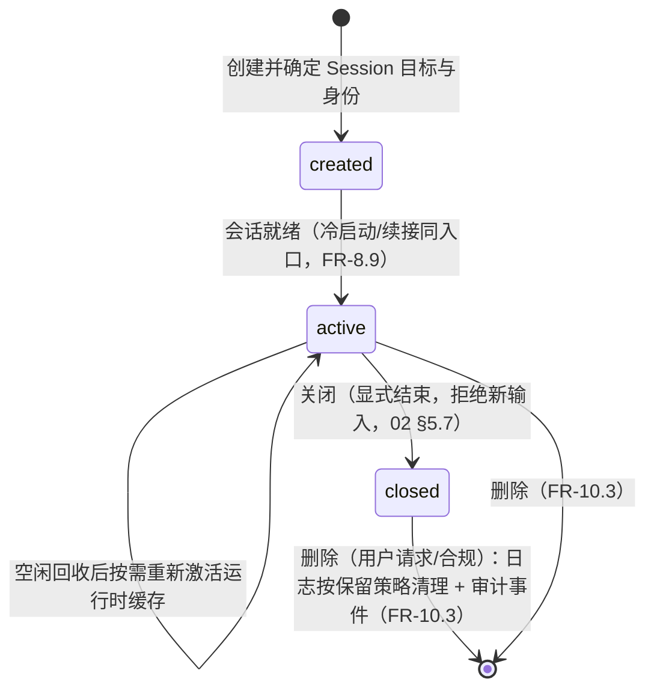

SessionStatus 不包含 Execution 状态。任一 Execution 进入 `waiting_hitl`、`failed` 或 `completed` 都不触发 Session 状态迁移；只有显式关闭或删除会阻止新输入。空闲回收只释放运行时缓存，不把 Session 改为 closed。

状态准入只约束首次输入，不反向否定已经提交的 receipt 或既有执行：普通首提和 `NewRun` 仅在 `ACTIVE` 时接受；`CREATED`、`CLOSED` 或尚不存在的 Session 在身份已验证后提交稳定 `session_not_active` REJECTED receipt，且不创建 Inbox、Run 或 state publication。`CLOSED` 仅允许已验证 `SystemPrincipal`、原异步 causation 证明、`CALLBACK/RECOVERY` 与同 owner `ExistingRun` 全部闭合的恢复输入，它只投递既有 Run。准入事务必须先识别同 input 的 V95 已提交事实，再在同一 owner root 与 V96 Session 行锁下判定状态并提交 V95；因此首次准入与 close 由 Session 行锁线性化，而已提交后丢失响应的输入在随后 close 后仍返回原 receipt。

### 6.2 Execution

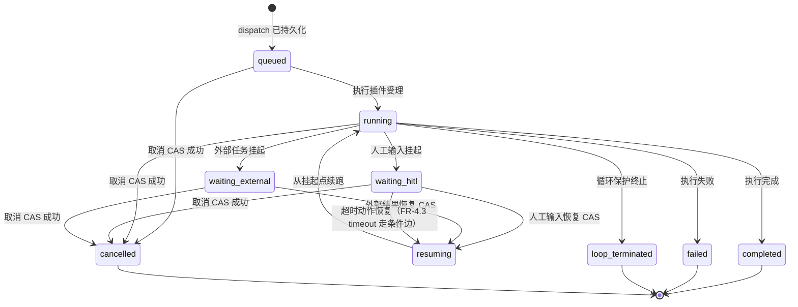

Workflow Execution Ledger 区分 `WAITING_HITL` 和 `WAITING_EXTERNAL`；两种等待都使用精确的原等待状态、revision、suspendRef 与 actionKey 执行恢复 CAS。`RESUMING` 与随后 `RUNNING` 及其事件由恢复操作原子提交；恢复中或终态不接受新的恢复状态推进。MVP-0 的目标是在重启后重建活动执行视图并继续安全的挂起恢复；任意运行节点的 checkpoint 续跑和分布式租约属于 P2 FR-13。

当前实现以 `agent_runtime_executions` 保存状态、revision 和 checkpoint；Workflow 调用事实由 `agent_runtime_workflow_invocations` 与 Session Workflow 操作表关联。恢复和并发写权统一遵循 Agent Runtime 的 revision、lease 与 fencing 契约。

**孤儿执行处置**：会话删除时仍 `waiting_hitl` 的执行须有明确终态策略——
取消（cancel，回调/定时器后续到达按无归属拒绝并审计，FR-14.2）或移交
（detach，挂起清单投影从账本重建后可转人工处置）；禁止无策略的永久等待
（01 已按附录 A #A12 回写为 FR-10.5）。

### 6.3 PendingEntry

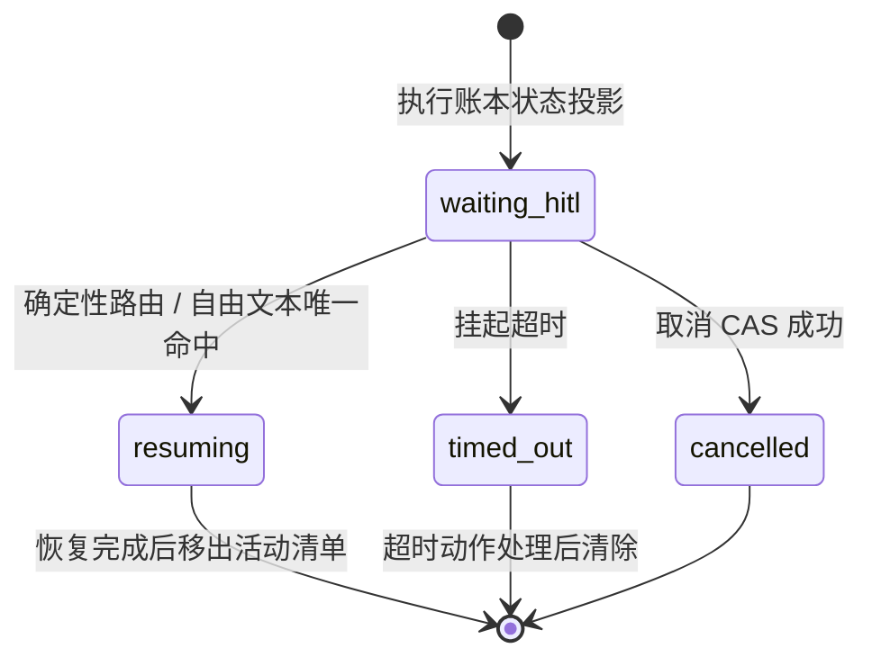

挂起、恢复、超时和取消的每次状态变更都投影为会话事件。PendingEntry 是 Execution Ledger 的投影；语义唤醒的产品策略和任务运营视图由 P1 FR-12 增强。

### 6.4 MemoryFact 事实状态机（02 §5.8 收敛于此）

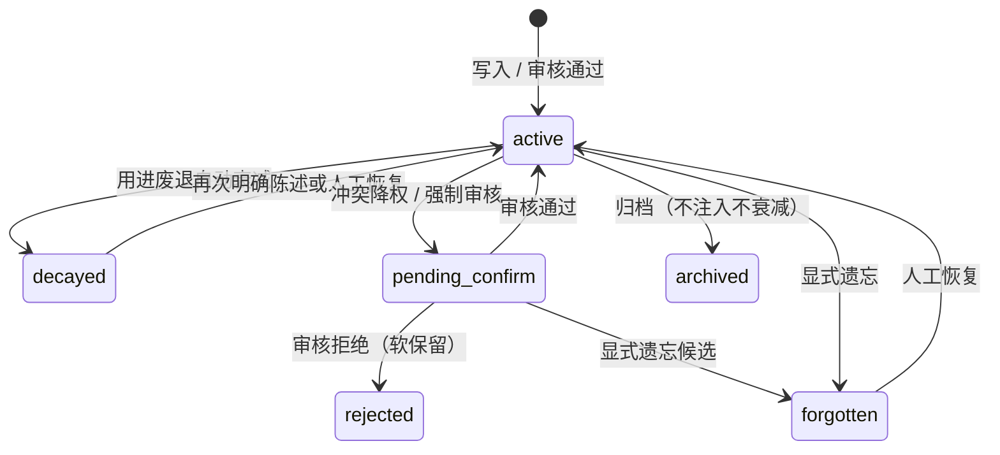

> 六态与 01 FR-9.16 / 02 `FactStatus` 已对齐（01/02 均按附录 A #A9 回写）：
> 冲突降权后旧事实落 `pending_confirm`（`supersededBy` 指向新事实），
> 不设独立 superseded 态。`MemoryFact` record 唯一家在 02 §5.8。

### 6.5 TodoItem

本节保留 `TodoItem` 标题与锚点，现描述通用任务计划的业务步骤，不再定义独立认知 Todo 状态机。完整计划操作、准入、依赖和恢复契约见 [08 §2.2](08-Agent委派与多智能体运行时.md#22-通用任务计划)；本节状态表达不授予工具或外部执行权限。

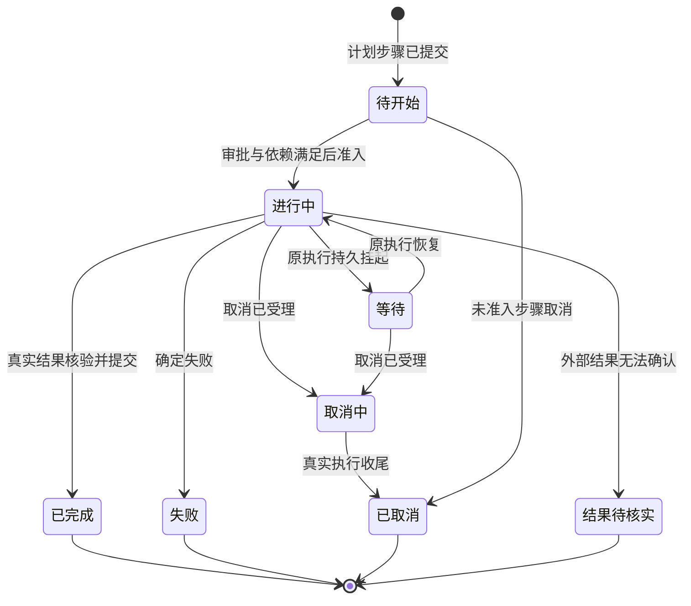

上图表示步骤执行与用户展示的语义；等待与依赖阻塞由宿主事实投影，不额外创建 Todo 执行账本。计划身份为所属 `work_id/input_id` 与原主 Run，步骤使用稳定 `task_id`；步骤执行另有 admission 身份与准入计划版本，不能以 Run 唯一性代替步骤唯一性。

| 操作 | 约束 |
| :-- | :-- |
| 提交与修订 | 原生 `plan.submit` 携带预期版本；依赖存在、输出声明匹配且无环；只修改尚未准入步骤，保留版本与变更说明 |
| 审批 | 普通模式持久提交后推进；规划模式或明确审批要求批准精确版本，新版本重新批准；在途步骤按原绑定登记结果与恢复 |
| PRIMARY 开始 | `plan.start_step` 校验审批、依赖、当前 Run、互斥资源及单活动主步骤，冻结输入和准入版本；Action 在派发前绑定该步骤 |
| PRIMARY 完成 | `plan.finish_step` 提交结论及命名产出；工具或外部操作须校验本步骤真实成功结果引用，未知效果不得声明完成 |
| MEMBER 完成 | 状态与产出从真实子 Run、委派回执和成果事实投影；主 Agent 不能通过主步骤完成操作改写成员终态 |
| 等待与恢复 | `plan.wait` 持久等待审批或指定依赖；经既有 RECOVERY 入口恢复原 Run，拒绝自我等待；确定依赖失败可返回阻塞原因 |
| 用户介入与取消 | 首版查看、自然语言补充、批准、取消均绑定明确工作和必要步骤身份；调整在途目标先取消收尾，再创建关联替代步骤 |
| 失败与未知 | 单分支失败只影响依赖；结果未知保留原事实，不经改版本、换成员或新步骤自动重做；计划不另建预算或外调许可 |

### 6.6 Resource Revision 与 Deployment

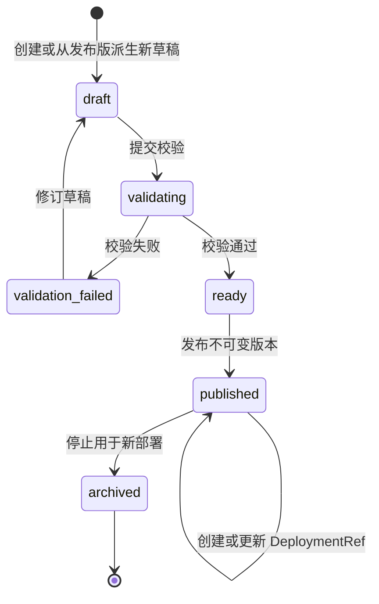

`published` 内容不可原地修改，任何变化必须派生新 draft。Deployment 与 ChannelBinding 的 CAS 只切换引用，不改写旧版本；正在运行的 Workflow Execution 继续使用启动时冻结的版本和 Deployment，当前 Agent Loop 使用 input 受理时冻结的 CapabilityMountSnapshot。

### 6.7 ControlOperation

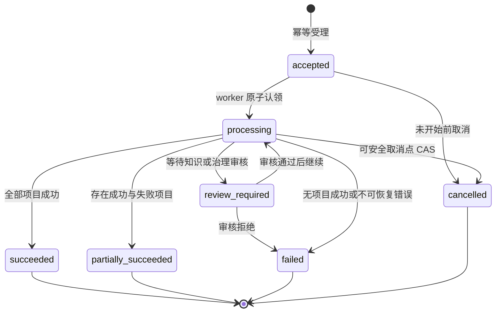

同一 `tenantId + integrationId + idempotencyKey` 且请求指纹一致时返回原 operation；指纹不同则拒绝。部分失败保留全部 ControlOperationItem，调用方只可按 retryable 项创建显式重试操作，不把原操作改写为未发生。

### 6.8 KnowledgeIngestionJob

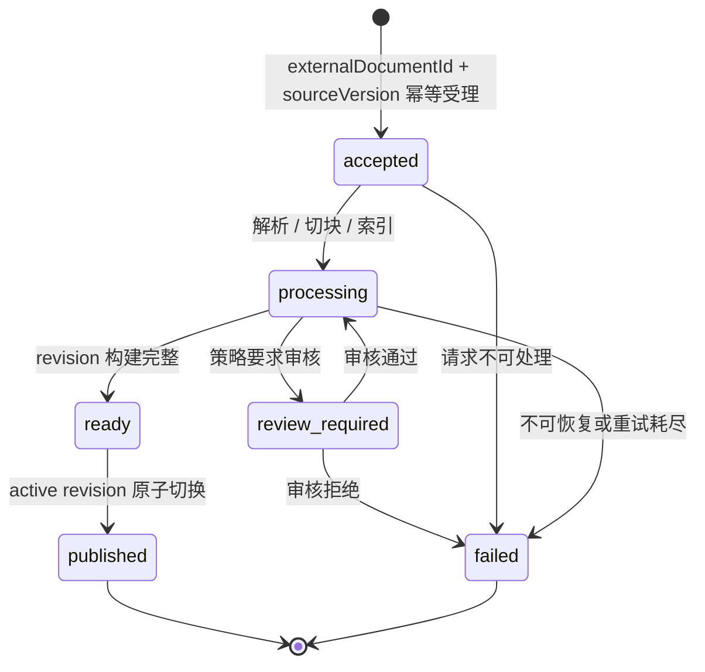

同一 KnowledgeBase 的构建可并行，但只有完整 `ready` revision 可竞争 active 指针 CAS；失败或部分构建版本不能被 FOLLOW_ACTIVE 检索。发布切换不删除旧 revision，既有 EvidenceRef 与 PINNED_REVISION 继续解析到原冻结版本。

---

## 7. Kernel 与 Runtime 边界

### 7.1 Kernel 不等于 Agent Runtime

Kernel 是 Agent Runtime 内部的最小契约与能力路由组件，不拥有 Session、关系状态、记忆或 Workflow 执行状态。Agent Runtime 由 Unified Inbound、Session Runtime、Agent Decision Runtime、Kernel、能力插件和持久化适配共同组成。

禁止提供 `kernel.getSession()`、`kernel.getRelationshipState()` 或 `kernel.getExecutionState()` 一类万能入口。需要状态的组件必须依赖对应端口，并由宿主按最小权限注入。

### 7.2 内核门面

```java
public interface Kernel {
    DispatchOrder decode(Object raw);
    BattleReport dispatch(DispatchOrder order);
    BattleReport delegate(DelegationOrder order);          // MVP-0 保留契约；P2 启用路由
    void publish(ExecutionEvent event);
    <T extends Plugin> T plugin(Class<T> type);
}
```

### 7.3 plugin() 依赖声明约束

`plugin(Class<T>)` 只能解析插件注册时显式声明的依赖，避免退化为万能 Service Locator。

```java
// 插件注册时声明依赖；plugin() 仅在声明清单内解析
public interface Plugin {
    default Set<Class<? extends Plugin>> dependsOn() { return Set.of(); }
}
```

规则：插件调用 `kernel.plugin(T)` 时，T 必须在其注册时声明的
`dependsOn()` 清单内（或由宿主容器注入），否则解析失败并审计。未声明
依赖清单的插件（默认空集）无法经 Kernel 获取任何其他插件。

### 7.4 运行时组件归属

| 组件 | 归属 | 职责 |
| :-- | :-- | :-- |
| ContractCodec / DispatchRouter | Kernel | 契约校验、执行能力定位和受控调用 |
| Registry / Scope | Kernel | 插件注册、依赖解析、能力视图和隔离 |
| EventBus | Kernel | 进程内运行时广播；不承担持久化事实源职责 |
| SessionTable | Session Runtime | Session 归属、身份、人格版本、组合代和生命周期 |
| InputIdempotencyLedger | Session Runtime | `input_id + 会话键` 去重，独立于 Session 缓存保留 |
| InputMailbox / OutputMailbox | Session Runtime | 同 Session 决策单 flight 与有序输出投递 |
| ContextPipeline / PolicyChain | Core；Session 提供事实与提交协调 | 可回放上下文选择与强制治理，不直接读取宿主存储 |
| ExecutionRegistry | Session Runtime | Session 下活动 Execution 的可重建摘要投影 |
| SessionLog | Session Runtime | 交互与认知域 append-only 事实源，先落盘后进入模型或广播 |
| Execution Ledger | Workflow Runtime | 执行状态、checkpoint、挂起和恢复 CAS 的唯一权威 |
| Action Ledger | Workflow/Capability Runtime | 逻辑 actionId、外部副作用尝试、幂等键和结果协调 |
| ControlOperation Log | Open Platform Runtime | 资源发布、知识摄取、批量同步和期望状态对账的状态、逐项结果与因果引用 |
| Usage Ledger | Metering Runtime | 原子用量、价格/汇率快照、费用、未决项和追加调整 |
| TraceProjection | Observability Runtime | 按 TraceRootRef 组合各权威事实引用；可丢失、可重建 |
| RelationshipState / Memory | Stateful Agent 扩展 | 通用关系容器与记忆端口；按租户、用户和 Agent 隔离 |

### 7.5 Agent Runtime SDK façade

本节 façade 接口和简化输入代码块保留为历史设计草案；当前源码不提供同名 `AgentRuntime` 门面。实际执行入口以 [ExecutionCoordinator](../backend-java/agent-runtime-session/src/main/java/com/skillforge/runtime/session/ExecutionCoordinator.java)、[ExecutionStore](../backend-java/agent-runtime-session-spi/src/main/java/com/skillforge/runtime/session/spi/ExecutionStore.java) 与 [InboundEnvelope](../backend-java/agent-runtime-api/src/main/java/com/skillforge/runtime/api/InboundEnvelope.java) 为准；Session 目标和身份见 [§5.1.1](#511-群归属与执行身份目标契约)。

SDK 的公开门面以 Unified Inbound 作为唯一状态变更入口。显式恢复、审批回调、后台完成和中断请求都先规范化为 `InboundEnvelope`，不得提供绕过 Inbox、幂等账本、SessionLog 或 PolicyChain 的 `resumeLoop`、`runTool`、`invokeWorkflow` 与 `runChildAgent` 公共方法。

```java
public interface AgentRuntime {
    InputReceipt accept(InboundEnvelope envelope);
    RunSnapshot queryRun(RunQuery query);
    SessionSnapshot querySession(SessionQuery query);
    InputReceipt requestCancel(CancelCommand command);
    Flow.Publisher<RuntimeEvent> events(EventStreamRequest request);
}

public record TenantId(String value) {}
public record AgentId(String value) {}
public record EndUserId(long value) {}
public record InputId(String value) {}
public record EventId(String value) {}
public record RequestId(String value) {}
public record ResultRef(String value) {}
public record AuthenticationRef(String value) {}
public record SessionRef(TenantId tenantId, String sessionId) {}
public record RunRef(TenantId tenantId, String runId) {}

public record AccessEnvelope(
        AuthenticationRef authenticationRef,
        TenantId tenantId,
        AgentId agentId,
        EndUserId endUserId,
        RequestId requestId,
        String channel,
        String source,
        String traceId,
        String spanId) {}

public record RunQuery(AccessEnvelope access, RunRef runRef) {}
public record SessionQuery(AccessEnvelope access, SessionRef sessionRef) {}
public record EventStreamRequest(
        AccessEnvelope access,
        SessionRef sessionRef,
        long afterSequence) {}

public sealed interface RunTarget
        permits RunTarget.NewRun, RunTarget.ExistingRun {
    record NewRun() implements RunTarget {}
    record ExistingRun(RunRef runRef) implements RunTarget {}
}

public record TraceEnvelope(
        String traceId,
        String spanId,
        InputId rootInputId,
        Optional<EventId> causedByEventId) {}

public record InboundEnvelope(
        AuthenticationRef authenticationRef,
        Optional<ResultRef> causationIdentityRef,
        SessionRef sessionRef,
        AgentId agentId,
        EndUserId endUserId,
        InputId inputId,
        EventId eventId,
        InboundKind kind,
        RunTarget runTarget,
        String channel,
        String source,
        TraceEnvelope trace,
        TypedPayload payload,
        Instant receivedAt) {}

public enum InboundKind {
    MESSAGE, ACTION, CALLBACK, RECOVERY, COMMAND, SCHEDULED
}

public record CancelCommand(
        InboundEnvelope envelope,
        RunRef runRef,
        long expectedRevision) {}

public record InputReceipt(
        SessionRef sessionRef,
        InputId inputId,
        InputReceiptStatus status,
        boolean replayed,
        long ledgerRevision,
        Optional<RunRef> runRef,
        Optional<String> rejectionReasonCode,
        Optional<ResultRef> resultRef,
        Instant recordedAt) {}

public enum InputReceiptStatus { ACCEPTED, REJECTED }

public final class IdempotencyConflictException extends IllegalArgumentException {
    public IdempotencyConflictException(InputId inputId, ResultRef auditRef) { ... }
    public InputId inputId() { ... }
    public ResultRef auditRef() { ... }
}

public final class RuntimeAccessException extends SecurityException {
    public RuntimeAccessException(String reasonCode, ResultRef auditRef) { ... }
    public String reasonCode() { ... }
    public ResultRef auditRef() { ... }
}

public record RunSnapshot(
        RunRef runRef,
        SessionRef sessionRef,
        RunStatus status,
        long runRevision,
        Optional<RunOutcome> outcome,
        Instant updatedAt) {}

public enum RunStatus {
    QUEUED, RUNNING, SUSPENDED, RESUMING, COMPLETED, TERMINATED, FAILED, CANCELLED
}

public record SessionSnapshot(
        SessionRef sessionRef,
        long sessionRevision,
        long lastSequence,
        List<RunRef> activeRuns,
        Instant updatedAt) {}

public sealed interface RunOutcome
        permits RunOutcome.Completed,
                RunOutcome.Suspended,
                RunOutcome.Terminated,
                RunOutcome.Failed,
                RunOutcome.Cancelled {

    record Completed(RuntimeReport report) implements RunOutcome {}

    record Suspended(
            LoopSuspendReason reason,
            String suspendRef,
            long checkpointRevision) implements RunOutcome {}

    record Terminated(
            LoopTerminationReason reason,
            RuntimeReport partialReport) implements RunOutcome {}

    record Failed(String reasonCode, ResultRef resultRef) implements RunOutcome {}

    record Cancelled(InputId cancelRequestId, long runRevision) implements RunOutcome {}
}

public record RuntimeReport(
        String output,
        List<Presentation> presentations,
        List<ExportedValue> exportedValues) {}

public record Presentation(String kind, TypedPayload payload) {}

public record ExportedValue(String exportPath, TypedPayload payload) {}

public record TypedPayload(String schemaId, String canonicalJson) {}

public sealed interface RuntimeEvent
        permits RuntimeEvent.Queued,
                RuntimeEvent.Started,
                RuntimeEvent.Progressed,
                RuntimeEvent.Suspended,
                RuntimeEvent.Resumed,
                RuntimeEvent.Completed,
                RuntimeEvent.Failed,
                RuntimeEvent.Terminated,
                RuntimeEvent.Cancelled {

    EventId eventId();
    SessionRef sessionRef();
    RunRef runRef();
    long sessionSequence();
    long runRevision();
    Instant occurredAt();

    record Queued(EventId eventId, SessionRef sessionRef, RunRef runRef,
                  long sessionSequence, long runRevision,
                  Instant occurredAt) implements RuntimeEvent {}
    record Started(EventId eventId, SessionRef sessionRef, RunRef runRef,
                   long sessionSequence, long runRevision,
                   Instant occurredAt) implements RuntimeEvent {}
    record Progressed(EventId eventId, SessionRef sessionRef, RunRef runRef,
                      long sessionSequence, long runRevision, Instant occurredAt,
                      TypedPayload detail) implements RuntimeEvent {}
    record Suspended(EventId eventId, SessionRef sessionRef, RunRef runRef,
                     long sessionSequence, long runRevision, Instant occurredAt,
                     RunOutcome.Suspended outcome) implements RuntimeEvent {}
    record Resumed(EventId eventId, SessionRef sessionRef, RunRef runRef,
                   long sessionSequence, long runRevision,
                   Instant occurredAt) implements RuntimeEvent {}
    record Completed(EventId eventId, SessionRef sessionRef, RunRef runRef,
                     long sessionSequence, long runRevision, Instant occurredAt,
                     RuntimeReport report) implements RuntimeEvent {}
    record Failed(EventId eventId, SessionRef sessionRef, RunRef runRef,
                  long sessionSequence, long runRevision, Instant occurredAt,
                  String reasonCode, ResultRef resultRef) implements RuntimeEvent {}
    record Terminated(EventId eventId, SessionRef sessionRef, RunRef runRef,
                      long sessionSequence, long runRevision, Instant occurredAt,
                      LoopTerminationReason reason,
                      RuntimeReport partialReport) implements RuntimeEvent {}
    record Cancelled(EventId eventId, SessionRef sessionRef, RunRef runRef,
                     long sessionSequence, long runRevision, Instant occurredAt,
                     InputId cancelRequestId) implements RuntimeEvent {}
}
```

首个 Java 构件与包根固定为 `agent-runtime-api` / `com.skillforge.runtime.api`。上述 record 的 identity、schema、channel、source、reason、trace 与时间字段不能为空白或 `null`，`EndUserId` 必须为正整数；ledger、run、session 与 checkpoint revision 必须为正数，`lastSequence` 与 `afterSequence` 可为 0，已提交事件的 `sessionSequence` 必须为正数。集合和 `Optional` 在构造时复制并规范化。`AuthenticationRef` 是身份边界签发的不可逆认证事实引用，不包含 JWT、API key、callback secret 或可反解凭据；其事实至少保留到关联 input 幂等、schedule、callback 与 delivery 事实全部过期。`InboundEnvelope` 与 `AccessEnvelope` 都必须携带它，façade 不能从 ThreadLocal、正文 tenant/role/user 或 channel/source 补造调用方身份。普通外部调用传入的 causationIdentityRef 必须为空，Runtime 验证后在内部规范化为首次 VerifiedIdentity.verificationRef；受信延迟调用必须使用宿主签发且可跨重启解析的 SystemPrincipal AuthenticationRef，并显式携带与 schedule/callback/delegation 账本相同的原 causationIdentityRef，不持久化短期外部 token。每次外部调用先重新验证当前认证，再将 PrincipalRef、credentialVersion 与原已提交身份比较；吊销、身份漂移或延迟 causation ref 错配都 fail closed。`InboundEnvelope` 的幂等身份固定为 `tenant + agent + session + inputId`，其 request fingerprint 包含 kind 与完整 RunTarget，但不包含可能因重新认证变化的 AuthenticationRef 或 causationIdentityRef；后者由 input/异步账本单独保存并比对。`TraceEnvelope` 必须完整提供 trace、span 与 root input，只有 causation event 可以为空。`AccessEnvelope` 是只读调用的完整认证引用、tenant、Agent、EndUser、request、channel/source 与 W3C trace 身份，不创建 input 或持久事件；RunQuery、SessionQuery 与 EventStreamRequest 的 tenant 必须与其引用一致。`CancelCommand` 必须携带 `kind=COMMAND` 且 `runTarget=ExistingRun` 的完整 envelope，ExistingRun.runRef 必须与 command.runRef 相等，Session 与 Run tenant 必须一致；返回 receipt 的 Session tenant 也必须一致。

`RunRef` 是 façade 的持久运行身份，是否创建运行只由显式 `RunTarget` 决定，不能从 InboundKind 推断。`NewRun` 只有在入口身份、ReAct eligibility、LoopBudget 与 Capability admission 全部通过后，才能在同一持久边界分配 RunRef、写入 ACCEPTED receipt、可领取 Inbox 与初始 QUEUED Run/state outbox event；SDK 不提供绕过 durable Inbox 直接创建 running AgentRun 的第二入口，RUNNING 只能由 worker 领取后以 RunStore transition 提交。Runtime 不得根据进程内排队状态伪造 `QUEUED`。`ExistingRun` 必须引用已存在且与 envelope 身份匹配的 RunRef，ACCEPTED receipt 只能引用该 RunRef，不得分配新的运行身份。准入或业务拒绝只写稳定 REJECTED receipt，不创建新的 RunRef 或 AgentRun。

`InputReceiptStatus.ACCEPTED` 必须携带由 NewRun 新分配或由 ExistingRun 指定的 RunRef 且 rejectionReasonCode 为空；`REJECTED` 必须携带稳定 rejectionReasonCode 和 ResultRef 且不得创建新的 RunRef，ExistingRun 的拒绝可以携带已验证属于当前身份的目标 RunRef。`replayed` 与接受/拒绝正交，`recordedAt` 和 `ledgerRevision` 指向首次有效 envelope 形成的原始 receipt 事实。相同幂等键与相同指纹返回该原 receipt，并以 `replayed=true` 表示重放；同键异指纹不得覆盖或伪造原 receipt，Runtime 追加审计事实并抛出只携带 InputId 与 ResultRef 的稳定 `IdempotencyConflictException`。取消命令只在命令 Inbound 被接受时返回 ACCEPTED receipt，其 RunRef 是目标运行身份；expected revision 过期、目标不存在或身份不一致时返回 REJECTED receipt。

AgentRuntime 的五个方法都必须先以 envelope/access 中的 AuthenticationRef 进行身份验证，再对具体动作 authorize。`accept` 与 `requestCancel` 使用 `IdentityPolicyPort.verify` 核对完整 claimed owner；`queryRun`、`querySession` 与 `events` 在任何业务读取前使用 `verifyAccess`，从随机 AuthenticationRef 对应的不可变验证事实恢复完整 Session owner，并逐项核对 access 声明的 tenant、Agent、EndUser、channel 与 source；禁止为获取 owner 而在验证前读取 Run 或 Session。身份验证 Rejected、authorize Denied 或 authorize Failed 统一 fail closed，抛出只携带稳定 reasonCode 与安全 auditRef 的 RuntimeAccessException；不得按未验证 claimed tenant 写 Input receipt、SessionLog、Run 或其他业务账本，也不得回显认证引用、Principal 或资源存在性。只有身份已验证但 admission、状态或业务规则拒绝时才形成 REJECTED InputReceipt；IdentityPolicyPort 的安全审计事实由身份边界独立提交，auditRef 只引用该事实。

`RunSnapshot` 的 `QUEUED/RUNNING/RESUMING` 不携带 outcome；`SUSPENDED/COMPLETED/TERMINATED/FAILED/CANCELLED` 必须携带与状态同构的 `RunOutcome`。RunSnapshot 与 SessionSnapshot 的 Session/Run tenant 必须一致；SessionSnapshot.activeRuns 只含同 tenant、互不重复且处于非终态的 RunRef。`RunOutcome.Cancelled.runRevision` 必须等于包含它的 RunSnapshot.runRevision；`RunOutcome.Suspended.checkpointRevision` 是挂起事实域的 checkpoint CAS revision，不与 runRevision 混用或强制相等。§5.7 的带 `Map` `InboundEnvelope` 是 Session Runtime 内部逻辑模型，不是 SDK 类型；进入 façade 前必须按注册 schema 规范化为本节 `TypedPayload`，不能由 SDK 公共类型依赖或兼容读取内部 envelope。

`RuntimeEvent` 是已提交 façade run 生命周期的公共投影，不与 §5.2 的九类 `execution.*` 事件按名称机械一一映射。Queued 只来自已提交的可领取事实，Started 来自 running AgentRun，Progressed 来自已提交 step/observation，Suspended 来自五类 `LoopSuspendReason` 的持久挂起转移，Resumed 来自恢复 CAS，四类终态事件来自相应 run 终态；`AGENT_HITL`、`WORKFLOW_HITL`、`WORKFLOW_EXTERNAL` 与 `TOOL_INPUT` 必须分别有已提交 pending、Workflow execution、Workflow 外部等待或 Action wait + Session response journal 事实，`DELEGATED` 必须有 delegation ledger 事实。每个事件的 sessionSequence 在 Session 内严格递增，runRevision 对同一 RunRef 单调递增，同一事件中的 Session 与 Run tenant 必须一致。

`accept` 返回 InputIdempotencyLedger 中已接受、已拒绝或已存在输入的稳定 receipt，不把同步方法返回当作执行完成事实。`queryRun` 与 `querySession` 使用 AccessEnvelope 做授权后只读取权威账本或可重建投影；`events` 从 afterSequence 之后只消费已提交事件。`requestCancel` 先生成 `command` Inbound 并经过 `accept` 的相同身份、幂等和审计管线。Session 派生的需求与验收由 [FR-23](04-后续阶段需求扩展-P1-P3.md#fr-23-session-派生forkp2) 定义，随 P2 交付；M7 阶段规划的首个 API 基线不包含 `forkSession`；当前 Runtime API 源码也未提供该方法，P2 的派生需求仍以 FR-23 为准。

`RunOutcome` 是 façade 对 Loop 与 AgentRun 事实的投影，映射固定为：

| `RunOutcome` | 来源事实 | 说明 |
| :-- | :-- | :-- |
| `Completed` | `LoopOutcome.COMPLETED` | `RuntimeReport` 由最终 RespondAction 与白名单导出值投影 |
| `Suspended` | `LoopOutcome.SUSPENDED` | 原样携带 `LoopSuspendReason`、`suspendRef` 与 checkpoint revision |
| `Terminated` | `LoopOutcome.TERMINATED` | 携带 `LoopTerminationReason`；`partialReport` 只含已提交输出 |
| `Failed` | RunRef 已分配后，AgentRun 在 Loop 之外发生编排或 Runtime 技术故障 | `reasonCode` 稳定，`resultRef` 指向类型化审计/结果事实；RunRef 分配前的准入拒绝只形成 REJECTED receipt，不与 `Terminated` 混用 |
| `Cancelled` | `command` Inbound 的取消请求经 action/execution CAS 收敛 | 收敛前查询仍返回 `Suspended` 或运行中快照 |

`RuntimeReport` 是 façade 的唯一结果投影，不复用内部 `BattleReport`。`TypedPayload` 以已注册 `schemaId` 和规范化 JSON 文本承载动态展示或导出值，避免在 façade、公开事件或宿主侧 SPI 签名中暴露 `Map`、Jackson 或供应商对象；接收方必须按 schema 校验后才能解析。内部 `BattleReport`、Workflow/Tool 原始结果和节点变量只能在相应 Runtime 模块的内部协作契约中流动，不能透过公开边界逸出。

`ForkSessionCommand` 必须指定已提交的来源 `sessionSequence`。派生 Session 只复制该 sequence 前允许继承的 SessionLog 引用、Persona/Agent revision 与经 Policy 允许的上下文引用，不复制 PendingEntry、活动 Execution、LoopState、Workflow checkpoint、Delegation 状态、Outbox 投递状态或 lease。来源 Session 后续事件不自动进入派生 Session。

公开 DTO 只使用 SDK API 中的 record、sealed interface、枚举和值对象。以下类型不得跨 façade 或 Port/SPI：

- 任意 `Map<String, Object>` 业务载荷。
- `*DO`、Mapper、Repository 实现与数据库行结构。
- Spring、MyBatis、Redis、Neo4j、HTTP Controller 或消息队列客户端类型。
- OpenAI-compatible、MCP 或其他供应商专属请求/响应。
- 明文凭据、连接串与可反向解析的 Secret 内容。

### 7.6 SDK Ports 与适配器责任

Agent 执行的受理、Run/Action/Attempt、结果、等待、取消和到期工作统一由 [ExecutionStore](../backend-java/agent-runtime-session-spi/src/main/java/com/skillforge/runtime/session/spi/ExecutionStore.java) 承接。下表和后续历史草案中的 InputAcceptance/Inbox/RunStore、ActionLedger permit、内部操作回执及 RuntimeEventOutbox/Destination 分层不再定义当前主链的实现义务。Session/Workflow/Delegation、IAM、预算和渠道仍保留各自真实职责，具体公开 ABI 以源码和生成基线为准。

| Port/SPI | Runtime 使用方式 | 适配器责任 |
| :-- | :-- | :-- |
| ModelResolutionPort / ModelPort | 解析冻结目标并执行规范模型请求 | 本地解析配置、翻译供应商协议；不决定 Agent Policy 或预算 |
| ToolPortal / WorkflowPortal / KnowledgePortal | 执行已挂载、已授权的类型化 Action | 调 Provider 并返回规范 Observation；不修改 LoopState |
| MemoryPort | 按 tenant、user、agent、session scope 读取或提交治理写入 | 适配关系库、向量库或图存储；不浏览未授权 SessionLog |
| IdentityPolicyPort | 提供已验证身份、scope 与授权事实 | 接 IAM/RBAC；不补造缺失 `endUserId` 或修改 Runtime 决策 |
| SessionStorePort / SessionLogPort | 保存 Session 与 append-only 交互事实 | 提供事务、唯一性、唯一 Session sequence 和租户隔离 |
| ExecutionStore | 原子受理、Run/Action/Attempt、等待、结果采用、取消与统一公开事件 | 同事务租户绑定、CAS/fencing、预算参与、唯一约束和到期工作定位 |
| ExecutionLedgerPort | 保存真实 Workflow Execution、节点 checkpoint 和挂起状态 | 提供当前 Execution lease、revision CAS 及原业务执行事实 |
| SessionDelegations | 保存当前委派与等待事实；阶段规划和实际能力边界见[委派设计](08-Agent委派与多智能体运行时.md) | 不复制 Workflow/Action 私有 checkpoint |
| ExecutionHostWorker / ExecutionStore | 唤醒并扫描已提交的到期执行工作 | 有界槽位、恢复扫描与存储中的领取/fencing；旧通用 SchedulerPort / WorkQueuePort 草案不代表现有 API |
| CallbackRegistrationPort | 保存 callbackId 与 session/execution/actionKey 归属 | 校验重放与签名后产生 callback Inbound，不直调执行域 |
| ExecutionStore SavedEvent / Session Mailbox | 直接消费已提交事件及统一 Session 游标 | 幂等补投与有界恢复；展示不加载完整执行或另建 publication 来源证明 |

#### 7.6.1 共用身份、引用与失败契约

`com.skillforge.runtime.api.port` 只依赖 `com.skillforge.runtime.api` 根包的 façade、共享领域值对象与 `java.base`。Port 调用使用以下共用类型；`AuthenticationRef` 位于 API 根包，因为 façade 本身消费它，`ExecutionRef` 也位于 API 根包，因为 02 §5.8 的唯一 MemoryFact 直接引用 Workflow Execution 身份；其余本节共用类型位于 `com.skillforge.runtime.api.port`。

```java
public sealed interface PrincipalRef
        permits PrincipalRef.EndUserPrincipal,
                PrincipalRef.ServicePrincipal,
                PrincipalRef.SystemPrincipal {
    TenantId tenantId();

    record EndUserPrincipal(TenantId tenantId, EndUserId endUserId)
            implements PrincipalRef {}
    record ServicePrincipal(TenantId tenantId, String principalId,
            String integrationId, long credentialVersion) implements PrincipalRef {}
    record SystemPrincipal(TenantId tenantId, String principalId)
            implements PrincipalRef {}
}

public record SessionOwner(
        SessionRef sessionRef, AgentId agentId, EndUserId endUserId) {}
public record RunIdentity(
        SessionOwner owner, InputId causationInputId,
        RunRef runRef, TraceEnvelope trace,
        ResultRef causationIdentityRef) {}
public record VerifiedIdentity(
        PrincipalRef principal, SessionOwner owner, Set<String> scopes,
        long policyRevision, ResultRef verificationRef) {}
public record ExecutionRef(TenantId tenantId, String executionId) {}
public record ActionRef(TenantId tenantId, String actionId) {}
public record DelegationRef(TenantId tenantId, String delegationId) {}
public record IdempotencyKey(String value) {}
public enum PortalCallKind {
    MODEL_GENERATE, MODEL_STREAM, TOOL_INVOKE,
    WORKFLOW_DISPATCH, WORKFLOW_RESUME,
    WORKFLOW_RECOVER_RESULT, WORKFLOW_CANCEL, KNOWLEDGE_EXECUTE
}
public enum PortalResolution { KNOWN_RESULT, KNOWN_FAILURE, OUTCOME_UNKNOWN }
public record PortalOutcomeSnapshot(
        PortalCallKind callKind, PortalResolution resolution,
        String outcomeType, TypedPayload outcome) {}
@FunctionalInterface
public interface CancellationSignal {
    boolean isCancellationRequested();
}
public record InvocationControl(
        Instant deadlineAt, CancellationSignal cancellationSignal) {}
public record PortCallContext(
        RunIdentity runIdentity, VerifiedIdentity identity,
        InvocationControl control) {}
public record ProviderCallContext(
        PortCallContext callContext,
        ActionLedgerPort.ActionInvocationPermit invocationPermit) {}
public record LeaseFence(
        TenantId tenantId, String claimId, String workerId,
        long fencingToken, Instant leaseUntil) {}
public record PortFailure(
        String reasonCode, RetryMode retryMode, ResultRef resultRef) {}
public final class ProviderInvocationException extends IllegalStateException {
    public ProviderInvocationException(String reasonCode, ResultRef auditRef) { ... }
    public String reasonCode() { ... }
    public ResultRef auditRef() { ... }
}
public enum RetryMode {
    NONE, IDEMPOTENT_BY_STABLE_KEY, RESULT_QUERYABLE, COORDINATED
}
public enum LeaseMutationStatus {
    APPLIED, ALREADY_APPLIED, STALE_LEASE, NOT_FOUND, TERMINAL
}
public record PortConflict(
        String resourceKind, String resourceId, ResultRef auditRef) {}
public record CapabilitySnapshotRef(
        SessionRef sessionRef, InputId inputId,
        String snapshotId, long generation) {}
public enum WorkflowExecutionState {
    QUEUED, RUNNING, WAITING_HITL, WAITING_EXTERNAL, RESUMING,
    COMPLETED, FAILED, LOOP_TERMINATED, CANCELLED
}
```

CapabilityRef、CapabilityType 与 ToolEffect 复用 §5.4 的唯一类型，KnowledgeRequest、KnowledgeSourceVersion、KnowledgeOperatorType、EvidenceBundle 与 EvidenceRef 及其字段闭包复用 §5.9 的唯一类型，MemoryFact、MemoryQuery、MemoryScope、MemoryTypeRef、RetentionClassRef、FactStatus 及其字段闭包复用 02 §5.8 的唯一类型；这些跨 Port 公开领域值对象发布在 `com.skillforge.runtime.api` 根包，`com.skillforge.runtime.api.port` 只引用且不得建立同名副本。所有 ID、reason、schema、fingerprint、handler、principal、scope 和版本文本均非空白；revision、generation、version 与 fencing token 为正数。所有集合、`Optional` 和嵌套值在构造时防御复制、去重并拒绝 `null`。`SessionOwner`、Run/Execution/Action/Delegation 引用、Capability snapshot、EvidenceRef、VerifiedIdentity 与 Principal 的 tenant 必须一致；PortCallContext.runIdentity.owner 必须等于 identity.owner，ProviderCallContext.invocationPermit.intent.lease 的 action tenant 必须等于 callContext owner tenant。`causationInputId` 是当前动作的因果输入，不得冒充 `TraceEnvelope.rootInputId`；ActionAttemptFact 中的 `actionRef` 是逻辑动作身份，`invocationId` 在安全重试间稳定，`attemptId` 每次外部尝试唯一且不得等于 invocationId，三者不能由 inputId 代替。Provider Port 不接受调用方散装传入这三个身份；Core 必须先以 current ActionLease 调用 ActionLedgerPort.startAttempt，只有 Started 才能把返回的 permit 与普通调用上下文封装为 ProviderCallContext，其他 start result 均不构造外调上下文。MemoryPort 与 DelegationActionPort 只使用普通 PortCallContext，并分别服从 Memory 幂等/CAS 与 Delegation Ledger，不重复进入 Action attempt 账本。

InvocationControl.deadlineAt 由受信宿主为本次调用建立；适配器按冻结目标 timeout 与 control 剩余期限取较早边界，不得延后原 deadline。任务活跃预算在派发准入与活动结算边界检查，不由此推断在途调用会于剩余活跃时间耗尽时立即中断。Model/Tool/Knowledge 与 Workflow adapter 在外部调用前、等待中和每次受控重试前检查 CancellationSignal，取消后停止产生新副作用。Model stream 同时响应 Flow.Subscription.cancel 与该 signal；deadline 已到或 signal 已触发时 fail closed，不发起外部请求。

Model/Tool 当前窗口可附带本次刚完成的取消观测，仅覆盖精确同一动态 signal 实例，并在使用时继续读取无阻塞、单调的本地停止闩锁。Core 同一次检查可以复用该观测；不同来源的原 control 仍独立执行取消回调，原始 deadline 始终参与检查。观测不得持久化或跨 journal、registry、operation 分配、permit 消费等阻塞边界复用；新窗口重新核对 IAM、Run、租约和时钟。Provider 直接调用原动态 signal，不使用窗口观测替代等待期间的实时取消检查。

CancellationSignal 必须线程安全、无阻塞且不得抛异常；同一次 invocation 中一旦返回 true，后续所有线程观察都必须保持 true，不能复位。宿主取消源异常按已取消处理。SDK-1B 只冻结该函数式 ABI 与语义；SDK-3 的 adapter 共用 conformance suite 必须对实际取消源与 Model stream 覆盖并发读取、单调触发以及 subscription cancel 与 signal 任一路径先到时的单终态收敛，不能以 API 测试中的示例 lambda 冒充实现验收。

`PrincipalRef.ServicePrincipal` 与 `SessionOwner.endUserId` 分列记录集成调用方和被代理终端用户；正文 tenant、role、user、channel 与 source 不参与授权。SystemPrincipal 只用于经过宿主信任边界签发的 scheduler、recovery 与内部投递，不接受外部正文声明。AuthenticationRef 的解析结果必须与 envelope 中的 claimed tenant、Agent 与 EndUser 完全相等，否则拒绝，不能静默改写。

IdentityPolicyPort.verify 成功时，VerifiedIdentity.owner 必须等于 request.claimedOwner，principal.tenantId 必须等于 owner 的 tenant；EndUserPrincipal.endUserId 还必须等于 owner.endUserId，ServicePrincipal 代办 EndUser 只能由显式 scope/policy 授权，SystemPrincipal 只允许宿主信任边界。verificationRef 必须指向该次 AuthenticationRef、PrincipalRef、credentialVersion 与请求通道形成的不可变验证事实。authorize 只能评估传入的同一 principal/owner，不得改换身份；Allowed/Denied 的 policyRevision 与 auditRef 必须来自同一次策略评估并可相互追溯，Denied 只表示确定性策略拒绝。IAM/Policy store 不可用或结果不确定返回 Failed(PortFailure)，façade 同样 fail closed 为 RuntimeAccessException，不得伪装成 Denied 或抛供应商异常。

灵知 身份适配器仅从成功认证的受信宿主入口签发随机认证引用，绑定完整 owner、principal、channel/source 与失效时间；服务入口有效期最多一小时，系统入口必须由宿主显式覆盖冻结异步事实的完整责任窗口。认证事实持续保留，撤销只改变有效性。ServicePrincipal 在 verify 与 authorize 中都读取原 `service_principals` 的当前状态、integration、credentialVersion 和 scopes；不能镜像权限或将 credentialVersion 当作 policyRevision。系统主体必须在宿主显式授权配置中，无真实认证入口的 EndUser 不得凭用户存在性或渠道认证签发。`runtime.accept` 明确映射到 `sessions.write` 和 admission-resource.v1，严格校验完整资源及原入口；既有 Session 的服务集成范围为 `open-platform:<integrationId>`。未知 action/schema 拒绝，其他动作须在各自资源契约中显式定义。

授权前按 verificationRef 回查不可变全值验证事实，再评估当前 IAM 与资源归属；调用方自行构造的 VerifiedIdentity 不能提供授权证明。安全审计与业务事务使用独立连接提交，成功验证事实与验证审计原子提交；认证前只能按随机认证引用解析原租户，不能把 claimed tenant 记为可信租户。审计仅保存稳定结果、同次策略版本和域分离关联摘要；审计存储失败时不得释放成功身份或允许结果，也不得生成不存在的 auditRef。

RunIdentity.causationIdentityRef 在普通外部 NewRunDraft 创建时固定为首次 VerifiedIdentity.verificationRef；受信 SystemPrincipal 发起的延迟 NewRun 则固定为已校验的 envelope.causationIdentityRef，并随 RunRecord、Execution、Action、Delegation、后台任务和恢复链持久传播。延迟任务的 causationIdentityRef 指向不可变、脱敏的原 PrincipalRef、credentialVersion 与 authentication verification fact，保留期覆盖关联任务和审计窗口；它只用于审计与 Policy 因果判断，不是凭据，不能恢复外部权限、签发新 AuthenticationRef 或替代 SystemPrincipal 的当前授权。

构造期协议错误抛 `IllegalArgumentException`，不得包含凭据或原载荷。预期业务失败、权限拒绝、CAS/lease 冲突与外部调用失败使用类型化 result 和稳定 reasonCode；领域 sealed result 的 Failed/OutcomeUnknown 是结果确定性的唯一表达，PortFailure 不重复携带 certainty。RetryMode 只描述已证明安全的后续动作：OutcomeUnknown + NONE 禁止重试，稳定 eventId/actionId 可由适配器幂等去重时才允许 IDEMPOTENT_BY_STABLE_KEY，可查询结果时先 RESULT_QUERYABLE，跨账本协调时使用 COORDINATED。数据库消息、供应商异常类/消息、HTTP/MQ 对象、明文 secret 与原始第三方 payload 不得进入 Port result、SessionLog 或公开事件。

所有 limit、当前 claim/调用的 attempt、budget、token、character、timeout 与 Duration 必须为正数；持久记录中的累计 attempts/attempt 在首次领取前允许为 0，领取后不得回退，序列从 1 开始。temperature 必须是有限的 0..2，relevance/confidence/importance/decay 必须是有限的 0..1，NaN 与 Infinity 一律拒绝；结束/过期时间不得早于对应开始时间。OutcomeUnknown 包装的 PortFailure 只有在稳定键幂等、结果查询或账本协调已明确时才可使用非 NONE RetryMode；RuntimeEventSink.RetryableFailure 只允许 IDEMPOTENT_BY_STABLE_KEY，PermanentFailure 必须使用 NONE。

#### 7.6.2 身份、模型、能力与记忆 Ports

通用媒体访问、模型视觉能力与 Codec 图片位置能力分别由所属宿主适配器和 Provider 证明；Core/API 只消费供应商无关的已验证引用及冻结能力事实，不直接读取路径或构造供应商图片请求。目标契约见[多模态专题](03-多模态内容与媒体引用.md)，下面的既有 ABI 示例不自证多模态已经接入。

```java
public interface IdentityPolicyPort {
    IdentityResult verify(IdentityRequest request);
    IdentityResult verifyAccess(AccessIdentityRequest request);
    AuthorizationResult authorize(AuthorizationRequest request);

    record IdentityRequest(
            AuthenticationRef authenticationRef, SessionOwner claimedOwner,
            String channel, String source, RequestId requestId,
            Optional<InputId> inputId, String traceId, String spanId) {}
    record AccessIdentityRequest(
            AuthenticationRef authenticationRef, TenantId claimedTenantId,
            AgentId claimedAgentId, EndUserId claimedEndUserId,
            String channel, String source, RequestId requestId,
            String traceId, String spanId) {}
    sealed interface IdentityResult permits IdentityResult.Verified, IdentityResult.Rejected {
        record Verified(VerifiedIdentity identity) implements IdentityResult {}
        record Rejected(PortFailure failure) implements IdentityResult {}
    }
    record AuthorizationRequest(
            VerifiedIdentity identity, String action,
            TypedPayload resource, String traceId, String spanId) {}
    sealed interface AuthorizationResult
            permits AuthorizationResult.Allowed, AuthorizationResult.Denied,
                    AuthorizationResult.Failed {
        record Allowed(long policyRevision, ResultRef auditRef)
                implements AuthorizationResult {}
        record Denied(String reasonCode, long policyRevision, ResultRef auditRef)
                implements AuthorizationResult {}
        record Failed(PortFailure failure) implements AuthorizationResult {}
    }
}

public interface ModelResolutionPort {
    ResolutionResult resolve(ModelResolutionRequest request);

    record ModelResolutionRequest(
            RunIdentity runIdentity, VerifiedIdentity identity,
            ModelPort.ModelBindingRef binding,
            ModelPort.RequestedModelStrategy requestedStrategy) {}
    sealed interface ResolutionResult
            permits ResolutionResult.Resolved,
                    ResolutionResult.Rejected {
        record Resolved(ModelPort.FrozenModelTarget target)
                implements ResolutionResult {}
        record Rejected(PortFailure failure) implements ResolutionResult {}
    }
}

```

ModelPort 的请求、结果及流事件精确 ABI 由 [Java 源码](../backend-java/agent-runtime-api/src/main/java/com/skillforge/runtime/api/port/ModelPort.java)与生成基线持有；调用、终态与恢复语义见本节，结果编码见 §8.2。

模型前缀能力随不可变绑定及 `ModelCapabilitySnapshot` 冻结，区分已核实支持、已核实不支持和未核实；宿主和模型准备不得扩大具体服务、协议、端点与模型已核实的范围。历史内 SYSTEM、工具更新模式和 tools 与 NONE 的组合分别协商，未知默认关闭对应优化，恢复校验原持久字段与摘要，不按当前 Provider 目录重判。能力语义及连续 Session 投影的来源、采用与隔离契约归[上下文专题 §13.1](03-上下文视图与执行优化.md#131-供应商-prompt-cache-与前缀稳定性)。

ToolPortal 精确 ABI 由 [Java 源码](../backend-java/agent-runtime-api/src/main/java/com/skillforge/runtime/api/port/ToolPortal.java)与生成基线持有；Headless 调用和反馈见 §5.6.2，私有结果编码见 §8.2。

WorkflowPortal 与 KnowledgePortal 的精确 ABI 分别由 [Workflow 源码](../backend-java/agent-runtime-api/src/main/java/com/skillforge/runtime/api/port/WorkflowPortal.java)、[Knowledge 源码](../backend-java/agent-runtime-api/src/main/java/com/skillforge/runtime/api/port/KnowledgePortal.java)和生成基线持有；下文保留准入、调用与恢复语义，§8.2 定义结果编码。

```java

public interface MemoryPort {
    MemoryQueryOutcome query(MemoryQueryCall query);
    MemoryMutationResult submit(MemoryCommand command);
    List<Optional<MemoryFact>> findCurrent(CurrentFactReadBatch batch);

    record CurrentFactRead(PortCallContext context, MemoryFactRef fact) {}
    record CurrentFactReadBatch(List<CurrentFactRead> reads) {}
    record MemoryQueryCall(PortCallContext context, MemoryQuery query) {}
    record MemoryFactDraft(
            MemoryOwner owner, MemoryTypeRef type,
            RetentionClassRef retentionClass, String schemaVersion, String subject,
            String predicate, TypedPayload object, List<EventId> sourceEventIds,
            SessionRef sourceSessionRef, Optional<ExecutionRef> sourceExecutionRef,
            Optional<String> exportPath, String extractorVersion,
            Instant validFrom, Optional<Instant> validTo,
            Optional<Instant> expiresAt, double confidence, double importance,
            boolean reviewRequired, Optional<MemoryFactRef> derivedFrom,
            FactStatus initialStatus) {}
    record MemoryQueryResult(
            String queryId, List<MemoryFact> candidates,
            ResultRef resultRef, Instant evaluatedAt,
            MemoryRetrievalDiagnostics diagnostics) {}
    sealed interface MemoryQueryOutcome
            permits MemoryQueryOutcome.Retrieved,
                    MemoryQueryOutcome.Failed {
        record Retrieved(MemoryQueryResult result)
                implements MemoryQueryOutcome {}
        record Failed(PortFailure failure) implements MemoryQueryOutcome {}
    }
    sealed interface MemoryCommand
            permits MemoryCommand.Create, MemoryCommand.Supersede,
                    MemoryCommand.Transition {
        record Create(
                PortCallContext context, IdempotencyKey idempotencyKey,
                MemoryFactDraft fact) implements MemoryCommand {}
        record Supersede(
                PortCallContext context, IdempotencyKey idempotencyKey,
                MemoryFactRef current, long expectedRevision,
                MemoryFactDraft replacement) implements MemoryCommand {}
        record Transition(
                PortCallContext context, IdempotencyKey idempotencyKey,
                MemoryFactRef fact, long expectedRevision,
                FactStatus target, String reasonCode) implements MemoryCommand {}
    }
    sealed interface MemoryMutationResult
            permits MemoryMutationResult.Applied, MemoryMutationResult.Rejected,
                    MemoryMutationResult.Conflict {
        record Applied(MemoryFact fact, Optional<MemoryFact> before, boolean replayed)
                implements MemoryMutationResult {}
        record Rejected(PortFailure failure) implements MemoryMutationResult {}
        record Conflict(
                MemoryFactRef fact, long currentRevision, ResultRef auditRef)
                implements MemoryMutationResult {}
    }
}
```

MemoryMutationResult.Applied 的 `before` 是该命令第一次成功提交时的不可变前置事实：Create 为空，Supersede/Transition 为命令 expectedRevision 对应的精确事实。原键重放仍返回原 before 与原结果，不能以当前 head 替代；MemoryRuntime 复验当前授权后用这组原事实闭合 memory.written，支持存储提交后审计事件尚未确认的恢复。

ModelBindingRef 只引用当前 tenant 的宿主配置；ModelResolutionRequest.runIdentity.owner 必须等于 identity.owner，binding.tenantId 必须等于 owner 的 tenant。Core 先调用纯本地 ModelResolutionPort 解析 `requested strategy → frozen target + capability snapshot + timeout`，该 Port 不联网、不返回 endpoint/secret/provider options，再由 Core 计算 negotiated ResponseContract 并把 requested strategy、target、capabilities、timeout 与 contract 保存为 invocationSnapshotRef 后调用 ModelPort。ModelCapabilitySnapshot.responseFormats 非空且至少含 TEXT，ResponseContract.format 必须被 snapshot 支持；stream 只在 streaming=true 时调用，reasoning=false 时不能发送非 DISABLED reasoning。Agent 输入准备同时把本轮 ToolCatalog 的 exact opaque handle、inputSchema 与确定性供应商安全名冻结为 ModelTool；供应商只看到 wireName，adapter 保留有序原生正文和工具调用事实，Session 从同一冻结条目唯一还原 toolHandle 并校验动作，再由既有 ToolPortal 执行完整授权、预算、确认与副作用治理。未知名、非法参数或不符合冻结调用约束仍失败关闭；正文与调用共存不授予额外并行执行能力。请求不得携带 endpoint、SecretRef、provider options 或供应商 DTO，adapter 不重新选择 model、协商策略或解码 Agent 业务动作；Completed.effectiveModelId 必须等于 FrozenModelTarget.effectiveModelId，漂移返回 Failed/OutcomeUnknown。NativeConversation 的 Completed.output 使用 TEXT 对应的 JSON 字符串载荷保存正文，动作解释依据原 AssistantTurn，不再以空对象吞掉正常正文。stream 的文本、工具参数和用量 sequence 从 1 严格递增并恰好产生一个终态事件，终态后不得再发布元素，业务失败不使用携带供应商文本的 `onError`。纯本地 resolution Rejected 与 Model OutcomeUnknown 只能使用 RetryMode.NONE；Core 不把未确认的模型调用自动重放。

`AgentRuntimeModelConfiguration.ModelSource` 是模型发布入口的受信宿主输入；Host 在 NewRun 受理时从平台模型目录和当前运营配置解析并冻结完整版本；后续模型或工具动作从该 Run 的冻结事实构造 Source。SDK 与 adapter 只消费本次动作的 Source，不查询 TenantModelSelection、Agent 或其他租户业务表，也不从当前租户配置补读、回退或重选模型。模型生产绑定使用 `(tenantId,bindingId,revision)` 的不可变事实；每次发布形成精确 `ModelBindingRef`，已经发出的调用、重放和恢复只按该 binding/revision 读取。受信宿主发布入口从本次调用的平台模型版本读取整组 provider/service/profile/protocol/authentication/dialect、endpoint/model/加密凭据，先按 SDK 目录校验服务组合，再冻结策略版本、响应能力、streaming 与 timeout；没有显式 SDK 校验器的存储实例不得发布。同内容重放原 revision，变化生成新 revision。Agent 的五项运行预算覆盖（业务模型、工具、知识次数，累计总 Tokens 和活跃时长）在 NewRun 时与 task_budget 场景根额度及代码角色比例统一装配并冻结；后续动作及恢复不得重读当前预算或 Agent 覆盖。所有新格式运行在受理时形成完整冻结事实，后续模型与工具动作继续使用原准备 Profile 精确引用及预算登记。已经发出的调用不会改读最新值。模型名来自用户显式发现后的选择或手工输入，SDK 不以内置模型清单限制；`/models` 返回变化不得改写已发出调用的模型名，恢复和调用不得重新发现或替换它。发布入口不向请求开放 endpoint/secret 参数，resolution 不解密或联网；HTTP adapter 不读取最新目录重新解释不可变绑定，只在外调前核对自身支持的冻结协议、认证与 Dialect，使用冻结 endpoint/model 并解密该版本凭据，失败不按明文回退。当前 OpenAI-compatible profile 不声明 reasoning 能力，调用显式 DISABLED；不能把供应商专属开关当作通用协议。

`model.resolve`、`model.generate`、`model.stream` 明确映射当前 `sessions.write`。解析资源 `skillforge.runtime.model.resolve-resource.v1` 与外调资源 `skillforge.runtime.model.dispatch-resource.v1` 均为规范 15 字符串数组 `[tenantId,agentId,sessionId,endUserId,runId,causationInputId,causationIdentityRef,traceId,spanId,rootInputId,causedByEventId,bindingId,bindingRevision,strategyId,strategyVersion]`，无 causedByEventId 时为空。生产策略另读取完整真实 Run 和绑定归属；外调只核验原已 CONSUMED permit、STARTED/intent/bearer 摘要、当前 lease 与无 winner 事实，唯一消费仍在 Core。Codec SPI 的 `matchesModelCall` 复用原私有快照校验完整散装调用；HTTP 方法还须匹配原 MODEL_GENERATE/MODEL_STREAM，不能交换调用形态。

OpenAI-compatible 输出注册为 `skillforge.runtime.model.text.v1`（canonical JSON 字符串）或 `skillforge.runtime.model.json.v1`（键排序的 JSON 对象），JSON_SCHEMA 仍须由宿主显式注入的结果 validator 按原 schema 验证。response model 必须精确等于冻结目标；SSE 首次内容确认模型后，usage-only 包可省略 model，但任何显式 model 漂移均不能完成。内容与 usage 共用递增 sequence；记录 finish_reason 后继续等 usage 与 `[DONE]`，只产生一个终态。已确认 token 值为非负整数，供应商明确返回的 0 保留为已知零，只有缺失映射 Optional.empty，负数、非整数与溢出拒绝。发送后的网络中断、缺终态、408/5xx 归 OutcomeUnknown 且 NONE，不自动重试；订阅取消和调用 deadline 会关闭 HTTP body。

Completed 表示供应商调用得到确定终态，不保证业务输出可采纳。消费者先检查 `finishReasonCode`：`length` 和 `content_filter` 的正文可能只有已接收的部分，也可能没有正文；不能把该结果当作完整输出，这两种终态不要求通过业务输出 schema。OpenAI-compatible 适配中，TEXT 或原生模式无正文时使用空字符串载荷；结构化正文缺失或不能解析为 JSON 对象时使用 `{}` 占位，不能将占位视为供应商正文，也不能假定结构化部分原文已保存在 output 中。已报告的 usage 仍随 Completed 保留，未报告的字段保持缺失，不从输出或占位推断用量。

Tool/Workflow/Knowledge 必须命中当前 input 的 CapabilitySnapshotRef，并由 Core 传入已解析且携带正数 timeout 的 FrozenToolTarget/FrozenWorkflowTarget/FrozenKnowledgeTarget；三者的 capability.type 必须分别为 TOOL、WORKFLOW、KNOWLEDGE_SOURCE，类型错配在构造期拒绝。每个 ToolCall、KnowledgeCall、WorkflowDispatch/Resume/ResultQuery/Cancel 都显式携带该 snapshot，adapter 不从 attempt fact 自证、不读取 SessionLog/Registry、不查 current active target。handle 格式分别是 `tool:<mountId>`、`workflow:<mountId>` 与 `knowledge:<mountId>`。Workflow `recoverResult` 只按完整 owner、snapshot、execution 与 frozen mounted identity 读取已提交 waiting_hitl/waiting_external 或 completed/failed/loop_terminated/cancelled 结果，或返回携带 InvocationBarrierProof 的 Absent；该屏障必须与旧 invocation 提交线性化，屏障先建立时旧 holder 此后永久不能提交，已存在的结果返回真实等待或终态 revision，不要求调用方预知终态 revision，也不执行节点。Rejected 只表示查询自身的确定性失败，不能替代 Absent 授权重新 Execute，也不能把原 action 标记 FAILED；resume/cancel 校验 execution、owning run、mounted identity、suspendRef/actionKey 与 expected revision。InvocationBarrierProof 是 adapter 已验证的 provider-neutral attestation 投影：actionRef、invocationId、blockedExecuteAttemptId 与 blockedExecuteRequestFingerprint 必须来自本次 ResultQuery 的 ProviderCallContext.startedFact 及其所指历史 EXECUTE fact，reconciliationRef 与 invocationBarrierRef 证明 Provider 侧线性化；Ledger 无需解析不透明 ResultRef 即可逐字段比对 subject。WorkflowResult.Failed.revision 只有在 Provider 已提交 workflow terminal failure 时必须存在；确定性 call-level 拒绝、确认未创建 execution、`pre_dispatch_contract_rejected` 或 `invocation_barrier_rejected` 没有权威 workflow revision 时为空，禁止伪造 0 或沿用旧 revision。recoverResult 返回的 Failed 是权威已提交终态，revision 必须存在且 failure.retryMode 固定 NONE；查询自身失败或仍运行时只使用 Rejected。恢复联合 `WorkflowRecoveredResult.Suspended` 保留原 execution、suspendRef、reason 与 revision，采用后挂起父 Run；来源必须是同一根调用的已提交 RECONCILE 事实，并核对原 EXECUTE attempt 与请求指纹。挂起不产生终态结果投影。节点原调用已经提交的 resolved winner 可经只读查询触发系统恢复，信号仅包含结果事实引用；采用结果不延长原外调期限，也不再次授予 Provider 调用权。新外调的 start/consume 继续验证原 deadline、当前租约与 fence。Tool OutcomeUnknown 只允许 NONE，或在 target.idempotent=true 时使用 IDEMPOTENT_BY_STABLE_KEY；Knowledge OutcomeUnknown 只允许 NONE；二者不得返回没有结果查询/协调入口承接的 RESULT_QUERYABLE 或 COORDINATED。Workflow OutcomeUnknown 只允许 NONE 或 RESULT_QUERYABLE，并由 recoverResult/Execution Ledger 收敛；没有权威 revision 时 OptionalLong 为空。KnowledgeCall.request 的 tenant/endUser/agent/session/trace 必须分别等于 context.callContext.runIdentity.owner/trace，sourceEventId 必须属于当前 Session 与 causationInputId 的因果链。Knowledge `NONE` 不调用 Port；FrozenKnowledgeTarget 必须包含 descriptor revision 与完整 source version manifest，KnowledgeRequest 只能进一步收窄来源、算子与预算；完整 EvidenceBundle 必须先写 SessionLog，再形成可注入 EvidenceRef。ToolEffect 与 CapabilityRef/Type 复用 §5.4，KnowledgeRequest/SourceVersion/Operator/EvidenceBundle/Ref 复用 §5.9，MemoryFact/Query/Scope/Type/Retention/Status 复用 02 §5.8；port 包不得复制同名领域类型。

PortalOutcomeSnapshot 是 Action attempt 的私有、版本化重放载荷，不是模型可见 observation。outcome 必须使用 §8.2 登记的 schemaId 和 canonical JSON，无损覆盖对应公开 Port result subtype 的全部字段但不得含供应商原始响应；callKind、resolution、outcomeType 与 schema 必须命中同一登记项，错配 fail closed。MODEL_GENERATE/MODEL_STREAM 只保存聚合后的终态 ModelResult；MODEL_STREAM 重放时 Core 构造只发布该终态事件的 publisher，不重放 ContentDelta/UsageDelta、不伪造 sequence，也不调用 Provider。Tool InputRequired 使用独立 `INPUT_REQUIRED` resolution；它是已登记但非终态的 attempt 事实，不进入 resolved index、不完成 Action、不生成 canonicalObservation。Workflow Accepted/Suspended/Completed/Terminated/Cancelled 仍是对应 Workflow 调用的 KNOWN_RESULT。各 Portal Failed 以及 Workflow recoverResult.Rejected、cancel Conflict/Rejected 是 KNOWN_FAILURE；cancel Conflict.failure.retryMode 固定 NONE，OutcomeUnknown 是 OUTCOME_UNKNOWN。recoverResult.Rejected 只表示只读查询失败，不能终结原 action；recoverResult.Absent 是 KNOWN_RESULT，但必须携带 Provider 侧线性化 invocationBarrierRef，只能作为 ReconciledAbsent 证据，不能完成原 action。Portal outcome registry 对 Model Completed、Tool Succeeded、Workflow Completed 与 Knowledge Retrieved 返回 canonicalObservation=`REQUIRED`，对其余 subtype 返回 `FORBIDDEN`。Core/Session 只有在 schema 校验、脱敏、预算裁剪和必要的 SessionLog ACK 后才形成该安全投影；Ledger 只按 registry 的 subtype 规则校验 `CompleteAction` presence 并原样保存，不生成或解析投影，也不证明 ACK。首次返回与重放仍由同一 decoder 从 snapshot 重建完整 Port result；canonicalObservation 不参与 Portal 解码。

MemoryPort 直接复用 02 §5.8 的 MemoryFact、MemoryQuery、MemoryOwner、MemoryRetrievalPolicy 与 MemoryRetrievalDiagnostics。五种归属统一遵循 [02 §5.8.1](02-微内核插件架构实现思路.md#581-群记忆归属与冻结目标契约)：SESSION 只绑定当前 SessionRef；USER_AGENT 绑定当前真实用户与执行 Agent；USER 只绑定真实用户；GROUP/GROUP_MEMBER 绑定当前群生命周期，描述对象通过 subjectEndUserId 表达。访问者由 MemoryQueryCall.context 的原 RunIdentity 与 VerifiedIdentity 提供，不从归属字段推造用户或 Agent。MemoryFactDraft.sourceSessionRef 必须等于当前 Session，SESSION 草稿的 owner.sessionRef 也必须等于该来源；所有事实引用、来源和 derivedFrom 均封闭在同租户。

查询仅从当前已授权、ACTIVE 且在 asOf 有效的范围内召回；USER 读取不要求来源 Agent 等于当前 Agent，但仍须核验原 sourceSessionRef 与 sourceEventIds。群成员事实的描述对象不能代替当前访问者授权。显式 taskConstraint 对 DEFAULT 和 RECENT_EPISODIC 都生效，只收窄已关联任务，保留既定的无任务关联事实；RECENT_EPISODIC 另限制 USER_AGENT 情节类型与时间窗。检索正文、分析器、模型修订/维度、召回数、RRF 参数及失败政策由完整 retrievalPolicy 冻结，diagnostics 保存原量纲评分和预算选择。原键异指纹、索引缺失及模型调用 UNKNOWN 不得伪装空结果或换键重搜；只有原策略明确允许时才记录并采用词法降级。

普通读取不更新检索计数，不改写或失效被覆盖的用户级事实。策略拒绝或读取失败返回 MemoryQueryOutcome.Failed；已冻结检索在恢复与实际使用时经正式批量 findCurrent 复核当前授权、治理状态和时效，不能用最新搜索替换原事实。Create/Supersede/Transition 只允许 §6.4 的合法状态迁移；Create.initialStatus 只允许 ACTIVE/PENDING_CONFIRM，同幂等键同指纹返回原事实，异指纹冲突，Supersede/Transition 使用 revision CAS。读 USER 与写 USER 必须分别授权。MemoryFactDraft 不接受 id、revision、createdAt、supersededBy 或 decayScore。

治理列表使用窄的 `findCurrent(CurrentFactReadBatch)` 当前事实来源读取：批次最多 200 项，同一租户，每项绑定自己的 PortCallContext 与 MemoryFactRef；构造器复制输入、拒绝空元素与跨租户引用/批次，保留重复项及输入顺序。返回 List 与请求一一对应，缺失或 owner/scope 不可见是 Optional.empty，空批次零存储往返。该读取保留当前 revision 的所有治理状态，不经过相关性排名或 ACTIVE/asOf 过滤，逐项核验 tenant/endUser、实际 Run.agentId 与 SESSION 范围，并完整恢复来源顺序、精确 revision 与纳秒时态；技术失败或数据损坏显式失败，不能用空项掩盖。JDBC 同一事务中集合读取 current revisions 与对应来源；集合语句各自具有当前 READ COMMITTED 快照，不提供跨语句的额外快照承诺。该来源能力不替代 Runtime 每次操作的 AccessPolicy/SourcePolicy，也不改变装配层的单条 CurrentFactSource seam；无逐项循环默认 fallback。

内存查询与变更以 02 §5.8 为准；事实、当前指针和操作同事务提交，CAS 失配只写审计，重放不重分配身份、时间或替代链。

MCP 生产路由按 tenant、deployment key/revision、capability version 与具体 handle 冻结完整 Tool target。受信发布入口核对原 TOOL descriptor、部署与同租户 MCP connector，将 connector 的 endpoint 和加密 bearer 凭据保存为不可变历史；toolName 必须由受信 profile 显式指定并命中该 connector 的 capabilities，不能由能力名称或业务 arguments 推断。已发布路由不随 connector 更新改变，相同键异内容拒绝；不支持的认证、未版本化 Vault 路径或任意 header 配置拒绝。调用只精确读取冻结路由，不重新选择当前部署。

连接器发现与导入的 capabilities 保存 MCP 协议原始工具名；跨 Server 的 qualifiedName 只用于展示和选择。管理面的保存、发现与发布沿用同一组已支持配置：无认证或直接 Bearer 凭据，以及明确支持的协议版本头；未接线配置在发现或保存前拒绝，不将其展示为可用调用能力。

`tool.invoke` 映射当前 `sessions.write`。生产策略验证完整真实 Run、当前 IAM、原已消费 permit、完整 Tool 调用快照与原准入快照成员证明；成员验证是显式必需的 Sources 依赖，不能从调用 DTO 或 attempt fact 自证。输入 schema 与输出 schema 验证同样为必需依赖，没有默认放行实现。具体资源编码由 [ToolPolicyResource](../backend-java/agent-runtime-adapter-jdbc/src/main/java/com/skillforge/runtime/adapter/jdbc/identity/ToolPolicyResource.java) 持有。

MCP Adapter 默认采用 `2026-07-28` 无状态契约，现代请求不发送 `initialize`、`notifications/initialized` 或 `Mcp-Session-Id`。连接器可通过公开配置头 `MCP-Protocol-Version: 2025-11-25` 显式选择标准握手传输；协议版本和端点、凭据一起冻结到部署路由。该模式先发送不带版本 header 的 `initialize`，核对服务端返回的版本和 tools 能力，再发送 `notifications/initialized`；存在合法 `Mcp-Session-Id` 时，仅在当前交换链后续请求携带。当前明确支持的协议集合为 `2026-07-28` 和 `2025-11-25`，未知版本失败关闭，不解析错误文案推测版本，不因 400、超时或结果未知自动切换协议或重放业务调用。握手完成后再次校验授权，所有阶段共享调用取消与截止时间。现代请求携带协议 `_meta` 与镜像 headers；握手模式使用该协议标准请求字段，其完整 ToolResult 在适配器边界转为 Runtime complete 观察。JSON/SSE 响应均必须精确匹配本次 JSON-RPC id；现代 `resultType=complete` 才能形成成功，`resultType=input_required` 进入独立等待结果，握手模式不声明现代 continuation 支持。控制面目录完成 cursor 分页、名称确定排序、`ttlMs/cacheScope` 有界缓存、`notifications/tools/list_changed` 失效和合法空目录/发现失败区分；分页期间收到变更通知时，本次快照可以返回但不得重新缓存。目录保留 title、input/output schema、icons 与不可信 annotations，调用结果保留文本、多媒体、资源内容和 `structuredContent`。模型目录只列当前 input 冻结挂载中仍能由 ToolResolver 精确解析到 ToolVersion 与 Deployment 的项；名称和 qualifiedName 只用于搜索与跨 Server 消歧，不能成为授权回退，目录变化只影响后续发现或 input。

MCP `resultType=input_required` 已映射为 `ToolOutcome.InputRequired(inputRequests, requestState)`；精确 ABI 同时提供 `ToolContinuationCall`、类型化 `ToolInputRequest/ToolInputResponse` 与 `ToolPortal.resume`。Core 将 InputRequired attempt 原子转成 `WAITING_INPUT` 和 `ToolInputWait`，Session checkpoint 保存 `ToolInputContinuation` 引用；补充输入必须先由 Session Inbox 写入绑定原 owner/action/invocation/wait revision/input event 的 response journal，再以 `RESUME_INPUT` 领取新 attempt 并派生 continuation call。`FINALIZE_INPUT` 只负责把已登记的 input-required fact 转成等待态，不得冒充终态。多轮再次 InputRequired 必须提高 wait revision、换新 pending/wake identity，并要求上一轮 response journal 已存在。协议错误、可修正的 Tool 执行错误、成功、失败、input required 和结果未知互不降级；<code>tools/call</code> 发送后的截断、错误响应身份、已消费但无法登记结果继续进入 OutcomeUnknown，绝不重发。服务端没有可证明稳定幂等或结果查询协议时，不能仅凭 ToolDefinition 声明授予 Core 崩溃后自动重试副作用的能力，也不把普通 HTTP 202 当作 InputRequired。

Workflow Provider 的原 invocation journal 与 Execution 命令共用一个数据库事务。首次 dispatch、resume、cancel 与结果恢复按同一原 attempt 锁顺序线性化；COMMITTED 仅与原 Execution mutation 一起提交，BLOCKED 是不可逆屏障。已提交但尚未终结的调用返回可查询拒绝，不能返回 Absent；取消意图不等于 CANCELLED，Portal 仅在真实取消终态提交后返回 Applied。节点执行发生在入口事务提交之后，节点边界使用原 Execution lease/CAS 提交，失败不能继续下一节点。

Workflow 冻结目标中的 instanceId 是原实例主键文本，instanceRevision 是本次冻结解析出的定义版本 ID；它可不同于实例原安装定义版本，但须属于同一 Workflow 容器，且不能与 capability versionId 混用。独立的正数 installationRevision 指向不可变安装修订；可信发布读取该修订的配置、customPrompt、槽绑定与关联 DefinitionVersion，冻结存储键及摘要包含两种 revision。调用与恢复精确读取该完整冻结事实，不从当前模板、active version 或可变子图解析。受控真实 Engine 入口显式接收控制检查、节点执行和 checkpoint hooks，不读写旧产品侧工作流检查点或运行时存储，未装配的新外部节点必须拒绝。

人工交互使用 WAITING_HITL；回调、子图、并行分支与完整 Agent 等待使用 WAITING_EXTERNAL。两者均保存精确等待身份，resume 命令必须包含原 expectedState、revision、suspendRef 与 actionKey，并在同一事务提交 RESUMING、RUNNING 两个 revision。后台等待不能投影成人工输入卡片，外部等待状态事件为 `execution.waiting`。节点 Checkpoint 的 waitReason 在 WAITING 时必需，在其他边界必须为空，区分 HUMAN_INPUT、CALLBACK、CHILD_EXECUTION、AGENT、TOOL_INPUT。

Tool 节点的补充输入先将原 `InputRequired` attempt 原子提交为 Action `WAITING_INPUT`，再提交 Workflow 等待。Workflow 私有 checkpoint 保存精确 Execution、node、visit、call、Action、invocation、pending/wake、waitRevision 及原 fact 引用；请求正文和 Provider opaque 状态保留在 Action wait，不作为业务变量导出。崩溃后从已保存 attempt 完成等待提交，不重新调用 Provider。补充输入的 continuation 保持原 `WorkflowNodeOrigin`、Action 和 invocation 身份，仅创建新的 attempt；普通人工节点的 `WorkflowResume` 不能恢复此类外部等待。

节点准备的绝对业务 deadline 不由首次 worker 租约截短。租约可以重新领取，但不得延长原调用期限；每次外调仍独立验证当次 Execution fence 和 Action permit。

Worker 入场必须验证原 COMMITTED dispatch 及其初始 checkpoint；当前 checkpoint 只能提供进度，不能自证准入来源。当前 IAM 检查覆盖终态读取，停止推进时释放原租约，挂起恢复与取消重放读取原不可变入口命令。外部节点显式接收冻结的 NodeInputs（target、snapshot、parameters、有序 SDK EvidenceRef 与 customPrompt），证据必须属于原 Execution Session；不转换旧证据类型或补读完整历史。结构化参数按 `ctx_*` 注入，`user_input` 同时提供目标化输入；customPrompt 作为冻结配置交给显式节点实现，Engine 不自动拼接或覆盖系统提示词。

Provider 私有 checkpoint 注册为 `skillforge.runtime.workflow.engine-state.v1`，保存完整 target、CapabilitySnapshotRef、原 TypedPayload parameters、有序 evidenceRefs、响应对象及可空 engine 边界。engine 保存 boundary、nodeId/nextNodeId、state/extracted/messages、可空 card/timeoutSeconds、loopLimit、类型化 waitReason 及独立 cursor。cursor 保存节点访问计数、当前活动节点与总步数，不放进业务 state；外调前先提交活动游标，恢复复用原访问序号。LOOP_TERMINATED 必须精确记录 NODE_REVISIT 或 MAX_STEPS，其他边界没有 loopLimit。对象键规范排序，读取拒绝未知字段、重复键、非规范内容和越界结构；该私有状态不能直接成为模型可见结果。成功结果 `skillforge.runtime.workflow.engine-result.v1` 仅投影冻结 descriptor 的 `export_fields`：`messages` 显式导出消息，其余顶层字段优先读取 extracted、再读取 state；缺失字段省略，由原 output schema 决定是否为错误。空集合导出空对象，不隐式披露完整状态、卡片或上下文。完成提交前校验原输出 schema，结果重放使用同一冻结 descriptor，再沿既有脱敏与 Session 提交规则处理。

Workflow 外部节点调用使用显式 `WorkflowNodeOrigin`，由完整 Run、Execution、node、visit、call 和调用种类确定稳定 Action 身份；准备引用、定义修订、安装修订及请求内容不参与 Action 身份，发生差异时构成冲突。首次外调前在 Execution 行锁内保存不可变准备事实，包含完整调用、来源 checkpoint、策略引用、绝对 deadline 和重试模式。准备来源必须验证已提交 dispatch、活动游标、冻结绑定与当前策略；重启从原准备读取，不重新解析已发出调用的模型或 Deployment。Action claim 显式传入当前 Execution lease/revision，原准备不保存永久租约。领取得到的 Action fence 绑定该次 Execution 写权；start、consume、retry 均以 Run→Execution→Action 顺序核对活动状态、取消、revision、fence 和取得行锁后的数据库时间。普通 Agent claim 不接受节点来源。外调结果先进入 Action 账本，失租或取消只阻止 Execution 推进，不能丢弃已发生的结果；原 attempt 已消费或结果未知时不得重新调用非幂等 Provider。

Knowledge 生产来源绑定从同租户已发布的知识库 revision、能力版本及完整 source version manifest 形成不可变分块副本；缺失任何声明版本时拒绝发布，检索不回退当前内容。KEYWORD 计划仅选择请求与冻结目标共同允许的算子，每步对一个来源的请求授权版本集合执行一次批量连续字面查询，结果保留实际命中文档的 sourceId/sourceVersion；GROUNDING 固定一个关键词步骤，RESEARCH 在 maxQueries 内按来源确定性扇出，无 KEYWORD 授权时明确拒绝，不冒充 VECTOR/LINK/STRUCTURED。时间边界、取消、条目与字符预算在实际查询和结果构造中执行；字符、条目裁剪或跳过查询不能标为完整结果。模型可见的执行摘要从已提交 plan/trace 派生查询词、来源、实际算子、版本范围、跳过与裁剪状态，空结果只说明实际查询范围内该短语无命中，不能证明知识库为空或产品不在库内。文本匹配及链接正文取证只能判定 PARTIAL 或 INSUFFICIENT，不能据匹配自动声称充分回答。图谱、GraphRAG 和图抽取不属于 Knowledge Runtime 目标范围。

知识分块内容注册为 `skillforge.runtime.knowledge.chunk.v1`，规范 JSON 对象仅含 `text`，证据来源另由 EvidenceItem 的原文档/分块引用及精确版本记录。Provider 的持久结果保存原 Action attempt、调用指纹与完整 EvidenceBundle；Retrieved 的 resultRef 指向已提交结果，重放仍需当前 IAM 与原许可验证。该结果提交不代替 Core 的 Session Observation 提交，不由 Provider 自行创建可注入 EvidenceRef；未知结果固定 NONE。

`knowledge.execute` 映射当前 `sessions.write`，资源 schema 为 `skillforge.runtime.knowledge.execute-resource.v1`，严格绑定完整 Run、snapshot、冻结 target、原请求和原 attempt；集合使用排序且带长度前缀的摘要，不以来源 ID 独立授权。生产策略另核原真实 Run、已发布绑定、独立准入成员事实和已消费许可。结果缓存读取、查询与结果提交共享最早 deadline/cancel；保存等待锁必须有界，锁后及提交前后重验当前权限，晚提交结果不得作为新的成功交付。

RuntimeEvent 的 HTTP destination 使用协议 `runtime-event-http-v1`。注册键为租户与不可变 destinationId，冻结完整 endpoint、加密 bearer 和单次 timeout；改配置使用新 destinationId，撤销使该目标停止发送，不能把原 delivery 改投当前地址。请求 POST，Bearer 认证，禁止重定向；发送前核对原 outbox 的 DELIVERING 事实、完整 committed event、attempt 和有效租约，DTO 本身不授予发送权。

HTTP 请求体注册为 `skillforge.runtime.event-delivery.v1`，规范 JSON 包含 schemaId、tenantId、destinationId、eventId、eventType、eventVersion、committedFactRef、agentId、endUserId、causationInputId、trace 和完整 event。body 在重试间不变，attempt 单独通过 `X-SkillForge-Delivery-Attempt` 发送；`Idempotency-Key` 为带长度前缀的 tenant/destination/eventId 的 SHA-256，`X-SkillForge-Content-SHA256` 绑定规范 body。接收端必须持久去重，禁止同键异内容；ACK 仅接受 HTTP 200/201 与规范 JSON `{schemaId,tenantId,destinationId,eventId,contentSha256,replayed}`，schemaId 固定 `skillforge.runtime.event-ack.v1`，全部身份/摘要匹配才确认。无精确 ACK 的 2xx、408/429/5xx、传输失败均仅授权稳定键重投；其他 HTTP 状态确定失败，不把 202 当作已送达。超时覆盖响应体读取，body 大小有界；投递失败只改变原 delivery 责任。

delivery worker 每次领取一个目标再执行有界发送；宿主配置的 destination timeout 必须不超过 worker 的 sinkTimeout，leaseDuration 必须大于 sinkTimeout 与 settlementWindow 之和。超时、异常或迟到结果保留 DELIVERING 未决责任，后续只能按原稳定键重投；最终 ACK、重试或 dead-letter 均由原 claim 的 revision/fence 结算。

#### 7.6.3 Session、准入、Run 与 Mailbox Ports

本节后续保留旧 SessionAdmission/Flight、SessionCommitJournal 与各阶段 preparation/request 来源协议的历史细节。当前受理和推进归 [ExecutionCoordinator](../backend-java/agent-runtime-session/src/main/java/com/skillforge/runtime/session/ExecutionCoordinator.java) 与 [ExecutionStore](../backend-java/agent-runtime-session-spi/src/main/java/com/skillforge/runtime/session/spi/ExecutionStore.java)：受理保存原可信身份与完整输入，派发短事务核验当前资格并登记预算和 Attempt，提交返回当前 Run，正常循环不恢复旧 checkpoint。旧内部 record、journal 和全部 sourceRun 重建不再是当前要求。

Session 的生产来源组合只读取原有效 InputAcceptance/receipt、Inbox、Run、SessionLog 与 Action/Execution/Provider 事实。私有 `SessionSourceFacts` 返回原 V95 effective command 而非仅已 prepare 的 journal，所有查询匹配完整 owner；读取结果不授予写权。Flight 在领取前验证 worker 对 owner 的当前领取授权，领取后按精确 Inbox input 选择原 Run admission，禁止按 Session 的“最新身份”选择。每次推进重新验证当前执行责任，但 checkpoint 保留稳定原 admission。

`RESTRICTED_WORKFLOW` 的模型准备必须由不可变的原 Workflow node 输入构造。该输入同时绑定完整 RunIdentity、ExecutionRecord、当前 actor、nodeId、parameters、configuration、可选 custom prompt、已提交 SessionLog source event 与稳定 sourceRef；source event 的 RunRef 和 ExecutionRef 必须分别等于该 Run 与 Execution。准备只生成 `workflow-node.v1` 的系统配置块和参数块，不读取 Agent capability snapshot、Skill、Persona、Relationship、Memory 或 Evidence。首次冻结前重验真实 Execution、原事件和当前 actor；恢复逐字采用原 profile、输入、计量与准备，并再次重验当前 actor，不重新解析模型、选取上下文或调用 tokenizer。

执行责任由受信宿主显式登记到原 Run，固定 system authentication、channel/source、完整 RunIdentity 和责任有效期，不能由普通请求指定，也不能用同租户任意 system 身份代替。登记核验真实已接受输入、原 Run、原验证身份与当前系统认证，之后不可替换；需要继续的责任期必须在首次登记时明确覆盖。已登记责任从首次调用起即为稳定执行主体，不能先使用请求身份、再在其到期时切换正在调用的 actor；checkpoint 的原因果身份保持原值。原服务认证过期不撤销已有系统责任，当前系统认证、授权或责任期限失效则拒绝，也不能退回仍有效的原请求绕过；没有已登记责任时，仅原当前认证仍有效的主体可以推进。安全审计独立于业务提交。

Session IAM 资源分别注册为 `skillforge.runtime.session.claim-resource.v1`（完整 owner）、`skillforge.runtime.session.input-resource.v1`（完整 owner、inputId、eventId、原 causation、目标 RunRef 和原 requestFingerprint）、`skillforge.runtime.session.run-resource.v1`（完整 RunIdentity 与可选 cancelRequestId），严格规范编码且拒绝额外字段。明确动作 `session.claim`、`session.execute`、`session.commit`、`session.cancel` 需要当前 `sessions.write`；资源解析不替代真实原事实核验。取消调用结算查询覆盖完整 Run 的所有 Action/Execution：未完成结算的 attempt 与非终态 Execution 阻止 CANCELLED，过期 lease 本身不能证明调用已结算。已终结 Tool 的 OUTCOME_UNKNOWN 按模型与 Tool 取消结算规则独立保留；CANCELLED 只表示停止本轮调度，既不覆盖局部成功，也不保证外部效果回滚。

**认证撤销后的已知失败本地终结**

本地终结是独立于继续执行的内部授权用途，不使撤销后的主体重新成为当前执行身份。仅当受信宿主从原 Run 的不可替换执行责任中读取精确 system authentication/verification 绑定，并从身份权威存储确认该认证 active=false，才可核验本节资格；普通授权 Denied、认证过期、责任期限失效、身份缺失或 IAM/存储不可用都不等于认证已撤销。调用方 DTO、异常文本和历史 ALLOW 不能签发本地终结权。

首版只覆盖 RUNNING 的普通 Agent input Run 中一个待终结 TOOL_INVOKE：原 permit 已真实消费，同一 action/invocation/attempt 的已登记最新事实为 FAILED/KNOWN_FAILURE，registry 解码的 retryMode=NONE；resolved index 存在时必须是同一被选失败事实，不存在时只接受当前 attempt latest。原 InputAcceptance receipt、完整 RunIdentity/owner、责任 actor/authentication/verification、原调用快照/started fact、消费行及失败 factRef/evidenceRevision/outcome 必须相互闭合。其他 Action 须已确定终结且无未结算 attempt，不得存在其他待执行 child、未决或活动异步执行、取消请求及未知外部结果；其余场景保持原状态并拒绝进入本用途。

受信宿主只为持有原有效 ActionLease、RunLease 和精确 InboxLease 的当前持有者创建私有封闭结算上下文；租约只证明存储写权，不自行授予该用途。结算资格来自本节的宿主校验及用途约束，不创建新 principal、authentication、verification 或 effect permit。上下文绑定原完整 owner/Run/input/receipt、责任与认证引用、action/invocation/attempt、原消费 permit 的不可逆 proof、所选失败事实和 winner 决定、三个原 lease/fence/revision，以及稳定结算 operationId。上述资格绑定由各步现有私有命令/journal 承载，不另存三步聚合 proof/ACK 账本，不保存或恢复 bearer；哈希或可构造的上下文本身不能替代权威源核验。

新 mutation 的截止时间固定为原 Action/Run/Inbox 三个 leaseUntil 与原责任 until 的最早值。每步使用所属存储的可信时间，并核对本步尚未结束的原 claimId、workerId、fencingToken、leaseUntil、revision 与完整源事实；不得续租、重领、借用新 fence 或延长原责任。本版不提供失租后的结算领取。源状态漂移、失败事实/winner 改变、缺失结果、未消费、错 owner/attempt、失租或截止时间已到均失败关闭，不增加 attempt、不改写原事实，也不转入新调用。

结算顺序为原 Action FAILED → 原 Run FAILED → 精确原 Inbox FAILED。Action 使用原已登记失败事实和原因、原有效 ActionLease/revision 的 FailAction，并保留 first-winner、原幂等键与状态 outbox 事务规则；不生成普通 ToolResult 反馈或将结果送入下一模型决策。Action 的实际终态 ACK 后，Run 才可用原有效 RunLease/state/revision 执行限定失败迁移，RunOutcome.Failed 的 reasonCode 固定为 session_execution_authentication_revoked，resultRef 指向持久结算回执。checkpoint 只按既有失败收尾清除运行等待，保留历史决策/用量与原结果引用，不伪造“已向 Loop/用户交付”事实。Run 的实际终态 ACK 后，才允许原仍有效 InboxLease/revision 将同一被接受 input 置为 FAILED，reasonCode 与 Run 相同，resultRef 引用同一结算回执；不得完成其他输入或将普通失败改成取消/成功。

各 Port 分别提交，不宣称跨 Action/Run/Inbox 原子事务。先冻结并发送原 Action 失败命令；取得该步实际终态 ACK 后，才准备并冻结 Run 失败完整命令；取得 Run 实际终态 ACK 后，才准备并冻结精确原 InboxFail 完整命令。各步复用所属现有 journal/ACK 机制，不预冻结后一步命令，不把预测 after 当作已提交 ACK；阶段从各步原提交记录和精确 ACK 核验，不另建聚合账本。后继首次 mutation 继续受原截止与自身原 fence/CAS 约束，原 lease 和最早截止均不延长。前一步终结清除自身 lease 后，下步验证它的原命令与精确 after ACK，不要求已释放的 lease 再次有效。响应丢失仅重放同一完整原命令；已提交操作在截止或失租后只可按原 operation journal/精确 after 状态返回 ACK，不取得任何后继写权。同 operationId 异内容、其他终态、较新 fence/revision 或非原 after 状态返回冲突，不能用重放掩盖状态差异。部分提交就报告部分阶段，不得宣称 Run/Inbox 均已结束。

本用途只允许上述本地状态、私有结算回执、安全审计及所属存储强制的状态 outbox 写入；这些 outbox 记录不授予模型、正常公开答复或渠道发送权限。既有读投影/状态传输沿自身授权运行，不接收该结算上下文作为通用当前身份。新决策、模型或 Tool execute/resume、start/consume、公开内容生成/交付及其他资源写入仍按当前 IAM/执行责任拒绝；不复活原责任、不换任意 system 主体、不回退原请求，不将 STARTED/UNRESOLVED/OUTCOME_UNKNOWN 或 IAM unavailable 变成确定撤权失败。

工具评审的 `INPUT_REQUIRED` 已结束本次调用。取消时，当前 `WAITING_INPUT` 的精确持久等待，或由持久 continuation resume 消费的历史等待，可以证明对应 attempt 已静止；读取必须匹配同 Run、Action、invocation、wait revision、输入事实与已消费 permit。静止判断不改写 Action 为成功或失败，不清除执行事实；未提交等待、新 continuation 的 `STARTED` 和 `UNRESOLVED` 仍单独阻止取消。取消已登记后禁止领取或发送新的 continuation。

Model 原命令 journal 注册为私有 `skillforge.runtime.session.model-operation.v1`：作用域固定完整 RunIdentity、模型 ActionRef 和 invocationId，封闭命令种类为 CLAIM、START、RESULT、COMPLETE、FAIL、UNKNOWN。claim 使用显式 generation；start 使用完整原 ActionLease；终结键绑定原 lease、采用 factRef、终态种类及 superseded event。相同键只能精确重放完整原值，新的 generation 或 winner 不覆盖旧行。命令由 Core 原工厂生成，存储层不复制 Core 的事件编码或执行状态机。

Model 决策投影策略固定版本为 `skillforge.runtime.model-decision-projection.v6`，只接受 `skillforge.runtime.model.text.v1` 的完整 JSON 字符串或 `skillforge.runtime.model.json.v1` 的完整对象，经 SDK 受控动作 decoder 严格解码并规范重编码。精确的 `decision_rejected` 封闭信封保留 `CONTROL_ACTION_REQUIRES_SINGLE_CALL`、`TOOL_NOT_AVAILABLE`、`TOOL_ARGUMENTS_INVALID_JSON`、`TOOL_ARGUMENTS_NOT_OBJECT`、`CONTROL_ARGUMENTS_FIELDS_INVALID`、`CONTROL_COMMENTARY_INVALID` 或 `CONTROL_ARGUMENTS_INVALID` 原因，不携带原函数名、参数或正文；额外字段、未知原因、reasoning、畸形内容和资源超限统一产生当前 decision schema 的固定 `{}`。保留消费 CAS 后的有界无效决策处理及原真实 usage；不截取、修补或截断 JSON。输出预算使用 Unicode code points，parser 分别限制 code units、节点数和深度；该结构策略不承诺识别 respond.output 内任意敏感文本。独立 AssistantTurn 按 [§4.2](#42-action基础行动与受控扩展)保留原生事实，不从此决策投影重建。

投影 journal 以完整 Run/Action/invocation 与原采用 fact 为键，一次冻结原准备字节、原 fact、独立登记的策略版本与预算、完整结果 payload 和 occurredAt。策略配置不包含用户内容，同 ref 全局不可变；业务投影按租户隔离。首次写入反查原模型 winner 与策略，Session 再用 Core codec 验证结果 metadata 和转换；恢复仅读取原冻结产物并核验，不重新分配时间或以当前策略覆盖旧行。journal 不替代提交前准备来源或 SessionLog 回执。

RESULT 仅保存原 intent、STARTED 全值、bearer 不可逆摘要、outcome 和稳定 resultOperationId；持久数据严禁包含原 bearer、完整 permit、InvocationControl 或当前调用窗口。发送时只能附回当前进程仍持有且逐字段匹配的真实 permit，不能从 journal 恢复网络许可。每次 guard 消费尝试登记新的 consumeOperationId；响应丢失不重放 Consumed 权。结果到达后以原已签发/消费事实验源，不因后来的 Run 取消、失租或认证过期而丢弃；未消费结果仅允许原协议明确的 pre_dispatch_contract_rejected。Workflow V127/V128 按 attempt 冻结 RESULT 与投影，强制 RLS 且不可变。

```java
public record SessionEventDraft(
        EventId eventId, String eventType, String eventVersion,
        String eventFingerprint, TraceEnvelope trace,
        TypedPayload payload, Instant occurredAt) {}
public record CommittedSessionEvent(
        SessionOwner owner, InputId inputId,
        Optional<RunRef> runRef, Optional<ExecutionRef> executionRef,
        Optional<ActionRef> actionRef, Optional<DelegationRef> delegationRef,
        EventId eventId, long sessionSequence, String eventType,
        String eventVersion, TraceEnvelope trace,
        TypedPayload payload, Instant occurredAt) {}
public record SessionProjectionTarget(
        SessionOwner owner, InputId inputId,
        Optional<RunRef> runRef, Optional<ExecutionRef> executionRef,
        Optional<ActionRef> actionRef,
        Optional<DelegationRef> delegationRef) {}
public record StateEventPublication(
        TenantId tenantId, String sourceKind, String sourceId,
        long sourceRevision, ResultRef committedFactRef,
        SessionProjectionTarget projectionTarget, LedgerEvent event,
        Set<String> runtimeEventDestinationIds,
        long publicationRevision, Instant availableAt) {}
public record PublicationClaimRequest(
        TenantId tenantId, String workerId, int limit,
        Duration leaseDuration) {}
public record StateEventClaim(
        StateEventPublication publication, LeaseFence fence) {}
public record PublicationAcknowledge(
        TenantId tenantId, String sourceKind, String sourceId,
        EventId eventId, LeaseFence fence, long expectedPublicationRevision,
        ResultRef projectionRef) {}
public record PublicationRetry(
        TenantId tenantId, String sourceKind, String sourceId,
        EventId eventId, LeaseFence fence, long expectedPublicationRevision,
        Instant availableAt, PortFailure failure) {}
public sealed interface PublicationMutationResult
        permits PublicationMutationResult.Applied,
                PublicationMutationResult.Replayed,
                PublicationMutationResult.StaleLease,
                PublicationMutationResult.NotFound,
                PublicationMutationResult.Terminal {
    record Applied(StateEventPublication publication)
            implements PublicationMutationResult {}
    record Replayed(StateEventPublication publication)
            implements PublicationMutationResult {}
    record StaleLease(StateEventPublication publication, PortFailure failure)
            implements PublicationMutationResult {}
    record NotFound(PortFailure failure) implements PublicationMutationResult {}
    record Terminal(StateEventPublication publication)
            implements PublicationMutationResult {}
}

public interface SessionStorePort {
    SessionCreateResult create(CreateSession command);
    Optional<SessionRecord> find(SessionLookup query);
    SessionCasResult compareAndSet(ChangeSessionStatus command);

    enum SessionStatus { CREATED, ACTIVE, CLOSED }
    record SessionRecord(
            SessionOwner owner, String channel, String scopeKey,
            String personaVersion, SessionStatus status,
            long sessionRevision, long lastSequence,
            Instant createdAt, Instant updatedAt) {}
    record CreateSession(
            SessionOwner owner, String channel, String scopeKey,
            String personaVersion, InputId causationInputId,
            TraceEnvelope trace, Instant requestedAt) {}
    record SessionLookup(SessionOwner owner) {}
    record ChangeSessionStatus(
            SessionOwner owner, SessionStatus expectedStatus,
            SessionStatus targetStatus, long expectedRevision,
            InputId causationInputId, TraceEnvelope trace,
            Instant requestedAt) {}
    sealed interface SessionCreateResult
            permits SessionCreateResult.Created, SessionCreateResult.Replayed,
                    SessionCreateResult.Conflict {
        record Created(SessionRecord session) implements SessionCreateResult {}
        record Replayed(SessionRecord session) implements SessionCreateResult {}
        record Conflict(long currentRevision, ResultRef auditRef)
                implements SessionCreateResult {}
    }
    sealed interface SessionCasResult
            permits SessionCasResult.Applied, SessionCasResult.Replayed,
                    SessionCasResult.Conflict, SessionCasResult.NotFound,
                    SessionCasResult.Rejected {
        record Applied(SessionRecord session) implements SessionCasResult {}
        record Replayed(SessionRecord session) implements SessionCasResult {}
        record Conflict(SessionRecord current, ResultRef auditRef)
                implements SessionCasResult {}
        record NotFound(PortFailure failure) implements SessionCasResult {}
        record Rejected(PortFailure failure) implements SessionCasResult {}
    }
}

public interface SessionLogPort {
    int MAX_APPEND_BATCH = 64;
    AppendResult append(AppendSessionEvent command);
    List<AppendResult> appendBatch(List<AppendSessionEvent> commands);
    Optional<CommittedSessionEvent> findByEvent(
            SessionOwner owner, EventId eventId);
    Map<EventId, CommittedSessionEvent> findByEvents(
            SessionOwner owner, Set<EventId> eventIds);
    List<CommittedSessionEvent> readAfter(ReadSessionLog query);
    List<CommittedSessionEvent> readAfter(ReadSessionLog query, Set<String> eventTypes);

    record AppendSessionEvent(
            SessionProjectionTarget target, SessionEventDraft event) {}
    sealed interface AppendResult
            permits AppendResult.Appended, AppendResult.Replayed,
                    AppendResult.Conflict {
        record Appended(CommittedSessionEvent event) implements AppendResult {}
        record Replayed(CommittedSessionEvent event) implements AppendResult {}
        record Conflict(PortConflict conflict) implements AppendResult {}
    }
    record ReadSessionLog(SessionOwner owner, long afterSequence, int limit) {}
}

public interface RunStorePort {
    Optional<RunRecord> find(RunLookup query);
    RunLeaseResult acquireLease(RunLeaseRequest request);
    LeaseMutationStatus renew(RunLease lease, Duration extension);
    LeaseMutationStatus release(RunLease lease);
    RunCancelResult requestCancel(RequestRunCancel command);
    RunWriteResult progress(ProgressRun command);
    RunWriteResult transition(TransitionRun command);
    List<RunRecoveryCandidate> scanRecoverable(RunRecoveryScan query);
    List<StateEventClaim> claimStateEvents(PublicationClaimRequest request);
    PublicationMutationResult acknowledgeStateEvent(PublicationAcknowledge command);
    PublicationMutationResult retryStateEvent(PublicationRetry command);

    record RunRecord(
            RunIdentity identity, RunStatus status, long runRevision,
            Optional<TypedPayload> loopCheckpoint,
            Optional<RunOutcome> outcome, Optional<LeaseFence> lease,
            Optional<InputId> cancelRequestId,
            Optional<Instant> cancelRequestedAt,
            Instant createdAt, Instant updatedAt) {}
    record NewRunDraft(
            RunIdentity identity, Optional<TypedPayload> loopCheckpoint,
            LedgerEvent queuedEvent) {}
    record RunLookup(VerifiedIdentity identity, RunRef runRef) {}
    record RunLeaseRequest(
            RunIdentity identity, String workerId,
            Duration leaseDuration, Instant requestedAt) {}
    record RunLease(RunIdentity identity, LeaseFence fence, long runRevision) {}
    sealed interface RunLeaseResult
            permits RunLeaseResult.Acquired, RunLeaseResult.Busy,
                    RunLeaseResult.Rejected {
        record Acquired(RunRecord run, RunLease lease) implements RunLeaseResult {}
        record Busy(RunRecord run) implements RunLeaseResult {}
        record Rejected(PortFailure failure) implements RunLeaseResult {}
    }
    record ProgressRun(
            RunLease lease, long expectedRevision,
            Optional<TypedPayload> loopCheckpoint,
            LedgerEvent progressEvent) {}
    record TransitionRun(
            RunLease lease, RunStatus expectedStatus, long expectedRevision,
            RunStatus targetStatus, Optional<TypedPayload> loopCheckpoint,
            Optional<RunOutcome> outcome, LedgerEvent stateEvent) {}
    record RequestRunCancel(
            VerifiedIdentity identity, RunRef runRef,
            long expectedRevision, InputId cancelRequestId,
            LedgerEvent cancelEvent) {}
    sealed interface RunCancelResult
            permits RunCancelResult.Applied, RunCancelResult.Replayed,
                    RunCancelResult.Conflict, RunCancelResult.NotFound,
                    RunCancelResult.Rejected {
        record Applied(RunRecord run) implements RunCancelResult {}
        record Replayed(RunRecord run) implements RunCancelResult {}
        record Conflict(RunRecord current) implements RunCancelResult {}
        record NotFound(PortFailure failure) implements RunCancelResult {}
        record Rejected(PortFailure failure) implements RunCancelResult {}
    }
    sealed interface RunWriteResult
            permits RunWriteResult.Applied, RunWriteResult.Replayed,
                    RunWriteResult.Conflict,
                    RunWriteResult.LeaseLost, RunWriteResult.Rejected {
        record Applied(RunRecord run) implements RunWriteResult {}
        record Replayed(RunRecord run) implements RunWriteResult {}
        record Conflict(RunRecord current) implements RunWriteResult {}
        record LeaseLost(PortFailure failure) implements RunWriteResult {}
        record Rejected(PortFailure failure) implements RunWriteResult {}
    }
    record RunRecoveryScan(
            TenantId tenantId, int limit) {}
    record RunRecoveryCandidate(
            RunIdentity identity, RunStatus status, long runRevision,
            Optional<Instant> leaseUntil,
            Optional<InputId> cancelRequestId) {}
}

public interface InputAcceptancePort {
    AcceptanceResult commit(InputAcceptance command);
    Optional<InputReceipt> find(InputLookup query);

    record InputAcceptance(
            InboundEnvelope envelope, VerifiedIdentity identity,
            String requestFingerprint,
            AcceptanceDecision decision, Instant availableAt,
            Instant requestedAt) {}
    sealed interface AcceptanceDecision
            permits AcceptanceDecision.AcceptedNewRun,
                    AcceptanceDecision.AcceptedExistingRun,
                    AcceptanceDecision.Rejected {
        record AcceptedNewRun(RunStorePort.NewRunDraft newRun)
                implements AcceptanceDecision {}
        record AcceptedExistingRun(RunRef runRef)
                implements AcceptanceDecision {}
        record Rejected(String reasonCode, ResultRef resultRef)
                implements AcceptanceDecision {}
    }
    record InputLookup(SessionOwner owner, InputId inputId) {}
    sealed interface AcceptanceResult
            permits AcceptanceResult.Committed, AcceptanceResult.Replayed,
                    AcceptanceResult.Conflict {
        record Committed(InputReceipt receipt) implements AcceptanceResult {}
        record Replayed(InputReceipt receipt) implements AcceptanceResult {}
        record Conflict(InputId inputId, ResultRef auditRef)
                implements AcceptanceResult {}
    }
}

public interface InboxPort {
    List<InboxReadySession> scanReady(TenantId tenantId, int limit);
    InboxClaimResult claimNext(InboxClaimRequest request);
    LeaseMutationStatus renew(InboxLease lease, Duration extension);
    InboxMutationResult complete(InboxComplete command);
    InboxMutationResult retry(InboxRetry command);
    InboxMutationResult fail(InboxFail command);

    enum InboxStatus { QUEUED, PROCESSING, COMPLETED, FAILED }
    record InboxEntry(
            InboundEnvelope envelope, InputReceipt receipt,
            String requestFingerprint, InboxStatus status,
            long inboxRevision, int attempts, Instant availableAt,
            Optional<LeaseFence> lease, Optional<ResultRef> resultRef,
            Optional<String> reasonCode, Instant createdAt, Instant updatedAt) {}
    record InboxClaimRequest(
            SessionOwner owner, String workerId,
            Duration leaseDuration, Instant requestedAt) {}
    record InboxReadySession(
            SessionOwner owner, long earliestInboxRevision,
            Instant availableAt) {}
    record InboxLease(
            SessionOwner owner, InputId inputId,
            LeaseFence fence, long inboxRevision) {}
    sealed interface InboxClaimResult
            permits InboxClaimResult.Claimed, InboxClaimResult.Empty,
                    InboxClaimResult.Busy {
        record Claimed(InboxEntry entry, InboxLease lease)
                implements InboxClaimResult {}
        record Empty() implements InboxClaimResult {}
        record Busy() implements InboxClaimResult {}
    }
    record InboxComplete(
            InboxLease lease, long expectedRevision, ResultRef resultRef) {}
    record InboxRetry(
            InboxLease lease, long expectedRevision, Instant availableAt,
            String reasonCode, ResultRef diagnosticRef) {}
    record InboxFail(
            InboxLease lease, long expectedRevision,
            String reasonCode, ResultRef resultRef) {}
    sealed interface InboxMutationResult
            permits InboxMutationResult.Applied,
                    InboxMutationResult.AlreadyApplied,
                    InboxMutationResult.StaleLease,
                    InboxMutationResult.NotFound,
                    InboxMutationResult.Terminal {
        record Applied(InboxEntry current) implements InboxMutationResult {}
        record AlreadyApplied(InboxEntry current) implements InboxMutationResult {}
        record StaleLease(InboxEntry current, PortFailure failure)
                implements InboxMutationResult {}
        record NotFound(PortFailure failure) implements InboxMutationResult {}
        record Terminal(InboxEntry current) implements InboxMutationResult {}
    }
}

public interface OutboxPort {
    OutboxAppendResult append(OutboxMessage message);
    List<OutboxReadySession> scanPending(TenantId tenantId, int limit);
    OutboxClaimResult claimNext(OutboxClaimRequest request);
    LeaseMutationStatus renew(OutboxLease lease, Duration extension);
    OutboxMutationResult markSent(OutboxLease lease, long expectedRevision);
    OutboxMutationResult retry(OutboxRetry command);
    OutboxMutationResult deadLetter(OutboxDeadLetter command);
    List<OutboxEntry> readAfter(ReadOutbox query);

    enum OutboxStatus { PENDING, DELIVERING, SENT, DEAD_LETTER }
    record OutboxMessage(
            CommittedSessionEvent event, String destination,
            Instant availableAt) {}
    record OutboxEntry(
            OutboxMessage message, OutboxStatus status,
            long outboxRevision, int attempts, Optional<LeaseFence> lease,
            Optional<String> reasonCode, Instant createdAt, Instant updatedAt) {}
    sealed interface OutboxAppendResult
            permits OutboxAppendResult.Appended,
                    OutboxAppendResult.Replayed,
                    OutboxAppendResult.Conflict,
                    OutboxAppendResult.Rejected {
        record Appended(OutboxEntry entry) implements OutboxAppendResult {}
        record Replayed(OutboxEntry entry) implements OutboxAppendResult {}
        record Conflict(PortConflict conflict) implements OutboxAppendResult {}
        record Rejected(PortFailure failure) implements OutboxAppendResult {}
    }
    record OutboxClaimRequest(
            SessionOwner owner, String workerId,
            Duration leaseDuration, Instant requestedAt) {}
    record OutboxReadySession(
            SessionOwner owner, long earliestSessionSequence,
            Instant availableAt) {}
    record OutboxLease(
            SessionOwner owner, EventId eventId,
            LeaseFence fence, long outboxRevision) {}
    sealed interface OutboxClaimResult
            permits OutboxClaimResult.Claimed, OutboxClaimResult.Empty,
                    OutboxClaimResult.Busy {
        record Claimed(OutboxEntry entry, OutboxLease lease)
                implements OutboxClaimResult {}
        record Empty() implements OutboxClaimResult {}
        record Busy() implements OutboxClaimResult {}
    }
    record OutboxRetry(
            OutboxLease lease, long expectedRevision,
            Instant availableAt, String reasonCode,
            ResultRef diagnosticRef) {}
    record OutboxDeadLetter(
            OutboxLease lease, long expectedRevision,
            String reasonCode, ResultRef diagnosticRef) {}
    sealed interface OutboxMutationResult
            permits OutboxMutationResult.Applied,
                    OutboxMutationResult.AlreadyApplied,
                    OutboxMutationResult.StaleLease,
                    OutboxMutationResult.NotFound,
                    OutboxMutationResult.Terminal {
        record Applied(OutboxEntry current) implements OutboxMutationResult {}
        record AlreadyApplied(OutboxEntry current) implements OutboxMutationResult {}
        record StaleLease(OutboxEntry current, PortFailure failure)
                implements OutboxMutationResult {}
        record NotFound(PortFailure failure) implements OutboxMutationResult {}
        record Terminal(OutboxEntry current) implements OutboxMutationResult {}
    }
    record ReadOutbox(SessionOwner owner, long afterSequence, int limit) {}
}
```

`SessionStorePort` 的资源身份固定为 `(tenantId, agentId, sessionId)`，同一资源首次 `create` 冻结完整 `SessionOwner`、channel、scopeKey、personaVersion、causationInputId、trace 与 requestedAt；owner 是创建幂等身份，完整命令规范指纹相同才返回当前 Session 投影的 `Replayed`，任一字段漂移返回资源冲突可见 revision 与持久稳定 auditRef 的 `Conflict`。`find` 必须按完整 owner 查询，错 end user 返回 empty；`compareAndSet` 的错 owner 结果是安全 `NotFound`，不得通过 `Conflict.current` 暴露 Session 记录；`create` 的 sealed result 没有 NotFound，错 owner 只能返回资源冲突可见 revision 与不透明 auditRef 的 `Conflict`。该 revision 在 V96 Session 行存在时取实际 sessionRevision；仅共用 owner root 已建立时固定为初始值 1，只表示资源身份已占用而不表示 Session 已创建，V93 SessionLog sequence 与 V95 Inbox sequence 都不参与。`compareAndSet` 的 operation identity 固定为 `(owner, expectedStatus, targetStatus, expectedRevision, causationInputId)`，journal 保存完整命令指纹与输出 lifecycle tuple；仅相同 operation identity、相同指纹且当前 SessionStore 自有字段仍等于原输出时返回 `Replayed`，同 identity 异指纹或 lifecycle revision 已被后续状态推进时返回 `Conflict`，不能恢复旧 revision 的写权。实时派生的 lastSequence 不参与 create/CAS 重放匹配，所有成功结果在返回时附上当前 SessionLog sequence。合法状态推进只有 `CREATED → ACTIVE` 与 `ACTIVE → CLOSED`，每次首次应用只增加一次 sessionRevision；终态 CLOSED 不再迁移。

宿主 `AgentRuntimeSessionLifecycle.ensureActive` 表达确保状态，不等同于 Store 精确命令重放：并发创建冲突后按完整 owner 重读，仅复用 channel、scopeKey、personaVersion 全部相容的 Session；并发激活 CAS 冲突仅在返回的当前状态为相容 ACTIVE 时收敛成功。不重新打开 CLOSED，不循环重试 CREATED 冲突，不吞掉归属或配置漂移；`activate` 与 Store 原有命令指纹、CAS journal 和审计规则保持严格。

Session 的 createdAt/updatedAt 与 CAS 判定使用存储端时钟，requestedAt 连同 causation/trace 以 adapter-private canonical command 或等价的无损字段持久化，只作冻结审计事实；完整命令指纹覆盖这些字段，但摘要不能替代审计事实。`SessionRecord.lastSequence` 不在 SessionStore 维护第二份计数，而是在同一读取快照中从 `SessionLogPort` 的权威 Session stream 派生为 `nextSequence - 1`，尚无 stream 时为 0；V93 SessionLog、V95 SessionPersistence 与 V96 SessionStore 的首次写入必须通过同一 `(tenantId, agentId, sessionId)` owner root 线性化并校验完整 `SessionOwner`，三域行以完整 owner 外键引用该 root。迁移前既存 owner 冲突必须使迁移失败；运行时发现 root 与任一域行 owner 不一致属于存储损坏并 fail closed，不能回退为 0、改写 owner 或仅依赖跨表可见性 trigger。create、CAS、operation journal 与 conflict audit 各自在一个本地事务内提交，连接、执行或提交结果不确定统一抛出保留 cause 的稳定 `session_store_storage_failure`，调用方只能重放原命令；对外 auditRef 只使用 domain-separated 固定长度不透明标识，不编码 owner、入口配置、trace 或 requestedAt 原文。

`InputAcceptancePort.commit` 是窄领域事务，不是通用事务 Port：command.identity 必须是 envelope.authenticationRef 的本次验证结果，其 owner 与 envelope 的 SessionRef/AgentId/EndUserId 相等；进入该 Port 的 envelope.causationIdentityRef 必须已存在，普通调用等于 command.identity.verificationRef，SystemPrincipal 延迟调用则等于已校验的原异步账本引用。NewRun envelope 只能配 AcceptedNewRun，且其 RunRef 只来自 NewRunDraft；draft.identity.owner、causationInputId 与 trace 必须分别等于 envelope 的对应字段，draft.identity.causationIdentityRef 必须等于 envelope.causationIdentityRef，draft RunRef tenant 必须等于 Session tenant，由 queuedEvent 生成的 StateEventPublication.projectionTarget 也必须是同一身份。ExistingRun envelope 只能配 AcceptedExistingRun，且 decision.runRef 必须等于 envelope.runTarget.runRef；延迟恢复还要求 envelope.causationIdentityRef 等于目标 RunIdentity 的原引用。Rejected 可配任一 target，构造时不满足该封闭矩阵即 fail closed。每次首次 commit 都在同一 input ledger 事实中保存 requestFingerprint、identity.verificationRef 与 causationIdentityRef；后续外部重放先重新验证当前 AuthenticationRef，再比较原 PrincipalRef/credentialVersion，不能只因 fingerprint 相同而越过身份漂移。ACCEPTED 必须在同一提交中保存首次 receipt、可领取 Inbox 行，以及 NewRunDraft 对应的初始 `QUEUED` RunRecord 与 queued state outbox event；revision、recordedAt/createdAt 与空 lease 由适配器生成，调用方不能提交完整持久记录。ExistingRun 不创建新 Run。REJECTED 只保存 receipt 与两类身份引用，不创建 Inbox、Run 或活动 Execution。同幂等键同 fingerprint 且身份未漂移才返回原 receipt，异 fingerprint 保存审计引用并返回 Conflict。`InboxPort` 因此没有公开 enqueue；任何代码都不能在 ledger finalize 后再补写 Inbox。

Session Runtime 不得把 `SessionStorePort.find` 与裸 `InputAcceptancePort.commit` 作为两个事务串接。`SessionAdmission` 只依赖 `agent-runtime-session-spi` 的私有 prepare journal 与 active-commit seam：prepare journal 先按 `(tenantId, agentId, sessionId, inputId)` 冻结完整 normalized command、首次身份、lifecycle policy/proof、决策和时间；来源真实性仍由 Session 的 Source 验证，不由 journal 或数据库 default-allow。active-commit 在一个本地事务中按 `owner root → Session row → admission/input key → run key → input stream` 加锁，先读取既存 V95 input：存在则在 journal、完整 owner、业务指纹与原身份均匹配时重放原 effective command/receipt，不受当前 Session 状态影响；不存在才判定 ACTIVE 或受限 closed recovery。普通非 ACTIVE 首提把 prepared command 确定性收敛为 `session_not_active` Rejected effective command，并与 V95 receipt 同事务提交；不能改写 prepare journal，也不能先写拒绝后补 ledger。SQL、连接或提交结果不确定抛出保留 cause 的稳定 `session_admission_storage_failure`，调用方只能按原 prepare command 重放。

受限 closed recovery 只允许 prepare journal 已冻结 `CLOSED_EXISTING_RUN_RECOVERY`、proofRef 已由 Source 对原 Callback/Delegation/Schedule 等不可变账本验证、当前主体为 SystemPrincipal、InboundKind 为 `CALLBACK` 或 `RECOVERY`、target/decision 均为同一个 ExistingRun，且 adapter 从 V95 权威 Run 行独立核对完整 owner 与原 causationIdentityRef。任一条件缺失都按普通状态拒绝处理，不能由 envelope kind、caller DTO 或当前内存状态自证豁免。`SessionCommitter` 不执行该生命周期 gate；close 不能撤销已准入 Inbox、Run lease 或恢复收敛权。

Input ledger 必须由适配器构造器注入正的 retention，并把存储时钟生成的 `expiresAt = recordedAt + retention` 保存为未来清理标记；过期、清理或重建 adapter 都不得让同 `(tenantId, agentId, sessionId, inputId)` 获得第二次首次提交机会。实现可以压缩已过期事实，但必须保留足以继续返回原 receipt 或稳定 Conflict 的幂等墓碑，不能按当前时间复用 InputId。

Inbox 使用 adapter 私有、每 Session 单调递增且不复用的 sequence 判定严格 head-of-line；公开 `inboxRevision` 是 entry 的 CAS 版本，不是队列位置。只有最小非终态 sequence 可被领取，future `availableAt` 的 QUEUED head 返回 Empty，仍持有有效 lease 的 PROCESSING head 返回 Busy，过期 head 才能接管；首次 claim 与每次接管都使 attempts、inboxRevision 各加一并签发更高 fencing token。同 Session 同时最多一个有效 processing lease，claim、renew、complete、retry 与 fail 都校验完整 owner、revision、claim/worker/token 和存储时钟下未过期的 fence。renew 只把调用方凭据中的 leaseUntil 加正 extension，不改变 revision、attempt 或 token；相同命令响应丢失返回 ALREADY_APPLIED，expiry 已被其他续租推进或授权漂移返回 STALE_LEASE。complete/retry/fail 与私有 operation journal 同一提交，只有当前 entry 仍等于 journal 的精确输出时返回 AlreadyApplied，后续推进不能恢复旧写权。

RunStorePort 是 AgentRun/LoopState 的权威边界，ExecutionLedgerPort 不兼任 façade Run 存储。Run lease 的 acquire/takeover、renew 与 release 使用存储端时钟和完整 identity/fence；它们可以改变 lease、updatedAt 与更高 fencing token，但不得增加领域 runRevision、改变状态/checkpoint/outcome/cancel 或生成 state publication。Run 的 progress、transition 与 requestCancel 才按 expected state/revision 做领域 CAS，并把新的 Run 事实、完整原命令 operation journal 与对应 domain-owned state publication 放在同一事务；数据库连接、执行或提交结果未知时抛出保留 cause 的稳定 `session_persistence_storage_failure`，调用方只能重放原命令，不能把未知结果伪装成确定拒绝或成功。

`SessionCommitter` 另有发送前 outer journal，它不能由 RunStore mutation journal 或 SessionLog 反推：按 `(tenantId, runId, operation)` 首次冻结完整 RunIdentity/owner、before RunRecord、lease/fence、目标 checkpoint/status/outcome、state event、顺序 appends、afterSequence 及全部 trace/time。相同 identity 只有完整 command 相等才返回原命令；异内容固定失败 `session_journal_conflict`，缺失固定失败 `session_journal_missing`，均不得 append 或写 Run。每次 replay 仍由 Session Sources 验证原候选来源，再幂等重放已冻结 eventId/appends 和 V95 Run CAS；outer journal 不复制最终结果，成功权威仍是 checkpoint.adoptedOperations、SessionLog ACK 与 RunStore mutation journal。存储或提交不确定统一抛出保留 cause 的 `session_commit_journal_storage_failure`，不生成新 operation、时间、event 或 lease。

每条 Run publication 首次为私有 `PENDING/publicationRevision=1`；首次 claim 或过期接管增加 publicationRevision、attempt 并产生更高 fence，acknowledge 与 retry 也各增加 revision，私有 operation journal 只在当前输出仍精确匹配时返回 Replayed。Run mutation 事务同时冻结 event-specific SessionProjectionTarget 与完整 runtimeEventDestinationIds；projection target 固定由 owner、causationInputId 与 runRef 派生，execution/action/delegation 引用为空，重放不得从 SessionLog、Registry 或当前 active 配置重新计算身份、关联引用或目的地。StateEventPublication.sourceKind 只允许 canonical `run`、`execution`、`action`、`delegation`，sourceId 必须分别等于同 tenant 的 RunRef.runId、ExecutionRef.executionId、ActionRef.actionId 或 DelegationRef.delegationId；任一 domain mutation 必须在提交业务状态前独立重建并验证 LedgerEvent 的 eventType、eventVersion、fingerprint 与 payload schema 都匹配本次合法迁移，错配时 fail closed 且业务状态和 outbox 都不改变。Run/Execution/Action/Delegation 各 Port 的 claimStateEvents 按 tenant 重新发现并领取本域未发布事件，返回的 StateEventClaim 必须携带本次领取的 LeaseFence；PublicationAcknowledge/PublicationRetry 的 tenant、sourceKind、sourceId、eventId、fence 与 expectedPublicationRevision 必须逐项等于该 claim 的 publication、fence 和当前 revision，错配或旧 fence 不得变更 publication。Projector 以原 eventId 幂等 append SessionLog，并为冻结的全部 destination 幂等 enqueue RuntimeEventOutbox；只有两步都完成或确认重放后才以 projectionRef acknowledge domain event。任一步后崩溃都重新 claim 原事件，不回滚或丢失已提交状态。Run/Execution/Delegation 的 requestCancel 是不取得也不中断 worker lease 的控制面 expected-revision CAS：先保存稳定 cancelRequestId，lease holder 或 recovery 观察后传播，只有执行和副作用确认收敛才提交 CANCELLED 终态。

RunStore 合法迁移固定为 `QUEUED → RUNNING/FAILED/CANCELLED`、`RUNNING → SUSPENDED/COMPLETED/TERMINATED/FAILED/CANCELLED`、`SUSPENDED → RESUMING/FAILED/CANCELLED`、`RESUMING → RUNNING/SUSPENDED/COMPLETED/TERMINATED/FAILED/CANCELLED`；四个终态不再迁移。`progress` 是唯一受控的 RUNNING 原状态写入：必须持有当前 lease 并匹配 expected revision，在同一事务递增 runRevision、可选更新 checkpoint 并提交 progress state outbox event，不能改变状态或 outcome；ProgressRun.loopCheckpoint 的 Optional.empty 表示保留原 checkpoint，不表示清空，清空只允许由合法状态迁移显式完成；它是 RuntimeEvent.Progressed 的唯一生产入口。相同 eventId、相同 expected state/revision 与相同目标的响应丢失重试返回 Replayed，真正竞争返回 Conflict；RunOutcome 与状态矩阵继续服从 §7.5。

`appendBatch` 限定最多 64 条、相同完整 SessionOwner 的事件，按请求顺序返回逐项回执；遇到首个 typed Conflict 后停止，接受的前缀保持提交，调用方只重放原事件。技术失败回滚该 JDBC 批次并保留 cause，诊断批次遇到冲突也整批回滚。JDBC 一次事务内复用连接、owner/stream 显式锁及幂等批读，每条 INSERT 仍使用当前 sequence 并逐次递增分配器，遵守正式逐行触发器；完整 ACK、来源和幂等检查不因批写省略。不假设批次与 ActionLedger 共享事务。

`SessionLogPort.append` 是 `sessionSequence` 的唯一分配者；同 eventId 同 fingerprint 返回原 entry，不增加 sequence，异 fingerprint 返回 typed Conflict。`OutboxMessage` 只能引用已提交 `CommittedSessionEvent`，不能自行 `max+1` 或维护第二套业务序列。每个 `(tenantId, agentId, sessionId, eventId)` 及同一 `(tenantId, agentId, sessionId)` 内的 `sessionSequence` 最多只定位一条用户 Outbox；`destination` 是该 event 的不可变提交内容，不是第二个 delivery 身份，首次 `availableAt` 只作 append 幂等原值另行保存，entry 的 `message.availableAt` 表达可被 retry 改写的当前排期。append 先以完整 owner/event 逐字段核对权威 SessionLog；不存在或不相等时返回 `Rejected`，通过后才以 eventId 查找 Outbox，相同 destination 和首次 availableAt 返回当前 entry 的 `Replayed`，任一漂移返回 `Conflict`。

Outbox 状态只允许 `PENDING → DELIVERING → SENT | PENDING | DEAD_LETTER`；只有 `DELIVERING` 持有 lease，每次首次领取或过期接管同时使 `attempts` 和 `outboxRevision` 各加一并产生更高 fencing token。同 Session 严格 head-of-line：只有最小非终态 `sessionSequence` 可被领取，future `availableAt` 的 PENDING head 使 `claimNext` 返回 `Empty`，持有有效 lease 的 DELIVERING head 返回 `Busy`，过期 DELIVERING head 可由新 claim 接管；只有 SENT 或 DEAD_LETTER 解除后续 sequence 的阻塞。普通投递失败只能显式 `retry` 回到 PENDING，显式 `deadLetter` 是进入不可重试终态的唯一入口。

`renew` 必须校验完整 owner/event/revision/claim/worker/token 且在存储时钟下尚未过期；当前完整 lease 等于输入时首次应用 `newLeaseUntil = suppliedLease.fence.leaseUntil + extension`，不改变 revision、attempt 或 fencing token，并以存储时钟刷新 updatedAt。当前 claim/token/revision 仍相同且 expiry 恰等于该目标时返回 `ALREADY_APPLIED`；expiry 已推进到其他值、已过期或任一 lease/revision 漂移返回 `STALE_LEASE`，缺失或错 owner 返回 `NOT_FOUND`，终态返回 `TERMINAL`。调用方使用同一公式构造后续 lease，使多次续租与响应丢失重放都不需要信任 worker 时钟。

`markSent`/`retry`/`deadLetter` 同时校验完整 lease、未过期 fence 和 expected revision，成功后 revision 加一并清除 lease；SENT 允许保留上次 retry reason，retry 保留 attempts 并以调用方给出的 availableAt/reason/diagnostic 重新排队，DEAD_LETTER 保留永久失败 reason/diagnostic。私有 mutation journal 以 resource、claim/fencing token、expected revision 和 mutation kind 定位操作，并以完整命令指纹区分响应丢失重放与旧授权；journal 只外键指向稳定 entry，并约束其 `outputRevision` 不大于当前 revision，不伪造历史 entry 版本。只有当前 revision/状态/指纹仍等于 journal 输出的精确重放返回 `AlreadyApplied`，后续已推进时返回 `StaleLease` 或 `Terminal`，不恢复旧写权。传输成功但确认丢失时按原 eventId 重投，不重新生成 Agent 输出。

`scanPending` 按有效 availableAt/leaseUntil 再按 Session owner 稳定排序，为每个 Session 返回最小非终态 head，包括 future PENDING 与 live DELIVERING；二者的 candidate.availableAt 分别是当前 message.availableAt 与 leaseUntil，最终由 `claimNext` 返回 Claimed/Empty/Busy。`readAfter` 按完整 owner 和 Session sequence 升序返回包含终态的所有已持久状态；两者都不授予写权或更新状态。对 mutation，缺失或错 owner 返回 NotFound，终态返回 Terminal，lease/revision/expiry 漂移返回 StaleLease。`requestedAt` 只作审计事实；leaseUntil、过期判定与恢复扫描使用存储端权威时钟，不信任 worker 传入的 `now`。OutboxPort 只表达用户可见 Session 输出；Workflow/Action/Delegation Ledger 的状态/终态 outbox 归各自事务拥有，不能合并成通用 OutboxPort。

其他 scan 同样返回足以构造后续精确 claim 的 owner/identity/status/revision candidate，但 discovery 不授予写权，最终仍由 claim/CAS 判权。

#### 7.6.4 Workflow Execution、Action 与 Delegation Ledger

```java
public record LedgerEvent(
        SessionEventDraft sessionEvent, String ledgerEventType,
        String ledgerFingerprint, TypedPayload privatePayload) {}

public interface ExecutionLedgerPort {
    ExecutionWriteResult create(CreateExecution command);
    Optional<ExecutionRecord> find(ExecutionLookup query);
    ExecutionLeaseResult acquireLease(ExecutionLeaseRequest request);
    LeaseMutationStatus renew(ExecutionLease lease, Duration extension);
    LeaseMutationStatus release(ExecutionLease lease);
    ExecutionCancelResult requestCancel(RequestExecutionCancel command);
    ExecutionWriteResult progress(ProgressExecution command);
    ExecutionWriteResult transition(TransitionExecution command);
    ExecutionWriteResult resume(ResumeExecution command);
    List<ExecutionRecoveryCandidate> scanRecoverable(ExecutionRecoveryScan query);
    List<StateEventClaim> claimStateEvents(PublicationClaimRequest request);
    PublicationMutationResult acknowledgeStateEvent(PublicationAcknowledge command);
    PublicationMutationResult retryStateEvent(PublicationRetry command);

    record ExecutionRecord(
            ExecutionRef executionRef, RunIdentity owner,
            String executionUnitId, String definitionVersion, ExecutionMode mode,
            Optional<ActionRef> causativeActionRef,
            Optional<DelegationRef> delegationRef,
            WorkflowExecutionState state, long executionRevision,
            TypedPayload checkpoint, Optional<ExecutionWait> waiting,
            Optional<ResultRef> resultRef,
            Optional<String> reasonCode, Optional<LeaseFence> lease,
            Optional<InputId> cancelRequestId,
            Optional<Instant> cancelRequestedAt,
            Instant createdAt, Instant updatedAt) {}
    record CreateExecution(
            ExecutionRef executionRef, RunIdentity owner,
            String executionUnitId, String definitionVersion, ExecutionMode mode,
            Optional<ActionRef> causativeActionRef,
            Optional<DelegationRef> delegationRef,
            TypedPayload initialCheckpoint, String requestFingerprint,
            LedgerEvent queuedEvent) {}
    record ExecutionWait(String suspendRef, String actionKey) {}
    record ExecutionLookup(VerifiedIdentity identity, ExecutionRef executionRef) {}
    record ExecutionLeaseRequest(
            VerifiedIdentity identity, ExecutionRef executionRef,
            String workerId, Duration leaseDuration, Instant requestedAt) {}
    record ExecutionLease(
            ExecutionRef executionRef, LeaseFence fence,
            long executionRevision) {}
    sealed interface ExecutionLeaseResult
            permits ExecutionLeaseResult.Acquired, ExecutionLeaseResult.Busy,
                    ExecutionLeaseResult.Rejected {
        record Acquired(ExecutionRecord execution, ExecutionLease lease)
                implements ExecutionLeaseResult {}
        record Busy(ExecutionRecord execution) implements ExecutionLeaseResult {}
        record Rejected(PortFailure failure) implements ExecutionLeaseResult {}
    }
    record ProgressExecution(
            ExecutionLease lease, long expectedRevision,
            TypedPayload checkpoint, LedgerEvent stepEvent) {}
    record TransitionExecution(
            ExecutionLease lease, WorkflowExecutionState expectedState,
            long expectedRevision, WorkflowExecutionState targetState,
            TypedPayload checkpoint, Optional<ExecutionWait> waiting,
            Optional<ResultRef> resultRef,
            Optional<String> reasonCode, LedgerEvent event) {}
    record ResumeExecution(
            ExecutionLease lease, long expectedRevision,
            String expectedSuspendRef, String expectedActionKey,
            TypedPayload checkpoint,
            LedgerEvent resumedEvent, LedgerEvent startedEvent) {}
    record RequestExecutionCancel(
            VerifiedIdentity identity, ExecutionRef executionRef,
            long expectedRevision, InputId cancelRequestId,
            LedgerEvent cancelEvent) {}
    sealed interface ExecutionCancelResult
            permits ExecutionCancelResult.Applied,
                    ExecutionCancelResult.Replayed,
                    ExecutionCancelResult.Conflict,
                    ExecutionCancelResult.NotFound,
                    ExecutionCancelResult.Rejected {
        record Applied(ExecutionRecord execution)
                implements ExecutionCancelResult {}
        record Replayed(ExecutionRecord execution)
                implements ExecutionCancelResult {}
        record Conflict(ExecutionRecord current)
                implements ExecutionCancelResult {}
        record NotFound(PortFailure failure) implements ExecutionCancelResult {}
        record Rejected(PortFailure failure) implements ExecutionCancelResult {}
    }
    sealed interface ExecutionWriteResult
            permits ExecutionWriteResult.Applied, ExecutionWriteResult.Replayed,
                    ExecutionWriteResult.Conflict, ExecutionWriteResult.LeaseLost,
                    ExecutionWriteResult.Rejected {
        record Applied(ExecutionRecord execution) implements ExecutionWriteResult {}
        record Replayed(ExecutionRecord execution) implements ExecutionWriteResult {}
        record Conflict(ExecutionRecord current) implements ExecutionWriteResult {}
        record LeaseLost(PortFailure failure) implements ExecutionWriteResult {}
        record Rejected(PortFailure failure) implements ExecutionWriteResult {}
    }
    record ExecutionRecoveryScan(TenantId tenantId, int limit) {}
    record ExecutionRecoveryCandidate(
            ExecutionRef executionRef, RunIdentity owner,
            WorkflowExecutionState state, long executionRevision,
            Optional<Instant> leaseUntil,
            Optional<InputId> cancelRequestId) {}
}

// ActionLedgerPort 的精确 ABI 见本节代码块后的源码链接。

public interface DelegationLedgerPort {
    DelegationClaimResult claim(ClaimDelegation command);
    DelegationWriteResult bindChild(BindChild command);
    Optional<DelegationRecord> find(DelegationLookup query);
    DelegationLeaseResult acquireLease(DelegationLeaseRequest request);
    LeaseMutationStatus renew(DelegationLease lease, Duration extension);
    DelegationWriteResult markWaiting(MarkWaiting command);
    DelegationWriteResult resume(ResumeDelegation command);
    DelegationCancelResult requestCancel(RequestDelegationCancel command);
    DelegationWriteResult complete(CompleteDelegation command);
    DelegationWriteResult fail(FailDelegation command);
    DelegationWriteResult confirmCancelled(ConfirmDelegationCancelled command);
    List<DelegationRecoveryCandidate> scanRecoverable(DelegationRecoveryScan query);
    List<StateEventClaim> claimStateEvents(PublicationClaimRequest request);
    PublicationMutationResult acknowledgeStateEvent(PublicationAcknowledge command);
    PublicationMutationResult retryStateEvent(PublicationRetry command);
    List<DelegationRecoveryClaim> claimRecoveries(PublicationClaimRequest request);
    DelegationRecoveryMutation acknowledgeRecovery(
            AcknowledgeDelegationRecovery command);
    DelegationRecoveryMutation retryRecovery(RetryDelegationRecovery command);

    enum DelegationState { QUEUED, RUNNING, WAITING, COMPLETED, FAILED, CANCELLED }
    record DelegationTargetSnapshot(
            int schemaVersion, TenantId tenantId, AgentId targetAgentId,
            String targetAgentKey, String targetAgentHandle,
            String targetRevision, String definitionDigest,
            TypedPayload resolvedDefinition, TypedPayload modelResolution,
            TypedPayload policyResolution, TypedPayload capabilityDeclaration,
            ResultRef parentTargetProjectionRef,
            TraceEnvelope trace, Instant frozenAt) {}
    record DelegationPath(List<DelegationHop> hops) {}
    record DelegationHop(
            DelegationRef delegationRef, AgentId parentAgentId,
            RunRef parentRunRef, AgentId targetAgentId,
            RunRef childRunRef) {}
    record DelegationWait(
            String suspendRef, LoopSuspendReason childSuspendReason,
            Optional<ExecutionRef> executionRef,
            String actionKey, long checkpointRevision) {}
    sealed interface DelegationOutcome
            permits DelegationOutcome.Completed, DelegationOutcome.Failed,
                    DelegationOutcome.Cancelled {
        record Completed(RuntimeReport report, ResultRef resultRef)
                implements DelegationOutcome {}
        record Failed(String reasonCode, Optional<RuntimeReport> report,
                ResultRef resultRef) implements DelegationOutcome {}
        record Cancelled(InputId cancelRequestId, ResultRef resultRef)
                implements DelegationOutcome {}
    }
    record DelegationRecoveryPublication(
            DelegationRef delegationRef, SessionOwner owner,
            RunRef parentRunRef, long ledgerRevision,
            ResultRef committedFactRef, ResultRef causationIdentityRef,
            Optional<ResultRef> prerequisiteProjectionRef,
            InboundEnvelope recoveryEnvelope,
            long publicationRevision, Instant availableAt) {}
    record DelegationRecoveryClaim(
            DelegationRecoveryPublication publication, LeaseFence fence) {}
    record AcknowledgeDelegationRecovery(
            DelegationRecoveryClaim claim, long expectedPublicationRevision,
            InputReceipt inputReceipt) {}
    record RetryDelegationRecovery(
            DelegationRecoveryClaim claim, long expectedPublicationRevision,
            Instant availableAt, PortFailure failure) {}
    sealed interface DelegationRecoveryMutation
            permits DelegationRecoveryMutation.Applied,
                    DelegationRecoveryMutation.Replayed,
                    DelegationRecoveryMutation.StaleLease,
                    DelegationRecoveryMutation.NotFound {
        record Applied(DelegationRecoveryPublication publication)
                implements DelegationRecoveryMutation {}
        record Replayed(DelegationRecoveryPublication publication)
                implements DelegationRecoveryMutation {}
        record StaleLease(
                DelegationRecoveryPublication publication,
                PortFailure failure) implements DelegationRecoveryMutation {}
        record NotFound(PortFailure failure)
                implements DelegationRecoveryMutation {}
    }
    record DelegationRecord(
            DelegationRef delegationRef, SessionOwner sessionOwner,
            InputId parentInputId, RunRef parentRunRef,
            ActionRef delegateActionRef, AgentId targetAgentId,
            InputId childInputId, RunRef childRunRef,
            DelegationPath delegationPath, String requestFingerprint,
            DelegationTargetSnapshot targetSnapshot,
            ResultRef causationIdentityRef,
            Optional<ResultRef> childCapabilitySnapshotRef,
            DelegationState state, long ledgerRevision,
            Optional<DelegationWait> waiting,
            Optional<DelegationOutcome> outcome,
            Optional<InputId> cancelRequestId,
            Optional<Instant> cancelRequestedAt,
            Optional<LeaseFence> lease,
            Instant createdAt, Instant updatedAt) {}
    record ClaimDelegation(
            DelegationRef delegationRef, SessionOwner sessionOwner,
            InputId parentInputId, RunRef parentRunRef,
            ActionRef delegateActionRef, AgentId targetAgentId,
            InputId childInputId, RunRef childRunRef,
            DelegationPath delegationPath, String requestFingerprint,
            DelegationTargetSnapshot targetSnapshot,
            ResultRef causationIdentityRef,
            IdempotencyKey idempotencyKey,
            LedgerEvent queuedEvent) {}
    record BindChild(
            DelegationLease lease, long expectedRevision,
            ResultRef capabilitySnapshotRef, LedgerEvent event) {}
    record DelegationLookup(VerifiedIdentity identity, DelegationRef delegationRef) {}
    record DelegationLeaseRequest(
            VerifiedIdentity identity, DelegationRef delegationRef,
            String workerId, Duration leaseDuration, Instant requestedAt) {}
    record DelegationLease(
            DelegationRef delegationRef, LeaseFence fence, long ledgerRevision) {}
    sealed interface DelegationLeaseResult
            permits DelegationLeaseResult.Acquired, DelegationLeaseResult.Busy,
                    DelegationLeaseResult.Rejected {
        record Acquired(DelegationRecord delegation, DelegationLease lease)
                implements DelegationLeaseResult {}
        record Busy(DelegationRecord delegation) implements DelegationLeaseResult {}
        record Rejected(PortFailure failure) implements DelegationLeaseResult {}
    }
    record MarkWaiting(
            DelegationLease lease, long expectedRevision,
            DelegationWait waiting, LedgerEvent stateEvent) {}
    record ResumeDelegation(
            DelegationLease lease, long expectedRevision,
            DelegationWait expectedWaiting, LedgerEvent stateEvent) {}
    record RequestDelegationCancel(
            VerifiedIdentity identity, DelegationRef delegationRef,
            long expectedRevision,
            InputId cancelRequestId, Instant requestedAt,
            LedgerEvent cancelEvent) {}
    sealed interface DelegationCancelResult
            permits DelegationCancelResult.Applied,
                    DelegationCancelResult.Replayed,
                    DelegationCancelResult.Conflict,
                    DelegationCancelResult.NotFound,
                    DelegationCancelResult.Rejected {
        record Applied(DelegationRecord delegation)
                implements DelegationCancelResult {}
        record Replayed(DelegationRecord delegation)
                implements DelegationCancelResult {}
        record Conflict(DelegationRecord current)
                implements DelegationCancelResult {}
        record NotFound(PortFailure failure)
                implements DelegationCancelResult {}
        record Rejected(PortFailure failure)
                implements DelegationCancelResult {}
    }
    record CompleteDelegation(
            DelegationLease lease, long expectedRevision,
            DelegationOutcome.Completed outcome, LedgerEvent terminalEvent,
            InboundEnvelope recoveryEnvelope) {}
    record FailDelegation(
            DelegationLease lease, long expectedRevision,
            DelegationOutcome.Failed outcome, LedgerEvent terminalEvent,
            InboundEnvelope recoveryEnvelope) {}
    record ConfirmDelegationCancelled(
            DelegationLease lease, long expectedRevision,
            DelegationOutcome.Cancelled outcome,
            LedgerEvent terminalEvent, InboundEnvelope recoveryEnvelope) {}
    sealed interface DelegationClaimResult
            permits DelegationClaimResult.Claimed, DelegationClaimResult.Replayed,
                    DelegationClaimResult.Conflict, DelegationClaimResult.Rejected {
        record Claimed(DelegationRecord delegation) implements DelegationClaimResult {}
        record Replayed(DelegationRecord delegation) implements DelegationClaimResult {}
        record Conflict(DelegationRef delegationRef, ResultRef auditRef)
                implements DelegationClaimResult {}
        record Rejected(PortFailure failure) implements DelegationClaimResult {}
    }
    sealed interface DelegationWriteResult
            permits DelegationWriteResult.Applied, DelegationWriteResult.Replayed,
                    DelegationWriteResult.Conflict,
                    DelegationWriteResult.LeaseLost,
                    DelegationWriteResult.Rejected {
        record Applied(DelegationRecord delegation) implements DelegationWriteResult {}
        record Replayed(DelegationRecord delegation) implements DelegationWriteResult {}
        record Conflict(DelegationRecord current) implements DelegationWriteResult {}
        record LeaseLost(PortFailure failure) implements DelegationWriteResult {}
        record Rejected(PortFailure failure) implements DelegationWriteResult {}
    }
    record DelegationRecoveryScan(TenantId tenantId, int limit) {}
    record DelegationRecoveryCandidate(
            DelegationRef delegationRef, SessionOwner sessionOwner,
            RunRef parentRunRef, RunRef childRunRef,
            DelegationState state, long ledgerRevision,
            Optional<Instant> leaseUntil,
            Optional<InputId> cancelRequestId) {}
}
```

ExecutionRef 不得用 façade RunRef 冒充。状态字段矩阵：`QUEUED/RUNNING/RESUMING` 无 waiting/result/reason；`WAITING_HITL` 有 waiting/result；`COMPLETED/CANCELLED` 仅有 result；`FAILED/LOOP_TERMINATED` 有 result/reason。终态无 lease，非终态可 release。写前、row 解码与 SQL 均验证该矩阵及 record/journal/publication 闭包，损坏即 fail closed。

`progress` 仅凭 current lease 在 RUNNING 匹配 revision，原子 +1、替换 checkpoint 并写 `execution.step`。普通 `transition` 不含此自环和 resume 两边。`resume` 校验 WAITING_HITL 的 suspendRef/actionKey，以不同 eventId 在一事务执行两步、清 waiting/result、+2 并写两条 publication，失败全回滚。每个 Execution 只 claim 最小未 ACK revision，故 resumed(r+1) ACK 前不能领取 started(r+2)，重试/失租也不能越过队头。

create 以 Execution 资源与完整 command fingerprint 线性化，初始 `QUEUED` revision=1。progress/transition identity 为 kind+eventId+expectedRevision，resume 绑定双 eventId+expectedRevision，requestCancel 绑定 cancelRequestId+eventId+expectedRevision；journal 仅在当前输出仍精确匹配时 Replayed，后续推进不得恢复旧写权。lease 操作只改 lease/updatedAt/fence，不改领域 revision/state/checkpoint/cancel或写 publication；release 绑定 claimId/token/领取 revision。`requestCancel` 无 worker lease，以 expected revision CAS 保存意图、+1 revision 并原子写 `execution.cancel_requested`；`CANCELLED` 仍由合法 transition 完成。

publication target 从已存 Execution 重建 owner/input/run/execution/action/delegation，destinations 为空，不复用 Run/Action 表或事务。ACK/retry 的 NONE 失败码：错目标为 `execution_publication_not_found`，旧 fence/revision/output 为 `execution_publication_stale_lease`，同 identity 异命令为 `execution_publication_mutation_conflict`，eventId 闭包冲突为 `execution_publication_event_conflict`。存储/解码异常保留 cause，message=`execution_ledger_storage_failure`。

下述 ActionRecord、resolved index、Claim/Start/consumePermit 与 Reconcile 屏障矩阵属于旧 ActionLedger 设计，保留其故障分析背景，不作为当前协议或兼容要求。当前 Action/Attempt 和准确结果选择由 [ExecutionStore](../backend-java/agent-runtime-session-spi/src/main/java/com/skillforge/runtime/session/spi/ExecutionStore.java) 定义，外调直接消费 Registered 与 ProviderDispatch；UNKNOWN 后的原结果、用量和迟到事实按 [§10.1](#101-执行与持久化的最小权威模型) 保存，不能通过恢复旧 permit/codec 图重新签发调用权。Workflow 与 Delegation 的独立业务账本语义不因删除旧 Action 协议而丢弃。

ActionRecord 的确定终态迁移只允许 `CLAIMED → SUCCEEDED/FAILED/OUTCOME_UNKNOWN`；Tool 输入等待另允许 `CLAIMED(FINALIZE_INPUT) → WAITING_INPUT → CLAIMED(RESUME_INPUT)`。`WAITING_INPUT` 是非终态，必须携带匹配的 `ToolInputWait` 且无 lease、canonicalObservation、outcomeFactRef 或 reasonCode；SUCCEEDED 与 FAILED 不再迁移。OUTCOME_UNKNOWN 是 Core 已作出的持久停止决定，不直接恢复 Provider 调用权：任一 retryMode 都只在同一 invocation 的 resolved index 后来出现 winner 时由 fresh claim 进入 `CLAIMED(FINALIZE_KNOWN)` 并本地收敛；index 为空时一律 Replay。安全 retry/reconcile 必须在提交 OUTCOME_UNKNOWN 前、仍持有 FINALIZE_UNKNOWN 或当前外部 authorization 时由 Core 按预算显式调用 RetryAction，fresh claim 不代替预算决策。所有可见 ActionRecord 都有稳定非空白 invocationId、正数 attempt、非空白 attemptId 和由 Ledger 持久化的 authorization；executeCall 是逻辑 action 的不可变原始调用快照，RESULT_QUERYABLE 必须同时冻结 callKind=WORKFLOW_RECOVER_RESULT 的 reconcileCall，其他 mode 的 reconcileCall 为空；attemptCall 每次由 Ledger 按 authorization 选择：EXECUTE 时逐字段等于 executeCall且 reconcilesExecuteAttemptId 为空；RESUME_INPUT 时是由原 executeCall、当前 ToolInputWait 与 Session response journal 派生的 Tool continuation 快照；RECONCILE 时从 reconcileCall 模板派生并冻结最近一次 EXECUTE attemptId 到 reconcilesExecuteAttemptId；FINALIZE_INPUT 保留刚登记 InputRequired 的当前 Tool attempt；FINALIZE_KNOWN/FINALIZE_UNKNOWN 保留最近一次外部 authorization 的 attemptCall 与该可选绑定。该字段在 CLAIMED 时是当前写权与调用许可，在其他状态只保留导致该结果的最后 authorization，绝不授予终态或无 lease 记录新的调用权。attempt 统计已获授权的 Provider 调用次数，Execute、ResumeInput continuation 与 Reconcile 各占一次并生成全局唯一的新 attemptId；FinalizeInput/FinalizeKnown/FinalizeUnknown 不递增 attempt。invocationId 在同一逻辑 action 的所有安全调用间不变，历史 attempt/authorization 保存在 Ledger 私有事实中而不由当前 ActionRecord 覆盖。CLAIMED 必须持有同 tenant lease，且 canonicalObservation、outcomeFactRef、reasonCode 均为空；ActionLease.actionRef/actionRevision/authorization/fence 必须逐项等于该记录的当前值。WAITING_INPUT 必须无 lease，并由同 action/invocation 的当前 ToolInputWait 完整绑定 inputRequiredFact、wait identity/revision 与 invocationSnapshotRef。SUCCEEDED 必须携带用于终结 action 的 ActionAttemptFact.factRef 作为 outcomeFactRef、reasonCode 为空并清除 lease，canonicalObservation 的 presence 必须服从 §8.2 Portal outcome registry：`REQUIRED` 时非空、`FORBIDDEN` 时为空；FAILED 与 OUTCOME_UNKNOWN 必须携带对应 factRef 和从 snapshot 确定性解码的 reasonCode、canonicalObservation 为空并清除 lease。complete 接受当前 EXECUTE/RESUME_INPUT 的 KNOWN_RESULT、当前 RECONCILE 的 Completed/Terminated/Cancelled、与 FinalizeKnown.terminalFact 精确匹配的 FINALIZE_KNOWN，或同一 invocation 的 resolved index winner KNOWN_RESULT；InputRequired 只能走 FINALIZE_INPUT/awaitToolInput，不能传给 complete/fail；fail 对称接受当前 EXECUTE 的 KNOWN_FAILURE、当前 RECONCILE 的 WorkflowRecoveredResult.Failed、匹配的 FINALIZE_KNOWN，或 resolved index winner KNOWN_FAILURE，但不能接受 Reconcile.Rejected。markOutcomeUnknown 只在 resolved index 为空时接受当前 EXECUTE 的 UNRESOLVED、当前 RECONCILE 的 Rejected 或匹配的 FINALIZE_UNKNOWN。三者都要求当前 fence、authorization、revision 与所消费 factRef/evidenceRevision 同时匹配，并在同一事务锁定 resolved index、递增 actionRevision、提交对应事实与 state outbox；失败或失租不产生部分终态。

Action Ledger 还以 `(tenantId, actionRef, invocationId)` 维护私有 resolved index，指向同一逻辑 action 首个在线性化顺序提交的 action-resolving known fact。可进入该索引的事实只包括：已消费 EXECUTE attempt 的 KNOWN_RESULT、§8.2 明确登记 eligible 且 `PortFailure.retryMode=NONE` 的已消费 EXECUTE KNOWN_FAILURE，以及 RECONCILE 返回的 Completed/Failed/Terminated/Cancelled；可安全 Retry 的 EXECUTE failure 只是 attempt 失败，不能抢先冻结逻辑 action。WORKFLOW_RECOVER_RESULT/Absent、任一 Rejected、`pre_dispatch_contract_rejected`、Provider barrier 拒绝旧 holder 提交时记录的 `invocation_barrier_rejected` 与任何 OUTCOME_UNKNOWN 都不解析原 action 结果，不能进入该索引；barrier rejection 即使来自已消费 EXECUTE 且 RetryMode.NONE 也只是被屏障否决的旧 attempt 事实。每个 eligible fact 必须先由 §8.2 registry 投影为 provider-neutral action resolution key，并按同表的兼容关系比较，不能直接比较 callKind/schema 不同的 PortalOutcomeSnapshot。首次 eligible fact 以 CAS 固定 winner；后续等价事实只作为 corroborating evidence，Workflow dispatch/resume 的 Accepted/Suspended 与同 execution 的 recover terminal、Workflow cancel 的 Applied/Replayed 与同 execution 的 recover Cancelled 属于允许的生命周期细化，按提交顺序保留既有 winner且不报冲突。其他不兼容 resolution 则保存后续 attempt 事实与 `provider_outcome_conflict` 审计、返回 Conflict(winner)，但绝不覆盖 winner 或已完成 Action。findResolved 只按 current VerifiedIdentity、actionRef 与 invocationId 返回该不可变 winner；找不到、身份漂移或 invocationId 不一致均 fail closed。该索引不是 ActionRecord 的公开状态，也不单独产生 state outbox。

ClaimAction 必须按下表校验 executeCall.callKind、ActionRetryMode、冻结 target 保证与 reconcileCall；未列组合或证明不足在首次 claim 构造期 Rejected。该组合是不可变 action tuple 的一部分，claim/retry/start/consume、operation replay 与重启恢复每次都重新按已存 snapshot 验证；损坏或由旧实现写入的非法组合 fail closed，不能借恢复路径补造能力。恢复合成的 PortFailure.retryMode 也只能从已验证组合映射，不能生成 Portal union 禁止的值。

| execute PortalCallKind | 允许的 ActionRetryMode | 附加证明 |
| :-- | :-- | :-- |
| `MODEL_GENERATE`, `MODEL_STREAM` | `NO_AUTOMATIC_RETRY` | Model OutcomeUnknown 固定 RetryMode.NONE |
| `TOOL_INVOKE` | `NO_AUTOMATIC_RETRY`, `PROVIDER_IDEMPOTENT_BY_ACTION_ID` | 后者要求 FrozenToolTarget.idempotent=true 且稳定 idempotencyKey 绑定 actionId |
| `KNOWLEDGE_EXECUTE` | `NO_AUTOMATIC_RETRY` | 首版 FrozenKnowledgeTarget 未声明 stable-key 幂等保证 |
| `WORKFLOW_DISPATCH`, `WORKFLOW_RESUME`, `WORKFLOW_CANCEL` | `NO_AUTOMATIC_RETRY`, `RESULT_QUERYABLE` | 后者必须同时冻结 WORKFLOW_RECOVER_RESULT reconcileCall、权威查询键与 Provider barrier |
| `WORKFLOW_RECOVER_RESULT` | 不允许作为 executeCall | 只允许成为 RESULT_QUERYABLE 的 reconcileCall |

原始 Action 外部副作用只允许发生在 EXECUTE authorization 下，同一 Tool invocation 的多轮 continuation 只允许发生在 RESUME_INPUT 下，Provider 结果查询只允许发生在 RECONCILE 下；FINALIZE_INPUT、FINALIZE_KNOWN 与 FINALIZE_UNKNOWN 都不授权 Provider 调用，前者只允许按返回的 terminalFact 完成本地收敛或安全 retry，后者只允许持有者把 uncertaintyFact 原样提交给 markOutcomeUnknown。Core 是 startAttempt 的唯一调用者：它把 claim/retry 返回的 ActionLease 与该 authorization 唯一的 startOperationId 封装为 ActionInvocationIntent，调用 startAttempt，并且只在得到 Started(permit) 后构造携带该 permit 的 ProviderCallContext。startAttempt 必须在创建 STARTED 前检查 resolved index；已有 winner 时返回 Replayed(winner)，Core 使用原 current lease 按 winner 调 complete/fail，不构造外调上下文。InProgress、Replayed、Conflict、LeaseLost 或 Rejected 都不得调用 Provider；同 attempt 的 Replayed 解码该 attempt 的终态 snapshot，跨 attempt 的 Replayed 只允许返回 resolved index winner。MODEL_STREAM 的 Replayed 返回只发布一个已存终态事件的 publisher，不发布历史 delta。生产 Provider adapter 不再次调用 startAttempt；它在完整调用闭包比对通过后、网络前以新的 consumeOperationId 原子调用 consumePermit。consumePermit 必须在首次提交 consumption 前再次检查 resolved index；已有 winner 时返回 Resolved(winner)，只有 Consumed 才能发起调用，Resolved、AlreadyConsumed、Conflict、LeaseLost 或 Rejected 均 fail closed 且不得访问 Provider。ActionInvocationBearer 由 Ledger 随首次 STARTED 生成，journal 只保存不可逆摘要与 issued/consumed 状态，禁止记录原始 bearer，伪造或复制 permit 不能通过原子消费。首次 claim 对三种 ActionRetryMode 都原子保存并校验 ClaimAction.invocationId、建立 attempt=1 与 attemptId、取得 lease、持久化 EXECUTE authorization、写入 `action.claimed` state outbox 并返回 Execute。后续 claim/retry 在签发新的 Execute/Reconcile 前必须先检查 resolved index；fresh claim 命中 winner 时不递增 attempt，而是换新 fence、持久化 FINALIZE_KNOWN、写 claimed outbox并返回该 winner。SUCCEEDED、FAILED 与 resolved index 为空的 OUTCOME_UNKNOWN 只 Replay 其 outcomeFactRef 精确指向的完成或 uncertainty fact。Execute、ResumeInput、Reconcile、FinalizeInput、FinalizeKnown 与 FinalizeUnknown 的 ActionClaimResult subtype 必须等于持久 authorization，且 ActionRecord 与 ActionLease 的 actionRevision、authorization 与 fence 必须逐项相等，ActionRecord.reconcilesExecuteAttemptId 还必须符合该 authorization；FinalizeKnown.terminalFact 在 resolved index 存在时可以来自同一 invocation 的任一历史 attempt且必须逐字段等于 winner，index 为空时只能逐字段等于当前 attempt latest 的 SUCCEEDED/FAILED known fact，跨 attempt 非 winner 一律拒绝。FinalizeUnknown.uncertaintyFact 必须绑定当前 attempt 与最近一次外部 authorization。InProgress 只能携带仍为 CLAIMED 且有 live lease 的记录；不同 worker 即使发现 resolved winner 也不能夺取 live lease，当前 holder 可用 findResolved 读取 winner并本地终结，失租后 fresh claim 再进入 FINALIZE_KNOWN。lease 是否过期只由存储时钟判断。

WAITING_INPUT 不走失租 fresh claim。Session 先用已验证 identity 读取当前 `ToolInputWait`，将命中该 wait 的 Session Inbox 事件冻结为 `ToolInputResponseJournal`；响应 key 必须与全部 input request identity 精确一致，method 必须相同，journal 同 operation 同内容重放、异内容冲突。`resumeToolInput` 只接受当前 wait revision 与 responseJournalRef，原子把 Action 改回 CLAIMED、递增 actionRevision/attempt、生成新 attemptId、签发 RESUME_INPUT lease，并把派生 `ToolContinuationCall` 冻结为新的 attemptCall；任何旧 pending/wake、旧 revision、错 input event 或已推进 wait 均拒绝。RESUME_INPUT 的 start/consume/record 协议与 EXECUTE 相同，但 Provider 入口必须调用 `ToolPortal.resume`；已消费 permit 而未保存结果的恢复只生成 OutcomeUnknown，不重新调用 resume。

CLAIMED 失租或任一 OUTCOME_UNKNOWN 的 fresh claim，必须在 action row、当前 attempt latest evidence row、同 invocation 全部 eligible known fact、resolved index 与相关 permit-consumption row 的同锁事务中读取并冻结事实，再决定是否换 fence。resolved index 已存在时优先保留 attempt/attemptId，持久化 FINALIZE_KNOWN、换新 fence、递增 actionRevision并写 claimed outbox，返回 winner；只有 index 为空才进入下述恢复矩阵。CLAIMED 从未提交 STARTED 时，当前 attempt 没有 attempt fact，Ledger 不伪造 startOperationId 或 NOT_DISPATCHED，直接递增 attempt、生成新 attemptId、递增 actionRevision并写新的 `action.claimed` state outbox；latest fact=STARTED 且对应 permit 明确未消费时，Ledger 才把该 STARTED 追加为 outcome 为空的 NOT_DISPATCHED，再执行相同推进，原 authorization=EXECUTE 时返回 Execute，原 authorization=RECONCILE 时只返回 Reconcile。当前 latest fact 为 SUCCEEDED/FAILED 时，WORKFLOW_RECOVER_RESULT/Absent 与 Rejected 必须先特判：Absent 只有在 action.retryMode=RESULT_QUERYABLE、fact.authorization=RECONCILE 且 barrierProof 逐字段绑定 actionRef、invocationId、fact.reconcilesExecuteAttemptId 与被屏蔽 executeCall.requestFingerprint，并由 Provider adapter 验证 invocationBarrierRef 的权威性后提供线性化未发生证明时，才可递增 attempt、生成新 attemptId、持久化 EXECUTE并返回 Execute；Rejected 只表示查询自身失败，failure.retryMode=NONE 或 RESULT_QUERYABLE 时都不递增 attempt，而是持久化 FINALIZE_UNKNOWN、换新 fence并返回同一 Rejected uncertaintyFact，其他 mode 一律 Rejected。Core 恢复后再按查询预算选择以该 fact 调 RetryAction 继续 Reconcile，或原样 markOutcomeUnknown，claim 不代替该决策。其他当前 SUCCEEDED/FAILED 保留 attempt/attemptId，持久化 FINALIZE_KNOWN、换新 fence并写 claimed outbox，返回该 terminalFact 供 Core 完成、失败或安全 retry。当前 authorization=FINALIZE_UNKNOWN 且 latest fact 是与该授权同 attempt/attemptCall 的 UNRESOLVED 时，保留 attempt/attemptId 与 uncertaintyFact、换新 fence、递增 actionRevision并返回 FinalizeUnknown，不追加 evidence或签发外调权。当前 latest fact=STARTED 且 permit 已消费时，旧 holder 可能已经外调：authorization=EXECUTE 时 Ledger 按 attemptCall.callKind 合成注册的 OUTCOME_UNKNOWN snapshot并追加一次 recovery UNRESOLVED evidence；authorization=RECONCILE 时 Ledger 追加注册的 KNOWN_FAILURE/Rejected snapshot 记录 `reconciliation_interrupted`，其 RetryMode 固定 RESULT_QUERYABLE。两者都保留 attempt/attemptId、持久化 FINALIZE_UNKNOWN、换新 fence并返回同一 uncertaintyFact，不在 fresh claim 内签发下一次外调；Core 再按预算选择 RetryAction 或 markOutcomeUnknown。所有从失租 CLAIMED 取得新写权的分支都换新 fence、递增 actionRevision并写 claimed outbox；每个递增 attempt 的分支还必须原子选择新 attemptCall，EXECUTE 逐字段复制 executeCall并清空 reconcilesExecuteAttemptId；RECONCILE 从 reconcileCall 模板派生完整 attemptCall，并把最近一次 EXECUTE attemptId 冻结为 reconcilesExecuteAttemptId、纳入 invocationSnapshot/ref 与 requestFingerprint，禁止沿用上一 attempt 的 callKind/fingerprint/snapshotRef/invocationSnapshot 或 blocked identity。OUTCOME_UNKNOWN 在 resolved index 为空时保持原记录并返回 Replay(action, ActionRecord.outcomeFactRef 精确指向的 uncertaintyFact)，不换 fence、不写 outbox、不产生新 attempt，且不按 retryMode 自动恢复 Execute/Reconcile。OUTCOME_UNKNOWN 的 outcomeFactRef 缺失或无法解析为同 action/invocation uncertainty fact 一律 Rejected，不以空历史授权执行。NOT_DISPATCHED 只能由 fresh claim 对未消费 permit 追加且 outcome 为空；recovery UNRESOLVED 只能在旧 EXECUTE lease 已过期且 permit 已消费后创建；其他 UNRESOLVED 只能由已消费 permit 的 recordAttemptResult 创建。recovery uncertaintyFact 是 Ledger 在 fresh claim 事务中一次性生成并记入 operation journal 的完整 ActionAttemptFact：outcome.resolution=OUTCOME_UNKNOWN，snapshot 内 PortFailure.retryMode 按 action mode 分别为 NONE、IDEMPOTENT_BY_STABLE_KEY 或 RESULT_QUERYABLE；EXECUTE recovery 合成的 FinalizeUnknown 按 action mode 原样保留 NONE、IDEMPOTENT_BY_STABLE_KEY 或 RESULT_QUERYABLE，RECONCILE Rejected 的 FinalizeUnknown 原样保留 NONE 或 RESULT_QUERYABLE。RECONCILE Rejected 直接复用已记录 FAILED fact 作为 uncertaintyFact，不合成 OUTCOME_UNKNOWN Portal subtype。factRef 指向对应不可变 attempt 事实，Workflow revision 没有权威证据时为空；响应重放必须返回同一 factRef/evidenceRevision/snapshot，不得另造 outcomeType、reasonCode 或 ResultRef。该矩阵与 startAttempt/consumePermit 的二次 barrier 保证未消费 permit 可安全重做、已消费旧 holder 不会被本地查询误判、永久坏查询停止自动循环、Absent 不会被误当作原 action 完成，且 attempt1 known 晚于 attempt2 claim/STARTED 时仍在 attempt2 consumption 前被阻断；若 attempt2 已消费，则其结果提交与 resolved index first-winner 规则线性化，下一次本地 mutation 或 fresh claim 必须使用 winner 收敛。

startAttempt 只接受全字段 current/live 且 authorization 为 EXECUTE/RESUME_INPUT/RECONCILE 的 ActionInvocationIntent，并在 action row、resolved index、当前 attempt evidence 与 permit-consumption row 的同锁事务中先检查 winner；已有 winner 时返回跨 attempt Replayed(winner)，不创建 STARTED、不签发 bearer。index 为空时，Ledger 才在 attempt 子账本以 `(tenantId, actionRef, attemptId)` 唯一创建 evidenceRevision=1、status=STARTED 的 ActionAttemptFact，并只在这次首次提交生成高熵、短生命周期的 ActionInvocationBearer；Ledger 只把 bearer.irreversibleFingerprint、issued 状态与关联 identity 写入 start operation journal，不持久化或重放原始 bearer，并向首次调用返回 ActionInvocationPermit。STARTED 的 outcome 为空，owner、call、invocationId、attemptId、reconcilesExecuteAttemptId、authorization 与 ActionRecord 逐项一致，且 fact.call 必须逐字段等于 ActionRecord.attemptCall，permit.intent 必须等于输入，permit.startedFact 必须等于该 STARTED fact。`(tenantId, actionRef, attemptId, startOperationId)` 唯一标识开始操作；规范 fingerprint 覆盖完整 ActionInvocationIntent，包括完整 ActionLease 与 startOperationId。同键同 fingerprint 且 latest fact 仍为 STARTED、lease 仍 live 时只返回 InProgress(current fact)，不追加 evidence、不重放 bearer；已有同 attempt SUCCEEDED/FAILED/UNRESOLVED 时返回 Replayed(current fact)，同样不签发 bearer。同 attempt 使用不同 startOperationId 或同 id 异 fingerprint 返回 Conflict，旧 lease 返回 LeaseLost。只有 consumePermit 首次返回 Consumed 才是网络许可，InProgress、Replayed 与任何已消费 bearer 永不许可网络；首次 start 响应丢失时调用方拿不到 bearer，不能外调；旧 lease 过期后 fresh claim 读取未消费事实并追加 NOT_DISPATCHED，不能误判为 unknown。recordAttemptResult 通常只接受与该 journal 中 issued identity 及不可逆摘要匹配且已成功消费的 permit；唯一例外是 consume 前闭包拒绝的 `pre_dispatch_contract_rejected` Failed。旧 lease 过期后的 fresh claim 仅在 bearer 已消费时把 EXECUTE/RESUME_INPUT STARTED 推进为 UNRESOLVED，或把 RECONCILE STARTED 推进为 `reconciliation_interrupted` Rejected；两者都先进入 FINALIZE_UNKNOWN。

consumePermit 先按 start operation journal 的 issued identity 与 bearer.irreversibleFingerprint 验证完整 permit；已验证 bearer 的 consumption 已提交时，无论 consumeOperationId 是否相同、lease 是否随后失效，都只返回 AlreadyConsumed(首次 issued 的 evidenceRevision=1 STARTED fact)，绝不返回 latest evidence 或重放 Consumed。尚未消费时必须在 action row、resolved index、attempt evidence 与 permit-consumption row 的同锁事务中再次读取 winner：winner 已存在则返回 Resolved(winner)，不标 consumed；index 为空时还必须要求 latest fact 仍为 STARTED 且 ActionLease 仍 current/live，才以 `(tenantId, actionRef, attemptId, bearer.irreversibleFingerprint)` 唯一标记 consumed。`(tenantId, consumeOperationId)` 是消费操作唯一键，规范 fingerprint 覆盖完整 permit；同 operationId 异 fingerprint 返回 Conflict。只有首次成功提交 consumption 的调用返回 Consumed。错 bearer、intent、startedFact 或 fingerprint 返回 Conflict/Rejected，尚未消费但失租返回 LeaseLost；这些分支不改 consumption、ActionRecord、evidenceRevision、resolved index 或 state outbox。ActionInvocationBearer 只作为进程内短生命周期对象传给 Provider guard，禁止进入日志、SessionLog、公开/私有事件、异常消息或长期 operation journal；该类型没有原始值 accessor，toString 固定脱敏，Ledger 只持久化不可逆摘要、issued/consumed 状态和关联 identity。consume 响应丢失时调用方不得发网，Ledger 仍保守把 committed consumed 事实视为“可能已外调”；未提交消费则由 fresh claim 证明 NOT_DISPATCHED。

Provider guard 收到 ProviderCallContext 后、网络前必须用 invocationPermit.startedFact 执行完整调用闭包：callContext.runIdentity 必须逐字段等于 fact.owner，callContext.identity.owner 必须等于 fact.owner.owner，permit.intent/startedFact 必须相互一致，intent.lease 与 fact 的 actionRef/authorization 必须等于本次冻结写权。guard 按对应 Port 的注册规则规范化实际 PortalCallKind、call-kind-specific target handle、冻结 snapshot identity、target identity 与 request/arguments，并计算包含 owner、target、request 和 action kind 的 call fingerprint；这些值必须逐字段等于 fact.call.callKind/targetHandle/requestFingerprint，规范化后的完整 invocationSnapshot 与其 ref 必须逐字段等于 fact.call.invocationSnapshot/invocationSnapshotRef。Model 以 FrozenModelTarget.binding 的 canonical identity 作为 targetHandle、以 capabilities.capabilityFactRef 作为 snapshot identity，不要求不存在的 CapabilitySnapshotRef；Tool/Knowledge/Workflow 以显式 CapabilitySnapshotRef 与 mount handle 校验。ModelCall 已携带的 invocationSnapshotRef 必须直接等于 fact.call.invocationSnapshotRef，其他 Portal 也必须由当次 fact.call 而不是 ActionRecord.executeCall 选择 target+request；RECONCILE 还必须把 fact.reconcilesExecuteAttemptId 纳入完整闭包。任一 principal、owner、causation identity、trace、run、snapshot、target、request、arguments 或 fingerprint 漂移都在 consumePermit 与网络前拒绝；guard 必须在 permit 未消费时以 registry 登记的 KNOWN_FAILURE subtype 和 `pre_dispatch_contract_rejected`+RetryMode.NONE 调用 recordAttemptResult：Model/Tool/Workflow dispatch-resume/Knowledge 使用 Failed，Workflow recoverResult 与 cancel 使用 Rejected，cancel 的 failure.retryMode 固定 NONE，Model stream 只产生一个 Failed terminal。记录成功后返回同一失败，不得等待失租或访问底层客户端。

STARTED fact 不保存当前 VerifiedIdentity，guard 的 principal 闭包必须由 Session 当前准入边界提供独立可信的完整身份进行比较，不能只比较 owner 或从传入 identity 自证。原 Run 的 causationIdentityRef 独立保持不变，不要求当前 verificationRef 等于它；合法 SystemPrincipal 延迟调用须经当前准入授权。结果回执必须保持原 attempt 不可变身份，evidenceRevision 高于 STARTED；迟到 known 可以经过 recovery UNRESOLVED 后到达，逐次 revision 恰好加一由 Ledger 原子追加保证，Core 不能仅凭 STARTED 和结果假定中间没有恢复事实。

Core 不直接消费原始 Provider Port 返回值，而只消费 guard 的封闭结果：非流式 `Returned<T>(portalResult, attemptFact)` 或 `Resolved(terminalFact)`，流式 `Delta(event)`、`Terminal(event, attemptFact)` 或 `Resolved(terminalFact)`；这些是 Core 内部控制类型，不进入 PortalOutcomeSnapshot 或公开 SDK ABI。guard 在 consumePermit 返回 Resolved 时直接把同一 winner 作为 Resolved 交给 Core，不尝试把跨 callKind fact 强转成当前 Portal subtype。Provider 正常返回后，guard 先调用 recordAttemptResult，再以同一 identity/action/invocation 调 findResolved：Recorded/Replayed 且 index 为空或 winner 等于本次 fact 时形成 Returned/Terminal；已有等价/兼容的其他 winner、本次非 eligible outcome 记录后出现已校验的确定 winner，或 Conflict.current 等于 winner 时，guard 丢弃当前 Provider 返回并改交 Resolved(winner)。Core 对任何 Resolved 都用该 factRef 再调用 findResolved 做 current identity/invocation 校验，然后以现有 lease 调 complete/fail；若 lease 已失效则使用新 eventId fresh claim 取得 FINALIZE_KNOWN，绝不根据被丢弃的当前返回终结 Action。该通道让 consume 与结果提交阶段发现的跨 attempt winner 都能驱动同一 FINALIZE_KNOWN 路径。

非流式 guard 以新 consumeOperationId 调用 consumePermit，只有 Consumed 才调用底层 Provider；同 bearer 无论使用相同或不同 operationId 再次消费都只返回 AlreadyConsumed，不得重放 Consumed。Model stream 的 guard publisher 只允许一次 subscription：首次订阅先向下游调用 onSubscribe，再执行闭包校验与原子消费，Consumed 才建立唯一上游；Resolved 时不建立上游、不访问 Provider，只发布一次内部 Resolved signal并立即 onComplete。正常流式调用只发布已校验的 Delta，唯一 Terminal 在 recordAttemptResult 提交后恰好发布一次并立即 onComplete；Terminal/Resolved 后不得再发布元素或终止信号。后续或并发订阅必须先调用 `onSubscribe(no-op-cancelled-subscription)`，再以 `ProviderInvocationException(reasonCode=model_stream_already_subscribed, auditRef=startedFact.factRef)` 调用 onError，且不得访问 Provider或改写 attempt。publisher 从未订阅时 bearer 仍未消费，失租恢复为 NOT_DISPATCHED；consume 响应丢失或消费后崩溃才按“可能已外调”恢复，不能把三者混为 unknown。ProviderInvocationException 的 reasonCode()/auditRef() 只暴露稳定诊断值，不含 bearer、供应商正文或凭据。

Model/Tool 的新 consumeOperationId 只在本次 guard 调用内生成，不另行写 Session 消费登记。真正的消费事实与操作回执由 ActionLedger 在同一原子事务内保存；操作 ID 的生成或历史 Session 登记均不构成已消费证明，不替代原 permit、当前执行窗口与一次性消费裁定。

流式 guard 的 Delta/Terminal/Resolved 都消耗下游 demand，零需求只缓冲，终态投递后立即完成；上游 outstanding 最多一项。锁内只确定待执行效果，Access、Ledger、Provider 与订阅回调均在锁外执行，单一 drain owner 阻止同步 request/onNext 重入。onSubscribe 内取消或非法需求先于消费；消费已开始时取消不撤销既有事实，但禁止随后创建上游。下游停止与结果记账状态分离：已接收的合法 terminal 不因取消、失租或超时被丢弃，仍按原 permit 记账，只抑制投递。非法需求与上游协议错误使用脱敏技术 onError，不伪造 Failed/OutcomeUnknown；下游回调抛错后只取消资源，不再次回调该下游。

recordAttemptResult 只接受本次 startAttempt.Started 返回、startedFact 全字段匹配且属于同一 bearer 的命令，并按 `(tenantId, actionRef, attemptId, resultOperationId)` 幂等；规范 fingerprint 覆盖 resultOperationId、完整 permit identity（intent、startedFact 与 bearer.irreversibleFingerprint，不含 bearer 原值）、ActionAttemptOutcome subtype discriminator 及完整 PortalOutcomeSnapshot。Ledger 据此把同一 attempt 从 STARTED 追加为 SUCCEEDED/INPUT_REQUIRED/FAILED/UNRESOLVED，或把迟到的确定结果从 UNRESOLVED 追加为 SUCCEEDED/FAILED；每次合法追加 evidenceRevision 恰好加一，SUCCEEDED/FAILED 此后不再迁移。Succeeded.outcome 必须命中 registry 的 KNOWN_RESULT，InputRequired.outcome 必须命中独立 INPUT_REQUIRED resolution，Unresolved.outcome 必须命中 OUTCOME_UNKNOWN；三者都要求 permit-consumption row 已 committed consumed。InputRequired 永不进入 resolved index，只能由匹配 `FINALIZE_INPUT` lease 建立 `WAITING_INPUT`。Failed.outcome 必须命中 KNOWN_FAILURE；Provider 已返回或查询失败时同样要求 consumed=true，只有 SDK 在 consume 前完成调用闭包校验并生成 `pre_dispatch_contract_rejected`+RetryMode.NONE 时允许 consumed=false，且该分支必须证明没有任何底层客户端访问。追加后的 ActionAttemptFact.outcome 必须存在且逐字段等于输入 snapshot，factRef 是该版本 attempt 事实的不可变引用，不与 snapshot 内某个业务 resultRef 混为一谈。WorkflowResult.Failed 只有 revision 存在、来自 Provider 权威终态且 reasonCode 不是 `pre_dispatch_contract_rejected` 或 `invocation_barrier_rejected` 时才可能 action-resolving；无 revision 的本地或 barrier failure 只保存 attempt 证据。若新 fact 满足 action-resolving eligibility，则同一事务还必须计算 registry resolution key、CAS/校验 resolved index：首次 winner 返回 Recorded(newFact)，等价或兼容后续事实返回 Recorded(newFact)且保留 winner，不兼容后续事实在保存 newFact 与冲突审计后返回 Conflict(winner)。SUCCEEDED 只表示本次 Portal 调用取得确定的非失败结果；Tool InputRequired 不表示完成，Workflow Accepted/Suspended 不表示其异步资源已终态。Provider guard 必须在把非流式结果返回 Core 前记录 snapshot；Model stream 必须在发布唯一终态事件前记录聚合终态 snapshot。结果追加允许在原 lease 过期、recovery UNRESOLVED、ActionRecord 已进入 OUTCOME_UNKNOWN 或更高 attempt 已开始后到达，但不能直接改写 ActionRecord、authorization 或 state outbox；resolved index 使下一次 start/consume、local mutation 或 fresh claim 优先返回 first winner。WORKFLOW_RECOVER_RESULT/Absent 只按 Provider barrier 规则恢复为安全 Execute，Rejected 只能继续 Reconcile或在预算结束标记原 action OUTCOME_UNKNOWN。result operation journal 必须保存首次响应的精确 subtype 与完整 payload：首次 Recorded(newFact) 的同 id/同 fingerprint 重放只在该 fact 仍为 attempt latest 且 resolved-index decision 未变时返回 Replayed(newFact)；首次 provider_outcome_conflict 返回 Conflict(winner) 时，同 id/同 fingerprint 且 winner 未变必须再次返回同一 Conflict(winner)，绝不能把已保存的 incompatible fact 伪装成 Replayed。输出 fact 已被迟到确定结果推进时返回 Conflict(current)，fact 仍为 latest 但其他 attempt 已建立 resolved winner 时返回 Conflict(winner)，两者都不得返回旧 retryable/unknown fact；同 id 异 fingerprint、同 attempt 两个不同确定终态、从确定终态再写或未匹配 started fact 分别返回 Conflict/Rejected。跨 attempt 的 provider_outcome_conflict 是唯一允许“先保存后返回 Conflict(winner)”的分支，用于保留不可丢失的外部证据；其他 Conflict 不得产生部分 mutation。ActionAttemptFact 是 SDK Action 路径的唯一 attempt 事实，§5.10 的旧 ExternalInvocation 展示类型不得充当该 Port 的 schema 或 currentness 依据。

ActionRecord mutation、claim/retry/finalize、startAttempt、consumePermit 与 recordAttemptResult 必须由同一 ActionLedger adapter 对 action row、`(actionRef, invocationId)` resolved-index row、相关 `(actionRef, attemptId)` latest evidence rows、permit-consumption rows与 operation-journal row 按固定顺序加锁并线性化。所有消费 evidence 的 mutation 在同一事务锁定并比较 expected factRef+evidenceRevision、再次确认 resolved winner 后再 CAS ActionRecord；consumePermit 与 recordAttemptResult 也取得同一组锁。recordAttemptResult 对 eligible known outcome 必须在一个事务中完成 attempt evidence append、registry resolution-key/兼容性校验、resolved-index 首次 CAS 或既有 winner 比对以及 operation journal 写入；Action state mutation 还必须在该事务写 state outbox。不得先提交任一事实后异步补 index、journal 或 outbox，也不得让不兼容后续结果覆盖 first winner。recordAttemptResult 通常要求 consumed=true，只有已证明零客户端访问的 pre_dispatch_contract_rejected Failed 允许 consumed=false。线性顺序为 winner/result 先提交时后续 claim、retry、start、consume 或 mutation 读取并优先返回该 winner；mutation 先提交时迟到 result 只能推进旧 attempt，若 Action 已终态则仅保存 corroborating/conflict evidence而不能改写 Action；不能出现“先校验旧 evidence/index、提交 action 或 consumption、再插入冲突 result”的 TOCTOU 窗口。Absent barrier 与旧 Provider invocation 还必须由 Provider 侧按下一段线性化，本地事务不能替代该边界。

complete/fail 在 resolved index 为空时只消费命令携带的 current terminal fact；index 已存在时，命令 fact 必须逐字段等于 winner 才能终结 Action。若命令携带其他 current/historical fact 而 winner 在竞争中先提交，Ledger 不写终态与 outbox，返回 ActionWriteResult.Resolved(current action, current lease, winner)；Core 必须改用 winner 重试 complete/fail。markOutcomeUnknown 遇 winner 使用相同 Resolved 返回。ActionWriteResult.Resolved 只用于仍为 CLAIMED 且 current lease 未失效的重定向，不改变 actionRevision、authorization、attempt、lease 或 state outbox；失租仍返回 LeaseLost，终态 Action 仍按普通 Replay/Conflict 规则处理。

RetryAction 只接受当前 CLAIMED 的 lease/revision/authorization，并先在同锁事务检查 resolved index；已有 winner 时不递增 attempt、不签发外调权，而是递增 actionRevision、持久化 FINALIZE_KNOWN、写 claimed outbox并返回 ActionRetryResult.FinalizeKnown(updated action, updated lease, winner)。index 为空时才递增 actionRevision、递增 attempt、生成新 attemptId、保留 invocationId 与 fence、持久化下一 authorization、写入新的 `action.claimed` state outbox并返回 Execute/Reconcile。RetryableFailure.failedFact 必须是当前 attempt 的 FAILED+KNOWN_FAILURE snapshot，并且 subtype 必须含可由 registry 解码的 PortFailure；RetryableUnknown.unresolvedFact 必须是当前 EXECUTE 的 UNRESOLVED+OUTCOME_UNKNOWN，或逐字段等于当前 FINALIZE_UNKNOWN 冻结 uncertaintyFact 的同类 fact。当前 authorization 属于 EXECUTE/FINALIZE_KNOWN、action mode=PROVIDER_IDEMPOTENT_BY_ACTION_ID 且 failure.retryMode=IDEMPOTENT_BY_STABLE_KEY 时持久化 EXECUTE并把 attemptCall 逐字段设为 executeCall，或当前 authorization 属于 EXECUTE/RECONCILE/FINALIZE_KNOWN/FINALIZE_UNKNOWN、action mode=RESULT_QUERYABLE 且 failure.retryMode=RESULT_QUERYABLE 时持久化 RECONCILE，从 reconcileCall 模板派生含最近一次 EXECUTE attemptId 的完整 attemptCall，并同步 reconcilesExecuteAttemptId。RetryableUnknown 在 action mode=PROVIDER_IDEMPOTENT_BY_ACTION_ID 且 retryMode=IDEMPOTENT_BY_STABLE_KEY 时进入 EXECUTE，在 action mode=RESULT_QUERYABLE 且 retryMode=RESULT_QUERYABLE 时进入 RECONCILE；NONE 或 mode 不匹配一律 Rejected。FINALIZE_UNKNOWN 下的 RetryableFailure 只允许逐字段等于其冻结 uncertaintyFact 的 WORKFLOW_RECOVER_RESULT Rejected，FINALIZE_KNOWN 只在 claim 冻结的 terminalFact 逐字段等于该 failedFact，或 failedFact 等于 resolved index winner 时允许。ReconciledAbsent.absentFact 必须是当前 RECONCILE attempt 的 SUCCEEDED+KNOWN_RESULT、callKind=WORKFLOW_RECOVER_RESULT、outcomeType=Absent snapshot；InvocationBarrierProof 必须证明 Provider 把“旧 attempt 已提交”与“屏障先建立、该 attempt 此后永久拒绝”线性化；proof 逐字段绑定原 actionRef/invocationId/reconcilesExecuteAttemptId/blocked execute request fingerprint，且可按稳定查询键重放，随后才可持久化 EXECUTE、把 attemptCall 逐字段设为 executeCall并清空 reconcilesExecuteAttemptId。只返回某时刻查无结果、依赖本地 lease/cancellation 或无法阻止旧 holder 提交的查询结果一律不能构造 Absent。FINALIZE_UNKNOWN 下未匹配的 uncertaintyFact、FINALIZE_KNOWN+非失败事实、其他组合以及 COORDINATED 一律 Rejected。FailAction 表示调用方基于策略或预算作出的显式终止决策，可保存当前 EXECUTE 的任意 FAILED+KNOWN_FAILURE、当前 RECONCILE 的 WorkflowRecoveredResult.Failed、匹配 FINALIZE_KNOWN 的失败或 resolved winner 解码出的失败，但不得把 WORKFLOW_RECOVER_RESULT 的 Absent/Rejected 当作原 action 成败；Workflow cancel Rejected 仍是当前 EXECUTE failure，可由 Core 显式 fail。FAILED 此后只 Replay，PortFailure 中“技术上可安全重试”不恢复自动执行权。OutcomeUnknownAction.uncertaintyFact 接受当前 EXECUTE 的 UNRESOLVED+OUTCOME_UNKNOWN、当前 RECONCILE 的 FAILED+KNOWN_FAILURE Rejected，或 FINALIZE_UNKNOWN 冻结的同一 UNRESOLVED/Reconcile Rejected；后者表示查询失败后原 action 仍未知，不得映射 FAILED。前者解码出的 retryMode 必须分别映射 NO_AUTOMATIC_RETRY→NONE、PROVIDER_IDEMPOTENT_BY_ACTION_ID→IDEMPOTENT_BY_STABLE_KEY、RESULT_QUERYABLE→RESULT_QUERYABLE；Rejected 只允许 NONE 或 RESULT_QUERYABLE，NONE 表示查询永久不可执行，RESULT_QUERYABLE 表示可在预算内继续查询。提交 OUTCOME_UNKNOWN 前必须再次确认 resolved index 为空；若 winner 在竞争中先提交则返回 ActionWriteResult.Resolved(action, lease, winner)，Core 转 complete/fail。Rejected+NONE 只能 markOutcomeUnknown；Rejected+RESULT_QUERYABLE 在提交 OUTCOME_UNKNOWN 前可由 RetryAction 再次 Reconcile，查询预算耗尽时才 markOutcomeUnknown。任一 Rejected 一旦提交为 OUTCOME_UNKNOWN，fresh claim 都只能 Replay 同一 uncertaintyFact，不能直接 Execute 或自动恢复查询。

ClaimAction.executeCall.invocationSnapshot 是 registry-schema 的 provider-neutral canonical JSON，必须完整包含重启后重建调用所需的 owner、actionRef、invocationId、execute PortalCallKind、capability snapshot、冻结 Provider target identity、规范请求/arguments、稳定幂等键与 timeout，但不得含 endpoint、凭据或供应商 DTO；invocationSnapshotRef 是该完整 payload 的 content-addressed 不可变引用；MODEL_GENERATE/MODEL_STREAM 的 targetHandle 是 ModelBindingRef(tenantId,bindingId,revision) 的 canonical identity，其他 callKind 使用冻结 mount handle。requestFingerprint 同时覆盖 callKind、targetHandle 与 payload canonical bytes，三者错配 fail closed。RESULT_QUERYABLE 的 reconcileCall 是首次 claim 时内联的 provider-neutral 不可变查询模板，固定 callKind=WORKFLOW_RECOVER_RESULT，并绑定同一 owner/action/invocation、原 executeCall、冻结 target、权威查询键以及 barrier 协议；模板不预知 execute attemptId；executeCall 只允许 WORKFLOW_DISPATCH/WORKFLOW_RESUME/WORKFLOW_CANCEL，其他 ActionRetryMode 的 reconcileCall 必须为空。ActionRecord 原样持久化完整 executeCall 与 reconcileCall 模板；Ledger 产生 EXECUTE 时逐字段复制 executeCall并清空 reconcilesExecuteAttemptId，产生 RECONCILE 时把最近一次 EXECUTE attemptId 同时冻结进 ActionRecord.reconcilesExecuteAttemptId 和派生的完整 attemptCall invocationSnapshot/ref/requestFingerprint；Core 可在重启后直接从返回的 ActionRecord 重建调用，不需要未定义的 snapshot resolver，adapter 不得回查 current registry、重新解析 target或把 execute fingerprint/snapshot 用于 Reconcile。PortalOutcomeSnapshot 内 PortFailure.retryMode 在 attempt 结果落盘时取 Provider 已证明保证与 ActionRetryMode 的策略有效交集：NO_AUTOMATIC_RETRY 固定 NONE，PROVIDER_IDEMPOTENT_BY_ACTION_ID 只有 TOOL_INVOKE 且 FrozenToolTarget.idempotent=true、稳定 key 绑定 actionId 时才为 IDEMPOTENT_BY_STABLE_KEY，Knowledge 与 Model 不允许该 mode；RESULT_QUERYABLE 只有 Workflow executeCall 与 reconcileCall 共同证明权威查询及 Provider barrier 时才为 RESULT_QUERYABLE；保证不足或 mode 错配必须 fail closed。EXECUTE/RECONCILE 下的 RetryableFailure.failedFact 与 ReconciledAbsent.absentFact 必须是当前 attempt latest fact，并逐项绑定当前 actionRef、invocationId、attemptId 与 ActionRecord.attemptCall；failedFact 解码出的确定性和 RetryMode 必须匹配当前授权及 ActionRetryMode，absentFact 还必须携带 adapter 已验证的 InvocationBarrierProof，且 proof 的 actionRef、invocationId、blockedExecuteAttemptId、blockedExecuteRequestFingerprint 必须分别等于当前 action、invocation、reconcilesExecuteAttemptId 与对应历史 EXECUTE call fingerprint。resolved index 存在时，CompleteAction.succeededFact、FailAction.failedFact 或 FINALIZE_KNOWN retry fact 可以来自同一 action/invocation 的任一历史 attempt，但必须逐字段等于 winner；index 为空时，complete/fail 只能消费当前 attempt latest 的 known fact。complete 必须是 SUCCEEDED/KNOWN_RESULT 且不得为 Absent；fail 必须是当前 EXECUTE 的 KNOWN_FAILURE、当前 RECONCILE 的 WorkflowRecoveredResult.Failed、匹配 FINALIZE_KNOWN 的失败或 resolved winner KNOWN_FAILURE；unknown 必须是当前 EXECUTE 的 UNRESOLVED/OUTCOME_UNKNOWN、当前 RECONCILE 的 FAILED/KNOWN_FAILURE Rejected，或匹配 FINALIZE_UNKNOWN 的同一 UNRESOLVED/Reconcile Rejected。CompleteAction.canonicalObservation 的 presence 必须服从 §8.2 Portal outcome registry；存在时必须是 Core 从 succeededFact snapshot 按已登记投影规则产生并完成所需 SessionLog 提交的模型可见值，它不参与 Portal replay。FINALIZE_KNOWN 的 CompleteAction/FailAction 或 RetryableFailure 必须逐字段等于 claim/retry operation journal 冻结的 terminalFact 或 resolved index winner；FINALIZE_UNKNOWN 的 OutcomeUnknownAction.uncertaintyFact 必须逐字段等于 FinalizeUnknown 返回的 uncertaintyFact。错 action、无索引的旧 attempt、错 evidenceRevision、错 authorization/attemptCall、错 target/snapshot、错确定性、schema/subtype 错配或 observation 投影不等都返回 Rejected，且不递增 revision/attempt、不改变 lease、不写 outbox。

ClaimAction.invocationId 由 Core 为逻辑 action 生成并随记录稳定保存，attemptId 只能由 Ledger 在发出外部调用授权时生成，adapter 不得临时补造调用身份。ClaimAction.claimedEvent.sessionEvent.eventId 是 claim operation identity；Ledger 持久化的规范 operation fingerprint 覆盖逐字段 ClaimAction，包括 workerId、leaseDuration、完整不可变 action tuple 以及公开 eventFingerprint/payload 和私有 ledgerFingerprint/privatePayload。同 eventId 与同 operation fingerprint 的响应丢失重放，仅在 operation journal 记录的完整输出仍为当前 live lease，且其 actionRef、完整 fence、输出 actionRevision、authorization、attemptCall 与 reconcilesExecuteAttemptId 逐项等于当前 CLAIMED record 时，返回原 Execute/Reconcile/FinalizeKnown/FinalizeUnknown 及完全相同的记录、lease、terminalFact 或 uncertaintyFact；fence.workerId 还必须等于原请求 workerId，不递增 revision、重复生成 evidence 或重复写 outbox。若 journal 输出已被推进，则当前记录为 live CLAIMED 时返回 InProgress；当前记录为 SUCCEEDED/FAILED 时返回携带 ActionRecord.outcomeFactRef 精确指向事实的 Replay；当前记录为 OUTCOME_UNKNOWN 且 resolved index 为空时，返回携带 ActionRecord.outcomeFactRef 精确指向 uncertainty fact 的 Replay；当前记录为已过期 CLAIMED或 resolved index 已出现时返回 Rejected(PortFailure(reasonCode=stale_claim_operation, retryMode=NONE, resultRef=auditRef))，要求调用方以新 eventId fresh claim。任何分支都不得返回旧 subtype 或写权。同 eventId 异 fingerprint 返回 Conflict，不同 eventId 遇 live lease 返回 InProgress，lease 过期后旧 eventId 绝不恢复旧写权。每个 fresh claim 都使用新 eventId；CLAIMED 换 fence以及 OUTCOME_UNKNOWN→CLAIMED 都递增 actionRevision并原子写一条新的 `action.claimed` state outbox。RetryAction.claimedEvent.sessionEvent.eventId 同样是 retry operation identity；其规范 operation fingerprint 覆盖原 lease、expectedRevision、authorization、evidence subtype discriminator、完整 failedFact/unresolvedFact/absentFact 与双层事件字段，并由 operation journal 保存 Execute/Reconcile/FinalizeKnown 的精确完整输出。同 eventId、同 fingerprint 的响应丢失重放先命中 journal，不再按已经过期的输入 revision 执行普通 CAS；Execute/Reconcile 只有在输出 ActionLease、新 attemptCall 与 reconcilesExecuteAttemptId 仍逐项等于当前 live record/lease 时重放原 subtype，FinalizeKnown 只有在当前 live authorization、record/lease 与同一 resolved winner 仍逐项相等时重放原 FinalizeKnown(action, lease, winner)，且均不递增 revision/attempt 或重写 outbox。同 eventId 异 fingerprint 返回 Conflict，输出已被推进或过期则返回 LeaseLost，且不得生成新 attempt或恢复写权。consumePermit 的 operation journal 刻意不重放 Consumed：同一已验证 bearer 第一次成功消费后，无论 consumeOperationId 相同或不同，所有后续请求都返回 AlreadyConsumed(原 STARTED fact)，且消费不改变 ActionRecord、evidenceRevision、resolved index 或 state outbox。

RenewAction 只接受当前 CLAIMED 且 ActionLease 全字段匹配的 live lease；成功只延长存储时钟计算的 leaseUntil，不改变 actionRevision、authorization、attempt 或 attemptId，并返回包含更新后完整 LeaseFence 的 ActionRecord 与 ActionLease。`(tenantId, actionRef, renewOperationId)` 是 renewal operation 的唯一键，规范 operation fingerprint 覆盖输入 lease、extension 与 operationId；同 operationId、同 fingerprint 的响应丢失重放先命中 operation journal，只有原输出 lease 仍逐项等于当前 live record/lease 时返回 Replayed，相同 id 异 fingerprint 返回 Conflict，输出已被后续 renew/claim/write 推进或已过期返回 LeaseLost。调用方后续写入必须使用 Renewed/Replayed 返回的新 ActionLease，旧 lease 不再满足全字段 CAS；renew 不写业务 state outbox。

`(tenantId, idempotencyKey)` 唯一绑定一个 actionRef，同 tenant 同 key 但不同 actionRef、同 actionRef 但不同 key 或不同 invocationId 都返回 Conflict；不同 tenant 可以复用 key。同 actionRef 的 claim 还要求 owner、executionRef、delegationRef、actionKind、executeCall、reconcileCall、ActionRetryMode 与 owner.causationIdentityRef 全部等于已存不可变事实，任一漂移都在 claim operation journal 同一事务以稳定 operation identity 追加一次审计事实并返回 Conflict，不覆盖原记录；同 eventId、同 fingerprint 精确重放同一 Conflict(actionRef, auditRef)，不得重复写审计或补造 auditRef；Conflict.actionRef 返回该 tenant/key 已绑定的 actionRef。ClaimAction、RetryAction、CompleteAction、FailAction 与 OutcomeUnknownAction 的公开 eventType 使用 §8.2 注册的四类 Action 事件；adapter registry 分别验证公开 SessionEventDraft 的 eventVersion/eventFingerprint/payload schema、私有 LedgerEvent 的 ledgerEventType/ledgerFingerprint/privatePayload schema，以及私有 PortalOutcomeSnapshot 的 callKind/resolution/outcomeType/schemaId，再由一致性套件验证 terminal fact、canonical observation、CAS/fence 当前性及 state outbox 原子性，不能仅凭 DTO 构造成功放行写入。complete、fail 与 markOutcomeUnknown 的 event.sessionEvent.eventId 是各自 mutation operation identity；operation journal 与对应 mutation 或 Resolved 线性化决定同事务保存首次精确 subtype 和完整 payload。首次 Applied 的同 eventId/同 fingerprint 仅在输出 revision/state/canonicalObservation/outcomeFactRef/last authorization 仍逐项等于当前记录且 resolved-index decision 未变时返回 Replayed；OUTCOME_UNKNOWN 提交后若 late-known winner 新出现则返回 Conflict(current)，要求以新 eventId fresh claim 收敛 winner，且不重复递增或写 outbox；首次 Resolved 的相同重放在 action、live lease 与 resolved winner 仍逐项相等时返回同一 Resolved(action, lease, winner)，不得降级为 Replayed。若该 winner 已终结 Action 且 outcomeFactRef 等于 winner.factRef，则返回终态 Replayed；Action/lease 已推进但仍非该终态时返回 LeaseLost，终态 fact 或 resolved winner 不同则返回 Conflict。同 eventId 但字段不同、不同 eventId 试图改写终态，或原 CLAIMED/FINALIZE_UNKNOWN 已被 RetryAction 或其他 mutation 推进后再重放旧 mutation，都返回 Conflict；旧 fence 或旧 evidenceRevision 不得生成或恢复终态事实。公开 action.* payload 只包含登记的安全投影，不得泄露私有 PortalOutcomeSnapshot；私有 snapshot 也不得携带供应商原始响应、凭据或未脱敏正文。

Delegation claim 使用 Create command 而不是调用方构造的持久 record，在任何子执行前保存 Target Snapshot、稳定 child input/run identity、路径与原调用方 causationIdentityRef；revision、状态、时间与 lease 由适配器生成。Delegation 的 RUNNING 表示 child input 已通过准入并进入 durable Inbox/QUEUED Run 执行边界，不表示 child AgentRun 已取得 worker lease。markWaiting 将 RUNNING 与 state outbox 原子提交为 WAITING，只投影 PendingEntry/WakeIndex，不产生父 Inbound；DelegationWait.childSuspendReason 只允许 AGENT_HITL、WORKFLOW_HITL 或 TOOL_INPUT，不能再次写 DELEGATED。resume 必须持有当前 lease，并以 expectedRevision 和完整 expectedWaiting 将 WAITING CAS 回 RUNNING、清空 waiting、递增 revision 且原子写 state outbox；错 suspend/execution/action/checkpoint 或旧 fence 均拒绝。COMPLETED/FAILED/CANCELLED 的 terminal CAS 必须在同一事务提交封闭 DelegationOutcome、StateEventPublication 与 DelegationRecoveryPublication；后两者分别驱动会话/运行时投影和父 Run 恢复，不能互相替代。recovery publication 初始 prerequisiteProjectionRef 为空且不可领取；只有相同 delegationRef、ledgerRevision、committedFactRef 的 terminal state publication 已成功 append SessionLog 并 ACK 后，acknowledgeStateEvent 才在同一事务写入其 projectionRef、递增 recovery publication revision 并使其可领取，保证父恢复事件不会排在委派终态会话事实之前。recoveryEnvelope 固定 `kind=RECOVERY`、`source=agent_delegation`、父 Session/Agent/EndUser/Run、`ExistingRun(parentRunRef)`、SystemPrincipal AuthenticationRef、稳定 recovery InputId/EventId、与 DelegationRecord 相同的 causationIdentityRef，以及含 delegation/parent/child/revision/result ref 的注册 schema payload，重投不得补造新身份。acknowledgeRecovery 只接受由该原 recoveryEnvelope 经 InputAcceptancePort.commit 返回的 receipt：receipt 的 SessionRef、InputId、tenant 与 publication owner/input/tenant 必须相同，receipt 的 RunRef 必须等于 parentRunRef，原 envelope 的 RunTarget 必须仍为 `ExistingRun(parentRunRef)`；任何无关 receipt、身份漂移或 RunRef 不匹配都不能提前 ACK。取消请求先保存 cancelRequestId，子 Run 与活动 Workflow 未确认收敛前不得提交 CANCELLED。DelegationLedger 不保存 Agent Loop、Workflow 或 Action checkpoint。阶段规划中 M7 只冻结 DelegationActionPort/DelegationLedgerPort，委派实现与端到端 Gate 属于 P2 FR-15；当前已配置委派的行为和限制见 [Agent 委派与多智能体运行时](08-Agent委派与多智能体运行时.md)。

ClaimDelegation.causationIdentityRef 必须等于 parent RunIdentity 的原引用；同 delegationId/idempotencyKey 只有 fingerprint 与该引用都等于已存 DelegationRecord 才返回 Replayed，错配返回 Conflict 并 fail closed。

#### 7.6.5 后台工作、调度、回调与事件投递

Agent 执行调度使用唯一 Host Registry/Worker、有限活动槽位和 Store 的到期工作，按提交后定向唤醒并有界补扫，不经下述通用 WorkQueue/RuntimeEventOutbox/Destination 层重新推进 Run。旧 publication/mutation 快照与来源解码的投递协议只保留为历史；当前公开事件直接读取 Store 已提交 SavedEvent，再按原 Session 游标投递。当前 API 没有下述通用 SchedulerPort / WorkQueuePort；这两者的类型与投递规则是历史设计，不应据此判断当前功能。CallbackRegistrationPort 及 JDBC 适配器仍存在，但下文旧通用 callback worker 的投递描述不代表当前主链。当前机构宿主的 [Workflow 回调交付](../backend-java/skillforge-institution-service/src/main/java/com/skillforge/institution/runtime/AgentRuntimeWorkflowCallbackDeliveries.java)仅处理 ExecutionTarget：验签后写入 READY，并关联原 Workflow 等待完成交付；失败的 READY 项由有界扫描恢复。

```java
public record RuntimeWorkIdentity(
        SessionOwner owner, Optional<RunRef> owningRunRef,
        InputId causationInputId, TraceEnvelope trace,
        ResultRef causationIdentityRef) {}

public interface WorkQueuePort {
    WorkEnqueueResult enqueue(WorkSubmission submission);
    List<WorkClaim> claimReady(WorkClaimRequest request);
    WorkMutationResult renew(WorkRenew command);
    WorkMutationResult acknowledge(WorkAcknowledge command);
    WorkMutationResult retry(WorkRetry command);
    WorkMutationResult deadLetter(WorkDeadLetter command);

    enum WorkState { QUEUED, CLAIMED, ACKNOWLEDGED, DEAD_LETTER }
    record WorkRef(TenantId tenantId, String workId) {}
    record WorkSubmission(
            WorkRef workRef, RuntimeWorkIdentity identity,
            String handlerId, IdempotencyKey idempotencyKey,
            String requestFingerprint, TypedPayload command,
            Instant availableAt) {}
    record WorkReceipt(
            WorkRef workRef, WorkState state, boolean replayed,
            long revision, Instant recordedAt) {}
    sealed interface WorkEnqueueResult
            permits WorkEnqueueResult.Enqueued, WorkEnqueueResult.Replayed,
                    WorkEnqueueResult.Conflict, WorkEnqueueResult.Rejected {
        record Enqueued(WorkReceipt receipt) implements WorkEnqueueResult {}
        record Replayed(WorkReceipt receipt) implements WorkEnqueueResult {}
        record Conflict(WorkRef workRef, ResultRef auditRef)
                implements WorkEnqueueResult {}
        record Rejected(PortFailure failure) implements WorkEnqueueResult {}
    }
    record WorkClaimRequest(
            TenantId tenantId, String workerId, int limit,
            Duration leaseDuration) {}
    record WorkLease(WorkRef workRef, LeaseFence fence, long workRevision) {}
    record WorkClaim(
            WorkSubmission submission, WorkLease lease, int attempt) {}
    record WorkRenew(
            WorkLease lease, Duration extension,
            RequestId operationId, String requestFingerprint,
            Instant requestedAt) {}
    record WorkAcknowledge(
            WorkLease lease, ResultRef committedFactRef,
            RequestId operationId, String requestFingerprint,
            Instant acknowledgedAt) {}
    record WorkRetry(
            WorkLease lease, Instant availableAt,
            String reasonCode, ResultRef diagnosticRef,
            RequestId operationId, String requestFingerprint) {}
    record WorkDeadLetter(
            WorkLease lease, String reasonCode,
            ResultRef diagnosticRef, RequestId operationId,
            String requestFingerprint, Instant recordedAt) {}
    record WorkRecord(
            WorkSubmission submission, WorkState state,
            long revision, int attempt, Optional<LeaseFence> lease,
            Optional<PortFailure> failure, Instant updatedAt) {}
    sealed interface WorkMutationResult
            permits WorkMutationResult.Applied,
                    WorkMutationResult.AlreadyApplied,
                    WorkMutationResult.StaleLease,
                    WorkMutationResult.NotFound,
                    WorkMutationResult.Terminal,
                    WorkMutationResult.Conflict,
                    WorkMutationResult.Rejected {
        record Applied(WorkRecord current) implements WorkMutationResult {}
        record AlreadyApplied(WorkRecord current) implements WorkMutationResult {}
        record StaleLease(WorkRecord current, PortFailure failure)
                implements WorkMutationResult {}
        record NotFound(PortFailure failure) implements WorkMutationResult {}
        record Terminal(WorkRecord current) implements WorkMutationResult {}
        record Conflict(WorkRecord current, ResultRef auditRef)
                implements WorkMutationResult {}
        record Rejected(PortFailure failure) implements WorkMutationResult {}
    }
}

public interface SchedulerPort {
    ScheduleCreateResult schedule(ScheduleSubmission submission);
    List<ScheduledInboundClaim> claimDue(DueScheduleClaimRequest request);
    ScheduleMutationResult renew(ScheduleLeaseCommand command);
    ScheduleMutationResult finish(ScheduleFinish command);
    ScheduleMutationResult retry(ScheduleRetry command);
    ScheduleMutationResult cancel(ScheduleCancel command);
    ScheduleMutationResult deadLetter(ScheduleDeadLetter command);

    enum ScheduleState { SCHEDULED, CLAIMED, DELIVERED, CANCELLED, DEAD_LETTER }
    record ScheduleRef(TenantId tenantId, String scheduleId) {}
    record ScheduleSubmission(
            ScheduleRef scheduleRef, InboundEnvelope envelope,
            ResultRef causationIdentityRef,
            IdempotencyKey idempotencyKey,
            String requestFingerprint, Instant dueAt) {}
    record ScheduleReceipt(
            ScheduleRef scheduleRef, ScheduleState state,
            boolean replayed, long revision, Instant recordedAt) {}
    sealed interface ScheduleCreateResult
            permits ScheduleCreateResult.Scheduled,
                    ScheduleCreateResult.Replayed,
                    ScheduleCreateResult.Conflict,
                    ScheduleCreateResult.Rejected {
        record Scheduled(ScheduleReceipt receipt) implements ScheduleCreateResult {}
        record Replayed(ScheduleReceipt receipt) implements ScheduleCreateResult {}
        record Conflict(ScheduleRef scheduleRef, ResultRef auditRef)
                implements ScheduleCreateResult {}
        record Rejected(PortFailure failure) implements ScheduleCreateResult {}
    }
    record DueScheduleClaimRequest(
            TenantId tenantId, String workerId, int limit,
            Duration leaseDuration) {}
    record ScheduleLease(
            ScheduleRef scheduleRef, LeaseFence fence, long scheduleRevision) {}
    record ScheduledInboundClaim(
            ScheduleSubmission submission, ScheduleLease lease, int attempt) {}
    record ScheduleLeaseCommand(
            ScheduleLease lease, Duration extension,
            RequestId operationId, String requestFingerprint,
            Instant requestedAt) {}
    record ScheduleFinish(
            ScheduleLease lease, InputReceipt inputReceipt,
            RequestId operationId, String requestFingerprint,
            Instant finishedAt) {}
    record ScheduleRetry(
            ScheduleLease lease, Instant dueAt,
            String reasonCode, ResultRef diagnosticRef,
            RequestId operationId, String requestFingerprint) {}
    record ScheduleCancel(
            ScheduleRef scheduleRef, RuntimeWorkIdentity identity,
            VerifiedIdentity requester,
            long expectedRevision, String reasonCode,
            RequestId operationId, String requestFingerprint,
            Instant requestedAt) {}
    record ScheduleDeadLetter(
            ScheduleLease lease,
            String reasonCode, ResultRef diagnosticRef,
            RequestId operationId, String requestFingerprint) {}
    record ScheduleRecord(
            ScheduleSubmission submission, ScheduleState state,
            long revision, int attempt, Optional<LeaseFence> lease,
            Optional<PortFailure> failure, Instant updatedAt) {}
    sealed interface ScheduleMutationResult
            permits ScheduleMutationResult.Applied,
                    ScheduleMutationResult.AlreadyApplied,
                    ScheduleMutationResult.StaleLease,
                    ScheduleMutationResult.NotFound,
                    ScheduleMutationResult.Terminal,
                    ScheduleMutationResult.Conflict,
                    ScheduleMutationResult.Rejected {
        record Applied(ScheduleRecord current) implements ScheduleMutationResult {}
        record AlreadyApplied(ScheduleRecord current) implements ScheduleMutationResult {}
        record StaleLease(ScheduleRecord current, PortFailure failure)
                implements ScheduleMutationResult {}
        record NotFound(PortFailure failure) implements ScheduleMutationResult {}
        record Terminal(ScheduleRecord current) implements ScheduleMutationResult {}
        record Conflict(ScheduleRecord current, ResultRef auditRef)
                implements ScheduleMutationResult {}
        record Rejected(PortFailure failure) implements ScheduleMutationResult {}
    }
}

public interface CallbackRegistrationPort {
    CallbackRegisterResult register(RegisterCallback command);
    Optional<CallbackRegistration> find(CallbackRef callbackRef);
    CallbackStatusResult changeStatus(ChangeCallbackStatus command);
    CallbackDeliveryResult acceptVerified(VerifiedCallbackDelivery delivery);
    List<CallbackReadyDelivery> scanReady(TenantId tenantId, int limit);
    CallbackClaimResult claimReady(CallbackClaimRequest request);
    CallbackMutationResult renew(CallbackRenew command);
    CallbackMutationResult finish(CallbackFinish command);
    CallbackMutationResult retry(CallbackRetry command);
    CallbackMutationResult deadLetter(CallbackDeadLetter command);

    enum CallbackRegistrationStatus { ACTIVE, SUSPENDED, REVOKED }
    enum CallbackDeliveryStatus {
        READY, PROCESSING, DELIVERED, REJECTED, DEAD_LETTER
    }
    record CallbackRef(TenantId tenantId, String callbackId) {}
    record CallbackDeliveryRef(TenantId tenantId, String deliveryId) {}
    record CredentialRef(TenantId tenantId, String value) {}
    sealed interface CallbackTarget
            permits CallbackTarget.ExecutionTarget,
                    CallbackTarget.SessionTarget {
        record ExecutionTarget(
                ExecutionRef executionRef, RunRef owningRunRef,
                String actionKey, long expectedExecutionRevision)
                implements CallbackTarget {}
        record SessionTarget() implements CallbackTarget {}
    }
    record CallbackRegistrationDraft(
            CallbackRef callbackRef, SessionOwner owner,
            CallbackTarget target, String source, String payloadSchemaId,
            String signaturePolicyId, CredentialRef signingCredentialRef) {}
    record CallbackRegistration(
            CallbackRegistrationDraft draft,
            ResultRef causationIdentityRef,
            CallbackRegistrationStatus status, long revision,
            Instant createdAt, Instant updatedAt) {}
    record RegisterCallback(
            CallbackRegistrationDraft registration, VerifiedIdentity requester,
            Optional<RunIdentity> owningRun,
            InputId causationInputId,
            TraceEnvelope trace, ResultRef causationIdentityRef,
            IdempotencyKey idempotencyKey,
            String requestFingerprint) {}
    sealed interface CallbackRegisterResult
            permits CallbackRegisterResult.Registered,
                    CallbackRegisterResult.Replayed,
                    CallbackRegisterResult.Conflict,
                    CallbackRegisterResult.Rejected {
        record Registered(CallbackRegistration registration)
                implements CallbackRegisterResult {}
        record Replayed(CallbackRegistration registration)
                implements CallbackRegisterResult {}
        record Conflict(CallbackRef callbackRef, ResultRef auditRef)
                implements CallbackRegisterResult {}
        record Rejected(PortFailure failure) implements CallbackRegisterResult {}
    }
    record ChangeCallbackStatus(
            CallbackRef callbackRef, VerifiedIdentity requester,
            long expectedRevision, CallbackRegistrationStatus targetStatus,
            InputId causationInputId, TraceEnvelope trace,
            RequestId operationId, String requestFingerprint) {}
    sealed interface CallbackStatusResult
            permits CallbackStatusResult.Applied,
                    CallbackStatusResult.Replayed,
                    CallbackStatusResult.Conflict,
                    CallbackStatusResult.NotFound,
                    CallbackStatusResult.Rejected {
        record Applied(CallbackRegistration registration)
                implements CallbackStatusResult {}
        record Replayed(CallbackRegistration registration)
                implements CallbackStatusResult {}
        record Conflict(CallbackRegistration current, ResultRef auditRef)
                implements CallbackStatusResult {}
        record NotFound(PortFailure failure) implements CallbackStatusResult {}
        record Rejected(PortFailure failure) implements CallbackStatusResult {}
    }
    record VerifiedCallbackDelivery(
            CallbackRef callbackRef, long expectedRegistrationRevision,
            CallbackDeliveryRef deliveryRef, String requestFingerprint,
            InboundEnvelope envelope, Instant verifiedAt) {}
    record CallbackDeliveryReceipt(
            CallbackRef callbackRef, CallbackDeliveryRef deliveryRef,
            CallbackDeliveryStatus status, long ledgerRevision,
            Optional<InboundEnvelope> envelope,
            Optional<String> rejectionReasonCode,
            Optional<ResultRef> auditRef, Instant recordedAt) {}
    sealed interface CallbackDeliveryResult
            permits CallbackDeliveryResult.Ready,
                    CallbackDeliveryResult.Replayed,
                    CallbackDeliveryResult.Rejected,
                    CallbackDeliveryResult.Conflict {
        record Ready(CallbackDeliveryReceipt receipt)
                implements CallbackDeliveryResult {}
        record Replayed(CallbackDeliveryReceipt receipt)
                implements CallbackDeliveryResult {}
        record Rejected(CallbackDeliveryReceipt receipt)
                implements CallbackDeliveryResult {}
        record Conflict(CallbackDeliveryRef deliveryRef, ResultRef auditRef)
                implements CallbackDeliveryResult {}
    }
    record CallbackReadyDelivery(
            CallbackDeliveryRef deliveryRef, CallbackRef callbackRef,
            SessionOwner owner, long ledgerRevision, Instant recordedAt) {}
    record CallbackClaimRequest(
            TenantId tenantId, String workerId, int limit,
            Duration leaseDuration) {}
    record CallbackLease(
            CallbackDeliveryRef deliveryRef, LeaseFence fence,
            long ledgerRevision) {}
    record CallbackClaim(
            CallbackDeliveryReceipt receipt, CallbackLease lease) {}
    sealed interface CallbackClaimResult
            permits CallbackClaimResult.Claimed,
                    CallbackClaimResult.Empty {
        record Claimed(List<CallbackClaim> claims)
                implements CallbackClaimResult {}
        record Empty() implements CallbackClaimResult {}
    }
    record CallbackRenew(
            CallbackLease lease, Duration extension,
            RequestId operationId, String requestFingerprint) {}
    record CallbackFinish(
            CallbackLease lease, InputReceipt inputReceipt,
            RequestId operationId, String requestFingerprint) {}
    record CallbackRetry(
            CallbackLease lease, Instant availableAt,
            PortFailure failure, RequestId operationId,
            String requestFingerprint) {}
    record CallbackDeadLetter(
            CallbackLease lease, PortFailure failure,
            RequestId operationId, String requestFingerprint) {}
    sealed interface CallbackMutationResult
            permits CallbackMutationResult.Applied,
                    CallbackMutationResult.AlreadyApplied,
                    CallbackMutationResult.StaleLease,
                    CallbackMutationResult.NotFound,
                    CallbackMutationResult.Terminal,
                    CallbackMutationResult.Conflict,
                    CallbackMutationResult.Rejected {
        record Applied(CallbackDeliveryReceipt current)
                implements CallbackMutationResult {}
        record AlreadyApplied(CallbackDeliveryReceipt current)
                implements CallbackMutationResult {}
        record StaleLease(
                CallbackDeliveryReceipt current, PortFailure failure)
                implements CallbackMutationResult {}
        record NotFound(PortFailure failure) implements CallbackMutationResult {}
        record Terminal(CallbackDeliveryReceipt current)
                implements CallbackMutationResult {}
        record Conflict(CallbackDeliveryReceipt current, ResultRef auditRef)
                implements CallbackMutationResult {}
        record Rejected(PortFailure failure) implements CallbackMutationResult {}
    }
}

public final class CommittedRuntimeEvent {
    private CommittedRuntimeEvent(...) {}
    public static CommittedRuntimeEvent from(
            StateEventPublication publication,
            CommittedSessionEvent sessionEvent,
            RuntimeEventPayloadDecoder decoder) { ... }
    @FunctionalInterface
    public interface RuntimeEventPayloadDecoder {
        DecodedRuntimeEventBody decode(
                String eventType, String eventVersion,
                TypedPayload committedPayload);
    }
    public sealed interface DecodedRuntimeEventBody
            permits Queued, Started, Progressed, Suspended, Resumed,
                    Completed, Failed, Terminated, Cancelled { ... }
    public RuntimeEvent event() { ... }
    public AgentId agentId() { ... }
    public EndUserId endUserId() { ... }
    public InputId causationInputId() { ... }
    public TraceEnvelope trace() { ... }
    public String eventVersion() { ... }
    public ResultRef committedFactRef() { ... }
}

public interface RuntimeEventOutboxPort {
    EnqueueResult enqueue(EnqueueRuntimeEvent command);
    List<DeliveryClaim> claimReady(DeliveryClaimRequest request);
    DeliveryMutationResult renew(DeliveryRenew command);
    DeliveryMutationResult acknowledge(DeliveryAcknowledge command);
    DeliveryMutationResult retry(DeliveryRetry command);
    DeliveryMutationResult deadLetter(DeliveryDeadLetter command);

    enum DeliveryState { PENDING, DELIVERING, DELIVERED, DEAD_LETTER }
    record DeliveryRef(
            TenantId tenantId, EventId eventId, String destinationId) {}
    record EnqueueRuntimeEvent(
            DeliveryRef deliveryRef, CommittedRuntimeEvent event,
            IdempotencyKey idempotencyKey, String requestFingerprint,
            Instant availableAt) {}
    record DeliveryRecord(
            EnqueueRuntimeEvent submission, DeliveryState state,
            long revision, int attempt, Optional<LeaseFence> lease,
            Optional<PortFailure> failure, Instant updatedAt) {}
    sealed interface EnqueueResult
            permits EnqueueResult.Enqueued, EnqueueResult.Replayed,
                    EnqueueResult.Conflict, EnqueueResult.Rejected {
        record Enqueued(DeliveryRecord delivery) implements EnqueueResult {}
        record Replayed(DeliveryRecord delivery) implements EnqueueResult {}
        record Conflict(DeliveryRef deliveryRef, ResultRef auditRef)
                implements EnqueueResult {}
        record Rejected(PortFailure failure) implements EnqueueResult {}
    }
    record DeliveryClaimRequest(
            TenantId tenantId, String workerId, int limit,
            Duration leaseDuration) {}
    record DeliveryLease(
            DeliveryRef deliveryRef, LeaseFence fence, long deliveryRevision) {}
    record DeliveryClaim(DeliveryRecord delivery, DeliveryLease lease) {}
    record DeliveryRenew(
            DeliveryLease lease, Duration extension,
            RequestId operationId, String requestFingerprint) {}
    record DeliveryAcknowledge(
            DeliveryLease lease,
            RuntimeEventSink.DeliveryResult.Acknowledged sinkResult,
            RequestId operationId, String requestFingerprint) {}
    record DeliveryRetry(
            DeliveryLease lease, Instant availableAt,
            PortFailure failure, RequestId operationId,
            String requestFingerprint) {}
    record DeliveryDeadLetter(
            DeliveryLease lease, PortFailure failure,
            RequestId operationId, String requestFingerprint) {}
    sealed interface DeliveryMutationResult
            permits DeliveryMutationResult.Applied,
                    DeliveryMutationResult.AlreadyApplied,
                    DeliveryMutationResult.StaleLease,
                    DeliveryMutationResult.NotFound,
                    DeliveryMutationResult.Terminal,
                    DeliveryMutationResult.Conflict,
                    DeliveryMutationResult.Rejected {
        record Applied(DeliveryRecord current)
                implements DeliveryMutationResult {}
        record AlreadyApplied(DeliveryRecord current)
                implements DeliveryMutationResult {}
        record StaleLease(DeliveryRecord current, PortFailure failure)
                implements DeliveryMutationResult {}
        record NotFound(PortFailure failure)
                implements DeliveryMutationResult {}
        record Terminal(DeliveryRecord current)
                implements DeliveryMutationResult {}
        record Conflict(DeliveryRecord current, ResultRef auditRef)
                implements DeliveryMutationResult {}
        record Rejected(PortFailure failure)
                implements DeliveryMutationResult {}
    }
}

public interface RuntimeEventSink {
    DeliveryResult deliver(RuntimeEventDelivery delivery);

    record RuntimeEventDelivery(
            RuntimeEventOutboxPort.DeliveryRef deliveryRef,
            CommittedRuntimeEvent committedEvent,
            int attempt, Instant attemptedAt) {}
    sealed interface DeliveryResult
            permits DeliveryResult.Acknowledged,
                    DeliveryResult.RetryableFailure,
                    DeliveryResult.PermanentFailure {
        record Acknowledged(
                RuntimeEventOutboxPort.DeliveryRef deliveryRef,
                boolean replayed) implements DeliveryResult {}
        record RetryableFailure(
                RuntimeEventOutboxPort.DeliveryRef deliveryRef,
                PortFailure failure) implements DeliveryResult {}
        record PermanentFailure(
                RuntimeEventOutboxPort.DeliveryRef deliveryRef,
                PortFailure failure) implements DeliveryResult {}
    }
}
```

WorkQueue/Scheduler 的 WorkRef、ScheduleRef、LeaseFence 与所有 mutation 都显式 tenant-scoped；QUEUED/SCHEDULED 只表示已提交且可跨重启领取的事实。WorkSubmission 的 RuntimeWorkIdentity.owningRunRef 必须存在并属于 owner；ScheduleSubmission.envelope.runTarget 为 NewRun 时 ScheduleCancel.identity.owningRunRef 为空，为 ExistingRun 时必须存在且等于该目标。WorkRef 或 ScheduleRef 与 idempotencyKey 在租户内双向绑定原 submission；仅完整 fingerprint、causationIdentityRef 与冻结内容均相同才重放，任一错配均 Conflict。claim 产生携带当前 revision 的领域 lease；持久 attempt 初值为 0，每次成功 claim 递增且不回退。renew、ack、retry、dead-letter 与 finish 同时校验 tenant、CLAIMED state、revision、claim/worker 和单调 fencing token，旧 holder 返回 typed StaleLease。相同 operationId 仅在 fingerprint 与原 mutation 完全相等时返回 AlreadyApplied；不同 fingerprint 返回 Conflict，不得扩义为 StaleLease 或伪装成重放；当前授权、事实引用或策略确定拒绝返回 Rejected。ack 必须引用已经提交的业务或 terminal outbox 事实，queue ack 本身不是业务完成。retry 时间与 dead-letter 决策由 Runtime 显式给出；retry 后排队态保留 last failure 并固定 IDEMPOTENT_BY_STABLE_KEY，成功终态清空 failure，dead-letter 固定 NONE，adapter 不隐藏最大次数或退避。首版 Scheduler 只冻结一次性 schedule，不把 cron/provider 表达式写入 API；ScheduleSubmission 必须携带 `kind=SCHEDULED` 的完整 envelope，既允许 NewRun 也允许 ExistingRun，且 submission.causationIdentityRef 必须等于 envelope.causationIdentityRef。ScheduleCancel.requester 是本次控制面操作的当前 VerifiedIdentity，必须与原 submission 的 tenant/owner 一致且仍获授权；RuntimeWorkIdentity.causationIdentityRef 只供审计，不能替代 requester，其余 RunTarget/causationInputId/trace/causationIdentityRef 必须与原 submission 相等后才能 CAS。ScheduleFinish 只接受 session/input 与冻结 envelope 相同的原 receipt；ACCEPTED 的 RunRef 必须等于 ExistingRun 或 NewRun 首次分配结果，REJECTED 也必须属于同一 input，两者都使 schedule 进入 DELIVERED。重启重投原 envelope 并由 input 幂等收敛。

以下为旧通用 Callback 投递协议；当前 Workflow ExecutionTarget 的具体交付路径见本节开头。旧协议中 CallbackRef/CallbackDeliveryRef/lease/CredentialRef 全部 tenant-scoped；CredentialRef 只能在 registration.owner 所属 tenant 的凭据命名空间解析，禁止跨 tenant 引用。确定性恢复目标是 `session + execution + owning Run + actionKey + expected execution revision`，不能用 RunRef 冒充 ExecutionRef。HTTP adapter 在调用 Port 前验证原始签名与 schema；Port 只接不可反解 CredentialRef 和已验证 delivery，不接 header、secret 或供应商 request。RegisterCallback 只接 draft 与本次当前 VerifiedIdentity，requester.owner 必须等于 registration.owner；适配器把 command.causationIdentityRef 保存到 CallbackRegistration，ACTIVE、revision 与时间由适配器生成，同键同 fingerprint/causationIdentityRef 返回 Replayed，错配返回 Conflict。ExecutionTarget 必须提供 owner/runRef 一致的 owningRun；SessionTarget 不预选 Run，validated envelope 可使用 NewRun 或同 owner 的 ExistingRun。changeStatus 同样要求当前 requester 与已存 owner 相等且仍获授权，causation identity 或 trace 不能替代授权；相同 operationId 仅在 fingerprint 完全相等时 Replayed，错配返回 Conflict。状态机只允许 `ACTIVE ↔ SUSPENDED` 与任意非 REVOKED 状态到 REVOKED，REVOKED 不可复活。acceptVerified 原子校验注册状态/revision、tenant/session/agent/user、target、source、schema 与 delivery replay，并持久化可领取 READY record；READY、PROCESSING、DELIVERED 与 DEAD_LETTER 保留原 envelope，REJECTED 不保存 envelope 且必须保存 rejectionReasonCode/auditRef，DEAD_LETTER 保存 NONE failure 的 reasonCode/resultRef，其他三态不携带 rejection 字段。生成的 callback Inbound 使用 SystemPrincipal AuthenticationRef 并保留 registration.causationIdentityRef。durable worker 经 scan/claim 取得 fence 后调用 AgentRuntime.accept，再用匹配的 InputReceipt finish；ACCEPTED 与 REJECTED receipt 都表示投递已收敛并进入 DELIVERED，崩溃时重领原 envelope。CallbackRetry 只接受 IDEMPOTENT_BY_STABLE_KEY，CallbackDeadLetter 只接受 NONE；READY 不能直调 Workflow 或 Loop，SessionTarget 只表示 FR-14 主动业务事件，由 Agent 决定处理方式。

RuntimeEvent 是 façade Run 生命周期投影，不等于包含 assistant/task/proactive 等事件的 Open Platform Session Outbox 协议。以下保留旧 RuntimeEventOutbox 投递协议作为历史设计，不描述当前主执行路径；当前路径见本节开头。旧协议中，各 Run/Execution/Action/Delegation Port 先从自己的 domain-owned state outbox 重投到 SessionLog；只有 sourceKind=`run` 且事件可按 §7.5 投影为 façade Run lifecycle event 的 publication 可以冻结非空 runtimeEventDestinationIds，Execution/Action/Delegation 或其他非 Run lifecycle publication 的该集合必须为空。CommittedRuntimeEvent 必须由本次 append 得到的 CommittedSessionEvent 与原 StateEventPublication 构造：eventId、sessionRef、sessionSequence、occurredAt、trace、causationInputId、AgentId、EndUserId 和 eventVersion 分别与已提交 Session event/其 projectionTarget 完全相等，RuntimeEvent.runRef 等于 projectionTarget.runRef，RuntimeEvent.runRevision 等于 Run publication.sourceRevision，committedFactRef 等于 publication.committedFactRef；RuntimeEvent subtype 及专有字段只能按该 eventVersion 的注册 schema 从 committed payload 确定性解码，调用方不得另传、补造或重算，任一缺失或错配都 fail closed。SessionLog 提交后，RuntimeEventOutboxPort 为冻结的每个 destination 持久化 DeliveryRef；DeliveryRef 与 idempotencyKey 在租户内双向绑定原 event/fingerprint，仅完全相同才 Replayed，任一错配均 Conflict，destination membership 由持有原 publication 的 projector 校验。DeliveryRecord 初始 attempt 为 0，成功 claim 后递增；仅 DELIVERING 携带 lease，PENDING 可保留上次 IDEMPOTENT_BY_STABLE_KEY failure，DELIVERED 清空 failure，DEAD_LETTER 必须携带 NONE failure。RuntimeEventDelivery 的 deliveryRef/committedEvent 必须等于已领取 record，sink result 的 deliveryRef 必须原样返回，DeliveryAcknowledge 的 lease、sink result 与 record tenant/event/destination 必须全部相等；相同 mutation operationId 仅在 fingerprint 完全相等时 AlreadyApplied，错配返回 Conflict，确定拒绝返回 Rejected。RuntimeEventSink 只接收携带 trace、eventVersion 与 committedFactRef 的 CommittedRuntimeEvent；Acknowledged 才确认 delivery，RetryableFailure 只允许 IDEMPOTENT_BY_STABLE_KEY 并重排原 event，PermanentFailure 与 DeliveryDeadLetter 只允许 NONE。投递失败只影响 delivery 责任，不改变 Run/Session/Event 事实，也不得触发业务重跑。事件 cursor 只由 SessionLog/Outbox 读取端口与 `AgentRuntime.events(afterSequence)` 拥有，Sink 不分配 sequence 或保存业务 cursor。

Scheduler 首次提交与精确重放都先检查当前 SystemPrincipal 认证和 `runtime.accept` 授权；原 causation 必须指向同完整 owner 的持久验证事实，ExistingRun 还须匹配原 RunIdentity 的 causation。原外部认证失效不删除历史因果证明，也不恢复其权限。宿主显式提供到期后的恢复责任窗口，系统认证必须覆盖较晚的 dueAt/当前时间加该窗口。retry 仅修改内部下次到期时间，原 submission.dueAt/envelope 始终冻结；不由适配器换认证、刷新输入或隐式重排。取消使用 schema 注册表中的 `schedule.cancel` 资源和当前 requester 授权，随后在原调度行锁下执行 revision CAS；重放取消同样检查当前权限。

ScheduleFinish 的生产证明从已提交 Input ledger 读取完整原 envelope 和 receipt，只忽略 receipt 的响应标记 replayed；prepare journal 或仅 InputId 相等不足以完成投递。协调器仅把原 envelope 交给 façade.accept，保留原 claim/receipt，以 receipt.recordedAt 作为稳定完成时间；原命令可以精确重投，重新 accept 返回不同 replayed 标记时使用不同 operationId，由当前 DELIVERED 状态收敛，不伪装成同一 mutation。数据库在 receipt 核验后重新检查 lease 时间，过期时不提交 DELIVERED 或 operation journal。

同 ScheduleRef/idempotencyKey 只有 fingerprint 与 causationIdentityRef 都等于原 ScheduleRecord 才返回 Replayed，错配返回 Conflict；ScheduleSubmission.causationIdentityRef 与 envelope.causationIdentityRef 必须相等。RegisterCallback 的 ExecutionTarget 必须提供 owner/runRef 一致的 owningRun，SessionTarget 的 owningRun 若存在也必须同 owner；command.causationIdentityRef 在 owningRun 存在时等于其原引用，否则等于非 SystemPrincipal requester.verificationRef，无 owningRun 的 SystemPrincipal 注册 fail closed。同 callback/idempotencyKey 只有 fingerprint 与该引用都等于原 CallbackRegistration 才返回 Replayed，错配返回 Conflict。

Callback 控制面明确使用 `callback.register`、`callback.status`，均映射当前 `sessions.write`。资源分别为 `skillforge.runtime.callback.register-resource.v1` 和 `skillforge.runtime.callback.status-resource.v1`；前者是 15 项规范字符串数组 `[tenantId,agentId,sessionId,endUserId,callbackId,source,payloadSchemaId,signaturePolicyId,credentialRef,targetKind,executionId,owningRunId,actionKey,expectedExecutionRevision,causationIdentityRef]`，后者追加 `[expectedRegistrationRevision,targetStatus]`。Session targetKind=`session` 且四个 Execution 字段为空；Execution targetKind=`execution` 且 revision 为正规范十进制。凭据仅使用 `service-principal-v1.<base64url(UTF8 principalId)>.<credentialVersion>`，服务注册绑定本人当前版本，System 注册绑定真实 owning Run 原服务原因果事实。Execution 注册还须读取原 Ledger 的完整 RunIdentity、等待状态（`WAITING_HITL` 或 `WAITING_EXTERNAL`）、waiting.actionKey 和精确 executionRevision。

签名策略 `hmac-sha256-callback.v1` 的原消息为换行分隔且末尾无换行的 `callback-v1`、base64url UTF-8 tenantId/callbackId/deliveryId、正规范 epoch 秒 timestamp、原 body 的小写 SHA-256。使用原 IAM 密文凭据解密后 HMAC-SHA256 验签，当前状态/版本、签名时间窗口、body 上限与已注册业务 schema 均须通过。Session payload schema=`skillforge.runtime.callback.session-event.v1`，规范数组为 `[resultSchemaId,resultCanonicalJson]`；Execution schema=`skillforge.runtime.callback.execution-result.v1`，数组为 `[tenantId,executionId,owningRunId,actionKey,expectedExecutionRevision,resultSchemaId,resultCanonicalJson]`。外层 UTF-8 与数组结构严格验证，内层结果必须交由宿主注册的业务 schema 校验器，不能以结构解析代替业务验证。

受信入口持久证明只保留租户、callback/delivery 身份、业务摘要、完整命令摘要、首次 registration revision、System authenticationRef 与 verifiedAt，不存 body 或 envelope。HTTP 重签可改变 timestamp，但不得改变原业务内容；重建相同命令时复用首次系统认证及时间，不能每次重试重新签发。Registry 的 ingress guard 比较完整命令摘要，公开 `VerifiedCallbackDelivery` DTO 本身不构成签名证明。首次证明后注册暂停与最终接收竞争由注册行锁决定；拒绝 delivery 不保存 payload。worker 完成须读取已提交 Input ledger 的完整原 envelope/receipt，仅允许忽略 response.replayed，不能用 InputId 相等代替证明。

`skillforge.runtime.session.run-state.v1` 的 `run.progressed` 不额外定义 detail 字段；`RuntimeEvent.Progressed.detail` 保真使用本次已提交的整个原 `TypedPayload`，包括原 schemaId 与 canonicalJson。其余生命周期的专有字段从对应 outcome 解码；注册 decoder 必须拒绝错版本、未知字段、非规范编码及 status/outcome 错配。

旧 RuntimeEvent JDBC delivery 协议保存完整不可变投影快照与独立投递字段；恢复时按稳定 tenant/run/event 批量读取原 Run publication 与 SessionLog，在同一租户读取快照中调用 `CommittedRuntimeEvent.from` 并核对持久投影的全部公开字段。不得从当前 Run 状态重新生成历史事件，也不得反射调用私有构造器绕过事实校验。原 publication 与 SessionLog 必须保留到其 delivery 恢复责任结束；投递账本不获得业务状态写权。

#### 7.6.6 适配器一致性与删除边界

同一 Port 的 in-memory 与生产适配器必须通过同一契约测试。in-memory 实现允许省略跨进程可用性，但必须显式声明 `development` profile，不能被生产 profile 解析或被用作持久恢复证据。生产适配器必须证明幂等、expected-state/revision CAS、lease 接管、fencing、outbox 重投、重启恢复与 outcome_unknown；不承诺 exactly-once。

SDK-1 只冻结 API，不在宿主切换前删除仍被生产路径使用的内部接口。SDK-2/3/4 接管时必须整洁删除：ModelConfig/供应商 DTO 与自由 options Map 跨域；Tool/Workflow/Knowledge 的名称或当前 active lookup、instance-id 公共 run/resume、Map 结果和 Mock fallback；MemoryService 充当 SessionLog、UserLongTermMemoryService 的 DO/Mapper/Map 外观；ServicePrincipal ThreadLocal；Session Outbox 独立 sequence allocator；无 owner/fencing 的 Inbox/Outbox/Execution event claim；Workflow state-only CAS；明文 callback secret 与 workflowId 直启；旧 Delegation Map/schema/状态和无 revision/fencing 更新。不得保留旧 Service 到新 Port 的长期薄适配、双读双写或 legacy/new 开关。

SDK 的模块与部署边界见[微内核插件架构 §1.4](02-微内核插件架构实现思路.md#14-agent-runtime-sdk-交付边界)。

---

## 8. 事件体系

### 8.1 事件三域（02 §4.3 原文，02 侧已收敛为规则条目）

| 域 | 性质 | 示例 | 谁消费 |
| :-- | :-- | :-- | :-- |
| **会话事件** | 持久事实，附加到会话日志，必须可重建 | 用户消息、assistant 输出、派兵令、委派令、战报、工具调用、Todo 清单变更、`inbound.callback`、`inbound.todo_edit` | 回放/审计/持久化/前端 |
| **能力事件** | 能力接入点，附加策略与适配器 | `knowledge/*`、`tool/*` 生命周期 | 能力插件（不感知循环） |
| **运行时事件** | 进行中的活动，不持久 | 派兵中、恢复中、组合切换 | 决策插件（拦截/观察） |

### 8.2 SessionEvent 封闭联合

多模态事件沿用同一会话事实域：入站和工具结果保存有序内容及图片出现位置，视图采用保存批量卸载与保护集合，准备快照保存实际请求变体和计量。目标语义见[多模态专题 §9](03-多模态内容与媒体引用.md#9-sessionlog冻结与恢复)，具体 schema 在实现时注册，不建立第二个日志序列。

会话事件统一为带 `eventVersion` 的封闭联合；事件名和 schema 只有一份当前定义，新增或修改事件必须先更新契约注册表与验收测试。

| 事件 | 命名状态 | 依据 |
| :-- | :-- | :-- |
| `execution.queued` / `execution.started` / `execution.step` / `execution.hitl` / `execution.resumed` / `execution.completed` / `execution.failed` / `execution.loop_terminated` / `execution.cancel_requested` / `execution.cancelled` | 已命名 | 01 FR-3；取消意图扩展见 §7.6.4 |
| `inbound.callback` | 已命名 | 01 FR-14.1 |
| `inbound.todo_edit` | 已命名 | 01 FR-16.5 |
| assistant 输出事件 | 已命名（「assistant 事件」，FR-14.6） | 01 FR-14.6 |
| 用户消息 / 续接 / 点选 / 定时器唤醒输入事件 | 命名提案 `inbound.message` / `inbound.action` / `inbound.scheduled` | FR-8.6「每条输入记录为会话事件」 |
| 派兵令事件 | 命名提案 `dispatch.sent` | 02 §4.3 会话事件域示例 |
| 委派令事件 | 命名提案 `delegation.sent` | FR-15.7 + 02 §4.3 示例 |
| 战报事件 | 命名提案 `battle_report.received` | 02 §4.3 示例（战报入会话事件域） |
| 工具调用事件 | 命名提案 `tool.called` | 02 §4.3 示例 + FR-9.14 使用记录 |
| 检索事件 | 已注册 `retrieval.performed`（SDK-2D） | FR-9.10「检索请求与命中的记忆片段本身记入会话日志」 |
| 记忆写入事件 | 已注册 `memory.written`（SDK-2D） | FR-9.3「记忆变更即会话事件」 |
| Todo 清单变更事件 | 命名提案 `todo.updated` | FR-16.2 + 02 §4.3 示例 |

聊天过程是上述会话事实的公开投影，不增加第二套事件事实源。模型结果提交后，允许在同一投影边界发布 `process.finished` 的 `type=commentary` 条目，`presentation.summary` 只包含已授权说明；它不计入执行步骤数量。`process.*` 的排序与归属遵循 §5.10.1，`session_sequence` 仍只属于 Session Outbox 传输顺序。

Memory Runtime 注册 `retrieval.performed`（`eventVersion=2`，`TypedPayload.schemaId=skillforge.runtime.memory.retrieval-performed.v3`），payload 为 `{query,resultRef,evaluatedAt,phase,trace,facts,accessAuditRef,diagnostics}`。`query/facts/trace` 按[微内核插件架构 §5.8](02-微内核插件架构实现思路.md#58-记忆协议类型--提取--路由--检索--更新--过期)和 API record 全字段规范编码；phase 依次为 `CANDIDATE/SELECTED/INJECTED/REFERENCED`。CANDIDATE 的 candidateIds 按 facts 顺序等于其 factId，后三组为空；后续只收窄累计轨迹，SELECTED 的 injected/referenced 为空，INJECTED 的 referenced 为空。各 phase 复用同一已验证 facts 快照，不重读 MemoryPort。target 取查询 `RunIdentity` 的 owner、causationInputId、runRef，execution/action/delegation 为空，trace 取同一身份。`eventId=memory-retrieval:` + `H(skillforge.runtime.memory-retrieval-identity.v1,{runIdentity,queryId,resultRef,phase})`；同 phase 改写轨迹、事实或时间构成 SessionLog 冲突。候选和模型可见事实分别只在 CANDIDATE/INJECTED 精确 ACK 后可用，REFERENCED 只在模型或 Action 明确引用后追加；空 facts/选择合法并可回放。

Memory Runtime 注册 `memory.written`（`eventVersion=2`，`TypedPayload.schemaId=skillforge.runtime.memory.written.v2`），payload 为 `{operation,idempotencyKey,before,command,fact,accessAuditRef,sourceAuditRef}`。operation 为 `CREATE/SUPERSEDE/TRANSITION/ACCEPT_REVISION`；CREATE 的 before 为 null，其他操作保留 Applied.before 的原提交前完整 MemoryFact，重放不改用当前 head；command 分别保存完整 draft、current ref + expectedRevision + replacement，fact ref + expectedRevision + target + reasonCode，或 current + expectedRevision + proposal + expectedProposalRevision。fact 是 MemoryPort 返回且已核对归属、类型、来源、revision 和目标状态的 Applied 事实。Create/Supersede 的 sourceAuditRef 保存本次来源授权，Transition 为 null；新 Create/Supersede 事实的 revision=1、decayScore=0、supersededBy 为空，Supersede replacement 的 derivedFrom 等于 current ref。target/trace 同检索事件；`eventId=memory-write:` + `H(skillforge.runtime.memory-write-identity.v1,{owner,idempotencyKey})`，同 owner 同幂等键异命令必须冲突。Rejected/Conflict 不生成事件；Applied 后未获 SessionLog 精确 ACK 时只返回“事实可能已写、日志未确认”的 pending，重试冻结原命令和 occurredAt，以同一 Memory 幂等键和 Session eventId 收敛。

两类 Memory Session event 的 fingerprint 均为 `H(skillforge.runtime.memory-session-event-fingerprint.v1,{target,eventId,eventType,eventVersion,trace,payload,occurredAt})`；规范 JSON、64-bit 整数、Instant、Optional、Set、TypedPayload、Unicode 和资源限制沿用本节通则。SessionLog adapter 以 draft fingerprint 判定幂等/冲突。因 `CommittedSessionEvent` 不回传 fingerprint，Runtime 对 Appended/Replayed 逐字段核对完整草稿，要求 sequence 为正且同轨迹后续 phase 的 sequence 递增；owner/input/run/ref、eventId/type/version/trace/payload/time 或 sequence 任一错配均 fail closed。历史 replay 规范解码 payload、重算 eventId 并核对完整 envelope，只使用冻结 facts/trace，不调用 MemoryPort 或当前类型注册表。

Headless 模型准备与结果交接使用下列注册；前四行是 Session 事件，后两行是 Agent 私有继续状态和 Action 调用载荷，不作为公开 RuntimeEvent 投递。四个 Session 事件均由原 RunIdentity 生成相同 SessionProjectionTarget（runRef/actionRef 必填，delegationRef 为空；executionRef 与上下文执行范围一致），eventVersion 固定为字符串 `1`。

| eventType / 用途 | TypedPayload.schemaId | 规范内容 |
| :-- | :-- | :-- |
| `agent.context-policy` | `skillforge.runtime.agent.context-policy.v1` | operation、contextSnapshotRef、context 阶段有序 decisions 与最终 verdict；不含被拒绝的上下文正文 |
| `agent.context-snapshot` | `skillforge.runtime.agent.context-snapshot.v1` | operation、contextScope、executionRef、capabilitySnapshot、persona/relationship 引用、有序 blocks、EvidenceRef、可见 capabilityHandles、完整 modelRequest、budget、createdAt |
| `agent.model-policy` | `skillforge.runtime.agent.model-policy.v1` | operation、contextSnapshotRef、invocationSnapshotRef、model 阶段有序 decisions 与最终 verdict |
| `agent.model-result` | `skillforge.runtime.agent.model-result.v3` | `{operation,invocationSnapshotRef,adoptedFactRef,projectionPolicyRef,maxOutputCharacters,output,effectiveModelId,usage,finishReasonCode,reasoningContent,assistantTurn}`；output 为已脱敏、裁剪并通过注册 schema 的 TypedPayload；独立原生 assistant 与私有 reasoning 字段执行所属检查，其余结果字段逐项等于采用的 Completed |
| 私有模型准备包 | `skillforge.runtime.agent.model-preparation.v1` | `{contextSnapshot,contextPolicy,modelPolicy,invocationSnapshot,contextPolicyOccurredAt,contextSnapshotOccurredAt,modelPolicyOccurredAt}`；前四项为完整 TypedPayload，context DENY 时 modelPolicy/modelPolicyOccurredAt=null |
| 私有模型调用快照 | `skillforge.runtime.portal.model-invocation.v1` | operation、actionRef、invocationId、callKind、contextSnapshotRef、三个准备 eventId、contextScope、executionRef、capabilitySnapshot、完整 modelRequest 与 idempotencyKey |

Native 最终正文使用已采用 Respond 与真实 Run 完成结果，不再注册独立的 Runtime 模型正文流或正文采用事件。宿主可以从同次真实 Provider 调用观察 ContentDelta，经过累计安全检查后生成非权威正文预览；预览不是已采用 Respond、ModelResult、canonicalObservation 或模型历史，不能触发业务副作用。完整模型结果中的 assistantTurn 是私有原生事实，不能直接投影为公开最终正文；当前 schema 严格读取，不通过旧事件或 commentary 重建缺失事实。

最终答复不注册回答准备事件，正文及 evidenceItemIds 在同一次决策消费中检查。私有 preparation instructions 使用 `skillforge.runtime.session.preparation-instructions.v6`，只冻结实际模型请求需要的原配置、控制范围和来源，不保留回答准备 factRef 或 answerCandidate；恢复必须逐字段满足当前格式，不读取旧格式补齐被删除状态。

上述 schema 的 operation 固定为 `{runIdentity,loopId,iteration}`；modelRequest 固定为 `{requestedStrategy,target,messages,response,generation,reasoning}`，组件直接使用 ModelPort 的对应类型，不包含 ProviderCallContext。contextScope 仅允许 `AGENT_INPUT`（capabilitySnapshot 必填且与原 input 匹配，executionRef 可选）或 `RESTRICTED_WORKFLOW`（executionRef 必填且经当前 owner 授权，capabilitySnapshot=null，不携带 Agent 侧人格、关系、EvidenceRef 或 mount handles）。ContextBlock 固定为 `{blockId,type,providerId,sourceEventIds,scope,trustLevel,content,priority,sequence,tokenCost,charCost,messageIds}`；content 为注册 TypedPayload，每个 block 的 messageIds 非空且只引用实际 modelRequest.messages，所有实际消息必须有来源 block，预算成本对应最终选中内容。persona/relationship 的字段使用 §5.6 语义；budget 固定为 `{maxTokens,maxCharacters,usedTokens,usedCharacters}`，成本精确加和、不得溢出且不得超过正上限。decision 固定为 `{policyId,stage,outcome,reasonCode,auditEventId}`；decisions 非空、policyId 唯一、stage 与事件一致；最终 verdict 只有 `ALLOW/DENY`，transform 决策必须已反映在冻结候选中，末项为最终判定且不能覆盖链中 DENY。contextSnapshotRef 是完整 context-snapshot payload 的内容摘要；快照内不包含自身摘要或 invocationSnapshotRef，避免循环依赖。

上述 schema 统一使用 UTF-8 / RFC 8785 的对象键序与字符串编码；不正规化 Unicode，拒绝未配对 surrogate、重复键、未知字段、未知 schema/version 和尾随内容。API record 按精确组件名递归；id/ref 单值 wrapper 使用其 value 的编码，字符串保持原值，EndUserId 等整数 wrapper 使用下述十进制字符串，枚举为 name，List 保序，Set 按编码后的元素字节序排序，Optional 缺省为显式 null，TypedPayload 编为 `{schemaId,canonicalJson}`（后者为字符串，不拼接任意 JSON）。ResponseFormat 显式编码为 `{kind,schema}`：kind 为 `TEXT/JSON_OBJECT/JSON_SCHEMA`，只有 JSON_SCHEMA 携带 TypedPayload，其余 schema=null；policy stage/outcome 使用 `CONTEXT/MODEL` 与 `ALLOW/DENY/REDACT/DEGRADE`，不能以空对象或字段猜测变体。所有整数以无前导零的十进制字符串保存，解码须精确到目标 Java 整数范围；Duration/Instant 使用 JDK 21 的标准字符串并要求重编码相同；temperature 为 `BigDecimal.valueOf(value).stripTrailingZeros().toPlainString()` 字符串，零统一为 `0`，范围仍服从 ModelPort。该编码避免 JSON number 使 64-bit identity/revision 丢失精度；每个 codec 必须通过独立 golden bytes 和 `encode(decode(payload))` 字节一致性 Gate，不因 record 构造成功省略 schema 校验。

模型准备 codec 的输入必须携带显式资源限制：原始 UTF-16 code unit 数和节点数为正上限，根值深度为 1，最大嵌套深度在 1–128 内。节点包括每个值/容器及对象字段名；解析前检查长度，递归/分配下一节点前检查剩余额度，超限拒绝而非截断。该限制只保护注册快照解析，不冒充 Context 的字符/token 预算；嵌套 TypedPayload 的 canonicalJson 仍为不透明字符串，所属 registry 校验另受其资源限制。

内容摘要统一为 `H(schemaId,payload) = lowercaseHex(SHA-256(UTF8(schemaId) + NUL + canonicalBytes(payload)))`，schemaId 不得含 NUL；内容寻址 ResultRef 固定为 `schemaId + ':' + H`。operation 的 K 使用 schemaId `skillforge.runtime.model-operation.v1` 和上述 operation 对象；ModelBindingRef 的 targetHandle 为 `skillforge.runtime.model-target.v1:` 加 H（该 schema 的完整 payload 为 ModelBindingRef），两者仅定义 identity 编码，不是 Session 事件。invocationSnapshotRef 使用 model-invocation payload；requestFingerprint 使用 schemaId `skillforge.runtime.model-request-fingerprint.v1`，payload 固定为 `{callKind,targetHandle,invocationSnapshot}`，最后一项为完整 TypedPayload。Session eventFingerprint 使用 schemaId `skillforge.runtime.model-session-event-fingerprint.v1`，payload 固定为 `{target,eventId,eventType,eventVersion,trace,payload,occurredAt}`，target 为 SessionProjectionTarget。三个摘要均不含自身值、attempt/lease/bearer 或 live control；任何 callKind、target 或消息配置漂移必须拒绝。MODEL_GENERATE 与 MODEL_STREAM 不互换，Model ActionRetryMode 固定 NO_AUTOMATIC_RETRY。

准备包解码必须重算 contextSnapshotRef、invocationSnapshotRef 并比对包内所有引用；构造 ActionCallSnapshot 时从完整 invocationSnapshot 计算 targetHandle/requestFingerprint，读取既有 Ledger 调用时还须与持久值精确匹配。所有 payload 的 operation、上下文范围、execution/capability 引用及 modelRequest 逐字段相等，三个 eventId 必须由同 K 派生。invocationSnapshot 只引用 contextSnapshot 摘要和稳定 eventId，不引用准备包或策略内容摘要；modelPolicy 再引用 invocation 摘要，不产生循环。MODEL_STREAM 必须由冻结 target.capabilities.streaming 明确支持；包内即使 context DENY 仍完整冻结调用种类，但不会生成调用权。模型消息只能归属一个 block，charCost 是该 block 最终消息内容的 code point 数之和；tokenCost 的测量事实必须由 Session 校验后供 Core 消费，Core 不伪造 tokenizer 结果。解码后的所有范围/来源/预算和 Port 构造约束仍须校验，TypedPayload 的 opaque canonicalJson 不能跳过它所属 registry 的验证。

缺省委派拒绝事件注册为 `agent.delegation-rejected`，eventVersion=`1`，payload schemaId=`skillforge.runtime.delegation-rejected.v1`，完整规范 payload 为 `{operation,decisionFingerprint,reasonCode,resultRef}`，reasonCode 固定 `delegation_not_configured`。decisionFingerprint=`H(skillforge.runtime.agent-decision.v1,完整规范 Delegate 快照对象)`；eventId=`delegation-rejected:`+上述 operation 的 K，只绑定原 Run/Loop/iteration，不包含 decisionFingerprint。同 operation 异内容必须冲突，不能换 eventId 绕过；同正文跨 operation 的事件身份不同。target 与原模型事件相同（actionRef 为原 model actionRef，无 delegation/child），eventFingerprint 复用上述完整 Session 草稿域；不含 task/context/evidence 正文。后续迭代命中重复历史时引用原拒绝事件，不为重复决策追加新拒绝。

Tool 的 operation 沿用上述完整 Run/Loop/iteration；`K=H(skillforge.runtime.tool-operation.v1,operation)`，actionRef/idempotencyKey=`tool-action:`+K，invocationId=`tool-invocation:`+K。target/arguments 变化只改变内容指纹，不换逻辑键。私有 `skillforge.runtime.portal.tool-invocation.v1` 保存 `{operation,executionRef,capabilitySnapshot,decisionSnapshotRef,contextSnapshotRef,actionRef,invocationId,target,arguments,idempotencyKey}`；target 为全部 FrozenToolTarget，两个 SnapshotRef 指向完整原规范决策/Context，executionRef 与原 Context 相同。invocationSnapshotRef 为完整载荷内容引用；targetHandle=`skillforge.runtime.tool-target.v1:`+H（完整 target），requestFingerprint 使用 `skillforge.runtime.tool-request-fingerprint.v1` 与 `{callKind,targetHandle,invocationSnapshot}`。只允许 TOOL_INVOKE，无 bearer/lease/live control。

Workflow调用共享`K=H(skillforge.runtime.workflow-operation.v1,operation)`；`actionRef/idempotencyKey="workflow-action:"+K`，`invocationId="workflow-invocation:"+K`。私有调用固定为`WORKFLOW_DISPATCH`/`skillforge.runtime.portal.workflow-dispatch.v1`：`{operation,decisionSnapshotRef,contextSnapshotRef,capabilitySnapshot,actionRef,invocationId,target,executionRef,parameters,evidenceRefs,idempotencyKey,maxAttempts,retryDeadline}`；`WORKFLOW_RESUME`/`skillforge.runtime.portal.workflow-resume.v1`：`{operation,contextSnapshotRef,capabilitySnapshot,actionRef,invocationId,target,executionRef,suspendRef,actionKey,response,expectedRevision,originalActionRef,originalInvocationId,originalFactRef,originalResultRef,requestJournalRef,idempotencyKey,maxAttempts,retryDeadline}`；`WORKFLOW_CANCEL`/`skillforge.runtime.portal.workflow-cancel.v1`：`{operation,contextSnapshotRef,capabilitySnapshot,actionRef,invocationId,target,executionRef,actionKey,expectedRevision,reasonCode,idempotencyKey,maxAttempts,retryDeadline}`；`WORKFLOW_RECOVER_RESULT`/`skillforge.runtime.portal.workflow-recover.v1`：`{operation,contextSnapshotRef,capabilitySnapshot,actionRef,invocationId,target,executionRef,maxAttempts,retryDeadline,blockedExecuteAttemptId,blockedExecuteRequestFingerprint}`。recover模板末两项为null；派生RECONCILE时Ledger只传最近一次EXECUTE attemptId，`ActionCallCodec`自行读取executeCall.requestFingerprint、重算invocationSnapshotRef/requestFingerprint并拒绝其他blocked tuple。人工恢复采用独立身份并绑定原挂起胜者与本次请求日志。

四类targetHandle共用`skillforge.runtime.workflow-target.v1`；requestFingerprint依次使用`skillforge.runtime.workflow-dispatch-fingerprint.v1`、`skillforge.runtime.workflow-resume-fingerprint.v1`、`skillforge.runtime.workflow-cancel-fingerprint.v1`、`skillforge.runtime.workflow-recover-fingerprint.v1`，payload均为`{callKind,targetHandle,invocationSnapshot}`。codec必须从完整调用重算同一`{maxAttempts,retryDeadline}`；maxAttempts包含首次授权，EXECUTE/RECONCILE共用`ActionRecord.attempt`，deadline使用存储时钟并严格要求`now<retryDeadline`。首次claim要求窗口未过期；后续claim/retry仅在`attempt<maxAttempts`时签发下一attempt；startAttempt/consumePermit还要求`attempt<=maxAttempts`且窗口未过期。cap先于deadline判定，Ledger拒绝的reasonCode固定为`workflow_attempt_limit_exceeded`/`workflow_retry_deadline_exceeded`，RetryMode固定`NONE`；resultRef绑定与该请求、reasonCode及operationFingerprint同事务持久化的rejection fact，精确重放复用原`PortFailure`与引用。除该持久拒绝事实外不递增actionRevision/attempt、不改lease，也不写attempt/permit/publication。

Session 的 Workflow resume 日志首次仅接受 EXECUTE；结果未知后通过冻结的 RESULT_QUERYABLE 策略申请独立 RECONCILE permit，查询始终绑定首次 EXECUTE attempt 和指纹，不能再次调用业务 resume。每轮 Inbox 驱动至多派发一次查询，查询 Rejected 只追加 FAILED 查询事实并等待后续对账，不替换原 UNRESOLVED 事实或伪造业务失败。重建日志和重新领取租约后仍验证完整 owner、调用快照、attempt 与结果事实，再采用权威结果。取消收口必须确认所属 Workflow Execution 已真实终态；关联核对包含 tenant、session、run、agent、end-user，不使用其他执行的终态。活跃查询租约不得被取消抢占，过期查询以独立拒绝事实结束，原未知业务结果保持不变。

Consumed后Provider抛错、返回null或codec/registry异常，Core必须先从持久journal取得稳定原命令并落账：EXECUTE写Workflow OutcomeUnknown/UNRESOLVED，RECONCILE写recover Rejected/FAILED；同operation只精确重放，完整fact确认后才分别传播脱敏Provider异常或原registry技术异常。journal/落账失败则fail closed，不返回业务结果。记录前还须证明实际attempt call绑定冻结target，请求结果的executionRef等于原executionRef；Absent另逐项绑定actionRef、invocationId、blocked attempt/fingerprint及查询execution。事件的workflowHandle、revision、resultRef只从已验证invocation/outcome派生，调用方不能覆盖。

Tool 反馈注册为 `agent.tool-result`，eventVersion=`1`，schemaId=`skillforge.runtime.agent.tool-result.v1`，精确 payload 为 `{operation,actionRef,invocationId,invocationSnapshotRef,adoptedFactRef,toolHandle,status,projectionPolicyRef,maxOutputCharacters,output,reasonCode,resultRef,usageRefs}`。status 为 SUCCEEDED/FAILED；成功 output 为经冻结 output schema、脱敏与预算验证的 TypedPayload，reasonCode=null，resultRef/usageRefs 等于采用 Succeeded；失败 output=null、usageRefs=[]，reasonCode/resultRef 等于已验证安全的原 Failed。原因不可安全表达时停止，不透传异常；maxOutputCharacters 为正整数，失败也保留冻结预算。预算统一统计最终脱敏/裁剪后 `output.canonicalJson()` 的 Unicode code points，在事件构造和恢复读取时执行相同检查，不统计解码文本或渲染结果。输出 registry 在本地解析 catch 外，异常不改装为 Portal failure；完整来源仍须独立验证。

Tool 反馈 eventId=`tool-result:`+H(`skillforge.runtime.tool-result-identity.v1`,{actionRef,invocationId,adoptedFactRef})，fingerprint 沿用完整 Session 草稿域；target 为原 owner/input/run/execution 与 Tool actionRef，delegationRef 为空，trace 为原 Run trace，occurredAt 来自原投影 journal。Appended/Replayed 的完整 envelope/payload 必须相等，sequence 大于原已消费决策事件；只在 §5.6.2 的后续终结与消费确认后形成 Loop 输入。该注册不把失败反馈加入 CompleteAction.canonicalObservation 白名单，也不使用工具调用审计 `tool.called` 代替结果事件。

Workflow安全结果注册为 `agent.workflow-result` / `skillforge.runtime.agent.workflow-result.v1`，payload=`{operation,actionRef,invocationId,invocationSnapshotRef,adoptedFactRef,workflowHandle,status,projectionPolicyRef,maxOutputCharacters,executionRef,revision,output,reasonCode,resultRef}`。status 取 COMPLETED/FAILED/TERMINATED/CANCELLED：Completed 保存经 schema、脱敏及字符预算验证的 output；Failed 保存 OptionalLong revision 与稳定 failure；Terminated 保存 LoopTerminationReason；Cancelled 无 reasonCode；非 Completed 的 output=null。eventId=`workflow-result:`+`H(skillforge.runtime.workflow-result-identity.v1,{actionRef,invocationId,adoptedFactRef})`，eventVersion=`1`；target/trace/time/ACK 沿用Tool规则。所有字段从上述已验证fact及冻结投影策略派生；只有已提交的完整Completed payload可作canonicalObservation，其他终态也须先核对ACK再终结Action。Accepted/Suspended不生成事件。

Knowledge 的 `K=H(skillforge.runtime.knowledge-operation.v1,operation)`；actionRef/idempotencyKey=`knowledge-action:`+K，invocationId=`knowledge-invocation:`+K，sourceEventId=`knowledge-observation:`+K。私有 `skillforge.runtime.portal.knowledge-invocation.v1` 为 `{operation,executionRef,decisionSnapshotRef,contextSnapshotRef,capabilitySnapshot,actionRef,invocationId,target,request,sourceEventId,idempotencyKey}`。sourceEventId 由原 operation 唯一派生并持久重放，不能由 caller 换值；owner/session/causation 由 operation 与 capability/request 精确闭合。target/指纹域为 `skillforge.runtime.knowledge-target.v1`/`skillforge.runtime.knowledge-request-fingerprint.v1`；只允许 `KNOWLEDGE_EXECUTE`。target/request 保存 §5.9 全字段，Set 按规范 JSON 的无符号 UTF-8 排序，不读 active 版本。

KnowledgeObservation 注册为 `agent.knowledge-observation` / `skillforge.runtime.agent.knowledge-observation.v1`，eventVersion=`1`，payload=`{operation,actionRef,invocationId,invocationSnapshotRef,adoptedFactRef,knowledgeHandle,sourceEventId,projectionPolicyRef,maxOutputCharacters,bundle,candidateItemIds,selectedItemIds,injectedItemIds,referencedItemIds,rejections,resultRef}`；rejection=`{itemId,stage,reasonCode}`，stage 为 `SELECTION/INJECTION`。invocationSnapshotRef、adoptedFactRef、bundle/resultRef 必须分别等于原调用、当前已采用 SUCCEEDED fact 与其 Retrieved；target.actionRef、payload.actionRef 与 Ledger action 相等且必填。eventFingerprint 复用 `skillforge.runtime.model-session-event-fingerprint.v1` 的完整 `{target,eventId,eventType,eventVersion,trace,payload,occurredAt}`，eventId=sourceEventId；ACK 的 owner/input/run/execution/action/trace/payload/time 全等且 sequence 大于原 decisionSequence。

Retrieved 要求 bundle/plan 的 knowledgeRequestId 等于 request；GROUNDING step 数为 1，RESEARCH step 数不超过 maxQueries，所有 step 恰含一个允许 source、允许 operator 且五项预算逐项不大于 request；items 不超过 maxItems，每项 source/version pair 与 operator 获准；trace tokenCost/elapsedMs 分别无溢出求和且不超过 maxTokens/timeoutMs。candidate 精确等于 bundle item 顺序；四阶段列表非 null、无重复并保持 candidate 相对顺序，selected⊆candidate、injected⊆selected、初始 referenced 为空；每个 candidate-selected 与 selected-injected 各有唯一对应阶段 rejection，其他项无 rejection。injected content canonicalJson 的 code points 无溢出求和，且不超过 maxOutputCharacters≤request.maxCharacters。以上均在 append 前验证。

只有原 invocation/result/selection journal、Action fact 与同 sourceEventId 的 Session ACK 可恢复：append 响应丢失精确重放原 payload/time；ACK 后按 injected ids 构造同 Session/bundle/version/sourceEventId 的 EvidenceRef，再 complete。缺失或错配任一来源即停止，不造新 event/time/resultRef、不重跑 Provider/plan或读取 active version；Failed/Unknown 无 Observation/ref，Unknown 固定 NONE。

下表保留旧 SessionAdmission/SessionCommitter 的准入与 mutation schema，用于理解既有历史事实，不是新 Run 的写入格式或兼容目标。当前输入和请求编码归 [AgentExecutionCodec](../backend-java/agent-runtime-session/src/main/java/com/skillforge/runtime/session/AgentExecutionCodec.java)，原子受理、结果采用和公开事件归 [ExecutionStore](../backend-java/agent-runtime-session-spi/src/main/java/com/skillforge/runtime/session/spi/ExecutionStore.java)；不为每次内部变更复制 before/after 全文。Workflow/Delegation 的真实业务 checkpoint 仍由其所属账本持有。

| 用途 | schemaId | 规范内容 |
| :-- | :-- | :-- |
| `runtime.accept` 授权资源与业务输入指纹 | `skillforge.runtime.session.admission-resource.v1` | 有序数组：tenantId、agentId、sessionId、endUserId、inputId、eventId、kind、runTarget、channel、source、traceId、spanId、rootInputId、causedByEventId、payload.schemaId、payload.canonicalJson、receivedAt。runTarget 为 `["new"]` 或 `["existing",tenantId,runId]`；causedByEventId 为 `[]` 或 `[eventId]`；认证引用和独立验证的 causation 不参与指纹 |
| `schedule.cancel` 当前控制面授权资源 | `skillforge.runtime.schedule.cancel-resource.v1` | 15 项规范字符串数组：tenantId、agentId、sessionId、endUserId、scheduleId、expectedRevision、causationInputId、targetKind、targetTenant、targetRunId、traceId、spanId、rootInputId、causedByEventId、causationIdentityRef。正整数采用规范十进制字符串；NewRun 的 targetKind 为 `new` 且 targetTenant/targetRunId 为空，ExistingRun 为 `existing` 且完整引用同租户；无 causedByEventId 用空字符串。完整资源必须由原 submission 与当前 cancel identity 相等后生成，明确要求 `sessions.write`；不要求控制面入口等于原 System 投递入口 |
| Run state event，eventVersion=`1` | `skillforge.runtime.session.run-state.v1` | `{outcome,revision,runId,status}`；revision 为目标精确十进制字符串，status 为 RunStatus 名称，outcome 为 null 或 §7.5 对应 RunOutcome 的完整有序对象；RuntimeReport/TypedPayload 保留全部字段与列表顺序，64-bit revision 使用十进制字符串 |
| 同名私有 Run mutation | `skillforge.runtime.session.run-mutation.v2` | `{after,before,expectedRevision,expectedStatus}`；before/after 为 null 或 `SessionCheckpointReference` canonicalJson 字符串，引用绑定完整 Run 身份摘要、tenantId、runId、原 checkpoint schema 与内容摘要；expectedRevision 为原精确十进制字符串；初始 queued 固定为 before=null、expectedRevision=`0`、expectedStatus=null |
| `run.cancel_requested` 公开取消意图，eventVersion=`1` | `skillforge.runtime.session.run-cancel-requested.v1` | `{cancelRequestId,revision,runId,status}`；revision 为提交取消意图后的精确十进制字符串，status 保留提交时 RunStatus |
| `run.cancel_requested` 私有取消 mutation | `skillforge.runtime.session.run-cancel-mutation.v1` | `{cancelRequestId,expectedRevision,identity,runRef}`；identity 保存完整 RunIdentity，runRef 与 identity.runRef 逐字段相等 |
| Execution state event，eventVersion=`1` | `skillforge.runtime.execution-state.v1` | `{cancelRequestId,executionId,reasonCode,resultRef,revision,state,waiting}`；revision 为提交后精确十进制字符串，waiting 为 null 或 `{actionKey,suspendRef}`，其余可选值用 null；字段 presence 必须符合 §7.6.4 状态矩阵 |
| Execution `CREATE/PROGRESS/TRANSITION/RESUME` 私有 mutation | `skillforge.runtime.execution-ledger-mutation.v1` | `{command,commandType}`；command 是相应 Port command 排除事件后的完整结构。resume 两事件使用相同 private payload，journal 另绑定两条完整 LedgerEvent |
| `execution.cancel_requested` 公开取消意图，eventVersion=`1` | `skillforge.runtime.execution-cancel-requested.v1` | `{cancelRequestId,executionId,revision,state}`；revision 为保存意图后的精确十进制字符串，state 保留提交时 WorkflowExecutionState |
| `execution.cancel_requested` 私有取消 mutation | `skillforge.runtime.execution-ledger-cancel.v1` | `{command,commandType="CANCEL"}`；command 保存完整 VerifiedIdentity、ExecutionRef、expectedRevision 与 cancelRequestId |
| SessionAdmission prepare journal command 指纹 | `skillforge.runtime.session.admission-command.v1` | 完整 `AdmissionCommand(prepared,policy,lifecycleProofRef)`；prepared 保存 normalized envelope、首次 VerifiedIdentity、业务 requestFingerprint、完整 decision、availableAt 与 requestedAt；`ACTIVE_ONLY` proof 为空，`CLOSED_EXISTING_RUN_RECOVERY` proof 等于原 envelope causation ref |
| SessionCommitter outer command journal 指纹 | `skillforge.runtime.session.commit-command.v1` | 完整 `SessionCommitCommand(operation,before,lease,checkpoint,targetStatus,outcome,event,appends,afterSequence)`；appends 保序，before/lease/fence、事件、目标 checkpoint 与 sequence 全部参与指纹 |

`run-state.v1.outcome` 的封闭编码只允许：非结果态 `null`；Suspended `{checkpointRevision,kind="suspended",reason,suspendRef}`；Completed `{kind="completed",report}`；Failed `{kind="failed",reasonCode,resultRef}`；Terminated `{kind="terminated",partialReport,reason}`；Cancelled `{cancelRequestId,kind="cancelled",runRevision}`。`report`/`partialReport` 固定为 `{exportedValues,output,presentations}`，Presentation 为 `{kind,payload}`，ExportedValue 为 `{exportPath,payload}`，TypedPayload 为 `{canonicalJson,schemaId}`；数组保留 API 顺序，checkpointRevision/runRevision 使用精确十进制字符串。

Run eventType 由迁移唯一派生：RUNNING 原状态写入为 `run.progressed`，`QUEUED → RUNNING` 为 `run.started`，`SUSPENDED → RESUMING` 为 `run.resuming`，`RESUMING → RUNNING` 为 `run.resumed`，其余迁移为 `run.<目标状态小写>`；取消意图固定为 `run.cancel_requested`。`run.resuming` 与 `run.cancel_requested` 只投影 Session，runtimeEventDestinationIds 必须为空；其余 façade 九类 lifecycle event 使用该 Run 首次成功 mutation 时冻结的 adapter destination 集合，之后重放不得读取当前配置。

上述 JSON schema 的对象键字典序、Optional=null、TypedPayload=`{canonicalJson,schemaId}`、long=十进制字符串；摘要为 `lowercaseHex(SHA-256(UTF8(schemaId + LF + canonicalJson)))`。Execution `ledgerEventType` 等于公开 eventType；registry 重建并比较 version=`1`、trace、完整公开/私有 payload 与指纹。两个 Session journal schema 仍用 `SessionPersistenceContracts` 的结构编码与 schema-domain SHA-256；commit `operationHash` 使用 `skillforge.runtime.session.commit-command.v1#operation` 子域并保存原文。codec 必须无损 round-trip；状态事件由所属 Ledger 事务提交 publication。

Action Ledger 的公开/私有 schema identity 只在下表注册；`eventVersion` 是字符串 `1`，TypedPayload.schemaId 已包含 schema major，不由 adapter 另起别名。

|公开eventType|eventVersion|公开payload schemaId|私有ledgerEventType|私有payload schemaId|
|:--|:--|:--|:--|:--|
|`action.claimed`|`1`|`skillforge.runtime.action.claimed.v1`|`action_ledger.claimed`|`skillforge.runtime.action-ledger.claimed.v1`|
|`action.succeeded`|`1`|`skillforge.runtime.action.succeeded.v1`|`action_ledger.succeeded`|`skillforge.runtime.action-ledger.succeeded.v1`|
|`action.failed`|`1`|`skillforge.runtime.action.failed.v1`|`action_ledger.failed`|`skillforge.runtime.action-ledger.failed.v1`|
|`action.outcome_unknown`|`1`|`skillforge.runtime.action.outcome-unknown.v1`|`action_ledger.outcome_unknown`|`skillforge.runtime.action-ledger.outcome-unknown.v1`|

四类 Action 公开 payload 均为 `{actionRef,invocationId,state,outcomeFactRef,reasonCode}`；state 分别为 `CLAIMED/SUCCEEDED/FAILED/OUTCOME_UNKNOWN`，claimed 的后两字段为 null，succeeded 仅 reasonCode=null，failed/unknown 的 reasonCode 来自已验证 outcome。公开载荷不含请求、output、canonicalObservation 或 lease；mutation 实际生成的 revision/fact 由 StateEventPublication 承载，不在提交前伪造。私有 payload 为 `{commandType,command}`：commandType 是 `CLAIM/RETRY/COMPLETE/FAIL/OUTCOME_UNKNOWN`，command 按对应 ActionLedgerPort 命令的精确组件递归编码，但排除其 `claimedEvent/event`；ActionRetryEvidence 在组件外增加 `kind` 判别，值为精确 subtype 简名。完整 fact、lease、TypedPayload 和 optional 沿用本节规范编码，不能用引用替代命令闭包，bearer 不属于这些命令。

公开 eventFingerprint 为 `H(skillforge.runtime.action-session-event-fingerprint.v1,{target,eventId,eventType,eventVersion,trace,payload,occurredAt})`；target 由原 owner/input/run/execution/action/delegation 构造；终态/Retry 命令不携带全部投影引用，生产方从已冻结的原 claim/Action tuple 取得，Ledger registry 与已持久 ActionRecord 不可变字段精确比较，不信任传入 target 或当前 registry 补值。私有 ledgerFingerprint 为 `H(skillforge.runtime.action-ledger-event-fingerprint.v1,{sessionEventFingerprint,ledgerEventType,privatePayload})`。两个 hash 排除自身，指纹覆盖公开和私有完整内容；registry 必须从实际命令重建并精确比较事件，而非只检查 schemaId。eventId/occurredAt 在 operation journal 发送前冻结，响应丢失使用原值；更换 lease、事实或投影必须使用新 operation，不得用旧 eventId 改请求。

model-result 的 eventId 为 `model-result:` 加 `H(skillforge.runtime.model-result-identity.v1,{actionRef,invocationId,adoptedFactRef})`，投影 target 与原模型准备相同，eventVersion=`1`；公开事件指纹沿用模型准备事件的 fingerprint 域与完整 envelope。maxOutputCharacters 是正整数，限制 output.canonicalJson 的 Unicode code point 数；预算与投影策略事实须先由 Session 冻结，Core 不伪造 tokenizer。usage 的两个可选整数与 Completed 完全一致，不能从 delta、裁剪后输出或缺失值猜测。该 payload 不含自身 eventId/摘要/sequence；canonicalObservation 等于已提交的整个 model-result payload，不参与私有 Portal 重放解码。

PortalOutcomeSnapshot 是 Action Ledger 私有 attempt 事实，schema identity 与允许的 subtype 只在下表注册；完整 snapshot 不进入公开 SessionEvent payload。`outcomeType` 使用表中大小写，codec 必须验证 callKind、resolution、outcomeType、schemaId 与解码后的公开 Port result class 全部一致，并保证 `encode(decode(payload))` 逐字节得到相同 canonical JSON。

|PortalCallKind|私有outcome schemaId|KNOWN_RESULT outcomeType|INPUT_REQUIRED outcomeType|KNOWN_FAILURE outcomeType|OUTCOME_UNKNOWN outcomeType|canonicalObservationRule|
|:--|:--|:--|:--|:--|:--|:--|
| `MODEL_GENERATE` | `skillforge.runtime.portal.model-outcome.v5` | `Completed` | — | `Failed` | `OutcomeUnknown` | `Completed`=`REQUIRED`；其余=`FORBIDDEN` |
| `MODEL_STREAM` | `skillforge.runtime.portal.model-outcome.v5` | `Completed` | — | `Failed` | `OutcomeUnknown` | `Completed`=`REQUIRED`；其余=`FORBIDDEN` |
| `TOOL_INVOKE` | `skillforge.runtime.portal.tool-outcome.v2` | `Succeeded` | `InputRequired` | `Failed` | `OutcomeUnknown` | `Succeeded`=`REQUIRED`；其余=`FORBIDDEN` |
| `WORKFLOW_DISPATCH` | `skillforge.runtime.portal.workflow-invoke-outcome.v2` | `Accepted`, `Suspended`, `Completed`, `Terminated`, `Cancelled` | — | `Failed` | `OutcomeUnknown` | `Completed`=`REQUIRED`；其余=`FORBIDDEN` |
| `WORKFLOW_RESUME` | `skillforge.runtime.portal.workflow-invoke-outcome.v2` | `Accepted`, `Suspended`, `Completed`, `Terminated`, `Cancelled` | — | `Failed` | `OutcomeUnknown` | `Completed`=`REQUIRED`；其余=`FORBIDDEN` |
| `WORKFLOW_RECOVER_RESULT` | `skillforge.runtime.portal.workflow-recover-outcome.v2` | `Completed`, `Terminated`, `Cancelled`, `Absent` | — | `Failed`, `Rejected` | — | `Completed`=`REQUIRED`；其余=`FORBIDDEN` |
| `WORKFLOW_CANCEL` | `skillforge.runtime.portal.workflow-control-outcome.v1` | `Applied`, `Replayed` | — | `Conflict`, `Rejected` | `OutcomeUnknown` | `FORBIDDEN` |
| `KNOWLEDGE_EXECUTE` | `skillforge.runtime.portal.knowledge-outcome.v2` | `Retrieved` | — | `Failed` | `OutcomeUnknown` | `Retrieved`=`REQUIRED`；其余=`FORBIDDEN` |

Model outcome 使用封闭编码，完整字段由[生产 codec](../backend-java/agent-runtime-core/src/main/java/com/skillforge/runtime/core/ModelOutcomeCodec.java)与[模型 Port](../backend-java/agent-runtime-api/src/main/java/com/skillforge/runtime/api/port/ModelPort.java)拥有。Completed 保存 output、effectiveModelId、usage、finishReasonCode、resultRef、独立 reasoningContent 与可选 AssistantTurn；原生结果保存实际收到的有序正文和身份完整且可解码的工具调用块，已知终止时无效或身份不完整的片段不能表示为调用，也不宣称保存了全部收到的片段。output 仅承载同一正文的 TEXT JSON 字符串，不能从动作反推原响应，也不表示未收到的内容完整。Failed 保存 failure 与可选 retryAt，OutcomeUnknown 保存 failure；discriminator 必须与外层 snapshot 一致。usage 的五个 OptionalLong 保留供应商明确报告值，null 表示未报告而非零；cached/cache-write 是 inputTokens 子项，reasoning 是 outputTokens 子项，均不得再次累加。结构 codec 与注入的 opaque output registry 同时验证，恢复拒绝缺失/未知字段、非规范编码及旧版本；不能用业务 resultRef 替代 attempt factRef，Completed.effectiveModelId 在消费边界必须与冻结目标精确相等。这些检查不证明真实 Provider 来源、计量或账本事务。

非模型 Headless outcome 同样沿用本节规范编码和资源上限，根对象包含与外层一致的 `outcomeType`，其余字段精确对应注册的公开 Port result record 组件；不另建镜像 DTO。Tool 的四分支分别保存 observation/resultRef/usageRefs、类型化 inputRequests + 可选 requestState、failure 与可选 comparisonFact，或未知结果的 failure；usageRefs 保序且唯一。Failed 的 comparisonFact 为有界规范 TypedPayload，存在表示生产者确认的完整私有比较事实，null 表示不可得，不能把不同来源的同码失败判为相同；正文不进入公开反馈或普通日志。MCP complete isError 保存完整 observation，RPC 保存完整 error 对象，确定 HTTP 拒绝保存状态、Content-Type 和完整有界正文（Base64）；正文不可完整取得时保持确定失败但 comparisonFact=null。派发后未知结果仍为 OutcomeUnknown，不自动重发。编码预算不足时只允许在完整事实校验后降为不可比并保留原失败；运行及结果来源按原 Attempt 核验。v2 不读取 v1；切换前须排空或隔离仍需恢复的 v1 运行，不能重派以补造历史事实。InputRequired 中动态 request id 保持原身份，method 只允许 `elicitation/create`、`sampling/createMessage`、`roots/list`，requestState 作为 opaque 字符串原样保存。Workflow invoke 保存各分支全部组件；recover 的 Completed/Failed/Terminated/Cancelled 保留 `result` 包装，其内部为相应 invoke body（也含 outcomeType），Absent 保存完整 executionRef 与 barrierProof，Rejected 保存 failure。control 的 Applied/Replayed 保存完整 execution，Conflict 保存完整 current 与 failure，其余分支保存 failure；WorkflowSnapshot 递归保存 executionRef、target、state、revision、可选 resultRef 和 updatedAt，不以 executionRef 替代快照。Duration/Instant 沿用 JDK 21 标准字符串，Optional 显式 null；解码严格保留各 Port 构造器的 RetryMode 和字段 presence 约束，不套用 Model 的 NONE 收窄。所有读取须显式接收调用方预期 callKind，尤其 dispatch/resume 不能借共用 body 互换。

Knowledge outcome 的 Retrieved body 为 `{outcomeType,bundle,resultRef}`，Failed/OutcomeUnknown 为 `{outcomeType,failure}`。bundle 递归保存 EvidenceBundle 的全部精确组件，不用 bundleId 替代完整证据。List 保序，sourceIds Set 按规范 JSON string 元素的 UTF-8 **无符号**字节序排序，读取重复元素必须拒绝；不能按 Java UTF-16、原始未转义字符串或有符号 byte 比较。relevance 使用 `BigDecimal.valueOf(value).stripTrailingZeros().toPlainString()` 字符串，仍须有限且位于 [0,1]；与 temperature 相同，API 的负零在编码时规范为 `0`，解码得到正零，wire 的 `-0`、指数及其他别名必须拒绝。整数与 Instant 沿用本节规范。完整结构、引用闭包与 round-trip 校验后，按 items 顺序由独立注入的 registry 逐项验证 content；结构 codec 保留 Failed 的 API RetryMode，OutcomeUnknown 仅允许 NONE，实际持久策略交集仍由 guard 校验。

SDK-2B Core 拥有四类结构 codec、独立规范字节与严格 round-trip 测试；Tool observation、Workflow output、EvidenceItem content 分别注入业务 registry，技术异常不得转为解析错误。编码在构造规范值/转义字符串前预检节点、深度和转义后 UTF-16 长度，集合先检查最小节点额度再遍历；Set 排序字节在全量预检通过后缓存，不在 comparator 中重复分配。编码后 parse 不能替代预检；外层总量限制与各 opaque payload 的 registry 限制同时适用。结构 codec 不产生 canonicalObservation、提交回执或调用许可，不证明脱敏、来源授权或持久存在。SDK-3 负责生产 registry 装配、原调用/命令/owner 闭包校验及事务 Gate，复用 Core 编码，不复制格式。

Action-resolving subtype 的 resolution key 必须按下表精确投影。Ledger 先把“规范语义字段”编码为 RFC 8785 canonical JSON，再计算小写十六进制 SHA-256；最终 key 为 `logicalOutcomeSchemaId + ":" + sha256`。索引键已经绑定 tenant/action/invocation，因此语义 payload 不重复这些字段；表中未列出的 wrapper、callKind、attemptId、outcome schemaId、transport/audit ResultRef 与时间字段一律不得进入 hash。

| eligible subtype | logicalOutcomeSchemaId | 规范语义字段 |
| :-- | :-- | :-- |
| Model `Completed`（generate/stream） | `skillforge.runtime.action-resolution.model-completed.v2` | `output`, `effectiveModelId`, `usage`, `finishReasonCode`, `assistantTurn`（实际收到的有序正文与身份完整且可解码的调用块，保留调用 ID、名称和原参数；已知终止时无效或身份不完整的片段不表示为调用） |
| Model `Failed`（RetryMode.NONE 且非 `pre_dispatch_contract_rejected`） | `skillforge.runtime.action-resolution.model-failed.v1` | `failure.reasonCode` |
| Tool `Succeeded` | `skillforge.runtime.action-resolution.tool-succeeded.v1` | `observation`, `usageRefs` |
| Tool `InputRequired` | 不 eligible | 不进入 resolved index；只允许建立 `WAITING_INPUT` 并由新的 continuation attempt 继续 |
| Tool `Failed`（RetryMode.NONE 且非 `pre_dispatch_contract_rejected`） | `skillforge.runtime.action-resolution.tool-failed.v1` | `failure.reasonCode` |
| Workflow invoke `Accepted` | `skillforge.runtime.action-resolution.workflow-accepted.v1` | `executionRef`, `revision` |
| Workflow invoke `Suspended` | `skillforge.runtime.action-resolution.workflow-suspended.v1` | `executionRef`, `suspendRef`, `revision` |
| Workflow invoke/recover `Completed` | `skillforge.runtime.action-resolution.workflow-completed.v1` | `executionRef`, `output`, `revision` |
| Workflow invoke `Failed`（RetryMode.NONE，且非 `pre_dispatch_contract_rejected` / `invocation_barrier_rejected`） | `skillforge.runtime.action-resolution.workflow-failed.v1` | `executionRef`, `revision`, `failure.reasonCode`；revision 必须存在 |
| Workflow recover `Failed` | `skillforge.runtime.action-resolution.workflow-failed.v1` | `executionRef`, `revision`, `failure.reasonCode`；revision 必须存在且 RetryMode.NONE |
| Workflow invoke/recover `Terminated` | `skillforge.runtime.action-resolution.workflow-terminated.v1` | `executionRef`, `revision`, `reason` |
| Workflow invoke/recover `Cancelled` | `skillforge.runtime.action-resolution.workflow-cancelled.v1` | `executionRef`, `revision` |
| Workflow cancel `Applied` / `Replayed` | `skillforge.runtime.action-resolution.workflow-cancelled.v1` | `executionRef`, `revision`；snapshot.state 必须为 CANCELLED |
| Workflow cancel `Conflict`（RetryMode.NONE） | `skillforge.runtime.action-resolution.workflow-control-conflict.v1` | `current.executionRef`, `current.state`, `current.revision`, `failure.reasonCode` |
| Workflow cancel/recover `Rejected` | 不 eligible | 不进入 resolved index；recover Rejected 只表达查询失败，cancel Rejected 由 Core 作为当前 attempt failure 决定 fail |
| Knowledge `Retrieved` | `skillforge.runtime.action-resolution.knowledge-retrieved.v1` | 完整 `bundle` |
| Knowledge `Failed`（RetryMode.NONE 且非 `pre_dispatch_contract_rejected`） | `skillforge.runtime.action-resolution.knowledge-failed.v1` | `failure.reasonCode` |

resolution key 相同才是等价 corroboration。另只登记三类对称兼容关系：同 executionRef 且 revision 单调不减的 Workflow `Accepted ↔ Suspended`；同 executionRef 且 terminal revision 不小于非终态 revision 的 `Accepted/Suspended ↔ Completed/Failed/Terminated/Cancelled`；以及同 executionRef+revision 的 cancel `Applied/Replayed ↔ recover Cancelled`。兼容只阻止误报冲突，不改变 first-committed winner；两个不同 terminal logicalOutcomeSchemaId、executionRef 不同、revision 倒退，或任何其他 key 不同均为 `provider_outcome_conflict`。MODEL_STREAM 与 MODEL_GENERATE 共用终态 ModelResult schema，但 callKind 不同；decoder 不得用其中一个替代另一个。`WORKFLOW_RECOVER_RESULT/Absent` 只表示权威查询以 Provider 侧 invocationBarrierRef 证明旧 invocation 未发生且此后不能提交，不是原 action 的成功结果。recovery 合成 unknown 使用与原 callKind 相同的 schema 和 `OutcomeUnknown` subtype；没有该 subtype 的只读 recoverResult 不合成 unknown，而是以查询失败事实按 RetryAction 继续 Reconcile，或在预算终止时把原 action 标为 OUTCOME_UNKNOWN。

Absent 的 invocationBarrierRef 建立后，旧已消费 EXECUTE holder 若恢复提交，Provider 必须按被拒绝的原 execute callKind 稳定返回：dispatch/resume 使用 `WorkflowResult.Failed(revision=OptionalLong.empty(), PortFailure(reasonCode=invocation_barrier_rejected, retryMode=NONE, ...))`，cancel 使用 `WorkflowControlResult.Rejected` 携带同一 failure；guard 正常记录该旧 attempt FAILED fact，但 registry 明确把它排除于 resolved index。该 fact 不能覆盖 Absent 后授权的新 Execute、不能终结逻辑 Action，也不能被当作 provider_outcome_conflict；旧 holder 的 lease/fence 已失效，其 complete/fail 必须 LeaseLost。契约测试固定 `old Execute consumed → Reconcile Absent barrier → new Execute authorized → old holder resume rejected` 的顺序，并断言 winner 只来自新 Execute 或后续权威 recover terminal。

### 8.3 SessionLog（Store）与 EventBus（Bus）分离

以下 SessionLog / EventBus 分层和路由图是设计模型，不是对当前事件总线装配的声明。当前主执行事件以 ExecutionStore 已提交的 SavedEvent 为来源，由宿主按 Session 游标投影；见 [事件投影实现](../backend-java/skillforge-institution-service/src/main/java/com/skillforge/institution/runtime/AgentRuntimeExecutionProjection.java)。会话事实与传播边界仍须遵循持久事实先于对外投影的约束。

普通展示历史的退役须由完整 owner 的真实 CLOSED Session 修订与关闭时刻证明，并满足[保留与引用保护](../docs/04-指南与运维/11-数据清理与保留规范.md#普通保留与累计正文预算)。退役不改写已确认的逻辑事件：永久保留原 eventId、sequence 与覆盖完整 Append 命令的摘要墓碑，精确原命令重放返回原 sequence，异命令 Conflict；诊断退役沿同一保障。新来源引用与删除共享源事件锁协议，受保护来源保持原文，后续有界扫描重新检查；公开退役水位单调。普通退役不解除 checkpoint、journal、receipt、ConversationTask、Memory、发布或调查引用，也不授予模型重放权。读取已退役推理历史须表达 owner 范围的不完整，不能把 owner 累计退役数量推断为某个 model attempt 曾有或丢失正文。

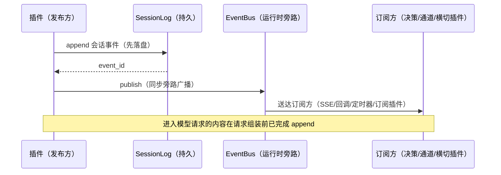

- **SessionLog**：会话事件域的持久载体，append-only；模型可见内容的
  落盘先于模型请求组装（FR-3.5 硬约束的时序保证）。
- **EventBus**：进程内同步旁路广播，不持久；性能指标与 SessionLog 提交指标分开观测。
- **路由规则**：会话事件 → SessionLog + EventBus；能力事件 / 运行时事件 →
  仅 EventBus（依据 02 §4.3 三域性质列：会话事件持久，运行时事件不持久）。
- **执行事件原子性**：`execution.*` 先由 Execution Ledger 在状态/进度记录事务中分配唯一 executionRevision 并写入待发布记录，提交后再投影到 SessionLog、ExecutionRegistry 和远程 Outbox；各投影保留原 eventId 与 executionRevision，不另造同义状态事件。进程在提交后、广播前崩溃时从待发布记录补发。
- **执行投影判序**：同 eventId 重复送达直接幂等返回；revision 小于当前值视为旧事件并忽略；revision 等于当前值但 eventId 或状态不同视为契约冲突，停止该 Execution 的自动投影并告警；revision 更大时才推进投影。
- **指标拆分**：EventBus 广播、SessionLog 提交和 Outbox 投递分别建立基线与 SLO，具体阈值由 Gate 0 性能基线确定。

---

## 9. 幂等体系

### 9.1 三层主幂等 + 开放平台附加键

| 层 | 键 | 机制 | 依据 |
| :-- | :-- | :-- | :-- |
| 输入幂等 | `input_id + 会话键` | 持久记录保存 requestFingerprint、状态与 resultRef；同指纹返回原结果，异指纹以 `idempotency_conflict` 拒绝 | FR-8.7 / 02 §5.6 |
| 恢复幂等 | `execution_id` | 执行层 CAS：`waiting_hitl` 或 `waiting_external` 以匹配的等待状态和身份恢复；其他状态不推进恢复 | FR-4.4 / 02 §5.3 |
| 动作收敛 | `actionsTaken` | 根据动作身份、参数和历史结果复用或继续收敛；新鲜读取及未决请求按各自规则判定 | FR-11.7 |
| （附加）回调幂等 | 回调 id | 第三方重发按回调 id 去重，跨重启有效 | FR-14.3 |
| （附加）委派幂等 | `delegation_id` | 重发不重复执行 | FR-15 |
| （附加）写入幂等 | `sourceEventId` | 同一来源事件的提取/写入不重复 | FR-9.9 / 02 §5.8 |
| （开放平台）控制操作幂等 | `tenantId + integrationId + idempotencyKey` | 请求指纹相同返回原 ControlOperation，指纹不同拒绝 | FR-21.6 / FR-21.7 |
| （开放平台）资源映射 | `tenantId + integrationId + resourceType + externalRef` | 定位三方同一资源；revision/If-Match 防并发覆盖 | FR-21.6 |

### 9.2 会话回收不清理幂等账本

会话运行时缓存与输入幂等记录使用不同生命周期；空闲回收不能删除仍处于重试窗口内的 inputId。

| 层 | 内容 | 回收时 |
| :-- | :-- | :-- |
| 会话运行时态 | scope 注册、LoopState 缓存、挂起清单投影缓存 | 释放 |
| InputIdempotencyLedger | `input_id + 会话键`、请求指纹、处理状态与结果引用 | **保留**，独立 TTL |

- TTL ≥ 客户端最大重试窗口（配置项，命名提案 `input-idempotency-ttl`，
  具体数值按宿主项目重试策略设定，不臆造）。
- 会话删除（用户请求/合规）时幂等账本随会话日志按保留策略清理
  （FR-10.3 已有语义，与回收区分）。

### 9.3 内部调度与外部副作用边界

副作用去重约束的是**逻辑动作**，不是基础设施尝试次数。一个逻辑动作生成一次稳定 actionId，内部账本、重试和外部调用始终复用该 id；重试不得生成新的业务动作。

只有外部系统按 actionId 幂等、结果可查询，或执行前存在可证明唯一的协调记录时，系统才可自动重试未知结果。结果可查询只先授权只读查询；只有权威查询确认原副作用未发生后才可重新授权副作用 Execute，查询未知或查询失败不得直接重放。外部 API 可能已成功但响应丢失，且无法确认结果时，执行记录为 `failed / outcome_unknown` 并停止不安全的自动重放；人工处置也必须沿用原 actionId。系统只陈述各边界的真实保证，不宣称端到端 exactly-once。

---

## 10. 事实源关系

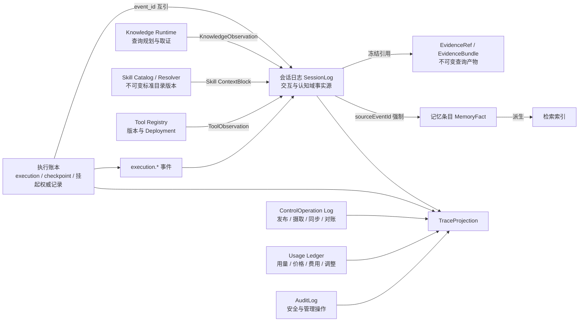

| 载体 | 权威域 | 规则 |
| :-- | :-- | :-- |
| 执行账本（执行插件私有） | 执行状态唯一权威 | checkpoint / 挂起记录；会话侧一切状态均为可重建投影（01 FR-13 / 02 §5.11） |
| 会话日志（SessionLog） | 交互与认知域事实源 | 模型可见 ⟺ 已记录（FR-3.5）；回放/审计/重试基于同一事实源 |
| EvidenceBundle / EvidenceRef | 已执行知识查询的不可变认知产物 | 必须绑定 SessionLog sourceEventId；不是 KnowledgeBase、MemoryFact 或新的机构知识事实源 |
| Skill Catalog / Resolver | 标准 Skill 包版本、目录 metadata 与文件摘要权威 | 不拥有执行状态或脚本权限；实际加载的 `SKILL.md`、资源摘要和注入内容以 AgentContextSnapshot/Loop checkpoint 为回放依据 |
| Tool Registry / Deployment | Tool 契约和 Provider 绑定权威 | 不拥有 Workflow 状态；每次调用事实进入 SessionLog、Action Ledger 与 Usage Ledger |
| 记忆条目（MemoryPlugin） | 从会话日志派生的只读事实 | `sourceEventId` 强制回溯（FR-9.6）；检索索引再从记忆派生（FR-9.15「宁可漏检，不可返回坏结果」） |
| ControlOperation Log | 非会话资源操作事实源 | 保存发布、摄取、同步、逐项结果和最终资源引用；不伪造 Session/inputId |
| Usage Ledger | 计量与费用唯一权威 | 每个外部 attempt 的用量来源、价格快照、币种、状态与调整只追加；不由执行终态反推 |
| TraceProjection | 端到端查询投影 | 只保存来源引用、排序和脱敏摘要；丢失后从 SessionLog、ControlOperation Log、Execution/Action Ledger、Usage Ledger 与 AuditLog 重建 |

**交叉引用**：`execution.*` 事件同时入 SessionLog（执行结果在会话时间线上的
呈现）；执行账本条目与会话事件以 `event_id + execution_revision` 互引，委派链经 `delegate_of`
在事件链上重建（02 §4.3）。


### 10.1 执行与持久化的最小权威模型

本节与 [02 §1.5](02-微内核插件架构实现思路.md#15-执行与持久化重构) 共同定义当前目标，不要求恢复每个内部调用，也不为审计重建完整会话。§5.2、§5.6.1–§5.6.2 与 §7.6、§8.2 中已标明的完整 Session checkpoint、准备/消费/提交票据、Action permit、独立 journal 和 publication/mutation 来源协议均为已替换设计；其中的归属、当前权限、预算和外部执行事实语义由本节承接。

唯一推进路径为 Core 的纯值路由 → Session [ExecutionCoordinator](../backend-java/agent-runtime-session/src/main/java/com/skillforge/runtime/session/ExecutionCoordinator.java) / [AgentExecutionProgram](../backend-java/agent-runtime-session/src/main/java/com/skillforge/runtime/session/AgentExecutionProgram.java) → [ExecutionStore](../backend-java/agent-runtime-session-spi/src/main/java/com/skillforge/runtime/session/spi/ExecutionStore.java) / [JdbcExecutionStore](../backend-java/agent-runtime-adapter-jdbc/src/main/java/com/skillforge/runtime/adapter/jdbc/execution/JdbcExecutionStore.java) 事务 → 本次 Registered 的 Provider 调用。实际协议材料由 [AgentExecutionCodec](../backend-java/agent-runtime-session/src/main/java/com/skillforge/runtime/session/AgentExecutionCodec.java) 和所属请求/结果 codec 唯一编码；[PortalOutcomeCodec](../backend-java/agent-runtime-codec-spi/src/main/java/com/skillforge/runtime/codec/spi/PortalOutcomeCodec.java) 保留强类型结果语义，不恢复旧 ActionCallCodec 来源校验。

| 数据 | 唯一责任 | 不再保存的重复内容 |
| :-- | :-- | :-- |
| Session | 会话归属、生命周期、消息顺序 | 整套执行状态 |
| Run | 当前状态、revision、取消、lease/fence、执行进度引用、必要到期时间 | 在完整 `record_data` 中再次复制这些可变字段 |
| Action | 逻辑动作、原决策/准备请求引用、冻结能力版本、选定结果引用及进度 | request/preparation 各保存整套来源证明 |
| Attempt | 一次派发的身份、派发状态、外部操作标识、实际结果引用、用量关联和采纳状态 | STARTED、permit、consume、RESULT journal 重复保存相同调用及结果 |
| 执行正文 | 实际请求与配置、必要上下文、原始结果及安全反馈 | 递归嵌入历史 Run 和 checkpoint；大正文使用不可变引用 |
| 业务事件 | 已提交的安全展示内容及投递位置 | 供每个内部阶段再次证明状态的 publication/mutation 全文 |

这是逻辑责任，不要求每项独立建表，也不建立万能操作表；能归入现有明确业务记录的字段直接合并。现有预算账本继续拥有预算余额和结算权威；Attempt 只关联预算事实及用量来源，不再自建另一套余额。实际请求、配置、上下文及必要结果正文使用不可变材料引用，大正文、图片和文件不递归嵌入 Run、checkpoint 或重复结果。固定字段使用具体 record、实体和封闭类型，不经过 `Map<String,Object>` 转换链；JSON 编解码集中在存储和协议边界。

多轮 Agent 的实际 MODEL 请求采用固定一层材料结构：manifest 保存有序消息引用、实际 tool-set 引用及该次冻结配置、媒体映射和输出约束；完整消息与工具集合分别按 schema 和规范正文摘要内容寻址，保存在原执行材料表。同一正文只保存一份，消息标识本身不能代替内容身份。根材料、依赖正文、Action/Attempt 与预算占用在原派发事务内一起保存并核验，同一引用异内容拒绝；不增加准备阶段或外部存储。单次 Workflow 请求可沿用完整内联编码。

活动调用直接使用 Prepared 携带的正文，恢复、Program RPC 与诊断按原租户和精确引用集合批读固定一层依赖，经同一 codec 重建完整 `FrozenModelRequest`。消息顺序、工具声明、媒体映射及原始协议字段必须完全一致，缺失或摘要不符时拒绝；重建后的完整请求仍受原总解析与模型输入预算限制。该结构不产生递归前缀链，不改变 UNKNOWN 与发送授权。未来清理执行材料时，必须保护仍被保留请求引用的正文闭包；本结构不自行定义或变更保留时限，也不授权删除执行账本。

输入受理在一个业务边界内确认归属、输入去重、保存输入、建立运行状态及必要配置引用。Session 层活跃执行消费该次提交返回的 Run 状态及版本继续推进；内存副本不取得持久化权威，冲突、接管和恢复重新加载已提交状态。

派发前在短事务中确认 Run 版本、fence、取消、当前执行权限、挂载及预算，保存准备请求引用，原子登记唯一 Attempt 派发权与预算占用；成功提交后退出事务并调用外部服务。已领取派发权不证明网络操作实际发生，恢复进程也不能据此再次获得同一调用权。准备与派发可在同一提交内完成，不为每个准备方法增加状态。

同一业务事务使用同一连接、同一 `SqlSession`，事务开始时绑定租户，事务内禁止切换租户，保留 RLS。预算准入和派发登记复用现有可参与调用方事务的预算接口，合并重复余额读取；同时涉及预算与运行状态时按“预算根 → Run → Action/Attempt”顺序加锁。纯取消只锁 Run，不反向获取预算锁。CAS、唯一键和必要行锁保障并发正确性，不以反复查询替代提交条件。外部调用、人工等待和大正文处理不得持有数据库事务。

| 可观察状态 | 后续行为 |
| :-- | :-- |
| 未越过派发边界 | 重新确认当前执行条件后允许派发 |
| 结果已保存 | 直接采用对应结果；重复结果或重复采纳不推进两次 |
| 可能已派发且结果未知 | 保持 UNKNOWN，不自动重发。已有 Provider 明确支持原操作查询或幂等键时使用其能力，不新增通用查询恢复框架 |
| 等待用户 | 仅保存实际所需的等待身份、版本和关联；准确响应且当前允许时推进一次 |
| 已取消或终结 | 阻止新动作，仍可保存原 Attempt 的迟到结果与用量 |

UNKNOWN 后收到准确的迟到结果可以补充该 Attempt 的事实；不得以新请求成功代替旧结果，也不丢弃曾发生的未知状态。保存必要状态及结果关联即可，不要求为每个内部变更建设可重放事件日志。已有选定结果不被重复或迟到冲突结果覆盖。

结果提交保存实际结果和实际用量；转换较轻时，结果保存、预算结算、Action/Run 推进、安全会话内容及必要公开事件追加同事务完成。只有图片准备等较长计算或外部处理才先保存原结果，再做处理与采纳，不为每种结果默认增加阶段。采用结果、更新进度和写入公开事件原子提交。失败只恢复这个未完成步骤，不重新读取全部历史证明。新派发与取消竞争由同一 Run 版本/锁边界裁定；取消或结束停止后续派发，保留在途结果及必要结算，终态不能被迟到结果重新打开。

模型公开过程的开始来源与真实 MODEL 派发登记同事务保存，表示该 Action 的调用已登记，不证明网络已送达、首 token 已到达或生成成功；结果过程终态继续与实际结果及采纳同事务保存。产品沿用稳定 `process_id`、`type=reasoning` 和 `process.started/process.finished`，成功、失败与结果未知按真实结果区分。仅重复报告私有推理、工具参数或用量分片计数而没有新公开内容的内部进展，不建立独立提交、恢复节点或公开 delta。真实模型流仍连续消费；首 token 与供应商计量来自实际流及审计回调，不能用派发时刻代替。私有 reasoning 与原生工具参数不提前公开，NativeConversation 的最终正文仍在完整校验后随 Run 终结提交；宿主 `message.preview` 可提前展示同次真实调用经累计安全过滤的正文候选（包括工具前 commentary），但不公开 reasoning 或工具参数、不新增模型请求、不改动聚合结果与 UNKNOWN。预览只冻结在产品 Outbox，由 session sequence 重连；同一 attempt 内累计快照替换，不同 attempt 按 ordinal 与 attemptId 整体替换。正式终态消息身份和版本不变，通过 `preview_message_id` 关联并替换候选，`execution.completed` 关闭该 Run 的预览且迟到预览不得复活；失败、取消、未知及安全拒绝不把部分文本晋升为正式结果。预览写入不可用时停止该调用后续预览并记录脱敏诊断，不覆盖真实模型结果或授予重发权；宿主预览在当前调用线程按显式 Duration（生产默认 100ms）与单调时间合并，首片立即检查并发布，后续披露点对累计全文执行原安全检查，模型成功后仅补待发布安全前缀且不释放安全尾部，补发故障也不能覆盖真实成功结果。该合并不新增线程、调度队列或模型请求，正式终态不节流；其他模型格式已经允许的真实公开正文增量继续遵循其安全检查、持久游标和流式契约。

重复输入、结果和等待响应按业务身份及唯一约束处理；人工等待保存等待身份、版本和关联，准确响应通过当前权限检查后只推进一次。仅确需重复返回原响应的控制操作保存精简回执。普通内部方法不分配操作号、独立回执或恢复节点。审计复用该业务边界已经取得的身份、目标、判定和结果引用，不为审计额外查询身份、重建会话或记录内部成功证明。原始结果不得直接进入公开事件；安全过滤边界保留，但不为过滤过程复制执行账本。

新路径只保存当前业务所需的执行进度与结果，不新增任意步骤回滚、全历史分叉、跨版本恢复或自动补偿体系。当前历史事实的保留与退役另按清理规范处理；不兼容旧执行格式不等于允许抹除事实。

---

## 附录 A：命名对照

> 概念层使用 snake_case 贴近事件和配置契约，Java 草案使用 camelCase；序列化映射必须显式测试。

| 概念层（snake_case） | Java（camelCase） |
| :-- | :-- |
| `execution_unit_id` | `executionUnitId` |
| `definition_version` | `definitionVersion` |
| `mode` | `mode`（ExecutionMode） |
| `evidence_refs` | `evidenceRefs` |
| `agent_id` | `agentId` |
| `end_user_id` | `userId`（Java 历史组件名） |
| `input_id` | `inputId` |
| `root_input_id` | `rootInputId` |
| `execution_revision` | `executionRevision` |
| `trace_id` | `traceId` |
| `span_id` | `spanId` |
| `caused_by_event_id` | `causedByEventId` |
| `invocation_id` | `invocationId` |
| `attempt_id` | `attemptId` |
| `export_fields` | `exportFields` |
| `supports_hitl` | `supportsHitl` |
| `timeout_ms` | `timeoutMs` |
| `concurrency_safe` | `concurrencySafe` |
| `delegation_id` | `delegationId` |
| `target_agent_handle` | `targetAgentHandle` |
| `target_agent_id` | `targetAgentId` |
| `parent_agent_run_id` | `parentAgentRunId` |
| `child_agent_run_id` | `childAgentRunId` |
| `context_refs` | `contextRefs`（ContextRef 列表） |
| `delegation_budget` | `budget`（DelegationBudget） |
| `delegation_path` | `delegationPath`（包含 DelegationHop 列表的类型化路径） |
| 事件载荷键 `session_id` / `execution_id` / `status` | 保持 snake_case（FR-3.1 复用既有命名，不新造键） |

---

*文档结束*
