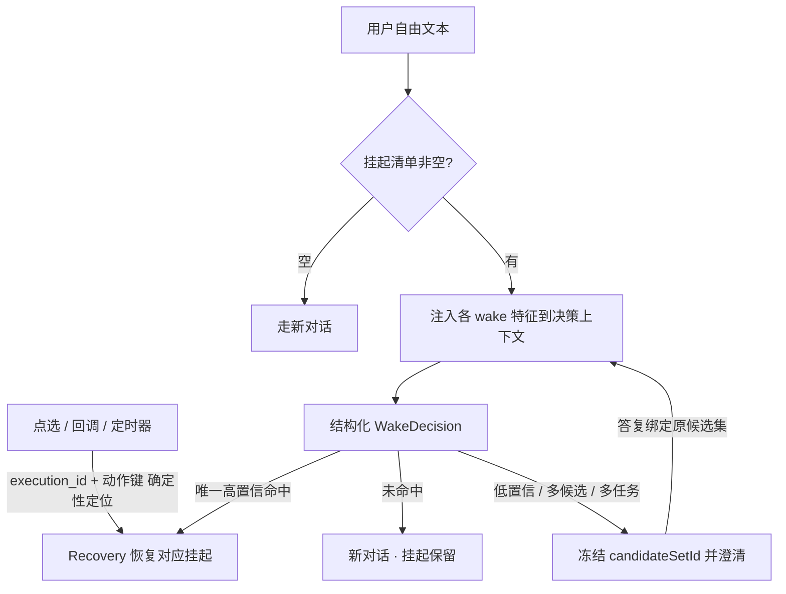
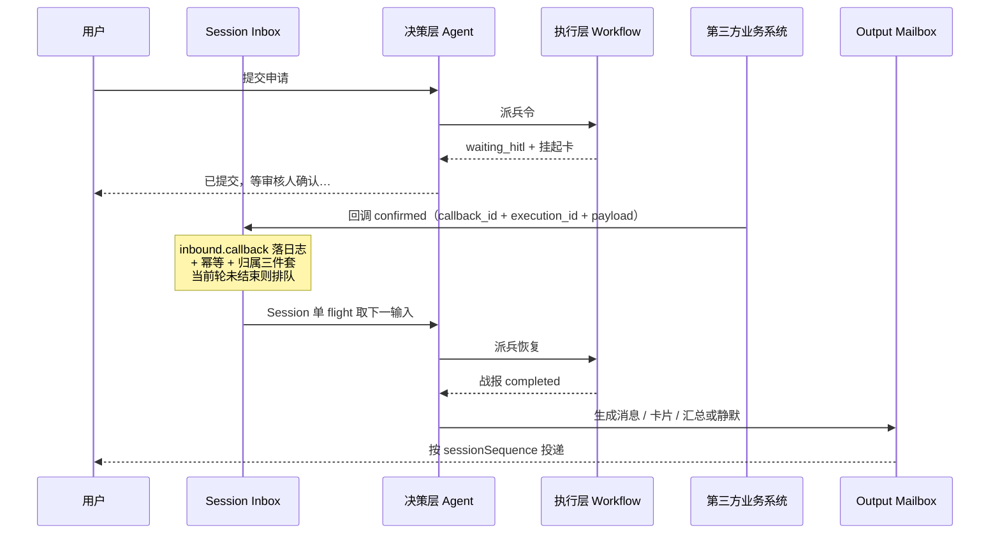
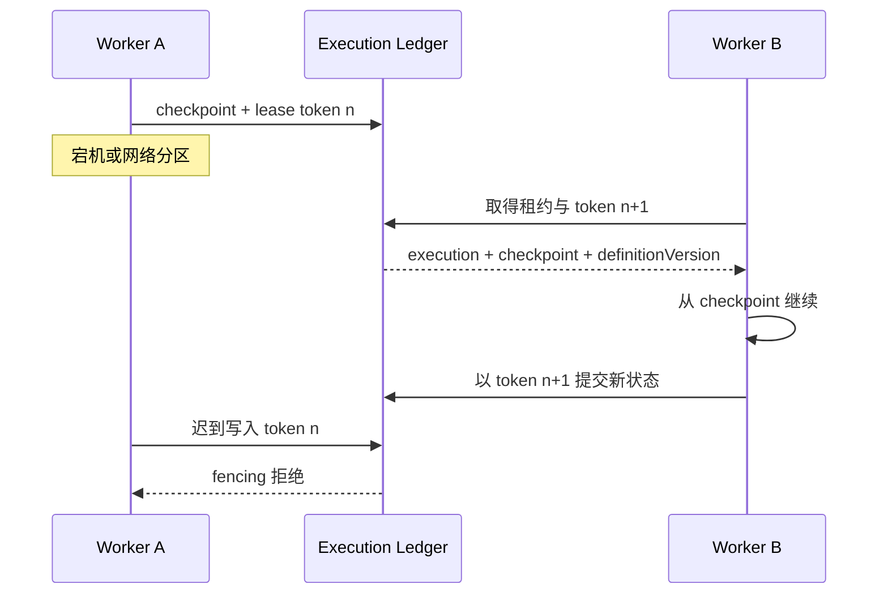

# Agent-Workflow 协作引擎：后续阶段需求扩展（P1/P2）

> 本文定义 P1/P2 的需求和验收标准：FR-9、FR-10、FR-12 至 FR-16、FR-19 至 FR-23。
> MVP-0 的概念和需求见 [01-MVP-0 需求分析](01-Agent-Workflow协作引擎-MVP需求分析.md)。
> 对象模型和状态机见 [03-核心对象模型与状态机](03-核心对象模型与状态机.md)。

---

## 1. 定位与分期

### 1.1 本文件范围

| 阶段 | 能力 | FR |
| :-- | :-- | :-- |
| P1 | 会话生命周期治理 | FR-10 |
| P1 | 记忆产品增强 | FR-9（基于 MVP-0 MemoryPort，机制细节见 02 §5.8） |
| P1 | 多任务语义唤醒与交互产品化 | FR-12（基于 MVP-0 Multi-Execution Runtime） |
| P1 | 第三方业务回环产品化 | FR-14（基于 MVP-0 TriggerPort 与 Unified Inbound） |
| P1 | Knowledge Runtime 产品化 | FR-19（基于 MVP-0 FR-7 知识模式与证据契约） |
| P1 | 端到端轨迹与费用归因产品化 | FR-20（基于 MVP-0 TraceContext、外部调用守卫与 Usage Ledger） |
| P1 | Tenant Open Platform | FR-21（基于管理 API、Unified Inbound、Session Outbox 与知识治理链） |
| P1 | 前端能力体系与 Workflow Builder 基础闭环 | FR-22（基于版本化资源 API、Workflow schema 与隔离测试 Session） |
| P1 | 会话日志回放（NFR-7 完整版） | —（验收见 01 §5 NFR-7） |
| P1 | 基础 Handoff 与计费分析 | 宿主产品工作；只消费受控任务、Usage 和版本化资源 |
| P2 | 任意节点中断续跑与分布式执行韧性 | FR-13 |
| P2 | Agent 委派 | FR-15 |
| P2 | Todo 任务清单 | FR-16 |
| P2 | Session 派生（Fork） | FR-23 |
| P2 | 高级记忆（冲突/衰减/审核/元认知） | FR-9 其余 |
| P2 | Marketplace 供应链和企业合规 | 宿主产品工作；不得扩展运行时能力类型 |

### 1.2 与 MVP-0 的依赖

- 全部 FR 依赖 01 的 MVP-0 基础：执行契约、Scope/Preset、统一恢复、能力挂载、会话与消息入口、决策循环、Stateful Agent Runtime（FR-17）和 Multi-Execution Session Runtime（FR-18）。
- P1 只增加业务 schema、策略、运营配置和增强算法，不重新定义 Session/Execution 生命周期，也不新增绕过 Unified Inbound、PolicyChain 或 WorkflowPortal 的路径。
- P1 的 Knowledge Runtime 只深化查询规划、来源/算子与写回提案处理，不改变 Agent 的唯一决策权，也不允许 Workflow 绕过显式 KnowledgeQueryNode。
- P1 的 TraceProjection 只组合 SessionLog、ControlOperation Log、Execution/Action Ledger、Usage Ledger 和 AuditLog，不合并权威存储；OpenTelemetry 仍是可采样导出而非审计事实源。
- P1 的开放平台把资源控制、知识内容、会话运行和事件交互分面授权；资源维护不伪装成 Session Inbound，会话交互不建立 Workflow 直连入口。
- P1 的前端与 Builder 只生产版本化资源或消费受控 Session/Execution/Trace 投影；保存草稿、服务端校验、发布版本和隔离测试互不伪装，Builder 不建立 Workflow run/resume 入口。
- P1/P2 产品运营能力只生产版本化资源或消费 Session/Execution/Usage/Audit 的受控投影，不调用底层引擎、Connector 或 Provider；P3 动态插件与生态市场另行立项。
- 对象模型 / 状态机 / record 唯一家在 03；本文只引用，不重复定义。

---

## 2. P1 需求

### FR-9 记忆产品增强（P1）

> 记忆分层、记忆条目结构（MemoryFact）、类型注册表、两阶段提交提取、
> 分层检索与轨迹、六态状态机、来源强制、用进废退、去重三级等机制的
> **完整定义在 [02 §5.8](02-微内核插件架构实现思路.md)**。
> 状态机唯一家在 [03 §6.4](03-核心对象模型与状态机.md)。
> 本节只保留需求基线级的验收标准。

**描述**：在 MVP-0 MemoryPort、SessionLog、ContextPipeline 和作用域隔离基础上，补齐结构化提取、检索、冲突消解、衰减、审核和元认知工具。MemoryPort 的持久归属包括 `SESSION`、`USER_AGENT`、`USER`、`GROUP` 与 `GROUP_MEMBER`；工作记忆由 LoopState/AgentContextSnapshot 承载，短期和中期是可重建视图。记忆只经决策层消费，Workflow 不读写关系状态或记忆。归属、访问权限和来源身份分开：`USER` 表示租户内用户级归属，不表示任何助手默认可读可写。

**记忆分层**：

| 产品概念 | 实现 | 作用域 |
| :-- | :-- | :-- |
| 工作记忆 | LoopState + 不可变 AgentContextSnapshot | 当前 input / loop |
| 短期记忆 | SessionLog 近期事件视图 | 当前 Session 最近窗口 |
| 会话记忆 | SESSION MemoryFact + 会话摘要投影 | tenant + session；来源身份另行保存 |
| 中期记忆 | RECENT_EPISODIC 查询配置 | 同一 user + agent 的近期跨会话情节；不新增任务/项目级 scope |
| 关系级长期记忆 | USER_AGENT MemoryFact | tenant + user + agent；专属偏好与需隔离的长期业务事实 |
| 用户级长期偏好 | USER MemoryFact | tenant + user；类型策略允许且适用范围明确的人级偏好 |
| 群公共与成员记忆 | GROUP / GROUP_MEMBER MemoryFact | tenant + group binding；成员事实另绑定被描述用户，访问者权限独立校验 |
| Workflow 状态 | Execution Ledger / checkpoint | 单个 executionId；不属于记忆 |

**验收标准**：

- FR-9.1 多层记忆产品化：ContextPipeline 统一装配工作上下文、短期视图、会话事实、中期情节、关系级长期事实和获授权的用户级偏好，但不合并权威存储；MemoryPort 按实际归属接受 `SESSION`、`USER_AGENT`、`USER`、`GROUP` 和 `GROUP_MEMBER` scope，各层遵循类型、预算与保留策略。治理页区分用户级记录与当前助手级记录，并遵循各自读/写权限。
- FR-9.2 记忆只经决策层消费：决策前经 ContextPipeline 向记忆插件检索；Workflow 不获得会话历史、MemoryPort 或关系状态，战报只按能力声明 `export_fields` 导出 data。
- FR-9.3 记忆变更即会话事件：写入的记忆（提取的事实、更新的画像）作为会话
  事件落日志，回放一致（FR-3.5）。
- FR-9.4 记忆与模型可见一致：进入 prompt 的记忆片段可从会话日志重建。
  未记录的记忆不得进模型请求。
- FR-9.5 SESSION 事实按 tenant+session 归属，USER_AGENT 按 tenant+user+agent 归属，USER 按 tenant+user 归属；GROUP 按 tenant+group binding 归属，GROUP_MEMBER 另绑定被描述成员。来源用户与 Agent 和当前访问者权限独立保存与校验，不由 SESSION 归属补造 Agent，也不因群成员被描述而授予其访问权。USER 的跨助手可见性由访问策略授予，不等于默认全局注入；缺少 Agent 的 USER_AGENT 不能解释为 USER。
- FR-9.6 **记忆条目结构化**：每条事实包含显式身份与 scope、类型/schema/保留类别、主体-谓词-结构化客体、sourceEventIds、来源 Session、可选 sourceExecutionId/exportPath、revision、双时态、治理状态和演进引用；进入 prompt 的事实可回溯到来源事件。USER 事实的来源仍保留写入时的原始 agent 与 session，不随用户级归属丢弃。
- FR-9.7 **冲突消解**：新旧事实冲突时旧事实保留不物理删除（降置信度、
  转待确认、`superseded_by` 指向新事实、置失效时间），回放与审计可见画像演进。
  三层检测机制（显式关联 / 否定互斥 / 去重兜底）见 02 §5.8。
- FR-9.8 **记忆时效与用进废退**：事实采用双时态，失效事实不进检索；候选、选中、注入和明确引用分别记录，衰减统计由使用事件投影生成，不以一次读取计数声称模型已使用；再次明确陈述可按类型策略复活，高敏冻结类别可豁免。`USER` 同样适用修订与失效，人级不等于永久有效。
- FR-9.9 **写入时机与白名单**：提取器只消费已提交 SessionLog 事件；工具结果与 BattleReport.data 仅按 export_fields 白名单先落 Observation，再成为候选。任务幂等键包含 sourceEventId、extractorVersion、memoryType 与 canonicalFactKey。
- FR-9.10 **检索协议**：MemoryQuery 携带当前意图、允许 scope/type、asOf、相关性阈值、条数/token/字符预算和来源要求；检索为空不阻断决策，candidate/selected/injected/referenced 轨迹入日志。查询中的 agent 是当前访问者，不是 USER 事实的归属字段。
- FR-9.11 **记忆类型注册表与提取策略**：记忆按类型 schema 注册
  （如 profile / preferences / entities / events），每类型可独立启停、可声明
  **强制审核**（高敏类别）与**重要性默认值**；提取只产生策略白名单内的类型，
  会话级策略可覆盖（如禁用某类型提取）。
- FR-9.12 **提交-提取-路由流程**：Phase 1 与 SessionLog 批次提交原子登记持久提取任务并返回任务 id；Phase 2 从持久队列水合白名单 Observation、提取候选并逐条路由 SESSION/USER_AGENT/USER。目标身份必须来自来源事件，崩溃与重复领取不重复写入。写入 USER 须同时满足类型注册表允许该 type 进入 USER、用户表达的适用范围支持用户级、满足保存条件、且当前访问者具有 USER 写权限。`explicit_save` 与 `repeated_confirmed` 只证明可否写成稳定记忆，不单独决定 scope，也不构成跨助手共享授权；重复确认不得扩大原始表达的适用范围。缺少独立可信共享依据的自动 USER 提议保留为 `reviewRequired=true + PENDING_CONFIRM`，不自动激活或复用 ACTIVE USER；提取身份不能取代或迁移 USER 状态。治理审核须由获授权操作者核对来源及内容，按事实 id、expectedRevision 显式确认 `confirmed_scope=USER` 后激活，恢复或纠正不能绕过此确认；拒绝无需确认范围。来源、权限和审核边界见 [Harness 02 §5.8](02-微内核插件架构实现思路.md#58-记忆协议类型--提取--路由--检索--更新--过期)。
- FR-9.13 **检索分层加载与轨迹**：检索结果按需取层——摘要（快速判相关）→
  概览（规划）→ 详情（仅需要时读全文），降低 token 消耗；每次检索保留轨迹
  （查询 → 定位 → 命中路径），结果可疑时可按轨迹调试，回放可见检索过程。
- FR-9.14 **上下文使用记录**：决策层分别记录候选、选中、实际注入、明确引用、能力调用结果和成败；回放能区分“被召回”“进入模型”和“后续被引用”，使用统计不直接改写 MemoryFact。
- FR-9.15 **事实源与索引分离**：会话日志与记忆条目是唯一事实源，检索索引是
  派生的（可从源重建）；索引与源不一致以源为准——宁可漏检，不可返回坏结果。
  清理 / 删除先删索引后删源（与 FR-10.3 一致，源保留可重建）。
- FR-9.16 **事实状态机与来源强制**：事实六态——有效（注入）/ 衰减（用进废退
  自动，可自动复活）/ 待确认（不注入，含冲突降权与强制审核）/ 拒绝（软保留）/
  遗忘（显式，仅人工恢复）/ 归档；冲突降权后的旧事实即落待确认态，
  `superseded_by` 指向新事实（旧事实保留不物理删除，回放与审计可见画像演进）。
  来源强制：高敏类别无论蒸馏还是工具写入一律落待确认 + 人工审核
  （LLM 推断禁止直接写高敏记忆——落审核而非拒绝，数据不丢可审计）。
  审核动作（通过 / 拒绝 / 恢复 / 归档）全量入审计。
- FR-9.17 **注入预算与去重降级**：注入按条数上限 + 字符预算截断（超限截断附注）。
  去重三级：精确去重（同键唯一约束）→ 语义去重（向量相似度 ≥ 阈值，合并取最高
  置信度、不新增行不改写内容——原始记录不可改写）→ 语义不可用降级关键词
  （防有数据查不到的静默空返回）；并发竞态撞唯一约束时重查合并，不丢数据。
- FR-9.18 **元认知工具**：平台内置保存、召回、更新和遗忘工具；工具写入与自动提取共用 schema、幂等、去重、冲突和来源强制链路，显式保存提高候选优先级但不绕过敏感审核，也不单独授予 USER 写入或跨助手共享。
- FR-9.19 **注入顺序**：硬性事实置于上下文最末尾（利用近因偏差压制幻觉）：
  角色指令 → 工作上下文/近期对话/任务 → 知识 → 关系/画像 → 事实（最末尾，最高遵从）。
  注入内容满足模型可见 ⟺ 已记录（FR-9.4）。对同一可选偏好、适用条件重叠、有效且可信度满足要求的值，默认解析为：当前明确请求 > 当前 SESSION 约定 > USER_AGENT 专属偏好 > USER 通用偏好 > 助手默认表现；该顺序不能覆盖系统约束、工具权限或安全要求，推断偏好不得仅凭更细 scope 压过用户明确保存的设置。覆盖只影响本次采用值，普通查询不得改写或失效用户级事实。
- FR-9.20 **工作记忆与回放**：LoopState 保存当前决策轮运行状态，每次模型调用前冻结带来源、scope、信任级别、顺序和 token 成本的 AgentContextSnapshot；轮次结束后不自动转为 MemoryFact，历史回放不重新检索。
- FR-9.21 **短期视图与摘要**：近期对话按 SessionLog sessionSequence 先取最新窗口再恢复正序，缓存必须可回源；SessionSummaryProjection 标注覆盖区间、来源和版本，不删除或替代原日志。
- FR-9.22 **中期情节视图**：RECENT_EPISODIC 只查询 USER_AGENT/episodic 事实并叠加时间窗与快速衰减；它不是新存储或 scope，窗口外事实可保留审计但不进入该视图。中期继续使用 USER_AGENT，是因为产品把它定义为同一用户与同一助手近期一起做过的事，不为本次需求引入任务级或项目级作用域。
- FR-9.23 **类型化晋升**：普通情节默认停留在会话或中期视图；只有类型注册表允许且满足明确陈述、重复确认、显式保存等信号的候选可生成稳定长期事实。人级且适用范围明确者可进 USER，其余长期仍进 USER_AGENT；不得仅凭“看起来是人属性”自动全局化，也不得把“只告诉你、不要让其他助手知道”写入 USER。Session 结束不得把完整摘要自动晋升，晋升使用 derivedFrom/supersededBy 保留链路。历史 USER_AGENT 事实默认保留，不得批量去掉归属 agent；确需迁移的通用偏好依据原始证据生成 USER 事实并保留演进链路。
- FR-9.24 **归属、访问与来源分离**：按记忆 scope 判断归属和访问权限，按原始来源身份验证来源。读取共享 USER 事实不授予读取原始会话全文或其他 USER_AGENT 记忆的权限。读 USER 与写 USER 必须独立授权。最小可交付切片为：助手 A 明确保存一条允许共享的用户偏好，助手 B 按权限读取并采用，同时不泄露助手 A 的其他记忆或原始会话。作用域设计不能单独解释“已落库但助手声称不能保存”；须分别验证是否成功保存、保存在哪个范围、以及本次回答是否准确反映结果。记住界面偏好不等于已经修改实际界面设置。

### FR-10 会话生命周期与数据治理（P1）

**描述**：会话超时 / 空闲回收 / 关闭 / 删除的完整生命周期，与执行层生命周期解耦。

**验收标准**：

- FR-10.1 空闲会话超时回收：空闲阈值可配置；回收释放 agent 层 scope 注册
  （disposer）与会话运行时缓存（LoopState / 挂起清单投影缓存）。
  输入幂等账本（InputIdempotencyLedger）独立保留、不随回收清除（独立 TTL，
  见 [03-核心对象模型与状态机](03-核心对象模型与状态机.md) §9.2）。
- FR-10.2 回收不丢恢复点：挂起中的会话被回收后，恢复点仍留在执行层账本
  （01 §4 FR-4.1），恢复通道可重新拉起，无需重建整个会话。
- FR-10.3 会话删除（用户请求 / 合规）：会话日志按保留策略清理；删除动作本身
  记录为审计事件；删除后该会话回放受限（有明确记录）。
- FR-10.4 回收 / 删除不追溯销毁已完成的执行：执行是独立生命周期。
  除非合规明确要求，会话删除不影响执行历史。
- FR-10.5 孤儿执行处置：会话删除时仍处于 `waiting_hitl` 的执行须有明确终态
  策略——取消（cancel，回调/定时器后续到达按无归属拒绝并审计，FR-14.2）
  或移交（detach，挂起清单投影从账本重建后可转人工处置）；禁止无策略的
  永久等待（对象模型见 [03-核心对象模型与状态机](03-核心对象模型与状态机.md) §6.2）。

### FR-12 多任务语义唤醒与交互产品化（P1）

**描述**：MVP-0 已支持多 Execution、多挂起、确定性恢复、自由文本候选判断和歧义澄清；P1 在此基础上提供可配置唤醒特征、任务运营视图、面向用户的任务指代和更精细的语义评估。挂起清单仍是 Execution Ledger 的认知投影。

**挂起条目**（Execution Ledger 的 PendingEntry 投影，不属于 MemoryFact）：

| 字段 | 说明 |
| :-- | :-- |
| `execution_id` | 执行标识（权威键：恢复永远以它为准，FR-4.4） |
| `workflow_id` | 挂起的执行单元 |
| `display_name` / `wait_summary` | 用户可区分的任务名称与等待事项，不暴露内部节点状态 |
| `actions` | 允许动作的 actionKey、标签与输入 schema |
| `wake` | 版本化唤醒特征：摘要、关键词、实体键、示例表达与节点类型 |
| `expires_at` | 超时时间（源自战报 `pending.timeout_seconds` 换算） |
| `status` | `waiting_hitl` / `resuming` / `cancelled` / `timed_out` |
| `execution_revision` | 投影判序版本；旧事件不得覆盖新状态 |

**唤醒路由**（按通道分类）：

| 通道 | 路由方式 |
| :-- | :-- |
| 点选 / 外部回调 / 定时超时 | 确定性通道：按 `execution_id` + 动作键进入 Recovery，不经 LLM 判定或绕过 Session Inbox |
| 用户自由文本 | 候选生成 + 结构化 WakeDecision；唯一高置信时最多恢复一个，否则普通对话或稳定澄清 |

**唤醒路由示意**：

**验收标准**：

- FR-12.1 任务视图展示一个 Session 下全部活动与挂起 Execution，并提供用户可区分的任务名称、状态、等待事项和下一步动作。
- FR-12.2 唤醒特征可按 Workflow 或业务场景配置、版本化和离线评估；未命中时保留任务，不得默认恢复“最新”任务。
- FR-12.3 产品生成的点选、回调和定时动作必须携带 executionId 与 actionKey，继续使用 MVP-0 确定性路由，不引入 LLM 旁路。
- FR-12.4 一条自由文本最多自动恢复一个 Execution；低置信、多候选或同时指向多个任务时列出用户可理解的候选，并以 candidateSetId 固定原集合，不因新后台事件改变序号和指代。
- FR-12.5 运营回放可查看候选生成、匹配分数或理由、最终选择和状态变化，同时对普通用户隐藏内部节点细节。
- FR-12.6 任务视图与 WakeIndex 均可从 Execution Ledger 与 SessionLog 重建；不得把挂起清单写为 MemoryFact，产品投影丢失不影响基础恢复。

### FR-14 第三方业务系统回环产品化（P1）

**描述**：MVP-0 已把回调标准化为 InboundEnvelope，并提供幂等、归属校验、确定性恢复和 TriggerPort；P1 增加业务回调注册、payload schema、签名策略、主动事件决策规则、通知配置和运营观测。回调在会话中呈现为业务事件而非用户消息，全程可回放。

- **入口触点**：第三方 → 系统，落 `inbound.callback` 会话事件（输入事件，
  记录回调 payload 快照 + 回调 id + 归属信息）。
- **出口触点**：执行层恢复后的 `execution.resumed` / `execution.completed` 号角事件。

**回环在会话中的三种载体**：

| 载体 | 形式 |
| :-- | :-- |
| 会话日志 | `inbound.callback` 持久事件：来源系统 + 回调 id（幂等键）+ `execution_id` + 动作键 + payload 快照；决策层引用前已在日志（FR-3.5 模型可见 ⟺ 已记录） |
| 挂起清单（PendingEntry） | 命中挂起 → 条目 `waiting_hitl → resuming`，恢复完成后清除 / 更新；权威仍在 Execution Ledger |
| 决策层 | Recovery 确定性判定（不匹配挂起 / 过期 / 会话已删除 → 拒绝 + 审计）→ 派兵恢复 → 战报 → 消息 / 卡片 / 汇总 / 静默策略 |

**回环分类**：

| 类型 | 触发 | 会话中形式 |
| :-- | :-- | :-- |
| 恢复型回环 | 回调对应既有挂起（归属三件套命中） | 恢复该执行；时间线上一次无用户输入的自动推进 |
| 主动型回环 | 回调无挂起对应（业务主动推送：订单变更 / 到账提醒） | 决策层判定：通知用户 / 启动新流程 / 忽略（判定入日志） |

**回环在会话中的时序示意**：

**验收标准**：

- FR-14.1 回环即事件：每次第三方回调以 `inbound.callback` 会话事件落日志
  （含 payload 快照与归属），回放可见完整回环链路。
- FR-14.2 归属三件套：派兵时注册回调 `execution_id + session_id + action_key`。
  回调到达按注册归属会话；无法归属（无注册 / 会话已删除）→ 拒绝并审计，
  不创建无归属会话（01 FR-8.1）。
- FR-14.3 回调幂等：第三方重发回调（at-least-once）按回调 id 去重，
  跨重启有效（FR-13.4）。
- FR-14.4 竞争处理：回调恢复与用户输入竞争时单 flight 串行 + 恢复幂等 CAS
  （FR-4.4），不重复执行。
- FR-14.5 主动型回环可决策：无挂起对应的回调由决策层判定（通知 / 新流程 /
  忽略），判定与结果入日志。
- FR-14.6 用户可见性受控：回环本身不是用户消息；决策层可把回环结果以
  消息 / 卡片 / 汇总告知用户或静默更新；可见输出写 Output Mailbox，在当前回复之后分配 sessionSequence，禁止回调直写 SSE。
- FR-14.7 回调先完成 callbackId 幂等、归属和 payload schema 校验，再作为 InboundEnvelope 写 Session Inbox；当前决策轮未结束时只排队，不打断正常回复或直调 Workflow。
- FR-14.8 回调 payload 和 Workflow 内部状态不能直接写记忆；只有 export_fields 白名单结果先落 SessionLog Observation，才可进入 FR-9 提取链。

### FR-19 Knowledge Runtime 产品化（P1）

**描述**：在 MVP-0 `NONE / GROUNDING / RESEARCH`、KnowledgeRequest、单查询 KnowledgePlan、EvidenceBundle/EvidenceRef 和守卫调用基础上，增加复杂企业知识任务需要的多源规划、链接追踪、证据评估和写回提案治理。Agent Runtime 继续拥有研究目标、总预算、继续/停止和最终回复决策；Knowledge Runtime 只负责证据计划与执行。图谱、GraphRAG、图抽取和图谱运营不属于本阶段或后续阶段。

**验收标准**：

- FR-19.1 Planner 可把复杂问题拆为有依赖的子查询，在 Agent 指定的来源、算子、时效和总预算内执行；Vector、Keyword、Link、Structured 可并行或级联，不能调用未挂载、越权或跨租户来源。
- FR-19.2 Source Provider 与 Operator 分离；新增 Wiki、远程搜索或结构化来源不修改 Agent Loop，所有来源统一返回 EvidenceItem 并保留 sourceId、版本、原始引用、信任级别和算子特有路径。
- FR-19.3 `GRAPH`、GraphRAG、图抽取和图谱运营不进入 Source/Operator 目录、产品页面、Marketplace 或阶段验收；历史类型、页面或代码存在不构成待实现范围。
- FR-19.4 Link Operator 只追踪允许域名和深度内的引用，遵守 Sandbox、robots/来源授权、超时和内容大小预算；每次展开形成独立 trace step，禁止无界爬取。
- FR-19.5 融合阶段对跨来源结果去重、重排并标记冲突，输出 `SUFFICIENT / PARTIAL / INSUFFICIENT`；充分性只是 Observation，不能替 Agent 决定继续、澄清、拒答或停止。
- FR-19.6 EvidenceBundle 在模型或 Workflow 可见前写为 SessionLog KnowledgeObservation；candidate、selected、injected、referenced 和 token/延迟成本可分别查询，历史回放不重新执行计划或来源调用。
- FR-19.7 Workflow 仅通过定义中声明的 KnowledgeQueryNode 调用 KnowledgePortal 或解析 EvidenceRef；节点输入输出 schema、来源、算子、预算和错误策略均在定义版本中固定，未声明调用和读取 SessionLog/MemoryPort 的尝试必须拒绝并审计。
- FR-19.8 EvidenceRef 在重启、Workflow 挂起恢复和回放时解析到相同 bundle 版本与 item 集；来源内容后续更新不得改变已冻结证据，引用失效时返回结构化不可用结果而非静默重查。
- FR-19.9 KnowledgeWriteProposal 只能指向 `MEMORY` 或 `INSTITUTIONAL_KNOWLEDGE`；前者进入 FR-9 schema/敏感性/冲突治理，后者进入机构知识抽取、审核和发布流程。Runtime 不得直接激活 MemoryFact 或写 KnowledgeBase。
- FR-19.10 写回候选必须引用已提交 EvidenceRef 或 export_fields 白名单 Observation；Prompt、未导出 Workflow 变量、原始第三方 payload 和无来源模型陈述不得成为候选。
- FR-19.11 运营轨迹可按 request/plan/step/source/operator 查看计划版本、候选与选中项、充分性、冲突、预算和失败原因，同时对普通用户隐藏内部查询与未授权来源。
- FR-19.12 来源失败按 KnowledgePlan 声明处理：可选来源降级并降低充分性，必需来源失败返回结构化错误；任何失败都不能触发未授权换源、直接写回或绕过 Agent 决策。

### FR-20 端到端轨迹与费用归因产品化（P1）

**描述**：在 MVP-0 已统一 TraceContext、ExternalInvocationGuard 和 Usage Ledger 的基础上，按 rootInputId 提供从原始提问到上下文、决策、知识/工具/Workflow、回调恢复、结果生成和 Outbox 投递的结构化轨迹，并对全部外部可计费调用提供可解释费用、未决项与追加对账。TraceProjection 是可重建查询视图，不是新的事实源。

**验收标准**：

- FR-20.1 每个 Inbound 拥有 inputId；原始问题创建 rootInputId，回调、恢复、定时器和后台完成产生新 inputId 与 W3C trace，但必须保留 rootInputId 和 causedByEventId，按根标识可查询完整因果图。
- FR-20.2 TraceView 按发生时间和因果关系组合 Inbound、AgentContextSnapshot、PolicyDecision、KnowledgeAction、Tool Action、DispatchOrder、ExecutionEvent、Observation、Outbox 与 DeliveryAttempt，并为每项返回来源域和 sourceEventId。
- FR-20.3 模型、Embedding、Rerank、Knowledge Source、Tool、Connector 和外部 Workflow 调用必须经 ExternalInvocationGuard；未经过守卫的底层客户端依赖由架构规则阻断。
- FR-20.4 UsageEvent 按 invocationId + attemptId 记录供应商、模型/服务、数量、token 明细、用量来源、状态与 providerRequestId；同一 attempt 重放不双计，可能单独收费的重试各自保留 attempt。
- FR-20.5 inputTokens 包含 cached/cache-write 子集，outputTokens 包含 reasoning 子集；聚合不重复计算。供应商未返回 usage 时只能记录 PROVIDER_REPORTED 之外的 ESTIMATED 或 UNKNOWN，估算携带 tokenizer/模型/估算器版本。
- FR-20.6 单价、价格来源和版本随 UsageEvent 冻结；金额使用高精度十进制，账单聚合时才按币种规则舍入。原币与结算币分别保存，换汇冻结汇率来源/版本，未转换币种不得直接求和。
- FR-20.7 超时、响应丢失或供应商账单未确认时状态为 UNRESOLVED；后续 reconciliation/adjustment 事件引用原 UsageEvent 追加修正，历史事件不覆盖，TraceView 同时展示已确认与未决费用。
- FR-20.8 TraceProjection 删除后可从其引用的权威域重建；OpenTelemetry 采样、导出失败或短期数据过期不影响回放、费用和 TraceView 结果。
- FR-20.9 Trace API 默认返回脱敏摘要、摘要哈希和来源引用，不返回凭证、完整敏感载荷、Workflow checkpoint、原始第三方 payload 或模型私有思维链/reasoning_content。
- FR-20.10 完整结构化视图只对本租户管理员/开发者开放；平台跨租户读取需要特权且写 AuditLog，普通用户不能借 trace 引用读取未授权证据、会话或执行内部状态。
- FR-20.11 UsageSummary 按 operation/provider/model/currency 聚合，并分别报告 provider-reported、estimated、unknown、unpriced、unresolved 和 adjustment；任何缺口都不能静默进入“已确认费用”。
- FR-20.12 从 TraceView 可定位最终 outputRef、Outbox 顺序和每次投递状态；后台结果晚于普通回复时仍沿原 rootInputId 展示，但不能改写既有 sessionSequence。

### FR-21 Tenant Open Platform（P1）

**描述**：向租户授权的第三方系统提供完整开放平台能力，使其能够通过版本化 API 维护 Agent、Workflow、知识、工具、Connector、渠道和治理配置，并代理终端用户创建 Session、提交全部交互、接收实时或异步结果。开放平台由资源控制面、知识内容面、会话运行面和事件面组成，共享 ServicePrincipal、租户隔离、审计、幂等、配额和计量，但不混用业务入口。

**验收标准**：

- FR-21.1 每个集成凭证映射到租户内 ServicePrincipal，并以独立 scope 授权资源读取、草稿修改、校验、发布、部署、知识写入、渠道管理、会话调用、事件订阅、轨迹和费用查询；请求正文中的 tenantId、内部 userId 和角色声明不参与授权。
- FR-21.2 资源控制、知识内容、会话运行和事件交互使用分离的 API 语义与配额；控制/内容请求不创建 Session 或 inputId，运行面 message/action/callback/command 全部转换为 InboundEnvelope。
- FR-21.3 Agent、Workflow、Skill、Tool、Persona 和 Policy 采用容器、草稿 revision、校验、不可变发布版本和 Deployment/挂载生命周期；修改已发布版本必须产生新草稿，ChannelBinding 只指向已部署 Agent 版本。
- FR-21.4 KnowledgeBase 内容按 externalDocumentId + sourceVersion 幂等摄取，异步任务显式呈现 accepted、processing、review_required、ready、published、failed；解析、切块、Embedding 和索引失败可逐项查询，active revision 只在发布时原子切换。
- FR-21.5 Agent 的知识绑定显式选择 FOLLOW_ACTIVE 或 PINNED_REVISION；前者只跟随已发布 active revision，后者固定版本。每次 EvidenceItem 仍冻结实际 sourceVersion，内容更新不改写历史 EvidenceRef。
- FR-21.6 所有可由三方维护的资源支持 integrationId + resourceType + externalRef 的租户内稳定映射；重复写入使用 Idempotency-Key + 请求指纹，资源并发更新使用 revision/If-Match，指纹冲突或过期 revision 返回稳定冲突。
- FR-21.7 长耗时发布、知识摄取、批量同步和期望状态对账返回 ControlOperation；三方可按 operationId 查询逐项结果、部分失败、重试安全性和最终资源引用，系统不以跨服务长事务承诺全有或全无。
- FR-21.8 创建 Session 时由凭证确定 tenant/integration，调用方必须显式传入属于当前租户的 `end_user_id`；externalUserRef 和 externalConversationRef 只用于审计、幂等与会话定位，不能解析、创建或覆盖内部终端用户。审计同时记录 ServicePrincipal 和 end user，三方不能覆盖 Session 固定的 Agent deployment 或内部身份。
- FR-21.9 全交互输入统一提交 message、action、callback 或 command；恢复动作携带 sessionId + executionId + actionKey 但仍先进 Session Inbox，开放 API 不暴露 Workflow run/resume 或 checkpoint 入口。
- FR-21.10 在线 SSE、出站 Webhook 和 cursor pull 消费同一 Session Outbox 投影；每条事件具有 eventId、sessionId、sessionSequence、causationInputId、rootInputId 和 eventVersion，断线、重投和传输切换不改变原顺序或生成第二份结果。
- FR-21.11 入站业务回调与出站事件订阅使用不同端点、凭证方向、签名和投递状态；入站事件完成 schema/归属/重放校验后进入 Inbound，出站事件按 eventId 至少一次投递并支持按 cursor 补偿。
- FR-21.12 Connector 密钥、Webhook secret 和渠道凭证只通过受管凭证引用绑定；资源响应、事件、TraceView 和审计摘要不返回明文凭证、未投影 checkpoint、完整敏感 payload 或模型私有思维链。
- FR-21.13 会话链路以 rootInputId 为业务根；Agent 发布、知识摄取和批量同步以 rootOperationId 为业务根，每个 ControlOperation 使用 operationId 定位。ExternalInvocation 与 UsageEvent 使用类型化 InvocationContext 关联其中一种，控制面不得伪造 inputId，费用可按 integration/resource/operation/session 聚合。
- FR-21.14 生成 OpenAPI、SDK 契约测试和版本发布说明必须覆盖四个入口面、scope、幂等、错误、分页/cursor、异步 Operation 与事件 schema；预发布阶段删除冲突旧端点，不建立新旧双轨语义。
- FR-21.15 Skill 管理接口接受目录或 ZIP，根目录必须包含符合 Agent Skills 规范的 `SKILL.md`，并校验 metadata、引用、文件类型、路径穿越、数量和解压预算；`scripts/`、`references/`、`assets/` 可随不可变版本发布，`ALWAYS/ON_DEMAND`、适用意图、冲突组、依赖能力和 token 估算作为宿主治理元数据。脚本只能经已授权 Tool/Runtime 执行，凭证和 Provider 配置不得进入包。
- FR-21.16 Tool 管理接口把 ToolDefinition/ToolVersion、ToolRegistry/ToolResolver 与 ToolDeployment 分开：版本声明 name/title/description、inputSchema、可选 outputSchema/icons/annotations，宿主另行保存风险、幂等和确认策略，Deployment 才引用受管 Connector 或 Provider；远程 annotations 不能授予权限，任何资源响应不得返回凭证明文。
- FR-21.17 Agent capability mount 必须引用已发布 CapabilityRef，并使用类型化挂载配置；绑定 Skill、Tool、Workflow 和 Knowledge Source 时统一校验租户、状态和版本，更新使用 revision/If-Match，不能以显示名称或自由 Map 建立绑定。
- FR-21.18 开放平台没有 Tool invoke、Workflow run/resume 或 Skill execute 端点；三方发起业务交互只能进入 Session Runtime，管理面不能绕过 Agent Runtime、PolicyChain、ExternalInvocationGuard 或 Execution Ledger。

### FR-22 前端能力体系与 Workflow Builder 产品化（P1/P2）

**描述**：P1 把双前端从历史 CRUD 页面收敛为六层产品信息架构，并交付 Workflow 的容器、草稿 revision、服务端校验、差异审阅、不可变发布与隔离测试 Session 基础闭环。后续画布与调试增强按实际业务缺口单独确定，不预设完整协作产品。现有页面、Controller、构建通过或旧 upload/dry-run 只能作为迁移起点，不能作为目标能力已交付证据。

**验收标准**：

- FR-22.1 Agent 挂载界面有且只有 `SKILL / TOOL / WORKFLOW / KNOWLEDGE_SOURCE`；Connector 只作为 ToolDeployment Provider，Memory、Persona、Channel、Builder、Trace 和 Billing 不伪装成 Capability；图谱相关入口不进入产品范围。
- FR-22.2 Workflow Builder 使用顶部版本栏、左侧节点目录、中央类型化画布、右侧检查器和底部 Problems/Validation/Diff/Test Trace 五区布局，支持基础编辑、问题定位与测试结果查看。
- FR-22.3 节点目录从同版本 Workflow schema 生成，只展示合法节点；必须支持 knowledge_query，不得展示或导入 http。ToolCallNode 与 KnowledgeQueryNode 只选择定义中声明的能力槽，不显示 Connector 凭证、Provider URL 或租户全局同名资源。
- FR-22.4 生命周期固定为容器→draft revision→If-Match 保存→服务端校验→能力槽解析→diff 审阅→不可变 DefinitionVersion 发布→可选安装/升级。保存草稿与发布分离，error 阻断发布但不丢弃合法草稿。
- FR-22.5 已发布版本只读，编辑时创建新草稿；布局与 viewport 保存为引用 draft revision 的 BuilderSnapshot，不属于运行定义，拖动节点不能修改已发布版本。
- FR-22.6 新建、草稿、已发布页面使用统一类型化路由上下文，不以 `create`、`new` 和空 ID 多套哨兵判断；新建态不请求空资源，revision 冲突不静默覆盖。
- FR-22.7 服务端问题返回稳定 code、severity、对象引用和字段路径；Problems 面板支持点击定位节点、边或字段。导入、连线和发布分别执行 schema、图结构、能力槽与策略校验。
- FR-22.8 Builder 测试创建隔离 Session，经 Unified Inbound、Agent Runtime、PolicyChain 与 WorkflowPortal 运行，并展示脱敏 Trace/Execution/Usage 投影；Builder/Open Platform 不提供 Workflow run/resume 或 checkpoint 读取。

  FR-22.8的窄P1显式固定测试来源，创建持久TestSession及私有不可变副本、安装和测试身份，普通资源API不得操作；通过可信宿主的授权初始Workflow意图运行唯一工作流，来源约束见[Action契约](03-核心对象模型与状态机.md#42-action基础行动与受控扩展)。使用真实有限预算与计量，仅允许TEST/READ_ONLY MCP及已授权冻结知识绑定，禁止长期memory；首批不支持script、async_task、parallel、subgraph、agentic。交互走正式chat与原Pending，UNKNOWN核对原回执，关闭必须沿正式取消收敛，不盲删运行资源。

- FR-22.9 Session 客户端按持久 Outbox 的 eventId、sessionSequence 和 cursor 消费；单个 execution 终态只更新该投影，不能默认终止同一 input、其它 Execution 或 Session。
- FR-22.10 P1 画布至少支持 undo/redo、复制粘贴、多选、重连、适配视口、问题徽标、键盘与 Pointer 操作、宽连线命中区和 reduced-motion。
- FR-22.11 机构端负责租户资源构建和运营，平台端负责跨租户审核、配额、账务与审计；跨租户查看产生 AuditLog，平台端不能取得 Connector 凭证、未投影 checkpoint 或租户内部可变草稿。
- FR-22.12 前端验收必须包含路由、组件、契约、可访问性和端到端证据；生产构建通过和纯函数单测不能单独证明 Builder 生命周期、能力隔离或 Multi-Execution 交互完成。

---

## 3. P2 需求

### FR-13 任意节点中断续跑与分布式执行韧性（P2）

**描述**：MVP-0 已支持从执行账本重建活动视图和恢复 HITL 挂起；P2 扩展到非挂起节点 checkpoint、跨实例执行租约、故障接管和决策轮中断续跑。执行账本仍是唯一权威，接管不得造成双执行或静默重放副作用。

**持久化载体**：

| 载体 | 内容 | 归属 |
| :-- | :-- | :-- |
| 执行账本（持久化） | 执行记录、检查点、挂起权威记录、执行租约和 fencing token | Workflow Runtime |
| 会话表（持久化） | 会话归属、Persona 版本和身份 | Session Runtime |
| 上下文快照（持久化） | input 级能力组合、实际 ContextBlock 与 handle 映射 | SessionLog |
| 输入幂等账本（持久化） | `input_id + 会话键` 已处理集合，独立 TTL、不随会话回收清除 | Session Runtime |
| 循环状态（持久化） | 决策轮暂停点、已执行动作、剩余预算和关联 Execution | Agent Decision Runtime |

**故障接管时序**：先完成 MVP-0 的注册表、Session 和活动执行投影重建，再扫描失效租约；新实例取得更高 fencing token 后，才能从 checkpoint 接管非挂起执行；旧实例的后续写入必须被账本拒绝。

**中断续跑语义**：

- HITL 挂起中崩溃：从挂起节点继续（已有语义，重启不影响）。
- 执行中崩溃（非挂起）：有检查点 → 从最近检查点续跑；无检查点但有幂等键 →
  幂等重跑；无法安全续跑 → 标 `failed` 可人工重试，**不静默重放**（防重复副作用）。
- 决策循环中断：从暂停点续跑；未持久化的中间轮不重放。
- 幂等保持：重复恢复 CAS 拒绝（FR-4.4）、重复输入去重（01 FR-8.7），
  跨重启依然成立。

**验收标准**：

- FR-13.1 非挂起执行按能力声明写入可验证 checkpoint；checkpoint 与执行定义版本、幂等键和账本 revision 绑定。
- FR-13.2 跨实例接管使用租约和 fencing token；网络分区恢复后旧持有者不能继续提交状态或副作用结果。
- FR-13.3 中断续跑：执行从检查点 / 挂起节点继续不重头；决策循环从暂停点续跑。
- FR-13.4 幂等保持：重启前后重复恢复 / 重复输入均被拒，不产生重复副作用。
- FR-13.5 无法安全续跑的执行标 `failed` 且可重试，不静默重放。

### FR-15 Agent 委派（P2）

本节保留需求编号，当前首期以 [Agent 原生委派与结构化计划](08-Agent委派与多智能体运行时.md#20-agent-原生委派与结构化计划首期基线)为准。旧方案中递归委派、模型指定子预算、子任务不建内部 Session 和父 Run 在所有委派启动后立即挂起的设想，不描述当前首期。以下是要求与待执行验收，不代表本版本已通过完整验收。

主 Agent 从获授权目录选择协作者，提交完成任务所需的指令；目标 Agent 使用自己的发布配置与能力执行。直接委派和通用计划的成员步骤复用同一执行与事实链。模型不填写租户、父子身份、模型配置、容量或 Token 预算；这些边界由宿主、冻结配置与既有运行预算治理。

- FR-15.1 **可见性**：只允许从父 Run 冻结范围内且当前仍获授权、可用的目标创建委派；无权、未配置或不可用时明确拒绝。
- FR-15.2 **叶子执行与防自委派**：当前子 Agent 不再向其他 Agent 委派；拒绝自身作为目标，不以多级递归、深度限制或环检测配置替代首期叶子边界。
- FR-15.3 **会话与用户边界**：子任务使用独立内部 `delegation:*` Session 和 child Run；子 Agent 不直接消费父产品会话的用户入口或向父用户 Outbox 发送最终答复。
- FR-15.4 **预算与计量**：委派命令和计划不允许模型指定子预算；目标 Agent 普通 Run 与平台既有限制继续生效，实际用量保持父子关联并按既有计量结算。
- FR-15.5 **等待与恢复**：默认直接委派持久等待子任务；`background=true` 允许父 Run 继续独立工作。显式等待和子任务结果按原身份恢复，等待时不占用执行线程。
- FR-15.6 **结果契约**：父 Run 只接收经授权的子任务状态、安全结果与成果引用；受理、等待、已知失败和未知结果分别表达，不伪造完成。
- FR-15.7 **来源与可追溯性**：委派记录关联原父 Run、目标、稳定子 Run 与状态变更；恢复和展示使用已提交事实，不依赖模型自报的子任务结果。
- FR-15.8 **调用面**：仅启用委派并满足当前授权的主 Agent 可创建成员任务；已有计划时新委派绑定 MEMBER 步骤，普通 PRIMARY 计划不依赖委派开关。
- FR-15.9 **隔离**：子 Agent 使用自己的配置及授权能力；父 Agent 私有人设、模型凭据和未授权记忆不因委派自动传递，群和个人身份按各自来源与访问策略校验。
- FR-15.10 **目标快照**：父 Run 的委派范围与子 Run 采用的发布配置和资源引用保持冻结；新 Run 才能采用新发布，执行和披露边界仍复核当前撤权。
- FR-15.11 **持久等待与结果回注**：等待绑定原父 Run、等待身份和委派集合；子任务状态满足条件后通过现有恢复责任推进原父 Run，不重派未知外部效果。
- FR-15.12 **取消与恢复**：取消绑定原操作身份；仅在子执行及其活动工作收敛后表达取消结果，外部效果未知时保留未知。恢复、迟到结果和重复操作不得重复执行。
- FR-15.13 **干净切换**：不引入旧委派 DTO、递归路径、双读双写或自动回填；保留事实和恢复责任不等于重放旧业务效果。
- FR-15.14 **子执行准入**：目标、稳定 child identity 和原任务关联按现有持久边界受理；准入失败不能伪造子 Run 成功，恢复不得重建身份或绕过当前授权。

### FR-16 Todo 任务清单（P2，计划的可勾选视图）

**描述**：本节保留原 FR-16 标题与锚点，现义为通用任务计划及其用户视图。复杂用户任务、Skill 驱动任务与多 Agent 协作共用原生 `plan` 动作和持久 `DagWork`；简单任务可直接完成。计划不依赖规划模式或委派开关，不再由 `Planner.plan()` 生成另一份模型维护的 Todo 清单。执行与恢复契约见 [08 §2.2](08-Agent委派与多智能体运行时.md#22-通用任务计划)，步骤状态见 [03 §6.5](03-核心对象模型与状态机.md#65-todoitem)。

**验收标准**：

- FR-16.1 **生成与准入**：通过 `plan.submit` 提交结构化业务步骤、执行者、依赖和声明产出。Skill 发布元数据可声明必须先计划；激活后在执行动作受理前强制检查，允许必要只读调查、澄清、计划操作与取消收尾。
- FR-16.2 **版本与事实**：计划具有稳定 `work_id/task_id`、计划版本与审批版本；持久保存准入身份、冻结输入、Action 归属及真实结果来源。步骤状态从执行事实投影，日志与持久状态支持回放和恢复。
- FR-16.3 **与执行联动**：PRIMARY 步骤共用原主 Run，单次只允许一个活动主步骤；MEMBER 步骤复用真实委派子 Run。主步骤完成需提交可见结论，涉及工具或外部操作时校验真实成功结果引用；成员终态不得由主 Agent 自报覆盖，未知结果保持待核实。
- FR-16.4 **展示**：所属用户轮次下显示任务计划卡及步骤详情，展示负责人、依赖、等待原因、结果和限制。完成数量以真实状态统计，直播与回放采用同一宿主投影，不推算完成百分比。
- FR-16.5 **审批与用户介入**：普通模式提交后自动推进；规划模式或明确要求审批时批准精确版本后执行，修订后重新批准且不扩张权限。首版提供查看、自然语言补充、批准和取消，不提供用户直接增删重排任务表或依赖图。控制绑定明确 `work_id`，针对步骤时同时绑定 `task_id`。
- FR-16.6 **依赖与恢复**：审批或指定依赖等待持久挂起原 Run，条件满足或确定无法满足时经既有 RECOVERY 链路恢复；拒绝主 Agent 等待只能由自身完成的后续步骤。单分支失败不阻塞无关分支，恢复不重做未知外部效果。
- FR-16.7 **修订与资源约束**：使用预期版本修订尚未准入步骤并说明原因；已准入步骤固定原定义和输入，改变目标须先取消收尾再创建关联替代步骤。计划项数和输入规模受契约限额约束；执行继续使用原 Run 与宿主治理，不增加任务子预算体系。
- FR-16.8 **委派与答复**：已有计划时新增委派必须关联 MEMBER 步骤；成员携带父计划步骤上下文，不为相同要求重复建立顶层计划。父 Agent 只消费已授权的成员执行与成果投影，最终核查、整合和公开答复仍由原主 Run 完成。

### FR-23 Session 派生（Fork，P2）

**描述**：宿主可以从一个已存在 Session 的某个已提交历史点派生新 Session，用于分支对话、测试回放和运营
排障。派生是 Agent Runtime SDK 的 Session 能力（[02 §1.4](02-微内核插件架构实现思路.md#14-agent-runtime-sdk-交付边界)、
[03 §7.5](03-核心对象模型与状态机.md#75-agent-runtime-sdk-façade)），不是产品聊天入口的默认行为。

- FR-23.1 **命令入口**：派生只能通过 `ForkSessionCommand` 经 Unified Inbound 的身份、幂等和审计管线提交。
  命令必须指定来源 `sessionId` 与已提交的来源 `sessionSequence`，新 Session identity 由 Runtime 预分配。
- FR-23.2 **继承边界**：派生 Session 只复制该 sequence 之前允许继承的 SessionLog 引用、Persona/Agent
  revision 与经 Policy 允许的上下文引用；不复制 PendingEntry、活动 Execution、LoopState、Workflow checkpoint、
  Delegation 状态、Outbox 投递状态或 lease。
- FR-23.3 **身份与隔离**：派生 Session 保持同一 tenant、agent 与 `end_user_id`，不能借派生跨租户或换用户。
  MemoryFact 与 RelationshipState 按各自 scope 规则读取，不因派生复制副本。
- FR-23.4 **lineage**：派生 Session 记录来源 Session、来源 sequence 与派生命令 inputId；来源 Session 的后续
  事件不自动进入派生 Session，两者互不影响 Outbox 顺序。
- FR-23.5 **可回放**：派生命令、继承范围与新 Session identity 进入 SessionLog；回放派生 Session 只读取继承
  引用，不重新执行来源 Session 的任何模型、Tool、Knowledge 或 Workflow 动作。
- FR-23.6 **阶段**：FR-23 随 P2 交付；MVP-0 M7 的首个 SDK API 基线不包含 `forkSession`，宿主不得以复制
  SessionLog 行的方式提前实现。

**验收**：并发对同一 sequence 派生得到不同 Session 且 lineage 正确；派生自含活动 Execution/PendingEntry 的
Session 时新 Session 没有任何活动执行或挂起；来源 Session 继续产生事件后派生 Session 内容不变；派生命令重放
与幂等冲突返回稳定结果。

---

## 4. 非功能需求（P1/P2 相关）

| 编号 | 类别 | 需求 | 阶段 |
| :-- | :-- | :-- | :-- |
| NFR-2 | 性能 | 事件载体分离：EventBus 旁路广播 <1ms；SessionLog 持久提交独立指标（定义在 01 §5，完整版随回放落地） | P1 |
| NFR-7 | 可回放 | 一次完整对话（含模型请求、工具调用、战报）可从会话日志无损重建；回放与实时渲染一致（展示投影纯函数）——**完整版** | P1 |
| NFR-8 | 组合一致性 | 每个 input 冻结能力组合；切换只影响后续 input，同一 Loop 不漂移，历史回放读取当时快照 | P1 |
| NFR-16 | 轨迹与费用完整性 | TraceProjection 可从权威域重建；用量、费用、缺口和调整可解释且不可通过零值或遥测采样掩盖 | P1 |

> 其余 NFR（设计一致性 / 安全 / 可观测 / 可演进 / 文档驱动）为全局性要求，唯一家在
> [01 §5](01-Agent-Workflow协作引擎-MVP需求分析.md)，不在此重复。

---

## 5. 分期映射总表

| 阶段 | 能力 | 需求 | 实现里程碑（02 §9） |
| :-- | :-- | :-- | :-- |
| P1 | 会话生命周期治理 | FR-10 | P1 产品化 |
| P1 | 记忆产品增强 | FR-9 | P1 产品化 |
| P1 | 多任务语义唤醒与交互 | FR-12 | P1 产品化 |
| P1 | 第三方业务回环产品化 | FR-14 | P1 产品化 |
| P1 | Knowledge Runtime 产品化 | FR-19 | P1 产品化 |
| P1 | 端到端轨迹与费用归因 | FR-20 | P1 产品化 |
| P1 | Tenant Open Platform | FR-21 | P1 产品化 |
| P1 | 前端能力体系与 Workflow Builder 基础闭环 | FR-22.1–FR-22.9、FR-22.11–FR-22.12 | P1 产品化 |
| P1 | 会话日志可视化回放 | — | P1 产品化 |
| P2 | 任意节点中断续跑与分布式韧性 | FR-13 | P2 高级执行 |
| P2 | Agent 委派 | FR-15 | P2 高级执行 |
| P2 | Todo 任务清单 | FR-16 | P2 高级执行 |
| P2 | Session 派生 | FR-23 | P2 高级执行 |
| P2 | 高级记忆 | FR-9 其余 | P2 高级执行 |

---

## 6. 验收总览（P1 / P2）

| 验收项 | 对应需求 | 方式 | 阶段 |
| :-- | :-- | :-- | :-- |
| 记忆只经决策层消费、执行层不碰 | FR-9.2 | 代码评审 + 契约测试 | P1 |
| 记忆变更可回放、进 prompt 的可重建 | FR-9.3 / FR-9.4 | 回放测试 | P1 |
| 空闲回收不丢挂起恢复点 | FR-10.2 | 集成测试（回收后恢复） | P1 |
| 会话删除记录审计、执行历史保留 | FR-10.3 / FR-10.4 | 集成测试 + 审计检查 | P1 |
| 进 prompt 的记忆可回溯到来源事件 | FR-9.6 / FR-9.4 | 回放测试 | P1 |
| 冲突更新保留旧版本（superseded） | FR-9.7 | 单测 | P1 |
| 过期事实不进检索 | FR-9.8 | 单测 | P1 |
| 提取只产生类型白名单内记忆 | FR-9.11 | 单测（策略矩阵） | P1 |
| 提交后异步提取、目标可观察才落位 | FR-9.12 | 集成测试 + 回放 | P1 |
| 检索分层加载、轨迹可调试 | FR-9.13 | 回放测试 + 性能基准 | P1 |
| 上下文使用记录可回放 | FR-9.14 | 回放测试 | P1 |
| 索引可从事实源重建 | FR-9.15 | 重建演练 + 单测 | P1 |
| 六态状态机迁移正确 | FR-9.16 | 单测（状态迁移矩阵） | P1 |
| 高敏类别强制审核、拒绝不丢数据 | FR-9.16 | 集成测试 | P1 |
| 注入条数 / 字符预算截断 | FR-9.17 | 单测 | P1 |
| 去重三级降级（精确→语义→关键词） | FR-9.17 | 集成测试（语义不可用） | P1 |
| 元认知工具与蒸馏同链路 | FR-9.18 | 契约测试 | P1 |
| 硬性事实在上下文最末尾 | FR-9.19 | 回放测试（prompt 组装断言） | P1 |
| 工作记忆按 loop 隔离且模型快照先落日志 | FR-9.20 | 双 Session 集成测试 + 回放 | P1 |
| 最近窗口正确、缓存可回源、摘要区间可追溯 | FR-9.21 | 缓存故障测试 + 顺序断言 | P1 |
| 中期情节是查询视图而非新 scope | FR-9.22 | 契约测试 + 时间窗测试 | P1 |
| 会话结束只按类型化策略晋升长期事实 | FR-9.23 | 提取策略矩阵 + 幂等测试 | P1 |
| 用户级归属、访问权限与来源身份分离 | FR-9.24 | 双助手契约测试：A 写入 USER，B 按权限读取且不泄露 A 的 USER_AGENT 或原始会话 | P1 |
| 任务视图完整且名称可区分 | FR-12.1 | 产品 E2E（多任务场景） | P1 |
| 唤醒特征可配置、可版本化并通过离线意图集 | FR-12.2 | 配置测试 + 评估集 | P1 |
| 产品动作继续使用确定性恢复路由 | FR-12.3 | 契约测试 | P1 |
| 歧义澄清稳定关联候选集合 | FR-12.4 | 并发 E2E | P1 |
| 唤醒候选和选择理由可运营回放 | FR-12.5 | 回放测试 | P1 |
| 回环落日志（inbound.callback）、回放可见 | FR-14.1 | 回放测试 | P1 |
| 回调归属三件套、无归属拒绝不建会话 | FR-14.2 | 集成测试 | P1 |
| 回调重发去重（跨重启） | FR-14.3 | 宕机演练 + 集成测试 | P1 |
| 回调与用户输入竞争不重复执行 | FR-14.4 | 集成测试 | P1 |
| 主动型回环决策可审计 | FR-14.5 | 集成测试 | P1 |
| 回调在当前回复后经 Outbox 有序投递 | FR-14.6 / FR-14.7 | 并发 E2E + sessionSequence 断言 | P1 |
| 回调与 Workflow 结果只经白名单 Observation 入记忆 | FR-14.8 / FR-9.9 | 负向契约测试 + 来源追溯 | P1 |
| 多源计划不越过挂载、租户、权限和预算 | FR-19.1 / FR-19.2 | 规划器单测 + 多租户集成测试 | P1 |
| Link 仅在计划选中时执行且有域名、深度与资源边界；图谱类型不进入目录或验收 | FR-19.3 / FR-19.4 | Operator 契约测试 + 沙箱负向测试 | P1 |
| 证据冲突、充分性和使用阶段可区分 | FR-19.5 / FR-19.6 | 融合单测 + 回放测试 | P1 |
| Workflow 未声明知识节点不能查询或读记忆 | FR-19.7 | 架构规则 + 负向契约测试 | P1 |
| EvidenceRef 跨重启与恢复仍指向冻结版本 | FR-19.8 | 重启演练 + 引用版本断言 | P1 |
| 写回仅产提案且来源受白名单约束 | FR-19.9 / FR-19.10 | 状态断言 + 来源追溯测试 | P1 |
| 运营轨迹完整且失败不越权换源 | FR-19.11 / FR-19.12 | 可观测性集成测试 + 故障注入 | P1 |
| 挂起、回调和后台结果使用新 trace 但仍可沿 rootInputId 回到原问题 | FR-20.1 / FR-20.2 | 因果图契约测试 + 回调 E2E | P1 |
| 全部外部可计费调用经过守卫且重试不漏记/双计 | FR-20.3 / FR-20.4 | 架构规则 + 重试故障注入 | P1 |
| cached/reasoning token 不重复，reported/estimated/unknown 可区分 | FR-20.5 | Provider 契约测试 + 聚合单测 | P1 |
| 价格与汇率版本冻结，高精度金额在账单阶段舍入且多币种不误加 | FR-20.6 | 定价版本测试 + 多币种聚合测试 | P1 |
| 未决费用和追加调整保留演进链，不把缺口算为零 | FR-20.7 / FR-20.11 | 对账集成测试 + 数据断言 | P1 |
| TraceProjection 与遥测故障不影响持久事实和重建 | FR-20.8 | 删除重建演练 + OTLP 故障注入 | P1 |
| Trace API 脱敏、租户授权和跨租户审计不可绕过 | FR-20.9 / FR-20.10 | 安全负向测试 + AuditLog 断言 | P1 |
| 最终输出和投递顺序可追溯且后台结果不改写既有 sequence | FR-20.12 | Outbox E2E + sessionSequence 断言 | P1 |
| ServicePrincipal scope、租户身份与委托用户不可伪造 | FR-21.1 / FR-21.8 | 多租户安全负向测试 + AuditLog 断言 | P1 |
| Agent/Workflow 发布版本不可变且渠道只绑定 Deployment | FR-21.3 | 生命周期契约测试 + 并发更新测试 | P1 |
| 知识摄取幂等、逐项可观察且 active revision 原子切换 | FR-21.4 / FR-21.5 | 摄取故障注入 + 版本切换 E2E | P1 |
| 外部资源映射、请求幂等和 revision 冲突语义稳定 | FR-21.6 / FR-21.7 | 对账集成测试 + 并发契约测试 | P1 |
| 三方完整交互只经 Inbox/Outbox 且 SSE/Webhook/Pull 同序 | FR-21.9 / FR-21.10 | 三传输 E2E + sessionSequence 断言 | P1 |
| 入站回调与出站订阅隔离，重投和补偿不重复业务结果 | FR-21.11 | 签名/重放负向测试 + Outbox 重投演练 | P1 |
| 控制面费用关联 rootOperationId/operationId，不伪造 inputId | FR-21.13 | Usage Ledger 数据断言 + Trace 查询测试 | P1 |
| OpenAPI/SDK 与四面契约一致且冲突旧入口已移除 | FR-21.14 | 生成物 diff + 契约测试 + 架构规则 | P1 |
| Skill/Tool 版本不可变、类型化校验且凭证不外泄 | FR-21.15 / FR-21.16 | 生命周期契约测试 + 敏感信息负向测试 | P1 |
| 四类 Agent 挂载均校验租户、版本和 revision，不能按名称或 Map 绕过 | FR-21.17 | 多租户绑定测试 + 并发冲突测试 | P1 |
| 开放平台不能直调 Tool/Workflow/Skill，业务交互只经 Session Runtime | FR-21.18 | OpenAPI 负向测试 + 架构规则 | P1 |
| 节点目录与 Workflow schema 同源，包含 knowledge_query 且排除 http | FR-22.3 | schema 驱动组件测试 + 导入负向测试 | P1 |
| 草稿、校验、diff、发布与安装生命周期不混写 | FR-22.4 / FR-22.5 | 生命周期契约测试 + 并发 E2E | P1 |
| Builder 测试只经隔离 Session 与 Runtime 主干 | FR-22.8 | 端到端测试 + OpenAPI 负向测试 | P1 |
| 单个 Execution 终态不错误终止 Multi-Execution Session 流 | FR-22.9 | SSE/Outbox 重连 E2E | P1 |
| 五区编辑器、路由模式、问题定位和无障碍可用 | FR-22.2 / FR-22.6 / FR-22.7 / FR-22.10 | 组件测试 + 可访问性测试 + 产品 E2E | P1/P2 |
| 一次对话从日志无损重建 | NFR-7 完整版 | 回放测试 | P1 |
| 非挂起执行 checkpoint 可验证且绑定定义版本 | FR-13.1 | 宕机演练 + 数据断言 | P2 |
| 租约接管后旧持有者被 fencing 拒绝 | FR-13.2 | 网络分区与双实例演练 | P2 |
| 执行从检查点续跑、循环从暂停点续跑 | FR-13.3 | 宕机演练 + 回放 | P2 |
| 重启前后幂等保持（重复恢复被拒） | FR-13.4 | 宕机演练 | P2 |
| 无法安全续跑标 failed、不静默重放 | FR-13.5 | 集成测试 | P2 |
| 委派可见性：scope 外 Agent 被拒 | FR-15.1 | 集成测试（双 Agent 场景） | P2 |
| 自委派与子 Agent 递归委派被拒 | FR-15.2 | 目标可见性及叶子执行验证 | P2 |
| 委派命令无子预算字段，子 Run 受目标 Agent 与平台预算约束并关联实际用量 | FR-15.4 | schema、预算账本与用量关联验证 | P2 |
| 默认等待与后台继续分别符合原身份恢复契约 | FR-15.5 | 集成测试（等待、后台与恢复） | P2 |
| 子任务结果与成果只按实际授权披露，父子记忆和能力隔离 | FR-15.6 / FR-15.9 | 隔离测试 + 回放 | P2 |
| Todo 状态变更全程入日志可回放 | FR-16.2 | 回放测试 | P2 |
| Todo 勾选与执行结果一致（result_ref 回写） | FR-16.3 | 集成测试 | P2 |
| 用户介入只影响未执行项 | FR-16.5 | 集成测试（含副作用项拒绝回滚） | P2 |

---

## 7. 术语表（阶段特有）

| 术语 | 定义 |
| :-- | :-- |
| 挂起清单（Pending Registry） | 会话内多个执行挂起的认知投影：execution_id + 唤醒意图特征 + 超时；权威在执行层持久化账本，决策层只维护唤醒视图 |
| 唤醒意图特征（Wake Intent） | 挂起在等什么、期望什么输入（一句话 / 关键词 / 动作键），供意图匹配准确唤醒 |
| 检查点（Checkpoint） | 执行进度持久化标记，中断后从最近检查点续跑 |
| 中断续跑 | 宕机 / 被杀后从中断点继续：执行从检查点、决策循环从暂停点，不重头执行 |
| 回环（Callback Loop） | 第三方业务系统的回调事件：会话中呈现为 `inbound.callback` 业务事件，驱动挂起恢复（恢复型）或触发新动作（主动型） |
| 归属三件套 | 派兵时注册的回调归属信息：execution_id + session_id + action_key，回调到达按它归属会话 |
| Tenant Open Platform | 租户授权第三方通过资源、内容、会话和事件 API 维护平台并代理终端用户完整交互的开放能力。 |
| ServicePrincipal | 代表第三方集成应用的租户内服务身份；权限由 scope 决定，与被代理的 end user 分离。 |
| ControlOperation | Agent 发布、知识摄取、批量同步或期望状态对账等非会话长耗时操作及其可查询结果。 |
| 委派命令 | 主 Agent 选择已授权目标并提交业务任务；身份、配置和预算不由模型指定，具体操作见 [原生委派](08-Agent委派与多智能体运行时.md#21-原生委派操作) |
| 委派关联 | 使用 delegation、父 Run、子 Run 和可选前次委派身份关联事实；首期子 Agent 为叶子，不支持递归链 |
| Todo 清单（任务清单） | 通用计划的用户视图；步骤由持久工作及真实执行事实投影，操作和状态以 [FR-16](#fr-16-todo-任务清单p2计划的可勾选视图) 为准 |
| 记忆条目（Memory Fact） | 结构化事实：主体-谓词-客体 + 来源引用 + 双时态 + 置信度 + 重要性，冲突更新保留旧版本（机制详见 02 §5.8） |
| 知识计划（Knowledge Plan） | Knowledge Runtime 在 Agent 给定目标、来源、算子和预算内产生的查询步骤；充分性结果不替代 Agent 停止决策 |
| 证据引用（Evidence Ref） | 指向已写 SessionLog 的冻结 EvidenceBundle 版本与 item 集的只读引用，用于 Workflow、恢复和回放 |
| 外部调用（External Invocation） | 一次可能收费的模型、知识来源、工具、连接器或外部 Workflow 调用；逻辑 invocation 下可有多个独立 attempt |
| 用量来源（Usage Source） | PROVIDER_REPORTED、ESTIMATED 或 UNKNOWN，表示 token/数量的证据等级，不与费用状态混用 |
| 轨迹视图（Trace View） | 按 TraceRootRef 组合会话输入或控制操作关联的权威域引用、脱敏摘要、用量、费用与输出的可重建查询投影 |
| Builder 草稿 revision | Workflow 容器下可变、可并发校验的设计版本；保存不等于发布，发布后形成不可变 DefinitionVersion |
| BuilderSnapshot | 关联草稿 revision 的布局与 viewport 投影；不属于 Workflow 运行定义或 Execution checkpoint |

> 通用术语（决策层 / 执行层 / 派兵令 / 战报 / 号角 / 会话 / 组合代 / Scope /
> 记忆分层等）唯一家在 [01 §8 术语表](01-Agent-Workflow协作引擎-MVP需求分析.md)。

---

*文档结束*
