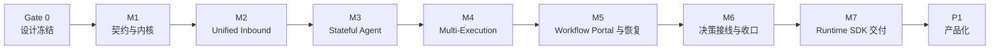

# MVP-0 技术底座实施方案

> 本文把 [01-MVP-0 技术底座需求](01-Agent-Workflow协作引擎-MVP需求分析.md) 拆解为可实施、可验收、可机械检查的工程方案。
> 全局架构以 [02-微内核插件架构 §1.2](02-微内核插件架构实现思路.md) 为准，对象与状态机以 [03-核心对象模型与状态机](03-核心对象模型与状态机.md) 为准。
> 强类型执行边界、事件和恢复语义统一见 [03-核心对象模型与状态机](03-核心对象模型与状态机.md)，公开 SDK 模块见 [02 §1.4](02-微内核插件架构实现思路.md#14-agent-runtime-sdk-交付边界)。
> 实施记录的状态、目录和转换门禁见 [Note 治理规范](../.agents/skills/nw-docs/references/notes-governance.md)。

---

## 1. 交付定位

MVP-0 交付的是可承载陪伴型 Agent 与复杂 Workflow 的技术底座，不交付具体陪伴产品规则，也不以空接口、样例代码或单条同步 Workflow 链路作为完成标准。

运行主干固定为 `Channel/Open Platform → Unified Inbound → Session Runtime → Agent Runtime → Skill/Tool/Knowledge Source/Workflow → Observation → Session Outbox`。Capability Runtime 只管理这四类挂载；认知上下文、会话执行、集成治理和产品运营能力分别使用自己的端口与事实源。

### 1.1 必须形成的两项底座能力

| 能力 | MVP-0 结果 | P1 扩展 |
| :-- | :-- | :-- |
| Stateful Agent Runtime | Persona、RelationshipState、ContextPipeline、PolicyChain、基础 Memory/Trigger、Knowledge 三级模式与证据契约、可回放上下文 | 具体关系/记忆产品、多源迭代研究、链接追踪、充分性评估和写回提案处理 |
| Multi-Execution Session Runtime | Session 持续活动、输入/输出邮箱、前后台 Execution、多挂起、确定性恢复、查询/取消、重启重建 | 任务运营视图、增强语义唤醒、业务回调配置和更复杂的任务协调体验 |

### 1.2 MVP-0 完成演示

MVP-0 退出时必须通过两个真实纵向样例，而不是只验证单个 SPI。

1. **陪伴 Agent 样例**：固定 Persona 版本，按 `tenant + user + agent` 续接关系状态，经 ContextPipeline 注入基础记忆，输入、能力和输出均经过 PolicyChain；替换关系 schema 时不修改 Kernel。
2. **复杂 Workflow 样例**：同一 Session 启动两个 Execution，其中一个 `waiting_hitl`、另一个后台完成；用户在等待期间继续普通对话，后台通知按序送达，点选准确恢复目标 Execution，服务重启后活动清单可重建。

### 1.3 不以 MVP-0 名义实现的内容

- 不在 Kernel、Session 或公共契约中加入熟悉度、情绪值、关系阶段等产品字段。
- 不启用动态 jar 安装、热更新、跨进程插件沙箱或对等多智能体协议。
- 不实现任意 Workflow 节点的通用 checkpoint 续跑；MVP-0 只保证执行账本重建、挂起恢复和可安全处理的后台任务恢复。
- 不为旧代码、旧数据结构或旧公开入口提供兼容层；每个里程碑在自己拥有的边界内完成整洁替换。
- 不把 Agent 委派、Memory、Persona、RelationshipState、Channel、Connector、Builder、Marketplace、Handoff、Billing、Trace、Usage 或 Audit 注册为 CapabilityType。

---

## 2. 实施状态入口

本文规定目标里程碑，不维护随代码变化的差距清单。已有代码与配置是该版本实现证据，不能用旧入口仍然存在推翻目标架构，也不能仅凭本方案宣告目标已交付。

各能力按本版本源码、配置与可复现验证分别判定完成，单项通过不能推导整个里程碑完成。

---

## 3. 实施总路径

M1–M7 表达能力依赖和验收切片，不是待重新执行的任务清单。各阶段早期包位置不作为当前 Java API；精确类型与发布单元遵循对象契约和 SDK 边界，已有能力只核对本次影响范围。

上下文与执行优化按 [§10](#10-上下文与执行优化实施批次)推进，目标契约由 [03 专题](03-上下文视图与执行优化.md)定义；该批不自动扩大既有 MVP-0 阶段的验收范围。

里程碑先明确关键契约和当前可交付切片，再交替实现与定向验证；Note 触发、复用和转态按 [Note 治理规范](../.agents/skills/nw-docs/references/notes-governance.md)，评审与验证范围按[评审与验证规范](../.agents/skills/nw-verification/references/candidate-driven-delivery.md)。不要求先完成全部测试再编码，不把里程碑规格下放到每个补丁。阶段未通过必要退出门禁时，不启动依赖该能力的下一阶段。

### 3.1 Gate 0：设计冻结与废弃清单

| 项 | 要求 |
| :-- | :-- |
| 主文档冻结 | 01 负责需求与验收，02 负责架构边界，03 负责类型与状态机；重复事实必须改为引用 |
| 废弃清单 | 列出旧入口、裸 Map 契约、逐参透传、旧上下文组装、多恢复路径和跨层依赖，为每项指定删除里程碑 |
| 目标数据样本 | 按新 schema 准备 Session、Execution、挂起、回调、Persona 和关系状态样本，用于验收不用于兼容对账 |
| 实施记录 | M1 的实施范围与关键取舍复用同主题 Note；格式与生命周期按 Note 治理规范，不在此重复定义 |
| 退出门禁 | 事实唯一归属无冲突；M1 验收项可直接映射到测试；每条冲突旧路径都有删除归属 |

Gate 0 不以现有行为作为正确性基线；现有代码只用于识别可复用部分和必须删除的冲突部分。

---

## 4. 里程碑拆解

### 4.1 M1：契约与内核

**目标**：建立稳定契约和最小 Kernel，并使强类型契约成为执行边界的唯一语义。

| 工作包 | 内容 | 交付物 |
| :-- | :-- | :-- |
| M1.1 契约 | DispatchOrder、BattleReport、ExecutionEvent、DelegationOrder、TraceContext、契约版本与入口校验 | `agent-runtime-api` 的公开契约和契约测试 |
| M1.2 ContractRegistry | 契约 codec 注册与九类 execution event 清单 | ContractRegistry 和事件名单一来源 |
| M1.3 Kernel | decode、dispatch、publish 骨架；delegate 保留但默认未启用 | 受控内部 dispatch 与依赖边界测试 |
| M1.4 类型化结果 | ExecutionPlugin 直接接收 DispatchOrder 并返回 BattleReport；DispatchOrder 入口强校验 | ExecutionPlugin、DispatchOrderValidator；删除裸 Map 结果跨边界传递 |
| M1.5 Event | 九类执行事件封闭联合、事件名单一来源与 executionRevision 契约 | 编译期穷尽检查、字段校验与事件契约测试 |

**退出门禁**：Workflow 执行边界仅接收强类型 DispatchOrder 并返回 BattleReport，目标、定义版本、参数和证据引用在入口校验，内部按类型流转；不提供旧 Map 结果或多参数签名的兼容入口。Workflow Runtime 直接返回 BattleReport；`waiting_hitl`、`failed`、`loop_terminated` 语义正确；DispatchOrder 最小元数据校验通过；九类事件穷尽测试通过；执行边界不再传递裸 Map 或逐参列表。

**实施记录**：M1 范围和证据按 [Note 治理规范 §4–§7](../.agents/skills/nw-docs/references/notes-governance.md#4-note-触发与复用) 维护；本节退出门禁不改变 Note 自身的覆盖范围和转态条件。

### 4.2 M2：Unified Inbound 与 Session Mailbox

**目标**：让所有外部输入先完成身份、幂等和 Session 路由，并建立同 Session 决策单 flight 与有序输出。

| 工作包 | 内容 | 交付物 |
| :-- | :-- | :-- |
| M2.1 InboundEnvelope | 统一 message、action、callback、recovery、command、scheduled 六类输入；`source` 为 envelope 一等字段并参与指纹，删除当前 payload 内 `source=task_report` 的旧写法；携带已解析身份和 TraceContext；异步输入新建 trace/span 并保留 rootInputId/causedByEventId | InboundGateway 与渠道适配器 |
| M2.2 身份边界 | tenant、user、agent、session 绑定与渠道身份映射 | IdentityResolver 与访问拒绝审计 |
| M2.3 输入幂等 | `tenant + agent + session + input_id` 唯一记录，保存规范化输入指纹、处理状态和结果引用；同键异指纹拒绝 | InputIdempotencyLedger 与 canonicalization 契约 |
| M2.4 输入邮箱 | 按 Session 排序；同 Session 一次只运行一个 Agent 决策轮 | SessionInbox 与并发测试 |
| M2.5 输出邮箱 | 回复、任务更新和主动消息持久排队并分配 Session sequence | SessionOutbox 与渠道重试适配 |
| M2.6 入口替换 | 各渠道产生方直接构造 InboundEnvelope；删除 ChatService 直连、旧回调和旧定时恢复入口 | 入口唯一性依赖测试 |

**退出门禁**：六类 InboundKind 均进入同一入口，后台完成复用带稳定 source 判别值的 recovery；同 Session 并发输入顺序稳定；不同 Session 可并行；同键同指纹返回原状态或结果，同键异指纹返回 `idempotency_conflict`；重复回调不重复决策；输出发送重试不重复生成回复。

**边界验收**：架构测试证明没有 Controller、Scheduler 或渠道绕过 InboundGateway。实施范围、验证证据与 Note 状态统一按 Note 治理规范维护。

### 4.3 M3：Stateful Agent Runtime

**目标**：提供陪伴型 Agent 所需的通用状态和策略原语，同时保持 Kernel 与产品 schema 解耦。

| 工作包 | 内容 | 交付物 |
| :-- | :-- | :-- |
| M3.0 Capability Runtime | CapabilityRef/Metadata、四类类型化领域契约、CapabilityMountSnapshot、Registry、Scope/Preset、Knowledge Source/Operator 注册和回滚 | 按 input 冻结的能力注册、租户隔离、版本组合与调用面测试 |
| M3.0a Skill Runtime | Agent Skills 标准目录与不可变版本；metadata、完整 `SKILL.md` 和按需资源渐进加载；`ALWAYS/ON_DEMAND` 激活、依赖、冲突、信任、整体 token 预算及包内脚本的受权 Tool/Runtime 执行边界 | SkillDefinition、SkillCatalog、SkillResolver、SkillActivation、ContextBlock Provider、包安全校验、激活负向测试与回放测试 |
| M3.0b Tool Runtime | ToolDefinition/ToolRegistry/ToolResolver、ToolDeployment、AgentToolMount、ToolInvocation/ToolResult、toolHandle、输入/输出 schema、风险/确认/幂等策略和 ToolPortal | 删除按名称全局查找与 Mock 回退；Tool 发现/解析、Provider 部署、调用守卫、`input_required` 和强类型 Observation 测试 |
| M3.1 Persona | 版本化 PersonaProfile；Session 创建时固定 personaVersion | PersonaRepository、解析器和版本回放测试 |
| M3.2 RelationshipState | 固定 envelope + schema 版本 + revision CAS 的扩展状态容器 | RelationshipStatePort 与基础存储适配 |
| M3.3 ContextPipeline | 系统约束、Persona、关系、基础记忆、任务、近期对话和已记录 EvidenceItem 的固定阶段 | ContextProvider SPI、预算裁剪器和 AgentContextSnapshot |
| M3.4 PolicyChain | input、context、model、capability、output、trigger 六个强制阶段 | Policy SPI、PolicyDecision 日志和不可绕过测试 |
| M3.5 MemoryPort | 具备 sourceEventId、作用域、读取预算、查看/纠正/删除的基础实现 | 基础 MemoryPort；高级提取与冲突治理留 P1 |
| M3.6 TriggerPort | 定时器和业务事件规范化为 InboundEnvelope | TriggerPort 与授权/频控/安静时段策略接口 |
| M3.7 SessionLog | 模型可见内容、策略结果、动作和观察先记录后使用 | append-only 日志和模型请求重建器 |
| M3.8 Knowledge Runtime 基线 | `NONE/GROUNDING/RESEARCH`、单查询 KnowledgePlan、KnowledgeAction/Observation、EvidenceBundle/EvidenceRef 与 KnowledgePortal 守卫调用 | 基础 Keyword/Vector 适配、证据快照与回放测试；复杂多源计划留 P1 FR-19，图谱与 GraphRAG 不进入交付范围 |
| M3.9 Metering 与轨迹基线 | ExternalInvocationGuard 覆盖模型、知识来源、工具、连接器和外部 Workflow；按 attempt 写 UsageEvent，关联 TraceContext、Action/Execution 和 Outbox | Usage Ledger 端口、价格/用量契约、架构禁止规则；丰富 TraceView 与对账留 P1 FR-20 |

**退出门禁**：陪伴样例关系 schema、Skill、ToolDeployment 与 Knowledge Source 可独立注册；同一用户跨 Session 续接、跨 Agent 默认隔离；Persona、input 级 CapabilityMountSnapshot、Skill ContextBlock、toolHandle 和 EvidenceRef 可按原版本回放；未挂载 Tool/Skill 调用被拒且无名称/Mock 回退；`NONE` 不调用来源，未声明知识节点的 Workflow 访问被拒；任一强制策略被绕过时测试失败。

**边界验收**：ContextPipeline、Runtime Portal 与 PolicyChain 的调用路径符合主文档；不存在固定前置 RAG、图谱旁路、按名称执行、生产 Mock fallback 或绕过策略链的模型/能力调用。

### 4.4 M4：Multi-Execution Session Runtime

**目标**：让一个 Session 同时承载持续对话、前台 Workflow、后台 Workflow 和多个挂起 Execution。

| 工作包 | 内容 | 交付物 |
| :-- | :-- | :-- |
| M4.1 ExecutionRegistry | 从 Execution Ledger 查询并投影活动执行摘要 | RegistryPort、重建器和缓存失效规则 |
| M4.2 模式 | foreground/background 显式写入 DispatchOrder 或调用策略 | 模式选择器与能力声明校验 |
| M4.3 多执行 | Execution 独立预算、状态、definitionVersion 和 action idempotency key | 并发调度器与资源预算器 |
| M4.4 多挂起 | 多个 PendingEntry 并存；确定性通道精确路由；自由文本唯一命中或澄清 | Pending 投影与候选解析器 |
| M4.5 查询取消 | 查询活动清单、执行摘要；取消经 Recovery 和 Workflow CAS | QueryExecutionPort、CancelExecutionPort |
| M4.6 完成回注 | 后台终态事件经 durable outbox 转为带稳定 `source` 判别值的 `recovery` Inbound，由 Agent 决定通知或继续 | ExecutionCompletionAdapter |
| M4.7 输出协调 | 后台通知不得插入正在生成的回复中间 | Outbox sequence 断言与重试测试 |

**退出门禁**：同 Session 两个以上 Execution 独立运行；一个挂起时可继续聊天并启动新 Execution；点选精确恢复指定执行；自由文本多候选时澄清；后台完成通知顺序确定；重启后 Registry 与执行账本一致。

**边界验收**：单 Session 多 Execution 的排序、并发、挂起、取消和重建符合主文档，不存在单执行退化分支或独立的兼容恢复器。实施记录按 Note 治理规范维护。

### 4.5 M5：Workflow Portal、恢复与执行事件

**目标**：把 Workflow 调用、恢复、查询和取消收敛为单一端口，并让执行账本成为状态权威。

| 工作包 | 内容 | 交付物 |
| :-- | :-- | :-- |
| M5.1 WorkflowPortal | run、resume、query、cancel 的稳定端口；内部调用 ExecutionPlugin 与 Workflow Runtime | `core-workflow` 门面与契约测试 |
| M5.2 执行账本 | dispatch 持久化、definitionVersion 固定、状态 CAS、每事件单调 revision、挂起数据和终态 | LedgerPort 与状态/进度记录测试 |
| M5.3 恢复统一 | 用户点选、回调、定时器都由 Recovery 构造恢复请求 | 单一恢复编排器 |
| M5.4 幂等链 | inputId/rootInputId、executionId、actionKey、invocationId/attemptId 与外部 idempotency key 贯穿 | 幂等审计字段和竞争测试 |
| M5.5 事件发布 | 账本状态/进度记录与待发布事件同事务提交；queued、started、step、hitl、resumed、completed、failed、loop_terminated、cancelled 在提交后发布 | ExecutionEventPublisher 与 durable event outbox |
| M5.6 投影 | 执行事件先转受控摘要，再按 eventId 幂等、executionRevision 判序写 SessionLog/ExecutionRegistry/Outbox | EventProjector 与乱序冲突告警 |
| M5.7 重启协调 | queued 原 id 重新领取；running/resuming 只在幂等、可查询或可协调时安全恢复，否则 failed/outcome_unknown | RecoveryCoordinator 与副作用账本 |

**退出门禁**：不存在 Controller 或 Scheduler 直接组装 Workflow 恢复快照；重复恢复只有一个 CAS 成功；运行中 Execution 固定 Workflow 定义版本；账本提交后广播前崩溃可补发事件；重复和乱序事件不回退投影；未知副作用结果不盲目重放；节点明细不会未经投影进入模型。

**边界验收**：WorkflowPortal 的命令边界与账本迁移符合主文档；宿主不存在跨层 Workflow 执行入口或自行组装恢复快照的代码。

### 4.6 M6：Agent 决策接线与架构收口

**目标**：完成端到端接线，证明两类核心底座能力成立，并机械禁止旧路径回流。

| 工作包 | 内容 | 交付物 |
| :-- | :-- | :-- |
| M6.1 决策拆分 | 产品 Chat 只负责入口与投影，执行、恢复和计划归 Agent Runtime | 薄门面与独立单元测试 |
| M6.2 唯一入口 | 用户直连 Workflow 分支关闭；用户侧只进入 Agent | 架构依赖测试和负向入口测试 |
| M6.3 样例 | 陪伴 Agent 样例与复杂 Workflow 样例 | 可重复 E2E 场景和测试数据 |
| M6.4 架构一致性 | 禁止旧入口、旧 Map 契约、直连 Workflow、绕过 PolicyChain/Metering 和跨层引擎或外部客户端调用 | 依赖规则、静态扫描与负向测试 |
| M6.5 验收证据 | 把 01 §7 每一行映射到测试、指标、回放或可重复演练 | MVP-0 验收索引 |
| M6.6 实施记录核对 | 按 Note 治理规范核对当前范围适用的 Notes、剩余范围与有效证据 | 对应记录与索引链接一致 |

**退出门禁**：01 §7 的 MVP-0 验收矩阵全部通过；两类纵向样例通过；用户直连 Workflow、旧入口、旧契约和兼容处理器均不存在；M1–M6 实施记录与代码、测试、主文档一致。

### 4.7 M7：Agent Runtime SDK 模块化交付

**目标**：在 M1–M6 运行语义闭合后，将同一实现收敛为无界面的 Java SDK，让 灵知 通过公开 façade 和生产适配器运行，而不是继续把 Agent Runtime 固定在应用 Service 与数据库实现中。

| 工作包 | 内容 | 交付物 |
| :-- | :-- | :-- |
| M7.0 Loop 前置收口 | 完成类型化挂起原因、准入原子边界和真实 Engine→Service 恢复组合验证 | 与 Delegation D0 共用的 Loop Gate；阶段范围内的挂起无字段猜测 |
| M7.1 API 隔离 | 建立零 Spring/数据库依赖的 `agent-runtime-api`，发布 façade、命令、结果、事件、值对象、DelegateAction/DelegationLedger Ports 与 AgentObservation 契约 | API jar、兼容性基线、公共签名架构测试 |
| M7.2 Core 抽取 | 将 Loop、Planning、Context、Policy、Memory 与 Session 编排迁入对应 Runtime 模块；Core 消费已冻结的 DelegateAction Port 与 AgentObservation，并在无 Delegation 实现时 fail closed | Headless Core；产品层不拥有执行编排 |
| M7.3 适配器 | 提供 Model、MCP、JDBC、Queue/Scheduler、IAM、Memory Store 和事件出口适配器 | 每类 Port 的契约测试；development/production profile 隔离 |
| M7.4 灵知 Host 切换 | Chat/Open Platform/Callback/Scheduler 只通过 AgentRuntime façade 和 Unified Inbound 接入 | 宿主装配、Spring Boot Starter、旁路依赖禁止规则 |
| M7.5 发布单元 | 对 API/Core/Session/Memory/Adapters/Starter 做独立构件和 BOM 版本管理；`agent-runtime-delegation` 构件与 `forkSession` 随 P2 FR-15/FR-23 增量发布 | Gradle publication 验证、最小宿主 smoke test 和依赖锁定 |

以下是 M7 的阶段验收范围，并非当前代码的能力清单。当前已配置委派的行为和限制见 [Agent 委派与多智能体运行时](08-Agent委派与多智能体运行时.md)；当前挂起原因还包括 `WORKFLOW_EXTERNAL`。

M7 不实现 P2 的 Agent 委派（FR-15）与 Session 派生（FR-23）：M7 只冻结它们依赖的 Port、AgentObservation 与 façade 契约位置，实现、构件与验收随 P2 交付，且 P2 接入不得修改 M7 已冻结的 Core 状态机或 Session 语义。

**退出门禁**：API/Core 编译依赖不含 Spring、MyBatis、数据库驱动、供应商协议或 灵知 Service；公开签名不含 Map/DO/Mapper；in-memory 与生产适配器通过同一契约套件；最小外部宿主可提交 input、消费事件、完成 `AGENT_HITL`、`WORKFLOW_HITL`、`TOOL_INPUT` 三类真实挂起与恢复及取消；Tool `INPUT_REQUIRED` 只通过 Action Ledger 与 Session response journal 恢复，长时异步任务归 Workflow 或独立任务协议；`DELEGATED` 与 DelegateAction 在 M7 未接线时 fail closed，负向测试证明不创建委派账本或子 AgentRun；委派的真实恢复与 Session 派生随 P2 验收，不作为 M7 前置；灵知 全链只使用同一 façade，旧直连入口和临时桥接器已删除。

**集成验收**：SDK 构件、灵知 Host 和原有 E2E 同时通过，证据覆盖依赖规则、契约测试、适配器 Testcontainers 测试、重启演练与宿主 smoke test 的相关范围。M7 及其子项的实施记录按 Note 治理规范维护；跨阶段 Note 按自身覆盖范围判断转态。

首版集成验收使用 [02 §1.4](02-微内核插件架构实现思路.md#14-agent-runtime-sdk-交付边界) 的生产组合，真实模型供应商端点与真实 MCP 服务的 live smoke、可控故障注入及进程重启恢复分别保留证据。本地 HTTP fixture 不替代真实服务证据；缺少环境时记录未验收范围，不能据此宣告生产组合交付完成。

---

## 5. 数据与事实源方案

### 5.1 逻辑存储

| 逻辑存储 | 最小字段 | 唯一性/并发 | 事实源职责 |
| :-- | :-- | :-- | :-- |
| SessionTable | tenantId、sessionId、agentId、userId、channel、scopeKey、personaVersion、status | 会话键唯一；状态字段做乐观并发 | Session 归属与生命周期；不固定能力组合代 |
| AgentContextSnapshot | tenantId、agentId、sessionId、inputId、loopId、CapabilityMountSnapshot、ContextBlock、handleMapping、tokenUsage | input + loop + snapshotVersion 唯一；模型调用前只追加冻结 | 当时模型实际可见上下文和 input 级能力组合 |
| InputIdempotencyLedger | tenantId、agentId、sessionId、inputId、requestFingerprint、processingStatus、resultRef、errorCode、expiresAt | `tenant + agent + session + input` 唯一；同键必须校验指纹 | 输入是否已受理及其稳定结果 |
| SessionLog | tenantId、sessionId、eventId、eventType、eventVersion、sessionSequence、payload、occurredAt | `session + sequence` 唯一；只追加 | 交互与认知事实 |
| SessionInbox | envelope 字段、sessionSequence、processingStatus、attempt | `tenant + agent + session + inputId` 唯一；领取使用租约或 CAS | 待处理 Inbound |
| SessionOutbox | envelope 字段、sessionSequence、deliveryStatus、attempt | `session + sequence` 唯一；发送幂等 | 待投递输出 |
| PersonaProfile | tenantId、agentId、version、content、status | `tenant + agent + version` 唯一；发布后不可变 | 人格版本内容 |
| RelationshipState | tenantId、userId、agentId、schemaId、schemaVersion、revision、payload | 隔离键唯一；revision CAS | 通用关系状态 |
| Execution Ledger | executionId、tenantId、sessionId、unitId、definitionVersion、mode、status、revision、checkpoint/pending、actionKey、outcomeCode | executionId 唯一；状态迁移 CAS 并递增 revision | Workflow 执行唯一权威 |
| Action Ledger | actionId、executionId、invocationId、idempotencyKey、status、outcomeCode、revision、occurredAt | actionId 唯一；副作用状态 CAS；attempt 另行唯一 | 逻辑动作与外部副作用协调 |
| Usage Ledger | usageEventId、InvocationContext（MVP-0 为 TraceContext）、invocationId、attemptId、operationType、token/quantity、usageSource、价格/汇率快照、金额、amountStatus、adjustsEventId、occurredAt | 事件键唯一；只追加；adjustment 指向原事件 | 原子用量、费用、未决项和追加调整；P1 扩展 ControlOperationContext |
| CapabilityDefinition/Version | tenantId、type、capabilityId、versionId、status、metadata、contentHash | 定义键与版本键唯一；published 后不可变 | 能力身份与版本共同权威 |
| SkillDefinition/Version | capabilityVersionId、标准目录 manifest、`SKILL.md`、逐文件摘要、宿主治理 metadata、conflictGroup、requiredCapabilities、发布时按 `SKILL.md` 估算冻结的 estimatedTokens（对照挂载 tokenBudget，不设 Loop 注入额度） | 版本一对一且发布后不可变；根目录必须有 `SKILL.md`，资源内容与宿主权限分离 | Skill 包、目录发现与渐进加载契约 |
| ToolDefinition/Version/Deployment | capabilityVersionId、name/title/description、input/output schema、icons/annotations、effect、idempotency、confirmation、timeout、sensitiveFields；deploymentId、providerType/providerRef、revision、status | 版本一对一；Deployment revision CAS；远程 annotations 不授予权限 | Tool 目录、调用契约与 Provider/Connector 绑定 |
| AgentCapabilityMount | tenantId、agentId、capabilityVersionId、mountType、typedConfigRef、priority、revision、status | Agent + mountId 唯一；revision CAS | Agent 授权挂载；运行时再冻结 input 级快照 |

RelationshipState 的 payload 是少数允许使用动态结构的字段，因为关系 schema 是底座扩展点；固定身份、版本、并发和审计字段必须使用类型化列。P1 若需要筛选或统计具体关系字段，应建立类型化投影，不直接让 Kernel 查询 payload。

ExecutionRegistry 不建立第二份执行权威表。它优先由 Execution Ledger 查询或投影缓存提供；缓存必须携带账本 revision，并允许全量重建。

### 5.2 目标 schema 落地顺序

1. 依据对应主文档明确目标表、字段、约束、事务边界、接管范围和数据验收查询；仅在 Note 治理规范规定需要 Note 时记录新的决策与实施范围，不复制已有契约。
2. 数据库变更一次性建立当前 schema 并删除冲突的旧列、旧索引和旧表；不建双写触发器、兼容视图或旧读回退。
3. 所有读写方在同一里程碑中改用目标 schema，并用依赖检查禁止旧 Repository/DAO 回流。
4. 需要保留真实业务数据时，另行编写一次性数据转换脚本和对账查询；该脚本只把数据转换为当前 schema，不使旧语义继续运行。
5. schema、应用代码、测试数据和实施记录作为一个发布单元验收；任一部分未就绪则不发布。

数据变更脚本编号在实施时按仓库当前最新版本顺延，本文不预占版本号。

---

## 6. 一致性与并发规则

| 场景 | 原子边界 | 冲突处理 |
| :-- | :-- | :-- |
| 接收入站 | 写 InputIdempotencyLedger + Inbox | 唯一键冲突先比较 requestFingerprint；相同返回已有 processing/resultRef，不同返回 idempotency_conflict |
| 启动 Execution | 写 dispatch 会话事件 + Execution queued 记录 | executionId 冲突返回已有执行，不二次启动 |
| 记录 Execution 事件 | 状态/进度记录 + revision 递增 + 待发布事件同事务提交 | 每个事件独占 revision；事务失败均不提交；提交后广播失败从 durable event outbox 补发 |
| 恢复 Execution | 校验 actionKey + `waiting_hitl → resuming` CAS | CAS 失败返回当前状态并审计，不重复恢复 |
| 取消 Execution | Recovery 授权 + 可取消状态到 cancelled CAS | 已终态返回幂等结果；运行中按能力支持度处理 |
| 写关系状态 | 校验 schema + revision CAS + 审计事件 | revision 冲突重读后由策略重试或拒绝，不静默覆盖 |
| 生成模型输入 | ContextBlock/PolicyDecision 先入 SessionLog，再创建 snapshot | 落盘失败则不调用模型 |
| 生成输出 | assistant/task/proactive 事件与 Outbox 同事务或 Outbox 模式 | 发送失败重试 envelope，不重新调用模型 |
| 外部副作用 | 稳定 actionId 写入本地副作用账本并传递到外部 | 只有幂等、可查询或可协调时自动重试；结果无法确认则 failed/outcome_unknown，不宣称 exactly-once |
| 外部可计费调用 | 守卫先记录 invocation/attempt 开始事实，再调用 Provider；结果写 UsageEvent | 开始事实落盘失败则不调用；usage 缺失标 estimated/unknown，结果不明标 unresolved，后续只追加调整 |

同一 Session 的 Agent 决策轮单 flight 不等于所有 Execution 串行。Execution 是否并行由 `concurrencySafe`、租户配额和资源预算共同决定；未声明并发安全时默认串行。

---

## 7. 架构一致性与发布门禁

| 门禁 | 禁止内容 | 证据 |
| :-- | :-- | :-- |
| 契约边界 | 裸 Map 或逐参列表跨 Agent/Workflow 边界 | 编译期类型检查 + 静态扫描 |
| 入站边界 | Controller、Callback、Scheduler 绕过 InboundGateway | 依赖规则 + 负向集成测试 |
| 决策边界 | 用户直连 Workflow，或 Agent 读取节点/快照内部 | 模块依赖测试 + 代码扫描 |
| 执行边界 | WorkflowPortal 之外调用引擎 run/resume/query/cancel | 可见性限制 + 架构测试 |
| 上下文边界 | LegacyContextProvider 或绕过 PolicyChain 的模型/能力调用 | 禁止类清单 + 负向测试 |
| 计量边界 | Provider、Knowledge Source、Tool、Connector 或 Workflow 节点绕过所属调用许可与计量守卫直连底层外部客户端 | 依赖规则 + 调用许可与 ExternalInvocationGuard 负向测试 |
| 模型 Provider 边界 | `*ModelProvider` 仅返回调用参数，由上层编码或发送供应商请求；上层按品牌或协议旁路调用客户端 | 按 [SDK 模型边界](02-微内核插件架构实现思路.md#14-agent-runtime-sdk-交付边界)验证统一 Provider 入口、类型化结果与内部协议复用，覆盖模型发现及普通/流式调用 |
| 数据边界 | 双写、双读、兼容视图或旧 schema 读回退 | migration 审查 + schema 断言 |
| 实施记录一致性 | 应维护的 Note 缺失，或记录与自身覆盖范围、实际证据不一致 | 按 [Note 治理规范](../.agents/skills/nw-docs/references/notes-governance.md) 核对；不以部分代码合并要求跨阶段 Note 提前转态 |

发布失败时只能将应用、schema 和持久数据作为同一发布单元恢复到已验证快照；不通过运行时开关切回旧逻辑，也不为此保留兼容代码。

---

## 8. 测试与验收矩阵

本表定义相关能力在里程碑集成时应具备的验证；局部任务只选择本次实际影响部分，复用仍有效证据，执行路由见评审与验证规范。

前端按受影响接口和用户旅程选择类型检查、构建及必要交互验证；后端测试通过不能替代界面或接入验证。

| 测试层 | 必测内容 |
| :-- | :-- |
| 契约测试 | record 字段、九类事件封闭联合、CapabilityRef/类型化 Definition/Mount、SkillDefinition/Catalog/Resolver/Activation、ToolDefinition/Registry/Resolver/Invocation/Result、InvocationContext、ExternalInvocation/UsageEvent、KnowledgeRequest/EvidenceBundle/EvidenceRef、当前版本 schema 和调用面 |
| 单元测试 | Skill 常驻/按需激活、依赖/冲突/预算、Tool handle/schema/确认/幂等、ContextPipeline 顺序与裁剪、Knowledge 三级模式、PolicyChain、Registry 投影、Inbox/Outbox 顺序、状态 CAS |
| 模块集成 | Chat → Inbound → Agent → Kernel → WorkflowPortal → Ledger → Event → Agent → Outbox |
| 并发测试 | 同 Session 并发输入、双 Execution、恢复与回调竞争、取消与完成竞争、关系 revision 冲突 |
| 重启测试 | Inbox 处理中重启、账本提交后事件广播前重启、后台 Execution 未知结果、waiting_hitl 重启、Outbox 发送中重启 |
| 多租户测试 | Session、Persona、关系、记忆、Registry、日志和能力视图跨租户访问全部拒绝 |
| 回放测试 | 从 SessionLog 重建模型请求、策略结果、动作、观察、EvidenceRef 和输出；Persona/组合版本一致；模型、知识来源与外部能力调用计数为零 |
| 投影测试 | 重复 eventId、旧 revision、新 revision、同 revision 冲突分别产生幂等、忽略、推进和停止自动投影并告警 |
| 计量测试 | reported/estimated/unknown、cached/reasoning 子集、高精度定价、多币种、同 attempt 去重、收费重试、unresolved 与 adjustment |
| 轨迹测试 | rootInputId 跨挂起/回调/重启关联；TraceProjection 删除可重建；OTLP 不可用不影响账本；最终 output/Outbox 投递可定位 |
| 负向安全测试 | 未挂载或伪造 Tool/Skill handle、按名称全局搜索或 Mock fallback、Skill `allowed-tools`/正文/脚本自动扩权或绕过受权 Tool 执行、插件绕过 PolicyChain、模型调用 user-only 能力、Knowledge 越权来源、Workflow 未声明知识节点或借引用读 SessionLog/Memory、关系 schema 非法、删除数据再次注入、伪造 callback 归属 |
| E2E 陪伴样例 | 跨 Session 关系续接、Persona 固定、基础记忆、策略拒绝/脱敏、主动触发经过授权与 Outbox |
| E2E 复杂 Workflow | 等待期间继续聊天、双执行、多挂起、歧义澄清、确定性恢复、后台通知、查询取消、重启重建 |
| 架构一致性 | 禁止旧入口、旧契约、双读写、跨层调用和策略绕过；依赖规则失败必须阻断 CI |

性能与容量阈值不在本文臆造固定数字。Gate 0 先建立基线，再为 Inbox 积压、Outbox 延迟、ContextPipeline 耗时、模型调用、活动 Execution 数和重建耗时设置可观测 SLO 与容量门槛。

---

## 9. MVP-0 Definition of Done

MVP-0 仅在以下条件全部满足时完成：

- 01 §7 的验收项全部有自动化测试或可重复演练证据。
- 陪伴 Agent 与复杂 Workflow 两个纵向样例同时通过，且均使用生产同构入口与持久化。
- 用户消息、点选、回调、定时器和后台完成事件没有绕过 Unified Inbound 与 Agent 的路径。
- Kernel 不包含任何陪伴产品字段；新关系 schema、ContextProvider 和 Policy 可通过注册接入。
- Session 在 Execution 挂起或后台运行时保持可交互，多 Execution 状态互不污染。
- Execution Ledger、Action Ledger、SessionLog、Usage Ledger、AuditLog 与 InputIdempotencyLedger 的事实域边界有代码依赖测试和目标 schema 一致性查询保障。
- Persona、能力组合和 Workflow 定义版本均可固定并用于回放或恢复。
- PolicyChain、租户隔离、输入幂等、恢复 CAS、外部副作用幂等键和 Outbox 不可绕过。
- TraceContext 在同步、异步、挂起和回调路径语义一致；所有外部可计费调用不能绕过 Metering，usage/价格/结果缺口不会被零值掩盖。
- 同 inputId 不同载荷不能静默复用；执行投影不依赖到达时间；回放不重新执行；未知外部结果不自动重放。
- M1–M7 按 Note 治理规范需要维护的 Notes 与实际状态一致，必要验收可从需求追溯到有效验证、SDK 构件和生产代码；不为生命周期完整性补建记录。
- 架构一致性门禁证明旧入口、旧契约、兼容适配器、双读写与策略绕过均不存在。
- Agent Runtime API/Core 不依赖 Spring、MyBatis、数据库驱动或供应商协议；灵知 作为 Host 只通过公开 façade、Ports 和生产适配器接入，同一最小宿主 smoke test 可独立运行。
- P1 产品化需求无需修改 Kernel 或重新设计 Session/Execution 生命周期即可开始实施；Tenant Open Platform 的控制操作保持在 Session 外部，通过 ControlOperationContext 接入统一计量与轨迹。

---

*文档结束*

## 10. 上下文与执行优化实施批次

目标契约与配置默认值见 [上下文专题](03-上下文视图与执行优化.md)，模块边界见 [02 §5.7](02-微内核插件架构实现思路.md#57-会话状态记忆与生命周期)。本节定义工程交付顺序，不把方案批准或文档检查等同于已实现。

遵循[项目最高优先原则](../.agents/skills/nw-workflow/references/development-workflow.md#项目最高优先原则)：架构正确性优先，历史代码、接口、数据库、数据、迁移、配置及持久格式均不形成兼容义务；实际替换和数据操作按[工程规范](../.agents/skills/nw-engineering/references/engineering-standards.md)执行。按模块批次集中完成生产代码、测试和配置，再统一验证；普通修改自检，高风险差量集中聚焦审查，不逐补丁测试或扩大为无关审计。

### 10.1 实施顺序与交付物

| 批次 | 决策编号 | 完整交付物与边界 |
| :-- | :-- | :-- |
| C1 基础契约与计量 | 2、8、15 的基础 | 明确模型视图、来源及策略版本、调用组、内部引用和阶段计量；同步类型、codec、持久化/schema 与恢复校验，保留同工作量测量基线 |
| C2 任务与上下文主链路 | 1、3–10 | 边界维护和证据游标；安全原文先存后引用；两级缩减、独立摘要用途、覆盖式历史和唯一溢出补救；在完整真实组合链上验证 |
| C3 提示词与 Skill | 11–14、18–19 | 具名模块、当前快照、Run 增量缓存、显式释放及稳定序列化；同步程序维护的控制协议，无 complete-prompt 入口 |
| C4 执行与吞吐 | 16–17 | API/decoder/动作/子身份/checkpoint/回放全链支持只读批次，再接 reasoning 聚合、背压与终态刷新；不能只切 Provider parallel_tool_calls |
| C5 诊断与交付 | 15 的界面与整体集成 | 扩展现有诊断接口与页面、发布独立摘要模型、核查运行配置，按启动指南运行服务并完成小规模 API 验收 |

实现按依赖顺序推进，C1 定义共享契约，后续模块批次包含其必要生产装配、测试和配置，不以接口/Mock 代替闭环。模块内集中修改后测试；变更失败或存在明确阻塞时才提前检查，条件按[评审与验证规范](../.agents/skills/nw-verification/references/candidate-driven-delivery.md)。

旧协议 Run 不跨新协议版本继续。发布前排空或明确终止在途 Run，保留已知/未知外部结果，不重发业务动作；schema 调整集中完成，不引入旧格式双读或兼容分支。部署及模型配置操作见[指南 §5.3.8](../docs/04-指南与运维/01-开发与部署指南.md#538-上下文与执行优化版本的发布核查)。撤销只定位本任务差量，混有其他改动不能整体 reset；数据与外部副作用按工程规范恢复。

### 10.2 聚焦验收矩阵

| 验收 ID | 范围 | 必须验证的行为 |
| :-- | :-- | :-- |
| CX-01 | 任务选择与按需管理 | 普通聊天直接进入主模型，不执行任务分类、搜索、来源修复或自动保存；仅显式 `extraParameters.task_id` 选择并冻结已验证任务，缺失时不读取 current 任务；`search_tasks`、`read_task`、`update_task` 与显式 `correct` 分别验证当前权限、来源、revision 与幂等 |
| CX-02 | 长历史与摘要 | 超过 20 轮后可恢复早期确认；覆盖区间无跳过，16% 延伸完整调用组；每准备至多一次摘要；小摘要窗口、不缩小输出、相关来源变化和硬限失败可判定 |
| CX-03 | 输出与访问隔离 | 代码/MCP 大结果两级缩减和分页回读；跨租户/用户越权拒绝；预览省略与采集不完整区分；存储失败不重复业务动作；引用保留和清理一致 |
| CX-04 | 溢出补救 | 明确溢出只新增一次请求；原冻结请求不变，恢复不重置计数；额度/鉴权/普通 400/超时/length 不误重试；已完成工具不重执行 |
| CX-05 | 视图、缓存与 Skill | 缓存命中/失效/恢复得到等价合法请求；动态模块仅当前快照；ALWAYS/依赖未完不能释放；再次激活冻结版本，硬限拒绝不截断正文 |
| CX-06 | 并行工具 | 上限 4、资格整批校验、逐项权限/预算、结果顺序、部分失败、取消与重启恢复正确；完成子项不重执行，未知不转成功 |
| CX-07 | reasoning 持久化 | 首片立即提交，定时/字符触发均有效；先提交后可见；错误/取消刷新后终结；背压有界，恢复与回放无重复 |
| CX-08 | 诊断与性能 | 前后端度量版本一致；组成无重计，辅助调用关联根请求，未知 usage 不为零；连接/首模型事件/首可见回答/结束区分，重叠耗时不直接相加 |

### 10.3 真实 API 验收与完成判定

测试所需 Agent、能力、Skill 和用户通过正式接口创建；覆盖简单问候、多步工具、超过 20 轮任务续接、大输出回读、多 Skill 切换、只读并行与暂停恢复。使用小规模代表样本，不自动启动 1000 会话；任何真实模型测试出现额度不足立即停止，保存已完成证据及未验证范围。

按模块运行必要定向测试，集中检查修改直接影响的恢复、权限和并发差量。文档变更仅做相关文档检查，不触发业务全量测试。真实测试比较同模型、配置和工作量，记录主/维护/摘要调用次数、上下文体积、阶段耗时及写入次数，不承诺固定百分比或以局部微基准代替端到端效果。

完成要求是必要行为、配置、装配与验收一致，已完成动作不会因压缩/缓存/恢复重发，未实现功能和已知阻断没有被隐藏。交付区分本次执行、有效证据复用和未验证；小规模通过不代表所有场景无问题。状态回写对应 Note，不以本章清单代替运行证据。
