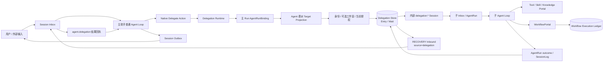
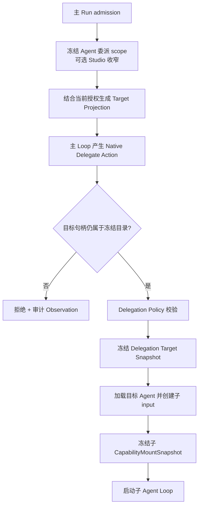
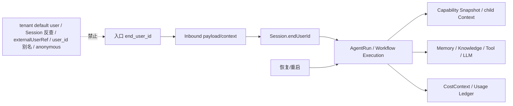
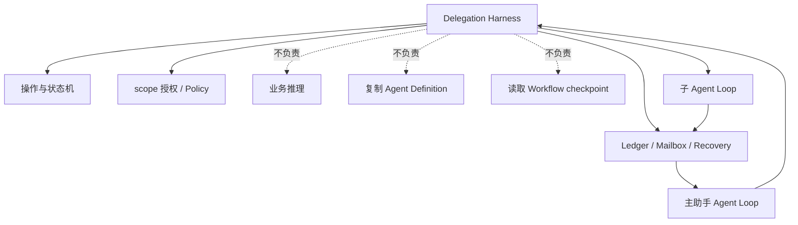
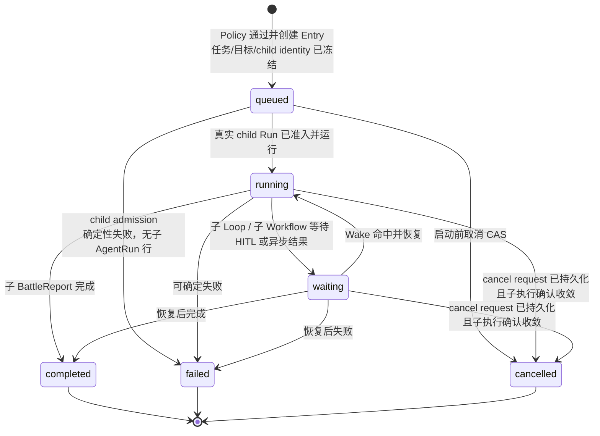
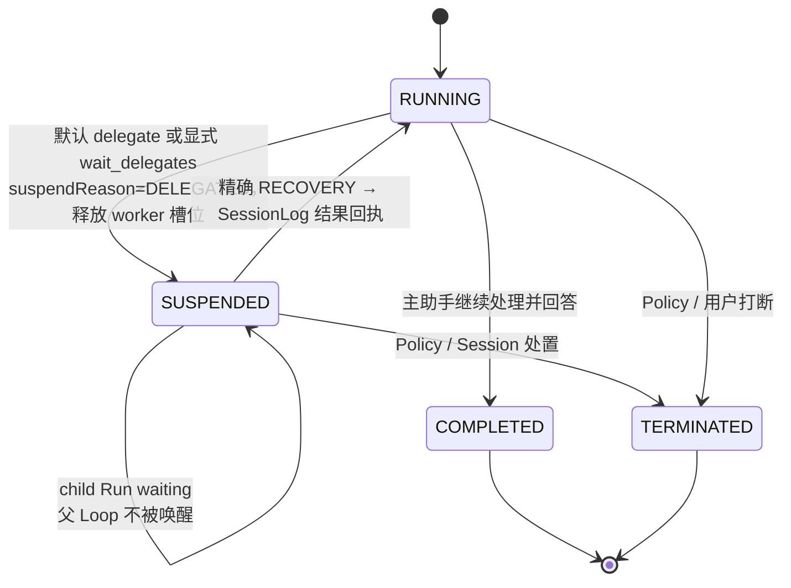
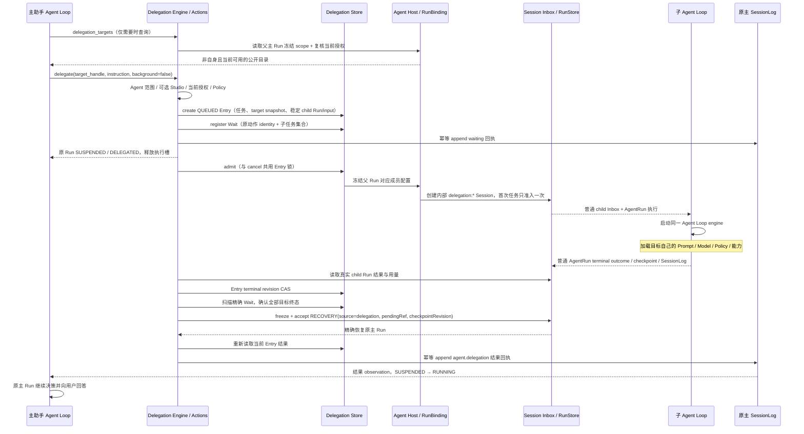
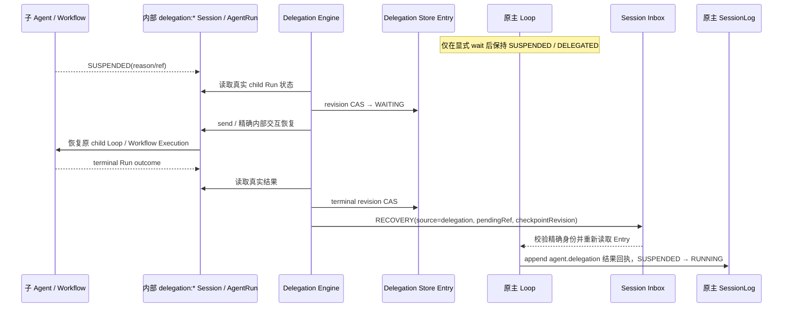
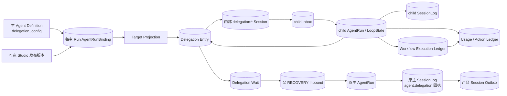

# Agent 委派与多智能体运行时

当前首期采用 [§20 Agent 原生委派与结构化计划](#20-agent-原生委派与结构化计划首期基线)：委派能力配置在 Agent 自身，普通单聊与工作室都由主助手的普通 Chat Run 理解输入、使用完整能力并回复用户；直接委派和可选 DAG 共用原生委派入口，不建立逐消息接待路由或第二套团队推理内核。

## 1. 定位与边界

本文定义 灵知 Multi-Agent 平台中的主从式 Agent Delegation Runtime。它不是一套平行于
Session、Agent、Capability 和 Workflow 的新平台，而是复用这些现有运行时事实域完成跨 Agent
选择、授权、启动、等待、结果回注和恢复的协调层。

本文描述一个主助手如何按自身 `delegation_config` 把边界明确的子任务交给已发布 Agent，并在普通单聊或可选工作室范围、持久化、授权和恢复约束下取得结果。

[MVP-0 需求](01-Agent-Workflow协作引擎-MVP需求分析.md)继续拥有 Session、Agent Loop、Capability Runtime 与 Workflow 协作需求；[P1/P2 需求](04-后续阶段需求扩展-P1-P3.md#fr-15-agent-委派p2)继续拥有 FR-15 及验收编号；[核心对象模型](03-核心对象模型与状态机.md)继续拥有通用 Action、Observation、Session、LoopState、CapabilityMountSnapshot 与 Workflow Execution 状态机。

本文是以下委派专题事实的唯一架构来源：Agent 委派配置、`AgentRunBinding`、Delegation Target Snapshot、直接委派与结构化计划、主子生命周期、`Entry/Wait` 持久协调、挂起传播、恢复、取消，以及委派与 Session Mailbox、Wake、WorkflowPortal、Execution Ledger 的组合关系。

实现状态与差距不写入本文；后续实施使用同主题 Note 记录。

共享群目标的会话归属和每轮回复 Agent 采用 [Harness 03 §5.1.1](03-核心对象模型与状态机.md#511-群归属与执行身份目标契约)：群每轮显式选择一位当前获准服务 Agent，再走本文的普通主 Run 与既有委派链，不把群转换为固定主 Agent 的 Team。子任务继承原主 Run 的群、根来源、请求者、执行 Tenant、部署和授权依据，目标仍为该 Tenant 的本地 Agent；同源实例后续切换授权不改变原链，源/成员/群控制等当前撤权在新派发前复验。子结果只回注原主 Run，不另取得对群外发资格。

### 1.1 目标

- 主助手只能从当前主 Run 冻结的自身委派名单中选择仍授权、可用且不是自身的目标；工作室会把该名单进一步收窄为当前工作室成员交集，不做全租户 Agent 搜索，也不临时生成子 Agent 定义。
- 子 Agent 加载自己的 Prompt、Model、Knowledge Source、Skill、Tool、Workflow、Persona 与 Policy，并为本次子输入冻结独立能力与上下文快照。
- 主助手只传递完成任务所需的目标、背景、约束和预期产物；路由元数据只负责身份、幂等、因果和授权，不复制主助手定义或私有人设。
- 委派复用单 Agent Loop；多智能体能力由薄调度 Harness 组合多个独立 Loop，而不是建立第二种推理引擎。
- 委派可审计、可补充、可等待、可取消、可恢复、可回放，且不能绕过租户、请求者、Agent 委派范围、可选工作室成员授权与副作用策略。

### 1.2 非目标

- 不恢复历史 Agent Group 执行内核或群体记忆；Team 只是 Agent 委派范围的可选收窄条件与产品组织对象，按 §20 建模。
- 不支持对等 Agent 协商、竞价、投票或无父节点的自治群体。
- 不允许父 Agent 把自己的 system prompt、模型凭据、CapabilityMountSnapshot、Policy 实例或可变内存复制给子 Agent。
- 不允许子 Agent 直接消费用户 Session Inbox、直接向用户 Outbox 写消息或改变 Session 归属 Agent。
- 不把 Agent 注册为第五种 CapabilityType；委派授权与四类 CapabilityMount 相互独立。
- 子 Agent 是叶子执行者，不能继续委派；首期不定义递归深度、环或父子预算分割协议。
- 普通消息不强制创建 DAG；结构化计划通过独立原生 `PlanCommand` 提交，不自动挂载或依赖平台 Tool。

### 1.3 Clean cutover

当前项目以基础架构正确性优先，不承担历史 Delegation 数据或旧实验契约兼容：

- `DelegationOrder.input`、`delegateTo`、`parentExecutionChain` 等旧字段可直接删除并替换为本文契约。
- 委派若进入实现阶段，只能新增 Agent Runtime 自有账本；V142 已删除产品层委派表，不做旧行回填、双读、双写或运行时翻译。
- 不保留 v1/v2 DTO、deprecated 委派入口、旧状态映射或“读取失败再走旧路径”的 fallback。
- 当前接管边界的主文档、schema、生产代码与测试同步切换；阶段划分按开发流程规范，实施记录与 Note 转态按 [Note 治理规范](../.agents/skills/nw-docs/references/notes-governance.md)，不要求固定的 PR Stack 形式。

## 2. 核心结论

灵知 Multi-Agent 的运行公式是：

```text
Published Target Agent Definition
+ Delegation Authorization
+ Delegated Task / Required Context
+ Child Input CapabilityMountSnapshot
= Child Agent Run using the same single-Agent Loop
```

父 Agent 负责选择“谁”和“做什么”；Delegation Runtime 负责“能否委派、冻结什么、如何运行与恢复”；子 Agent 负责“如何完成”。

子 Agent 不是父 Agent 的线程副本，也不是父 Agent 的 Capability。

### 2.1 原生委派操作

| 模型工具 | 灵知 语义 | 边界 |
| :-- | :-- | :-- |
| `delegate(target_handle,instruction,background=false)` | 持久创建子任务并在同一动作内登记等待；子任务终态后恢复原主 Run，模型直接取得结果 | 默认不先返回 accepted 再要求模型调用等待；不阻塞线程，不接收执行配置或预算 |
| `delegate(...,background=true)` | 持久受理子任务并返回稳定 `delegation_id` 与 accepted | 主助手可继续独立工作；accepted 不是完成结果 |
| `wait_delegates(ids)` | 对后台委派或已有工作登记持久等待 | 全部目标终态后恢复原 Run；释放执行槽 |
| `message_delegate(id,message)` | 向活动子 Run 补充输入；终态后创建关联新子 Run | 终态不复活；补充不代表批准计划或执行完成 |
| `cancel_delegate(id)` | 持久受理取消并传播至子 AgentRun 与活动 Workflow | 请求取消不等于已停止，未知副作用不伪装为撤销 |
| `delegate_status(id?)` | 读取当前主 Run 所属单项或全部委派的安全摘要 | 每次检查归属及披露权限，不以轮询代替等待 |
| `delegation_targets()` | 按需读取冻结范围与当前授权交集的公开目录 | 目录通常已注入上下文，查询不是启动前置步骤 |

Agent Loop 仍然只做 Observe → Think → Act。

这些独立模型工具规范化为原生 Delegate Action 与内部 `TARGETS/START/LIST/GET/SEND/WAIT/CANCEL` 命令；不是普通业务 Tool，也不要求独立服务或 HTTP API。Harness 只承担目标投影、校验、状态迁移、邮箱投递和恢复，不承担业务推理，不拼接成员私有人设，也不读取 Workflow checkpoint。

### 2.2 通用任务计划

通用计划采用独立原生 `plan` 动作，沿用 `sf_agent_action` 协议及原 Run 的 Loop；不依赖 Agent 的委派开关。它复用已有 `DagPlan/DagWork`、工作 CAS、准入和 SessionLog，不新增第二套计划存储。无协作者的主 Agent 多步骤工作与多 Agent 分工使用同一契约。旧 Todo 整表和委派计划提交入口不再是本轮任务步骤入口。

| 操作 | 行为与受理边界 |
| :-- | :-- |
| `plan.submit` | 完整提交或修订标题、步骤、依赖、产出与限制，携带预期计划版本；修订提供变更说明，已准入步骤保持原定义和输入 |
| `plan.get` | 返回授权范围内的计划版本、审批版本、步骤身份、状态、依赖和已有真实结果 |
| `plan.start_step` | 开始一个 PRIMARY 步骤，CAS 校验精确审批、依赖、当前 Run、资源互斥及单活动主步骤，冻结输入和准入版本 |
| `plan.finish_step` | 仅提交当前 PRIMARY 步骤的可见摘要和真实结果引用，或失败、结果未知说明；不能改变 MEMBER 终态 |
| `plan.wait` | 持久等待审批或指定依赖结果，释放原 Run 执行槽；依赖终态、无法满足或计划修订时恢复，拒绝等待尚未完成的自身 PRIMARY 步骤及依赖它的路径 |

模型计划回复保留 `approved_revision` 与 `plan_revision` 作为真实版本事实，提供 `approval_pending` 表示当前精确计划版本是否仍待批准；不输出表示策略要求的 `approval_required`，避免将策略与当前等待混淆。旧版本已准入步骤仍在执行不表示新版本获批。批准恢复回复可先于 Run 恢复落盘，因此模型快照不携带回复生成时刻的 `run_status`；公开 UI 保留审批策略和真实运行状态。需审批的 SUBMIT 由宿主直接挂起，模型无需额外 WAIT。WAIT 已返回就绪结果或恢复结果时附 `wait_satisfied=true`，仅表示原等待操作已结束；用户纠正也可结束等待，是否获批仍独立由 `approval_pending` 和精确版本表达。读取或完成等待不自动批准、开始步骤或生成新持久状态。

`finish_step.result_refs` 可省略或为空：主步骤声明 completed 时，宿主从已按精确 Run/Action 绑定到本步骤的持久成功结果中补全并核验引用，再将实际引用写入步骤终结事实。显式提供的引用仍须通过相同归属与成功检查；跨步骤、业务失败与未知结果不能借此完成。纯文字步骤没有外部 Action 时保持无需引用的语义。重放使用首次持久终结事实中的引用，不拼接后来结果；审批、步骤 fence 与命名输出要求不变。

模型公开工具名为 `plan_submit/plan_get/plan_start_step/plan_finish_step/plan_wait`，由 `NativeAgentTools` 规范化为同一 `plan` 动作及相应 operation；上表点号形式表示操作语义。`finish_step` 的 `outputs` 把声明输出名绑定到本步骤已有真实引用，不能用单个模型自述替代所有声明产出。

当前计划内可纠正的步骤选择、预期版本、缺少或多余命名输出，以及对未结束 PRIMARY 步骤的直接或间接自等待，以 `rejected` 和当前计划视图反馈给原 Run，供后续模型决定纠正；拒绝不登记步骤完成或等待事实。授权、原身份、真实结果证据、步骤 fence 和同操作异内容的持久冲突仍分别核验，缺少原执行事实或技术故障沿原错误路径处理，不能通过输入反馈取得新的执行权限。

每个步骤的执行者明确为 `PRIMARY` 或 `MEMBER`。PRIMARY 的 Agent 身份由宿主赋为协调者，绑定原 `controlRun`；多个主步骤以独立 `task_id/admission_id` 区分，不能用 Run 唯一性代替步骤唯一性。MEMBER 通过目录句柄定位冻结范围与当前授权交集的目标，继续独占稳定 child Run，不能用主 Agent 的 ID 把 PRIMARY 再启动成成员。主步骤与成员可以重叠，同一主 Agent 一次只有一个活动主步骤，`DagDriver` 只自动调度 MEMBER。

PRIMARY 步骤内 Action 在派发前由可信宿主绑定到步骤准入，模型无需逐工具填写计划身份。纯分析步骤提交可见结论；涉及工具、文件或外部操作时，完成须附属本步骤真实成功执行的引用。宿主核验引用归属、执行状态和可见性；模型自述不构成外部成功证据。MEMBER 状态由真实子 Run、回执和成果投影，成员完成后仍由主 Agent 核查与整合。整项工作结案须包含主 Run 的最终答复或关闭事实，不能从成员全部结束推断。

普通模式在计划持久化并记录持久更新事件后推进。规划模式或明确审批要求绑定精确计划版本；修订继续保留审批要求，并对新版本重新批准。已准入的在途步骤仍按原版本、输入和 Run 绑定登记结果或恢复；未开始步骤允许改变目标、依赖和执行者。已开始目标若需改变，先取消并等待收尾，再创建关联替代步骤；结果未知不得经新步骤或新成员自动重做。批准不扩张任何执行权限。

Skill 在发布版本元数据扩展区声明 `skillforge-plan: required|optional`，缺省不强制。激活 required Skill 后，要求从激活边界开始对当前任务持续生效，释放 Skill 不清除要求；已存在的有效计划可复用，已绑定父计划步骤的成员不重复建立顶层计划。未满足时允许宿主声明的只读调查、成员目录查询、澄清、计划操作和必要取消收尾；写入、代码执行、Workflow、成员启动及普通成功答复都须在实际受理或派发前被阻止。工具读写属性来自可信声明，不能由模型自报。系统不解析 Skill 正文编号生成固定流程，也不自动证明计划覆盖全部自然语言要求。

已有计划时，新增委派必须先成为该计划的 MEMBER 步骤，防止计划之外的隐藏执行。指定依赖等待在依赖完成或确定无法满足时返回真实状态，不让单分支失败阻止无关分支。命令指纹、稳定 admission、原 Run/child Run 绑定、冻结输入、Action 归属与结果来源均持久保存；重复请求及进程重启恢复原工作和等待，不重复受理或重做未知效果。PRIMARY 完成重放使用持久来源事件中的原 fence，不从计划版本猜测执行许可。

## 3. 总体架构



`Entry` 与 `Wait` 是委派协调事实，不替代真实的 AgentRun、LoopState、SessionLog、Action/Usage Ledger 或 Workflow Execution Ledger。子任务通过独立的内部 `delegation:*` Session 和普通 Runtime 准入；目标、任务、稳定 child Run/input、状态投影、取消键和安全结果保存在 `Entry`，默认委派或显式等待的父身份与目标集合保存在 `Wait`。子任务的状态与结果始终从真实 Run 事实读取，再以 revision CAS 更新 `Entry`。

默认 `delegate` 与 `wait_delegates` 都通过持久 `Wait` 挂起原主 Run 并释放 worker 执行槽。所有目标终态后，宿主只构造协调恢复用的 [InboundKind.RECOVERY](03-核心对象模型与状态机.md#57-multi-execution-registry-与-session-mailbox)：`source=delegation`，payload 严格为 `pendingRef` 与 `checkpointRevision`。该输入不携带委派状态、结果正文或新的授权；恢复阶段必须重新从已归属的 `Entry` 和真实 child AgentRun 读取结果，并把幂等 `agent.delegation` 结果回执写入原主 SessionLog 后才对父模型可见。

恢复认证由宿主签发 `SystemPrincipal` AuthenticationRef，`causationIdentityRef` 复用原主 Run 已冻结的调用方验证事实。Session owner、执行 Agent、parent Run、wait identity、checkpoint revision、trace 与因果引用必须精确匹配；错配时不得提交或恢复。委派层不另建执行事件或恢复队列，也不增加绕过 Session Runtime 的回调入口。

## 4. 预定义专业 Agent 与动态选择

### 4.1 Agent Definition 与 Delegated Task 分离

| Target Agent Definition 拥有 | 主助手委派任务拥有 |
| :-- | :-- |
| Agent identity 与发布状态 | delegationId 与 targetAgentHandle |
| system prompt / role / Persona 引用 | Task |
| Model 解析配置 | 完成任务必要的背景和约束 |
| Knowledge Source / Skill / Tool / Workflow 挂载声明 | 可披露的证据与产物引用 |
| Policy 与 planning rules | parent / trace / idempotency 元数据 |

Parent 不得把左列复制到右列。

`targetAgentHandle` 是本次父 input 目标投影中的不透明路由句柄，不授权 Parent 修改 Target Definition。

### 4.2 Delegation Target Projection

Agent 自身保存 `delegation_config:{enabled,target_agent_ids}`。`enabled=false` 只关闭新的委派和计划准入，名单仍保留，重新开启后无需重建；主 Agent 自身的普通处理不受协作者名单约束，只有一个主 Agent 的工作室也不要求开启委派。

每个主 Run 首次受理前，由 `institution.runtime.AgentRunBindings` 在表 `agent_runtime_agent_run_bindings` 冻结通用 scope。scope 至少包含 `origin`、`primaryRun`、`primaryAgent`、委派配置与范围、可选 Studio、`members`、公开 `directory` 和 `requester`。普通 AGENT Run 冻结主 Agent 自身名单，以及候选成员各自的人设、模型和 CapabilityMount；TEAM Run 在此基础上额外冻结工作室发布成员版本，并把协作者收窄为“主 Agent 已启用名单 ∩ 当前工作室成员/授权目录”。同一 Run 的目标解析、恢复与回放始终使用该 scope，新主 Run 才能冻结更新配置。

主 Run 从冻结 scope 与当前授权解析 Delegation Target Projection。目标必须在冻结名单中、当前仍授权和可用、不是主 Agent 自身；TEAM Run 的目标还必须仍属于当前工作室授权成员。委派子 Run 的绑定角色是 `DELEGATE`，目标投影为空，因此不能递归委派。

该投影只是模型输入和校验所需的只读运行时视图，不是新的资源目录、授权事实源、数据库表或 Capability 类型。模型可见部分只暴露稳定目标句柄、版本化描述、允许的任务标签和必要限制；句柄到目标 Agent 的映射由父 `AgentRunBinding` 与 `Entry.target.snapshot` 共同证明，只供 Runtime 校验，不向模型暴露目标数据库 identity、system prompt、私有人设、模型凭据、内部能力参数或 Policy 实现。

父模型只能选择目录中的目标句柄；按名称全租户搜索、未命中后回退到任意 Agent、让模型填写目标 revision 都必须拒绝。

目标投影不是 CapabilityMountSnapshot 的第五类 mount。

### 4.3 目标解析顺序



主 Run 的 Target Projection 解决“主助手当时允许选谁”；Delegation Target Snapshot 解决“实际启动了
哪个目标定义”；子 CapabilityMountSnapshot 解决“该目标本次 input 实际能用哪些能力”。三者语义不同，
其中 Target Projection 复用父 input 的 AgentContextSnapshot/SessionLog，Target Snapshot 保存在 `Entry.target`，
CapabilityMountSnapshot 复用 child input 的 Capability Runtime admission；三者不形成三个新子系统。

## 5. Delegation Target Snapshot

Delegation Target Snapshot 是 `Entry.target` 持有的不可变目标证明，由 Runtime 在授权通过后从父主 Run 的 `AgentRunBinding` 生成，不由 Parent Agent 构造。类型化 payload 的 schema 固定为 `skillforge.agent.delegation-target.v1`，且 payload 只能包含 `scope_run_id` 与 `agent_id`。完整目录、成员版本、委派范围和授权上下文由父主 Run 的 `AgentRunBinding` 拥有，不能复制进 Entry 形成第二份配置事实源。

它至少固定以下语义：

| 分类 | 冻结事实 |
| :-- | :-- |
| 父主 Run 绑定 | origin、primary Run/Agent、委派配置与范围、可选 Studio、members、directory、requester |
| Entry 目标 | 稳定 handle、`targetAgentId` 与恰含 `scope_run_id/agent_id` 的类型化证明 |
| child identity | delegationId、稳定 childInputId、childAgentRunId、可选 previousDelegationId |
| 因果 | 完整 parent RunIdentity、TraceContext 与原 causationIdentityRef |
| 当前授权 | 按 targets/start/plan/send/wait/cancel/list/get 的动作语义复核；不改写已冻结配置 |

child admission 必须先验证 Entry 的 `scope_run_id/agent_id` 证明与父主 Run 绑定完全一致，再从该绑定取目标成员的冻结定义，持久化 child Run binding，并由普通 Runtime admission 使用该成员自己的 CapabilityMountSnapshot。Target Snapshot 不内嵌 prompt、模型凭据、Policy 实例、CapabilityMountSnapshot、工作室版本或父上下文。

同一父主 Run 内的后续委派继续使用该 Run 的冻结 scope；之后的新主 Run 才能冻结更新后的 Agent 配置或工作室版本。恢复读取原父/child Run binding、Entry 目标证明与原 CapabilityMountSnapshot，禁止改用 current Team、current Agent、current mount-set、FOLLOW_ACTIVE 或当前 Model 配置，也不增加旧 snapshot 兼容分支。实时撤权只会进一步收紧模型可见目标和新的业务能力使用；关闭委派或撤权不能阻止既有委派的受控读取、等待、取消、终态登记、来源核验与费用收尾。

计划仍有未准入任务时，若其冻结执行范围在当前授权检查中确定失效，整项工作进入既有取消链并等待已准入执行收敛，不制造未执行的子 Run，也不修改已批准计划。数据库或服务瞬时失败保留恢复重试；平台容量或资源互斥等待不作为撤权取消。

### 5.1 入口 `end_user_id` 不变量

`end_user_id` 是整个用户处理链的入口事实，不是运行时可推导的辅助字段。每一个能启动
Session/Agent/Workflow 链的入口都必须显式携带正数 `end_user_id`：

| 入口 | 入口承载 | 后续允许的动作 |
| :-- | :-- | :-- |
| Chat/SSE/Sync | `ChatRequest.context.end_user_id` | 入口校验后复制到 Inbox payload、Session、AgentRun、CostContext |
| 机构端创建 Session | `CreateSessionRequest.end_user_id` | 校验租户归属后写入 Session；不能创建默认用户 |
| Open Platform 创建 Session | `OpenPlatformCreateSessionRequest.end_user_id` | 校验租户归属后冻结到 Session；`externalUserRef` 只作审计/关联 |
| Open Platform message/action/callback/command | 创建时已冻结的 Session identity | 作为同一 Session 的只读入口投影写入 Inbox；不得重新映射 |
| Workflow DispatchOrder / Agent delegation | 上游已冻结的 `end_user_id` | 只读透传到 `AgentRun`、Workflow Ledger、子 Context 和用量 |
| 定时器/恢复/重启 | 原始入口已持久化的 execution identity | 仅复用该已记录事实并校验一致性；缺失或不一致直接失败 |

传播关系如下，任何虚线“查找”都不是合法路径：



约束是硬性的：

- 缺失、非法或非正数时在当前入口 fail closed；不得把它替换成租户默认用户、`anonymous`、
  `user_id` 别名或任意外部用户映射。
- Session、AgentRun、Workflow DispatchOrder、DelegationOrder、Capability Snapshot、
  KnowledgeRequest、工具/模型调用和 CostContext 只能复制或校验该值，不能通过查询获得另一个值。
- Open Platform 的 `externalUserRef` 与 `externalConversationRef` 用于审计、幂等和会话定位；它们
  不能创建、选择或覆盖内部 `end_user_id`。
- 恢复器可以从原始 execution/Session 事实重放入口 ID，这是回放已持久化的输入事实，不是新的
  身份兜底；若原事实缺失、当前显式值不一致或租户不匹配，必须拒绝恢复。
- `CostContext` 嵌套作用域允许子作用域省略该字段以继承父入口值，但禁止改写为不同 ID；这只是
  传播，不是用户查询。
- 跨边界 JSON、Context、事件和快照中的身份字段必须带语义名称（如 `end_user_id`、`tenant_id`、
  `session_id`、`agent_id`、`execution_id`）；不得用裸 `id` 表示用户、租户、会话或执行身份。

当前代码的 Chat 传输仍使用 `context.end_user_id` 作为统一 DTO 字段；这是入口协议字段，不代表
服务端可以从 `Session` 或 `EndUserService` 补齐它。该不变量适用于委派子 Agent，即 Parent 不
传递新的用户定义，Child 只继承 Parent 已受理并冻结的入口身份。

## 6. 委派输入与结果契约

### 6.1 主助手允许传递的业务载荷

普通模型委派只填写 `delegate` 的目录句柄 `target_handle`、单段业务指令 `instruction` 与可选 `background`（默认 false）。内部规范化为 `Task(objective=instruction,context="",constraints=[],expectedOutput="")`；业务目标、限制、输入及交付标准写在指令中。结构化计划继续使用独立的 Task 四字段及计划依赖、产出和审批约束；普通指令的空辅助字段不取消计划的交付标准。Runtime 从已提交的模型动作生成稳定 operation key，并补齐 `delegation_id`、父子 Run/Input、租户、Session、终端用户、trace 和幂等身份；模型不能填写这些身份，也不能指定 system prompt、模型、能力、容量或 Token 预算。

直接 `start` 的逻辑任务身份由完整的 `target_handle`、`objective`、`context`、`constraints`、`expected_output` 规范化结构生成，并由父 Run 隔离。后续模型轮次重复相同命令时，重新验证当前授权并复用原委派及 child Run；决策格式被拒绝不撤销已受理的任务。这里不做自然语言相似度去重。任一任务字段变化形成新任务；终态任务的显式续做使用 `send`，保留 `previous_delegation_id`。DAG 准入及其他委派命令继续使用各自的 operation key。

任务必须独立可理解。主助手只传完成任务所需的背景、约束及可披露证据或产物引用，不能复制完整 Session、主助手 Prompt、Memory、Capability config、其他成员私有人设或 Workflow checkpoint。成员没有主助手的聊天上下文，不能以“按上文处理”代替任务输入。

`message_delegate` 对应内部 SEND，只携带一个当前主 Run 拥有的委派 id 和补充正文。活动委派把正文送入原子 Run 的受控输入；终态委派创建新的关联记录和子 Run，保存 `previous_delegation_id`，并把原任务与安全结果当作背景数据而不是指令。

### 6.2 叶子执行与因果关联

首期子 Agent 是叶子执行者，其原生委派目录为空，不能调用 `delegate` 启动子任务。因此无需递归 `DelegationPath`、深度限制或环检测配置；执行追溯由 `delegation_id + parent_agent_run_id + child_agent_run_id + previous_delegation_id` 表达，不能复用含义模糊的 `parentExecutionChain`。

通用计划的 MEMBER 任务同样通过该叶子委派入口准入；PRIMARY 留在原主 Run。每项任务包含显式执行者、`objective/context/constraints/expectedOutput`、`inputs`、`outputs` 与 `exclusive_resources`；计划补充版本、依赖结果引用和资源互斥，不改变子 Agent 的私有人设、能力快照或委派权限，契约见 §2.2。

### 6.3 Result → Observation

委派结果的权威来源是内部 child Session 对应的真实 AgentRun、Loop checkpoint、Run outcome 与既有 Action/Usage/Workflow Ledger。宿主据此生成安全 `Result` 投影：`COMPLETED` 使用已提交输出，`FAILED` 保留稳定原因和可用的部分摘要，`CANCELLED` 不伪造战报；用量和 evidence 也必须来自真实账本。恢复输入正文不能提供、覆盖或修补这些结果。

用量账本保留完整的 child Session、child Run 和根输入身份；持久化字段应覆盖 Runtime 身份契约，不截断委派标识，也不将子用量改记到主 Run。

子执行 `waiting` 只表示真实 child AgentRun 处于既有挂起状态；默认 `delegate` 或主助手显式 `wait_delegates` 都会让原主 Run 进入 `SUSPENDED/DELEGATED`。子 waiting 不自行唤醒、再次挂起或替换父 Run。

结果提交顺序固定为：

1. 委派任务只作为 child Session 的首个 `MESSAGE/NewRun` 输入持久受理一次；同一稳定 child input 重试必须验证完整 fingerprint 和 RunIdentity，不得再次插入任务正文。
2. 子 Loop 按普通 AgentRun 路径提交最终 outcome、checkpoint、SessionLog 与既有账本事实。
3. 恢复扫描从真实 Run 读取状态、结果、用量和 evidence，并以 revision CAS 把安全投影写入原 `Entry`；`TERMINATED` 保存为 `FAILED` 与明确原因，不增加同义终态。
4. 只有精确归属原主 Run 的 `Wait` 且全部目标已终态时，宿主才校验父 Run 仍以同一 wait identity 和 checkpoint revision 挂起，并冻结 `RECOVERY(source=delegation)` 输入。payload 只含 `pendingRef` 与 `checkpointRevision`。
5. Session admission 以原 owner、执行 Agent、parent Run、causation identity、wait identity 和业务 fingerprint 接受该恢复输入。重复投递复用同一冻结 envelope；只允许刷新 AuthenticationRef。
6. 原主 Run 恢复时依据原动作的持久 `Wait` 读取当前 `Entry` 结果，不重放 START 的目标选择、启动或计划准入，把命令、结果与空 wait id 作为幂等 `agent.delegation` 回执写入原 SessionLog，然后把该回执加入父 Loop observation。恢复输入中的任何其他内容都不参与结果构造。
7. 只有主助手决定如何核查、整合结果并写入产品 Session Outbox；不创建 `final_answer` 子任务。

模型可见的子结果必须已进入原主 SessionLog；回放只读取该幂等结果回执及其中的安全 Entry 投影，不重新执行子 Agent。

## 7. 薄 Harness 与单 Agent Loop



父子 Agent 使用同一个 Loop engine、Action decoder、PolicyChain、ContextPipeline、ToolPortal、KnowledgePortal、Skill Runtime 和 WorkflowPortal。

运行时差异只来自各自冻结的 Agent Definition、Model、Entry-owned Target Snapshot、CapabilityMountSnapshot 和任务所需上下文。

同一 Loop 的挂起必须使用[核心对象模型](03-核心对象模型与状态机.md#52-loopstate)定义的显式 `LoopSuspendReason`。直接提问、Workflow HITL、Tool 多轮输入与委派等待分别使用 `AGENT_HITL`、`WORKFLOW_HITL`、`TOOL_INPUT` 与 `DELEGATED`；运行时不得根据 `loop_state`、handle 或 pending Map 的偶然字段推断恢复分支。长时异步任务归 Workflow 或独立任务协议，不占用 Tool outcome 或 Loop suspend reason。

普通消息可以直接处理或按需调用 `delegate`；需要结构化计划时使用独立原生 Plan Action，PRIMARY 与 MEMBER 按 §2.2 执行。成员仍通过既有委派准入，不得查找冻结 scope 外的 Agent、绕过审批创建子 Run 或另建结果通道。

### 7.1 SDK 模块归属

委派能力作为[Agent Runtime SDK](02-微内核插件架构实现思路.md#14-agent-runtime-sdk-交付边界)的 Session 原生能力交付，并复用 `agent-runtime-core` 的 Loop、Action decoder、ContextPipeline 与 PolicyChain。直接任务和结构化计划都只能通过已提交的原生 Delegate Action 进入；计划批准与依赖满足后调用同一受控 `start` 入口，宿主、Controller、Planner 和 Tool/MCP Adapter 不得自行构造模型身份或绕过 Unified Inbound 与 scope 授权。

公共 Runtime 契约冻结 SDK-safe `DelegationCommand`；Session SPI 以 `SessionDelegations.Entry/Wait`、`Store` 和 `Host` 表达持久协调与宿主适配；`SessionDelegationEngine` 和 `SessionDelegationActions` 负责操作、等待、回执与原 Run 恢复。没有宿主目标目录、父 Run 冻结绑定或持久 Store 时，原生 Delegate Action 必须 fail closed。

宿主只提供父 Run 绑定、目标目录、当前授权、普通 child Runtime 准入和真实 Run 结果读取。SDK API 不暴露 灵知 AgentDO、Mapper、Spring Bean 或数据库行；不同宿主必须产生相同的 `DelegationCommand`、持久 `Entry/Wait`、稳定 child identity、SessionLog 回执和协调恢复 Inbound。委派层不定义第二套执行 publication、checkpoint 或结果来源。

## 8. 运行操作

### 8.1 委派启动、目录与状态读取

`delegation_targets` 返回当前主 Run 冻结 scope 中当前授权可用且非自身的目录；TEAM Run 再与当前工作室成员取交集。`delegate` 按目录句柄重新校验冻结绑定及当前授权，以完整规范化任务确定稳定 delegation、child input 和 child Run。默认 `background=false` 在同一已提交模型动作内持久创建 Entry、登记 Wait，并把含 wait_id 的回执写入 SessionLog，随后以 checkpoint CAS 挂起原主 Run；完成后模型收到真实结果。`background=true` 只持久受理并返回 accepted，适用于父助手还有独立工作的并行场景。两种方式的 child 都由普通 Runtime 后台推进，不占用 HTTP 线程。

`delegate_status` 未传 id 时列出当前主 Run 的摘要，传 id 时读取单项安全结果，内部复用 LIST/GET。需要完成结果时用默认委派或 `wait_delegates`，不能用状态查询、sleep 或忙循环替代持久等待。

### 8.2 补充与持久等待

`message_delegate` 对活动委派提交带稳定 operation key 的补充输入；回执只表示输入已受理。补充输入和首次 child admission 都通过 `Store.admit` 在同一 Entry 持久锁内复核 `cancelKey`，与取消 CAS 串行，因而已受理取消后不得出现迟到的 child Run 或新补充输入。首次任务只进入稳定 child input 一次，后续 `send` 通过原 Runtime steering 进入同一 child Run。目标已经 completed/failed/cancelled 时，Runtime 不复活旧 Run，而是创建一个关联原委派的新 delegation 和新 child Run。

`wait_delegates(ids)` 对应内部 WAIT，接收一个或多个当前主 Run 拥有的委派 id。若目标已经全部终态，直接从已归属 `Entry` 返回结果；否则持久登记绑定完整 `RunIdentity` 与目标集合的 `Wait`，并让原主 Loop 以 `SUSPENDED/DELEGATED` 保存相同 wait identity 和 checkpoint revision，立即释放 worker 执行槽。这不是线程阻塞，也不冻结产品 Session。

恢复必须精确命中原 `SessionOwner`、执行 Agent、parent Run、wait identity、checkpoint revision、causation identity 与已提交的默认 `START(background=false)` 或 `WAIT` 动作。`RECOVERY` 只携带这次恢复的协调键；结果重新从 `Entry` 和真实 child Run 读取，不能恢复“当前最新”、另一条已挂起 Run，也不能接受恢复 payload 自报的状态或结果。

### 8.3 Cancel

`cancel_delegate` 对应内部 CANCEL，先校验 tenant、Session、主 Run、目标归属与调用者权限，再用稳定 cancel operation key 幂等保存取消请求。running/waiting 委派保持原状态直到 child AgentRun 及其活动 Workflow 确认收敛；只有此后才能提交 cancelled。已经 completed/failed/cancelled 的委派返回原终态。任何外部副作用都必须由权威动作账本和真实 Provider 回执核实；结果未知时记录 `failed(reason=outcome_unknown)`，不能宣称撤销成功。

## 9. 授权、Scope 与安全边界

### 9.1 三层授权

| 层 | 回答的问题 | 事实来源 |
| :-- | :-- | :-- |
| Target visibility | 主助手能否看到目标 | 冻结 `delegation_config`、可选 Studio 成员、Agent Definition、发布状态、当前授权与 Target Projection |
| Delegation permission | 主助手能否把此任务与这些引用交给目标 | Agent 委派范围、可选工作室成员关系、tenant/Session、请求者、用户与数据策略 |
| Child execution authority | 目标 Agent 实际能执行什么 | Entry-owned Target Snapshot、CapabilityMountSnapshot、PolicyChain 与 Sandbox |

目标 Agent 可以拥有主助手没有的专业能力，但实际执行权限仍由冻结 scope、当前授权和目标自身 Policy 共同决定，不能由主模型仅凭 `targetAgentHandle` 获得。

有效权限是目标冻结权限、委派授权限制、租户/用户/scope 限制和平台强制 Policy 的交集。

### 9.2 必须 fail closed 的检查

- tenant、session、parent Agent/Loop/Execution 与用户身份不一致。
- 目标不在主 Run 冻结的 Agent 委派范围、目标等于主助手自身，或调用者是叶子子 Run。
- 目标未发布、未激活、已不属于可选工作室成员交集或当前授权不匹配。
- ContextRef/EvidenceRef 未提交、跨租户、跨 Session、超出 scope 或已被撤销。
- 平台执行许可、速率、成本、Policy 或 Sandbox 不允许。
- ledger Target Snapshot 或 child CapabilityMountSnapshot 缺失、损坏或 identity 不一致。

子 Agent 没有原生委派目录，递归委派在入口直接拒绝，不通过可配置深度或环检测兜底。

动作授权按用途区分：`targets/start/plan` 复核主 Run、可见目录与当前执行授权；`send` 还必须确认活动 child Run 并禁止撤权后追加新的业务输入；`wait/list/get` 只读取当前调用者拥有且允许披露的既有事实；`cancel` 只作用于已归属委派；child 的模型、工具、知识与 Workflow 每次业务调用都重新校验当前授权。关闭委派或撤权后不得启动新任务、提交新计划、追加业务输入或继续借用能力，但既有委派仍可受控读取和等待、取消、终态收敛、核验来源并完成计费。

“受控读取与等待”保留独立的披露授权：仅关闭 `delegation_config.enabled` 或从目标执行名单移除成员，不阻断原父 Run 的 `list/get/wait`；原请求者、终端用户、渠道资源绑定、Agent 可用状态或工作室成员权限失效时，新的读取和等待请求拒绝披露结果。已登记等待的扫描、子终态登记、取消与费用收尾不依赖这些执行许可；父 Run 恢复读取仍重新核验披露权限，拒绝时记录明确的撤权结果，不转交子任务正文。冻结快照证明归属，不授予永久读取权限。

## 10. 执行许可与用量

原生委派命令、工作室配置、DAG 工作和任务都不接收容量或 Token 预算字段，预算从已登记的父根按代码角色比例派生，共用真实根账本。子任务作为目标 Agent 的普通 Run 执行，继续受平台执行许可、父任务已冻结共享根与目标 Agent 五项覆盖、模型与工具限制、速率、成本、Policy 和 Sandbox 约束；这些既有约束不能由委派输入覆盖。

子 Agent 的模型、Tool、Knowledge 与 Workflow 实际用量写入各自权威账本，并关联 `delegationId`、`childAgentRunId` 与 `parentAgentRunId`。用量用于计量、诊断和既有 Run 限制，不形成工作室总 Token 预算或团队容量配置；有部分文本的失败仍按失败终态呈现。

同一产品 Session 的 Inbound 仍由 Session Mailbox 单 flight 交给主助手决策。child AgentRun 与其 Workflow Execution 通过既有 Runtime 独立推进；平台执行器决定何时取得运行许可，工作室不声明并行容量，`wait` 释放原主 Run 的 worker 槽位。

## 11. 生命周期与状态机

### 11.1 Delegation Execution



初始 Agent 委派范围、可选工作室成员授权或 Policy 拒绝发生在 Entry 创建前，以原主 SessionLog 回执表达，不创建伪造 Entry；Entry 创建后的撤权禁止新业务调用，但保留受控读取、取消与终态收敛路径。

领域扫描重试和进程故障只推进 queued/running/waiting `Entry`，不新增 `recovery_pending` 状态。
接管必须复用 `delegationId`、`childAgentRunId`、Target Snapshot、CapabilityMountSnapshot 和稳定 actionId。
子 Loop 的既有 Run 限制或策略终止保存为 failed + 明确 `termination_reason`，不增加同义终态。

running/waiting 记录上的稳定 `cancelKey` 是持久命令事实，不是新状态。恢复扫描必须优先
继续取消传播；在 child AgentRun 与活动 Workflow 收敛前不得发出 cancelled terminal event。

### 11.2 Parent Loop

默认 START 的 Entry 与 Wait 使用稳定任务身份与原模型动作身份分别幂等登记。两次写入之间进程退出，原已提交模型动作重放复用同一 Entry 并补齐 Wait；不要求另一轮模型决策。只有含 wait_id 的幂等回执已持久化，checkpoint 才能提交 DELEGATED。扫描只有匹配原父 Run 的实际 suspension 才可投递 RECOVERY，因此子任务提前完成也不会丢失结果或提前唤醒。恢复只读取原 Wait，不重新启动子任务；全部结果终态且披露获准后回注原 SessionLog。



这是既有 LoopOutcome 的组合用法：持久化复用 AgentRun/LoopState checkpoint 和 SessionLog，不建立
Multi-Agent 专用主 Loop 表。原 Run 在默认 `delegate` 或显式 `wait_delegates` 时挂起并释放执行槽；子委派等待不把 Session 迁移为 waiting，也不阻止该 Session
开始其他 input 的 Loop。

## 12. 正常时序



## 13. 挂起、Wake 与恢复

### 13.1 子执行 HITL

子 Agent 不直接向用户提问。

每个子 Agent 使用独立的内部 `delegation:{delegationId}` Session。子 Loop 的 `AGENT_HITL`、`WORKFLOW_HITL` 或 `TOOL_INPUT` 继续由该内部 Session、AgentRun、Workflow Execution Ledger、Action Ledger 与 SessionLog 保存；委派 Store 只从真实 Run 投影 `Entry.state=WAITING`，不复制 checkpoint，也不建立委派专用状态投影通道或向产品会话伪造第二份 PendingEntry。

补充输入通过 `send` 进入同一 child Run；其准入与取消在同一 Entry 锁内串行。宿主若向用户展示或收集子任务交互，只能按 delegation、child Session、child Run 和原 suspend identity 精确路由，不能把内部 Session 变成产品聊天归属，也不能允许子 Agent 直接写产品 Session Outbox。原主 Run 已通过默认委派或显式等待挂起时继续保持 `DELEGATED`，不因 child waiting 发起父模型调用或占用 worker 槽位。



自由文本、点选、回调和定时器若用于恢复 child HITL，必须由内部 Session 的既有协议按稳定 identity 确定性定位；未唯一命中时澄清，不默认恢复最新委派。委派终态恢复父 Run 只由已登记 `Wait` 驱动。

### 13.2 进程故障恢复

| 故障窗口 | 恢复规则 |
| :-- | :-- |
| Entry 创建前崩溃 | 用同一 parent Run + operation key 重试；确定性 delegation/child Run/input identity 不变 |
| Entry 已创建、child admission 前 | `admit` 在 Entry 锁内重试；若 `cancelKey` 已存在则拒绝迟到准入，否则以稳定 child identity 创建或核验内部 Session、输入与 AgentRun |
| 首个 child input 已受理、状态尚未推进 | 按完整 owner/input 和 request fingerprint 读取原输入；任务正文不得再次插入，RunIdentity 不一致直接失败 |
| admission 与 cancel 并发 | 二者共用同一 Entry 持久锁；取消先成功时 admission 返回 false，admission 先成功时取消只传播到已存在的原 child Run |
| child waiting 已提交 | 从内部 child AgentRun/SessionLog 重建 waiting 投影；已显式 wait 的原主 Run 保持 `DELEGATED`，不创建父 recovery |
| 子模型/Tool/Knowledge/Workflow 调用中断 | 从 Action/Usage/Execution Ledger 判断既有结果；不能证明安全时 `failed(reason=outcome_unknown)` |
| 取消键已提交、传播未完成 | 保持 running/waiting 并优先续传同一 `cancelKey`；子执行收敛后才提交 cancelled |
| child Run 已终态、Entry 未终态 | 恢复扫描重读原 Run outcome、checkpoint 与账本，以 Entry revision CAS 提交安全结果，不重跑子 Agent |
| Entry 已终态、RECOVERY 未受理 | 扫描原 `Wait` 并核对全部目标终态；冻结或重放同一 `source=delegation` envelope，只允许刷新认证引用 |
| RECOVERY 已受理、结果回执未提交 | 原主 Run 按 owner/agent/run/wait/checkpoint/causation 精确恢复，重新读取 Entry 并以稳定 eventId append `agent.delegation` 回执 |
| 结果回执已提交、checkpoint 未推进 | 回放同一 SessionLog 事件完成原主 Run CAS，不重复结果读取之外的外部动作 |
| 原主 Loop/Session Runtime 重启 | 从原 AgentRun checkpoint、SessionLog、Entry/Wait 与 Inbox 重建同一等待关系，不创建替代父 Run |

恢复扫描可以并发重试，但状态推进只接受相同冻结 identity 下的 revision CAS；旧 revision、不同 parent identity、不同任务或不同恢复 fingerprint 均必须拒绝。

## 14. 与 Session Runtime 的关系

- 产品 Session 可绑定 AGENT 或 TEAM target 与终端用户；每个主 Chat Run 首次受理时冻结通用 `AgentRunBinding`。AGENT Run 冻结主 Agent 的委派配置和候选成员自身执行配置，TEAM Run 额外冻结工作室发布成员版本；该 Run 存续期不因配置更新而漂移，后续新主 Run 才能冻结新版本。
- 每个子 Agent 拥有独立的内部 `delegation:{delegationId}` Session、稳定 child input 和普通 AgentRun。父产品会话为 AGENT target 时，内部 Session 使用 child Agent 作为 `SessionTarget`；父产品会话为 TEAM target 时，内部 Session 保留该 TEAM target 作为产品归属并以 child Agent 作为实际 actor。两种情况都复用父入口的 tenant 与 end user，且不替换产品 Session、不出现在产品会话归属中，也不获得直接写产品 Outbox 的权限。
- 用户、action、callback 和 scheduled 输入继续进入产品 Session 的 Inbox。委派终态只把绑定原 `Wait` 的协调 `RECOVERY(source=delegation)` 投递到同一父 Session Inbox；child waiting 留在内部 Session/AgentRun，不产生父 recovery。
- 子 Agent 的中间进度、HITL、工具与 Workflow 状态属于内部 Session 及各自账本；父模型只读取已写入原主 SessionLog 的受控 `agent.delegation` 回执或协作投影。
- 用户可见输出只能由主助手的普通 Chat Run 写 Session Outbox；子 Agent 的 BattleReport 不是直接消息。
- Session 或父 Run 取消、关闭时，活动委派以稳定 cancel key 向原 child Run 传播并由恢复扫描继续收敛；不得留下无归属永久 running/waiting 记录。

## 15. 与 Workflow Runtime 的关系

- 专业 Agent 子任务的真实执行由内部 child Session 与 AgentRun 拥有；`Entry` 只保存委派协调投影。Workflow Execution 继续拥有定义版本、节点状态与 checkpoint，二者不复制事实。
- 子 Agent 只能用自己的 child CapabilityMountSnapshot 中的 Workflow handle 经 WorkflowPortal 启动、恢复、查询或取消 Workflow。
- Parent 与 Delegation Runtime 都不得读取、拼装或转发 Workflow checkpoint、节点变量和 Pending Map。
- 子 Workflow 的 ExecutionEvent 关联 `childAgentRunId`、`delegationId`、`parentAgentRunId` 与 trace；对父 Agent 只投影必要摘要。
- Workflow waiting 使真实 child AgentRun 按既有协议挂起，委派扫描只把它投影为 `Entry.state=WAITING`；原主 Loop 只有在显式 `wait` 后才是 `SUSPENDED/DELEGATED`。Workflow、child Run、Entry 投影和父 Run 各自保持明确来源，不能用一个同义状态替代。

## 16. 持久化与事实源

宿主绑定由 `institution.runtime.AgentRunBindings` 负责，持久化表为 `agent_runtime_agent_run_bindings`。一条父 scope 服务直接委派、结构化计划、等待和恢复；工作室信息只是 scope 中的可选字段。



| 事实域 | 唯一权威 | 不允许的替代 |
| :-- | :-- | :-- |
| 主 Run 委派 scope | `AgentRunBinding` 在每个主 Run 首次受理时冻结的 origin、primary Run/Agent、委派配置、可选 Studio、members、directory 与 requester | Session 创建时冻结、恢复时读取当前 Agent/Team 或沿用上一 Run scope |
| 委派授权 | 父 `AgentRunBinding` 冻结范围 + 每次操作的当前访问与披露策略 | planning prompt、动态公开目录、模型自报或全局名称搜索 |
| 委派协调 | `Delegation Entry/Wait` | 独立 delegation execution ledger、内存 future、模型自维护计划状态或第二套结果通道 |
| 目标配置 | `Entry.target.snapshot` 与父 Run 冻结绑定 | 恢复时读取 current Agent/current Team/current Policy |
| 子 Session 与执行 | 内部 `delegation:*` Session、child Inbox、AgentRun / LoopState + child SessionLog | 借用产品 Session、从 Entry 文本推断真实 Run 或创建第二个执行状态机 |
| 子能力组合 | child AgentRun 准入冻结的 CapabilityMountSnapshot | 复制父 snapshot 或恢复时重新 freeze |
| 子 Workflow 状态 | Workflow Execution Ledger | Delegation/Session 侧 checkpoint 副本 |
| 子结果与用量 | child Run outcome/checkpoint + Usage/Action/Execution Ledger；Entry 只保存安全投影 | RECOVERY payload、自报结果或从状态文本反推 |
| 父等待定位 | `Wait.parent`、delegation ids + 原主 Run 的 `DELEGATED` suspension | “最新 waiting 任务”猜测或只按 Session 查找 |
| 父恢复输入 | 已冻结的 `RECOVERY(source=delegation)` envelope 与原主 checkpoint；payload 仅 `pendingRef/checkpointRevision` | 携带 status/result 的第二结果通道 |
| 父模型认知 | 原主 SessionLog 的幂等 `agent.delegation` 回执 | recovery payload、临时 prompt 或直接读取 child checkpoint |
| 用量与外部动作 | Usage/Action/Execution Ledger | 从完成状态反推 token 或副作用 |

`Entry` 的 create/update/admit 与取消都按冻结 identity 和 revision 校验；child admission 与补充输入使用的 `admit` 和取消 CAS 共用同一持久锁。`Wait` 的 recovery envelope 首次冻结后只能以相同业务 fingerprint 重放，认证引用可以刷新，其他身份与载荷字段不可改变。

## 17. MVP 与后续演进

这里的 MVP 指 P2 Agent Delegation MVP，不改变项目 MVP-0 的既有范围定义。

### 17.1 P2 Agent Delegation MVP

- 每个主 Run 首次受理时冻结通用 `AgentRunBinding`；普通 AGENT Run 冻结主 Agent 委派配置与候选成员自身执行配置，TEAM Run 额外冻结工作室发布成员版本，再结合当前授权生成只含非自身目标的 Target Projection。
- 独立模型工具支持 `delegate/wait_delegates/message_delegate/cancel_delegate/delegate_status/delegation_targets`，内部复用原生 Delegate Action；未启用、非主助手或目标不再授权时，新的成员委派、成员输入和借用能力调用 fail closed；通用计划的 PRIMARY 不依赖委派开关。
- `PlanCommand` 统一承载结构化计划；任务包含显式 PRIMARY/MEMBER 执行者、类型化任务、依赖输入、声明输出和互斥资源。DAG Request 不携带 `teamVersion`，只以 `controlRun` 引用冻结 scope。
- 普通 `delegate` 只接收目标句柄、instruction 和 background；内部规范化 Task，结构化 Plan 保留明确任务标准，不接收自由 input Map、预算字段、递归 DelegationPath 或语义混杂的 parentExecutionChain。
- `Delegation Entry/Wait` 保存协调快照；每个 `Entry` 使用稳定 child identity 创建独立内部 `delegation:*` Session 和普通 AgentRun。子 Agent 加载自己的 Prompt、Model、Knowledge、Skill、Tool、Workflow 与 Policy，且不能再次委派。
- 首次类型化 Task 只进入稳定 child input 一次；重试核验完整 fingerprint 与 RunIdentity。补充输入复用原 child Run，且 admission/send 与 cancel 通过同一 Entry 锁串行。
- 默认 `delegate` 在同一动作中持久受理并等待；仅显式 background=true 返回 accepted 后主助手继续独立工作。`wait_delegates` 可等待多个后台委派；两种等待都释放执行槽并以 `LoopSuspendReason.DELEGATED` 精确恢复。
- `send` 对活动委派追加输入；终态后补充创建关联的新 delegation 和 child Run，不复活旧 Run。
- `Entry` 的 queued/running/waiting/completed/failed/cancelled 是真实 child Run 的协调投影；结果、用量与副作用仍从原 AgentRun 和既有账本读取，委派层不建立专用执行/恢复事件通道。
- 子 HITL 留在内部 child Session 和原 Runtime 事实域；子 waiting 不自行唤醒主 Loop。父终态恢复只由精确 `Wait` 触发。
- `RECOVERY` 固定 `source=delegation`，payload 只含 `pendingRef/checkpointRevision`；恢复按 owner/agent/parent Run/wait/checkpoint/causation/fingerprint 精确匹配，再重新读取 Entry 结果并写入原主 SessionLog 回执。
- 委派命令回执与恢复结果回执进入原主 SessionLog，可回放且不重执行 child Agent。
- Agent 委派配置、工作室配置、委派命令、DAG 工作和任务不接受容量或 Token 预算；每个子任务继续受目标 Agent 普通 Run 与平台既有限制。
- 旧 `DelegationOrder`、旧 ledger 字段/状态约束和旧非生产数据直接删除或重建；不存在兼容 DTO、双路由或历史数据回填。
- 所有 Chat、Session、Open Platform、Workflow、Agent delegation 入口缺失或篡改 `end_user_id` 均稳定拒绝。
  正常链路的 Session、AgentRun、Workflow、Memory/Knowledge/Tool/LLM 与 Usage 记录使用同一入口值，
  不存在默认用户、外部身份映射或 `anonymous` 兜底。

### 17.2 后续演进

当前契约只包含 §17.1 已定义的主从委派：默认 delegate 与 wait_delegates 都在其目标集合全部终态后恢复，产品 Session 归属保持不变。部分成功、抢占、公平调度、长任务 handoff、人工接管、跨 Session 迁移、对等协作或动态 Agent/plugin 生态都不属于本文契约；若以后批准，必须另行定义事实源与验收，不能在现有 Entry/Wait、recovery payload 或 Session 状态中预留同义字段伪装实现。

## 18. 验收标准

| 验收编号 | 可执行验收 | 证据 |
| :-- | :-- | :-- |
| DG-AC-01 | AGENT 或 TEAM Session 创建都不提前冻结委派范围；每个主 Run 首次受理冻结一个通用 `AgentRunBinding`，主助手只能选择该 scope 中当前授权且非自身的成员，TEAM 再与当前工作室成员取交集；同一 Run 恢复不漂移，新 Run 可冻结新配置 | RunBinding 并发/回放测试 + TargetProjection/Agent 与工作室授权单测 |
| DG-AC-02 | 子 Agent 使用独立 `delegation:*` Session、自己的 system prompt、model resolution、Policy 与四类 CapabilityMountSnapshot；AGENT 父会话的 child Session target 是 child Agent，TEAM 父会话的 child Session 保留 TEAM target 且 actor 是 child Agent；产品 Session 归属和用户可见作者保持主助手 | child Session/RunIdentity 断言 + 模型请求与 Outbox 负向测试 |
| DG-AC-03 | Schema 独立定义 delegate、wait_delegates、message_delegate、cancel_delegate、delegate_status、delegation_targets 与独立 plan 的字段和状态，delegate 默认为持久等待；精简通用指引不复制 Schema，动态公开目录不充当授权，代码按动作重新强制校验 | Schema/decoder 契约测试 + prompt 代表性场景 + 授权负向测试 |
| DG-AC-04 | 普通 instruction 规范化的 Task 与 Plan 的结构化 Task 都只作为稳定 child input 的首个任务输入一次；重试核验 fingerprint/RunIdentity，不重复插入正文；子 Run 的 targets 为空且递归 start 稳定拒绝 | child admission 重放测试 + 模型请求断言 + 叶子执行负向测试 |
| DG-AC-05 | Agent 委派配置、工作室、委派命令和 DAG 不含容量或 Token 预算；实际用量继续关联 delegation/parent/child 并服从目标 Agent 普通 Run 与平台限制 | Schema 检索 + Usage Ledger 集成查询 |
| DG-AC-06 | 同 parent Run + operation key 同冻结内容只创建一个 `Entry`、delegation id、child Run 和 child input；同键异内容冲突 | Entry create 并发/重放测试 + 唯一约束断言 |
| DG-AC-07 | 原主 Loop 默认调用 delegate 或显式调用 wait_delegates 后通过既有 AgentRun/LoopState 持久 `SUSPENDED/DELEGATED`；恢复只接受 `source=delegation` 且 payload 恰为 `pendingRef/checkpointRevision`，按 owner/agent/parent Run/wait/checkpoint/causation 精确匹配 | Wait/RECOVERY admission/Loop 集成测试 + payload 负向矩阵 |
| DG-AC-08 | 同一真实 Loop→Service 链路分别产生并恢复 `AGENT_HITL`、`WORKFLOW_HITL`、`TOOL_INPUT` 与 `DELEGATED`；每种挂起只由所属事实域保存私有 checkpoint，恢复入口不依据 `loop_state`、handle 或 pending Map 推断 | Engine/Service 组合测试 + 重启 Testcontainers 测试 |
| DG-AC-09 | `cancelKey` 先以 Entry revision CAS 持久化；admission/send 与 cancel 共用同一 Entry 锁，取消先成功时不得出现迟到 child Run/输入；已有 child Run 和活动 Workflow 收敛后才提交 cancelled，未知副作用记录 failed(reason=outcome_unknown) | admit/cancel 并发测试 + 取消传播崩溃窗口与故障注入测试 |
| DG-AC-10 | 默认委派在 Entry create 与 Wait register 间退出后原动作重放补齐，child 首次准入、Run 终态投影、Wait recovery freeze/accept、父结果回执与 checkpoint CAS 各窗口 kill -9 后不重复任务输入、模型、Tool、Knowledge、Workflow 或用户消息 | 分阶段宕机演练 + Entry/Wait/AgentRun/SessionLog 数据断言 |
| DG-AC-11 | 子结果、用量与 evidence 从真实 child AgentRun/outcome/checkpoint/既有账本读取；RECOVERY 不接收结果正文；父模型只见原主 SessionLog 的幂等 `agent.delegation` 结果回执，回放外部调用计数为零 | 结果来源负向测试 + SessionLog replay 测试 |
| DG-AC-12 | 子 Agent 不能消费用户 Inbox、直接写用户 Outbox 或继续委派；主助手不能直读子 Workflow checkpoint，最终回复仍由原主 Run 产生 | 架构依赖规则 + 负向入口测试 |
| DG-AC-13 | 旧 DelegationOrder、递归路径、预算字段、旧 ledger schema/状态和旧入口已删除；旧数据不回填，也不存在隐式兼容路径 | schema/入口架构检索 + 负向测试 |
| DG-AC-14 | Chat/Open Platform/Session/Workflow/Delegation 入口缺失或篡改 `end_user_id` 稳定拒绝；同一入口值贯穿 Session、AgentRun、Workflow、Capability、Knowledge/Tool/LLM 与 Usage，恢复只重放已持久化入口事实 | EndUserIdentity/入口契约单测 + 端到端链路断言 + 代码架构检索 |
| DG-AC-15 | 子 HITL 只保存在内部 `delegation:*` Session、child AgentRun 与原 Workflow/Action/Session 事实域；Entry waiting 是读取投影，不建立 delegation outbox 或产品 Session 的第二份 pending；父 `wait` 保持 `DELEGATED`，子恢复按稳定 child identity 定位 | child HITL/send/重启集成测试 + 产品 Session 隔离断言 |
| DG-AC-16 | Target Snapshot 校验失败不创建 Entry；Entry 创建后 child admission 只使用稳定内部 Session/child input/child Run，重试验证原输入与 RunIdentity；取消与准入共锁保证任务最多受理一次，拒绝输入投影为 failed 且不伪造 Run 结果 | 故障注入与 admit/cancel 竞争测试 + Entry/AgentRun/Inbox 数据断言 |
| DG-AC-17 | 直接委派与通用计划的 MEMBER 只从同一冻结 scope 选目标；DAG Request 只以 `controlRun` 引用 scope，不含 `teamVersion`；计划使用统一 DagWork；MEMBER 执行复用委派事实，PRIMARY 留在原 Run，审批、等待与恢复引用同一工作 | Plan decoder/审批/依赖/恢复集成测试 + schema 检索 |

## 19. 禁止路径与完成 Gate

以下条件约束原生 Delegate Action 的交付；结构化计划的完成条件见 §20。

- 主助手 Loop 对原生 Delegate Action 永久拒绝，另有服务或平台 Tool 可绕过已批准计划、冻结 scope 或模型动作直接创建委派。
- 主助手复制自身定义，或子执行读取主助手 CapabilityMountSnapshot。
- 恢复时重新读取 current Agent/mount/model/policy 替代原快照。
- 重新引入递归 DelegationPath、深度配置或通过字段名歧义推断链语义。
- 委派完成直接调用原主 Loop、直接写 SSE/Outbox，未经过 durable event 与 Session Inbox。
- 子 waiting 自行唤醒原主 Loop，或 `wait` 挂起时仍占用 worker 槽。
- child HITL 直接向用户发消息，或把内部 child Session 当成产品会话归属。
- 依据 `loop_state` 是否存在、handle 字符串或 pending Map 偶然字段猜测挂起类型和恢复入口。
- Delegation Entry 与 AgentRun/Workflow Ledger 双方都声称拥有同一 checkpoint。
- Agent 配置、工作室、委派或 DAG schema 出现容量、Token 预算或主子预算分割字段。
- 重新自动挂载或依赖 `submit_team_plan`，或者让 DAG Request 携带 `teamVersion` 而不引用 `controlRun` 的冻结 scope。
- 把动态公开目录当作授权事实，或用长 prompt 复制 Schema 和代码必须强制的约束。
- 把 objective/context/constraints/expectedOutput 拼入子 Agent system prompt，或向其他成员披露私有人设。
- 仍保留旧 DelegationOrder、旧列、旧状态映射、历史行回填、双读/双写或 fallback。
- 只验证同步成功路径，没有 claim、lease、取消竞争、结果投递与重启恢复证据。

委派 MVP 完成时，FR-15 与本文架构规则须有对应的契约、集成和故障验证，以及生产代码和 schema 证据；当前切片按实际影响选择验证，执行与文档检查范围见[评审与验证规范](../.agents/skills/nw-verification/references/candidate-driven-delivery.md)。实施记录的触发、跨阶段范围和验收追溯统一按 [Note 治理规范](../.agents/skills/nw-docs/references/notes-governance.md)，不由本节另设 Note 转态条件。

---

## 20. Agent 原生委派与结构化计划首期基线

### 20.1 Agent 配置、工作室与执行身份

Agent 保存 `delegation_config:{enabled,target_agent_ids}`。关闭委派保留 `target_agent_ids`，只禁止新的成员委派准入；主 Agent 自己处理用户请求不受该名单约束。没有协作者的单成员工作室无需开启委派。

Team 保存 `primary_agent_id`、成员配置发布版本及公开角色/能力摘要，作为可选组织与接入对象，不拥有独立委派配置，也不建立第二个 Agent Loop。工作室可选协作者固定为“主 Agent 当前已启用名单 ∩ 当前工作室成员/授权目录”；保存工作室时，所有非主成员都必须属于主 Agent 当前启用名单。成员不填写工作室内职责；完整 `systemPrompt`、模型和私有人设只用于该成员自身执行，不返回公开目录，也不复制给主助手或其他成员。

Session 创建时只冻结 `SessionTarget(AGENT|TEAM, id)` 与终端用户；每个主 Run 首次受理时冻结 §4.2 的通用 scope。工作室的每条用户消息仍由固定主助手通过普通 Chat Run 受理；主助手拥有普通单 Agent 的 Plan、Goal、HITL、steering、取消、送达、产物和记忆能力。普通问题可以直接回答，不创建接待路由、控制 Run、每消息 DAG 或动态负责人，也不把成员答复直接写给用户。

### 20.2 直接委派与结构化计划

委派范围由当前输入、相关上下文和仍有效的任务授权共同确定，按完整语义区分信息查询、执行请求、任务调整和取消，不按特定措辞或问句形式路由。省略对象或动作时先利用最近相关上下文；只有影响范围、授权或结果且无法通过查询消除的歧义才澄清。信息查询不新增业务执行授权，也不取消尚未完成任务的有效授权；已完成任务的原授权不包含再次执行。状态读取未命中、范围受限或权限拒绝不证明历史执行不存在，不构成补做、重试或重新委派的依据；无法核实时说明可见证据及不确定性。通用规则由聊天核心和交互模块维护，委派正文只保留协作选择、任务交接和结果整合要求，工具说明定义操作效果、准入前提及返回状态；不额外引入意图分类器或新的执行内核。

合法 `targets` 查询统一返回 `status=completed`、`available`、`reason` 和 `targets`；空目录是已完成查询。安全原因限于 `disabled/no_configured_targets/no_authorized_targets/frozen_scope_empty`，有目标时为 `available`。不返回不可见成员身份或私有配置；无效调用身份仍拒绝查询，执行仍独立复核当前权限，目录快照不授予权限。

模型侧的独立委派工具内部统一为原生 Delegate Action；`list/get` 只读取当前父 Run 所属委派，不是产品会话历史查询，空结果不否定其他 Run 的历史结果。主助手可用默认持久等待的 `delegate` 委派独立工作，继续独立工作时显式设 `background=true`。一旦当前任务已有通用计划，新增委派先进入计划并绑定 MEMBER 步骤。

计划入口为独立原生 `plan`，PRIMARY、MEMBER、审批、修订与持久等待统一按 §2.2；DAG Request 只用 `controlRun` 引用已冻结 scope，不携带 `teamVersion`。成员通过既有原生委派的 Entry/Wait、child Run 和 SessionLog 执行，主助手的分析、工具调用和最终答复保留原 Chat Run，不创建替主 Agent 回复用户的汇总子任务。

DAG 展示顺序不决定执行顺序。提交时校验 control Run、预期版本、任务、执行者、预期产出、互斥资源与无环性；依赖结果在已经持久化、满足完成条件且获准共享后解析并冻结。MEMBER 在依赖及审批满足后调度子 Run，PRIMARY 在相同条件下由原主 Run 显式开始。结构化计划批准精确版本，不通过文字评审替代，不对同一计划重复审批；主 Run 终态或取消后的未关闭工作通过既有取消链路收敛。

### 20.3 修订、介入与取消

Plan 模式批准精确分工版本，普通模式可按当前已提交分工自动推进。新版本只约束尚未准入的任务；在途执行按原绑定接收结果和恢复，不因新版未获批而被隐式取消。

任务输入区分补充、分工调整、批准、拒绝、回复问题与取消，并始终携带所属 `work_id`；操作回复进一步绑定 pending identity 和参数版本。补充不能变为批准，正文 `@Agent` 不重写目标，回执“已接收”“已纳入”不表示任务已经落实。

单分支等待或失败只影响其依赖，其他分支继续。整工作取消先持久受理并传播，等待真实终态或隔离完成后才结案。已准入任务的调整先取消并等待原执行收尾，再以 `replacesTaskId` 创建关联替代任务；外部结果未知时禁止自动重做或用新 Run、成员、工作标识绕过。

当前精确计划已获所需批准、已准入执行全部终态时，依赖链中的 `FAILED`、`CANCELLED` 或 `OUTCOME_UNKNOWN` 可使尚未准入的后续步骤按受阻结算；整项工作仍须等原主 Run 的最终答复或明确终态关闭事实才结案。公开视图将这些未执行步骤标为 `blocked`，保留无 Run 身份与未开始详情，分别说明前置失败、取消或结果待核实；不伪造子 Run、失败执行或成功成果。`OUTCOME_UNKNOWN` 始终保留待核实语义，结案不确认其外部结果，也不授权自动重做。

### 20.4 事实、授权与答复

统一步骤准入保存 work/task/admission、执行者类型、原 Run 或唯一子 Run、计划版本和冻结输入；PRIMARY 来源为本步骤的持久完成事件与真实 Action 引用，MEMBER 生命周期来自真实子 Run 与回执。协调快照、就绪集合、任务卡和历史工作列表都是投影，不另建业务规划器或工作室推理内核；原子准入与输入幂等保证重放、重复扫描和进程重启不产生第二次有效执行。

可见目录同时受冻结 scope 与当前授权限制。`start/plan/send/wait/cancel/list/get` 各自复核调用者身份、父 Run、目标归属和所需披露权限；child 每次模型、工具、知识或 Workflow 调用还复核当前执行授权。撤权后禁止超出当前授权的新执行；关闭委派后禁止新增成员任务、成员输入和继续借用成员能力，PRIMARY 通用计划仍按自身授权受理，既有委派仍允许受控读取与等待、取消、终态登记、来源核验和费用收尾。外部副作用只能以真实回执确认；无法证明结果时保持 `outcome_unknown`，不得宣称撤销成功。

成员终态恢复原主 Run，由固定主助手继续核查、整合并产生唯一公开答复。成员结果是待核查数据，不成为对主助手的新指令。结案对照用户目标说明完成范围、失败、未执行及不确定性；Run 结束、全部任务终态或任一成员有部分文本都不自动等于目标成功。

### 20.5 界面与验收

会话正文在所属用户轮次下显示紧凑协作摘要，以 `input_id` 关联用户消息、`run_id` 关联原主助手执行，并以 `work_id/task_id` 保持卡片身份。任务负责人、状态及已核验可见成果来自宿主投影，不展示成员推理。原生委派 receipt 读取嵌套 `result/wait_id`：查询完成、操作受理、已知拒绝、持久等待和未知结果分别表达；已受理不代表成员完成。

主聊天过程仍按一个根主 Run 聚合公开 `commentary` 与执行记录；子 Agent 使用独立 delegation Session，父聊天只展示已授权的 delegation 摘要与现有 TeamWorkPanel 子任务详情。父聊天不得跨 Session 导出子 Agent 原始日志，也不得把子结果直接当作最终回复；只有固定主助手的 Run 完成且最终答复就绪时，过程容器才进入完成折叠状态。

`TeamWorkSnapshot` 同时提供工作 `revision/status` 和父 Run `run_revision/run_status`。两个修订分别单调前进；成员完成后父 Run 尚未结束时继续同步并显示汇总阶段，直到主助手最终答复可见。流式接收期间延后的历史刷新必须在接收结束后补做，服务端用户消息按 `input_id` 替换乐观消息；没有归属的历史 SSE 正文不得挂到当前轮次。最终成果卡位于对应助手正文之后、复制/引用操作之前。

创建及编辑工作室时只选择主 Agent 当前启用委派名单中的已授权协作者和 `primary_agent_id`，角色描述及能力摘要只读展示；没有角色描述或能力时显示空态，不阻止选择。会话端和机构端均不填写职责、并行容量或 Token 预算。移除主助手后必须重新选择；已撤权或已移出委派名单的成员可移除但移除前不可保存；保存失败保留草稿，保存期间禁用重复提交及关闭。

普通 AGENT 与 TEAM 会话都使用同一“本次协作”入口。右侧详情在“协作”和“产物”之间切换：协作页按历史顺序展示 work 卡并用稳定 `work_id` 选择旧工作，刷新最新投影不能覆盖用户显式选择的历史卡；任务控制和结果打开都使用卡片自身的 `work_id` 与 `artifact_id`。任务列表与只读 DAG 共用执行事实，逐项显示负责人、阶段、依赖、等待原因、结果和限制，不编造百分比。

验收覆盖 Agent 委派开关保留名单、普通 AGENT 与 TEAM scope、固定主助手的普通 Chat 全能力、直接委派、原生结构化 Plan、叶子成员与私有人设隔离、两类父 target 下的 child SessionTarget/actor 规则、默认 delegate 与 wait_delegates 持久挂起并释放 worker 槽、终态 `send` 创建关联新 Run、Plan 的批准/依赖/并行/取消/恢复，以及主助手继续最终回复且不存在 `final_answer` 任务。默认委派另验证 Entry 创建后 Wait 写入前退出的重放、无新增父模型决策的精确恢复，以及 background=true 返回 accepted 且不登记 Wait。穿透 DAG 使用 `T1 → T2 → T4 → T5` 和 `T1 → T3 → T5`，证明无整批屏障和 T5 一次准入；另验证撤权后的事实收尾、历史 work 精确读取及旧卡控制不串到最新工作。

成员正式成果交接复用已冻结委派结果的 `summary` 与 `evidence`，不向旧 schema 注入字段。宿主只在精确子 Run 的 `task_results` 已发布、版本关联及每个文件当前可读时附加 `deliverable-revision:<id>` 证据和标题/格式摘要；发布仍 pending 时暂不冻结成员结果。摘要自述不证明交付，结果中的任何文字仍是数据。用户成果列表和访问票据复用不可变父子 Run、同一 endUser 及来源 Agent 当前授权的投影；保留子 Run、原版本与文件身份，将父 Run 仅作为所属用户轮次的展示关联。父 Agent 的 `list_artifacts` 与代码输入仍限定自身 Session，不能用空清单否定已核验成员成果，也不得自动放开跨 Session 文件读取。票据使用时重新验证投影与当前授权。

六类官方成果 Skill 的提供与发布规则由[产物交付架构](../docs/02-架构与设计/12-代码执行沙箱与产物交付.md#8-多形态成果与官方-skill-package)定义，不在 Runtime 增加技能类别枚举或专用字段。

### 20.6 委派执行原则

子 Agent 使用独立完整任务上下文并在后台推进，支持按需状态查询、持久等待和真实外部回执核验。任务只作为子 Agent 首个用户输入一次，子 Agent 保留自身人格与能力。首期不 fork 父上下文、不允许递归委派、不强制每轮等待全部子任务，也不把父 Agent 私有人设复制给子 Agent。

目录查询正常返回空态，查询快照不授予执行权；界面使用稳定委派身份，迟到状态不得使显示回退。执行边界由通用提示和原生操作说明共同表达，Entry/Wait 与 RECOVERY 负责恢复原父 Run。
